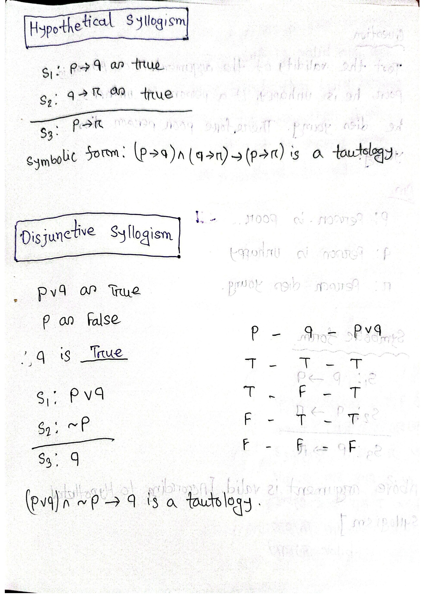

[← Previous: DM-3.8 Normal Forms and Functional Completeness](DM-3.8_Normal_Forms_and_Functional_Completeness.md) | [🏠 Index](00_Index.md) | [Next: DM-3 Lower-a: Validity, Equivalence, Translation →](DM-3_Lower_a_Validity_Equivalence_Translation.md)

---

# DM-3.9: Rules of Inference and Valid Arguments
> **Section:** B (Discrete Mathematics) | **Priority:** 🔴 | **Exam Frequency:** 2/3 DM papers (2022, 2023)
> **Sources:** Rosen §1.6 (pp. 47–58), Fahad Notes Class-16, Raidah Notes §4, Shishir Notes §10–11

## Why This Topic Matters

This is the payoff file of the logic block. Once you can classify a formula as a tautology you can turn that classification into a derivation, and a derivation is how you prove things. 2023 gave two consecutive parts on it: the four classical rules with truth tables, then a four-premise deduction built from them. Learn the eight rules by heart and the second kind becomes a mechanical chase.

---

## 📝 Key Definitions

> **Argument:** "An **argument** in propositional logic is a sequence of propositions. All but the final proposition in the argument are called **premises** and the final proposition is called the **conclusion**. An argument is **valid** if the truth of all its premises implies that the conclusion is true." — Rosen, §1.6, Definition 1 (p. 47)

> **Argument form:** "An **argument form** in propositional logic is a sequence of compound propositions involving propositional variables. An argument form is **valid** no matter which particular propositions are substituted for the propositional variables in its premises, the conclusion is true if the premises are all true." — Rosen, §1.6, Definition 1 (p. 47)

> **The criterion:** "From the definition of a valid argument form we see that the argument form with premises $p_1, p_2, \dots, p_n$ and conclusion $q$ is valid, when $(p_1 \wedge p_2 \wedge \dots \wedge p_n) \to q$ is a tautology." — Rosen, §1.6 (p. 47)

> **Modus ponens:** "The tautology $(p \wedge (p \to q)) \to q$ is the basis of the rule of inference called **modus ponens**, or the **law of detachment**. (Modus ponens is Latin for mode that affirms.)" — Rosen, §1.6 (p. 47)

> **Why rules exist at all:** "when an argument form involves 10 different propositional variables, to use a truth table to show this argument form is valid requires $2^{10} = 1024$ different rows. Fortunately, we do not have to resort to truth tables. Instead, we can first establish the validity of some relatively simple argument forms, called **rules of inference**." — Rosen, §1.6 (p. 47)

---

## Arguments and Validity

An **argument** is a sequence of statements. All but the last are **premises**; the last is the **conclusion**. It is **valid** when the truth of all the premises guarantees the truth of the conclusion.

$$
\begin{array}{cl}
S_1: & p \to q \\
S_2: & p \\
\hline
\therefore \; & q
\end{array}
$$

$$
(p \to q) \land p \to q
$$

**Validity is about the form, not about any particular conclusion.** The truth table checks the form. That is why the same eight rules work on sensors, fuses, swimmers and switches alike.

> [!WARNING] Valid form does not mean true conclusion
> A valid argument can have a false conclusion if one of its premises is false. "If $\sqrt2 > 3/2$ then $(\sqrt2)^2 > (3/2)^2$. We know $\sqrt2 > 3/2$." The form is valid by modus ponens, but the first premise is false and the conclusion is false too, since $2 < 9/4$.
>
> So write "the conclusion **follows** from the premises", not "the conclusion is true".

---

## The Master Reference Table

These eight rules are the whole toolkit. Every one is a tautology.

| Rule | Premises and conclusion | Tautology form | Name |
| :-- | :-- | :-- | :-- |
| **MP** | $p \to q,\ p \ \therefore\ q$ | $(p \land (p \to q)) \to q$ | Modus ponens, law of detachment |
| **MT** | $p \to q,\ \neg q \ \therefore\ \neg p$ | $(p \to q) \land \neg q \to \neg p$ | Modus tollens, contraposition |
| **HS** | $p \to q,\ q \to r \ \therefore\ p \to r$ | $((p \to q) \land (q \to r)) \to (p \to r)$ | Hypothetical syllogism, chaining |
| **DS** | $p \lor q,\ \neg p \ \therefore\ q$ | $(p \lor q) \land \neg p \to q$ | Disjunctive syllogism, elimination |
| **Add** | $p \ \therefore\ p \lor q$ | $p \to (p \lor q)$ | Addition |
| **Simp** | $p \land q \ \therefore\ p$ | $(p \land q) \to p$ | Simplification |
| **Conj** | $p,\ q \ \therefore\ p \land q$ | $p \land q \to (p \land q)$ | Conjunction |
| **Res** | $p \lor q,\ \neg p \lor r \ \therefore\ q \lor r$ | $((p \lor q) \land (\neg p \lor r)) \to (q \lor r)$ | Resolution |

> [!NOTE] Resolution is the one automated provers use
> Everything else in the table is single-step on a connective. Resolution combines two **clauses** of CNF and is the single engine behind automated theorem proving, which is exactly why [DM-3.8](DM-3.8_Normal_Forms_and_Functional_Completeness.md) spends time on normal forms.

---

## The Four Classical Rules, One at a Time

### 1. Modus ponens (MP), affirming the antecedent

$$
p \to q, \quad p \ \therefore\ q
$$

| $p$ | $q$ | $p \to q$ | Premises both true | Conclusion $q$ |
| :-: | :-: | :-: | :-: | :-: |
| F | F | T | antecedent false | F |
| F | T | T | antecedent false | T |
| T | F | F | no | |
| T | T | T | **yes** | **T** ✓ |

Whenever both premises hold, so does the conclusion. Valid.

**Example.** "If the switch is closed the lamp is lit." The switch is closed. Therefore the lamp is lit.

### 2. Modus tollens (MT), denying the consequent

$$
p \to q, \quad \neg q \ \therefore\ \neg p
$$

| $p$ | $q$ | $p \to q$ | $\neg q$ | Both true | Conclusion $\neg p$ |
| :-: | :-: | :-: | :-: | :-: | :-: |
| F | F | T | T | **yes** | T ✓ |
| F | T | T | F | no | |
| T | F | F | T | no | |
| T | T | T | F | no | |

Valid. MT is the contrapositive rule, since $p \to q \equiv \neg q \to \neg p$.

**Example.** "If the fuse has blown the lamp is dark." The lamp is not dark. Therefore the fuse has not blown.

### 3. Hypothetical syllogism (HS), chaining

$$
p \to q, \quad q \to r \ \therefore\ p \to r
$$

| $p$ | $q$ | $r$ | $p \to q$ | $q \to r$ | $p \to r$ |
| :-: | :-: | :-: | :-: | :-: | :-: |
| F | F | F | T | T | T |
| F | F | T | T | T | T |
| F | T | F | T | F | T |
| F | T | T | T | T | T |
| T | F | F | F | T | F |
| T | F | T | F | T | T |
| T | T | F | T | F | F |
| T | T | T | T | T | T |

Whenever both premises are T, so is $p \to r$. Valid.

**Example.** "If it rains the ground is wet. If the ground is wet the crop grows." Therefore if it rains the crop grows.

### 4. Disjunctive syllogism (DS), eliminating by negation

$$
p \lor q, \quad \neg p \ \therefore\ q
$$

| $p$ | $q$ | $p \lor q$ | $\neg p$ | Both true | Conclusion $q$ |
| :-: | :-: | :-: | :-: | :-: | :-: |
| F | F | F | T | no | |
| F | T | T | T | **yes** | T ✓ |
| T | F | T | F | no | |
| T | T | T | F | no | |

Valid.

**Example.** "The input is 0 or 1." The input is not 0. Therefore the input is 1.

---

## Summary and Comparison

| Rule | Form | Name | Uses |
| :-- | :-- | :-- | :-- |
| MP | $p \to q,\ p \therefore q$ | Affirming the antecedent | Forward chaining |
| MT | $p \to q,\ \neg q \therefore \neg p$ | Denying the consequent, that is contraposition | Backward chaining |
| HS | $p \to q,\ q \to r \therefore p \to r$ | Transitivity | Chaining rules |
| DS | $p \lor q,\ \neg p \therefore q$ | Elimination | Splitting a case |

## The Invalid Forms

| Form | Status | Why it fails |
| :-- | :-- | :-- |
| $p \to q,\ q \therefore p$ | **Invalid**, fallacy of affirming the consequent | Counterexample: $p = F, q = T$. Premises $(F \to T) = T$ and $q = T$ are true, but conclusion $p = F$ is false. |
| $p \to q,\ \neg p \therefore \neg q$ | **Invalid**, fallacy of denying the antecedent | Counterexample: $p = F, q = T$. Premises $(F \to T) = T$ and $\neg p = T$ are true, but conclusion $\neg q = F$ is false. |

Both are the *converse* and *inverse* of a conditional, and a conditional is not equivalent to its converse or its inverse. It is equivalent only to its **contrapositive** $\neg q \to \neg p$, which is what MT uses.

$$
\boxed{\text{MP, MT, HS, DS are valid; affirming the consequent and denying the antecedent are not}}
$$

> [!warning] The converse trap, worked out
> "If the switch is closed, the lamp is lit" does **not** let you conclude "the lamp is lit, so the switch is closed". The lamp can be lit by a second switch, by a battery, or by daylight through the window. The lamp being lit is *consistent* with the switch being closed; it does not *entail* it.
>
> The general form: $p \to q$ gives you one direction only. Forward from $p$ you may conclude $q$. Backward from $q$ you may conclude nothing about $p$ except via the contrapositive, which requires $\neg q$ and gives you $\neg p$, not $p$.
>
> **How to spot it in a proof.** If you ever find yourself concluding $p$ from $q$ using a conditional, stop. Either you used MT and negated something you should not have, or you have slipped into affirming the consequent.

> [!note] HS needs the matching middle term
> Hypothetical syllogism only works because the two conditionals share $q$. Given $p \to q$ and $r \to q$, you cannot conclude $p \to r$. The chain has to be $p \to q \to r$ with the same statement in the middle, and it is worth reading the chain aloud to check that it is.

---

## Building a Multi-Premise Argument

The standard notation writes each step in a numbered row with the rule that produced it in the right-hand column.

### The method

**Step 1. Assign variables** to every noun phrase in the problem. Write the table.

**Step 2. Translate each premise.** Watch "only if", "unless" and "but". Every premise becomes one line.

**Step 3. Split conjunctions** by simplification. A premise written as $A \land B$ gives you $A$ and gives you $B$, both free.

**Step 4. Work backwards from the goal.** Find which rule produces the target statement. That rule needs one or two inputs. Chase each one until it lands on a premise or on something already derived. This is the whole trick.

**Step 5. Write the table**, one row per step, with the rule named.

**Step 6. Check** that no premise was used twice and no rule was applied to a statement that does not supply what it needs.

> [!TIP] Read the chain as one line of arrows before you write the table
> A chain that will not compress into a single line usually has a step that does not follow, and that is much easier to spot in one line than in a numbered table.

---

## Worked Example (PYQ 2023)

> **Source:** 2023 Q.6(c) [Marks: 04]

**Question.** With these hypotheses: "It is not sunny this afternoon and it is colder than yesterday." "We will go swimming only if it is sunny." "If we do not swimming, then we will take a canoe trip." "If we take a canoe trip then we will be home by sunset." Using the inference rules, construct a valid argument for the conclusion: "we will be home by sunset".

**Answer.**

**Assign variables.**

| Symbol | Meaning |
| :-- | :-- |
| $S$ | it is sunny this afternoon |
| $C$ | it is colder than yesterday |
| $W$ | we go swimming |
| $K$ | we take a canoe trip |
| $H$ | we are home by sunset |

**Translate the four hypotheses.**

1. "It is not sunny this afternoon **and** it is colder than yesterday":
   $\neg S \land C$
2. "We will go swimming **only if** it is sunny". The phrase "only if" means
   swimming is a **necessary** condition of sunshine, so $W \to S$:
   $W \to S$
3. "If we do not swim, then we will take a canoe trip": $\neg W \to K$
4. "If we take a canoe trip then we will be home by sunset": $K \to H$

**Extract what is needed.** Split hypothesis 1 by simplification: $\neg S$ and
$C$. The proof needs only $\neg S$.

The goal is $H$, so work backwards from the rule that produces it. Rule 4 needs
$K$, and rule 3 needs $\neg W$, and that comes from $S$ by modus tollens on
rule 2.

**The valid argument, step by step.**

| Step | Statement | Rule |
| ---: | :-- | :-- |
| 1 | $\neg S \land C$ | Premise 1 |
| 2 | $\neg S$ | Simplification, 1 |
| 3 | $W \to S$ | Premise 2 |
| 4 | $\neg W$ | Modus tollens, 3 and 2 |
| 5 | $\neg W \to K$ | Premise 3 |
| 6 | $K$ | Modus ponens, 5 and 4 |
| 7 | $K \to H$ | Premise 4 |
| 8 | $H$ | Modus ponens, 7 and 6 |

Therefore, "we will be home by sunset" is a **valid conclusion**.

$$
\boxed{\neg S \Rightarrow \neg W \Rightarrow K \Rightarrow H, \quad \text{so } H \text{ follows validly}}
$$

> [!warning] The traps in this question
> **"Only if" is not "if".** "We will go swimming only if it is sunny" is
> $W \to S$, **not** $S \to W$. Reading it backwards inverts the conditional and
> breaks the whole proof. If it had been read as $S \to W$, step 4 could not be
> derived, since $\neg S$ carries no information about $W$.
>
> **Hypothesis 1 is a conjunction.** It provides $\neg S$ by simplification. It
> is tempting to treat "not sunny and colder" as one unit and hunt for a rule
> that accepts it. Split it first.
>
> **The fact that $C$ is never used is not a mistake.** The problem gives four
> premises but the conclusion needs three. The fourth, $C$, is surplus.

---

## 🏆 Golden Questions (Past Exam Archive)

### 🎯 Briefly explain modus ponens, modus tollens, hypothetical syllogism, disjunctive syllogism with truth tables and examples.
> **Appeared:** 2023 Q.6(b) — (04 marks)

**Full Answer:**

All four are inference rules. Each is a valid argument form, meaning the
conclusion is true whenever the premises are true.

---

**1. Modus ponens (MP), affirming the antecedent**

$$
p \to q, \quad p \ \therefore\ q
$$

| $p$ | $q$ | $p \to q$ | Premises both true | Conclusion $q$ |
| :-: | :-: | :-: | :-: | :-: |
| F | F | T | antecedent false | F |
| F | T | T | antecedent false | T |
| T | F | F | no | |
| T | T | T | **yes** | **T** ✓ |

Whenever both premises hold, so does the conclusion. Valid.

**Example.** "If the switch is closed the lamp is lit." The switch is closed.
Therefore the lamp is lit.

---

**2. Modus tollens (MT), denying the consequent**

$$
p \to q, \quad \neg q \ \therefore\ \neg p
$$

| $p$ | $q$ | $p \to q$ | $\neg q$ | Both true | Conclusion $\neg p$ |
| :-: | :-: | :-: | :-: | :-: | :-: |
| F | F | T | T | **yes** | T ✓ |
| F | T | T | F | no | |
| T | F | F | T | no | |
| T | T | T | F | no | |

Valid. MT is the contrapositive rule, since $p \to q \equiv \neg q \to \neg p$.

**Example.** "If the fuse has blown the lamp is dark." The lamp is not dark.
Therefore the fuse has not blown.

---

**3. Hypothetical syllogism (HS), chaining**

$$
p \to q, \quad q \to r \ \therefore\ p \to r
$$

| $p$ | $q$ | $r$ | $p \to q$ | $q \to r$ | $p \to r$ |
| :-: | :-: | :-: | :-: | :-: | :-: |
| F | F | F | T | T | T |
| F | F | T | T | T | T |
| F | T | F | T | F | T |
| F | T | T | T | T | T |
| T | F | F | F | T | F |
| T | F | T | F | T | T |
| T | T | F | T | F | F |
| T | T | T | T | T | T |

Whenever both premises are T, so is $p \to r$. Valid.

**Example.** "If it rains the ground is wet. If the ground is wet the crop grows."
Therefore if it rains the crop grows.

---

**4. Disjunctive syllogism (DS), eliminating by negation**

$$
p \lor q, \quad \neg p \ \therefore\ q
$$

| $p$ | $q$ | $p \lor q$ | $\neg p$ | Both true | Conclusion $q$ |
| :-: | :-: | :-: | :-: | :-: | :-: |
| F | F | F | T | no | |
| F | T | T | T | **yes** | T ✓ |
| T | F | T | F | no | |
| T | T | T | F | no | |

Valid.

**Example.** "The input is 0 or 1." The input is not 0. Therefore the input is 1.

---

**Summary and comparison**

| Rule | Form | Name | Uses |
| :-- | :-- | :-- | :-- |
| MP | $p \to q,\ p \therefore q$ | Affirming the antecedent | Forward chaining |
| MT | $p \to q,\ \neg q \therefore \neg p$ | Denying the consequent, that is contraposition | Backward chaining |
| HS | $p \to q,\ q \to r \therefore p \to r$ | Transitivity | Chaining rules |
| DS | $p \lor q,\ \neg p \therefore q$ | Elimination | Splitting a case |

**The invalid forms**

| Form | Status | Why it fails |
| :-- | :-- | :-- |
| $p \to q,\ q \therefore p$ | **Invalid** (Fallacy of affirming the consequent) | Counterexample: $p = F, q = T$. Premises $(F \to T) = T$ and $q = T$ are true, but conclusion $p = F$ is false. |
| $p \to q,\ \neg p \therefore \neg q$ | **Invalid** (Fallacy of denying the antecedent) | Counterexample: $p = F, q = T$. Premises $(F \to T) = T$ and $\neg p = T$ are true, but conclusion $\neg q = F$ is false. |

Both are the *converse* and *inverse* of a conditional, and a conditional is not
equivalent to its converse or its inverse. It is equivalent only to its
**contrapositive** $\neg q \to \neg p$, which is what MT uses.

$$
\boxed{\text{MP, MT, HS, DS are valid; affirming the consequent and denying the antecedent are not}}
$$

> [!warning] The converse trap, worked out
> "If the switch is closed, the lamp is lit" does **not** let you conclude "the
> lamp is lit, so the switch is closed". The lamp can be lit by a second switch,
> by a battery, or by daylight through the window. The lamp being lit is
> *consistent* with the switch being closed; it does not *entail* it.
>
> The general form of the mistake: $p \to q$ gives you one direction only. Forward
> from $p$ you may conclude $q$. Backward from $q$ you may conclude nothing about
> $p$ except via the contrapositive, which requires $\neg q$ and gives you
> $\neg p$, not $p$.
>
> **How to spot it in a proof.** If you ever find yourself concluding $p$ from
> $q$ using a conditional, stop. Either the rule you used was MT and you have
> negated something you should not have, or you have slipped into affirming the
> consequent.

> [!note] HS needs the matching middle term
> Hypothetical syllogism only works because the two conditionals share $q$. Given
> $p \to q$ and $r \to q$, you cannot conclude $p \to r$, and given $p \to q$ and
> $p \to r$ you cannot conclude $q \to r$. The chain has to be
> $p \to q \to r$ with the same statement in the middle, and it is worth reading
> the chain aloud to check that it is.

---

### 🎯 Using the inference rules, construct a valid argument for the conclusion "we will be home by sunset".
> **Appeared:** 2023 Q.6(c) — (04 marks)

**Full Answer:**

**Assign variables.**

| Symbol | Meaning |
| :-- | :-- |
| $S$ | it is sunny this afternoon |
| $C$ | it is colder than yesterday |
| $W$ | we go swimming |
| $K$ | we take a canoe trip |
| $H$ | we are home by sunset |

**Translate the four hypotheses.**

1. "It is not sunny this afternoon **and** it is colder than yesterday":
   $\neg S \land C$
2. "We will go swimming **only if** it is sunny". The phrase "only if" means
   swimming is a **necessary** condition of sunshine, so $W \to S$:
   $W \to S$
3. "If we do not swim, then we will take a canoe trip": $\neg W \to K$
4. "If we take a canoe trip then we will be home by sunset": $K \to H$

**Extract what is needed.** Split hypothesis 1 by simplification to get $\neg S$
and $C$. The proof needs only $\neg S$.

The goal is $H$, so work backwards from the rule that produces it. Rule 4 needs
$K$, rule 3 needs $\neg W$, and $\neg W$ comes from $S$ by modus tollens on rule
2.

**The valid argument, step by step.**

| Step | Statement | Rule |
| ---: | :-- | :-- |
| 1 | $\neg S \land C$ | Premise 1 |
| 2 | $\neg S$ | Simplification, 1 |
| 3 | $W \to S$ | Premise 2 |
| 4 | $\neg W$ | Modus tollens, 3 and 2 |
| 5 | $\neg W \to K$ | Premise 3 |
| 6 | $K$ | Modus ponens, 5 and 4 |
| 7 | $K \to H$ | Premise 4 |
| 8 | $H$ | Modus ponens, 7 and 6 |

Therefore "we will be home by sunset" is a **valid conclusion**.

$$
\boxed{\neg S \Rightarrow \neg W \Rightarrow K \Rightarrow H, \quad \text{so } H \text{ follows validly}}
$$

> [!warning] The traps in this question
> **"Only if" is not "if".** "We will go swimming only if it is sunny" is
> $W \to S$, **not** $S \to W$. Reading it backwards inverts the conditional and
> breaks the whole proof. If it had been read as $S \to W$, step 4 could not be
> derived, since $\neg S$ carries no information about $W$.
>
> The general form of the trap: "A **only if** B" gives $A \to B$, while "A
> **if** B" gives $B \to A$. The word order in English puts the *antecedent* in
> the "if" clause and the *consequent* in the "only if" clause, so read the phrase
> and identify which letter appears where before writing the arrow.
>
> **Hypothesis 1 is a conjunction.** It provides $\neg S$ by simplification. It
> is tempting to treat "not sunny and colder" as one unit and hunt for a rule that
> accepts it. Split it first.
>
> **$C$ is never used, and that is not a mistake.** The problem gives four
> premises but the conclusion needs three. The fourth, $C$, is surplus. Do not go
> looking for a way to involve it; a valid argument may use fewer premises than
> are supplied.

> [!note] The whole argument as one chain
> $$
> \underbrace{W \to S}_{\text{premise 2}},\ \underbrace{\neg S}_{\text{premise 1}} \vdash \underbrace{\neg W}_{\text{MT}} \vdash \underbrace{K}_{\text{MP}} \vdash \underbrace{H}_{\text{MP}}
> $$
> Each arrow uses a different rule, and each premise is consumed exactly once. No
> premise appears twice and no rule is applied to a statement that does not supply
> what it needs, so the derivation is sound.
>
> Reading the chain in one line is a good habit for longer arguments. A chain that
> will not compress into a single line of arrows usually has a step that does not
> follow, and that is much easier to spot in one line than in a numbered table.

---

## Two More Worked Derivations from the Class Notes

These are the shapes most likely to appear as an unseen variant.

### Example A, show $[p \land (p \to q)] \to q$ is a valid argument

| Step | Statement | Rule |
| ---: | :-- | :-- |
| 1 | $p \land (p \to q)$ | Hypothesis |
| 2 | $p$ | Simplification, 1 |
| 3 | $p \to q$ | Simplification, 1 |
| 4 | $q$ | Modus ponens, 2 and 3 |

Note that step 1 was used twice. That is fine. A premise may be split by simplification any number of times.

### Example B, name the rule used in each argument

"It is below freezing now. Therefore, it is either below freezing or raining now." With $p$: it is below freezing, $q$: it is raining.

$$
p \ \therefore\ p \lor q
$$

**Addition.** The same shape, "It is below freezing and raining now. Therefore it is below freezing now", is **Simplification**.

"If it rains today then we will not have a barbecue today. If we do not have a barbecue today then we will have a barbecue tomorrow. Therefore if it rains today then we will have a barbecue tomorrow" is **Hypothetical syllogism**.

---

## Exam Variants

| Year | Question | Task | Key Answer |
| :--- | :--- | :--- | :--- |
| 2023 Q.6(b) | Explain MP, MT, HS, DS with truth tables and examples | four rules, four tables, four examples | $\boxed{\text{MP, MT, HS, DS are valid; affirming the consequent and denying the antecedent are not}}$ |
| 2023 Q.6(c) | Four hypotheses, prove a conclusion | 8-step formal derivation | $\boxed{\neg S \Rightarrow \neg W \Rightarrow K \Rightarrow H, \quad \text{so } H \text{ follows validly}}$ |

---

## ⚡ Exam Tips & Common Mistakes

1. **Write the variable table first.** Every deduction question starts with one, and it takes thirty seconds and prevents every polarity error afterwards.
2. **"A only if B" is $A \to B$.** "A if B" is $B \to A$. Read the English clause by clause before drawing the arrow.
3. **Split conjunctive premises immediately.** A premise of the form $A \land B$ is two usable premises, not one.
4. **Work backwards from the goal.** Find the rule that produces the target, then chase its inputs. Starting forwards wastes steps.
5. **An unused premise is not a mistake.** Problems give surplus information. Never force a premise into the proof.
6. **Never conclude $p$ from $q$ using a conditional.** That is affirming the consequent. If you catch yourself doing it, the rule you actually needed was MT, and you have the sign wrong.
7. **Name the rule in every row.** "By MP" or "Modus ponens, 5 and 4" costs nothing and is worth marks on every derivation question.
8. **Check the middle term of every HS.** The two conditionals must share the same statement.

## 🔗 Related Topics

- [DM-3.2: Logical Connectives and Truth Tables](DM-3.2_Logical_Connectives_and_Truth_Tables.md) — the $p \to q$ table that makes modus ponens work
- [DM-3.3: Tautology, Contradiction, Contingency](DM-3.3_Tautology_Contradiction_Contingency.md) — every rule of inference is one of its tautologies
- [DM-3.8: Normal Forms and Functional Completeness](DM-3.8_Normal_Forms_and_Functional_Completeness.md) — resolution reads the CNF built there
- [DM-3_Lower_a: Validity, Equivalence, Translation](DM-3_Lower_a_Validity_Equivalence_Translation.md) — next in the chain, where the "unless" and "only if" traps are handled in full

---

[← Previous: DM-3.8 Normal Forms and Functional Completeness](DM-3.8_Normal_Forms_and_Functional_Completeness.md) | [🏠 Index](00_Index.md) | [Next: DM-3 Lower-a: Validity, Equivalence, Translation →](DM-3_Lower_a_Validity_Equivalence_Translation.md)
