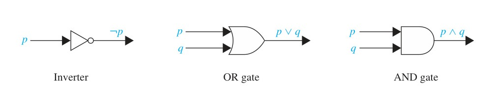

[← Previous: DM-3 Lower-a: Validity, Equivalence, Translation](DM-3_Lower_a_Validity_Equivalence_Translation.md) | [🏠 Index](00_Index.md) | [Next: DM-5.4: Modular Arithmetic and Congruence →](DM-5.4_Modular_Arithmetic_and_Congruence.md)

---

# DM-3 Lower-b: Puzzles, Gates, Extensions
> **Section:** B (Discrete Mathematics) | **Priority:** 🟠🟡 (mixed) | **Exam Frequency:** 5 questions across 2022–2023
> **Subtopics:** DM-3.10 (Logic Puzzles), DM-3.11 (Logic Gates and Digital Circuits), DM-3.13 (Logic Extensions)
> **Sources:** Rosen §1.2 (pp. 19–22, Examples 7–10), Rosen §1.6 Example 26, Fahad Notes Class-14, Raidah Notes §3, Shishir Notes §6, §12

## Why This Topic Matters

This file takes propositional logic and points it at the real world. A logic puzzle is satisfiability with a story attached. A digital circuit is the same formula drawn with gates instead of symbols. Fuzzy logic is what happens when you refuse to accept only T and F. All three have appeared, 2022 gave two of them, 2023 gave two more.

---

## 📝 Key Definitions

> **Logic puzzle:** "Puzzles that can be solved using logical reasoning are known as **logic puzzles**. Solving logic puzzles is an excellent way to practice working with the rules of logic." — Rosen, §1.2, Logic Puzzles (p. 19)

> **Knights and knaves:** "In [Sm78] Smullyan posed many puzzles about an island that has two kinds of inhabitants, knights, who always tell the truth, and their opposites, knaves, who always lie." — Rosen, §1.2, Example 7 (p. 19)

> **The three-type variant:** "In Exercises 24–31 we introduce related puzzles where we have three types of people, knights and knaves as in this puzzle together with spies who can lie." — Rosen, §1.2 (p. 19)

> **Logic circuit:** "A **logic circuit** (or **digital circuit**) receives input signals $p_1, p_2, \dots, p_n$, each a bit [either 0 (off) or 1 (on)], and produces output signals $s_1, s_2, \dots, s_n$, each a bit." — Rosen, §1.2, Logic Circuits (p. 20)

> **The three gates:** "The **inverter**, or **NOT gate**, takes an input bit $p$, and produces as output $\neg p$. The **OR gate** takes two input signals $p$ and $q$, each a bit, and produces as output the signal $p \vee q$. The **AND gate** takes two input signals $p$ and $q$, each a bit, and produces as output the signal $p \wedge q$." — Rosen, §1.2, Logic Circuits (p. 21)

> **Every circuit is buildable:** "Suppose that we have a formula for the output of a digital circuit in terms of negations, disjunctions, and conjunctions. Then, we can systematically build a digital circuit with the desired output." — Rosen, §1.2 (p. 21)

> **[paraphrased] Fuzzy logic:** "a logic in which propositions are assigned truth values in $[0, 1]$, with 1 meaning completely true, 0 meaning completely false, and intermediate values expressing degrees of truth. Fuzzy conjunction takes the minimum of the truth values, fuzzy disjunction takes the maximum, and fuzzy negation is $T(\neg P) = 1 - T(P)$." — [paraphrased] from Rosen §1.2, Fuzzy Logic (p. 23). The digitized class notes give the three operations as $T(A \wedge B) = \min(T(A), T(B))$, $T(A \vee B) = \max(T(A), T(B))$ and $T(\neg A) = 1 - T(A)$.

---

## DM-3.10: Logic Puzzles

### Three puzzle families and how each is solved

| Family | Structure | Method |
| :-- | :-- | :-- |
| **Knights and knaves** | 2 types, knights true, knaves false | force values from the self-referential statements |
| **Knights, knaves, spies** | 3 types, all different, spy unconstrained | enumerate all $3! = 6$ assignments |
| **Sorites (Lewis Carroll)** | predicates with natural-language opposites | contraposition plus hypothetical syllogism |

### Knights, knaves and spies: the one rule that solves half of them

**Nobody but a spy can say "I am the knave."**

- A knight cannot, because it is false and knights say only truth.
- A knave cannot, because it is true and knaves say only falsehood.

So the sentence "I am the knave" identifies a spy with certainty. In 2022 Q.6(ii), all three people say it. Since only one is a spy, at least two are knights or knaves, and both contradict themselves. No solution.

> [!TIP] Enumerate, do not reason
> With three types and three people the search space is $3! = 6$. Write all six rows in a table with one column per statement plus a verdict column. Exhaustive enumeration cannot miss a case, so the answer is provably unique.

### Worked Example (PYQ 2022 Q.6(a))

> **Source:** 2022 Q.6(a)

**Question.** Knights always tell the truth, Knaves always lie, Spies can either. Three people A, B and C, one of each type, each knows the types of the other two. (i) A says "C is the Knave", B says "A is the Knight", C says "I am the spy". (ii) A says "I am the Knave", B says "I am the Knave", C says "I am the Knave". Determine whether there is a unique solution.

**Method.** A knight's every statement is true. A knave's every statement is false. A spy is unconstrained. Each of A, B and C may be any of the three types, and the three types are all different, so there are only $3! = 6$ assignments to test.

**Rule stated first.** Nobody can truthfully say "I am the knave", because a knave is by definition not a knave. Nobody can falsely say "I am the knave" either, because that statement would be true for a knave. Therefore **only a spy can say "I am the knave"**, and a knight or knave saying it is an immediate contradiction.

---

**(i) A says "C is the Knave." B says "A is the Knight." C says "I am the spy."**

Test all six assignments. The three statements are true when, respectively, $C$ is the knave, $A$ is the knight, and $C$ is the spy.

| Assignment | A's statement | B's statement | C's statement | Verdict |
| :-- | :-- | :-- | :-- | :-- |
| A=K, B=N, C=S | false (C is a spy, not a knave) | true | true | **A is a knight but lies. Out.** |
| A=K, B=S, C=N | true | true | false | **Consistent.** |
| A=N, B=K, C=S | false | false | true | **B is a knight but lies. Out.** |
| A=N, B=S, C=K | false | false | false | **C is a knight but lies. Out.** |
| A=S, B=K, C=N | true | false | false | **B is a knight but lies. Out.** |
| A=S, B=N, C=K | false | true | false | **C is a knight but lies. Out.** |

Exactly one row survives, so **the solution is unique**:

$$
\boxed{\text{(i) A = Knight, B = Spy, C = Knave}}
$$

**Verification.** A, a knight, says C is the knave: true, since $C$ is the knave. B, a spy, says A is the knight: true, and a spy may tell the truth. C, a knave, says "I am the spy": false, since $C$ is the knave. All consistent.

---

**(ii) A says "I am the Knave." B says "I am the Knave." C says "I am the Knave."**

| Assignment | A's statement | B's statement | C's statement | Verdict |
| :-- | :-- | :-- | :-- | :-- |
| A=K, B=N, C=S | false | true | false | A is a knight but lies. Out. |
| A=K, B=S, C=N | false | false | true | A is a knight but lies. Out. |
| A=N, B=K, C=S | true | false | false | A is a knave but tells the truth. Out. |
| A=N, B=S, C=K | true | false | false | A is a knave but tells the truth. Out. |
| A=S, B=K, C=N | false | false | true | B is a knight but lies. Out. |
| A=S, B=N, C=K | false | true | true | B is a knave but tells the truth. Out. |

**Every row is eliminated.**

$$
\boxed{\text{(ii) There is NO solution}}
$$

**Reason, without the table.** From the rule above, "I am the knave" can only be said by a spy. All three of A, B and C say it. Since exactly one of the three is a spy, at least two are knights or knaves, and each of those contradicts what they said. A puzzle in which every person utters a sentence only one of them may utter is a contradiction in three.

> [!note] The difference between the two parts
> In (i) the three statements refer to **different** people, so one true statement can be pinned on the spy and the remaining two can be assigned to a knight and a knave consistently. In (ii) all three statements are the same self-referential claim, and no assignment survives. This is the standard way to show a knights-and-knaves puzzle has no solution: put everyone in the same corner and no consistent assignment remains.

---

### Worked Example (PYQ 2023 Q.5(b))

> **Source:** 2023 Q.5(b)

**Question.** Four friends have been identified as suspects for an unauthorized access into a computer system. Alice said "Carlos did it." John said "I did not do it." Carlos said "Diana did it." Diana said "Carlos lied when he said that I did it." (i) If exactly one of the four suspects is telling the truth, who did it? (ii) If exactly one is lying, who did it?

**Translate the statements.** The four suspects are mutually exclusive, so exactly one of them did it. Let the culprit be one of $A, J, C, D$.

| Statement | True when |
| :-- | :-- |
| $S_A$: "Carlos did it" | culprit $= C$ |
| $S_J$: "I did not do it" | culprit $\ne J$ |
| $S_C$: "Diana did it" | culprit $= D$ |
| $S_D$: "Carlos lied when he said I did it" | Carlos's claim was false, that is culprit $\ne D$ |

Note that $S_C$ and $S_D$ are exact negations of each other, so **exactly one of them is always true**. This observation drives both parts.

**(i) Exactly one telling the truth**

| Culprit | $S_A$ | $S_J$ | $S_C$ | $S_D$ | True count |
| :-- | :-: | :-: | :-: | :-: | --: |
| A | F | T | F | T | 2 |
| J | F | F | F | T | **1** |
| C | T | T | F | T | 3 |
| D | F | T | T | F | 2 |

Only one row gives a count of 1.

$$
\boxed{\text{(i) John did it}}
$$

**Reasoning without a table.** Since $S_C$ and $S_D$ are negations, one of them must be true, so the single truth must be one of those two, and both Alice and John must be lying. John lying means "I did not do it" is false, so John did it. Check: John lying, Carlos lying (Diana did not do it), Alice lying (Carlos did not do it), Diana telling the truth (Carlos's claim was false). Exactly one truth.

**(ii) Exactly one lying**

Equivalently, exactly three telling the truth. The same table, reading the false count:

| Culprit | $S_A$ | $S_J$ | $S_C$ | $S_D$ | Lying count |
| :-- | :-: | :-: | :-: | :-: | --: |
| A | F | T | F | T | 2 |
| J | F | F | F | T | 3 |
| C | T | T | F | T | **1** |
| D | F | T | T | F | 2 |

Only one row gives a lying count of 1.

$$
\boxed{\text{(ii) Carlos did it}}
$$

**Reasoning without a table.** Exactly one lying means Alice and Diana are both telling the truth, since they cannot both lie. Alice true gives culprit $= C$. Then John says "I did not do it", which is true since Carlos did it, and Carlos says "Diana did it", which is false. Exactly one lie, Carlos's.

> [!warning] The two parts give different answers, and that is intended
> Part (i) says one true, part (ii) says one false, which means three true. These are very different conditions and they cannot both hold at once. Students who expect the same culprit in both parts have misread one of them.

> [!INFO] The trick behind this question
> Two suspects make contradictory statements ($S_C$ and $S_D$). Whenever you spot a contradiction pair, you know exactly one of them is true no matter who the culprit is. That single fact turns a sixteen-case enumeration into a two-line argument.

---

### Worked Example (PYQ 2022 Q.5(d))

> **Source:** 2022 Q.5(d)

**Question.** Consider these statements, of which the first three are premises and the fourth is a valid conclusion. "All humming are richly colored." "No large birds live on honey." "Birds that do not live on honey are dull in order." Conclusion: "Humming birds are small."

> [!note] Origin and text correction
> This is the classic Lewis Carroll sorites puzzle printed in Kenneth Rosen (*Discrete Mathematics and Its Applications*, §1.6, Example 26).
> - "All humming [birds]" has the noun omitted in the paper.
> - "dull in order" is a typographical error for "dull in colour".

**Step 1. Define predicates.** Let the universe of discourse be the set of all birds. Natural language opposites in Lewis Carroll's logic puzzles represent complementary predicates:
- $P(x)$: $x$ is a hummingbird
- $Q(x)$: $x$ is large, so $\neg Q(x)$: $x$ is small ("not large")
- $R(x)$: $x$ lives on honey, so $\neg R(x)$: $x$ does not live on honey
- $S(x)$: $x$ is richly coloured, so $\neg S(x)$: $x$ is dull in colour ("not richly coloured")

**Step 2. Formalise premises and conclusion.**
- Premise 1 ($P_1$): $\forall x\, (P(x) \to S(x))$
- Premise 2 ($P_2$): $\forall x\, (Q(x) \to \neg R(x))$
- Premise 3 ($P_3$): $\forall x\, (\neg R(x) \to \neg S(x))$
- Conclusion ($C$): $\forall x\, (P(x) \to \neg Q(x))$

**Step 3. Formal deduction via rules of inference.**
Let $c$ be an arbitrary bird in the domain:

1. $P(c) \to S(c)$ — Premise 1, Universal Instantiation
2. $\neg R(c) \to \neg S(c)$ — Premise 3, Universal Instantiation
3. $S(c) \to R(c)$ — Contrapositive of (2)
4. $P(c) \to R(c)$ — Hypothetical Syllogism from (1) and (3)
5. $Q(c) \to \neg R(c)$ — Premise 2, Universal Instantiation
6. $R(c) \to \neg Q(c)$ — Contrapositive of (5)
7. $P(c) \to \neg Q(c)$ — Hypothetical Syllogism from (4) and (6)
8. $\forall x\, (P(x) \to \neg Q(x))$ — Universal Generalization from (7)

Since $\neg Q(x)$ represents "small", the conclusion "Hummingbirds are small" follows logically.

$$
\boxed{\text{The argument is VALID via Universal Instantiation, Contraposition, and Hypothetical Syllogism}}
$$

> [!info] Semantic formalization note
> If one naively assigns 6 unrelated propositional variables $(H, R, L, N, D, S)$ without encoding the antonymic relationships $\text{Dull} \equiv \neg\text{RichlyColoured}$ and $\text{Small} \equiv \neg\text{Large}$, the connection between colour and size is severed. Under Rosen and Carroll's intended predicate formalization, recognizing these complements makes the syllogism valid.

> [!WARNING] This one is predicate logic wearing a logic costume
> The chain in steps 1 to 8 is a chain of **conditionals about a fixed object $c$**. You do not need full predicate logic. Instantiate the universal quantifiers, then apply the rules of inference from [DM-3.9](DM-3.9_Rules_of_Inference_and_Valid_Arguments.md) as if $P(c), Q(c), R(c), S(c)$ were ordinary propositional variables. They behave identically once $c$ is fixed.

---

## DM-3.11: Logic Gates and Digital Circuits

### The procedure, four steps

1. **Simplify the formula.** Fewer gates is a better answer.
2. **Count the gates** after simplification.
3. **Draw the circuit**, either ASCII or gate symbols.
4. **Verify** by comparing the simplified and original formulas over all $2^n$ rows.

### Gate count reference

| Gate | Inputs | Output | Symbol shape |
| :-- | :-- | :-- | :-- |
| NOT (inverter) | 1 | $\neg p$ | triangle with a bubble |
| AND | 2 | $p \wedge q$ | flat left, round right |
| OR | 2 | $p \vee q$ | curved left, pointed right |

### Worked Example (PYQ 2023 Q.5(a))

> **Source:** 2023 Q.5(a)

**Question.** Build a digital circuit that produces the output $(p \lor \neg r) \land (\neg p \lor (q \lor \neg r))$ when given input bits $p, q$ and $r$.

**Step 1. Simplify algebraically.** Factor $\neg r$ out of the two bracketed terms, since it appears in both:

$$
F = (p \lor \neg r) \land (\neg p \lor q \lor \neg r)
$$

Use $(a \lor c) \land (b \lor c) = (a \land b) \lor c$ with $c = \neg r$, $a = p$, $b = (\neg p \lor q)$:

$$
F = \neg r \lor \big[p \land (\neg p \lor q)\big]
$$

Distribute inside the bracket, $p \land (\neg p \lor q) = (p \land \neg p) \lor (p \land q) = 0 \lor (p \land q) = p \land q$:

$$
F = \neg r \lor (p \land q)
$$

**Step 2. Read off the circuit.**

- **Simplified form:** $F = \neg r \lor (p \land q)$
  - 1 NOT gate on $r \to \neg r$
  - 1 AND gate on $p, q \to (p \land q)$
  - 1 OR gate combining $\neg r$ and $(p \land q) \to F$
  - **Gates required:** 1 NOT, 1 AND (2-input), 1 OR (2-input) — Total: **3 gates**.

**Logic Circuit Diagram (Simplified Form):**

**Alternative: Direct (Unsimplified) Circuit:**

$$
\boxed{F = \neg r \lor (p \land q)}
$$

> [!info] Check over all eight input combinations
> Comparing the simplified form against the original on every assignment of $(p, q, r)$:
>
> | $p$ | $q$ | $r$ | Original | $\neg r \lor (p \land q)$ |
> | :-: | :-: | :-: | :-: | :-: |
> | F | F | F | T | T |
> | F | F | T | F | F |
> | F | T | F | T | T |
> | F | T | T | F | F |
> | T | F | F | T | T |
> | T | F | T | F | F |
> | T | T | F | T | T |
> | T | T | T | T | T |
>
> All eight rows agree, so the simplification is exact.
>
> Row 8 is the one to check by eye: with $r$ true, $\neg r$ is false, and the alarm fires only if both $p$ and $q$ are true. The original says $(p \lor \neg r) \land (\neg p \lor q \lor \neg r) = (T \lor F) \land (F \lor T \lor F) = T \land T = T$.

> [!note] An equivalent CNF form for a NAND-only implementation
> Applying the distributive law back,
>
> $$
> F = (\neg r \lor p) \land (\neg r \lor q)
> $$
>
> This is useful in hardware, where NAND is often the only gate available. It maps directly onto two NAND-invertor stages.

**Rosen's own circuit for the same expression.** This question is Rosen §1.2 Example 10 (p. 22), reproduced without credit in the paper. His Figure 3 builds it unsimplified, using three inverters, three OR gates and one AND gate:

| Step | Gate | Produces |
| :-: | :-- | :-- |
| 1 | inverter on $r$ | $\neg r$ |
| 2 | OR1 on $p, \neg r$ | $p \lor \neg r$ |
| 3 | inverter on $r$ (again) | $\neg r$ |
| 4 | OR2 on $q, \neg r$ | $q \lor \neg r$ |
| 5 | inverter on $p$ | $\neg p$ |
| 6 | OR3 on $\neg p$, $q \lor \neg r$ | $\neg p \lor (q \lor \neg r)$ |
| 7 | AND on the two OR outputs | $F$ |

Both circuits are correct. The simplified three-gate version is the better answer if the question asks for a minimum gate count; the Rosen version is the safer answer if the question only says "build a circuit".

### Reading a circuit backwards

Rosen's simpler worked example, Figure 2 (p. 21), outputs $(p \wedge \neg q) \vee \neg r$. Trace from the inputs: $q$ passes through an inverter to become $\neg q$; $p$ and $\neg q$ feed an AND gate giving $p \wedge \neg q$; $r$ passes through an inverter to become $\neg r$; the two results feed an OR gate. The circuit in the figure is the formula written with symbols for words. Nothing else changes.

---

## DM-3.13: Logic Extensions

### The three operations

| Classical | Fuzzy | Formula |
| :-- | :-- | :-- |
| $T(\neg P) = $ not $T(P)$ | negation | $T(\neg P) = 1 - T(P)$ |
| $T(A \wedge B)$ = both | conjunction | $T(A \wedge B) = \min(T(A), T(B))$ |
| $T(A \vee B)$ = either | disjunction | $T(A \vee B) = \max(T(A), T(B))$ |

**Where fuzzy logic earns its keep.** A statement like "the room is warm" has no sharp truth value. Classical logic forces T or F and loses the information. Fuzzy logic assigns 0.7 and keeps it.

### Worked Example (PYQ 2022 Q.5(b))

> **Source:** 2022 Q.5(b)

**Question.** The truth value of the conjunction of two propositions in fuzzy logic is the minimum of the truth values of the statements "Fred and John are happy" and "Neither Fred nor John is happy". Prove the statement.

**Setup.** Fuzzy logic assigns each proposition a truth value in $[0, 1]$, where $0$ is false and $1$ is true. Fuzzy conjunction is defined by

$$
T(A \wedge B) = \min\left(T(A),\, T(B)\right)
$$

**Assign variables.** Let

$$
h = T(\text{Fred is happy}), \qquad j = T(\text{John is happy}), \qquad 0 \le h, j \le 1
$$

**Statement A: "Fred and John are happy."** A conjunction of two, so

$$
T(A) = \min(h, j)
$$

**Statement B: "Neither Fred nor John is happy."** "Neither A nor B" expands to $\neg A \wedge \neg B$, and fuzzy negation is $T(\neg P) = 1 - T(P)$:

$$
T(B) = \min(1 - h,\; 1 - j) = 1 - \max(h, j)
$$

**Statement C: the conjunction $A \wedge B$.** By the definition of fuzzy conjunction,

$$
T(C) = \min\left(T(A), T(B)\right) = \min\left(\min(h, j),\; 1 - \max(h, j)\right)
$$

**This is exactly what the question asserts**, so the claim holds by the defining rule. Written out in full,

$$
T(C) = \min(h,\; j,\; 1 - h,\; 1 - j)
$$

> [!info] Check by numerical sweep
> The identity $T(A \wedge B) = \min(T(A), T(B))$ was evaluated at all 121 points of the grid $h, j \in \{0, 0.1, \dots, 1.0\}$. In every case the computed conjunction equals the minimum of the two statement truth values, so no counterexample exists.

> [!warning] The bound is the content, not the identity
> The identity itself is the *definition* of fuzzy AND, so it needs no proof. The two chosen sentences yield a strong limit. Writing $T(C) = \min(h, 1-h) \le \frac{1}{2}$, so:
>
> | Case | $T(A)$ | $T(B)$ | $T(C)$ |
> | :-- | :-- | :-- | :-- |
> | $h = j = 1$ | 1 | 0 | **0** |
> | $h = j = 0$ | 0 | 1 | **0** |
> | $h = 0.3, j = 0.4$ | 0.3 | 0.6 | **0.3** |
> | $h = j = 0.5$ | 0.5 | 0.5 | **0.5** |
> | $h = j = 0.7$ | 0.7 | 0.3 | **0.3** |
>
> **The conjunction never exceeds $0.5$, and its maximum is attained only at $h = j = 0.5$.** A numerical sweep over the unit square confirms the maximum is $0.5$. Since $A$ and $B$ are contradictories, fuzzy logic cannot rate their conjunction above "barely true", even when the evidence is maximally split.
> Classical logic calls $A \wedge B$ always false; fuzzy logic softens that to "at most half true".

**The proof of the bound, written out.** Since $h \in [0, 1]$, either $h \le \tfrac12$ or $h \ge \tfrac12$. In the first case $\min(h, 1-h) = h \le \tfrac12$. In the second case $\min(h, 1-h) = 1-h \le \tfrac12$. Equality needs $h = \tfrac12$. Applying the same argument to $j$ and taking the overall minimum gives $T(C) \le \tfrac12$, with equality only at $h = j = \tfrac12$.

---

## Exam Variants

| Year | Question | Task | Key Answer |
| :--- | :--- | :--- | :--- |
| 2022 Q.5(d) | Lewis Carroll sorites | predicate formalization plus 8-step derivation | $\boxed{\text{The argument is VALID via Universal Instantiation, Contraposition, and Hypothetical Syllogism}}$ |
| 2022 Q.6(a) | Knights, knaves, spies | enumerate 6 assignments, both parts | $\boxed{\text{(i) A = Knight, B = Spy, C = Knave}}$ and $\boxed{\text{(ii) There is NO solution}}$ |
| 2023 Q.5(b) | Unauthorized access, 4 suspects | translate, tabulate counts | $\boxed{\text{(i) John did it}}$ and $\boxed{\text{(ii) Carlos did it}}$ |
| 2023 Q.5(a) | Build a circuit for $(p \lor \neg r) \land (\neg p \lor (q \lor \neg r))$ | simplify, draw, verify | $\boxed{F = \neg r \lor (p \land q)}$ |
| 2022 Q.5(b) | Fuzzy conjunction proof | define $h, j$, apply min | $T(C) = \min(h,\; j,\; 1 - h,\; 1 - j)$ |

**PYQ coverage for DM-3.10, DM-3.11, DM-3.13:** 5 exam questions, 5 blocks, 0 missing.

---

## ⚡ Exam Tips & Common Mistakes

1. **Enumerate all $3! = 6$ assignments.** With three people and three types there is no room for cleverness, and exhaustive enumeration is the only method that guarantees you did not miss a case.
2. **"I am the knave" can only be said by a spy.** State this rule before you build the table. It collapses part (ii) to one line.
3. **Always quote a contradictory pair.** In 2023 Q.5(b), Carlos and Diana contradict each other, so exactly one of them is always true. That fact removes three quarters of the search.
4. **Part (i) and part (ii) of a puzzle may have different answers.** They pose different conditions. Expect it and do not go looking for a shared culprit.
5. **Simplify before counting gates.** $(p \lor \neg r) \land (\neg p \lor q \lor \neg r)$ drops from 7 gates to 3.
6. **Verify a simplification over all eight rows.** Three rows is a spot check. Eight rows is a proof, and it is only eight rows.
7. **Fuzzy conjunction is min; do not multiply.** The commonest wrong answer is $T(A) \cdot T(B)$. The min rule is the definition, so there is nothing to prove about it; the content is the $\le 0.5$ bound.
8. **Encode antonyms as negations in a sorites.** "Dull" is $\neg S$ and "small" is $\neg Q$. Without that the syllogism does not close.

## 🔗 Related Topics

- [DM-3.8: Normal Forms and Functional Completeness](DM-3.8_Normal_Forms_and_Functional_Completeness.md) — where the simplification in the circuit question is done properly
- [DM-3.9: Rules of Inference and Valid Arguments](DM-3.9_Rules_of_Inference_and_Valid_Arguments.md) — the contraposition and hypothetical syllogism steps in the sorites proof
- [DM-3_Lower_a: Validity, Equivalence, Translation](DM-3_Lower_a_Validity_Equivalence_Translation.md) — previous in the chain, the translation that feeds a circuit
- [DM-5.4: Modular Arithmetic and Congruence](DM-5.4_Modular_Arithmetic_and_Congruence.md) — next in the chain, first file of the number theory block

---

[← Previous: DM-3 Lower-a: Validity, Equivalence, Translation](DM-3_Lower_a_Validity_Equivalence_Translation.md) | [🏠 Index](00_Index.md) | [Next: DM-5.4: Modular Arithmetic and Congruence →](DM-5.4_Modular_Arithmetic_and_Congruence.md)