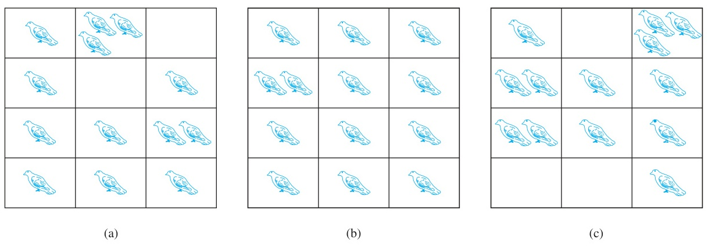

[← Previous: DM-5 Lower-b: Bases and Proofs](DM-5_Lower_b_Bases_Proofs.md) | [🏠 Index](00_Index.md) | [Next: DM-6 Lower: Counting, Combination, Binomial →](DM-6_Lower_Counting_Combination_Binomial.md)

---

# DM-6.3: Pigeonhole Principle
> **Section:** B (Discrete Mathematics) | **Priority:** 🔴 | **Exam Frequency:** 3/3 DM papers (2022 Q.8(c) & (d), 2023 Q.8(a), 2024 Q.8(c))
> **Sources:** Rosen §6.2 (pp. 15–21, Theorems 1–3, Examples 1–13), Fahad Notes Class-20, Raidah Notes §6.5, Shishir Notes §3

## Why This Topic Matters

The pigeonhole principle is the only discrete math topic that appeared in **all three** DM papers. It is also the cheapest one to learn. There is no calculation, no formula to remember, and only two sentences to state. But the examiner keeps asking for it in two different shapes: the plain form (2023 Q.8(a)) and the generalized form (2022 Q.8(c) and 2024 Q.8(c)). Learn both and the marks are there.

The third question in 2022 (Q.8(d)) uses the same principle as its engine. A proof about equal remainders is just the pigeonhole principle with $k$ boxes named $0, 1, 2, \dots, d-1$. Once you see that, the proof writes itself.

---

## 📝 Key Definitions

> **Pigeonhole principle (Theorem 1):** "If $k$ is a positive integer and $k + 1$ or more objects are placed into $k$ boxes, then there is at least one box containing two or more of the objects." — Rosen, §6.2 (p. 15)

> **Generalized pigeonhole principle (Theorem 2):** "If $N$ objects are placed into $k$ boxes, then there is at least one box containing at least $\lceil N/k \rceil$ objects." — Rosen, §6.2 (p. 17)

> **The other name:** "The pigeonhole principle is also called the **Dirichlet drawer principle**, after the nineteenth-century German mathematician G. Lejeune Dirichlet, who often used this principle in his work." — Rosen, §6.2 (p. 15)

> **Function corollary (Corollary 1):** "A function $f$ from a set with $k + 1$ or more elements to a set with $k$ elements is not one-to-one." — Rosen, §6.2 (p. 15)

*Figure 1 — There Are More Pigeons Than Pigeonholes. Rosen §6.2, p. 15.*

Look at panel (b). Twelve pigeons sit in twelve holes with one to each. Move a single pigeon from one hole to another and you get panel (a) or (c). You cannot put thirteen pigeons in twelve holes with one each. That is the whole principle, drawn.

---

## The two forms, side by side

The plain principle and the generalized principle are **different statements**. Getting this wrong is the single most common error in this topic.

| | Plain form (Theorem 1) | Generalized form (Theorem 2) |
| :-- | :-- | :-- |
| Statement | $k+1$ objects into $k$ boxes gives one box with $\ge 2$ | $N$ objects into $k$ boxes gives one box with $\ge \lceil N/k \rceil$ |
| Condition on $N$ | $N > k$ | $N > k(r-1)$, that is $N \ge k(r-1)+1$ |
| Guarantee | a pair | a whole group of $r$ |
| Recovered from | generalized by setting $r = 2$ | the plain form is the case $r = 2$ |

The plain form is the generalized form with $r = 2$. So when $r \ge 3$ you **must** use the stronger threshold $k(r-1) + 1$, not $k + 1$.

### Why the plain form is a special case

Rosen states the generalized version with a ceiling. Write the guarantee as "at least $r$ objects in one box". Then the condition is

$$
\left\lceil \frac{N}{k} \right\rceil \ge r
$$

The smallest integer $N$ that satisfies this is

$$
N = k(r - 1) + 1
$$

Set $r = 2$ and you get $N = k + 1$, which is exactly Theorem 1. Set $m = r - 1$ and the condition reads $N > mk$, which is the form used in the 2022 and 2024 papers.

### Reading off $k$ and $r$ from a story

In every application the story hands you $k$ directly. Count the categories.

- 12 months, $k = 12$
- 2 sock colours, $k = 2$
- $m$ hash buckets, $k = m$
- $d$ possible remainders, $k = d$
- 5 letter grades, $k = 5$
- $n$ building floors, $k = n$

Then $r$ is the size of the group you want to force, and you solve $N = k(r-1) + 1$ for the smallest $N$ that guarantees it.

> [!tip] The one-line worst case argument
> To find the smallest $N$ that forces $r$ objects in one box, fill every box with $r - 1$ objects first. That uses $k(r-1)$ objects and no box has $r$. One more object breaks it. So $N = k(r-1) + 1$. This is Rosen's own argument on p. 17.

---

## Proofs (both forms)

### Plain form, by contradiction

Suppose, for contradiction, that **every** box holds at most one object. With $k$ boxes that gives at most $1 + 1 + \dots + 1 = k$ objects in total. But we were given $k+1$ or more objects. Since $k + 1 > k$, this is impossible. So at least one box holds two or more.

Rosen writes the same argument as a proof by contraposition: suppose none of the $k$ boxes contains more than one object, then the total number of objects would be at most $k$, contradicting the hypothesis that there are at least $k+1$ objects. (§6.2, p. 15)

### Generalized form, by contradiction

Suppose every box holds **fewer than** $\lceil N/k \rceil$ objects. Then each box holds at most $\lceil N/k \rceil - 1$ objects, so the total is at most

$$
k \left(\left\lceil \frac{N}{k} \right\rceil - 1\right) < k \left(\left(\frac{N}{k} + 1\right) - 1\right) = N
$$

The strict inequality uses $\lceil N/k \rceil < N/k + 1$. So the total would be less than $N$, but there are exactly $N$ objects. Contradiction. Therefore some box holds at least $\lceil N/k \rceil$. (Rosen, §6.2, p. 17)

> [!note] Why the ceiling, and not $N/k$
> $N/k$ is often not a whole number. The box that gets the leftovers must be rounded up, and $\lceil N/k \rceil$ is the only integer bound that survives the counting argument. With $N = 25$, $k = 12$, the bound is $\lceil 25/12 \rceil = 3$, not $2.08$. Rounding down would claim two pigeons where three are guaranteed.

---

## The trap that costs marks: deterministic vs. probabilistic

**The pigeonhole principle is deterministic.** It says a collision *must* happen. No randomness, no probability, no assumptions about how objects are distributed.

**The birthday paradox is a different result.** It says that under a random model of birthdays, a shared birthday becomes *likely* around 23 people. That is probability, not pigeonhole.

Both get called "pigeonhole" by students, and the numbers get swapped. Get the pigeonhole figure right:

| Setting | Boxes $k$ | Plain principle guarantees a pair at | Probabilistic "50% chance" figure |
| :-- | --: | --: | --: |
| Birth **day** in a non-leap year | 366 | **367** people | 23 people (probability) |
| Birth **month** | 12 | **13** people | not the same question |
| Exam score on a 0 to 100 scale | 101 | **102** students | not applicable |
| English words, first letter | 26 | **27** words | not applicable |

Socks are certain. Birthdays are only probable. If you write "23 people share a birthday by the pigeonhole principle" in the exam, it is wrong. The correct pigeonhole figure is 367, and adding one sentence that separates the two ideas earns the mark that the swap would have cost you.

> [!warning] The exact wording that loses the mark
> The exam asks "briefly describe the pigeonhole principle with a real world example". A candidate who writes the birthday paradox as the example has answered a different question. Use socks, or floors of a building, or letter grades. Keep the birthday discussion as an aside that shows you know the difference.

---

## Worked examples from Rosen

These are not exam questions, but each one trains a move that a real exam question can ask for.

### General threshold questions

**Grades.** How many students are needed to guarantee six with the same grade, given five grades A, B, C, D, F? We need $\lceil N/5 \rceil \ge 6$, so $N = 5(6-1) + 1 = 26$. With 25 students, five can hold exactly five each, so 26 is genuinely the minimum. (Rosen §6.2 Example 6, p. 18)

**Cards.** How many cards from a 52-card deck guarantee three of one suit? $k = 4$ suits, want three of a suit, so $N = 4(3-1) + 1 = 9$. Eight cards could be two of each suit, so nine is the minimum. (Rosen §6.2 Example 7a, p. 18)

**Area codes.** A state has 25 million phones and 8 million numbers of the form $NXX\text{-}XXXX$. By the generalized principle, at least $\lceil 25000000/8000000 \rceil = 4$ phones must share a number, so at least four area codes are needed. (Rosen §6.2 Example 8, p. 18)

### Clever applications

These are the ones where the objects or boxes have to be **chosen cleverly**. That is the part students miss.

**A multiple with only 0s and 1s.** For every positive integer $n$, some multiple of $n$ has only 0s and 1s in its decimal expansion. Take the $n+1$ numbers $1, 11, 111, \dots, 11\dots1$ with $n+1$ ones. There are only $n$ remainders on division by $n$, so two of these $n+1$ numbers share a remainder. The larger minus the smaller is a multiple of $n$ made only of 0s and 1s. (Rosen §6.2 Example 4, p. 16)

**A dividing pair.** Among any $n+1$ positive integers not exceeding $2n$, one divides another. Write each as $a_j = 2^{k_j}q_j$ with $q_j$ odd. Only $n$ odd numbers lie below $2n$, so two of the $q_j$ coincide by pigeonhole. The two corresponding $a$'s then differ only in their power of 2, so one divides the other. (Rosen §6.2 Example 11, p. 19)

**Points in a triangle.** Shishir notes p. 615 give the same shape on geometry. Divide a unit equilateral triangle into 4 congruent triangles by joining the side midpoints. Each small triangle has side $0.5$. Five points, four small triangles, so two points share a triangle and their distance is at most $0.5$.

> [!tip] How to attack a clever application in the exam
> Write two lines first. Line one: the objects, counted. Line two: the boxes, counted. Then check that objects exceed boxes. Most students lose these marks by trying to invent a proof before identifying the two groups. Count first.

---

## Connecting to computing

This is the part that makes the topic worth marks in an ECE course.

### Hash table collisions

Storing $n$ keys in $m$ buckets forces a collision once $n > m$. That is the plain principle with the keys as pigeons and the buckets as boxes. More precisely, the generalized form says some bucket holds at least $\lceil n/m \rceil$ keys.

This is why the **load factor** $\alpha = n/m$ is kept below 1.0, typically near 0.75. The load factor is not a tuning knob, it is a direct reading of the principle. A table that guaranteed zero collisions would need one bucket per key, which defeats the purpose of hashing entirely.

The same count explains why a map with $m$ buckets cannot hold $m+1$ distinct keys without a collision, and why the birthday-paradox-style argument for collisions is **not** the pigeonhole principle but a probability estimate on top of it.

### Router buffers and network queues

A router buffer with $m$ slots receiving a burst of more than $m$ packets must drop or block one. Same shape: buffers are boxes, packets are pigeons. The generalized form gives the guaranteed depth of the worst queue, at least $\lceil n/m \rceil$, which is the bound an engineer writes into a queueing analysis.

### Function cardinality

Rosen's Corollary 1 (p. 15) is the pigeonhole principle wearing a function's clothes. A function from a set with $k+1$ or more elements to a set with $k$ elements cannot be one-to-one. Put $x$ in the box labelled $f(x)$. This is the formal reason a hash function from more keys than buckets cannot be injective, and it is the line to cite if an exam question asks you to connect the principle to data structures.

---

## Exam Variants

| Year | Question | What is asked | Key answer |
| :-- | :-- | :-- | :-- |
| 2022 Q.8(c) | Give a real-world example of generalized pigeonhole principle. | Generalized form plus an instance | $\boxed{\text{More than } mk \text{ objects in } k \text{ boxes forces some box to hold } m+1}$ |
| 2024 Q.8(c) | Give a real-world example of generalized pigeonhole principle. | Verbatim repeat of 2022 Q.8(c) | same box, character for character |
| 2022 Q.8(d) | Show that among any $d+1$ integers two share a remainder mod $d$. | Four-step proof by pigeonhole | $\boxed{\text{Any } d+1 \text{ integers include two congruent modulo } d}$ |
| 2023 Q.8(a) | Briefly describe the pigeonhole principle with a real world example. | Plain form, contradiction proof, example | $\boxed{\text{More objects than boxes forces at least one box to hold two or more}}$ |

Note the pattern. 2022 Q.8(c) and 2024 Q.8(c) are the **same question with the same marks**. Learn that one answer and you have covered two of the three papers. 2023 Q.8(a) is the plain form and is even easier.

---

## 🏆 Golden Questions (Past Exam Archive)

### 🎯 Give a real-world example of generalized pigeonhole principle.
> **Appeared:** 2022 Q.8(c), 2024 Q.8(c) — (02 marks)

**Full Answer:**

**The principle.** If $N$ objects are placed into $k$ boxes and $N > k$, then at least one box holds at least two objects. The **generalized** form: if $N > mk$, then some box holds at least $m + 1$ objects.

**Real-world examples.**

1. **Birth months in a class.** With 12 months, a class of 25 students guarantees that at least 3 share a birth month, since $25 > 2 \times 12 = 24$. Here $m = 2$, $k = 12$, and $N = 25$ is the smallest class that forces a triple.
2. **Socks from a drawer.** A drawer holds only black and white socks. Drawing 5 socks guarantees at least 3 of one colour, since $5 > 2 \times 2 = 4$.
3. **Hash tables.** Storing $n$ keys in $m$ buckets forces a collision once $n > m$. Keeping the load factor below 1, typically near 0.75, is what guarantees headroom before collisions become frequent.
4. **Servers.** A cluster with $r$ racks and $2r+1$ machines must place at least 3 machines in one rack, since $2r + 1 > 2 \times r$.

$$
\boxed{\text{More than } mk \text{ objects in } k \text{ boxes forces some box to hold } m+1}
$$

> [!warning] The plain and generalized forms are different statements
> The plain principle is the case $m = 1$. The generalized form needs $N > mk$, which is a **stronger** condition on $N$ and yields a **stronger** conclusion.
>
> The commonest slip is to use $N > k$ when $m > 1$, which forces only *two* in a box rather than $m + 1$. With 25 students and 12 months, "more students than months" forces only a pair. The $2 \times 12 = 24$ threshold is what forces a triple.

> [!note] Reading off $m$ and $k$ from the story
> In every example, $k$ is the number of boxes and is counted directly from the story: 12 months, 2 colours, $m$ buckets, $r$ racks. Then $m$ is the number above which you want a guarantee, and $N$ must exceed $mk$.
>
> Hashing is the case worth internalising, because the principle is not an accident there but a design constraint. A table that guarantees no collision at all would need one bucket per key, which defeats the purpose of hashing.

---

### 🎯 Let $d$ be a positive integer. Show that among any group of $d+1$ (not necessarily consecutive) integers there are two with exactly the same remainder when they are divided by $d$.
> **Appeared:** 2022 Q.8(d) — (02 marks)

**Full Answer:**

**Proof.**

**Step 1. Count the possible remainders.** For any integer $a$, the division algorithm gives

$$
a = qd + r, \qquad 0 \le r < d
$$

Every integer therefore has exactly one of the residues $0, 1, 2, \dots, d-1$. There are exactly **$d$** possible remainders.

**Step 2. Identify the boxes.** Take the $d+1$ integers and let each box be one of the $d$ possible remainders, $0$ through $d-1$. Place each integer in the box named by its remainder.

**Step 3. Apply the pigeonhole principle.** There are $d + 1$ integers placed into $d$ boxes, and $d + 1 > d$. By the pigeonhole principle, at least one box contains two or more integers.

**Step 4. Conclude.** Two integers $a_1, a_2$ share a box, so they share a remainder. Writing $a_1 = q_1 d + r$ and $a_2 = q_2 d + r$ and subtracting gives

$$
a_1 - a_2 = (q_1 - q_2)d
$$

hence $d$ divides $a_1 - a_2$, which is exactly the statement that the two have the same remainder on division by $d$.

$$
\boxed{\text{Any } d+1 \text{ integers include two congruent modulo } d}
$$

> [!info] Explicit cases
>
> | $d$ | Example with a forced repetition | Remainders |
> | --: | :-- | :-- |
> | 1 | $0, 0$ | $0, 0$ |
> | 3 | $0, 1, 2, 0$ | $0, 1, 2, 0$ |
> | 5 | $0, 1, 2, 3, 4, 0$ | $0, 1, 2, 3, 4, 0$ |
>
> In each case $d+1$ integers are given and $d$ remainders are available, so the repetition is forced rather than arranged.

> [!note] The bound is sharp, and that is what makes this a theorem
> With only $d$ integers no repetition is forced: take $0, 1, 2, \dots, d-1$, whose remainders are all distinct. Hence $d + 1$ is the **smallest** number of integers that guarantees a collision.
>
> The word "not necessarily consecutive" in the question is what rules out the other obvious route. If the integers were consecutive you could simply look at $d$ consecutive remainders, which cycle through all $d$ values and then repeat. The hypothesis has to be the general one for the pigeonhole argument to be needed at all.

> [!note] What this is used for
> This is the statement behind every proof of the pigeonhole principle for congruences, and behind the fact that $x \equiv y \pmod d$ has infinitely many solutions while $x \equiv y \pmod n$ with the same residue class has at most $\gcd(x-y, n)$ distinct residues.
>
> It is also the reason a hash table with $m$ buckets cannot hold $m+1$ distinct keys without a collision. Same counting argument, different words.

---

### 🎯 Briefly describe the pigeonhole principle with real world example.
> **Appeared:** 2023 Q.8(a) — (02 marks)

**Full Answer:**

**The principle.** If $N$ objects are placed into $k$ boxes and $N > k$, then at least one box holds at least two objects.

**Proof.** Suppose every box held at most one object. Then the boxes would hold at most $k$ objects in total. But $N > k$, a contradiction.

**Real-world examples.**

1. **Socks.** From a drawer holding black and white socks only, drawing three socks guarantees two of a colour, since two boxes cannot take three objects with at most one each. This is the tightest version: $N = 3$ into $k = 2$.
2. **Birthdays.** With 366 possible birthdays, the *plain* principle needs $367$ people to force a shared birthday, not 23. The famous result is therefore a **probabilistic** one, not a pigeonhole one: under a random model, past about 23 people the chance of a shared birthday exceeds $50\%$.
3. **Pigeonholes in a building.** A building with $n$ floors and $n + 1$ people must have two on the same floor.
4. **Hash tables.** Storing $n$ keys in $m$ buckets forces a collision once $n > m$, which is why the load factor is kept below 1.

$$
\boxed{\text{More objects than boxes forces at least one box to hold two or more}}
$$

> [!warning] The principle is deterministic, not probabilistic
> It states that a collision **must** happen, with no randomness and no probability. The birthday paradox is a different result: it says a shared birthday is **likely** under a random model of birthdays.
>
> Students mix these up constantly because both get called "pigeonhole". Socks are certain; birthdays are only probable. If you quote 23 as a pigeonhole result you are wrong, and the correct pigeonhole figure for a year with 366 possible birthdays is 367.

> [!note] The tighter generalised form
> The generalised principle says that if $N$ objects go into $k$ boxes, then some box holds at least $\lceil N/k \rceil$ objects. The plain form is the special case $\lceil N/k \rceil \ge 2$. Part (c) of Question 8 in the 2022 paper asks for a real-world instance of the generalised version, and the hash table example above is the standard answer: $n$ keys in $m$ buckets forces some bucket to hold at least $\lceil n/m \rceil$ keys.

**PYQ coverage for DM-6.3:** 4 manifest rows (2022 Q.8(c), 2022 Q.8(d), 2023 Q.8(a), 2024 Q.8(c)) across 3 unique questions, 3 blocks, 0 missing.

---

## ⚡ Exam Tips & Common Mistakes

1. **State both forms in the first two lines.** Part (c) of 2022 and 2024 asks for the *generalized* form. Part (a) of 2023 asks for the plain one. Answering with only one loses the marks even if your example is right.
2. **Use $N > mk$, not $N > k$.** With 25 students and 12 months, $25 > 12$ only forces a pair. The $25 > 2 \times 12 = 24$ threshold is what forces the triple.
3. **Never quote 23 as a pigeonhole result.** The pigeonhole figure for a shared birth day is 367. If you mention 23 at all, say explicitly that it is a probability result and not a pigeonhole one.
4. **Give a real-world example that is deterministic.** Socks, floors, grades, buckets. The birthday story invites the wrong answer.
5. **Name the boxes and the objects explicitly in the $d+1$ proof.** Write "the $d$ boxes are the residues $0$ through $d-1$". Without that line, Step 3 has no content.
6. **Finish Step 4 of the congruence proof.** Showing $a_1 - a_2 = (q_1 - q_2)d$ is half the job. Concluding that $d \mid a_1 - a_2$ is what closes it.
7. **Mention the sharpness if the marks allow.** With only $d$ integers, $0, 1, \dots, d-1$ has all remainders distinct, so $d+1$ is the smallest such number. One extra line, and it shows you understand why the statement is a theorem.
8. **The hash table example is the strongest one for ECE.** It is deterministic, it has a natural $k$ and $N$, and it connects the topic to something an ECE student recognises. Lead with it.

## 🔗 Related Topics

- [DM-5 Lower-b: Bases and Proofs](DM-5_Lower_b_Bases_Proofs.md) — previous in the chain; the division algorithm that Step 1 of the 2022 Q.8(d) proof relies on
- [DM-6 Lower: Counting, Combination, Binomial](DM-6_Lower_Counting_Combination_Binomial.md) — next in the chain, the counting rules that produce the pigeonhole principle's inputs
- [DM-5.4: Modular Arithmetic and Congruence](DM-5.4_Modular_Arithmetic_and_Congruence.md) — where the congruent-modulo-$d$ conclusion of 2022 Q.8(d) is used
- [DM-7: Algorithms and Relevance](DM-7_Algorithms_and_Relevance.md) — hash tables and complexity classes, the computing end of the same ideas

---

[← Previous: DM-5 Lower-b: Bases and Proofs](DM-5_Lower_b_Bases_Proofs.md) | [🏠 Index](00_Index.md) | [Next: DM-6 Lower: Counting, Combination, Binomial →](DM-6_Lower_Counting_Combination_Binomial.md)