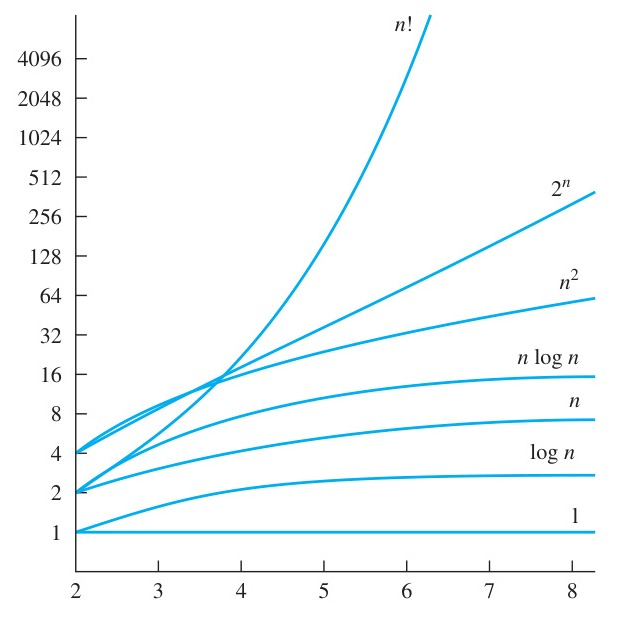

[← Previous: DM-6 Lower: Counting, Combination, Binomial](DM-6_Lower_Counting_Combination_Binomial.md) | [🏠 Index](00_Index.md) | [Next: Master Formula Sheet →](99_Master_Formula_Sheet.md)

---

# DM-7: Algorithms and Relevance of Discrete Mathematics
> **Section:** B (Discrete Mathematics) | **Priority:** 🟡 📘 (off-syllabus, but examined) | **Exam Frequency:** 2/3 DM papers (2023 Q.8(d), 2024 Q.7(a))
> **Subtopics:** DM-7.1 (Algorithms and Complexity, 📘 off-syllabus), DM-7.2 (Relevance of Discrete Mathematics)
> **Sources:** Rosen §3.1 (pp. 1–12, Definition 1, Greedy Algorithms), §3.2 (pp. 14–18, Definition 1), §3.3 (pp. 28–36, Table 1), Fahad Notes Class-20 §6, Raidah Notes §7

## Why This Topic Matters

This file is small and the marks are few, but one of them is not small. 2024 Q.7(a) is **six marks**, the biggest single question in the Discrete Mathematics section of that paper, and it sits in Section A rather than Section B. It asks for a sorting algorithm, a search algorithm with pseudocode, a greedy strategy, and a time complexity for each. Three separate skills in one part.

> [!warning] 📘 DM-7.1 is off the written syllabus
> `ECE2213_Syllabus.md` never lists algorithms or complexity. Yet 2024 Q.7(a) is a full six-mark algorithms question. This topic is flagged 📘 in `topic_subtopic_list.md` for exactly that reason: it appears in a paper while sitting outside the syllabus text.
>
> Treat it as high value anyway. Six marks is more than any other DM question except the Binomial Theorem, and the content is finite: three algorithms and one notation.

---

## 📝 Key Definitions

> **Algorithm:** "An **algorithm** is a finite sequence of precise instructions for performing a computation or for solving a problem." — Rosen, §3.1 (p. 1)

> **Greedy algorithm:** "This approach selects the best choice at each step, instead of considering all sequences of steps that may lead to an optimal solution. Algorithms that make what seems to be the 'best' choice at each step are called **greedy algorithms**." — Rosen, §3.1 (p. 8)

> **Big-O notation:** "Let $f$ and $g$ be functions from the set of integers or the set of real numbers to the set of real numbers. We say that $f(x)$ is $O(g(x))$ if there are constants $C$ and $k$ such that $|f(x)| \le C|g(x)|$ whenever $x > k$." — Rosen, §3.2 (p. 15)

> **The witnesses:** "To establish that $f(x)$ is $O(g(x))$ we need only find one pair of each of witnesses $C$ and $k$. That is, to show that $f(x)$ is $O(g(x))$, we need only find a pair of constants $C$ and $k$, the witnesses, such that $|f(x)| \le C|g(x)|$ whenever $x > k$." — Rosen, §3.2 (p. 15)

> **Worst case:** "The **worst-case** time complexity of an algorithm is the maximum number of operations used by the algorithm to solve a problem with input of a given size. The **average-case** time complexity of an algorithm is the average number of operations used by the algorithm to solve a problem with input of a given size, assuming some probability distribution on the input values. The **best-case** time complexity of an algorithm is the minimum number of operations used by the algorithm to solve a problem with input of a given size." — Rosen, §3.3 (p. 29)

> **Space complexity:** "A second measure of the efficiency of an algorithm is the amount of computer memory required by the algorithm to solve a problem, when input values are of a specified size." — Rosen, §3.3 (p. 28)

> **Tractable and intractable:** "A problem that is solvable using an algorithm with polynomial worst-case complexity is called **tractable**." / "Such problems are called **intractable**." — Rosen, §3.3 (p. 36)


*Figure 2 — The Function $f(x)$ is $O(g(x))$. Rosen §3.2, p. 18.*

The shaded part is the region where $f(x) \le C|g(x)|$. Big-O only cares about what happens to the right of $k$. Everything to the left is ignored, which is why a fast start does not earn an algorithm a good complexity class.

---

## DM-7.1: Algorithms and Complexity

### The seven properties of an algorithm

Rosen lists these in §3.1 (p. 3). They cost four lines to write and they answer any "define or list the properties of an algorithm" question directly.

| Property | Meaning |
| :-- | :-- |
| **Input** | Values drawn from a specified set |
| **Output** | Values produced from each input, and they are the solution |
| **Definiteness** | Every step is precisely defined |
| **Correctness** | The output is right for every input |
| **Finiteness** | The output arrives after finitely many steps |
| **Effectiveness** | Each step can be performed exactly in finite time |
| **Generality** | It works for all inputs of the required form, not one instance |

> [!tip] When to write them out
> Only if a question says "state the properties" or "what makes a procedure an algorithm". If the question asks you to solve something with an algorithm, writing the list is filler. Solve the problem instead.

### Big-O, stated properly

$f(x)$ is $O(g(x))$ when there exist **constants** $C > 0$ and $k$ such that

$$
|f(x)| \le C\,|g(x)| \qquad \text{for all } x > k
$$

Three things to get right when you write this in an exam:

1. **$C$ and $k$ are constants.** They do not depend on $x$.
2. **The inequality holds only for $x > k$.** Big-O is a statement about large inputs, not all inputs.
3. **Finding one pair of witnesses is enough.** You do not need the tightest $C$. Rosen says so twice on p. 15.

Worked witness example, from Rosen §3.2 Example 1 (p. 16). For $f(x) = x^2 + 2x + 1$ with $x > 1$, we have $x < x^2$ and $1 < x^2$, so

$$
0 \le x^2 + 2x + 1 \le x^2 + 2x^2 + x^2 = 4x^2
$$

Hence $C = 4$, $k = 1$ are witnesses and $f(x) = O(x^2)$. A tighter pair also works: for $x > 2$, $2x \le x^2$ and $1 \le x^2$ give $3x^2$, so $C = 3$, $k = 2$ is another valid witness pair.

### The complexity hierarchy



*The growth of common functions. Rosen §3.3, p. 36.*

Read the picture bottom to top. All the curves pass through roughly the same region for small $n$, which is why a bad algorithm looks fine on a test case. Then they separate, and the separation only widens.

| Complexity | Name | Efficiency verdict |
| :-- | :-- | :-- |
| $\Theta(1)$ | Constant | Ideal. Fixed number of operations |
| $\Theta(\log n)$ | Logarithmic | Extremely efficient. Grows very slowly |
| $\Theta(n)$ | Linear | Efficient |
| $\Theta(n \log n)$ | Linearithmic | Relatively efficient. What merge sort achieves |
| $\Theta(n^b)$, $b \ge 1$ | Polynomial | Efficient if $b$ is small |
| $\Theta(b^n)$, $b > 1$ | Exponential | Not efficient |
| $\Theta(n!)$ | Factorial | Not efficient |

That table is Rosen's Table 1, §3.3, p. 36. It is worth reproducing on paper, because "which class does $n \log n$ belong to and is it efficient" is a one-mark question on its own.

### Sorting and searching at a glance

| Algorithm | Best | Average | Worst | Space | Sorted input required |
| :-- | :-: | :-: | :-: | :-: | :-- |
| Bubble sort | $O(n)$ | $O(n^2)$ | $O(n^2)$ | $O(1)$ | No |
| Insertion sort | $O(n)$ | $O(n^2)$ | $O(n^2)$ | $O(1)$ | No |
| Merge sort | $O(n \log n)$ | $O(n \log n)$ | $O(n \log n)$ | $O(n)$ | No |
| Quicksort | $O(n \log n)$ | $O(n \log n)$ | $O(n^2)$ | $O(\log n)$ | No |
| Heapsort | $O(n \log n)$ | $O(n \log n)$ | $O(n \log n)$ | $O(1)$ | No |
| Linear search | $O(1)$ | $O(n)$ | $O(n)$ | $O(1)$ | No |
| Binary search | $O(1)$ | $O(\log n)$ | $O(\log n)$ | $O(1)$ | **Yes** |

Two things in that table decide exam questions.

**Binary search is the only one that needs a sorted list.** Everything else works on anything. This is the requirement people forget.

**Merge sort's worst case equals its average case.** Quicksort's worst case does not. If the answer must hold under a hard deadline, merge sort is the one with the guarantee.

### How to derive a complexity instead of recalling it

A bound you counted yourself is a bound you cannot get wrong under exam pressure. Count operations.

- **Merge sort.** Each level of the recursion merges $n$ items, and there are $\lceil \log_2 n \rceil$ levels. So $n \log_2 n$ operations. Worst case is the same, because the split is by position and never depends on the data.
- **Binary search.** Each step halves the interval, so after $s$ steps the interval has $n/2^s$ items. Setting $n/2^s = 1$ gives $s = \log_2 n$. So at most $\lceil \log_2 n \rceil$ comparisons.
- **Linear scan.** One comparison per item, so $n$ comparisons. Nothing to derive.

Rosen does exactly this in §3.3: binary search uses at most $2\lceil \log n \rceil + 2$ comparisons, and linear search uses $2n + 2$ in the worst case.

### Divide and conquer

Merge sort is the standard example of the paradigm. Three steps, repeated:

1. **Divide.** Split the list into two halves.
2. **Conquer.** Sort each half recursively, down to single items.
3. **Combine.** Merge the two sorted halves in linear time.

The recursion stops at one item because a single item is already sorted. The merge is linear because each merge touches every item once. Together they give $T(n) = 2T(n/2) + O(n)$, which solves to $O(n \log n)$.

### Greedy algorithms

A greedy algorithm makes the locally best choice at each step and never looks back. Rosen is careful about one point on p. 8: we call an algorithm greedy **whether or not it finds an optimal solution**. After a feasible answer exists, you either prove it optimal or produce a counterexample.

Rosen's change-making example (p. 8) makes the failure concrete. With quarters, dimes, and pennies but **no nickels**, greedy makes 30 cents as one quarter plus five pennies, six coins. Three dimes would be three coins. So greedy lost, and no proof exists.

Rosen's talk-scheduling example (p. 9) shows that the criterion matters more than the word "greedy":

- Earliest start time picks one talk where two would fit. Not optimal.
- Shortest talk picks one talk where two would fit. Not optimal.
- **Earliest finish time** among compatible talks is the criterion that works.

So a complete greedy answer names the criterion, not just the strategy.

---

## DM-7.2: Relevance of Discrete Mathematics

### The one-sentence version

Discrete mathematics is the language in which algorithms are specified, proved and costed.

That is the whole answer to a one-mark question. The rest of this section exists so that you can expand it if the marks allow.

### The three jobs it does

**It names the structures.** Sets, relations, graphs, trees and finite state machines describe what a computer stores and how it is linked. A linked list is a graph with a degree bound of 2. A file system is a tree. A relational database is a set of relations. Discrete mathematics gives each of those a formal definition, which is what lets you reason about them instead of guessing.

**It counts.** Combinatorics turns "this is fast" into a bound. An algorithm's complexity is a count of operations, so the counting rules from [DM-6 Lower](DM-6_Lower_Counting_Combination_Binomial.md) feed straight into $O(n \log n)$. Number theory does the same for modular exponentiation and for the primalities that block and public-key cryptography rest on.

**It proves.** Logic gives the proof rules that certify an algorithm correct. An induction on the loop index is what turns a pseudocode listing into a correctness argument. Without a proof, "correct" is a claim. With one, it is a theorem.

### Where it shows up in this course

| Discrete structure | Where it does real work |
| :-- | :-- |
| Logic | Digital gates, truth tables, system specification |
| Sets and relations | Data structures, database schemas, equivalence classes |
| Number theory | Modular arithmetic, RSA, primality tests |
| Counting | Algorithm complexity, hashing load factors, combinatorial search |
| Graph theory | Network routing, dependency graphs, circuit topology |

Notice the last two rows. They are the bridge to [DM-6](DM-6.3_Pigeonhole_Principle.md) and to [DM-7.1](#dm-71-algorithms-and-complexity) on this file. A hash table's collision guarantee is the pigeonhole principle. A binary search's $O(\log n)$ bound is a counting argument. Neither fact is continuous mathematics.

### Why "discrete" is the operative word

The binary system that 2023 Q.7(b) asks about is itself a discrete structure. Arithmetic on a fixed number of bits is arithmetic in a finite structure, and overflow is one of its theorems, not a numerical accident. The same holds for Boolean algebra over $\{0, 1\}$, for a 32-bit IPv4 address, and for the finite state machines that model digital circuits.

> [!note] One mark, so one tight paragraph
> 2023 Q.8(d) is a one-mark question and it is the last one in the paper. It is asking whether you can state the reason in a sentence. A single paragraph of three connected claims is the right size. A page of examples reads as padding and will not earn a second mark, because there is no second mark.

---

## Exam Variants

| Year | Question | Subtopic | Marks | Key answer |
| :-- | :-- | :-- | --: | :-- |
| 2024 Q.7(a) | Delivery company: sort, search, greedy assign, complexity | DM-7.1 | 06 | $\boxed{\text{Sort } O(n \log n), \quad \text{search } O(\log n), \quad \text{assign } O(n \log n + nm)}$ |
| 2023 Q.8(d) | Why is discrete mathematics essential in CS and algorithm design? | DM-7.2 | 01 | $\boxed{\text{Discrete mathematics is the language in which algorithms are specified, proved and costed}}$ |

The weight ratio is 6 to 1. Spend the time accordingly.

---

## 🏆 Golden Questions (Past Exam Archive)

### 🎯 A delivery company uses a computer system to manage customer orders. The system needs to perform the following tasks efficiently: sort all delivery address based on distance from warehouse; search for a customer's order by name or ID; use Greedy approach to assign delivery vans to the nearest unserved address; evaluate the time complexity of each algorithm used. (i) Which sorting algorithm would you choose to arrange delivery address efficiently? Write its name and state of average time complexity. (ii) If the address list is already sorted, which search algorithm should be used? Write its pseudocode and time complexity. (iii) Explain how a Greedy algorithm can be applied to assign vans to nearest delivery points.
> **Appeared:** 2024 Q.7(a) — (06 marks)

**Full Answer:**

This is three algorithmic tasks plus a complexity analysis for each. The tasks are independent, and each one has a natural choice whose justification is what the marks are for.

**(i) Sorting the addresses by distance.**

**Algorithm chosen: merge sort.** The addresses are sorted on a single numeric key, the distance from the warehouse. Merge sort divides the list in half, sorts each half recursively, and merges the two sorted halves in linear time.

- Average time complexity: $O(n \log n)$
- Best case: $O(n \log n)$
- Worst case: $O(n \log n)$
- Space: $O(n)$

**Why merge sort and not the others.**

- **Bubble sort** is $O(n^2)$, which fails at tens of thousands of addresses, and a delivery list over a few years is comfortably in that range.
- **Quicksort** is $O(n \log n)$ on average but $O(n^2)$ if the list is already sorted, which is close to what a distance list looks like. That worst case is avoidable with a random pivot, but the guarantee is not there by default.
- **Heapsort** is $O(n \log n)$ in all cases and $O(1)$ space, but it is not stable, and equal distances would lose their original order.
- **Counting or radix sort** would be faster at $O(n + k)$, but only if the distances are integers in a known range, which floating-point distances are not.

Merge sort's selling point here is that its worst case equals its average case, so a delivery system with a hard deadline can rely on it. The cost is $O(n)$ extra space.

**(ii) Searching for a customer's order.**

**Algorithm chosen: binary search**, since the list is already sorted from step (i).

```
function BINARY-SEARCH(A, key):
    low  <- 0
    high <- length(A) - 1
    while low <= high:
        mid <- floor((low + high) / 2)
        if A[mid].id = key:
            return mid
        else if A[mid].id < key:
            low <- mid + 1
        else:
            high <- mid - 1
    return NOT-FOUND
```

- Average time complexity: $O(\log n)$
- Best case: $O(1)$, when the key sits at the first midpoint tried
- Worst case: $O(\log n)$
- Space: $O(1)$, since it iterates rather than recurses

Binary search halves the search interval at every step, so $n$ items need at most $\lceil \log_2 n \rceil$ comparisons. For $n = 10^6$ that is 20 comparisons against $10^6$ for a linear scan, which is the whole reason sorting is worth doing once if many searches follow.

> [!warning] Binary search has one requirement
> The list must be sorted on the **same key** that is searched. Sorted by distance does **not** mean sorted by customer ID. Searching by ID requires either a second, ID-sorted index or a hash table. A hash table is the better answer for lookup by ID, at $O(1)$ average and $O(n)$ space, and this is the honest answer if the question allows more than one structure. The trap is to propose binary search on the distance-sorted list, which cannot find by ID.

**(iii) Assigning vans greedily.**

**Algorithm: nearest-neighbour greedy.** Scan the unserved addresses, take the closest one, assign it, mark it served, and repeat.

```
function GREEDY-ASSIGN(addresses, vans):
    served <- {}
    for each van:
        current <- warehouse position
        while an unserved address remains and the van has capacity:
            best <- the unserved address nearest to current
            assign best to this van
            add best to served
            current <- position of best
    return assignment
```

- Time complexity: $O(V \cdot A)$ in the straightforward form, where $V$ is the number of vans and $A$ the number of addresses
- Space: $O(A)$

$$
\boxed{\text{Sort } O(n \log n), \quad \text{search } O(\log n), \quad \text{assign } O(n \log n + nm)}
$$

**The complexity analysis.** The outer loop runs $V$ times. For each van, the inner loop scans the unserved list to find the nearest, and it does so once per assigned address, giving $A$ scans in the worst case, each of cost $O(A)$ if the list is not indexed. So the total is $O(V \cdot A^2)$ in the worst case, or $O(A^2)$ when the number of vans is proportional to the address count. Using a spatial index, a $k$-d tree or a grid hash, reduces the nearest-neighbour query to $O(\log A)$, giving $O(V A \log A)$.

**Why greedy here, and what it costs.** Greedy is $O(VA^2)$ and simple, and for a delivery list it is close to optimal in practice. It does **not** guarantee the shortest total route, which is the travelling salesman problem and is NP-hard. The bound is that greedy's tour is at most $O(\log A)$ times the optimal tour in the worst case, and in practice it lands within a few percent. Since the exam asks for a greedy approach, the answer is the nearest-neighbour construction with its complexity stated, plus the note that it is a heuristic.

> [!info] Check the complexity by counting operations
> For $n$ items, merge sort performs about $n \log_2 n$ comparisons: $\log_2 n$ levels, each doing a linear merge of $n$ items. Binary search does at most $\lceil \log_2 n \rceil$ comparisons, and the bound is tight when the key is absent. The greedy scan does one comparison per unserved address per assignment, so $A + (A-1) + \cdots + 1 = A(A+1)/2$ comparisons per van, which is $O(A^2)$, giving $O(VA^2)$ overall. These counts are what makes the table above more than a set of labels: each one can be derived by counting what the algorithm actually does, and the three agree with the standard classifications.

---

### 🎯 Why is discrete mathematics essential in computer science and algorithm design?
> **Appeared:** 2023 Q.8(d) — (01 marks)

**Full Answer:**

Discrete mathematics supplies the exact language for the structures a computer represents, so that correctness and cost can be reasoned about rather than guessed at.

Sets, relations, graphs, logic and counting describe what is stored and how it is linked. Combinatorics counts the cases an algorithm must handle, which is what converts "this is fast" into a bound. Logic gives proof rules that certify an algorithm correct, so correctness is demonstrated rather than asserted. And the binary system Question 7(b) uses is itself discrete: arithmetic on a fixed number of bits is arithmetic in a finite structure, with overflow as one of its theorems.

$$
\boxed{\text{Discrete mathematics is the language in which algorithms are specified, proved and costed}}
$$

> [!note] One mark, so one tight paragraph
> This is a one-mark question and it is the last one in the paper. It is asking whether you can state the reason in a sentence, so a single paragraph of three connected claims is the right size. A page of examples will read as padding and will not earn a second mark, because there is no second mark.

**PYQ coverage for DM-7.1, DM-7.2:** 2 manifest rows (2024 Q.7(a), 2023 Q.8(d)) across 2 unique questions, 2 blocks, 0 missing.

---

## ⚡ Exam Tips & Common Mistakes

1. **Give all three complexity figures, not one.** The 2024 question asks for the average time complexity in part (i) but the full set in the summary. State best, average, worst, and space for each algorithm. It costs one line each.
2. **Justify the algorithm choice, do not just name it.** Each of the four marks in part (i) is one algorithm rejected with a reason. "Merge sort, because its worst case is $O(n \log n)$ and it is stable" earns more than "Merge sort".
3. **Watch the search key.** The address list is sorted by **distance**. Binary search on customer ID needs a different index. Saying this out loud is worth a mark and separates a careful answer from a memorised one.
4. **Write the pseudocode in full.** Part (ii) asks for it. A bare name plus a complexity loses the pseudocode mark.
5. **Name the greedy criterion.** "Nearest-first" or "nearest-neighbour" is the criterion. A greedy algorithm without a named criterion is not an answer.
6. **State where greedy fails.** One sentence about vehicle capacity blocking a heavier address shows you understand the limit of the method. That is what Rosen's change-making example does.
7. **Do not over-write the one-mark question.** Three sentences for 2023 Q.8(d). Everything above that is padding.
8. **Know the complexity table cold.** $\Theta(1)$, $\Theta(\log n)$, $\Theta(n)$, $\Theta(n \log n)$, $\Theta(n^b)$, $\Theta(b^n)$, $\Theta(n!)$, in that order. It is Rosen's Table 1 and it is examinable as a standalone one-mark recall.

## 🔗 Related Topics

- [DM-6 Lower: Counting, Combination, Binomial](DM-6_Lower_Counting_Combination_Binomial.md) — previous in the chain; operation counting is combinatorics applied to code
- [DM-6.3: Pigeonhole Principle](DM-6.3_Pigeonhole_Principle.md) — where the hash table collision bound in this file comes from
- [DM-3.9: Rules of Inference and Valid Arguments](DM-3.9_Rules_of_Inference_and_Valid_Arguments.md) — the proof rules that certify an algorithm correct
- [DM-5.5: Modular Exponentiation](DM-5.5_Modular_Exponentiation.md) — the number-theoretic example of a discrete algorithm with a proven cost
- [99: Master Formula Sheet](99_Master_Formula_Sheet.md) — next in the chain, every formula in this file gathered in one place

---

[← Previous: DM-6 Lower: Counting, Combination, Binomial](DM-6_Lower_Counting_Combination_Binomial.md) | [🏠 Index](00_Index.md) | [Next: Master Formula Sheet →](99_Master_Formula_Sheet.md)