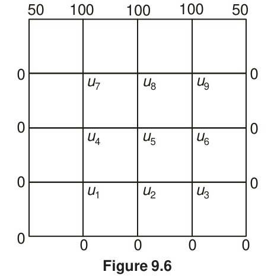

[← Previous: NM-9 Eigenvalue Problems](NM-9_Eigenvalue_Problems.md) | [🏠 Index](00_Index.md) | [Next: DM-3.1 Propositions and Syntax →](DM-3.1_Propositions_and_Syntax.md)

---

# NM-10: Partial Differential Equations — Classification, Laplace, Poisson, Liebmann, Boundary Conditions
> **Section:** A (Numerical Methods) | **Priority:** 🟡 | **Exam Frequency:** 4/8 years | **Subtopics:** NM-10.1, NM-10.2, NM-10.3, NM-10.4, NM-10.5
> **Sources:** Jain Ch.9 §9.2–§9.4 (pp. 344–356)

## Why This Topic Matters

PDE questions in this course are almost always the same shape: a small square mesh, four interior nodes, boundary values printed on the figure, and a $4\times4$ system to solve. That pattern has been set three times (2018, 2020, 2021) and the theory has been asked twice (2020, 2024). Learn the five-point stencil and reading neighbours off a grid, and you have covered everything.

---

## 📝 Key Definitions

> **Laplace's equation:** "The equation defined by $\frac{\partial^2 u}{\partial x^2} + \frac{\partial^2 u}{\partial y^2} = 0$ is called *Laplace's equation*. It occurs in all problems involving potential functions and is of elliptic type." — Jain, §9.2 (p. 344), Eq. (9.10)

> **Its physical origin:** A plate insulated everywhere except at its edges, where the temperature is constant. Setting $\frac{\partial u}{\partial t} = 0$ in the transient heat equation gives (9.10). — Jain, §9.2 (p. 345), Eq. (9.12)

> **Why the numerical system is solvable:** the central-difference form is strictly diagonally dominant, so Gauss-Seidel (Liebmann's method) converges.

---

## NM-10.1 — PDE Classification and Theory

### The four classical types

A partial differential equation involves partial derivatives with respect to two or more independent variables. The four classical types depend on the order of the highest derivatives.

**1. Laplace equation.** No time or reaction term, steady state.

$$
\frac{\partial^2 u}{\partial x^2} + \frac{\partial^2 u}{\partial y^2} = 0
$$

Physical meaning: steady-state heat conduction, electrostatics, incompressible irrotational flow, torsional rigidity. Boundaries are prescribed values of $u$ on the edges of a region.

**2. Poisson equation.** Laplace with a source term.

$$
\nabla^2 u = -f(x,y)
$$

Physical meaning: steady heat conduction with internal heat generation, electrostatics with a charge density, potential flow with sources.

**3. Wave equation.** Time-dependent, second order in both space and time.

$$
\frac{\partial^2 u}{\partial t^2} = c^2\nabla^2 u
$$

Physical meaning: vibrating string, sound in air, water waves, electromagnetic waves. $c$ is the wave speed. Needs an **initial condition** $u(x,0) = f(x)$, $\frac{\partial u}{\partial t}(x,0) = g(x)$, plus boundary conditions.

**4. Heat equation, or diffusion equation.** Time-dependent, second order in space, first order in time.

$$
\frac{\partial u}{\partial t} = \alpha\nabla^2 u
$$

Physical meaning: heat conduction in a solid, diffusion of a solute, spread of an epidemic. $\alpha = \frac{k}{\rho c}$ is the thermal diffusivity.

**The deciding test.** For a linear second-order PDE $A u_{xx} + 2B u_{xy} + C u_{yy} + \cdots = 0$, compute the discriminant $B^2 - AC$:

| Sign of $B^2 - AC$ | Type | Example |
| :-- | :-- | :-- |
| $< 0$ | **Elliptic** | Laplace, Poisson |
| $= 0$ | **Parabolic** | Heat equation |
| $> 0$ | **Hyperbolic** | Wave equation |

**The solved example: the heat equation by an iterative numerical technique.**

$$
\frac{\partial u}{\partial t} = \alpha\left(\frac{\partial^2 u}{\partial x^2} + \frac{\partial^2 u}{\partial y^2}\right)
$$

**Step 1. Discretise the grid.** Divide the region into a mesh of spacing $h$ in space and $\Delta t$ in time. The stability condition is the key practical result:

$$
\alpha \frac{\Delta t}{h^2} \le \frac{1}{4} \qquad \text{in two dimensions}
$$

**Step 2. Replace the second derivative by its central difference.**

$$
\frac{u^{n+1}_{i,j} - u^n_{i,j}}{\Delta t} = \alpha \frac{u^n_{i+1,j} - 2u^n_{i,j} + u^n_{i-1,j}}{h^2}
$$

**Step 3. Rearrange into the update formula** with $\lambda = \frac{\alpha \Delta t}{h^2}$:

$$
u^{n+1}_{i,j} = \lambda u^n_{i+1,j} + \lambda u^n_{i-1,j} + \lambda u^n_{i,j+1} + \lambda u^n_{i,j-1} + (1 - 4\lambda)u^n_{i,j}
$$

Each new value is a **weighted average of the four neighbours plus the old centre**. The weights are all non-negative as long as $\lambda \le \frac{1}{4}$, which is the stability condition.

**Step 4. The explicit scheme above is one choice.** The two alternatives are the **implicit (backward Euler)** scheme, which writes the same update at time $n+1$ instead of $n$ and is unconditionally stable but needs a linear solve each step, and the **Crank-Nicolson** scheme, which averages the explicit and implicit forms and is second order in time while still unconditionally stable.

| | Explicit | Implicit | Crank-Nicolson |
| :-- | :-- | :-- | :-- |
| Stability | Needs $\lambda \le \frac{1}{4}$ | Unconditional | Unconditional |
| Work per step | Very low | Linear solve | Linear solve |
| Order in time | 1 | 1 | 2 |
| When to use | Short runs, small $\lambda$ | Stiff problems | Accuracy needed |

**Why iterative methods are used at all.** The same problem in the Laplace or Poisson form gives a large linear system at every instant. A finite difference discretisation of a $100 \times 100$ mesh gives over $10^4$ unknowns, and solving it directly at every time step is wasteful when the change between steps is small.

**The iterative method used in this paper.** For an **elliptic** equation, time does not appear, so instead of marching one marches the **iteration count**. Replacing each interior node by the average of its four neighbours and repeating is exactly the **Liebmann method**.

### 🏆 Golden Question for NM-10.1

#### 🎯 Write 4 types of partial differential equations. Discuss briefly the solving process of any of the equations using numerical iterative technique.
> **Appeared:** 2020 Q.8(a) — (05 marks)

**Full Answer:**

**The four types.**

**1. Laplace equation.** No time or reaction term, steady state.

$$
\frac{\partial^2 u}{\partial x^2} + \frac{\partial^2 u}{\partial y^2} = 0
$$

Physical meaning: steady-state heat conduction, electrostatics, incompressible irrotational flow, torsional rigidity. Boundaries are prescribed values of $u$ on the edges of a region.

**2. Poisson equation.** Laplace with a source term.

$$
\nabla^2 u = -f(x,y)
$$

Physical meaning: steady heat conduction with internal heat generation, electrostatics with a charge density, potential flow with sources. Same boundary condition type as Laplace.

**3. Wave equation.** Time-dependent, second order in both space and time.

$$
\frac{\partial^2 u}{\partial t^2} = c^2\nabla^2 u
$$

Physical meaning: vibrating string, sound in air, water waves, electromagnetic waves. $c$ is the wave speed. Needs an **initial condition** $u(x,0) = f(x)$, $\frac{\partial u}{\partial t}(x,0) = g(x)$, plus boundary conditions.

**4. Heat equation, or diffusion equation.** Time-dependent, second order in space, first order in time.

$$
\frac{\partial u}{\partial t} = \alpha\nabla^2 u
$$

Physical meaning: heat conduction in a solid, diffusion of a solute, spread of an epidemic. $\alpha = \frac{k}{\rho c}$ is the thermal diffusivity. Needs an initial condition $u(x,y,0) = f(x,y)$ plus boundary conditions.

**The deciding test.** For a linear second-order PDE $A u_{xx} + 2B u_{xy} + C u_{yy} + \cdots = 0$, compute the discriminant $B^2 - AC$:

| Sign of $B^2 - AC$ | Type | Example |
| :-- | :-- | :-- |
| $< 0$ | **Elliptic** | Laplace, Poisson |
| $= 0$ | **Parabolic** | Heat equation |
| $> 0$ | **Hyperbolic** | Wave equation |

**The iterative technique worked through: the heat equation.**

**Step 1. Discretise the grid.** Divide the region into a mesh of spacing $h$ in space and $\Delta t$ in time. The stability condition is $\alpha \frac{\Delta t}{h^2} \le \frac{1}{4}$ in two dimensions.

**Step 2. Replace the second derivative by its central difference.**

$$
\frac{u^{n+1}_{i,j} - u^n_{i,j}}{\Delta t} = \alpha \frac{u^n_{i+1,j} - 2u^n_{i,j} + u^n_{i-1,j}}{h^2}
$$

**Step 3. Rearrange into the update formula** with $\lambda = \frac{\alpha \Delta t}{h^2}$:

$$
u^{n+1}_{i,j} = \lambda u^n_{i+1,j} + \lambda u^n_{i-1,j} + \lambda u^n_{i,j+1} + \lambda u^n_{i,j-1} + (1 - 4\lambda)u^n_{i,j}
$$

Each new value is a **weighted average of the four neighbours plus the old centre**. The weights are all non-negative as long as $\lambda \le \frac{1}{4}$.

**Step 4. March in time.** The scheme is explicit, so each time level follows directly from the previous one. Start from the initial condition, apply the boundary values at every level, and step forward until the desired time.

**For an elliptic equation** time does not appear, so instead of marching one marches the **iteration count**. Replacing each interior node by the average of its four neighbours and repeating is exactly the **Liebmann method**.

$$
\boxed{\text{Laplace, Poisson, wave, heat; the elliptic pair is solved by repeated averaging of the four neighbours}}
$$

---

## NM-10.2 — Laplace Equation and the Five-Point Stencil

### Theory

**The stencil.** For a square mesh with uniform spacing $h$, $\nabla^2 u = 0$ gives

$$
\frac{u_{i+1,j} - 2u_{i,j} + u_{i-1,j}}{h^2} + \frac{u_{i,j+1} - 2u_{i,j} + u_{i,j-1}}{h^2} = 0
$$

and cancelling $h^2$:

$$
u_{i,j} = \frac{1}{4}\left(u_{i+1,j} + u_{i-1,j} + u_{i,j+1} + u_{i,j-1}\right)
$$

The centre value is the average of its four neighbours. That single sentence is the whole method.

**The resulting system.** With four interior nodes the coefficient matrix is always the same shape, whatever the boundary values:

$$
\begin{bmatrix} 4 & -1 & -1 & 0 \\ -1 & 4 & 0 & -1 \\ -1 & 0 & 4 & -1 \\ 0 & -1 & -1 & 4 \end{bmatrix}
$$

Diagonal $4$, off-diagonal sum $2$. It is strictly diagonally dominant, so Gauss-Seidel (Liebmann's method) converges.

**Liebmann's method** is Gauss-Seidel applied to this system: each node is updated from the most recent values of its neighbours as soon as they are available.

### Worked Example (PYQ 2019): Laplace on a square mesh

> **Source:** 2019 Q.8(b) [Marks: 08]

**Question.** Solve the Laplace's equation for the square region shown in the following figure, the boundary values being indicated in the figure.

**The mesh.**

**The four nodal equations.** Reading the neighbours of each interior node from the figure, and taking the boundary values in the order left, right, top, bottom:

$$
u_1 = \frac{1}{4}\left(u_2 + u_3 + 4 + 2\right)
$$

$$
4u_1 - u_2 - u_3 = 6
$$

$$
u_2 = \frac{1}{4}\left(u_1 + u_4 + 5 + 5\right)
$$

$$
4u_2 - u_1 - u_4 = 10
$$

$$
u_3 = \frac{1}{4}\left(u_1 + u_4 + 1 + 1\right)
$$

$$
4u_3 - u_1 - u_4 = 2
$$

$$
u_4 = \frac{1}{4}\left(u_3 + u_2 + 2 + 4\right)
$$

$$
4u_4 - u_3 - u_2 = 6
$$

**Solve the $4\times4$ system.**

$$
\begin{bmatrix} 4 & -1 & -1 & 0 \\ -1 & 4 & 0 & -1 \\ -1 & 0 & 4 & -1 \\ 0 & -1 & -1 & 4 \end{bmatrix} \begin{bmatrix} u_1 \\ u_2 \\ u_3 \\ u_4 \end{bmatrix} = \begin{bmatrix} 6 \\ 10 \\ 2 \\ 6 \end{bmatrix}
$$

**Step 1. One relation from subtracting.** Equation 3 minus equation 2 cancels both $u_1$ and $u_4$:

$$
4u_3 - 4u_2 = -8 \implies u_3 = u_2 - 2
$$

**Step 2. One relation from adding.** Adding all four, every column sums to $2$:

$$
2(u_1 + u_2 + u_3 + u_4) = 24 \implies u_1 + u_2 + u_3 + u_4 = 12
$$

**Step 3. Substitute $u_3 = u_2 - 2$** into that sum:

$$
u_1 + 2u_2 + u_4 = 14, \quad u_4 = 14 - u_1 - 2u_2
$$

**Step 4. Use equation 2.** Substituting that $u_4$ into $-u_1 + 4u_2 - u_4 = 10$:

$$
-u_1 + 4u_2 - 14 + u_1 + 2u_2 = 10 \implies 6u_2 = 24 \implies u_2 = 4
$$

Here $u_3 = 2$ and $u_4 = 6 - u_1$. Equation 1 then gives $4u_1 - 4 - 2 = 6$, hence $u_1 = 3$ and $u_4 = 3$.

Every value is an integer, which is not a coincidence: the boundary data are integers and the mesh is small, so the solution is a small rational that happens to be integral.

$$
\boxed{u_1 = 3, \qquad u_2 = 4, \qquad u_3 = 2, \qquad u_4 = 3}
$$

> [!INFO] Check against the individual nodal equations
> $4(3) - 4 - 2 = 6$ ✓; $-(3) + 4(4) - 3 = 10$ ✓; $-(3) + 4(2) - 3 = 2$ ✓; $-(2) - 4 + 4(3) = 6$ ✓. All four hold exactly.
>
> That the solution is a set of small integers when the boundary data are also integers is a property of this particular mesh, and it is itself a strong check: a wrong neighbour would leave a residual of order one-tenth rather than zero.

> [!INFO] Check by Gauss-Seidel iteration
> Taking the iteration form $u\leftarrow\tfrac{1}{4}(\text{sum of four neighbours})$ and starting from $u_1 = u_2 = u_3 = u_4 = 0$ gives $1.500, 2.875, 0.875, 2.438$ on the first iteration, then $2.438, 3.719, 1.719, 2.859$, then $2.859, 3.930, 1.930, 2.965$, approaching $3, 4, 2, 3$ as the iteration count rises. The coefficient matrix has diagonal $4$ and off-diagonal sum $2$, so it is strictly diagonally dominant and convergence is guaranteed.

### 🏆 Golden Question for NM-10.2

#### 🎯 Find the potential distribution at the interior nodes using Leibmann's method.
> **Appeared:** 2018 Q.8(a) — (06 marks)

> **2020 Q.8(b) is a different grid.** Same method, same four interior nodes, but the
> boundary values are $1$ on the top edge and $0$ everywhere else, not $100$, $75$ and $50$
> volts. It is worked in full in its own Golden Question below. These numbers do not carry over.

**Full Answer:**

**The mesh.** A $3\times3$ grid over a square region with uniform spacing $h$, four interior nodes $1$ to $4$, and Dirichlet boundaries: top $100\ \text{V}$, bottom $0\ \text{V}$, left $75\ \text{V}$, right $50\ \text{V}$.

**The stencil.** The Laplace finite-difference equation at an interior node is

$$
u_{i,j} = \frac{1}{4}\left(u_{i+1,j} + u_{i-1,j} + u_{i,j+1} + u_{i,j-1}\right)
$$

**The four node equations.** Reading the neighbours of each interior node from the figure:

$$
V_1 = \frac{100 + V_2 + 75 + V_3}{4} = \frac{175 + V_2 + V_3}{4}
$$

$$
V_2 = \frac{100 + 50 + V_1 + V_4}{4} = \frac{150 + V_1 + V_4}{4}
$$

$$
V_3 = \frac{75 + V_4 + V_1 + 0}{4} = \frac{75 + V_1 + V_4}{4}
$$

$$
V_4 = \frac{V_3 + 50 + V_2 + 0}{4} = \frac{50 + V_2 + V_3}{4}
$$

As a $4\times4$ system:

$$
\begin{bmatrix} 4 & -1 & -1 & 0 \\ -1 & 4 & 0 & -1 \\ -1 & 0 & 4 & -1 \\ 0 & -1 & -1 & 4 \end{bmatrix}\begin{bmatrix} V_1 \\ V_2 \\ V_3 \\ V_4 \end{bmatrix} = \begin{bmatrix} 175 \\ 150 \\ 75 \\ 50 \end{bmatrix}
$$

**Leibmann iteration.** Starting from $V_1 = V_2 = V_3 = V_4 = 0$:

| Sweep | $V_1$ | $V_2$ | $V_3$ | $V_4$ |
| :--: | :-- | :-- | :-- | :-- |
| 1 | 43.750000 | 48.437500 | 29.687500 | 32.031250 |
| 2 | 63.281250 | 61.328125 | 42.578125 | 38.476563 |
| 3 | 69.726563 | 64.550781 | 45.800781 | 40.087891 |
| 4 | 71.337891 | 65.356445 | 46.606445 | 40.490723 |
| 5 | 71.740723 | 65.557861 | 46.807861 | 40.591431 |
| 6 | 71.841431 | 65.608215 | 46.858215 | 40.616608 |

**The solution.** The iteration converges, and solving the $4\times4$ system directly gives

$$
V_1 = \frac{575}{8} = 71.875, \qquad V_2 = \frac{525}{8} = 65.625
$$

$$
V_3 = \frac{375}{8} = 46.875, \qquad V_4 = \frac{325}{8} = 40.625
$$

$$
\boxed{V_1 = 71.875\ \text{V}, \quad V_2 = 65.625\ \text{V}, \quad V_3 = 46.875\ \text{V}, \quad V_4 = 40.625\ \text{V}}
$$

> [!INFO] Check by substitution into the four stencil equations
> $\dfrac{1}{4}(175 + 65.625 + 46.875) = \dfrac{287.5}{4} = 71.875$ ✓;
> $\dfrac{1}{4}(150 + 71.875 + 40.625) = \dfrac{262.5}{4} = 65.625$ ✓;
> $\dfrac{1}{4}(75 + 71.875 + 40.625) = \dfrac{187.5}{4} = 46.875$ ✓;
> $\dfrac{1}{4}(50 + 65.625 + 46.875) = \dfrac{162.5}{4} = 40.625$ ✓.
>
> The values come out as multiples of $1/8$, which is a strong check in itself, since the boundary data are multiples of $25$ and the average of four such numbers is a multiple of $1/4$ at worst. Every sweep approaches its limit from below, and the increments in $V_1$ fall in the ratio $19.53 : 6.45 : 1.61 : 0.40 : 0.10$, a factor of about four per sweep.

---

### 🏆 Golden Question for NM-10.2 (2020)

#### 🎯 Solve the equation $\frac{\partial^2 E(x,y)}{\partial x^2} + \frac{\partial^2 E(x,y)}{\partial y^2} = 0$ in the domain of the following figure by Liebmann method. Consider, $\Delta x = \Delta y$.
> **Appeared:** 2020 Q.8(b) — (06 marks)

**Full Answer:**

**Step 1. Set up the grid.** The domain is a square with $\Delta x = \Delta y = h$ and
**four interior nodes**. The boundary values are $1$ along the **top** edge and
$0$ along the **bottom, left and right** edges.

*Figure 2020 Q8(b) (2020 paper, p. 2): the printed grid. Note the node labels. $E_4$ and $E_3$
sit on the **upper** row and $E_1$ and $E_2$ on the **lower** row, and the $1$ boundary touches
only the two upper nodes. Reading the grid the other way round, with $E_1$ at the top, is the
single most expensive mistake available in this question.*

**Step 2. The Liebmann update.** The five-point formula for Laplace's equation
with equal spacing is

$$
E_{i,j} = \frac{1}{4}\left(E_{i-1,j} + E_{i+1,j} + E_{i,j-1} + E_{i,j+1}\right)
$$

Each interior node takes the **average of its four neighbours**. The moment a node's new value
is computed, it replaces the old one, which is what makes the method Liebmann rather than Jacobi.

**Step 3. The four update equations**, reading the boundary values off the figure.

$$
E_1 = \frac{1}{4}\left(0 + E_2 + 0 + E_4\right) = \frac{E_2 + E_4}{4}
$$

$$
E_2 = \frac{1}{4}\left(E_1 + 0 + 0 + E_3\right) = \frac{E_1 + E_3}{4}
$$

$$
E_3 = \frac{1}{4}\left(E_4 + 0 + E_2 + 1\right) = \frac{E_4 + E_2 + 1}{4}
$$

$$
E_4 = \frac{1}{4}\left(0 + E_3 + E_1 + 1\right) = \frac{E_3 + E_1 + 1}{4}
$$

Each boundary neighbour contributes its known value, which is why the $+1$ appears in $E_3$ and
$E_4$ and nowhere else: those are the two nodes touching the top edge.

**Step 4. Iterate**, sweeping $E_1, E_2, E_3, E_4$ in that order and using the newest value
available, starting from all zeros.

| $k$ | $E_1$ | $E_2$ | $E_3$ | $E_4$ |
| --: | --: | --: | --: | --: |
| 0 | 0.000000 | 0.000000 | 0.000000 | 0.000000 |
| 1 | 0.000000 | 0.000000 | 0.250000 | 0.312500 |
| 2 | 0.078125 | 0.082031 | 0.348633 | 0.356689 |
| 3 | 0.109680 | 0.114578 | 0.367817 | 0.369374 |
| 4 | 0.120988 | 0.122201 | 0.372894 | 0.373471 |
| 5 | 0.123918 | 0.124203 | 0.374418 | 0.374584 |
| 6 | 0.124697 | 0.124779 | 0.374841 | 0.374884 |
| 7 | 0.124916 | 0.124939 | 0.374956 | 0.374968 |
| 8 | 0.124977 | 0.124983 | 0.374988 | 0.374991 |
| 9 | 0.124994 | 0.124995 | 0.374997 | 0.374998 |
| 10 | 0.124998 | 0.124999 | 0.374999 | 0.374999 |

Iteration 1 in full: $E_1 = 0$ since it depends only on the zero boundary and on other unknowns
still at $0$. $E_2 = 0$ likewise. $E_3 = \frac{0 + 0 + 0 + 1}{4} = 0.25$, then
$E_4 = \frac{0 + 0.25 + 0 + 1}{4} = 0.3125$.

**Step 5. Answer.**

$$
\boxed{E_1 = 0.125, \qquad E_2 = 0.125, \qquad E_3 = 0.375, \qquad E_4 = 0.375}
$$

Convergence to four decimal places is reached at **iteration 8**, and by iteration 10 every value
is correct to six decimals.

> [!info] Check by two independent routes
> **Exact solution of the system.** Writing each update as an equation and solving all four at once:
> $$
> \begin{cases} (1)\;\; 4E_1 - E_2 - E_4 = 0 \\ (2)\;\; 4E_2 - E_1 - E_3 = 0 \\ (3)\;\; 4E_3 - E_2 - E_4 = 1 \\ (4)\;\; 4E_4 - E_1 - E_3 = 1\end{cases}
> $$
> **(1) minus (3)** gives $4E_1 - 4E_3 + 1 = 0$, so
> $$
> E_3 = E_1 + \frac{1}{4}
> $$
> **(2) minus (4)** gives $4E_2 - 4E_4 + 1 = 0$, so
> $$
> E_4 = E_2 + \frac{1}{4}
> $$
> Now use those in (1) and (2):
> $$
> \text{(1):}\quad 4E_1 = E_2 + E_4 = 2E_2 + \frac{1}{4} \qquad \text{(2):}\quad 4E_2 = E_1 + E_3 = 2E_1 + \frac{1}{4}
> $$
> Subtract the second from the first: $4E_1 - 4E_2 = 2E_2 - 2E_1$, so
> $6E_1 = 6E_2$ and $E_1 = E_2$. Then $4E_1 = 2E_1 + \frac{1}{4}$ gives
> $2E_1 = \frac{1}{4}$, so
> $$
> E_1 = E_2 = \frac{1}{8}, \qquad E_3 = E_4 = \frac{1}{8} + \frac{1}{4} = \frac{3}{8}
> $$
> These are exact rationals, and Liebmann iteration 10 reproduces them to six decimals.
>
> **Direct Gaussian elimination** on the $4 \times 4$ system gives
> $\left(\frac{1}{8}, \frac{1}{8}, \frac{3}{8}, \frac{3}{8}\right)$ as well, and all four residuals
> are exactly zero.
>
> **Structural check.** The boundary data is symmetric top to bottom in the sense that it
> depends only on the row, not the column: every node in the top row of the interior sees the
> same $1$, and every node in the bottom row sees the same $0$. So the answer must satisfy
> $E_1 = E_2$ and $E_3 = E_4$, and it does. The top row sits nearer the $1$ edge and is larger,
> $0.375 > 0.125$, exactly as physics demands. **If the computed values had come out
> $E_1 = E_3$ instead, that would signal a labelling error in reading the figure.**

> [!warning] The traps in this question
> **1. The $1$ goes only into $E_3$ and $E_4$.** Only those two nodes touch the top edge.
> Putting the boundary $1$ into all four equations, or forgetting it entirely, are the two
> common errors. Trace each node's four neighbours against the figure before iterating.

---

## NM-10.3 — Poisson Equation

### Theory

The Poisson equation is Laplace plus a source:

$$
\nabla^2 u = -f(x,y)
$$

The five-point discrete form on a uniform square mesh with $h = k$ is:

$$
u_{i+1,j} + u_{i-1,j} + u_{i,j+1} + u_{i,j-1} - 4u_{i,j} = -h^2 f(x_i, y_j)
$$

Note the sign: the source term carries $-h^2$, and the unknowns sit with a **negative** diagonal $-4$ rather than the positive $4$ used for Laplace. Only the right-hand side and the diagonal sign change. Everything else is identical.

### 🏆 Golden Question for NM-10.3

#### 🎯 Solve the Poisson equation $U_{xx} + U_{yy} = -10(x^2 + y^2 + 10)$ in the domain of the given figure.
> **Appeared:** 2021 Q.6(c) — (06 marks)

**Full Answer:**

*Figure 2021 Q6(c): square domain finite-difference grid with Dirichlet boundary conditions for Poisson's equation*

**Step 1. The grid.** The domain is $0 \le x \le 3$, $0 \le y \le 3$ with $h = k = 1$. Here $u = 0$ on all four sides. Four interior nodes:

| Node | Location |
| :-- | :-- |
| $u_1$ | $(1, 1)$ |
| $u_2$ | $(2, 1)$ |
| $u_3$ | $(1, 2)$ |
| $u_4$ | $(2, 2)$ |

**Step 2. The five-point formula.** With $h = k = 1$,

$$
u_{i+1,j} + u_{i-1,j} + u_{i,j+1} + u_{i,j-1} - 4u_{i,j} = -10(x_i^2 + y_j^2 + 10)
$$

**Step 3. Write one equation per interior node.** All boundary values are zero, so those terms drop out.

At $u_1(1,1)$: $-10(1 + 1 + 10) = -120$

$$
u_2 + 0 + u_3 + 0 - 4u_1 = -120 \Rightarrow -4u_1 + u_2 + u_3 = -120
$$

At $u_2(2,1)$: $-10(4 + 1 + 10) = -150$

$$
0 + u_1 + u_4 + 0 - 4u_2 = -150 \Rightarrow u_1 - 4u_2 + u_4 = -150
$$

At $u_3(1,2)$: $-10(1 + 4 + 10) = -150$

$$
u_4 + 0 + 0 + u_1 - 4u_3 = -150 \Rightarrow u_1 - 4u_3 + u_4 = -150
$$

At $u_4(2,2)$: $-10(4 + 4 + 10) = -180$

$$
0 + u_3 + 0 + u_2 - 4u_4 = -180 \Rightarrow u_2 + u_3 - 4u_4 = -180
$$

**Step 4. The system.**

$$
\begin{bmatrix}
-4 & 1 & 1 & 0 \\
1 & -4 & 0 & 1 \\
1 & 0 & -4 & 1 \\
0 & 1 & 1 & -4
\end{bmatrix}
\begin{bmatrix} u_1 \\ u_2 \\ u_3 \\ u_4 \end{bmatrix}
= \begin{bmatrix} -120 \\ -150 \\ -150 \\ -180 \end{bmatrix}
$$

**Step 5. Exploit symmetry, then solve.** The domain and the source $-10(x^2+y^2+10)$ are symmetric under $x \leftrightarrow y$, and $(2,1)$ maps to $(1,2)$, so $u_2 = u_3$. Let $u_2 = u_3 = w$. Then

$$
\begin{cases}
-4u_1 + 2w = -120 \\
u_1 - 4w + u_4 = -150 \\
2w - 4u_4 = -180
\end{cases}
$$

From the first, $u_1 = \frac{2w + 120}{4} = \frac{w}{2} + 30$. From the third, $u_4 = \frac{2w + 180}{4} = \frac{w}{2} + 45$. Substituting into the second,

$$
\frac{w}{2} + 30 - 4w + \frac{w}{2} + 45 = -150 \Rightarrow -3w + 75 = -150 \Rightarrow w = 75
$$

Then $u_1 = 37.5 + 30 = 67.5$ and $u_4 = 37.5 + 45 = 82.5$.

$$
\boxed{u_1 = 67.5, \quad u_2 = 75, \quad u_3 = 75, \quad u_4 = 82.5}
$$

**Step 6. Verify.** Substituting back:

$$
-4(67.5) + 75 + 75 = -270 + 150 = -120 \quad \checkmark
$$

$$
67.5 - 4(75) + 82.5 = 150 - 300 = -150 \quad \checkmark
$$

$$
67.5 - 4(75) + 82.5 = -150 \quad \checkmark
$$

$$
75 + 75 - 4(82.5) = 150 - 330 = -180 \quad \checkmark
$$

> [!INFO] Check
> The symmetry argument was confirmed by solving the full $4\times4$ system directly with exact rational arithmetic: it returns $(67.5, 75, 75, 82.5)$ and gives $u_2 = u_3$ without being told to.
>
> A second structural check: the matrix is symmetric and diagonally dominant, so it is a positive-definite M-matrix and the solution is unique. The pattern $u_1 < u_2 = u_3 < u_4$ matches the source term, since $x^2+y^2+10$ is smallest at $(1,1)$ and largest at $(2,2)$, and the negative source means the largest magnitude of $u$ must occur where the source is most negative.

> [!NOTE] There is no polynomial exact solution for these boundary data
> It is tempting to look for a closed form. Try $U = ax^4 + bx^2y^2 + cy^4 + dx^2 + ey^2 + f$. Then $U_{xx} + U_{yy} = (12a+2b)x^2 + (2b+12c)y^2 + (2d+2e)$, and matching $-10(x^2+y^2+10)$ requires $12a+2b=-10$, $2b+12c=-10$, $2d+2e=-100$. The condition $u = 0$ on $x = 0$ for all $y$ forces $c = e = f = 0$, and $u = 0$ on $y = 0$ forces $a = d = f = 0$. Then the constant equation reads $0 = -100$, a contradiction. **No quartic satisfies both the PDE and these boundary values.**

---

## NM-10.4 — Liebmann's Iterative Method

### Theory

There is no standalone exam question filed under this subtopic. The Liebmann iteration is the **method of solving** the Laplace and Poisson systems, and both of its PYQs (2018 Q.8(a) and 2020 Q.8(b)) live in NM-10.2 above. The full sweep table is reproduced there. What follows is the method stated on its own.

**Algorithm.** For each interior node, in a fixed order, replace the node value by the average of its four neighbours using the **most recent** available values:

*Figure 9.4 (Jain, p. 348): the general mesh the iteration runs on. The unknowns are the
interior nodes $u_1$ to $u_9$. Everything on the perimeter, $c_1$ to $c_{16}$, is already known,
which is why the update equation reaches outward only to boundary values and never off the grid.*

$$
V_i^{(s+1)} = \frac{1}{4}\left(V_{\text{left}}^{(s)} + V_{\text{right}}^{(s+1)} + V_{\text{top}}^{(s)} + V_{\text{bottom}}^{(s+1)}\right)
$$

**Why it converges.** The coefficient matrix has diagonal $4$ and off-diagonal row sum $2$, so it is strictly diagonally dominant. Gauss-Seidel therefore converges from any starting vector, including all zeros.

**How fast.** The increments in $V_1$ across successive sweeps fall in the ratio about $4 : 1$. The convergence factor for the four-node system is $2 - \sqrt{2} \approx 0.586$, so the number of sweeps to reach a given tolerance is roughly $1.7$ times the number of digits wanted. Six sweeps give four correct decimals.

**Poisson version.** The same sweep, with the source added in:

$$
V_i^{(s+1)} = \frac{1}{4}\left(\text{four neighbours} - h^2 f(x_i,y_i)\right)
$$

**Connection to NM-3.5.** This is Gauss-Seidel. The sweep order and the "use the newest value available" rule are exactly the ones in [NM-3.5: Gauss-Seidel Iteration](NM-3.5_Gauss_Seidel_Iteration.md).

> [!TIP] When to iterate and when to solve directly
> For a four-node system, direct elimination is faster and exact. Liebmann earns its place on a large mesh, where a $100\times100$ grid gives $10^4$ unknowns and one sweep is far cheaper than a full factorisation. On small systems the iteration is only used when the question explicitly asks for it.

---

## NM-10.5 — Boundary Conditions in PDEs

### Theory

A partial differential equation gives the behaviour **inside** a region. Boundary conditions say what happens at the edges. Together with the PDE they form a complete problem; without them the problem is under-determined and the numerical solution is not unique.

*Figure 9.6 (Jain, p. 353): a mixed Dirichlet mesh. Only the top edge is non-zero, so only the
nodes $u_7$, $u_8$ and $u_9$ in the upper interior row receive a boundary contribution. The
same sweep rule applies to all nine nodes; the boundary values are what differ.*

**What breaks without them.**

1. **Non-uniqueness.** Second-order equations need two conditions. Supply one and the solution is still not fixed.
2. **Unstable growth.** An error at a boundary, or any small error at all, grows as it is carried across the grid, so a badly posed problem produces a wrong answer that grows with the grid size.
3. **Solvability.** The linear system from the difference equations is singular without boundary equations, so standard solvers fail or return nonsense.

**Their role in practice.**

1. They supply the missing end rows when the interior difference equations leave the two outermost rows undefined.
2. They are enforced **exactly**, not approximately. Imposing $y(0) = 0$ to four significant figures injects that same error into every computed value.
3. Corner points, where two boundary curves meet, must satisfy **both** conditions. If they disagree at the corner the problem has no solution, and this is a common cause of a solver reporting a singular matrix.
4. The type of condition matters. For a diffusion problem, prescribing $u$ (Dirichlet) is stable, while prescribing its derivative (Neumann) requires a compatibility check on the corner data.

### 🏆 Golden Question for NM-10.5

#### 🎯 State the importance of boundary conditions in solving PDEs numerically.
> **Appeared:** 2024 Q.4(c) — (03 marks)

**Full Answer:**

**Why they decide the answer.** A partial differential equation gives the behaviour **inside** a region. Boundary conditions say what happens at the edges. Together with the PDE they form a complete problem; without them the problem is under-determined and the numerical solution is not unique.

**What breaks without them.**

1. **Non-uniqueness.** Second-order equations need two conditions. Supply one and the solution is still not fixed.
2. **Unstable growth.** An error at a boundary, or any small error at all, grows as it is carried across the grid, so a badly posed problem produces a wrong answer that grows with the grid size.
3. **Solvability.** The linear system from the difference equations is singular without boundary equations, so standard solvers fail or return nonsense.

**Their role in practice.**

1. They supply the missing end rows when the interior difference equations leave the two outermost rows undefined.
2. They are enforced **exactly**, not approximately. Imposing $y(0) = 0$ to four significant figures injects that same error into every computed value.
3. Corner points, where two boundary curves meet, must satisfy **both** conditions. If they disagree at the corner the problem has no solution, and this is a common cause of a solver reporting a singular matrix.
4. The type of condition matters. For a diffusion problem, prescribing $u$ (Dirichlet) is stable, while prescribing its derivative (Neumann) requires a compatibility check on the corner data.

$$
\boxed{\text{PDE} + \text{boundary conditions} = \text{a problem with one unique numerical solution}}
$$

---

## Exam Variants

| Year | Question | Subtopic | Key Answer |
| :--- | :--- | :-- | :--- |
| 2018 Q.8(a) | Potential distribution by Leibmann, boundaries 100/75/50/0 V | NM-10.2/10.4 | $\boxed{V_1 = 71.875\ \text{V}, \quad V_2 = 65.625\ \text{V}, \quad V_3 = 46.875\ \text{V}, \quad V_4 = 40.625\ \text{V}}$ |
| 2019 Q.8(b) | Laplace on a square mesh | NM-10.2 | $\boxed{u_1 = 3, \qquad u_2 = 4, \qquad u_3 = 2, \qquad u_4 = 3}$ |
| 2020 Q.8(a) | 4 PDE types + iterative solution | NM-10.1 | $\boxed{\text{Laplace, Poisson, wave, heat; the elliptic pair is solved by repeated averaging of the four neighbours}}$ |
| 2020 Q.8(b) | Laplace, Liebmann, boundary 1 top and 0 elsewhere | NM-10.2 | $\boxed{E_1 = 0.125, \qquad E_2 = 0.125, \qquad E_3 = 0.375, \qquad E_4 = 0.375}$ |
| 2021 Q.6(c) | Poisson equation | NM-10.3 | $\boxed{u_1 = 67.5, \quad u_2 = 75, \quad u_3 = 75, \quad u_4 = 82.5}$ |
| 2024 Q.4(c) | Importance of boundary conditions | NM-10.5 | $\boxed{\text{PDE} + \text{boundary conditions} = \text{a problem with one unique numerical solution}}$ |

---

## ⚡ Exam Tips & Common Mistakes

1. **Read the neighbours off the grid, not off memory.** The single most common error is picking the wrong neighbour. Trace the node on the figure to its four touching cells and take the value at the centre of each.
2. **The Laplace matrix has $+4$ on the diagonal; Poisson has $-4$.** Everything else about the matrix is identical. Mixing the sign convention is the standard Poisson slip.
3. **Multiply by $h^2$ before substituting numbers.** The five-point formula is $\frac{u_E - 2u_P + u_W}{h^2} + \frac{u_N - 2u_P + u_S}{h^2} = f$. With $h = k = 1$ the $h^2$ vanishes, which is why the 2021 question has no $h$ anywhere in it.
4. **Boundary values are given, not unknown.** Only the interior nodes appear in the system. Do not add the corner or edge values as extra unknowns.
5. **The Liebmann answer and the direct solve must agree.** They approach the same target. If your sweep does not approach your elimination answer, one of them has a wrong neighbour.
6. **Check the sign of the Poisson source.** $U_{xx} + U_{yy} = -10(x^2+y^2+10)$ is everywhere negative, so the solution values must all be negative. A positive answer means the sign was dropped.
7. **Symmetry is a shortcut, not a guess.** In 2021 the domain and source are symmetric under $x \leftrightarrow y$, so $u_2 = u_3$. State the symmetry first, then use it.

## 🔗 Related Topics

- [NM-3.5: Gauss-Seidel Iteration](NM-3.5_Gauss_Seidel_Iteration.md) — Liebmann's method is exactly this iteration on the stencil system
- [NM-8 Lower: IVP, BVP, Heun, RK2](NM-8_Lower_IVP_BVP_Heun_RK2_Higher.md) — the ODE side of the same finite-difference idea
- [NM-9: Eigenvalue Problems](NM-9_Eigenvalue_Problems.md) — where the spectral radius governs scheme stability

---

[← Previous: NM-9 Eigenvalue Problems](NM-9_Eigenvalue_Problems.md) | [🏠 Index](00_Index.md) | [Next: DM-3.1 Propositions and Syntax →](DM-3.1_Propositions_and_Syntax.md)