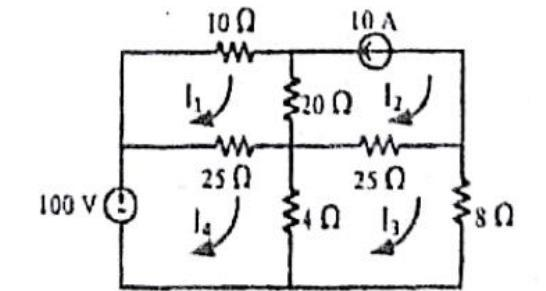

[← Previous: NM-3.5 Gauss-Seidel Iteration](NM-3.5_Gauss_Seidel_Iteration.md) | [🏠 Index](00_Index.md) | [Next: NM-3 Lower Tier →](NM-3_Lower_Gauss_Elim_LU_Jacobi_Relaxation.md)

---

# NM-3.8: Circuit Applications
> **Section:** A (Numerical Methods) | **Priority:** 🔴 | **Exam Frequency:** 5/8 years
> **Sources:** Topicwise NM-3.8, NM-3.5, Fahad Notes §01, Shishir Notes §02

## Why This Topic Matters

In ECE 2213, linear algebraic equations are rarely presented as abstract textbook systems. In 5 out of 8 exam years (2018, 2019, 2020, 2021, and 2024), the question gives a physical DC circuit diagram. The examiner asks you to derive the governing equations and solve for unknown currents or voltages numerically. The taxonomy lists this under NM-3.8, while the numerical solutions are filed under NM-3.5. This note provides the complete circuit analysis toolkit: how to formulate mesh and nodal systems, handle current sources and dependent sources, and ensure diagonal dominance.

---

## 📝 Key Definitions

> **Mesh Analysis (Loop Analysis):** A systematic circuit analysis technique based on Kirchhoff's Voltage Law (KVL) around closed planar loops, yielding a linear system $R I = V$ where $R$ is the loop resistance matrix and $I$ is the vector of clockwise mesh currents.

> **Nodal Analysis:** A systematic circuit analysis technique based on Kirchhoff's Current Law (KCL) at non-reference junctions, yielding a linear system $G V = I_{\text{in}}$ where $G$ is the node conductance matrix and $V$ is the vector of node voltages with respect to reference ground.

> **Constraint Equation (Current Source Branch):** When an ideal current source of value $I_s$ sits in an exterior branch of mesh $k$, it directly fixes that mesh current: $I_k = \pm I_s$. This removes $I_k$ as an unknown variable from the system of equations.

---

## Core Theory

### 1. Formulating Mesh Equations (KVL)

For planar resistive circuits, choose clockwise loop currents $I_1, I_2, \dots, I_m$.
Along loop $k$, KVL states that the algebraic sum of voltage drops equals the sum of voltage rises:

$$
\sum V_{\text{drops}} = \sum V_{\text{rises}}
$$

In matrix form $R I = V$:
- **Diagonal entry $R_{kk}$:** The sum of all resistances around mesh $k$ (always positive).
- **Off-diagonal entry $R_{kj}$ ($j \ne k$):** The negative of the resistance shared between mesh $k$ and mesh $j$.
- **Right-hand side $V_k$:** The net voltage rise from independent voltage sources driving in the direction of $I_k$.

#### The Current Source Rule in Mesh Analysis
If an ideal current source sits in an external branch of mesh $k$, the branch current equals $I_k$:

$$
I_k = I_{\text{source}} \quad \text{(or } -I_{\text{source}} \text{ if opposing)}
$$

Do not write a KVL equation around mesh $k$. The voltage across an ideal current source is unknown. Simply substitute the fixed value of $I_k$ directly into the equations of the adjacent meshes.

### 2. Formulating Nodal Equations (KCL)

Choose a convenient common node as the reference ground ($0\text{ V}$). Label the potentials of all remaining independent nodes as $V_1, V_2, \dots, V_n$.
At each non-reference node $k$, KCL states:

$$
\sum I_{\text{leaving}} = \sum I_{\text{entering}}
$$

In matrix form $G V = I_{\text{net}}$:
- **Diagonal entry $G_{kk}$:** The sum of all conductances connected directly to node $k$.
- **Off-diagonal entry $G_{kj}$ ($j \ne k$):** The negative of the conductance directly connecting node $k$ and node $j$.
- **Right-hand side:** Net current entering node $k$ from independent current sources.

### 3. Handling Dependent Sources

When a circuit contains a dependent source (such as a current-controlled voltage source $k I_0$):
1. Write the controlling variable (e.g., $I_0$) in terms of node voltages using Ohm's law:

$$
I_0 = \frac{V_A - V_B}{R}
$$

2. Relate the dependent source to the terminal voltage or loop equation.
3. Substitute the expression for the controlling variable into the KCL or KVL equations.
4. Collect like terms to obtain standard linear equations in the primary unknowns.

### 4. Natural Diagonal Dominance in Resistive Circuits

Passive resistor networks naturally yield diagonally dominant matrices:
- For mesh analysis, self-resistance $R_{kk} = \sum R_{\text{branches}}$ strictly exceeds any shared resistance $R_{kj}$ whenever mesh $k$ contains an unshared resistor.
- For nodal analysis, self-conductance $G_{kk} = \sum \frac{1}{R}$ exceeds mutual conductances when grounded resistors exist at that node.

This natural diagonal dominance guarantees that the Gauss-Seidel method converges smoothly when the equations are ordered correctly.

---

## Worked Example: Nodal Analysis (PYQ 2019 Q.3(c))

Obtain the nodal equations from the circuit below. Hence solve for the unknowns using the Gauss-Seidel iterative method. Show two iterations only.

> **Source:** 2019 Q.3(c) [Marks: 04]

### Step 1: Identify Nodes
The bottom rail is chosen as the reference ground ($0\text{ V}$).
Two non-reference nodes exist:
- Node 1 with potential $V_1$.
- Node 2 with potential $V_2$.

### Step 2: KCL at Node 1
Summing currents leaving Node 1:
- Downward through $2\ \Omega$ to ground: $\frac{V_1}{2}$
- Rightward through $4\ \Omega$ to Node 2: $\frac{V_1 - V_2}{4}$
- Entering from top branch: $5\text{ A}$ current source enters Node 1, so it contributes $-5\text{ A}$ to leaving current.

$$
\frac{V_1}{2} + \frac{V_1 - V_2}{4} - 5 = 0
$$

Multiply both sides by 4:

$$
2V_1 + (V_1 - V_2) = 20 \implies \boxed{3V_1 - V_2 = 20}
$$

### Step 3: KCL at Node 2
Summing currents leaving Node 2:
- Downward through $6\ \Omega$ to ground: $\frac{V_2}{6}$
- Leftward through $4\ \Omega$ to Node 1: $\frac{V_2 - V_1}{4}$
- Leaving through top branch: $5\text{ A}$ source leaves Node 2, so it contributes $+5\text{ A}$.
- Entering through right branch: $10\text{ A}$ source enters Node 2.

$$
\frac{V_2}{6} + \frac{V_2 - V_1}{4} + 5 = 10 \implies \frac{V_2}{6} + \frac{V_2 - V_1}{4} = 5
$$

Multiply both sides by 12:

$$
2V_2 + 3(V_2 - V_1) = 60 \implies \boxed{-3V_1 + 5V_2 = 60}
$$

### Step 4: Check Diagonal Dominance and Set Up Gauss-Seidel
The system matrix is:

$$
\begin{bmatrix} 3 & -1 \\ -3 & 5 \end{bmatrix} \begin{bmatrix} V_1 \\ V_2 \end{bmatrix} = \begin{bmatrix} 20 \\ 60 \end{bmatrix}
$$

- Row 1: $|3| > |-1| = 1$ (dominant in $V_1$)
- Row 2: $|5| > |-3| = 3$ (dominant in $V_2$)

Both rows are strictly diagonally dominant. The iterative update formulas are:

$$
V_1^{(k+1)} = \frac{20 + V_2^{(k)}}{3}, \qquad V_2^{(k+1)} = \frac{60 + 3V_1^{(k+1)}}{5}
$$

### Step 5: Perform Two Iterations
Starting from $V_1^{(0)} = 0$, $V_2^{(0)} = 0$:

- **Iteration 1:**

$$
V_1^{(1)} = \frac{20 + 0}{3} = 6.666667\text{ V}
$$

$$
V_2^{(1)} = \frac{60 + 3(6.666667)}{5} = \frac{80}{5} = 16.000000\text{ V}
$$

- **Iteration 2:**

$$
V_1^{(2)} = \frac{20 + 16.000000}{3} = \frac{36}{3} = 12.000000\text{ V}
$$

$$
V_2^{(2)} = \frac{60 + 3(12.000000)}{5} = \frac{96}{5} = 19.200000\text{ V}
$$

Exact solution by elimination:

$$
4V_2 = 80 \implies V_2 = 20\text{ V}, \qquad 3V_1 = 40 \implies V_1 = 13.3333\text{ V}
$$

$$
\boxed{V_1 = 13.3333\ \text{V}, \qquad V_2 = 20\ \text{V}}
$$

---

## Exam Circuit Comparison Table

| Year | Circuit Topology | Source Types | Unknowns to Iterate | Elimination Check |
| :-- | :-- | :-- | :-- | :-- |
| **2018 Q.4(b)** | Planar 4-mesh DC network ($2 \times 2$) | $100\text{ V}$ indep voltage, $10\text{ A}$ indep current | $I_1, I_3, I_4$ ($I_2 = -10\text{ A}$ fixed) | $I_1 = -4.1103\text{ A}, I_3 = -6.8695\text{ A}, I_4 = -1.0426\text{ A}$ |
| **2019 Q.3(c)** | 2 non-reference nodes | $5\text{ A}$ and $10\text{ A}$ indep current sources | $V_1, V_2$ | $V_1 = 13.3333\text{ V}, V_2 = 20\text{ V}$ |
| **2020 Q.4(b)** | Planar 3-mesh DC network | $400\text{ V}$ indep voltage, $10\text{ A}$ indep current | $I_1, I_2$ ($I_3 = 10\text{ A}$ fixed) | $I_1 = 13.5135\text{ A}, I_2 = 10.2703\text{ A}$ |
| **2024 Q.2(b)** | Different planar 3-mesh network | $500\text{ V}$ indep voltage, $5\text{ A}$ indep current | $I_1, I_2$ ($I_3 = 5\text{ A}$ fixed) | $I_1 \approx 21.875\text{ A}, I_2 \approx 7.8125\text{ A}$ |
| **2021 Q.7(b)** | 2 non-reference nodes | $30\text{ V}$ indep voltage, $5I_0$ dependent voltage | $V_C, V_R$ (then $I_0$) | $I_0 = 1.6235\text{ A}, V_C = 13.7648\text{ V}, V_R = 8.1176\text{ V}$ |

---

## 🏆 Golden Questions (Past Exam Archive)

### 🎯 Solve $I_1, I_2 \text{ and } I_3$ using Gauss-Seidel method.
> **Appeared:** 2020 Q.4(b) — (06 marks)

> **2024 Q.2(b) is a different network** with a $500\text{ V}$ source, a $5\text{ A}$ source, and
> $10$, $20$, $100\ \Omega$ resistors. It is solved in full under NM-3.5, which owns that
> question. The numbers below apply to the 2020 circuit only.

**Full Answer:**

**Step 1: Account for the current source.**
Mesh 3 is bounded on the right by an ideal $10\text{ A}$ current source directed downward. Since no other mesh shares this branch, the clockwise mesh current is fixed:

$$
I_3 = 10\text{ A}
$$

**Step 2: Mesh 1 KVL.**
Traversing clockwise around loop 1:

$$
-400 + 20I_1 + 40(I_1 - I_2) = 0 \implies 60I_1 - 40I_2 = 400
$$

**Step 3: Mesh 2 KVL.**
Traversing clockwise around loop 2:

$$
40(I_2 - I_1) + 10I_2 + 100(I_2 - I_3) = 0
$$

Substitute $I_3 = 10\text{ A}$:

$$
-40I_1 + 150I_2 - 1000 = 0 \implies -40I_1 + 150I_2 = 1000
$$

**Step 4: Check diagonal dominance and set up iterations.**
In row 1, $|60| > |-40| = 40$. In row 2, $|150| > |-40| = 40$. Both rows are strictly dominant.

$$
I_1^{(k+1)} = \frac{400 + 40I_2^{(k)}}{60}, \qquad I_2^{(k+1)} = \frac{1000 + 40I_1^{(k+1)}}{150}
$$

Starting from $I_1^{(0)} = I_2^{(0)} = 0$, the iterations converge to:

$$
I_1 = \frac{500}{37} \approx 13.5135\text{ A}, \qquad I_2 = \frac{380}{37} \approx 10.2703\text{ A}
$$

$$
\boxed{I_1 = 13.5135 \text{ A}, \qquad I_2 = 10.2703 \text{ A}, \qquad I_3 = 10.0000 \text{ A}}
$$

*(For the full 10-iteration sweep table, see [NM-3.5: Gauss-Seidel Iteration](NM-3.5_Gauss_Seidel_Iteration.md).)*

---

### 🎯 Determine the value of $I_0$ in the given circuit using Gauss-Seidel method.
> **Appeared:** 2021 Q.7(b) — (06 marks, CO: 2)

**Full Answer:**

**Step 1: Set reference and label node voltages.**
Ground reference is the bottom rail ($0\text{ V}$). Top rail is held at $V_T = 30\text{ V}$.
Centre node potential is $V_C$, right node potential is $V_R$.

**Step 2: Express the controlling current $I_0$.**
Current through the $10\ \Omega$ branch:

$$
I_0 = \frac{V_T - V_C}{10} = \frac{30 - V_C}{10}
$$

**Step 3: Relate dependent voltage source.**
The right node is driven by the dependent voltage source $5I_0$:

$$
V_R = 5I_0 = 5\left(\frac{30 - V_C}{10}\right) = 15 - 0.5V_C \implies V_C + 2V_R = 30
$$

**Step 4: KCL at centre node $V_C$.**

$$
\frac{V_C - 30}{10} + \frac{V_C - 0}{15} + \frac{V_C - V_R}{8} = 0
$$

Multiply through by 120:

$$
12(V_C - 30) + 8V_C + 15(V_C - V_R) = 0 \implies 35V_C - 15V_R = 360
$$

**Step 5: Diagonally dominant arrangement and solution.**
Order the equations to maintain diagonal dominance:
- Equation 1: $35V_C - 15V_R = 360$ ($|35| > |-15|$)
- Equation 2: $V_C + 2V_R = 30$ ($|2| > |1|$)

$$
V_C^{(k+1)} = \frac{360 + 15V_R^{(k)}}{35}, \qquad V_R^{(k+1)} = \frac{30 - V_C^{(k+1)}}{2}
$$

Converged node potentials:

$$
V_C = \frac{234}{17} \approx 13.7648\text{ V}, \qquad V_R = \frac{138}{17} \approx 8.1176\text{ V}
$$

Calculating branch current $I_0$:

$$
I_0 = \frac{30 - 13.764778}{10} = 1.6235\text{ A}
$$

$$
\boxed{I_0 = 1.6235 \text{ A}, \quad V_C = 13.7648 \text{ V}, \quad V_R = 8.1176 \text{ V}}
$$

*(For the complete 8-iteration table, see [NM-3.5: Gauss-Seidel Iteration](NM-3.5_Gauss_Seidel_Iteration.md).)*

---

### 🎯 Solve the following circuit by using Gauss-Seidel method.
> **Appeared:** 2018 Q.4(b) — (05 marks)

**Full Answer:**

**Step 1: Constraint equation.**
The $10\text{ A}$ source in the outer branch of mesh 2 directly fixes $I_2$:

$$
I_2 = -10\text{ A}
$$

**Step 2: KVL around meshes 1, 3, and 4.**
- Mesh 1: $10I_1 + 20(I_1 - I_2) + 25(I_1 - I_4) = 0 \implies 55I_1 - 25I_4 = -200$
- Mesh 3: $8I_3 + 25(I_3 - I_2) + 4(I_3 - I_4) = 0 \implies 37I_3 - 4I_4 = -250$
- Mesh 4: $25(I_4 - I_1) + 4(I_4 - I_3) = 100 \implies -25I_1 - 4I_3 + 29I_4 = 100$

**Step 3: Gauss-Seidel updates.**

$$
I_1^{(k+1)} = \frac{-200 + 25I_4^{(k)}}{55}, \quad I_3^{(k+1)} = \frac{-250 + 4I_4^{(k)}}{37}, \quad I_4^{(k+1)} = \frac{100 + 25I_1^{(k+1)} + 4I_3^{(k+1)}}{29}
$$

Starting from $(0, 0, 0)$, the iteration reaches the exact currents:

$$
\boxed{I_1 = -4.1103\ \text{A}, \quad I_2 = -10\ \text{A}, \quad I_3 = -6.8695\ \text{A}, \quad I_4 = -1.0426\ \text{A}}
$$

*(For the complete 8-iteration table, see [NM-3.5: Gauss-Seidel Iteration](NM-3.5_Gauss_Seidel_Iteration.md).)*

---

## ⚡ Exam Tips & Common Mistakes

1. **Spot current sources first.** If an independent current source sits on a boundary branch, write down that mesh current immediately. Never assign a variable voltage across it to write a loop equation.
2. **Dependent source substitution.** Always express controlling currents like $I_0$ in terms of node voltages before writing KCL. Do not treat the dependent source as an independent unknown.
3. **Always verify diagonal dominance before iterating.** If you form your equations and find a small diagonal coefficient, swap equations immediately.
4. **Independent verification by elimination.** A $2 \times 2$ system can be solved on your calculator or by quick elimination in 30 seconds. Do this to verify your converged values.

## 🔗 Related Topics

- [NM-3.5: Gauss-Seidel Iteration](NM-3.5_Gauss_Seidel_Iteration.md) — full numerical execution of the iteration tables
- [NM-3.2: Pivoting](NM-3.2_Pivoting.md) — row swaps in direct elimination
- [NM-3_Lower: Gauss Elimination, LU, Jacobi, Relaxation](NM-3_Lower_Gauss_Elim_LU_Jacobi_Relaxation.md) — alternative solvers for linear systems

---

[← Previous: NM-3.5 Gauss-Seidel Iteration](NM-3.5_Gauss_Seidel_Iteration.md) | [🏠 Index](00_Index.md) | [Next: NM-3 Lower Tier →](NM-3_Lower_Gauss_Elim_LU_Jacobi_Relaxation.md)
