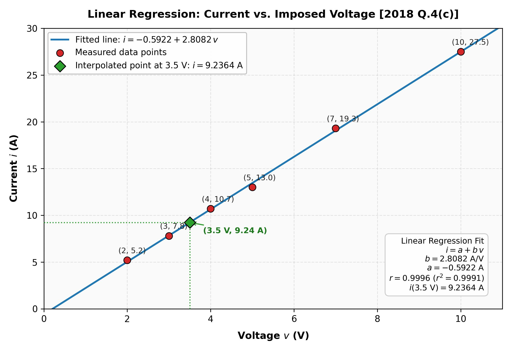

[← Previous: NM-4.1 Curve Fitting Concepts](NM-4.1_Curve_Fitting_Concepts.md) | [🏠 Index](00_Index.md) | [Next: NM-4.3 Non-Linear Regression →](NM-4.3_Non_Linear_Regression.md)

---

# NM-4.2: Least-Squares Linear Regression
> **Section:** A (Numerical Methods) | **Priority:** 🔴⚠️ | **Exam Frequency:** 4/8 years
> **Sources:** Jain Ch.4 §4.1–§4.2 (p. 126–129); Absent from Class Notes (Danger Zone!)

## Why This Topic Matters

This topic was not taught in class lectures, yet it appeared in 4 semester final exams. It tests two skills: deriving the normal equations from the principle of least squares, and calculating the slope and intercept for experimental data tables. Because this topic is omitted in class notes, students who rely only on lecture notebooks lose full marks here.

---

## 📝 Key Definitions

> **Method of Least Squares:** "Let the set of data points be $(x_i, y_i), i = 1, 2, \dots, m$, and let the curve given by $Y = f(x)$ be fitted to this data. At $x = x_i$, the given ordinate is $y_i$ and the corresponding value on the fitting curve is $f(x_i)$. If $e_i$ is the error of approximation at $x = x_i$, then we have $e_i = y_i - f(x_i)$. If we write $S = e_1^2 + e_2^2 + \dots + e_m^2$, then the method of least squares consists in minimizing $S$, i.e., the sum of the squares of the errors." — Jain, §4.2 (p. 126–127)

> **Normal Equations:** "Equations (4.6) are called the *normal equations*, and can be solved for $a_0$ and $a_1$, since $x_i$ and $y_i$ are known quantities." — Jain, §4.2.1 (p. 128)

> **Goodness of Fit (Correlation Coefficient):** "The correlation coefficient (cc) is defined as $\text{cc} = \sqrt{\dfrac{S_y - S}{S_y}}$, where $S_y = \sum_{i=1}^m (y_i - \bar{y})^2$ and $S = \sum_{i=1}^m [y_i - f(x_i)]^2$. If cc is close to 1, then the fit is considered to be good." — Jain, §4.2.1 (p. 128)

---

## Core Theory: Derivation of the Linear Regression Model

### 1. Formulating the Minimization Problem

Let a set of $n$ experimental data points be given:

$$
(x_1, y_1), (x_2, y_2), \dots, (x_n, y_n)
$$

We want to fit a straight line:

$$
\hat{y} = a + bx
$$

At each data point $i$, the difference between the measured value $y_i$ and the predicted value $\hat{y}_i$ is the residual $r_i$:

$$
r_i = y_i - (a + bx_i)
$$

The sum of the squared residuals is:

$$
S(a, b) = \sum_{i=1}^n r_i^2 = \sum_{i=1}^n [y_i - (a + bx_i)]^2
$$

We must find the coefficients $a$ and $b$ that minimize $S$.

### 2. Differentiating with Respect to the Parameters

For $S$ to be a minimum, its partial derivatives with respect to $a$ and $b$ must vanish simultaneously:

$$
\frac{\partial S}{\partial a} = 0 \quad \text{and} \quad \frac{\partial S}{\partial b} = 0
$$

Taking the partial derivative with respect to $a$:

$$
\frac{\partial S}{\partial a} = \sum_{i=1}^n 2[y_i - (a + bx_i)](-1) = -2 \sum_{i=1}^n [y_i - a - bx_i] = 0
$$

Dividing by $-2$ and distributing the summation:

$$
\sum_{i=1}^n y_i - \sum_{i=1}^n a - b \sum_{i=1}^n x_i = 0
$$

Since $\sum_{i=1}^n a = na$, we get the **First Normal Equation**:

$$
na + b \sum_{i=1}^n x_i = \sum_{i=1}^n y_i
$$

Now taking the partial derivative with respect to $b$:

$$
\frac{\partial S}{\partial b} = \sum_{i=1}^n 2[y_i - (a + bx_i)](-x_i) = -2 \sum_{i=1}^n [x_i y_i - ax_i - bx_i^2] = 0
$$

Dividing by $-2$ and distributing the summation:

$$
\sum_{i=1}^n x_i y_i - a \sum_{i=1}^n x_i - b \sum_{i=1}^n x_i^2 = 0
$$

This gives the **Second Normal Equation**:

$$
a \sum_{i=1}^n x_i + b \sum_{i=1}^n x_i^2 = \sum_{i=1}^n x_i y_i
$$

### 3. Solving the Normal Equations for $a$ and $b$

We have a $2 \times 2$ system of linear equations in the unknowns $a$ and $b$:

1. $na + b\sum x = \sum y$
2. $a\sum x + b\sum x^2 = \sum xy$

From the first equation, divide by $n$:

$$
a + b \bar{x} = \bar{y} \implies a = \bar{y} - b \bar{x}
$$

Substitute this expression for $a$ into the second equation:

$$
(\bar{y} - b\bar{x})\sum x + b\sum x^2 = \sum xy
$$

Using $\bar{y} = \frac{\sum y}{n}$ and $\bar{x} = \frac{\sum x}{n}$:

$$
\frac{\sum y}{n} \sum x - b \frac{(\sum x)^2}{n} + b \sum x^2 = \sum xy
$$

Multiply the entire equation by $n$:

$$
\left(\sum x\right)\left(\sum y\right) + b \left[n \sum x^2 - \left(\sum x\right)^2\right] = n \sum xy
$$

Rearranging for the slope $b$:

$$
b = \frac{n \sum xy - \sum x \sum y}{n \sum x^2 - \left(\sum x\right)^2}
$$

Once $b$ is calculated, the intercept $a$ is obtained from:

$$
a = \bar{y} - b \bar{x} = \frac{\sum y}{n} - b \frac{\sum x}{n}
$$

Both second partial derivatives are strictly positive ($\frac{\partial^2 S}{\partial a^2} = 2n > 0$), confirming that these parameters minimize $S$.

### 4. Step-by-Step Algorithm for Calculation

1. Count the number of data pairs $n$.
2. Form a calculation table with columns: $x_i$, $y_i$, $x_i^2$, and $x_i y_i$.
3. Compute the four sums: $\sum x$, $\sum y$, $\sum x^2$, and $\sum xy$.
4. Calculate $b$ using the closed-form equation.
5. Compute the sample means $\bar{x} = \frac{\sum x}{n}$ and $\bar{y} = \frac{\sum y}{n}$.
6. Calculate $a = \bar{y} - b\bar{x}$.
7. Write the fitted regression equation: $y = a + bx$.
8. Verify that the line passes through $(\bar{x}, \bar{y})$ and that $\sum (y_i - \hat{y}_i) \approx 0$.

---

## Worked Example (PYQ 2018 Q.4(c))

The following data was taken from an experiment measuring current in a wire for various imposed voltages:

| $v$ (V) | 2 | 3 | 4 | 5 | 7 | 10 |
| :---: | :---: | :---: | :---: | :---: | :---: | :---: |
| $i$ (A) | 5.2 | 7.8 | 10.7 | 13 | 19.3 | 27.5 |

Fit the line $i = a + bv$, determine current at $3.5\text{ V}$, and plot the fit.

**Step 1: Summary Table ($n = 6$)**

| $v$ | $i$ | $v^2$ | $vi$ |
| :--: | :--: | :--: | :--: |
| 2 | 5.2 | 4 | 10.4 |
| 3 | 7.8 | 9 | 23.4 |
| 4 | 10.7 | 16 | 42.8 |
| 5 | 13.0 | 25 | 65.0 |
| 7 | 19.3 | 49 | 135.1 |
| 10 | 27.5 | 100 | 275.0 |
| **$\sum v = 31$** | **$\sum i = 83.5$** | **$\sum v^2 = 203$** | **$\sum vi = 551.7$** |

**Step 2: Calculate Slope $b$ and Intercept $a$**

$$
b = \frac{n\sum vi - \sum v\sum i}{n\sum v^2 - \left(\sum v\right)^2} = \frac{6(551.7) - (31)(83.5)}{6(203) - 31^2} = \frac{3310.2 - 2588.5}{1218 - 961} = \frac{721.7}{257} = 2.8082\ \text{A/V}
$$

$$
a = \bar{i} - b\bar{v} = \frac{83.5}{6} - 2.8082\left(\frac{31}{6}\right) = 13.9167 - 14.5089 = -0.5922\ \text{A}
$$

$$
\boxed{i = -0.5922 + 2.8082\,v}
$$

**Step 3: Estimate at $3.5\text{ V}$**

$$
i(3.5) = -0.5922 + 2.8082(3.5) = -0.5922 + 9.8287 = 9.2364
$$

$$
\boxed{i(3.5\ \text{V}) = 9.2364\ \text{A}}
$$

**Step 4: Plot of the Regression Fit**

The plot displays the experimental points clustered tightly along the line. The correlation coefficient is $r = 0.9996$, confirming that Ohm's law holds closely for this wire.

---

## Exam Variants

| Year | Question Text | Data Given | Key Answer |
| :---| :---| :---| :---|
| 2017 Q.6(b) / 2024 Q.3(c) | Fit a straight line to $x$ and $y$ table | $x \in \{1, 2, 3, 4, 5, 6, 7\}$; $y \in \{0.5, 2.5, 2.0, 4.0, 3.5, 6.0, 5.5\}$ | $\boxed{y = 0.0714 + 0.8393x}$ |
| 2018 Q.4(c) | Wire voltage vs. current linear regression | $v \in \{2, 3, 4, 5, 7, 10\}$; $i \in \{5.2, 7.8, 10.7, 13, 19.3, 27.5\}$ | $\boxed{i = -0.5922 + 2.8082\,v}$, $\boxed{i(3.5\ \text{V}) = 9.2364\ \text{A}}$ |
| 2019 Q.4(c) | Deduce the linear regression expression | Theoretical derivation of $y = a + bx$ | $\boxed{y = \left(\bar y - b\bar x\right) + bx \quad\text{with}\quad b = \frac{n\sum xy - \sum x \sum y}{n\sum x^2 - \left(\sum x\right)^2}}$ |

---

## 🏆 Golden Questions (Past Exam Archive)

### 🎯 Fit a straight line to the $x$ and $y$ values in the first two columns of the following table.
> **Appeared:** 2017 Q.6(b), 2024 Q.3(c) — (04 marks)

**Full Answer:**

Given table:

| $x$ | 1 | 2 | 3 | 4 | 5 | 6 | 7 |
| :---: | :---: | :---: | :---: | :---: | :---: | :---: | :---: |
| $y$ | 0.5 | 2.5 | 2.0 | 4.0 | 3.5 | 6.0 | 5.5 |

Fit $y = a + bx$ using least squares. Here $n = 7$.

Compute the necessary sums:

$$
\sum x = 1 + 2 + 3 + 4 + 5 + 6 + 7 = 28
$$

$$
\sum y = 0.5 + 2.5 + 2.0 + 4.0 + 3.5 + 6.0 + 5.5 = 24
$$

$$
\sum x^2 = 1 + 4 + 9 + 16 + 25 + 36 + 49 = 140
$$

For $\sum xy$:

$$
\sum xy = 1(0.5) + 2(2.5) + 3(2.0) + 4(4.0) + 5(3.5) + 6(6.0) + 7(5.5) = 0.5 + 5 + 6 + 16 + 17.5 + 36 + 38.5 = 119.5
$$

**The normal equations:**

1. $na + b\sum x = \sum y \implies 7a + 28b = 24$
2. $a\sum x + b\sum x^2 = \sum xy \implies 28a + 140b = 119.5$

Multiply the first equation by $4$:

$$
28a + 112b = 96
$$

Subtract this from the second equation:

$$
28b = 119.5 - 96 = 23.5 \implies b = \frac{23.5}{28} = \frac{47}{56} \approx 0.839286
$$

Substitute $b$ back into the first equation:

$$
7a = 24 - 28(0.839286) = 24 - 23.5 = 0.5 \implies a = \frac{0.5}{7} = \frac{1}{14} \approx 0.071429
$$

Rounding to four decimal places gives the fitted straight line:

$$
\boxed{y = 0.0714 + 0.8393x}
$$

**Residual check table:**

| $x$ | $y$ | $\hat{y} = 0.0714 + 0.8393x$ | $e = y - \hat{y}$ |
| :--: | :--: | :--: | :--: |
| 1 | 0.5 | 0.9107 | $-0.4107$ |
| 2 | 2.5 | 1.7500 | $+0.7500$ |
| 3 | 2.0 | 2.5893 | $-0.5893$ |
| 4 | 4.0 | 3.4286 | $+0.5714$ |
| 5 | 3.5 | 4.2679 | $-0.7679$ |
| 6 | 6.0 | 5.1071 | $+0.8929$ |
| 7 | 5.5 | 5.9464 | $-0.4464$ |

The sum of residuals is $\sum e = 0$, confirming the calculations.

---

### 🎯 The following data was taken from an experiment that measured the current in a wire for various imposed voltages. On the basis of a linier regression of this data, determine current for a voltage of $3.5\text{ V}$. Plot the line to evaluate the fit.
> **Appeared:** 2018 Q.4(c) — (05 marks)

**Full Answer:**

Given experimental data:

| $v$ (V) | 2 | 3 | 4 | 5 | 7 | 10 |
| :---: | :---: | :---: | :---: | :---: | :---: | :---: |
| $i$ (A) | 5.2 | 7.8 | 10.7 | 13 | 19.3 | 27.5 |

Fit the line $i = a + bv$ by least squares with $n = 6$:

$$
\sum v = 31, \qquad \sum i = 83.5, \qquad \sum v^2 = 203, \qquad \sum vi = 551.7
$$

Calculate slope $b$:

$$
b = \frac{n\sum vi - \sum v\sum i}{n\sum v^2 - \left(\sum v\right)^2} = \frac{6(551.7) - (31)(83.5)}{6(203) - 31^2} = \frac{3310.2 - 2588.5}{1218 - 961} = \frac{721.7}{257} = 2.8082\ \text{A/V}
$$

Calculate intercept $a$:

$$
a = \bar{i} - b\bar{v} = \frac{83.5}{6} - 2.8082\left(\frac{31}{6}\right) = 13.9167 - 14.5089 = -0.5922\ \text{A}
$$

The fitted line is:

$$
\boxed{i = -0.5922 + 2.8082\,v}
$$

Evaluating the current at $v = 3.5\text{ V}$:

$$
i(3.5) = -0.5922 + 2.8082(3.5) = -0.5922 + 9.8287 = 9.2364\ \text{A}
$$

$$
\boxed{i(3.5\ \text{V}) = 9.2364\ \text{A}}
$$

**Plot of the line:**

The points lie tightly on the line. Residuals $r_i = i_i - \hat{i}_i$ are small across all points ($+0.18, -0.03, +0.06, -0.45, +0.24, +0.01$), confirming a reliable linear fit.

---

### 🎯 Deduce the linear regression expression.
> **Appeared:** 2019 Q.4(c) — (04 marks)

**Full Answer:**

Let the data points be $(x_i, y_i)$ for $i = 1, 2, \dots, n$, and let the fitted line be:

$$
\hat{y} = a + bx
$$

The residual at each point is $r_i = y_i - a - bx_i$. We choose $a$ and $b$ to minimize the sum of squared residuals:

$$
S(a, b) = \sum_{i=1}^n (y_i - a - bx_i)^2
$$

At a minimum, both partial derivatives must equal zero:

$$
\frac{\partial S}{\partial a} = -2 \sum_{i=1}^n (y_i - a - bx_i) = 0 \implies \sum y_i = na + b\sum x_i
$$

$$
\frac{\partial S}{\partial b} = -2 \sum_{i=1}^n x_i (y_i - a - bx_i) = 0 \implies \sum x_i y_i = a\sum x_i + b\sum x_i^2
$$

These are the **normal equations**:

$$
na + b\sum x_i = \sum y_i
$$

$$
a\sum x_i + b\sum x_i^2 = \sum x_i y_i
$$

Eliminating $a$ from the first equation gives:

$$
a = \frac{\sum y_i}{n} - b\frac{\sum x_i}{n} = \bar{y} - b\bar{x}
$$

Substituting this into the second normal equation:

$$
(\bar{y} - b\bar{x})\sum x_i + b\sum x_i^2 = \sum x_i y_i
$$

Multiply through and collect terms in $b$:

$$
\bar{y} \sum x_i - b\bar{x}\sum x_i + b\sum x_i^2 = \sum x_i y_i
$$

Using $\bar{y}\sum x_i = \frac{(\sum x_i)(\sum y_i)}{n}$ and $\bar{x}\sum x_i = \frac{(\sum x_i)^2}{n}$:

$$
b \left[\sum x_i^2 - \frac{(\sum x_i)^2}{n}\right] = \sum x_i y_i - \frac{(\sum x_i)(\sum y_i)}{n}
$$

Multiplying numerator and denominator by $n$:

$$
b = \frac{n\sum x_i y_i - \sum x_i \sum y_i}{n\sum x_i^2 - \left(\sum x_i\right)^2}, \qquad a = \bar{y} - b\bar{x}
$$

Thus, the final linear regression expression is:

$$
\boxed{y = \left(\bar y - b\bar x\right) + bx \quad\text{with}\quad b = \frac{n\sum xy - \sum x \sum y}{n\sum x^2 - \left(\sum x\right)^2}}
$$

---

## ⚡ Exam Tips & Common Mistakes

1. **Do not confuse $\sum x^2$ with $(\sum x)^2$.** $\sum x^2$ is the sum of the squared $x$ values. $(\sum x)^2$ is the square of the sum of $x$. The denominator is always positive for distinct points: $n\sum x^2 - (\sum x)^2 > 0$.
2. **Double check $\sum xy$.** Multiply each pair before summing. This is where most arithmetic slips happen under exam pressure.
3. **Always verify the centroid.** Calculate $\bar{x} = \frac{\sum x}{n}$ and $\bar{y} = \frac{\sum y}{n}$. Check if $a + b\bar{x} = \bar{y}$. If this check fails, your $a$ or $b$ contains an error.
4. **Sign check on residuals.** Compute the sum of residuals $\sum (y_i - \hat{y}_i)$. It must equal zero within rounding error.

## 🔗 Related Topics

- [NM-4.1: Curve Fitting Concepts](NM-4.1_Curve_Fitting_Concepts.md) — foundational principles and least-squares criteria
- [NM-4.3: Non-Linear Regression](NM-4.3_Non_Linear_Regression.md) — linearizing exponential and rational models
- [NM-4_Lower: Regression Theory & Interpolation Methods](NM-4_Lower_Regression_Theory_Interpolation_Methods.md) — theoretical regression criteria and alternative models

---

[← Previous: NM-4.1 Curve Fitting Concepts](NM-4.1_Curve_Fitting_Concepts.md) | [🏠 Index](00_Index.md) | [Next: NM-4.3 Non-Linear Regression →](NM-4.3_Non_Linear_Regression.md)
