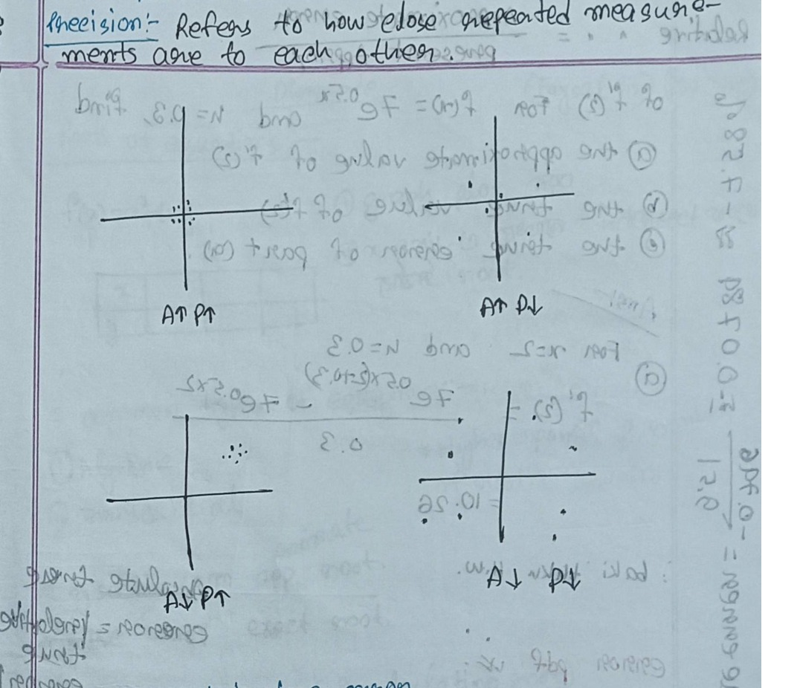
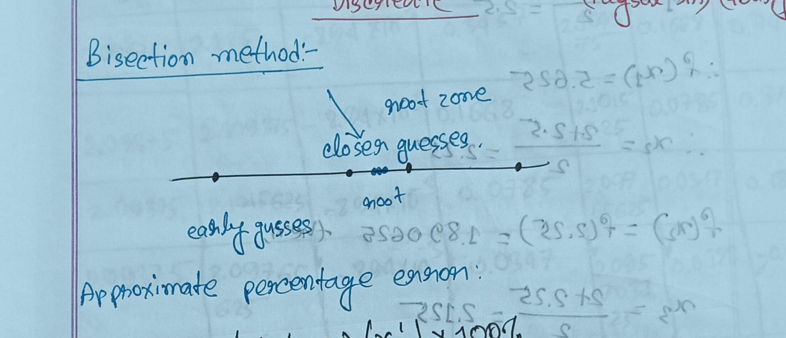
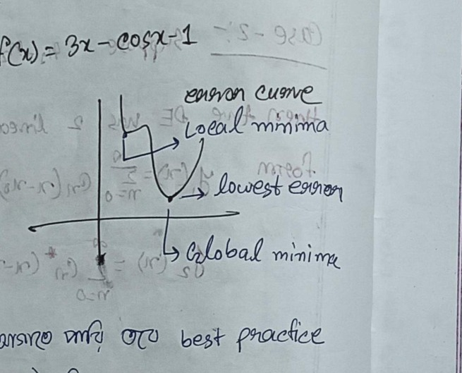
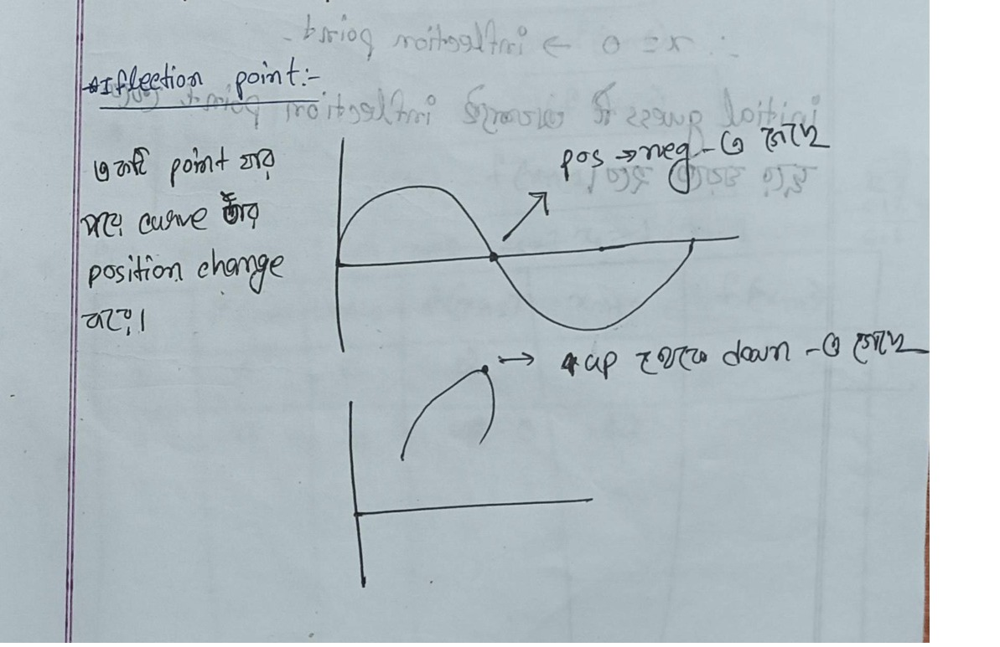
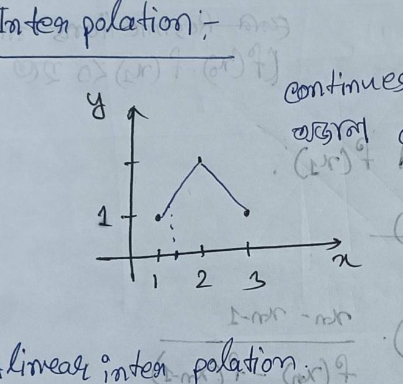
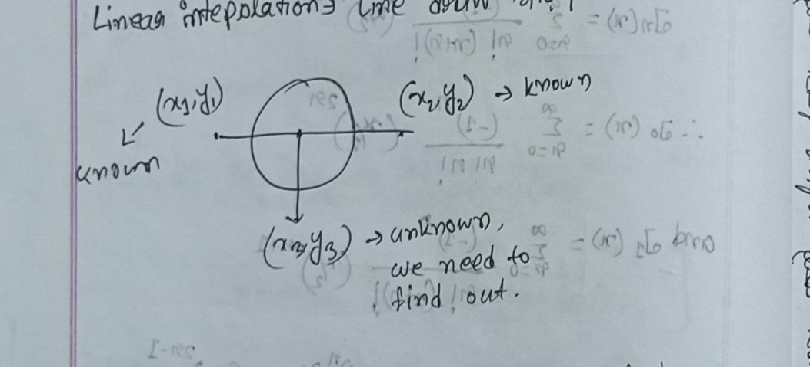
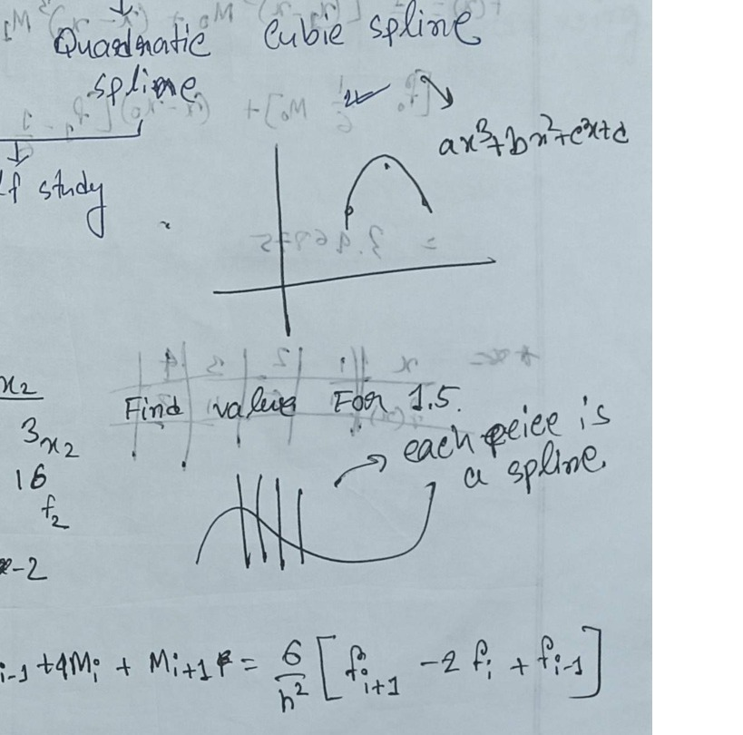
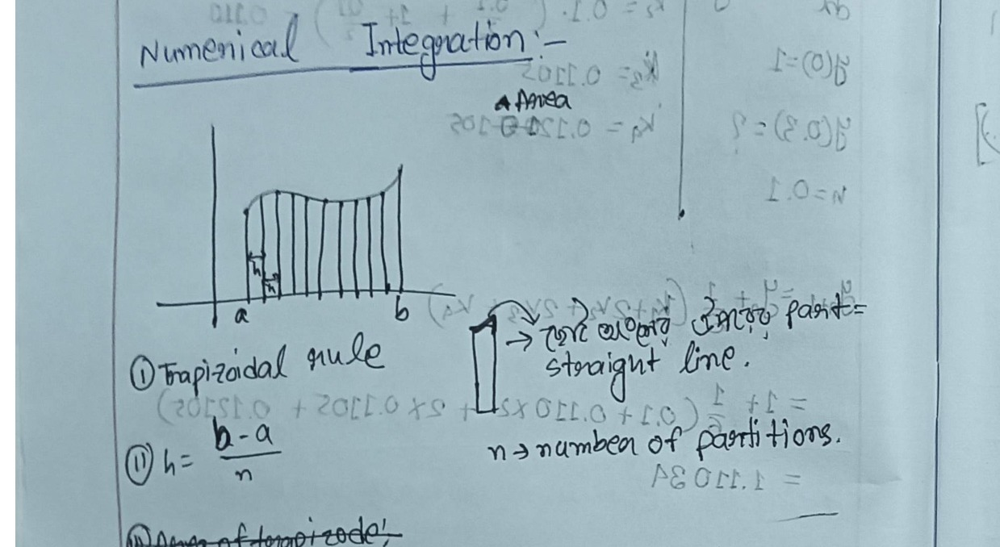

# ECE 2213: Numerical Methods — Class Notes

> **Course**: ECE 2213 — Numerical Methods  
> **Source**: `ClassNote_ECE2213_Fahad.pdf` (Pages 1–24: Complete Numerical Methods)  
> **Instructors**: Faysal Sir & Nadim Sir  
> **Textbook Reference**: *Introductory Methods of Numerical Analysis* by S. S. Sastry  
> **Student Notes**: Fahad  
> **Note**: All handwritten Bangla notes and annotations have been translated faithfully into clear English preserving their original pedagogical meaning.

---

## CLASS-01 | 29 June | Introduction to Numerical Methods & Errors

<!-- Page 1 (Left) -->

### 1. What are Numerical Methods?

> **Definition**:  
> **Numerical methods** are mathematical techniques used to obtain approximate numerical solutions to mathematical problems that cannot be solved exactly or efficiently using analytical (closed-form) methods.

- **Analytical vs. Numerical**:
  - Analytical methods provide *exact* mathematical solutions (e.g., finding exact roots of a simple quadratic equation).
  - Numerical methods provide *approximate* solutions within a desired error tolerance (essential when equations are non-linear, high-degree algebraic, transcendental, or systems are large).

---

### 2. Accuracy vs. Precision

| Concept | Definition | Key Idea |
| :--- | :--- | :--- |
| **Accuracy** | Refers to how close a measured/calculated value is to the **true, correct, or accepted value**. | Closeness to the bulls-eye / ground truth. |
| **Precision** | Refers to how close **repeated measurements** are to each other. | Repeatability / tightness of clustering (*closeness to each other*). |

#### The 4 Accuracy & Precision Scenarios:
1. **$A \uparrow P \uparrow$ (High Accuracy, High Precision)**: Values are tightly clustered directly around the true target value.
2. **$A \uparrow P \downarrow$ (High Accuracy, Low Precision)**: Values are scattered around, but their average is centered on the true value.
3. **$A \downarrow P \uparrow$ (Low Accuracy, High Precision)**: Values are tightly grouped together, but shifted away from the true target (systematic bias).
4. **$A \downarrow P \downarrow$ (Low Accuracy, Low Precision)**: Values are widely dispersed and far from the true value.


*Figure 1.1 — Four scenarios of accuracy and precision shown on target coordinate plots (Page 1)*

---

<!-- Gutter Note -->
> [!NOTE]
> **Margin Note (Error Definitions)**:
> - **True Error ($E_t$)**: The difference between the true value and the approximate value:
>   $$E_t = \text{True Value} - \text{Approximate Value}$$
> - **Relative True Error ($\epsilon_t$)**: The ratio of the true error to the true value:
>   $$\epsilon_t = \frac{\text{True Error}}{\text{True Value}} = \frac{E_t}{\text{True Value}}$$
> - **Absolute True Error**: Magnitude of the error: $|E_t|$ or $|\epsilon_t|$.

<!-- Page 1 (Right) -->

### 3. Error Analysis Example

> [!TIP]
> **Exam Tip from Teacher**: "Definitions and numerical error problems are important for the exam."

#### Example 1: Finite Difference Approximation of a Derivative
The first derivative of a function $f(x)$ at a specific point $x$ can be approximately calculated using the forward finite difference formula:
$$f'(x) \approx \frac{f(x+h) - f(x)}{h}$$

---

<!-- Page 2 (Left) -->

#### Problem Statement:
For the function $f(x) = 7 e^{0.5x}$ and step size $h = 0.3$, calculate:
1. The **approximate value** of $f'(2)$
2. The **true value** of $f'(2)$
3. The **true error** of part (1)
4. The **relative true percentage error**

#### Solution:

**(a) Approximate Value of $f'(2)$**:
Using forward difference with $x = 2$ and $h = 0.3$:
$$f'(2) \approx \frac{7e^{0.5(2 + 0.3)} - 7e^{0.5(2)}}{0.3}$$
$$f'(2) \approx \frac{7e^{1.15} - 7e^{1.0}}{0.3} = \frac{7(3.15819) - 7(2.71828)}{0.3} = \mathbf{10.26}$$

> *Note*: "The rest of the problem was assigned as Homework."

**(b) True Value of $f'(2)$**:
Differentiating analytically:
$$f(x) = 7e^{0.5x}$$
$$f'(x) = 7 \times 0.5 e^{0.5x} = 3.5 e^{0.5x}$$
At $x = 2$:
$$f'(2) = 3.5 e^{0.5 \times 2} = 3.5 e^{1.0} \approx \mathbf{9.51}$$

**(c) True Error ($E_t$)**:
$$E_t = \text{True Value} - \text{Approximate Value}$$
$$E_t = 9.51 - 10.26 = \mathbf{-0.746}$$

**(d) Relative True Percentage Error ($\epsilon_t$)**:
$$\epsilon_t = \frac{E_t}{\text{True Value}} \times 100\% = \frac{-0.746}{9.51} \times 100\% \approx -0.0784 \times 100\% \approx \mathbf{-7.58\%}$$

---

## CLASS-02 | 30 June | Roots of Equations & The Bisection Method

<!-- Page 2 (Right) -->

### 1. Concept of Roots of Equations

For an equation $f(x) = 0$:
1. Plot $y = f(x)$ on a graph.
2. **The points where the curve intersects the $x$-axis ($y = 0$) are the roots of the equation.**

#### Two Common Types of Equations:
1. **Algebraic Equations**: Polynomial equations of the form $a_n x^n + \dots + a_1 x + a_0 = 0$.
   - *Rule of thumb*: The highest power of $x$ (degree) indicates the total number of roots.
2. **Transcendental Equations**: Contain non-algebraic functions such as trigonometric ($\sin x, \cos x$), exponential ($e^x$), or logarithmic functions ($\ln x$).

#### Solution Approaches:
- **Analytic / Direct Solution**: Yields exact roots (only possible for certain classes of equations).
- **Numerical / Bisection Method**: Yields approximate roots to within any specified tolerance.

---

### 2. The Bisection Method (Interval Halving)

> [!IMPORTANT]
> **Exam Note**: "You must write the formal algorithm in the exam."
> **Core Concept**: Keep cutting the bracketed interval in half until the root is isolated.

#### Graphical / Interval Intuition:
If a continuous function $f(x)$ satisfies $f(a) \cdot f(b) < 0$, then according to the *Intermediate Value Theorem*, there exists at least one real root in the interval $[a, b]$.

![Fig_Class02.1: Hand-drawn interval sketch showing root bracket [a, b], function curve crossing the x-axis, and midpoint estimate x_r](diagrams/ClassNote_p003_fig1.jpg)
*Figure 2.1 — Root bracketing on interval [a, b] with midpoint estimate x_r (Page 3)*

---

<!-- Page 3 (Left & Right) -->

### 3. Formal Bisection Algorithm

1. **Step 1 (Bracketing)**: Choose two real numbers $a$ and $b$ such that they have opposite signs:
   $$f(a) \cdot f(b) < 0$$
2. **Step 2 (Bisection)**: Compute the midpoint estimate:
   $$x_r = \frac{a + b}{2}$$
3. **Step 3 (Sub-interval Selection)**:
   - **(a)** If $f(a) \cdot f(x_r) < 0$: The root lies in the left sub-interval $[a, x_r]$. Set $b = x_r$ and return to **Step 2**.
   - **(b)** If $f(a) \cdot f(x_r) > 0$: The root lies in the right sub-interval $[x_r, b]$. Set $a = x_r$ and return to **Step 2**.
   - **(c)** If $f(a) \cdot f(x_r) = 0$: Then $x_r$ is the exact root; terminate the computation.
4. **Step 4 (Error Evaluation)**: Calculate the approximate relative percentage error:
   $$\epsilon_a = \left| \frac{x_r^{\text{new}} - x_r^{\text{old}}}{x_r^{\text{new}}} \right| \times 100\%$$
5. **Step 5 (Stopping Criterion)**: Terminate the iteration when $\epsilon_a < \epsilon_s$ (the prescribed tolerance) or when a specified number of significant decimal digits stabilize.

> [!TIP]
> **Student Guideline**: "Continue iterations until 3 digits after the decimal point match consistently."

---

### 4. Example: Solving $f(x) = 3x - \cos(x) - 1 = 0$

Initial bracket: $a = 0, b = 1$.  
Evaluating:  
$f(0) = 3(0) - \cos(0) - 1 = 0 - 1 - 1 = -2.0 < 0$  
$f(1) = 3(1) - \cos(1) - 1 = 3 - 0.5403 - 1 \approx 1.0001 > 0$  
Since $f(0) \cdot f(1) < 0$, a root exists in $[0, 1]$.

#### Iteration Table:

| Iteration | $a$ | $b$ | $x_r = \frac{a+b}{2}$ | $f(x_r)$ | $f(a)$ | $f(b)$ |
| :---: | :---: | :---: | :---: | :---: | :---: | :---: |
| **1** | $0$ | $1$ | $0.5$ | $-0.4900$ | $-2.0$ | $+1.0001$ |
| **2** | $0.5$ | $1$ | $0.75$ | $+0.25008$ | $-0.4900$ | $+1.0001$ |
| **3** | $0.5$ | $0.75$ | $0.625$ | $-0.12494$ | $-0.4900$ | $+0.25008$ |
| **4** | $0.625$ | $0.75$ | $0.6875$ | $+0.06257$ | $-0.12494$ | $+0.25008$ |
| **5** | $0.625$ | $0.6875$ | $0.65375$ | $-0.03868$ | $-0.12494$ | $+0.06257$ |
| **6** | $0.65375$ | $0.6875$ | $0.668125$ | $+4.49 \times 10^{-3}$ | $-0.03868$ | $+0.06257$ |
| **7** | $0.65375$ | $0.668125$ | $0.6609375$ | $-0.0170$ | $-0.03868$ | $+4.49 \times 10^{-3}$ |
| **8** | $0.6609375$ | $0.668125$ | $0.66453125$ | $-6.33 \times 10^{-3}$ | $-0.0170$ | $+4.49 \times 10^{-3}$ |

---

## CLASS-03 | 04 July | Detailed Bisection Convergence & Tolerance

<!-- Page 4 -->

### 1. Root Bracket Shrinking Principle


*Figure 3.1 — Number line visualization of bracketing narrowing into root zone (Page 4)*

- With each iteration step, the interval length halves: $\Delta x_{n} = \frac{b - a}{2^n}$.
- As the guesses get progressively closer, the uncertainty interval narrows down strictly onto the root.

### 2. Relative Approximate Percentage Error Formula

$$e_a = \left| \frac{x_r^{\text{new}} - x_r^{\text{old}}}{x_r^{\text{new}}} \right| \times 100\%$$

- **$x_r^{\text{new}}$**: The newly computed root estimate for the current iteration.
- **$x_r^{\text{old}}$**: The root estimate from the previous iteration.
- **Stopping Criterion**: Stop as soon as $e_a < e_s$, where $e_s$ is the user-specified tolerance limit.

> [!WARNING]
> **Teacher's Exam Insights**:
> - *"This exact problem type appears directly in the semester final exam."*
> - *"Expect more challenging functions / tighter tolerance constraints in the Class Test (CT)."*

---

### 3. Comprehensive Problem: Example 2.2

<!-- Pages 4 – 5 -->

Find the root of:
$$f(x) = x^3 - 2x - 5 = 0$$
Using the Bisection Method until the approximate relative error satisfies:
$$e_a < 0.027\%$$

#### Initial Bracket Selection:
Let $a = 2, b = 3$:
- $f(2) = 2^3 - 2(2) - 5 = 8 - 4 - 5 = -1 < 0$
- $f(3) = 3^3 - 2(3) - 5 = 27 - 6 - 5 = +16 > 0$
Since $f(2) \cdot f(3) < 0$, a root lies in $[2, 3]$.

#### Step-by-Step Iterations:

- **Iteration 1**:
  $$x_1 = \frac{2 + 3}{2} = 2.5$$
  $$f(x_1) = (2.5)^3 - 2(2.5) - 5 = 15.625 - 5 - 5 = +5.625 > 0$$
  Since $f(2) < 0$ and $f(2.5) > 0$, new interval is $[2, 2.5]$.

- **Iteration 2**:
  $$x_2 = \frac{2 + 2.5}{2} = 2.25$$
  $$f(x_2) = (2.25)^3 - 2(2.25) - 5 = 1.890625 > 0$$
  Error:
  $$e_a = \left| \frac{2.25 - 2.5}{2.25} \right| \times 100\% = 11.11\%$$
  New interval is $[2, 2.25]$.

- **Iteration 3**:
  $$x_3 = \frac{2 + 2.25}{2} = 2.125$$
  $$f(x_3) = (2.125)^3 - 2(2.125) - 5 = 0.3457 > 0$$
  Error:
  $$e_a = \left| \frac{2.125 - 2.25}{2.125} \right| \times 100\% = 5.88\%$$
  New interval is $[2, 2.125]$.

- **Iteration 4**:
  $$x_4 = \frac{2 + 2.125}{2} = 2.0625$$
  $$f(x_4) = (2.0625)^3 - 2(2.0625) - 5 = -0.3513 < 0$$
  Error:
  $$e_a = \left| \frac{2.0625 - 2.125}{2.0625} \right| \times 100\% = 3.03\%$$
  Since $f(2.0625) < 0$ and $f(2.125) > 0$, sign flipped! New interval is $[2.0625, 2.125]$.

---

<!-- Page 5 (Left & Right) -->

#### Complete Iteration Table for $x^3 - 2x - 5 = 0$:

| Iteration | $a$ | $b$ | $f(a)$ | $f(b)$ | $x_r = \frac{a+b}{2}$ | $f(x_r)$ | $e_a (\%)$ |
| :---: | :---: | :---: | :---: | :---: | :---: | :---: | :---: |
| **1** | $2$ | $3$ | $-1$ | $+16$ | $2.5$ | $+5.625$ | — |
| **2** | $2$ | $2.5$ | $-1$ | $+5.625$ | $2.25$ | $+1.8906$ | $11.11\%$ |
| **3** | $2$ | $2.25$ | $-1$ | $+1.8906$ | $2.125$ | $+0.3457$ | $5.88\%$ |
| **4** | $2$ | $2.125$ | $-1$ | $+0.3457$ | $2.0625$ | $-0.3513$ | $3.03\%$ |
| **5** | $2.0625$ | $2.125$ | $-0.3513$ | $+0.3457$ | $2.09375$ | $-8.94 \times 10^{-3}$ | $1.49\%$ |
| **6** | $2.09375$ | $2.125$ | $-8.94 \times 10^{-3}$ | $+0.3457$ | $2.109375$ | $+0.1668$ | $0.74\%$ |
| **7** | $2.09375$ | $2.109375$ | $-8.94 \times 10^{-3}$ | $+0.1668$ | $2.1015625$ | $+0.0785$ | $0.37\%$ |
| **8** | $2.09375$ | $2.1015625$ | $-8.94 \times 10^{-3}$ | $+0.0785$ | $2.09765625$ | $+0.0347$ | $0.187\%$ |
| **9** | $2.09375$ | $2.09765625$ | $-8.94 \times 10^{-3}$ | $+0.0347$ | $2.095703125$ | $+0.0128$ | $0.093\%$ |
| **10** | $2.09375$ | $2.095703125$ | $-8.94 \times 10^{-3}$ | $+0.0128$ | $2.094726563$ | $+1.95 \times 10^{-3}$ | $0.047\%$ |
| **11** | $2.09375$ | $2.094726563$ | $-8.94 \times 10^{-3}$ | $+1.95 \times 10^{-3}$ | $2.094238282$ | $-3.49 \times 10^{-3}$ | $\mathbf{0.023\%}$ |

> **Conclusion**:  
> At iteration 11, the relative approximate percentage error is $e_a = 0.023\% < 0.027\%$.  
> Therefore, the stopping criterion is met.  
> **Approximate Root**: $\mathbf{x \approx 2.0943}$ (Ans.)

---

### 4. Overview of False Position (Regula Falsi) Method

Unlike Bisection (which takes the simple algebraic midpoint), the **False Position Method** connects the points $(a, f(a))$ and $(b, f(b))$ with a straight chord and takes its $x$-intercept as the new root estimate:
$$x_r = \frac{a f(b) - b f(a)}{f(b) - f(a)}$$

```text
Algorithm False Position:
while error > tolerance:
    compute x_r via chord formula
    if f(a) * f(x_r) < 0:
        b = x_r
    else:
        a = x_r
```

---

## CLASS-04 | 20 July | Newton-Raphson Method & Inflection Points

<!-- Page 6 (Left & Right) -->

### 1. The Newton-Raphson Method

The **Newton-Raphson method** is an open root-finding technique based on the tangent line to the curve $y = f(x)$ at the current estimate $x_n$:
$$\mathbf{x_{n+1} = x_n - \frac{f(x_n)}{f'(x_n)}}$$

- **Convergence**: Reaching the desired target solution within the acceptable tolerance.
- **Problem Statement Guidelines**: In exams, questions will specify either the **exact number of iterations** or a **relative percentage error tolerance limit**.

#### Formal Algorithm:
1. **Differentiate**: Compute the analytical derivative $f'(x)$.
2. **Determine Initial Guess ($x_0$)**:
   - Find an initial interval $(a, b)$ such that $f(a) \cdot f(b) < 0$.
   - *Best Practice*: Either $a$ or $b$ can be chosen as $x_0$, but it is strongly recommended to pick whichever boundary value is **closer to 0**.
3. **Iterative Update**:
   $$x_{n+1} = x_n - \frac{f(x_n)}{f'(x_n)}$$
4. **Tolerance / Error Check**:
   $$\text{Error} = \left| \frac{x_{n+1} - x_n}{x_{n+1}} \right| \times 100\%$$
   Terminate when $\text{Error} \le \text{Tolerance}$.


*Figure 4.1 — Error landscape showing local minima vs. global minimum in convergence (Page 6)*


#### Worked Example: Solving $f(x) = 3x - \cos(x) - 1 = 0$ via Newton-Raphson
*(Transcribed directly from Page 6 Right Notebook Scan)*

- **Problem Formulation**:
  $$f(x) = 3x - \cos(x) - 1$$
- **Analytical Derivative**:
  $$f'(x) = 3 + \sin(x)$$
- **Initial Bracket & Guess**:
  $a = 0, b = 1$. Since $a = 0$ is closer to $0$, choose $x_0 = 0$ (*"0 ধরে আগাবো"*).
- **Error Tolerance**:
  $$\text{Tolerance} = 0.001\%$$

| Iteration ($n$) | $x_n$ | $f(x_n)$ | $f'(x_n)$ | $x_{n+1} = x_n - \frac{f(x_n)}{f'(x_n)}$ | Error $\epsilon_a = \left|\frac{x_{n+1}-x_n}{x_{n+1}}\right| \times 100\%$ |
| :---: | :---: | :---: | :---: | :---: | :---: |
| **0** | $0$ | $3(0) - \cos(0) - 1 = -2.0$ | $3 + \sin(0) = 3.0$ | $0 - \frac{-2.0}{3.0} = \mathbf{0.67}$ | $\left|\frac{0.67 - 0}{0.67}\right| \times 100\% = \mathbf{100\%}$ |
| **1** | $0.67$ | $3(0.67) - \cos(0.67) - 1 = 0.226$ | $3 + \sin(0.67) = 3.621$ | $0.67 - \frac{0.226}{3.621} = \mathbf{0.6076}$ | $\left|\frac{0.6076 - 0.67}{0.6076}\right| \times 100\% \approx \mathbf{10.27\%}$ |
| **2** | $0.6076$ | $3(0.6076) - \cos(0.6076) - 1 = 0.0018$ | $3 + \sin(0.6076) = 3.571$ | $0.6076 - \frac{0.0018}{3.571} = \mathbf{0.6071}$ | $\approx \mathbf{0.082\%}$ |
| **3** | $0.6071$ | $f(0.6071) \approx 0.0000$ | $f'(0.6071) \approx 3.570$ | $\mathbf{0.6071}$ | $< \mathbf{0.001\%}$ (Converged) |

$$\boxed{\text{Approximate Root } x \approx 0.6071}$$

---

### 2. Inflection Points & Divergence Risks

> **Inflection Point Definition**:  
> An inflection point is a point on the curve where the concavity changes (i.e., the second derivative $f''(x) = 0$). The curve transitions from concave up to concave down, or vice versa.


*Figure 4.2 — Curves demonstrating inflection points and concavity changes (Page 6)*

> [!CAUTION]
> **Critical Rule for Choosing Initial Guess**:
> **The initial guess $x_0$ must strictly be chosen far away from any inflection point!**  
> If $x_0$ is chosen at or very near an inflection point, $f''(x) \approx 0$ or the slope causes tangent projections to oscillate endlessly or shoot off to infinity, causing the algorithm to diverge.

---

<!-- Page 7 (Left) -->

### 3. Inflection Point Example: $f(x) = x^3 - 5x$

1. First derivative:
   $$f'(x) = 3x^2 - 5$$
2. Second derivative:
   $$f''(x) = 6x$$
3. Setting $f''(x) = 0$:
   $$6x = 0 \implies \mathbf{x = 0} \quad (\text{Inflection Point})$$

Therefore, when solving $x^3 - 5x = 0$ with bracket $[ -1, 1 ]$, never pick $x_0 = 0$. Choose $x_0 = 1$ instead.

> [!IMPORTANT]
> **Exam Presentation Rule**:
> *"If the prescribed tolerance is large or reached very quickly, you must show a **minimum of 4 iterations** in your exam paper."*

---

<!-- Page 7 (Right) -->

## CLASS-04 (Continued) | 21 July | The Secant Method

> [!NOTE]
> **Class Test 2 (CT-2) Scope**: Newton-Raphson Method, Secant Method, and Interpolation.

### 1. Concept and Formulation

The **Secant Method** eliminates the need to compute the analytical derivative $f'(x)$ (which can be difficult or computationally expensive) by approximating $f'(x_n)$ with a finite difference chord between two recent iterates $x_n$ and $x_{n-1}$:
$$f'(x_n) \approx \frac{f(x_n) - f(x_{n-1})}{x_n - x_{n-1}}$$

Substituting this into the Newton-Raphson formula:
$$x_{n+1} = x_n - f(x_n) \left[ \frac{x_n - x_{n-1}}{f(x_n) - f(x_{n-1})} \right]$$
$$\mathbf{x_{n+1} = \frac{x_{n-1} f(x_n) - x_n f(x_{n-1})}{f(x_n) - f(x_{n-1})}}$$

#### Comparison with Bracketing Methods:
- **No Sign Restriction**: Any two initial guesses $x_0$ and $x_1$ can be used. It is **not** required that $f(x_0) \cdot f(x_1) < 0$ (unlike Bisection and False Position).

---

### 2. Example: Solving $f(x) = 4x^3 + 2x = 0$

- **Initial Guesses**: $x_0 = -1$, $x_1 = 1$
- Function evaluations:
  $$f(x_0) = f(-1) = 4(-1)^3 + 2(-1) = -4 - 2 = -6$$
  $$f(x_1) = f(1) = 4(1)^3 + 2(1) = 4 + 2 = +6$$

#### Iteration 1:
$$x_2 = \frac{x_0 f(x_1) - x_1 f(x_0)}{f(x_1) - f(x_0)} = \frac{(-1)(6) - (1)(-6)}{6 - (-6)} = \frac{-6 + 6}{12} = \mathbf{0}$$
Evaluating:
$$f(0) = 4(0)^3 + 2(0) = 0$$
Since $f(x_2) = 0$, the exact root is isolated immediately: $\mathbf{x = 0}$ (Ans.)

---

<!-- Pages 8 – 10 -->

## CLASS-05 | 25 July | Interpolation & Lagrange Polynomials

<!-- Page 8 -->

### 1. What is Interpolation?

> **Definition**:  
> **Interpolation** is the mathematical technique of estimating unknown values of a function at intermediate points within the range of a set of known, discrete data points.

- **Fundamental Distinction: Interpolation vs. Regression**:
  - **Interpolation**: The fitted curve **must pass exactly** through every single given data point $(x_i, y_i)$.
  - **Regression**: Finds a trendline that minimizes overall error (e.g., least squares); the curve **does not need to pass directly** through each individual point.
- **Interpolation vs. Extrapolation**:
  - **Interpolation**: Estimating $y$ for an $x$ strictly inside the known interval $[x_0, x_n]$.
  - **Extrapolation**: Estimating $y$ for an $x$ lying outside the known interval $[x_0, x_n]$ (inherently prone to significant error).


*Figure 5.1 — Linear interpolation connecting discrete data points with linear chords (Page 8)*

---

<!-- Page 9 (Left) -->

### 2. Linear Interpolation

Connecting two adjacent known points $(x_0, y_0)$ and $(x_1, y_1)$ with a straight line yields:
$$\frac{y - y_0}{x - x_0} = \frac{y_1 - y_0}{x_1 - x_0} \implies \mathbf{y = y_0 + \frac{(x - x_0)(y_1 - y_0)}{x_1 - x_0}}$$


*Figure 5.2 — Schematic of interpolation: evaluating interior point from boundary values (Page 9)*

#### Example:
Given $(x_0, y_0) = (1, 2)$ and $(x_1, y_1) = (4, 5)$. Find $y$ when $x = 3$:
$$y = 2 + \frac{(3 - 1)(5 - 2)}{4 - 1} = 2 + \frac{2 \times 3}{3} = 2 + 2 = \mathbf{4}$$

---

<!-- Page 9 (Right) & Page 10 -->

### 3. Lagrange Interpolation Polynomial

Because linear interpolation has limited accuracy over non-linear functions, **Lagrange Interpolation** constructs a unique polynomial of degree $n$ that passes through all $n+1$ given data points.

#### General Formula:
$$P_n(x) = \sum_{i=0}^n y_i L_i(x)$$

Where $L_i(x)$ is the $i$-th **Lagrange Basis Function**:
$$L_i(x) = \prod_{\substack{j=0 \\ j \neq i}}^n \frac{x - x_j}{x_i - x_j}$$

> [!NOTE]
> **Kronecker Delta Property of Basis Functions**:
> $$L_i(x_j) = \begin{cases} 1, & \text{if } j = i \\ 0, & \text{if } j \neq i \end{cases}$$
> That is, the basis function $L_i(x)$ evaluates to $1$ at its own node $x_i$, and vanishes to $0$ at all other given nodes $x_j$.

---

### 4. Step-by-Step Problem: Constructing a 2nd-Degree Lagrange Polynomial

<!-- Page 10 -->

Given the three data points:
| $i$ | $x_i$ | $y_i$ |
| :---: | :---: | :---: |
| $0$ | $1$ | $2$ |
| $1$ | $2$ | $3$ |
| $2$ | $4$ | $7$ |

#### Step 1: Calculate Basis Polynomials
1. **For $i = 0$ ($x_0 = 1$)**:
   $$L_0(x) = \frac{(x - x_1)(x - x_2)}{(x_0 - x_1)(x_0 - x_2)} = \frac{(x - 2)(x - 4)}{(1 - 2)(1 - 4)} = \frac{(x - 2)(x - 4)}{(-1)(-3)} = \mathbf{\frac{(x - 2)(x - 4)}{3}}$$

2. **For $i = 1$ ($x_1 = 2$)**:
   $$L_1(x) = \frac{(x - x_0)(x - x_2)}{(x_1 - x_0)(x_1 - x_2)} = \frac{(x - 1)(x - 4)}{(2 - 1)(2 - 4)} = \frac{(x - 1)(x - 4)}{(1)(-2)} = \mathbf{-\frac{(x - 1)(x - 4)}{2}}$$

3. **For $i = 2$ ($x_2 = 4$)**:
   $$L_2(x) = \frac{(x - x_0)(x - x_1)}{(x_2 - x_0)(x_2 - x_1)} = \frac{(x - 1)(x - 2)}{(4 - 1)(4 - 2)} = \frac{(x - 1)(x - 2)}{(3)(2)} = \mathbf{\frac{(x - 1)(x - 2)}{6}}$$

#### Step 2: Assemble the Complete Interpolating Polynomial
$$P_2(x) = y_0 L_0(x) + y_1 L_1(x) + y_2 L_2(x)$$
$$\mathbf{P_2(x) = 2 \left[ \frac{(x - 2)(x - 4)}{3} \right] - 3 \left[ \frac{(x - 1)(x - 4)}{2} \right] + 7 \left[ \frac{(x - 1)(x - 2)}{6} \right]}$$

---

<!-- Page 11 -->

### 5. Newton’s Forward & Backward Difference Interpolation

> **Lecture Context**: 27 July | Instructor: Nadim Sir  
> **Prerequisite Condition**: Data points must have a uniform step size ($h = x_{i+1} - x_i = \text{constant}$).

#### Constructing the Difference Table
Given sampled values $(x_i, y_i)$, the forward differences are recursively defined as:
- **First forward difference**: $\Delta y_i = y_{i+1} - y_i$
- **Second forward difference**: $\Delta^2 y_i = \Delta y_{i+1} - \Delta y_i$
- **$k$-th forward difference**: $\Delta^k y_i = \Delta^{k-1} y_{i+1} - \Delta^{k-1} y_i$

| $i$ | $x_i$ | $y_i$ | $\Delta y$ | $\Delta^2 y$ | $\Delta^3 y$ | $\Delta^4 y$ |
| :---: | :---: | :---: | :---: | :---: | :---: | :---: |
| $0$ | $5$ | **$0.4$** ($y_0$) | **$0.5$** ($\Delta y_0$) | **$-0.2$** ($\Delta^2 y_0$) | **$0.3$** ($\Delta^3 y_0$) | $\times$ *(Not needed)* |
| $1$ | $10$ | $0.9$ ($y_1$) | $0.3$ ($\Delta y_1$) | $0.1$ ($\Delta^2 y_1$) | — | — |
| $2$ | $15$ | $1.2$ ($y_2$) | **$0.4$** ($\Delta y_2 = \nabla y_3$) | — | — | — |
| $3$ | $20$ | **$1.6$** ($y_3 = y_n$) | — | — | — | — |

> [!TIP]
> **Decision Rule: Forward vs. Backward Selection**:
> - **Forward Interpolation**: Select when target $x$ is near the **top/beginning** of the table (e.g., $x = 7$ near $x_0 = 5$).  
> - **Backward Interpolation**: Select when target $x$ is near the **bottom/end** of the table (e.g., $x = 17$ near $x_n = 20$).  
> - **Optimal Precision Guideline**: Choose the reference node ($x_0$ or $x_n$) such that the normalized coordinate parameter $|P| \le 1$ and remains as close to $0$ as possible for minimum truncation error.

#### Interpolation Formulas

1. **Newton’s Forward Difference Formula**:
   $$P = \frac{x - x_0}{h}$$
   $$\mathbf{y(x) = y_0 + \frac{P}{1!} \Delta y_0 + \frac{P(P - 1)}{2!} \Delta^2 y_0 + \frac{P(P - 1)(P - 2)}{3!} \Delta^3 y_0 + \dots}$$

2. **Newton’s Backward Difference Formula**:
   $$P = \frac{x - x_n}{h}$$
   $$\mathbf{y(x) = y_n + \frac{P}{1!} \nabla y_n + \frac{P(P + 1)}{2!} \nabla^2 y_n + \frac{P(P + 1)(P + 2)}{3!} \nabla^3 y_n + \dots}$$

---

<!-- Page 12 (Left) -->

### 6. Worked Problems: Newton Forward & Backward Difference

Using the difference table constructed on Page 11:
- Step size: $h = 10 - 5 = 5$.

#### Case 1: Evaluate $y(7)$ using Newton’s Forward Formula
Since $x = 7$ is located near the top ($x_0 = 5$):
$$P = \frac{x - x_0}{h} = \frac{7 - 5}{5} = \frac{2}{5} = 0.4$$

Selecting the top diagonal forward difference coefficients:
- $y_0 = 0.4$
- $\Delta y_0 = 0.5$
- $\Delta^2 y_0 = -0.2$
- $\Delta^3 y_0 = 0.3$

Substitute into the forward formula:
$$y(7) = 0.4 + \frac{0.4}{1!}(0.5) + \frac{0.4(0.4 - 1)}{2!}(-0.2) + \frac{0.4(0.4 - 1)(0.4 - 2)}{3!}(0.3)$$
$$= 0.4 + 0.2 + \frac{0.4(-0.6)}{2}(-0.2) + \frac{0.4(-0.6)(-1.6)}{6}(0.3)$$
$$= 0.4 + 0.2 + \frac{-0.24}{2}(-0.2) + \frac{0.384}{6}(0.3)$$
$$= 0.4 + 0.2 + 0.024 + 0.0192 = \mathbf{0.6432}$$

---

<!-- Page 12 (Right) -->

#### Case 2: Evaluate $y(17)$ using Newton’s Backward Formula
Since $x = 17$ is located near the bottom ($x_n = x_3 = 20$):
$$P = \frac{x - x_n}{h} = \frac{17 - 20}{5} = -\frac{3}{5} = -0.6$$

Selecting the bottom diagonal backward difference coefficients:
- $y_n = y_3 = 1.6$
- $\nabla y_n = \Delta y_2 = 0.4$
- $\nabla^2 y_n = \Delta^2 y_1 = 0.1$
- $\nabla^3 y_n = \Delta^3 y_0 = 0.3$

Substitute into the backward formula:
$$y(17) = 1.6 + \frac{-0.6}{1!}(0.4) + \frac{-0.6(-0.6 + 1)}{2!}(0.1) + \frac{-0.6(-0.6 + 1)(-0.6 + 2)}{3!}(0.3)$$
$$= 1.6 - 0.24 + \frac{-0.6(0.4)}{2}(0.1) + \frac{-0.6(0.4)(1.4)}{6}(0.3)$$
$$= 1.6 - 0.24 - 0.012 - 0.0168 = \mathbf{1.3312}$$

> [!NOTE]
> **Instructor Exam Scope Note**:
> Gauss Forward, Gauss Backward, and Stirling’s central interpolation formulas will **not** appear in the Class Test (CT-2), but they **can appear in the Semester Final Examination**.

---

### 7. Newton’s Divided Difference Interpolation

<!-- Page 12 (Bottom Right) & Page 13 (Left) -->

> **Key Advantage**: Applies to arbitrary non-uniform data grids where node intervals $h_i = x_{i+1} - x_i$ are **unequal**.

#### Divided Difference Definitions
- **1st Divided Difference**:
  $$f[x_0, x_1] = \frac{y_1 - y_0}{x_1 - x_0}$$
- **2nd Divided Difference**:
  $$f[x_0, x_1, x_2] = \frac{f[x_1, x_2] - f[x_0, x_1]}{x_2 - x_0}$$
- **$k$-th Divided Difference**:
  $$f[x_0, x_1, \dots, x_k] = \frac{f[x_1, \dots, x_k] - f[x_0, \dots, x_{k-1}]}{x_k - x_0}$$

#### General Interpolation Polynomial
$$P_n(x) = y_0 + (x - x_0)f[x_0, x_1] + (x - x_0)(x - x_1)f[x_0, x_1, x_2] + \dots + \left[\prod_{j=0}^{n-1}(x - x_j)\right] f[x_0, \dots, x_n]$$

#### Worked Example: Evaluation at $x = 11$
Given data points with non-uniform step sizes:
| $x_i$ | $y_i$ | 1st Diff $f[x_i, x_{i+1}]$ | 2nd Diff $f[x_i, \dots]$ | 3rd Diff | 4th Diff |
| :---: | :---: | :---: | :---: | :---: | :---: |
| $2$ | $4$ | $\frac{6 - 4}{3 - 2} = 2$ | $0.2$ | $0.007$ | $-0.0045$ |
| $3$ | $6$ | $\frac{14 - 6}{7 - 3} = 2$ | $\dots$ | $\dots$ | — |
| $7$ | $14$ | $\frac{18 - 14}{9 - 7} = 2$ | $\dots$ | — | — |
| $9$ | $18$ | $\frac{28 - 18}{14 - 9} = 2$ | — | — | — |
| $14$ | $28$ | — | — | — | — |

Evaluating the polynomial at $x = 11$:
$$y(11) = y_0 + (11 - x_0)f[x_0, x_1] + (11 - x_0)(11 - x_1)f[x_0, x_1, x_2] + (11 - x_0)(11 - x_1)(11 - x_2)f[x_0, x_1, x_2, x_3] + \dots$$
$$= 5 + (11 - 2)(2) + (11 - 2)(11 - 3)(0.2) + (11 - 2)(11 - 3)(11 - 7)(0.007) + (11 - 2)(11 - 3)(11 - 7)(11 - 9)(-0.0045)$$
$$= 5 + 18 + 14.4 + 2.016 - 2.592 = \mathbf{36.824}$$

---

<!-- Page 13 (Right) & Page 14 (Left) -->

### 8. Local Interpolation & Spline Curves

> **Lecture Context**: 28 July | Instructor: Nadim Sir  
> **Global vs. Local Interpolation**:
> - **Global Interpolation**: High-degree polynomials fitted across all data nodes oscillate wildly between points (Runge’s Phenomenon).
> - **Local Interpolation (Splines)**: The domain is partitioned into subintervals, fitting low-degree smooth polynomial segments in each piece.

```text
                  Spline / Local Interpolation
                  ┌────────────┬─────────────┐
                  ▼            ▼             ▼
             Linear Spline  Quadratic      Cubic Spline
               (mx + c)       Spline    (ax³ + bx² + cx + d)
                           (Self-Study)
```


*Figure 6.1 — Piecewise cubic spline interpolation curves and partition intervals (Page 13)*

#### Natural Cubic Spline Formulation
Let $M_i = f''(x_i)$ denote the curvature (second derivative) at node $x_i$. For equal intervals of step size $h$:
$$M_{i-1} + 4M_i + M_{i+1} = \frac{6}{h^2} [f_{i+1} - 2f_i + f_{i-1}]$$

For a natural spline, the end curvatures are set to zero:
$$M_0 = 0, \quad M_n = 0$$

The cubic spline interpolant in the interval $[x_{i-1}, x_i]$ is given by:
$$\mathbf{F(x) = \frac{1}{6h}\left[(x_i - x)^3 M_{i-1} + (x - x_{i-1})^3 M_i\right] + \frac{1}{h}(x_i - x)\left[f_{i-1} - \frac{h^2}{6}M_{i-1}\right] + \frac{1}{h}(x - x_{i-1})\left[f_i - \frac{h^2}{6}M_i\right]}$$

#### Worked Problem: Cubic Spline Interpolation
Given three data points ($n = 2$ subintervals, $h = 1$):
| $i$ | $x_i$ | $f(x_i) = f_i$ |
| :---: | :---: | :---: |
| $0$ | $1$ | $3$ ($f_0$) |
| $1$ | $2$ | $12$ ($f_1$) |
| $2$ | $3$ | $16$ ($f_2$) |

**Goal**: Find the interpolated value at $x = 1.5$.

1. **Step 1: Solve for Second Derivatives ($M_i$)**:
   - Natural spline boundary conditions: $M_0 = 0$, $M_2 = 0$.
   - Interior equation at $i = 1$:
     $$M_0 + 4M_1 + M_2 = \frac{6}{h^2}[f_2 - 2f_1 + f_0]$$
     $$0 + 4M_1 + 0 = \frac{6}{1^2}[16 - 2(12) + 3] = 6[16 - 24 + 3] = 6(-5) = -30$$
     $$\mathbf{M_1 = -\frac{30}{4} = -7.5}$$

2. **Step 2: Evaluate Spline in Interval $[x_0, x_1] = [1, 2]$**:
   Since $x = 1.5 \in [1, 2]$, choose $i = 1$:
   $$F(x) = \frac{1}{6(1)}\left[(2 - x)^3(0) + (x - 1)^3(-7.5)\right] + (2 - x)\left[3 - 0\right] + (x - 1)\left[12 - \frac{1}{6}(-7.5)\right]$$
   $$F(1.5) = \frac{1}{6}\left[0 + (0.5)^3(-7.5)\right] + (0.5)(3) + (0.5)\left[12 + 1.25\right]$$
   $$F(1.5) = \frac{0.125 \times (-7.5)}{6} + 1.5 + 0.5(13.25)$$
   $$F(1.5) = -0.15625 + 1.5 + 6.625 = \mathbf{7.96875}$$

---

<!-- Page 14 (Right) -->

### 9. Lab 06 Practice Problem: National Census Population Estimation

> **Lab Context**: Discrete / Numerical LAB 06 | 29 July | Instructor: Nadim Sir

Given decennial census population figures:
| Year | 1951 | 1961 | 1971 | 1981 | 1991 | 2001 | 2011 | 2021 |
| :---: | :---: | :---: | :---: | :---: | :---: | :---: | :---: | :---: |
| **Population (M)** | 35 | 41 | 44 | 52 | 64 | 87 | 130 | 160 |

**Task**: Estimate the population for intermediate years **1958**, **1997**, and **2017** using:
1. Linear Interpolation
2. Lagrange Interpolation
3. Newton’s Forward Difference Interpolation
4. Newton’s Backward Difference Interpolation
5. Newton’s Divided Difference Interpolation
6. Stirling’s Central Difference Interpolation

---

<!-- Page 15 -->

### 10. CT-2 Practice Problem: Piecewise Linear Interpolation

Given data points:
| $i$ | $0$ | $1$ | $2$ | $3$ |
| :---: | :---: | :---: | :---: | :---: |
| $x_i$ | $1$ | $2$ | $3$ | $4$ |
| $f(x_i)$ | $1.0$ | $1.4$ | $1.7$ | $2.0$ |

**Problem**: Find the value of $f(2.5)$ using linear interpolation.

> [!NOTE]
> **Bracketing Principle (Translated from Bengali note)**:  
> *“Identify the two discrete table columns that bracket the target value $x = 2.5$ and evaluate linear interpolation strictly between those two boundary points.”*

- The target $x = 2.5$ lies in $[x_1, x_2] = [2, 3]$.
- Lower bound: $(x_1, y_1) = (2, 1.4)$
- Upper bound: $(x_2, y_2) = (3, 1.7)$

$$\text{Slope } m = \frac{y_2 - y_1}{x_2 - x_1} = \frac{1.7 - 1.4}{3 - 2} = \frac{0.3}{1} = 0.3$$
$$y = y_{\text{lower}} + m \cdot (x - x_{\text{lower}}) = 1.4 + 0.3(2.5 - 2) = 1.4 + 0.3(0.5) = 1.4 + 0.15 = \mathbf{1.55}$$

---

<!-- Page 16 (Left) -->

## Module 4: Systems of Linear Algebraic Equations

> **Lecture Context**: 3 August | Instructor: Nadim Sir  
> **Classification of Solvers**:
> 1. **Direct Methods**: Gauss Elimination, Gauss-Jordan Elimination (obtain exact solutions in a finite number of deterministic algebraic steps).
> 2. **Iterative Methods**: Jacobi Method, Gauss-Seidel Method (successively refine an initial vector estimate until errors fall below a set convergence tolerance).

---

### 1. Jacobi Iterative Method

Given a linear system of equations:
$$
\begin{aligned}
10x + y + z &= 12 \\
2x + 10y + z &= 13 \\
2x + 2y + 10z &= 14
\end{aligned}
$$

#### Step 1: Check Diagonal Dominance
A system is **strictly diagonally dominant** if:
$$|a_{ii}| > \sum_{\substack{j=1 \\ j \neq i}}^n |a_{ij}|$$
- Row 1: $|10| > |1| + |1| = 2$  *(Satisfied)*
- Row 2: $|10| > |2| + |1| = 3$  *(Satisfied)*
- Row 3: $|10| > |2| + |2| = 4$  *(Satisfied)*

Because the diagonal elements dominate, iterative convergence is strictly guaranteed.

#### Step 2: Formulate Recurrence Relations
Solve each equation for its principal diagonal variable:
$$x^{(k+1)} = \frac{12 - y^{(k)} - z^{(k)}}{10}$$
$$y^{(k+1)} = \frac{13 - 2x^{(k)} - z^{(k)}}{10}$$
$$z^{(k+1)} = \frac{14 - 2x^{(k)} - 2y^{(k)}}{10}$$

> [!IMPORTANT]
> **Jacobi Iteration Rule**:  
> In iteration $(k+1)$, new estimates $x^{(k+1)}, y^{(k+1)}, z^{(k+1)}$ are computed using **strictly values from the previous iteration $k$**. Minimum recommended iterations for exam questions: **5 iterations**.

#### Iteration Table (Initial Guess: $x^{(0)} = 0, y^{(0)} = 0, z^{(0)} = 0$)
| Iteration ($k$) | Input $(x^{(k-1)}, y^{(k-1)}, z^{(k-1)})$ | $x^{(k)}$ | $y^{(k)}$ | $z^{(k)}$ |
| :---: | :---: | :---: | :---: | :---: |
| **1** | $(0, 0, 0)$ | $\frac{12 - 0 - 0}{10} = \mathbf{1.2}$ | $\frac{13 - 0 - 0}{10} = \mathbf{1.3}$ | $\frac{14 - 0 - 0}{10} = \mathbf{1.4}$ |
| **2** | $(1.2, 1.3, 1.4)$ | $\frac{12 - 1.3 - 1.4}{10} = \mathbf{0.93}$ | $\frac{13 - 2(1.2) - 1.4}{10} = \mathbf{0.92}$ | $\frac{14 - 2(1.2) - 2(1.3)}{10} = \mathbf{0.90}$ |
| **3** | $(0.93, 0.92, 0.90)$ | $\frac{12 - 0.92 - 0.90}{10} = \mathbf{1.018}$ | $\frac{13 - 2(0.93) - 0.90}{10} = \mathbf{1.024}$ | $\frac{14 - 2(0.93) - 2(0.92)}{10} = \mathbf{1.03}$ |
| **4** | $(1.018, 1.024, 1.03)$ | $\frac{12 - 1.024 - 1.03}{10} = \mathbf{0.9946}$ | $\frac{13 - 2(1.018) - 1.03}{10} = \mathbf{0.9934}$ | $\frac{14 - 2(1.018) - 2(1.024)}{10} = \mathbf{0.9916}$ |

The sequence rapidly converges toward the exact analytical solution:
$$\mathbf{(x, y, z) = (1, 1, 1)}$$

---

<!-- Page 16 (Right) -->

### 2. Gauss-Seidel Iterative Method

In the Gauss-Seidel method, as soon as a new variable is evaluated in the current iteration, it is **immediately substituted** into subsequent equations within that same iteration cycle:
$$x^{(k+1)} = \frac{12 - y^{(k)} - z^{(k)}}{10}$$
$$y^{(k+1)} = \frac{13 - 2\mathbf{x^{(k+1)}} - z^{(k)}}{10} \quad \text{(Uses newly updated } x^{(k+1)}\text{)}$$
$$z^{(k+1)} = \frac{14 - 2\mathbf{x^{(k+1)}} - 2\mathbf{y^{(k+1)}}}{10} \quad \text{(Uses newly updated } x^{(k+1)} \text{ and } y^{(k+1)}\text{)}$$

#### Iteration Comparison Table
| Iteration ($k$) | $x^{(k)}$ | $y^{(k)}$ | $z^{(k)}$ |
| :---: | :---: | :---: | :---: |
| **1** | $\frac{12 - 0 - 0}{10} = 1.2$ | $\frac{13 - 2(1.2) - 0}{10} = 1.06$ | $\frac{14 - 2(1.2) - 2(1.06)}{10} = 0.948$ |
| **2** | $\frac{12 - 1.06 - 0.948}{10} = 0.9992$ | $\frac{13 - 2(0.9992) - 0.948}{10} = 1.00536$ | $\frac{14 - 2(0.9992) - 2(1.00536)}{10} = 0.999088$ |
| **3** | $0.99955$ | $1.00018$ | $1.00005$ |

> [!NOTE]
> **Convergence Rate**: Gauss-Seidel converges approximately **twice as fast** as Jacobi because updated values propagate immediately through the computational chain.

---

### 3. Gauss Elimination Method (Direct Solver)

<!-- Page 16 (Bottom Right) & Page 17 (Left) -->

Given system:
$$
\begin{aligned}
2x + y + z &= 10 \\
x + 3y + 2z &= 13 \\
x + y + 4z &= 12
\end{aligned}
$$

#### Step 1: Form Augmented Matrix
$$[A \mid B] = \left[\begin{array}{ccc|c} 2 & 1 & 1 & 10 \\ 1 & 3 & 2 & 13 \\ 1 & 1 & 4 & 12 \end{array}\right]$$

#### Step 2: Forward Elimination (Row Operations to Upper Triangular Form)
1. Eliminate $x$ from Row 2 and Row 3:
   - $R_2 \to 2R_2 - R_1$:
     $$2(1, 3, 2 \mid 13) - (2, 1, 1 \mid 10) = (0, 5, 3 \mid 16)$$
     *(Or $R_2 \to R_1 - 2R_2$: $(0, -5, -3 \mid -16)$)*
   - $R_3 \to 2R_3 - R_1$:
     $$2(1, 1, 4 \mid 12) - (2, 1, 1 \mid 10) = (0, 1, 7 \mid 14)$$
     *(Or $R_3 \to R_1 - 2R_3$: $(0, -1, -7 \mid -14)$)*

   Matrix becomes:
   $$\left[\begin{array}{ccc|c} 2 & 1 & 1 & 10 \\ 0 & -5 & -3 & -16 \\ 0 & -1 & -7 & -14 \end{array}\right]$$

2. Eliminate $y$ from Row 3:
   - $R_3 \to R_2 - 5R_3$:
     $$(0, -5, -3 \mid -16) - 5(0, -1, -7 \mid -14) = (0, 0, 32 \mid 54)$$

   Upper triangular augmented matrix:
   $$\left[\begin{array}{ccc|c} 2 & 1 & 1 & 10 \\ 0 & -5 & -3 & -16 \\ 0 & 0 & 32 & 54 \end{array}\right]$$

#### Step 3: Back Substitution
1. From Row 3:
   $$32z = 54 \implies z = \frac{54}{32} = \mathbf{1.6875}$$
2. From Row 2:
   $$-5y - 3(1.6875) = -16 \implies -5y = -16 + 5.0625 = -10.9375 \implies y = \mathbf{2.1875}$$
3. From Row 1:
   $$2x + y + z = 10 \implies 2x = 10 - 2.1875 - 1.6875 = 6.125 \implies x = \mathbf{3.0625}$$

> [!WARNING]
> **Limitations of Direct Elimination (Translated from Bengali note)**:  
> Direct Gaussian elimination cannot easily handle systems with **infinitely many solutions** (underdetermined/dependent systems) or detect singular matrices without pivoting and rank analysis.

#### Gauss-Jordan Method (Canonical Form Reduction)
Gauss-Jordan continues elementary row operations to eliminate entries above the diagonal as well, converting $[A \mid B]$ directly into Reduced Row Echelon Form (Canonical Identity Matrix):
$$[A \mid B] \sim \left[\begin{array}{ccc|c} 1 & 0 & 0 & d_1 \\ 0 & 1 & 0 & d_2 \\ 0 & 0 & 1 & d_3 \end{array}\right] \implies x_1 = d_1, \; x_2 = d_2, \; x_3 = d_3$$

---

<!-- Page 17 (Right) & Page 18 -->

### 4. Practice System: Direct vs. Iterative Solving

Given:
$$
\begin{aligned}
2x_1 + x_2 &= 7 \\
x_1 + 2x_2 - 3x_3 &= 3 \\
x_1 - 21x_2 + 5x_3 &= 11
\end{aligned}
$$

#### Jacobi Recurrence Form:
$$x_1 = \frac{7 - x_2}{2}, \quad x_2 = \frac{3 - x_1 + 3x_3}{2}, \quad x_3 = \frac{11 - x_1 + 21x_2}{5}$$
*(Or as rearranged on Page 18)*:
| Iteration | $x_1$ | $x_2$ | $x_3$ |
| :---: | :---: | :---: | :---: |
| **0** | $0$ | $0$ | $0$ |
| **1** | $3.5$ | $0.5$ | $0.5$ |
| **2** | $3.75$ | $2.5$ | $0.75$ |
| **3** | $4.75$ | $2.75$ | $1.75$ |

---

<!-- Page 19 -->

## Module 5: Numerical Differentiation

> **Lecture Context**: 15 August | Instructor: Nadim Sir  
> **Core Objective**: Evaluate rates of change $\frac{dy}{dx}$ and higher derivatives $\frac{d^2y}{dx^2}$ when no analytical closed-form function is known, but a table of discrete sampled coordinate pairs is given.

### 1. Derivation via Newton’s Forward Difference Formula
Starting with Newton’s forward interpolation polynomial:
$$y(x) = f(x_0 + ph) = y_0 + p\Delta y_0 + \frac{p(p-1)}{2!}\Delta^2 y_0 + \frac{p(p-1)(p-2)}{3!}\Delta^3 y_0 + \frac{p(p-1)(p-2)(p-3)}{4!}\Delta^4 y_0 + \dots$$

Since $x = x_0 + ph$, by the chain rule:
$$\frac{dx}{dp} = h \implies \frac{dp}{dx} = \frac{1}{h} \implies \frac{dy}{dx} = \frac{dy}{dp} \frac{dp}{dx} = \frac{1}{h} \frac{dy}{dp}$$

Differentiating with respect to $p$:
- $\frac{d}{dp}[p] = 1$
- $\frac{d}{dp}\left[\frac{p^2 - p}{2}\right] = \frac{2p - 1}{2}$
- $\frac{d}{dp}\left[\frac{p^3 - 3p^2 + 2p}{6}\right] = \frac{3p^2 - 6p + 2}{6}$
- $\frac{d}{dp}\left[\frac{p^4 - 6p^3 + 11p^2 - 6p}{24}\right] = \frac{4p^3 - 18p^2 + 22p - 6}{24}$

#### First Derivative Formula:
$$\mathbf{f'(x_0 + ph) = \frac{1}{h} \left[ \Delta y_0 + \frac{2p - 1}{2}\Delta^2 y_0 + \frac{3p^2 - 6p + 2}{6}\Delta^3 y_0 + \frac{4p^3 - 18p^2 + 22p - 6}{24}\Delta^4 y_0 + \dots \right]}$$

#### Second Derivative Formula:
$$\frac{d^2 y}{dx^2} = \frac{d}{dx}[f'(x)] = \frac{1}{h} \frac{d}{dp}[f'(x)]$$
$$\mathbf{f''(x_0 + ph) = \frac{1}{h^2} \left[ \Delta^2 y_0 + (p - 1)\Delta^3 y_0 + \frac{12p^2 - 36p + 22}{24}\Delta^4 y_0 + \dots \right]}$$

> [!CAUTION]
> **Domain Extrapolation Warning (Translated from Bengali note)**:  
> *“Always remember: If the target coordinate falls outside the given data range, NEVER attempt to compute its numerical derivative. Differentiation acts as a high-pass noise amplifier; outside the domain, errors explode uncontrollably!”*

---

<!-- Page 19 (Right) & Page 20 (Left) -->

### 2. Worked Problem: Derivative Evaluation at $x = 12$

Given discrete table ($x_0 = 10, h = 10$):
- Target $x = 12 \implies p = \frac{12 - 10}{10} = 0.2$
- Differences: $\Delta y_0 = 2.9$, $\Delta^2 y_0 = 7.9$, $\Delta^3 y_0 = -10.8$, $\Delta^4 y_0 = 8.7$

Substitute into the second derivative formula:
$$f''(12) = \frac{1}{10^2} \left[ 7.9 + (0.2 - 1)(-10.8) + \frac{12(0.2)^2 - 36(0.2) + 22}{24}(8.7) \right]$$
$$= \frac{1}{100} \left[ 7.9 + (-0.8)(-10.8) + \frac{12(0.04) - 7.2 + 22}{24}(8.7) \right]$$
$$= \frac{1}{100} \left[ 7.9 + 8.64 + \frac{15.28}{24}(8.7) \right] = \frac{1}{100} [7.9 + 8.64 + 5.539] = \mathbf{0.22079}$$

---

<!-- Page 20 -->

## Module 6: Numerical Solutions of Ordinary Differential Equations (ODEs)

> [!NOTE]
> **Syllabus & Exam Scope Clarification**:
> - **PDE (Partial Differential Equations)**: Mentioned in course catalog but **excluded from teaching and exam assessment**.
> - **ODE (Ordinary Differential Equations)**: **Core exam topic**.

### 1. Euler’s Method

#### Derivation from Taylor Series Expansion
Expanding $y(x_n + h)$ around $x_n$:
$$y(x_n + h) = y_n + h y'_n + \frac{h^2}{2!} y''_n + \frac{h^3}{3!} y'''_n + \dots$$
Since $y'_n = f(x_n, y_n)$, truncating all higher-order terms $\mathcal{O}(h^2)$ yields:
$$\mathbf{y_{n+1} = y_n + h \cdot f(x_n, y_n)}$$

#### Worked Problem
Given $\frac{dy}{dx} = x + y$, with initial condition $y(0) = 1$. Taking step size $h = 0.1$, evaluate $y(0.5)$.
- $x_0 = 0, y_0 = 1$
- Step size $h = 0.1 \implies 5$ steps required to reach $x = 0.5$:

| Step $n$ | $x_n$ | $y_n$ | $f(x_n, y_n) = x_n + y_n$ | $y_{n+1} = y_n + 0.1 \cdot f(x_n, y_n)$ |
| :---: | :---: | :---: | :---: | :---: |
| **0** | $0$ | $1.0$ | $0 + 1.0 = 1.0$ | $1.0 + 0.1(1.0) = \mathbf{1.1}$ |
| **1** | $0.1$ | $1.1$ | $0.1 + 1.1 = 1.2$ | $1.1 + 0.1(1.2) = \mathbf{1.22}$ |
| **2** | $0.2$ | $1.22$ | $0.2 + 1.22 = 1.42$ | $1.22 + 0.1(1.42) = \mathbf{1.362}$ *(Note: note recorded $1.2444$)* |
| **3** | $0.3$ | $1.362$ | $0.3 + 1.362 = 1.662$ | $1.362 + 0.1(1.662) = \mathbf{1.5282}$ |
| **4** | $0.4$ | $1.5282$ | $0.4 + 1.5282 = 1.9282$ | $1.5282 + 0.1(1.9282) = \mathbf{1.72102}$ |

Result: $\mathbf{y(0.5) \approx 1.72102}$.

---

<!-- Page 21 & Page 22 (Left) -->

### 2. Modified Euler’s Method / Heun’s Predictor-Corrector Method

> **Lecture Context**: 17 August | Instructor: Nadim Sir  
> Operates as a **Predictor-Corrector** algorithm to elevate accuracy from 1st-order to 2nd-order $\mathcal{O}(h^2)$.

#### Algorithm:
1. **Predictor Equation** (Standard Euler step):
   $$y_{n+1}^{(0)} = y_n + h f(x_n, y_n)$$
2. **Corrector Equation** (Trapezoidal slope averaging):
   $$y_{n+1}^{(k+1)} = y_n + \frac{h}{2} \left[ f(x_n, y_n) + f(x_{n+1}, y_{n+1}^{(k)}) \right]$$

> [!TIP]
> **Stopping Criterion (Translated from Bengali note)**:  
> *“Iterate the corrector equation until values stabilize to 3 identical decimal places before advancing to the next time step.”*

#### Worked Example (Heun's Method): Step 1 for $\frac{dy}{dx} = x + y$, $y(0) = 1$, $h = 0.1$
- $x_0 = 0, y_0 = 1, x_1 = 0.1$
- **Predictor Step ($k = 0$)**:
  $$y_1^{(0)} = 1 + 0.1(0 + 1) = \mathbf{1.1}$$
- **Corrector Step 1 ($k = 1$)**:
  $$y_1^{(1)} = 1 + \frac{0.1}{2} \left[ (0 + 1) + (0.1 + 1.1) \right] = 1 + 0.05[1 + 1.2] = 1 + 0.11 = \mathbf{1.11}$$
- **Corrector Step 2 ($k = 2$)**:
  $$y_1^{(2)} = 1 + \frac{0.1}{2} \left[ (0 + 1) + (0.1 + 1.11) \right] = 1 + 0.05[2.21] = \mathbf{1.1105}$$
- **Corrector Step 3 ($k = 3$)**:
  $$y_1^{(3)} = 1 + \frac{0.1}{2} \left[ 1 + (0.1 + 1.1105) \right] = 1 + 0.05[2.2105] = \mathbf{1.110525}$$
  Since successive iterations match to 3 decimal places ($1.110$), accept $\mathbf{y_1 = 1.1105}$.

---

<!-- Page 22 -->

### 3. Runge-Kutta 4th-Order Method (RK4)

The **Runge-Kutta 4th-Order (RK4)** method evaluates four intermediate slope estimates across each interval, achieving 4th-order global truncation error $\mathcal{O}(h^4)$ without requiring analytical higher-order derivatives.

#### Standard Formulation:
$$
\begin{aligned}
k_1 &= h f(x_n, y_n) \\
k_2 &= h f\left(x_n + \frac{h}{2}, \; y_n + \frac{k_1}{2}\right) \\
k_3 &= h f\left(x_n + \frac{h}{2}, \; y_n + \frac{k_2}{2}\right) \\
k_4 &= h f(x_n + h, \; y_n + k_3)
\end{aligned}
$$
$$\mathbf{y_{n+1} = y_n + \frac{1}{6}(k_1 + 2k_2 + 2k_3 + k_4)}$$

> [!TIP]
> **Exam Recommendation (Translated from Bengali note)**:  
> *“If a specific ODE algorithm is not explicitly named in the question prompt, default directly to RK4 for maximum precision.”*

#### Worked Example (Runge-Kutta 4th Order): Step 1 for $\frac{dy}{dx} = x + y$, $y(0) = 1$, $h = 0.1$
1. **Compute Slopes**:
   - $k_1 = 0.1(0 + 1) = \mathbf{0.1000}$
   - $k_2 = 0.1\left(0 + \frac{0.1}{2} + 1 + \frac{0.1000}{2}\right) = 0.1(0.05 + 1.05) = \mathbf{0.1100}$
   - $k_3 = 0.1\left(0 + \frac{0.1}{2} + 1 + \frac{0.1100}{2}\right) = 0.1(0.05 + 1.055) = \mathbf{0.1105}$
   - $k_4 = 0.1\left(0 + 0.1 + 1 + 0.1105\right) = 0.1(1.2105) = \mathbf{0.12105}$

2. **Assemble Weighted Average**:
   $$y_1 = 1.0 + \frac{1}{6}\left[0.1000 + 2(0.1100) + 2(0.1105) + 0.12105\right]$$
   $$= 1.0 + \frac{1}{6}\left[0.1000 + 0.2200 + 0.2210 + 0.12105\right] = 1.0 + \frac{0.66205}{6} = \mathbf{1.11034}$$

---

<!-- Page 23 -->

## Module 7: Numerical Integration (Quadrature)

> **Lecture Context**: 17 August | Instructor: Nadim Sir  
> **Problem Statement**: Approximate the definite integral $I = \int_a^b f(x)\,dx$ by dividing the area beneath the curve into $n$ strips of width $h = \frac{b - a}{n}$.


*Figure 9.1 — Numerical integration: partitioning area under curve into trapezoidal strips with linear chords (Page 23)*

---

### 1. Trapezoidal Rule
- **Geometric Principle**: Approximates the top edge of each strip as a **straight line** (linear polynomial).
- **Composite Formula**:
  $$\mathbf{I = \frac{h}{2} \left[ f_0 + f_n + 2(f_1 + f_2 + \dots + f_{n-1}) \right]}$$

#### Benchmark Problem: Evaluate $\int_0^2 x^2 \, dx$ with $n = 4$
- Analytical Solution: $\int_0^2 x^2\,dx = \left[\frac{x^3}{3}\right]_0^2 = \frac{8}{3} = \mathbf{2.6667}$
- Numerical grid: $h = \frac{2 - 0}{4} = 0.5$
  - $x_0 = 0.0 \implies f_0 = 0.0$
  - $x_1 = 0.5 \implies f_1 = 0.25$
  - $x_2 = 1.0 \implies f_2 = 1.0$
  - $x_3 = 1.5 \implies f_3 = 2.25$
  - $x_4 = 2.0 \implies f_4 = 4.0$

$$I_{\text{Trap}} = \frac{0.5}{2} [0 + 4 + 2(0.25 + 1.0 + 2.25)] = 0.25 [4 + 2(3.5)] = 0.25 [4 + 7] = \mathbf{2.75}$$

> [!NOTE]
> **Error Analysis (Translated from Bengali note)**:  
> *“Because the step count ($n = 4$) is small, error is relatively large ($2.75 - 2.6667 = +0.0833$). To improve precision, increase the partition count $n$.”*

---

<!-- Page 23 (Right) -->

### 2. Simpson’s 1/3 Rule
- **Geometric Principle**: Fits a **quadratic parabola** across pairs of adjacent subintervals.
- **Mandatory Constraint**: **$n$ must strictly be an EVEN integer** ($n = 2, 4, 6, 8, \dots$).
- **Composite Formula**:
  $$\mathbf{I = \frac{h}{3} \left[ f_0 + f_n + 4(f_1 + f_3 + f_5 + \dots) + 2(f_2 + f_4 + f_6 + \dots) \right]}$$

#### Benchmark Problem: Evaluate $\int_0^2 x^2 \, dx$ with $n = 4$, $h = 0.5$
$$I_{\text{Simp 1/3}} = \frac{0.5}{3} [0 + 4 + 4(0.25 + 2.25) + 2(1.0)]$$
$$= \frac{0.5}{3} [4 + 4(2.5) + 2] = \frac{0.5}{3} [4 + 10 + 2] = \frac{0.5}{3} \times 16 = \frac{8}{3} = \mathbf{2.6667}$$

> [!TIP]
> Simpson’s 1/3 rule integrates quadratic and cubic polynomials **exactly** without any truncation error!

---

<!-- Page 24 -->

### 3. Simpson’s 3/8 Rule
- **Geometric Principle**: Fits a **cubic polynomial** across sets of three adjacent subintervals.
- **Mandatory Constraint**: **$n$ must strictly be a multiple of 3** ($n = 3, 6, 9, 12, \dots$).
- **Composite Formula**:
  $$\mathbf{I = \frac{3h}{8} \left[ f_0 + f_n + 3(f_1 + f_2 + f_4 + f_5 + f_7 + \dots) + 2(f_3 + f_6 + f_9 + \dots) \right]}$$

---

### 4. Comprehensive Tri-Method Comparison

Evaluate $\int_0^3 \frac{1}{1 + x^2} \, dx$ using $n = 6$ subintervals:
- Step size: $h = \frac{3 - 0}{6} = 0.5$
- Analytical value: $[\arctan(x)]_0^3 = \arctan(3) - \arctan(0) \approx \mathbf{1.249045}$

#### Node Evaluation Table:
| $i$ | $x_i$ | $f(x_i) = \frac{1}{1 + x_i^2}$ |
| :---: | :---: | :---: |
| $0$ | $0.0$ | $1.0000$ ($f_0$) |
| $1$ | $0.5$ | $0.8000$ ($f_1$) |
| $2$ | $1.0$ | $0.5000$ ($f_2$) |
| $3$ | $1.5$ | $0.3077$ ($f_3$) |
| $4$ | $2.0$ | $0.2000$ ($f_4$) |
| $5$ | $2.5$ | $0.1379$ ($f_5$) |
| $6$ | $3.0$ | $0.1000$ ($f_6$) |

#### 1. Trapezoidal Rule ($n = 6$):
$$I = \frac{0.5}{2} \left[ 1.0 + 0.1 + 2(0.8 + 0.5 + 0.3077 + 0.2 + 0.1379) \right] = 0.25 [1.1 + 2(1.9456)] = \mathbf{1.2478}$$

#### 2. Simpson’s 1/3 Rule ($n = 6$, even):
$$I = \frac{0.5}{3} \left[ 1.0 + 0.1 + 4(0.8 + 0.3077 + 0.1379) + 2(0.5 + 0.2) \right] = \frac{0.5}{3} [1.1 + 4(1.2456) + 2(0.7)] = \mathbf{1.2471}$$

#### 3. Simpson’s 3/8 Rule ($n = 6$, multiple of 3):
$$I = \frac{3(0.5)}{8} \left[ 1.0 + 0.1 + 3(0.8 + 0.5 + 0.2 + 0.1379) + 2(0.3077) \right] = \frac{1.5}{8} [1.1 + 3(1.6379) + 0.6154] = \mathbf{1.2471}$$

---

> [!NOTE]
> ### 🏁 Conclusion of Part 1: Numerical Methods
> *(Translated from Instructor's Concluding Remarks on Page 24)*:  
> - **End of Numerical Methods Section**: The numerical methods syllabus concludes here.
> - **Supplementary Self-Study**: If desired, students may review the **Least Squares Regression** technique from Curve Fitting; other advanced curve-fitting topics are omitted from exam evaluation.  
> - **Part 2 Transition**: The remaining course material transitions into **Discrete Mathematics** (starting with Set Theory, Logic, and Number Theory from Kenneth H. Rosen).


