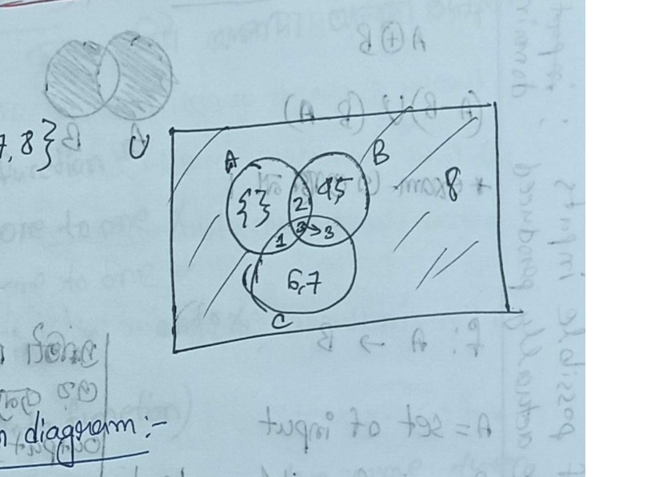
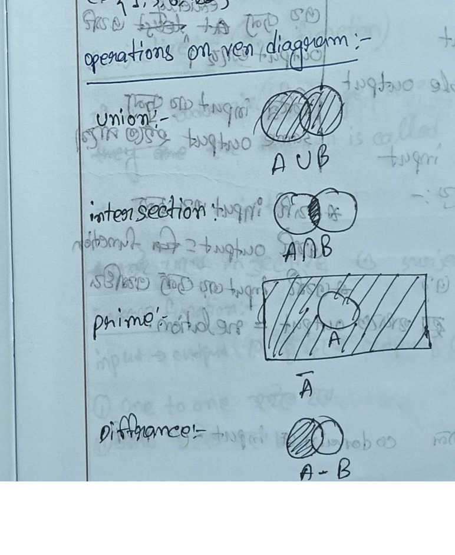
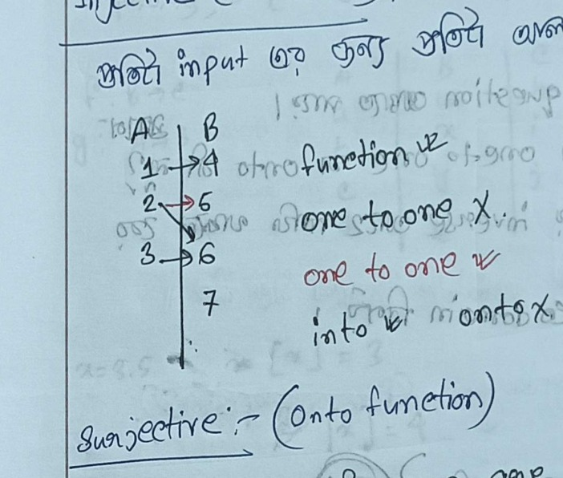

# ECE 2213: Discrete Mathematics — Class Notes

> **Course**: ECE 2213 — Numerical Methods & Discrete Mathematics  
> **Source**: `ClassNote_ECE2213_Fahad.pdf` (Pages 25–49: Complete Discrete Mathematics)  
> **Instructor**: Nadim Sir  
> **Textbook Reference**: *Discrete Mathematics and Its Applications* by Kenneth H. Rosen  
> **Student Notes**: Fahad  
> **Pedagogical Note**: All handwritten Bengali annotations, teacher tips, and margin notes have been translated faithfully into clear, natural English, preserving their full technical nuance and exam strategy insights.

---

## CLASS-10 | 24 August 2026 | Set Theory Fundamentals & Representations

<!-- Page 25 -->

### 1. Introduction to Sets (Rosen Chapter 2)

> **Definition**:  
> A **Set** is a collection of specified entities; an **unordered collection** of similar or well-defined objects.
> The individual objects belonging to a set are called its **elements** or members.

- **Set Membership Notation**:
  - $a \in A$: "$a$ belongs to $A$" ($a$ is an element of set $A$).
  - $a \notin A$: "$a$ does not belong to $A$".

---

### 2. Standard Number Sets

- $\mathbb{N} = \{0, 1, 2, \dots, n\}$: Set of **natural numbers** (discrete mathematics convention including $0$).
- $\mathbb{Z} = \{\dots, -2, -1, 0, 1, 2, \dots, n\}$: Set of **integers** (positive, negative, and zero).
- $\mathbb{Z}^+ = \{1, 2, 3, \dots\}$: Set of **positive integers** (all positive integers excluding $0$).
- $\mathbb{Z}^- = \{-1, -2, -3, \dots\}$: Set of **negative integers** (all negative integers excluding $0$).
- $\mathbb{R}$: Set of **real numbers** (all integers, rational fractions, and decimal point values).
- $\mathbb{C}$: Set of **complex numbers** ($z = a + bi$ where $a, b \in \mathbb{R}$ and $i = \sqrt{-1}$).

---

### 3. Intervals vs. Discrete Sets

A vital conceptual distinction between continuous intervals and discrete sets:

| Representation | Notation | Mathematical Meaning | Inclusion of Endpoints |
| :--- | :---: | :--- | :--- |
| **Open Interval** | $A = (0, 5)$ | Continuous interval: $\{x \in \mathbb{R} \mid 0 < x < 5\}$ | Endpoints $0$ and $5$ are **excluded**. |
| **Closed Interval** | $A = [0, 5]$ | Continuous interval: $\{x \in \mathbb{R} \mid 0 \le x \le 5\}$ | Endpoints $0$ and $5$ are **included**. |
| **Discrete Set** | $A = \{0, 5\}$ | Discrete elements only: $\{0, 5\}$ | Contains **only** the two discrete numbers $0$ and $5$. |

---

<!-- Page 26 (Left) -->

### 4. Methods of Set Representation

*(Translated from Bengali note: সেট প্রকাশ করার পদ্ধতি)*

1. **Roster Method (Tabular Form / তালিকা পদ্ধতি)**:
   Explicitly enumerating all elements within curly braces separated by commas.
   - Example: $A = \{1, 3, 5, 7\}$.

2. **Set-Builder Method (সেট গঠন পদ্ধতি)**:
   Specifying the predicate property that elements of the set must satisfy:
   $$S = \{x \mid P(x)\} \quad \text{or} \quad S = \{x : x \in \mathbb{N}, P(x)\}$$

#### Worked Example (Set-Builder to Roster Form):
> Express the set $S$ in roster form:
> $$S = \{x : x \in \mathbb{N}, x^2 > 25 \land x^3 < 1000\}$$

**Step-by-step Solution**:
- Condition 1: $x^2 > 25 \implies x > 5$ (for positive natural numbers).
- Condition 2: $x^3 < 1000 \implies x < 10$ (since $10^3 = 1000$).
- Intersection of conditions for natural numbers: $x \in \{6, 7, 8, 9\}$.
$$\therefore S = \{6, 7, 8, 9\}$$

---

### 5. Set Equality & Logic Quantifiers

Two sets $A$ and $B$ are **equal** ($A = B$) if and only if they contain precisely the same elements:
$$\forall x (x \in A \leftrightarrow x \in B)$$

> **Pedagogical Meaning**:  
> For all elements $x$, $x$ belongs to $A$ if and only if $x$ belongs to $B$. If this holds, sets $A$ and $B$ are identical.

#### Logic Quantifiers Summary Table:
| Symbol | Meaning | Natural Language Interpretation |
| :---: | :--- | :--- |
| $\forall$ | Universal Quantifier | "For all", "For every", "For each" |
| $\exists$ | Existential Quantifier | "There exists", "For at least one", "There is" |
| $\exists!$ | Unique Existential Quantifier | "There exists uniquely", "There exists exactly one" |
| $\nexists$ | Negated Existential | "Does not exist", "There is no" |

---

### 6. Subsets and Proper Subsets

- **Subset ($B \subseteq A$)**:
  Set $B$ is a subset of set $A$ if every element of $B$ is also an element of $A$:
  $$\forall x (x \in B \to x \in A)$$
  - Example: Let $A = \{1, 3, 5, 7\}$ and $B = \{1, 3, 5\}$. Since every element of $B$ is in $A$, $B \subseteq A$.

<!-- Page 26 (Right) -->

- **Proper Subset ($B \subset A$, প্রকৃত উপসেট)**:
  Set $B$ is a **proper subset** of $A$ if $B$ is a subset of $A$, but $B$ and $A$ are not equal:
  $$B \subseteq A \land B \neq A$$

> [!NOTE]
> **Two Mandatory Conditions for a Proper Subset**:
> 1. It cannot be identical to the parent set ($B \neq A$).
> 2. The number of elements of $B$ must be strictly less than the number of elements of $A$:
>    $$|B| < |A|$$
> *(Thus, $A$ must contain at least one element that is not present in $B$)*.

---

### 7. Cardinality of Sets

*(Translated from Bengali note: উপাদান সংখ্যা বা কার্ডিনালিটি)*

The **cardinality** of a set $S$, denoted $|S|$, represents the total number of distinct elements contained in $S$:
- If $A = \{1, 3, 5\} \implies |A| = 3$.
- If $B = \{1, 3\} \implies |B| = 2$.
- For the empty set: $|\emptyset| = |\{\}| = 0$.
- For infinite sets: $|\mathbb{N}| = \infty$.

---

### 8. The Power Set

The **Power Set** of a set $S$, denoted $\mathcal{P}(S)$ or $P(S)$, is the set of **all possible subsets** of $S$:
$$\mathcal{P}(S) = \{A \mid A \subseteq S\}$$

#### Worked Example (Power Set Evaluation):
Let $x = \{1, 2\}$:
- The subsets of $x$ are: $\emptyset, \{1\}, \{2\}, \{1, 2\}$.
- Therefore, the power set is:
  $$\mathcal{P}(x) = \{\emptyset, \{1\}, \{2\}, \{1, 2\}\}$$

> [!IMPORTANT]
> **Cardinality Rule of Power Sets**:  
> If a set $S$ has cardinality $n$ ($|S| = n$), then the cardinality of its power set is:
> $$|\mathcal{P}(S)| = 2^n$$
> For $n = 2$: $|\mathcal{P}(x)| = 2^2 = 4$.

---

## CLASS-11 | 25 August 2026 | Set Operations, Venn Diagrams, and Functions

<!-- Page 27 (Left) -->

### 1. Cartesian Product

For any two sets $A$ and $B$, the **Cartesian product** $A \times B$ is the set of all ordered pairs $(a, b)$ such that $a \in A$ and $b \in B$:
$$A \times B = \{(a, b) \mid a \in A \land b \in B\}$$

#### Worked Example (Cartesian Product Evaluation):
- Let $A = \{a, b\}$ and $B = \{1, 2, 3\}$.
- The Cartesian product is:
  $$A \times B = \{(a, 1), (a, 2), (a, 3), (b, 1), (b, 2), (b, 3)\}$$
- Note that the number of elements is $|A \times B| = |A| \times |B| = 2 \times 3 = 6$.

---

### 2. Fundamental Set Operations

- **Union ($A \cup B$)**:
  The set containing all elements belonging to $A$, or $B$, or both:
  $$A \cup B = \{x \mid x \in A \lor x \in B\}$$

- **Intersection ($A \cap B$)**:
  The set containing all elements that belong simultaneously to both $A$ and $B$:
  $$A \cap B = \{x \mid x \in A \land x \in B\}$$

- **Complement ($\overline{A}$)**:
  *(Translated from Bengali note: Universal set থেকে কোন set বাদ দিলে যা থাকে তা হলো Complement set)*  
  The set of all elements in the universal set $U$ that do not belong to $A$:
  $$\overline{A} = \{x \in U \mid x \notin A\}$$

- **Set Difference (Relative Complement, $A - B$)**:
  The set containing all elements belonging to $A$ but not to $B$:
  $$A - B = \{x \mid x \in A \land x \notin B\} = A \cap \overline{B}$$

<!-- Page 27 (Right) -->

---

### 3. Venn Diagrams & Worked Problem

#### 3-Set Venn Diagram Problem:
Given the universal set and three subsets:
- $U = \{1, 2, 3, 4, 5, 6, 7, 8\}$
- $A = \{1, 2, 3\}$
- $B = \{2, 3, 4, 5\}$
- $C = \{1, 3, 6, 7\}$

**Region breakdown**:
- $A \cap B \cap C = \{3\}$ (central triple intersection)
- $(A \cap B) - C = \{2\}$
- $(A \cap C) - B = \{1\}$
- $(B \cap C) - A = \emptyset$
- Only $B = \{4, 5\}$
- Only $C = \{6, 7\}$
- Outside $A \cup B \cup C$ inside $U = \{8\}$

*Figure 10.1 — Three-set Venn diagram with sets A, B, C inside universal set U (Page 27)*

#### Operations Illustrated on Venn Diagrams:
- **Union ($A \cup B$)**: Shading both circle $A$ and circle $B$.
- **Intersection ($A \cap B$)**: Shading only the overlapping lens between $A$ and $B$.
- **Complement ($\overline{A}$)**: Shading everything outside circle $A$ within the rectangle $U$.
- **Difference ($A - B$)**: Shading circle $A$ with the overlap of $B$ excised.

*Figure 10.2 — Venn diagram operations: Union, Intersection, Complement, and Set Difference (Page 27)*

---

<!-- Page 28 (Left) -->

### 4. Symmetric Difference

The **Symmetric Difference** of sets $A$ and $B$, denoted $A \oplus B$, consists of elements belonging to either $A$ or $B$, but **not to both**:
$$A \oplus B = (A - B) \cup (B - A) = (A \cup B) - (A \cap B)$$

> [!TIP]
> **Exam Advice from Teacher**:  
> "3-set symmetric difference does not usually appear in exams, but the 2-set definition and Venn shading are essential."

---

### 5. Relations vs. Functions

Let $A$ and $B$ be non-empty sets. A function $f$ from $A$ to $B$ (denoted $f: A \to B$) is an assignment of **exactly one** element of $B$ to each element of $A$.

- **Domain ($A$)**: The set of all allowable inputs that the function can take.
- **Codomain ($B$)**: The target set containing all potential outputs.
- **Range ($f(A)$)**: The actual subset of outputs produced by mapping domain elements:
  $$\text{Range} = \{f(x) \mid x \in A\} \subseteq B$$

#### The Fundamental Pedagogical Distinction:
*(Translated from detailed handwritten Bengali notes on Page 28)*:

| Concept | Criterion | Pedagogical Rule |
| :--- | :--- | :--- |
| **Function** | Every single input has **exactly one** output. | $\text{One input} \longrightarrow \text{Exactly one output}$ |
| **Allowed in Function** | Different inputs can share the same output. | $\text{Input}_1, \text{Input}_2 \longrightarrow \text{Same output } y$ (Valid function) |
| **Relation (Not a Function)** | A single input produces multiple outputs. | $\text{Single input} \longrightarrow \text{Multiple outputs}$ (Fails vertical line test / Not a function) |

---

<!-- Page 28 (Right) -->

### 6. Classification of Functions

#### 1. Injective Function (One-to-One / এক-এক ফাংশন)
*(Translated from Bengali note: প্রতিটা input এর জন্য প্রতিটা আলাদা আলাদা output)*  
A function $f: A \to B$ is **one-to-one (injective)** if distinct domain elements always map to distinct codomain elements:
$$\forall a, b \in A \quad (f(a) = f(b) \implies a = b)$$
Or contrapositively:
$$a \neq b \implies f(a) \neq f(b)$$

*Figure 11.1 — Hand-drawn mapping diagram illustrating an injective (one-to-one) function from set A to set B (Page 28)*

- In the mapping above: $A = \{1, 2, 3\}$, $B = \{4, 5, 6, 7\}$ with $1 \to 4, 2 \to 5, 3 \to 6$.
- Since distinct elements map to distinct targets, it is **one-to-one**.
- Since $7 \in B$ has no pre-image, it is an **into function** (not onto).

#### 2. Surjective Function (Onto Function / সার্বিক ফাংশন)
A function $f: A \to B$ is **onto (surjective)** if every element of the codomain has at least one pre-image in the domain:
$$\text{Range} = \text{Codomain}$$
- If $\text{Range} \subset \text{Codomain}$, the function is called **Into**.

#### 3. Bijective Function (One-to-One Correspondence)
*(Translated from Bengali note: একই সাথে Injective ও Surjective = Bijective)*  
A function is **bijective** if and only if it is simultaneously:
1. **One-to-one (Injective)**, AND
2. **Onto (Surjective)**.

#### 4. Inverse Function ($f^{-1}$)
Let $f: A \to B$. An inverse function $f^{-1}: B \to A$ reverses the mapping ($y \mapsto x$).
> [!IMPORTANT]
> **Condition for Invertibility**:  
> An inverse function $f^{-1}$ exists **if and only if** $f$ is a **bijective function** (both one-to-one and onto).

---

<!-- Page 29 (Left) -->

### 7. Worked Inverse Function Problem

> **Problem**: Let $f(x) = 2x + 3$. Find its inverse function $f^{-1}(y)$.

**Step-by-step Solution**:
1. Set $y = f(x)$:
   $$y = 2x + 3$$
2. Solve algebraically for $x$ in terms of $y$:
   $$2x = y - 3 \implies x = \frac{y - 3}{2}$$
3. Replace $x$ with $f^{-1}(y)$:
   $$f^{-1}(y) = \frac{y - 3}{2} \quad \left(\text{or } f^{-1}(x) = \frac{x - 3}{2}\right)$$

> [!TIP]
> **Exam High-Yield Topics**:
> 1. Short theoretical questions and formal proofs.
> 2. Determining whether a piecewise or algebraic function is one-to-one or onto.
> 3. Determining whether an inverse function exists, and finding $f^{-1}(x)$ if it does.
> 4. Finding Domain, Range, and Codomain for given mappings.

---

### 8. Composition of Functions

Let $g: A \to B$ and $f: B \to C$. The **composite function** $(f \circ g): A \to C$ is defined by:
$$(f \circ g)(x) = f(g(x))$$
Similarly:
$$(g \circ f)(x) = g(f(x))$$

<!-- Page 29 (Right) -->

---

### 9. Floor and Ceiling Functions

1. **Floor Function ($\lfloor x \rfloor$)**:  
   The largest integer that is less than or equal to $x$:
   $$\lfloor x \rfloor = \max \{n \in \mathbb{Z} \mid n \le x\}$$

2. **Ceiling Function ($\lceil x \rceil$)**:  
   The smallest integer that is greater than or equal to $x$:
   $$\lceil x \rceil = \min \{n \in \mathbb{Z} \mid n \ge x\}$$

#### Class Evaluation Examples:
- **For positive real $x = 3.5$**:
  - Floor: $\lfloor 3.5 \rfloor = 3$
  - Ceiling: $\lceil 3.5 \rceil = 4$
- **For negative real $x = -2.3$**:
  - Floor: $\lfloor -2.3 \rfloor = -3$ *(since $-3 \le -2.3$)*
  - Ceiling: $\lceil -2.3 \rceil = -2$ *(since $-2 \ge -2.3$)*

---

## CLASS-12 | 29 August 2026 | Propositional Logic & Truth Tables

<!-- Page 30 (Left) -->

### 1. Propositions and Truth Values (Rosen Chapter 1.1)

> **Definition**:  
> A **Proposition** is a declarative statement that is either **True ($T$)** or **False ($F$)**, but not both.
> *(Translated from Bengali note: এমন সব প্রস্তাব যার উত্তর Yes অথবা No — Either True or False)*.

- **Propositional Variables**: Propositions are conventionally denoted by lower-case letters: $p, q, r, s, \dots$
  - Example: Let $p =$ "Today is Saturday." (This is a valid proposition).
- **Truth Values**:
  - Universally true statement (চিরন্তন সত্য) $\to T$.
  - Universally false statement (চিরন্তন মিথ্যা) $\to F$.

---

### 2. Compound Propositions & Logical Connectives

A **compound proposition** is formed by combining existing propositions using logical operators (connectives):
1. **Negation ($\neg p$, NOT)**
2. **Conjunction ($p \land q$, AND)**
3. **Disjunction ($p \lor q$, Inclusive OR)**
4. **Exclusive OR ($p \oplus q$, XOR)**
5. **Conditional / Implication ($p \to q$, If-Then)**
6. **Biconditional ($p \leftrightarrow q$, Iff)**

<!-- Page 30 (Right) -->

---

### 3. Truth Tables of Basic Operators

#### 1. Negation ($\neg p$ / NOT Gate)
Reverses the truth value:
- Example: $p =$ "The Earth is round." $\implies \neg p =$ "It is not the case that the Earth is round" (or "The Earth is not round").

| $p$ | $\neg p$ |
| :---: | :---: |
| $T$ | $F$ |
| $F$ | $T$ |

#### 2. Conjunction ($p \land q$ / AND Gate)
True **only when both** $p$ and $q$ are True.
- Example: $p =$ "I am at home", $q =$ "It is raining" $\implies p \land q =$ "I am at home and it is raining."

| $p$ | $q$ | $p \land q$ |
| :---: | :---: | :---: |
| $T$ | $T$ | $T$ |
| $T$ | $F$ | $F$ |
| $F$ | $T$ | $F$ |
| $F$ | $F$ | $F$ |

---

<!-- Page 31 (Left) -->

#### 3. Disjunction ($p \lor q$ / Inclusive OR Gate)
*(Translated from Bengali note: যেকোনো একটি True হলেই হবে, ২টি একসাথে True হলেও সমস্যা নাই)*  
True if **at least one** operand is True; False only when both are False:

| $p$ | $q$ | $p \lor q$ |
| :---: | :---: | :---: |
| $T$ | $T$ | $T$ |
| $T$ | $F$ | $T$ |
| $F$ | $T$ | $T$ |
| $F$ | $F$ | $F$ |

#### 4. Exclusive OR ($p \oplus q$ / XOR Gate)
*(Translated from Bengali note: শুধুমাত্র একটাই সত্য হতে হবে, ২টি একসাথে হতে পারবে না)*  
True when **exactly one** of the propositions is True, but not both:

| $p$ | $q$ | $p \oplus q$ |
| :---: | :---: | :---: |
| $T$ | $T$ | $F$ |
| $T$ | $F$ | $T$ |
| $F$ | $T$ | $T$ |
| $F$ | $F$ | $F$ |

---

### 4. Conditional Statement (Implication, $p \to q$)

- **Form**: "If $p$, then $q$".
- $p$: **Hypothesis** (Antecedent / Premise).
- $q$: **Conclusion** (Consequence).

#### Truth Table:
| $p$ (Hypothesis) | $q$ (Conclusion) | $p \to q$ |
| :---: | :---: | :---: |
| $T$ | $T$ | $T$ |
| $T$ | $F$ | $F$ |
| $F$ | $T$ | $T$ |
| $F$ | $F$ | $T$ |

> [!NOTE]
> **Pedagogical Explanation of Implication**:
> *(Translated from Fahad's Bengali margin notes on Page 31)*:
> Consider the propositions:
> - $p =$ "I am at home."
> - $q =$ "It is raining."
> - Statement: "If I am at home, then it is raining" ($p \to q$).
>
> 1. **When $p$ is True**: You promised that whenever you are at home, it rains. If you are at home and it does not rain ($q = F$), your statement was a lie $\implies \mathbf{F}$.
> 2. **When $p$ is False**: You are not at home. Whether it rains or not outside, you never broke your contract, because your promise only applied when you were at home! Therefore, the statement is vacuously $\mathbf{T}$.
> - *Golden Rule*: $p \to q$ is **False ONLY when $T \to F$**. In all other cases, it is **True**.

---

<!-- Page 31 (Right) -->

### 5. Biconditional Statement ($p \leftrightarrow q$)

- **Form**: "$p$ if and only if $q$" ($p$ iff $q$).
- *(Translated from Bengali note: ২ টাই True বা ২ টাই False হতে হবে)*  
  True whenever both variables share the **same truth value**:

| $p$ | $q$ | $p \leftrightarrow q$ |
| :---: | :---: | :---: |
| $T$ | $T$ | $T$ |
| $T$ | $F$ | $F$ |
| $F$ | $T$ | $F$ |
| $F$ | $F$ | $T$ |

---

### 6. Truth Table Construction for Compound Proposition

> Construct the complete truth table for:
> $$(p \lor q) \to \neg r$$
> *"p or q implies negation of r"*

| $p$ | $q$ | $r$ | $\neg r$ | $p \lor q$ | $(p \lor q) \to \neg r$ |
| :---: | :---: | :---: | :---: | :---: | :---: |
| $T$ | $T$ | $T$ | $F$ | $T$ | **$F$** |
| $T$ | $T$ | $F$ | $T$ | $T$ | **$T$** |
| $T$ | $F$ | $T$ | $F$ | $T$ | **$F$** |
| $T$ | $F$ | $F$ | $T$ | $T$ | **$T$** |
| $F$ | $T$ | $T$ | $F$ | $T$ | **$F$** |
| $F$ | $T$ | $F$ | $T$ | $T$ | **$T$** |
| $F$ | $F$ | $T$ | $F$ | $F$ | **$T$** |
| $F$ | $F$ | $F$ | $T$ | $F$ | **$T$** |

---

## CLASS-13 | 31 August 2026 | Operator Precedence & Natural Language Translation

<!-- Page 32 (Left) -->

### 1. Logical Operator Precedence

When parentheses are omitted, compound logic expressions are evaluated in the following strict hierarchy:

$$\neg \quad > \quad (\land, \lor) \quad > \quad (\to, \leftrightarrow)$$

1. **Level 1 (Highest)**: $\neg$ (Negation)
2. **Level 2**: $\land$ (Conjunction) and $\lor$ (Disjunction)
3. **Level 3 (Lowest)**: $\to$ (Conditional) and $\leftrightarrow$ (Biconditional)

#### Example (Operator Precedence & Translation):
- Let $p =$ "I go to Harry's", $q =$ "I go to country", $r =$ "I will go shopping".
- Expression: $(p \lor q) \to \neg r$
- Natural English Translation:  
  *"If I go to Harry's or I go to the country, then I will not go shopping."*

---

### 2. Translating English into Symbolic Logic

#### Example 1: Campus Internet Access
> "You can access the internet only if you are a computer science student or not a freshman."

- Assign propositional variables:
  - $a$: "You can access the internet"
  - $b$: "You are a computer science student"
  - $c$: "You are a freshman"
- Translation Rule: "$p \text{ only if } q$" translates directly to $p \to q$.
- **Symbolic Logic Expression**:
  $$a \to (b \lor \neg c)$$

---

<!-- Page 32 (Right) -->

#### Example 2: Industrial System Specification
> "The system will operate in normal mode if and only if the primary controller or the backup controller is active, but not both. However, if the emergency sensor is triggered, then the system will enter emergency mode only if both controllers are inactive."

- Assign variables:
  - $r$: System operates in normal mode
  - $p$: Primary controller is active
  - $q$: Backup controller is active
  - $t$: Emergency sensor is triggered
  - $s$: System enters emergency mode
- Logical connective parsing:
  - "If and only if" $\to \leftrightarrow$
  - "Or ..., but not both" $\to \oplus$ (Exclusive OR)
  - "However", "moreover" $\to \land$ (Conjunction)
  - "Only if" $\to \to$ (Implication)
  - "Both controllers are inactive" $\to \neg p \land \neg q$
- **Formalized Logic Translation**:
  $$r \leftrightarrow (p \oplus q) \land (t \to (s \to (\neg p \land \neg q)))$$

---

<!-- Page 33 -->

#### Example 3: Examination & Certification Specification
> "If the student studies regularly or attends the tutorial class but not both, then the student passes the exam. And the student receives a certificate if and only if he passes the exam."

- Assign variables:
  - $p$: The student studies regularly
  - $q$: The student attends the tutorial class
  - $r$: The student passes the examination
  - $s$: The student receives a certificate
- Sentence breakdown:
  - "Studies regularly or attends tutorial class but not both" $\to (p \oplus q)$
  - "If ..., then passes the exam" $\to (p \oplus q) \to r$
  - "And / however" $\to \land$
  - "Receives certificate iff passes exam" $\to r \leftrightarrow s$
- **Formalized Logic Expression**:
  $$((p \oplus q) \to r) \land (r \leftrightarrow s)$$

---

## CLASS-14 | 06 September 2026 | Propositional Equivalences & Tautologies

<!-- Page 34 -->

### 1. Logical Equivalence ($p \equiv q$)

Two compound propositions are **logically equivalent** ($p \equiv q$ or $p \Leftrightarrow q$) if $p \leftrightarrow q$ is a tautology (they produce identical truth values under every truth assignment).

#### Fundamental Equivalence: $p \to q \equiv \neg p \lor q$
> Verify via truth table that $p \to q \equiv \neg p \lor q$:

| $p$ | $q$ | $\neg p$ | $p \to q$ | $\neg p \lor q$ | Equivalence Check |
| :---: | :---: | :---: | :---: | :---: | :---: |
| $T$ | $T$ | $F$ | **$T$** | **$T$** | Match |
| $T$ | $F$ | $F$ | **$F$** | **$F$** | Match |
| $F$ | $T$ | $T$ | **$T$** | **$T$** | Match |
| $F$ | $F$ | $T$ | **$T$** | **$T$** | Match |

Since the columns for $p \to q$ and $\neg p \lor q$ are identical for all assignments, the statements are **logically equivalent**.

---

### 2. Classifications of Compound Propositions

- **Tautology**: A compound proposition that is **always True**, regardless of the truth values of its constituent variables.
  - Classic example: $p \lor \neg p \equiv T$.
- **Contradiction**: A compound proposition that is **always False**.
  - Classic example: $p \land \neg p \equiv F$.
- **Contingency**: A compound proposition that is neither a tautology nor a contradiction (it can be True or False depending on the variables).

---

<!-- Page 35 (Left) -->

### 3. Key Equivalence Laws (Rosen Chapter 1.3)

> [!NOTE]
> **Key Equivalence Table References**:  
> In Kenneth Rosen's textbook, Tables 7 and 8 list the essential logical equivalences that must be memorized:
> - **Implication Law**: $p \to q \equiv \neg p \lor q$
> - **Contrapositive Law**: $p \to q \equiv \neg q \to \neg p$
> - **Biconditional Law**: $p \leftrightarrow q \equiv (p \to q) \land (q \to p)$
> - **De Morgan's Laws**:
>   $$\neg(p \lor q) \equiv \neg p \land \neg q$$
>   $$\neg(p \land q) \equiv \neg p \lor \neg q$$

#### Worked Equivalence Proof:
> Prove that $\neg(p \lor (\neg p \land q)) \equiv \neg p \land \neg q$ without using truth tables:

$$
\begin{aligned}
\neg(p \lor (\neg p \land q)) &\equiv \neg((p \lor \neg p) \land (p \lor q)) && \text{[Distributive Law]} \\
&\equiv \neg(T \land (p \lor q)) && \text{[Inverse Law: } p \lor \neg p \equiv T\text{]} \\
&\equiv \neg(p \lor q) && \text{[Identity Law: } T \land A \equiv A\text{]} \\
&\equiv \neg p \land \neg q && \text{[De Morgan's Law]} \quad \blacksquare
\end{aligned}
$$

> [!TIP]
> **Exam Strategy**:
> - **Logical Puzzles**: "Logical puzzles are not required for the final exam" *(logical puzzles লাগবে না)*.
> - **Propositional Satisfiability**: Skipped in class according to Sir *(skip স্যারের ভাষায়)*.
> - **Tautology Proving in Exam**: You may be asked to show whether an expression is a tautology using either truth tables or algebraic law reduction.

---

## CLASS-15 | 07 September 2026 | Predicate Logic & Quantifiers

<!-- Page 35 (Right) & Page 36 (Left) -->

### 1. Predicates and Variables

- A **Predicate** is a statement containing variables that becomes a proposition once specific values are assigned to those variables:
  - Example: Let $P(x) = "x > 30"$.
  - For $x = 40$: $P(40) = "40 > 30" \to \mathbf{T}$ (Proposition).
  - For $x = 10$: $P(10) = "10 > 30" \to \mathbf{F}$ (Proposition).
- Example:
  - "All men are mortal" $\to$ Proposition.
  - "$x$ is mortal" $\to$ Predicate: $P(x) = "x \text{ is mortal}"$.

---

### 2. Quantifiers

Quantifiers are used to assign values to variables in predicates across a specified **domain of discourse ($U$)**:

1. **Universal Quantifier ($\forall$)**:  
   - $\forall x P(x)$: "$P(x)$ is true for all $x$ in the domain."
   - Finite domain expansion: $\forall x P(x) \equiv P(x_1) \land P(x_2) \land \dots \land P(x_n)$.

2. **Existential Quantifier ($\exists$)**:  
   - $\exists x P(x)$: "There exists an element $x$ in the domain such that $P(x)$ is true."
   - Finite domain expansion: $\exists x P(x) \equiv P(x_1) \lor P(x_2) \lor \dots \lor P(x_n)$.

#### Domain Dependency Example:
Let $P(x)$ denote "$x > 0$":
- If domain $U = \text{all integers} \implies \forall x P(x)$ is $\mathbf{F}$ (e.g., $x = -2 \le 0$).
- If domain $U = \text{positive integers} \implies \forall x P(x)$ is $\mathbf{T}$.
- For existential quantifier $\exists x P(x)$:
  - Over all integers: $\mathbf{T}$ (since $x = 5 > 0$).
  - Over all negative integers: $\mathbf{F}$.

<!-- Page 36 (Right) -->

---

### 3. Translating Natural English to Predicate Logic

#### Problem 1: "Every student in the class has taken a course in Java"
- Let $S(x)$: "$x$ is a student in the class".
- Let $J(x)$: "$x$ has taken a course in Java".

| Domain of Discourse ($U$) | Correct Formalization | Explanation |
| :--- | :---: | :--- |
| **If $U =$ All students in the class** | $\forall x J(x)$ | The domain already restricts entities to students. |
| **If $U =$ All human beings** | $\forall x (S(x) \to J(x))$ | Must use implication to ensure the statement only asserts Java knowledge for those who are students. |

> [!WARNING]
> **Common Fallacy**:  
> Writing $\forall x (S(x) \land J(x))$ over all humans is incorrect because it asserts that every human in the universe is both a student in this class and has taken Java!

<!-- Page 37 -->

#### Problem 2: "Some students in the class have taken a course in Java"
- Correct Translation:
  $$\exists x (S(x) \land J(x))$$
- *Note*: An existential statement uses **Conjunction ($\land$)**, NOT implication ($\to$).

#### Problem 3: "All men are mortal"
- Let $Man(x)$: "$x$ is a man".
- Let $Mortal(x)$: "$x$ is mortal".
- Formalization:
  $$\forall x (Man(x) \to Mortal(x))$$

---

### 4. De Morgan's Laws for Quantifiers

Negating quantified statements:
1. $\neg \forall x P(x) \equiv \exists x \neg P(x)$
   - *"Not everyone is happy" $\equiv$ "There exists someone who is not happy."*
2. $\neg \exists x P(x) \equiv \forall x \neg P(x)$
   - *"There does not exist a flying pig" $\equiv$ "Every pig cannot fly."*

---

## CLASS-16 | 08 September 2026 | Predicate Translations & System Specifications

<!-- Page 38 (Left) -->

### 1. English to Predicate Translation Practice

#### Example 1: Students visiting Mexico
> "Some students in the class have visited Mexico."

- Let $U =$ All people.
- $S(x)$: "$x$ is a student in the class".
- $M(x)$: "$x$ has visited Mexico".
- **Translation**:
  $$\exists x (S(x) \land M(x))$$

#### Example 2: Visiting Canada or Mexico
> "Every student in the class has visited Canada or Mexico."

- Let $C(x)$: "$x$ has visited Canada".
- $M(x)$: "$x$ has visited Mexico".
- **Translation**:
  $$\forall x (S(x) \to (C(x) \lor M(x)))$$

<!-- Page 38 (Right) -->

---

### 2. Abstract Domain Translation: Fleegles, Snurds & Thingamabobs

Let the domain of discourse be $U = \{\text{fleegles}, \text{snurds}, \text{thingamabobs}\}$:
- $F(x)$: "$x$ is a fleegle"
- $S(x)$: "$x$ is a snurd"
- $T(x)$: "$x$ is a thingamabob"

1. **"Everything is a fleegle"**:
   $$\forall x F(x)$$
2. **"Nothing is a snurd"**:
   $$\neg \exists x S(x) \equiv \forall x \neg S(x)$$
3. **"All fleegles are snurds"**:
   $$\forall x (F(x) \to S(x))$$
4. **"Some fleegles are thingamabobs"**:
   $$\exists x (F(x) \land T(x))$$

> [!IMPORTANT]
> **The Golden Rules of Quantifier Translation**:
> - **For Universal Statements ($\forall$)**: Always use **Implication ($\to$)**.
> - **For Existential Statements ($\exists$)**: Always use **Conjunction ($\land$)**.
> - *(If a statement does not hold universally for all members, use existential quantification)*.

<!-- Page 39 (Left) -->

5. **"No snurd is a thingamabob"**:
   $$\neg \exists x (S(x) \land T(x)) \equiv \forall x \neg(S(x) \land T(x)) \equiv \forall x (\neg S(x) \lor \neg T(x))$$
6. **"If any fleegle is a snurd, then it is also a thingamabob"**:
   $$\forall x ((F(x) \land S(x)) \to T(x))$$

---

### 3. System Specifications Using Quantifiers

#### Specification 1: Mail Message Compression
> "Every mail message larger than one kilobyte will be compressed."

- $P(x, y)$: "message $x$ is larger than $y$ KB".
- $Q(x)$: "message $x$ will be compressed".
- $P(x, 1)$: "message $x$ is larger than $1$ KB".
- **Translation**:
  $$\forall x (P(x, 1) \to Q(x))$$

<!-- Page 39 (Right) -->

#### Specification 2: Active User Network Availability
> "If a user is active, at least one network link will be available."

- $A(u)$: "user $u$ is active".
- $S(n, \text{available})$: "network link $n$ is in available state".
- **Translation**:
  $$\exists u A(u) \to \exists n S(n, \text{available})$$

> [!NOTE]
> **CT-1 Syllabus Announcement**:
> - Rosen Textbook: Slide 1.1 & 1.2 up to before nested quantifiers.
> - Major focus: English to symbolic logic translation practice.

---

## CLASS-17 | 12 September 2026 | Nested Quantifiers

<!-- Page 45 (Left) -->

### 1. Understanding Nested Quantifiers

Nested quantifiers function analogously to **nested loops** in programming: the outermost quantifier sets the outer loop, and the inner quantifier sets the inner loop.

#### Commutativity Rules:
- Identical quantifiers commute:
  $$\forall x \forall y P(x, y) \equiv \forall y \forall x P(x, y)$$
  $$\exists x \exists y P(x, y) \equiv \exists y \exists x P(x, y)$$
- **Mixed quantifiers DO NOT commute!** The order is critical:
  $$\forall x \exists y P(x, y) \not\equiv \exists y \forall x P(x, y)$$

#### Examples over the Real Numbers ($\mathbb{R}$):
1. **Multiplicative Inverse**:
   - $\forall x \exists y (x \cdot y = 1)$: **False** (since $x = 0$ has no multiplicative inverse $y$).
   - $\exists y \forall x (x \cdot y = 1)$: **False**.
2. **Product Zero Property ($P(x, y): x \cdot y = 0$)**:
   - $\forall x \forall y P(x, y)$: **False** (e.g., $2 \cdot 3 = 6 \neq 0$).
   - $\forall x \exists y P(x, y)$: **True** (for any given $x$, choose $y = 0$).
   - $\exists x \forall y P(x, y)$: **True** (choose $x = 0$, then $0 \cdot y = 0$ for every $y$).
   - $\exists x \exists y P(x, y)$: **True** (e.g., choose $x = 0, y = 0$).

---

<!-- Page 45 (Right) -->

### 2. Complex Natural Language Translations

#### Problem 1: Campus Computer Friendship
> "Every student in your school has a computer or has a friend who has a computer."

- Let $C(x)$: "$x$ has a computer".
- Let $F(x, y)$: "$x$ and $y$ are friends".
- Domain: All students in the school.
- **Formalized Expression**:
  $$\forall x (C(x) \lor \exists y (F(x, y) \land C(y)))$$

#### Problem 2: Triply Nested Quantifier
> "There is a student none of whose friends are also friends with each other."

- **Formalized Expression**:
  $$\exists x \forall y \forall z ((F(x, y) \land F(x, z) \land (y \neq z)) \to \neg F(y, z))$$

> [!TIP]
> **Teacher Advice on Nested Quantifiers**:  
> "If nested quantifiers appear in the exam, the question will be chosen directly from the lecture slides, so memorize the slide examples thoroughly" *(দিলে slide থেকেই দিবে, so slide এরগুলো মুখস্থ / ATM)*.

---

### 3. Argument Validity

An **argument** is a sequence of propositions ending with a conclusion:
$$(p_1 \land p_2 \land \dots \land p_n) \to q$$
- $p_1, \dots, p_n$: Premises / Hypotheses.
- $q$: Conclusion.
- **Valid Argument**: The argument is valid if and only if the conditional statement is a **tautology** (always True under all interpretations).
- **Invalid Argument (Fallacy)**: An argument that is not a tautology.

---

## CLASS-18 | 15 September 2026 | Elementary Number Theory: Divisibility & Congruence

<!-- Page 40 -->

### 1. Divisibility

Let $a, b \in \mathbb{Z}$ with $a \neq 0$. We say **$a$ divides $b$** (written $a \mid b$) if there exists an integer $c$ such that:
$$b = ac \quad \left(\text{or } \frac{b}{a} = c \in \mathbb{Z}\right)$$
- $a$ is called a **divisor** or factor of $b$.
- $b$ is called a **multiple** of $a$.

#### Examples:
- $3 \mid 12$: **Divisible** (since $12 = 3 \times 4$).
- $3 \nmid 7$: **Not divisible** (since $\frac{7}{3} \notin \mathbb{Z}$).

#### Properties of Divisibility:
1. If $a \mid b$ and $a \mid c$, then $a \mid (b + c)$.
2. If $a \mid b$, then $a \mid bc$ for all integers $c$.
3. If $a \mid b$ and $b \mid c$, then $a \mid c$ (Transitivity).

> [!IMPORTANT]
> **Linear Combination Corollary**:  
> If $a \mid b$ and $a \mid c$, then for any integers $m$ and $n$:
> $$a \mid (mb + nc)$$
> *(Proof of divisibility properties is a standard semester final exam question!)*

---

### 2. The Division Algorithm

Let $a$ be an integer and $d$ a positive integer ($d \in \mathbb{Z}^+$). Then there exist **unique integers** $q$ and $r$, with $0 \le r < d$, such that:
$$a = dq + r$$
- $d$: Divisor
- $a$: Dividend
- $q = a \text{ div } d$: Quotient
- $r = a \bmod d$: Remainder

---

### 3. Modular Congruence

Let $a, b \in \mathbb{Z}$ and $m \in \mathbb{Z}^+$. We say that **$a$ is congruent to $b$ modulo $m$** (written $a \equiv b \pmod m$) if $m$ divides $(a - b)$:
$$a \equiv b \pmod m \iff m \mid (a - b)$$

#### Key Congruence Theorems:
- **Theorem**: $a \equiv b \pmod m \iff a \bmod m = b \bmod m$.
- **Theorem**: $a \equiv b \pmod m \iff a = b + km$ for some integer $k$.
- **Algebraic Properties**: If $a \equiv b \pmod m$ and $c \equiv d \pmod m$, then:
  $$a + c \equiv b + d \pmod m$$
  $$ac \equiv bd \pmod m$$

> [!NOTE]
> **Semester Final Weightage Notice**:  
> Sets and Propositional Logic together will constitute **at least 2 complete question sets** in the semester final exam!

---

## CLASS-19 | 19 September 2026 | Primes, GCD, and Chinese Remainder Theorem

<!-- Page 41 -->

### 1. Prime Numbers & Factorization

- **Prime Number**: An integer $p > 1$ whose only positive divisors are $1$ and $p$.
- **Composite Number**: An integer $n > 1$ that can be factored into a product of primes.
- **Fundamental Theorem of Arithmetic**: Every positive integer $n > 1$ can be written uniquely as a prime or as the product of two or more primes in non-decreasing order.
- **Sieve of Eratosthenes Theorem**: If $n$ is a composite integer, then $n$ must have a prime divisor less than or equal to $\sqrt{n}$.
- **Mersenne Primes**: Primes of the form $2^p - 1$, where $p$ is prime.

---

### 2. Greatest Common Divisor (GCD) & Least Common Multiple (LCM)

The **Greatest Common Divisor** of two integers $a$ and $b$ (not both zero), denoted $\gcd(a, b)$, is the largest integer dividing both $a$ and $b$.

#### Method 1: Prime Factorization
Factorize into prime powers:
- For $120$ and $500$:
  $$
\begin{aligned}
  120 &= 2^3 \times 3^1 \times 5^1 \\
  500 &= 2^2 \times 3^0 \times 5^3 \\
  \gcd(120, 500) &= 2^{\min(3, 2)} \times 3^{\min(1, 0)} \times 5^{\min(1, 3)} = 2^2 \times 3^0 \times 5^1 = 20
  \end{aligned}
$$

<!-- Page 42 (Left) -->

#### Method 2: The Euclidean Algorithm
Based on the identity $\gcd(a, b) = \gcd(b, a \bmod b)$ for $a > b$:
- Find $\gcd(287, 91)$:
  $$
\begin{aligned}
  287 &= 91 \times 3 + 14 && (\text{Remainder } 14) \\
  91 &= 14 \times 6 + 7 && (\text{Remainder } 7) \\
  14 &= 7 \times 2 + 0 && (\text{Remainder } 0)
  \end{aligned}
$$
  $\therefore \gcd(287, 91) = 7$.

> [!NOTE]
> **Self-Study Directive**: Extended Euclidean Algorithm is marked for self-study and is best practiced in tabular form.

---

<!-- Page 42 (Right) & Page 43 -->

### 3. Chinese Remainder Theorem (CRT)

> [!IMPORTANT]
> **High Exam Priority**: The Chinese Remainder Theorem is a guaranteed semester final exam problem!

#### Theorem Statement:
Let $m_1, m_2, \dots, m_n$ be pairwise relatively prime positive integers greater than $1$ ($\gcd(m_i, m_j) = 1$ for all $i \neq j$). Then the system of simultaneous congruences:
$$
\begin{aligned}
x &\equiv a_1 \pmod{m_1} \\
x &\equiv a_2 \pmod{m_2} \\
&\;\;\vdots \\
x &\equiv a_n \pmod{m_n}
\end{aligned}
$$
has a unique solution modulo $M = m_1 \times m_2 \times \dots \times m_n$.

#### General Formula:
$$x \equiv \left( \sum_{i=1}^n a_i M_i M_i^{-1} \right) \pmod M$$
where $M_i = \frac{M}{m_i}$, and $M_i^{-1}$ is the modular inverse satisfying $M_i M_i^{-1} \equiv 1 \pmod{m_i}$.

---

#### Complete Worked Class Problem:
Solve the simultaneous system:
$$
\begin{aligned}
x &\equiv 2 \pmod 3 \\
x &\equiv 3 \pmod 5 \\
x &\equiv 2 \pmod 7
\end{aligned}
$$

**Step 1: Compute $M$ and individual $M_i$**:
- $M = 3 \times 5 \times 7 = 105$
- $M_1 = \frac{105}{3} = 35$
- $M_2 = \frac{105}{5} = 21$
- $M_3 = \frac{105}{7} = 15$

**Step 2: Determine Modular Inverses $M_i^{-1}$**:
- **For $M_1 = 35$ modulo $3$**:
  $$35 M_1^{-1} \equiv 1 \pmod 3 \implies 2 M_1^{-1} \equiv 1 \pmod 3 \implies M_1^{-1} = 2$$
  *(Check: $35 \times 2 = 70 = 3 \times 23 + 1 \equiv 1 \pmod 3$)*.
- **For $M_2 = 21$ modulo $5$**:
  $$21 M_2^{-1} \equiv 1 \pmod 5 \implies 1 M_2^{-1} \equiv 1 \pmod 5 \implies M_2^{-1} = 1$$
- **For $M_3 = 15$ modulo $7$**:
  $$15 M_3^{-1} \equiv 1 \pmod 7 \implies 1 M_3^{-1} \equiv 1 \pmod 7 \implies M_3^{-1} = 1$$

**Step 3: Calculate the Solution $x$**:
$$
\begin{aligned}
x &= (a_1 M_1 M_1^{-1} + a_2 M_2 M_2^{-1} + a_3 M_3 M_3^{-1}) \bmod M \\
x &= (2 \times 35 \times 2 + 3 \times 21 \times 1 + 2 \times 15 \times 1) \bmod 105 \\
x &= (140 + 63 + 30) \bmod 105 \\
x &= 233 \bmod 105 \\
x &= 105 \times 2 + 23 \implies \mathbf{x = 23} \quad (\text{Ans})
\end{aligned}
$$

---

## CLASS-20 | 21 September 2026 | Combinatorics & Counting Principles

<!-- Page 44 -->

### 1. Permutations and Combinations

*(Translated from Bengali vertical margin note: Combination Permutation থেকে Exam-এ আসবে!)*

- **Selection $\longrightarrow$ Combination ($C$)**: Unordered choices of subsets.
- **Arrangement $\longrightarrow$ Permutation ($P$)**: Ordered sequences.

#### Formulas:
- Number of $r$-permutations of $n$ distinct elements:
  $$P(n, r) = {}^n P_r = \frac{n!}{(n - r)!}$$
- Number of $r$-combinations of $n$ distinct elements:
  $$C(n, r) = \binom{n}{r} = \frac{n!}{r!(n - r)!}$$

#### Example:
For 3 letters $A, B, C$, total arrangements $= 3! = 3 \times 2 \times 1 = 6$:
$$\{ABC, ACB, CAB, CBA, BAC, BCA\}$$

---

### 2. Word Arrangement Problem: "PROFESSOR"

> **Problem**: How many ways can you arrange 4 letters chosen from the word **`PROFESSOR`** taking unique letters?

**Analysis of Letters in `PROFESSOR`**:
- Total letters: $9$
- Distinct letters: $\{P, R, O, F, E, S\} \implies 6$ distinct letters.
- Multiplicities:
  - $O \to 2$
  - $R \to 2$
  - $S \to 2$
  - $P \to 1$
  - $F \to 1$
  - $E \to 1$

#### Case A: Choosing 4 strictly distinct letters
- Choose 4 letters from the 6 available types:
  $$\binom{6}{4} = \frac{6!}{4! \times 2!} = \frac{6 \times 5}{2} = 15$$
- Number of arrangements for each selection:
  $$4! = 24$$
- Total arrangements for strictly distinct letters:
  $$\binom{6}{4} \times 4! = 15 \times 24 = 360$$

---

## CLASS-21 | 28 September 2026 | Rules of Inference & Formal Methods of Proof

<!-- Page 46 (Left) -->

### 1. Rules of Inference

Rules of inference are established valid argument forms used as template building blocks to construct mathematical deductions:

| Rule of Inference | Name | Tautological Formulation |
| :--- | :--- | :--- |
| $\frac{p \to q, \quad p}{\therefore q}$ | **Modus Ponens** | $(p \land (p \to q)) \to q$ |
| $\frac{p \to q, \quad \neg q}{\therefore \neg p}$ | **Modus Tollens** | $(\neg q \land (p \to q)) \to \neg p$ |
| $\frac{p \to q, \quad q \to r}{\therefore p \to r}$ | **Hypothetical Syllogism** | $((p \to q) \land (q \to r)) \to (p \to r)$ |
| $\frac{p \lor q, \quad \neg p}{\therefore q}$ | **Disjunctive Syllogism** | $((p \lor q) \land \neg p) \to q$ |
| $\frac{p}{\therefore p \lor q}$ | **Addition** | $p \to (p \lor q)$ |
| $\frac{p \land q}{\therefore p}$ (or $q$) | **Simplification** | $(p \land q) \to p$ |
| $\frac{p, \quad q}{\therefore p \land q}$ | **Conjunction** | $((p) \land (q)) \to (p \land q)$ |
| $\frac{\neg p \lor r, \quad p \lor q}{\therefore q \lor r}$ | **Resolution** | $((\neg p \lor r) \land (p \lor q)) \to (q \lor r)$ |

> [!NOTE]
> **Notation Convention**:  
> In handwritten logical deduction, writing just a propositional variable like $p$ or $q$ on a premise line implicitly denotes that its truth value is asserted to be **True ($T$)**.

<!-- Page 46 (Right) -->

---

### 2. Valid Argument Deduction Examples

#### Example 1: Formal deduction of $q$
Show that $[p \land (p \to q)] \to q$ is a valid argument:
1. $p \land (p \to q)$ [Hypothesis]
2. $p$ [Simplification from line 1]
3. $p \to q$ [Simplification from line 1]
4. $\therefore q$ [Modus Ponens from lines 2 and 3] $\quad \blacksquare$

#### Example 2: Weather & Sunset Story Problem
Given propositions:
- $p$: "It is sunny this afternoon"
- $q$: "It is colder than yesterday"
- $r$: "We will go swimming"
- $s$: "We will take a canoe trip"
- $t$: "We will be home by sunset"

Premises:
1. $\neg p \land q$
2. $r \to p$
3. $\neg r \to s$
4. $s \to t$

**Conclusion to deduce**: $\therefore t$

**Deduction Steps**:
1. $\neg p \land q$ [Premise 1]
2. $\neg p$ [Simplification from 1]
3. $r \to p$ [Premise 2]
4. $\neg r$ [Modus Tollens from 2 and 3]
5. $\neg r \to s$ [Premise 3]
6. $s$ [Modus Ponens from 4 and 5]
7. $s \to t$ [Premise 4]
8. $\therefore t$ [Modus Ponens from 6 and 7] $\quad \blacksquare$

---

<!-- Page 47 -->

### 3. Terminology in Mathematical Proofs (Rosen Chapter 1.7)

- **Theorem**: A mathematical statement that can be shown to be true through formal deduction.
- **Proposition**: A less important or introductory theorem.
- **Lemma**: A simple "helping theorem" used as a stepping stone to prove a major theorem.
- **Corollary**: A theorem that follows directly from a previously proven theorem.
- **Conjecture**: A statement proposed to be true that has neither been proven nor refuted.
- **Axiom (Postulate)**: A fundamental proposition assumed to be true without proof.

---

### 4. Method 1: Direct Proof

To prove an implication $P \to Q$:
1. Assume the hypothesis $P$ is True.
2. Use definitions, axioms, and established theorems.
3. Show through valid deductive algebra that the conclusion $Q$ must be True.

#### Classic Problem 1: Parity of $n^2$
> **Theorem**: If $n$ is an odd integer, then $n^2$ is an odd integer.

**Proof**:
- **Assume $P$**: $n$ is an odd integer.
- By definition of odd integers, $n = 2k + 1$ for some integer $k \in \mathbb{Z}$.
- Calculate $n^2$:
  $$
\begin{aligned}
  n^2 &= (2k + 1)^2 \\
  &= 4k^2 + 4k + 1 \\
  &= 2(2k^2 + 2k) + 1
  \end{aligned}
$$
- Let $K = 2k^2 + 2k$. Since $k$ is an integer, $K \in \mathbb{Z}$.
- Therefore, $n^2 = 2K + 1$, which satisfies the definition of an odd integer.
- Thus, if $n$ is odd, $n^2$ is odd. $\blacksquare$

<!-- Page 48 -->

#### Classic Problem 2: Sum of Two Even Integers
> **Theorem**: Prove that the sum of two even integers is even.

**Proof**:
- Let $m$ and $n$ be even integers.
- By definition, $m = 2j$ and $n = 2k$ for integers $j, k \in \mathbb{Z}$.
- Compute the sum:
  $$\text{Sum} = m + n = 2j + 2k = 2(j + k)$$
- Since $(j + k)$ is an integer, the sum is a multiple of $2$, and hence even. $\blacksquare$

---

### 5. Method 2: Proof by Contraposition (Indirect Proof)

To prove $P \to Q$, we prove its logically equivalent **contrapositive**:
$$\neg Q \to \neg P$$

#### Classic Problem: "If $n^2$ is odd, then $n$ is odd"
**Proof**:
- Statement: $P \to Q$, where $P: n^2 \text{ is odd}$, $Q: n \text{ is odd}$.
- **Contrapositive**: $\neg Q \to \neg P \implies$ *"If $n$ is even, then $n^2$ is even."*
- Assume $n$ is even $\implies n = 2k$ for some integer $k \in \mathbb{Z}$.
- Calculate $n^2$:
  $$n^2 = (2k)^2 = 4k^2 = 2(2k^2)$$
- Since $2k^2 \in \mathbb{Z}$, $n^2$ is even.
- Since $\neg Q \to \neg P$ is True, the original statement $P \to Q$ is proven. $\blacksquare$

---

### 6. Method 3: Proof by Contradiction

To prove a proposition $P$:
1. Assume the negation $\neg P$ is True.
2. Deduce an impossible logical contradiction ($R \land \neg R$ or an absurd equality).
3. Conclude that $\neg P$ must be False, and therefore $P$ must be True.

#### Classic Problem: Prove that $\sqrt{2}$ or $\sqrt{3}$ is Irrational
*(Translated from Bengali note: $\sqrt{2}, \sqrt{3}$ অমূলদ সংখ্যা প্রমাণ কর)*

**Proof for $\sqrt{3}$**:
1. Assume the opposite: $\sqrt{3}$ is rational.
2. Then $\sqrt{3} = \frac{a}{b}$ where $a, b \in \mathbb{Z}, b \neq 0$, and $\gcd(a, b) = 1$ (fraction in irreducible lowest terms).
3. Square both sides:
   $$3 = \frac{a^2}{b^2} \implies a^2 = 3b^2$$
4. This means $3 \mid a^2$, which implies $3 \mid a$.
5. Since $3 \mid a$, we can write $a = 3k$ for some integer $k$.
6. Substitute back:
   $$(3k)^2 = 3b^2 \implies 9k^2 = 3b^2 \implies b^2 = 3k^2$$
7. This implies $3 \mid b^2$, which means $3 \mid b$.
8. But now $3$ divides both $a$ and $b$, contradicting the initial condition that $\gcd(a, b) = 1$.
9. Therefore, $\sqrt{3}$ must be **irrational**. $\blacksquare$

---

### 7. Method 4: Bidirectional Proofs ($P \leftrightarrow Q$)

*(Translated from Bengali note: Bidirection প্রমাণ দুই Side থেকে prove করতে হবে)*  
To prove a biconditional equivalence $P \leftrightarrow Q$, you must explicitly prove both directions:
1. **Forward Direction**: $P \to Q$
2. **Backward Direction**: $Q \to P$

#### Example: "An integer $n$ is odd if and only if $n^2$ is odd"
- **Direction 1 ($n \text{ odd} \implies n^2 \text{ odd}$)**: Proved directly using $n = 2k + 1 \implies n^2 = 2(2k^2 + 2k) + 1$.
- **Direction 2 ($n^2 \text{ odd} \implies n \text{ odd}$)**: Proved by contraposition (assuming $n$ is even $\implies n^2$ is even).
- Since both directions hold, $n \text{ is odd} \leftrightarrow n^2 \text{ is odd}$ is established. $\blacksquare$

---

## CLASS-22 | Final Exam Blueprint & Teacher Suggestions

<!-- Page 49 -->

*(Transcribed and synthesized directly from Nadim Sir's semester final exam suggestion notes on Page 49)*

### 1. Final Exam Question Set Breakdown

| Topic / Chapter | Textbook Reference | Question Weightage | Notes & Strategy |
| :--- | :--- | :---: | :--- |
| **Numerical Methods** | S. S. Sastry | **Full Section / Multiple Sets** | Prepared under Faysal Sir (Roots, Interpolation, Differentiation, ODEs, Integration). |
| **Propositional Logic** | Rosen 1.1 – 1.4 | **Minimum 2 Sets** | Truth tables, natural language translation, tautologies, equivalence laws, system specs. |
| **Elementary Number Theory** | Rosen Chapter 4 | **1 to 1.5 Sets** | Divisibility properties, Primes, Sieve of Eratosthenes, Euclidean GCD, Chinese Remainder Theorem. |
| **Combinatorics & Counting** | Rosen Chapter 6 | **1 Set** | Permutations, Combinations, product/sum rule. *May be combined with Number Theory!* |
| **Sets & Functions** | Rosen Chapter 2 | **0.5 to 1 Set** | Set operations, Venn diagrams, Injective/Surjective/Bijective proofs, inverse functions. |

---

### 2. High-Yield Strategic Recommendations

1. **Natural Language Translation Connectors**:
   Pay extreme attention when translating English statements joined by challenging connectors:
   - `"unless"` $\implies q \text{ unless } \neg p \equiv p \to q$ (or $\neg p \to q$ depending on context)
   - `"however"` / `"moreover"` $\implies \land$ (Conjunction)
   - `"until"` $\implies$ Temporal / conditional logic

2. **Lecture Slide Alignment**:
   For complex topics such as nested quantifiers and algorithm proofs, the questions are taken directly from the department lecture slides.

3. **Mandatory Focus Topics**:
   - **Chinese Remainder Theorem**: Practice step-by-step modular inverse computation.
   - **Methods of Proof**: Direct proof, Contraposition, and Contradiction ($\sqrt{2}, \sqrt{3}$ irrationality).
   - **Word Permutations**: Multiplicity grouping problems (e.g., words like `PROFESSOR`).
   - **Truth Tables & Laws**: Proving equivalences via both truth table verification and symbolic algebraic reduction.
