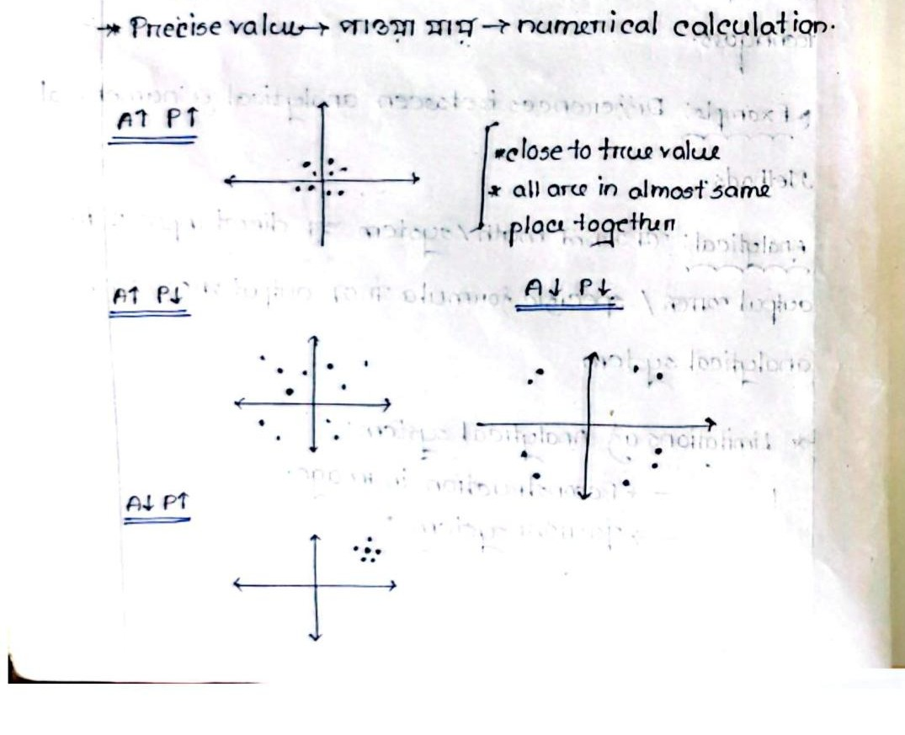
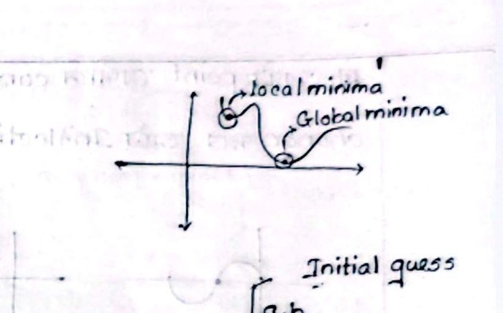
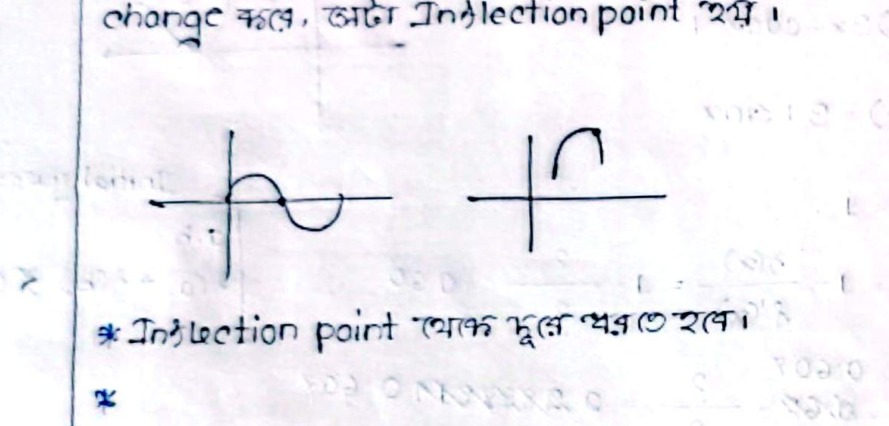
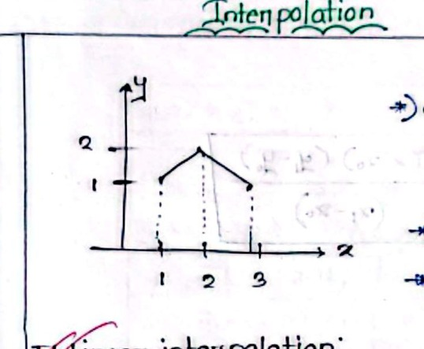
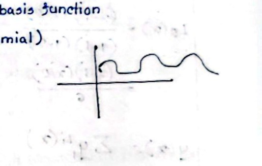
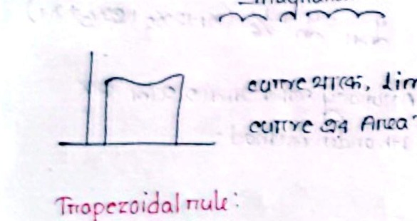
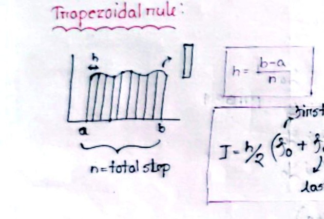

# ECE 2213: Numerical Analysis & Discrete Mathematics — Class Notes
## Part 1: Numerical Methods (Pages 1–18)

**Student**: Raidah (Roll: 2310035)  
**Instructors**: NRP Sir, Nadim Sir  
**Textbook References**: S. S. Sastry (*Introductory Methods of Numerical Analysis*), Kenneth H. Rosen (*Discrete Mathematics and Its Applications*)  

> [!INFO] Document Mapping & Structure
> - **Source PDF**: Pages 01–18 of `Numerical & Discrete classnote - 2310035 .pdf`
> - **Spread Accounting**: Page 01 is a single cover/intro page; Pages 02–18 are scanned two-page notebook spreads (~35 physical pages).
> - **Companion Note**: Part 2 (Discrete Mathematics, Pages 19–40) is located at [[02_ECE2213_Discrete_Mathematics_ClassNotes]].

---

<!-- Page 1 | CLASS-01 | 29.06.2026 -->
## CLASS-01 | 29.06.2026 | Introduction to Numerical Methods

**Reference**: Sastry (Book)  
**Class Code**: `3czyokbk`

### Introduction to Numerical Methods

#### Definition of Numerical Methods
> [!note] Definition
> **Numerical Methods** are mathematical techniques used to obtain approximate solutions to mathematical problems that cannot be solved exactly or efficiently using analytical methods or techniques.

#### Comparison: Analytical vs. Numerical Methods

* **Analytical System / Method**:
  A system or mathematical problem where a direct input produces a direct output, or where the exact output can be computed using a closed-form formula.
* **Limitations of Analytical Systems**:
  * Image reconstruction (complex pixel matrices and inverse problems)
  * Missile trajectory / guidance systems (time-varying atmospheric dynamics and nonlinear aerodynamic resistance)

---

<!-- Page 2 | Accuracy, Precision & Error Analysis -->
## Accuracy, Precision, and Error Analysis

### Accuracy vs. Precision

* **Accuracy**: How close a measured or computed value is to the true / actual value.
* **Precision**: The closeness, agreement, or repeatability among multiple measured or collected data points.
* **Analytical Calculation**: Yields the **True Value** (exact solution).
* **Numerical Calculation**: Yields the **Precise Value** (iterative approximation).

#### Accuracy & Precision Combinations

The four possible combinations of accuracy ($A$) and precision ($P$):
* $[A\uparrow P\uparrow]$: High Accuracy, High Precision (close to true value and clustered closely together)
* $[A\uparrow P\downarrow]$: High Accuracy, Low Precision (average is near true value, but points are widely scattered)
* $[A\downarrow P\uparrow]$: Low Accuracy, High Precision (points are clustered tightly together, but far from true value)
* $[A\downarrow P\downarrow]$: Low Accuracy, Low Precision (points are widely scattered and far from true value)


*Figure 1.1 — Combinations of Accuracy and Precision on coordinate target axes (Page 2)*

---

### Error Definitions

#### True Error ($E_t$)
The difference between the true (exact) value and the approximate value:
$$E_t = \text{True value} - \text{Approximate value}$$

* *Analytical formulation* gives the true value: $f(x)$
* *Numerical approximation* (e.g., finite difference):
  $$f'(x) \approx \frac{f(x+h) - f(x)}{h}$$

#### Relative True Error ($\epsilon_t$)
$$\epsilon_t = \left| \frac{\text{True Error}}{\text{True value}} \right| = \left| \frac{E_t}{\text{True value}} \right|$$

> [!tip] Percentage Form
> In practice, the relative true error is expressed as a percentage:
> $$\epsilon_t = \left| \frac{\text{True Error}}{\text{True value}} \right| \times 100\%$$

---

<!-- Page 3 | CLASS-02 | 30.06.2026 -->
## CLASS-02 | 30.06.2026 | Roots of Equations & Bisection Method

### Roots of Equations

* **General Formulation**: $f(x) = 0$
* **Objective**: Find the value(s) of $x$ satisfying the equation.
* **Nature of Solution**: Can be exact (analytical) or approximate (numerical). Widely applied in engineering and science.
* **Types of Equations**:
  * **Algebraic**: Polynomial equations, e.g., $a_n x^n + \dots + a_0 = 0$
  * **Transcendental**: Equations containing trigonometric, exponential, or logarithmic functions, e.g., $\sin x$, $e^x$, $\ln x$.
* Roots can occur in pairs or distinct combinations.

---

### Bisection Method (Interval Halving)

#### Algorithm:
1. Choose lower bound $a$ and upper bound $b$ such that they bracket the root, i.e., $f(a) \cdot f(b) < 0$.
2. Compute the midpoint approximation:
   $$x_0 = \frac{a + b}{2}$$
3. Evaluate $f(x_0)$.
4. Determine the new sub-interval:
   * If $f(a) \cdot f(x_0) < 0 \implies$ root lies in $[a, x_0]$; set $b = x_0$.
   * If $f(x_0) \cdot f(b) < 0 \implies$ root lies in $[x_0, b]$; set $a = x_0$.
   * If $f(x_0) = 0 \implies x_0$ is the exact root.

#### Example: Root of $f(x) = 3x - \cos x - 1 = 0$
* $f(0) = 3(0) - \cos(0) - 1 = 0 - 1 - 1 = -2 < 0$
* $f(1) = 3(1) - \cos(1) - 1 = 3 - 0.540302 - 1 = 1.45969 > 0$
* Since $f(0) \cdot f(1) < 0$, a root exists in $[0, 1]$. Choosing $a = 1$ and $b = 0.5$:

| Iteration | $a$ | $b$ | $f(a)$ | $f(b)$ | $x_0 = \frac{a+b}{2}$ | $f(x_0)$ |
| :---: | :---: | :---: | :---: | :---: | :---: | :---: |
| 1 | $1.0$ | $0.5$ | $+1.45969$ | $-3.77582$ | $0.75$ | $+0.51831$ |
| 2 | $0.75$ | $0.5$ | $+0.51831$ | $-3.77582$ | $0.625$ | $+0.06903$ |
| 3 | $0.625$ | $0.5$ | $+0.06903$ | $-3.7758$ | $0.5625$ | $-0.158424$ |
| 4 | $0.625$ | $0.5625$ | $+0.06903$ | $-0.158424$ | $0.59375$ | $-0.047598$ |
| 5 | $0.625$ | $0.59375$ | $+0.06903$ | $-0.047598$ | $0.609375$ | $+0.008119$ |
| 6 | $0.60937$ | $0.59375$ | $+0.008119$ | $-0.047598$ | $0.60156$ | $-0.019773$ |
| 7 | $0.60937$ | $0.60156$ | $+0.008119$ | $-0.019773$ | $0.605465$ | $-0.00584$ |
| 8 | $0.60937$ | $0.60546$ | $+0.008119$ | $-0.00584$ | $0.605965$ | $-0.000584$ |

$$\boxed{x \approx 0.6055} \quad (\text{Ans})$$

---

<!-- Page 4 | CLASS-03 | 01.07.2026 -->
## CLASS-03 | 01.07.2026 | Error Stopping Criterion & False Position Method

### Approximate Percentage Error Stopping Criterion
In practical engineering problems, exact roots cannot always be computed directly. Iteration is terminated once the estimate is sufficiently accurate:
$$\epsilon_a = \left| \frac{x_r^{\text{new}} - x_r^{\text{old}}}{x_r^{\text{new}}} \right| \times 100\%$$
* **Stopping Criterion**: Terminate when $\epsilon_a < \epsilon_s$ (where $\epsilon_s$ is the prespecified error tolerance).

#### Example 2.2: $f(x) = x^3 - 2x - 5 = 0$, tolerance $\epsilon_s < 0.01\%$
* $f(2) = 2^3 - 2(2) - 5 = -1 < 0$
* $f(2.5) = (2.5)^3 - 2(2.5) - 5 = 15.625 - 5 - 5 = 5.625 > 0$

| Iteration | $a$ | $b$ | $f(a)$ | $f(b)$ | $x_r$ | $f(x_r)$ | $\epsilon_a$ |
| :---: | :---: | :---: | :---: | :---: | :---: | :---: | :---: |
| 1 | $2$ | $2.5$ | $-1$ | $+5.625$ | $2.25$ | $+1.8906$ | — |
| 2 | $2$ | $2.25$ | $-1$ | $+1.8906$ | $2.125$ | $+0.3457$ | $5.88\%$ |
| 3 | $2$ | $2.125$ | $-1$ | $+0.3457$ | $2.0625$ | $-0.351$ | $3.03\%$ |
| 4 | $2.0625$ | $2.125$ | $-0.351$ | $+0.3457$ | $2.0937$ | $-8 \times 10^{-3}$ | $1.49\%$ |
| 5 | $2.0937$ | $2.125$ | $-8 \times 10^{-3}$ | $+0.3457$ | $2.1093$ | $+0.1665$ | $0.74\%$ |
| 6 | $2.0937$ | $2.1093$ | $-8 \times 10^{-3}$ | $+0.1665$ | $2.1015$ | — | $0.37\%$ |
| 7 | $2.0937$ | $2.1015$ | $-8 \times 10^{-3}$ | $+0.0778$ | $2.0976$ | — | $0.19\%$ |
| 8 | $2.0937$ | $2.0976$ | $-8 \times 10^{-3}$ | $+0.034$ | $2.0956$ | — | $0.095\%$ |
| 9 | $2.0937$ | $2.0956$ | $-8 \times 10^{-3}$ | $+0.0122$ | $2.0946$ | — | $0.047\%$ |
| 10 | $2.0937$ | $2.0946$ | $-8 \times 10^{-3}$ | $+1 \times 10^{-3}$ | $2.0941$ | — | $0.023\%$ |
| 11 | $2.0941$ | $2.0946$ | $-3 \times 10^{-3}$ | $+1 \times 10^{-3}$ | $2.0943$ | — | $\mathbf{0.009\%}$ |

$$\boxed{\text{Root } x \approx 2.0943}$$

#### Disadvantages of Bisection Method:
1. Extremely time-consuming.
2. Requires a very large number of iterations to achieve tight precision.
* **Alternative/Improved Approach**: **False Position Method (Regula Falsi)**.

---

<!-- Page 5 | CLASS-04 | 20.07.2026 | NRP SIR -->
## CLASS-04 | 20.07.2026 | NRP Sir | Newton-Raphson Method (Open Methods)

### Bracketing vs. Open Methods
* **Bracketing Methods**: Require two initial guesses $[a, b]$ that bound the root ($f(a) \cdot f(b) < 0$). Always converge, but converge slowly.
* **Open Methods**: Require only a single starting value (or two values that do not necessarily bracket the root). Converge much faster when they do converge.


*Figure 4.1 — Function curve showing local minima and global minima (Page 5)*

### Newton-Raphson Method
From the first derivative of the tangent line:
$$x_{n+1} = x_n - \frac{f(x_n)}{f'(x_n)}$$

> [!important] Convergence Stopping Rule
> If two consecutive iterations yield the exact same value (within the specified tolerance), the function evaluation should be terminated there.

#### Illustrative Example: $f(x) = 2x + 3 \implies f'(x) = 2$
* Initial guess $x_0 = 3$:
  $$x_1 = 3 - \frac{2(3) + 3}{2} = 3 - \frac{9}{2} = -1.5$$
  $$x_2 = -1.5 - \frac{2(-1.5) + 3}{2} = -1.5 - \frac{0}{2} = -1.5$$
  Since $x_1 = x_2 = -1.5$, iteration stops. Exact root found in 2 steps.

#### Example: $f(x) = 3x - \cos x - 1 = 0 \implies f'(x) = 3 + \sin x$
* Initial guess $x_0 = 1$:
  $$x_1 = 1 - \frac{f(1)}{f'(1)} = 1 - \frac{1.4597}{3.8415} \approx 0.62$$
  $$x_2 = 0.62 - \frac{f(0.62)}{f'(0.62)} \approx 0.607 \quad (\epsilon_a = 2.1916\%)$$
  $$x_3 = 0.607 - \frac{f(0.607)}{f'(0.607)} \approx 0.607 \quad (\epsilon_a = 0\%)$$
* With initial guess $x_0 = 0$:
  * $x_0 = 0 \implies f(0) = -2, f'(0) = 3 \implies x_1 = 0.67$
  * $x_1 = 0.67 \implies f(0.67) = 0.22617, f'(0.67) = 3.62098 \implies x_2 = 0.607$
  * $x_2 = 0.607 \implies f(0.607) = -3.629 \times 10^{-9}, f'(0.607) = 3.5709 \implies x_3 = 0.607$

---

<!-- Page 6 | Inflection Points & Secant Method Intro -->
## Inflection Points & Secant Method

### Inflection Point Problem in Newton-Raphson
> [!warning] Inflection Point Hazard
> A point where the concavity/curvature of the curve changes direction ($f''(x) = 0$) is an **inflection point**. Initial guesses must be chosen away from inflection points to prevent divergent oscillations.


*Figure 4.2 — Curves demonstrating inflection point where direction changes (Page 6)*

#### Case Study: $f(x) = x^3 - 5x$
* $f'(x) = 3x^2 - 5$
* $f''(x) = 6x \implies f''(x) = 0 \implies x = 0$ is the inflection point.
* Choosing $x_0 = 1$:
  * $f(1) = -4, f'(1) = -2 \implies x_1 = 1 - \frac{-4}{-2} = -1$
  * $f(-1) = 4, f'(-1) = -2 \implies x_2 = -1 - \frac{4}{-2} = 1$
  * The iterations oscillate endlessly between $+1$ and $-1$.
* **Remedy**: Pick an initial guess sufficiently far from $x = 0$, e.g., $x_0 = 3$:
  * $x_0 = 3 \implies f(3) = 12, f'(3) = 22 \implies x_1 = 2.45$
  * $x_1 = 2.45 \implies f(2.45) = 2.456125, f'(2.45) = 13.0976 \implies x_2 = 2.26$ ($\epsilon_a = 8.40\%$)
  * $x_2 = 2.26 \implies f(2.26) = 0.2132, f'(2.26) = 10.3228 \implies x_3 = 2.236$ ($\epsilon_a = 1.07\%$)
  * $x_3 = 2.236 \implies f(2.236) = 6.679 \times 10^{-3}, f'(2.236) = 9.999 \implies x_4 = 2.235$ ($\epsilon_a = 0.0447\%$)

#### Drawbacks of Newton-Raphson Method:
1. **High Computational Cost**: The analytical derivative $f'(x)$ must be evaluated at every iteration step.
2. **Inflection Points & Divergence**: Risk of infinite oscillation or division by zero when $f'(x) \approx 0$.

---

<!-- Page 7 | CLASS-05 | NRP SIR | Secant Method -->
## CLASS-05 | NRP Sir | Secant Method

The **Secant Method** eliminates the need to calculate the analytical derivative by approximating $f'(x)$ with a finite difference:
* Requires two initial estimates: $x_0$ and $x_1$, yielding $f(x_0)$ and $f(x_1)$.
* Formulation:
  $$x_{n+1} = x_n - \frac{f(x_n)(x_n - x_{n-1})}{f(x_n) - f(x_{n-1})}$$
  $$\boxed{x_{n+1} = \frac{x_{n-1}f(x_n) - x_n f(x_{n-1})}{f(x_n) - f(x_{n-1})}}$$

#### Worked Example: $f(x) = 4x^3 + 2x$
* $f(0) = 0$
* $f(1) = 4(1)^3 + 2(1) = 6$
* $f(2) = 4(2)^3 + 2(2) = 36$
* Using $x_0 = 2$ and $x_1 = 1$:
  $$x_2 = \frac{x_0 f(x_1) - x_1 f(x_0)}{f(x_1) - f(x_0)} = \frac{2(6) - 1(36)}{6 - 36} = \frac{12 - 36}{-30} = \frac{-24}{-30} = 0.8 = \frac{4}{5}$$
  $$f(x_2) = f(0.8) = 4(0.8)^3 + 2(0.8) = 2.048 + 1.6 = 3.648$$
* Next iteration:
  $$x_3 = \frac{x_1 f(x_2) - x_2 f(x_1)}{f(x_2) - f(x_1)} = \frac{1(3.648) - 0.8(6)}{3.648 - 6} = \frac{3.648 - 4.8}{-2.352} = 0.664688$$
  $$f(x_3) = f(0.664688) = 2.5040$$
* Next iteration:
  $$x_4 = \frac{x_2 f(x_3) - x_3 f(x_2)}{f(x_3) - f(x_2)} = \frac{0.8(2.5040) - 0.664688(3.648)}{2.5040 - 3.648} = 0.36849$$
  $$f(x_4) = f(0.36849) = 0.937121$$
* Next iteration:
  $$x_5 = \frac{x_3 f(x_4) - x_4 f(x_3)}{f(x_4) - f(x_3)} = \frac{0.664688(0.937121) - 0.36849(2.5040)}{0.937121 - 2.5040} = 0.191339$$
  $$f(x_5) = 0.410699$$

---

<!-- Page 8 | CLASS-06 | 25.07.2026 | Interpolation Fundamentals -->
## CLASS-06 | 25.07.2026 | Interpolation Fundamentals

### Important Secant Observation
For $f(x) = x^3 + 3x^2 - 9x - 12$:
* $f(0) = -12, f(1) = -12, f(2) = 0$.
* If an exact root is selected as an initial guess, $f(x_1) - f(x_0)$ or the numerator collapses to zero, leading to an undefined division or trivial halt. Therefore, independent, non-root values must be chosen as initial guesses.

---

### Introduction to Interpolation

* **Purpose**: To estimate intermediate values of a function between discrete tabulated data points, creating a continuous representation.
* **Scope**:
  * **Interpolation**: Estimating functional values *inside* the range of known data points ($x_0 \le x \le x_n$).
  * **Extrapolation**: Estimating functional values *outside* the range of known data points.
  * Related domains: Regression, Classification, Curve Fitting.


*Figure 6.1 — Piecewise linear interpolation on Cartesian plane (Page 8)*

### Linear Interpolation
Connecting two consecutive discrete data points $(x_0, y_0)$ and $(x_1, y_1)$ with a straight-line segment:
$$\text{Slope } m = \frac{y_1 - y_0}{x_1 - x_0}$$
$$y - y_0 = \frac{y_1 - y_0}{x_1 - x_0}(x - x_0) \implies \boxed{y = y_0 + \frac{(x - x_0)(y_1 - y_0)}{x_1 - x_0}}$$

---

<!-- Page 9 | Lagrange Interpolation -->
## Lagrange Interpolation

### Limitation of Linear Interpolation
Linear interpolation provides low accuracy because real physical phenomena are nonlinear; there is no guarantee that intermediate values lie on straight-line chords.

### Lagrange Polynomial Concept
Instead of piecewise chords, Lagrange interpolation constructs a single continuous polynomial $P_n(x)$ of degree $n$ that passes exactly through all $n+1$ distinct data points.


*Figure 6.2 — Oscillating polynomial curve through interpolation points (Page 9)*

#### General Formula:
$$y(x) = \sum_{i=0}^n y_i L_i(x)$$
where $L_i(x)$ is **Lagrange's Cardinal Basis Function**:
$$L_i(x) = \prod_{\substack{j=0 \\ j \neq i}}^n \frac{x - x_j}{x_i - x_j}$$

> [!note] Kronecker Delta Property
> Each basis function satisfies:
> $$L_i(x_j) = \begin{cases} 1, & \text{if } j = i \\ 0, & \text{if } j \neq i \end{cases}$$

#### Worked Problem: Lagrange Interpolation
Given data points:
| $i$ | $x_i$ | $y_i$ |
| :---: | :---: | :---: |
| 0 | $1$ | $2$ |
| 1 | $2$ | $3$ |
| 2 | $4$ | $7$ |

Find $y(3)$:
1. Construct basis polynomials:
   $$L_0(x) = \frac{(x - x_1)(x - x_2)}{(x_0 - x_1)(x_0 - x_2)} = \frac{(x - 2)(x - 4)}{(1 - 2)(1 - 4)} = \frac{(x - 2)(x - 4)}{(-1)(-3)} = \frac{(x - 2)(x - 4)}{3}$$
   $$L_1(x) = \frac{(x - x_0)(x - x_2)}{(x_1 - x_0)(x_1 - x_2)} = \frac{(x - 1)(x - 4)}{(2 - 1)(2 - 4)} = \frac{(x - 1)(x - 4)}{(1)(-2)} = \frac{(x - 1)(x - 4)}{-2}$$
   $$L_2(x) = \frac{(x - x_0)(x - x_1)}{(x_2 - x_0)(x_2 - x_1)} = \frac{(x - 1)(x - 2)}{(4 - 1)(4 - 2)} = \frac{(x - 1)(x - 2)}{(3)(2)} = \frac{(x - 1)(x - 2)}{6}$$

---

<!-- Page 10 | CLASS-07 | 27.07.2026 | Newton Forward & Backward Difference -->
## CLASS-07 | 27.07.2026 | Newton Forward & Backward Difference

### Completing Lagrange Evaluation at $x = 3$:
$$y(x) = 2 \left[\frac{(x-2)(x-4)}{3}\right] + 3 \left[\frac{(x-1)(x-4)}{-2}\right] + 7 \left[\frac{(x-1)(x-2)}{6}\right]$$
For $x = 3$:
$$y(3) = 2\left(\frac{(1)(-1)}{3}\right) + 3\left(\frac{(2)(-1)}{-2}\right) + 7\left(\frac{(2)(1)}{6}\right) = -\frac{2}{3} + 3 + \frac{7}{3} = \frac{14}{3} \approx \mathbf{4.6667}$$

---

### Newton's Forward & Backward Difference Interpolation
* **Requirement**: The independent variable $x$ must be **equally spaced** ($x_i - x_{i-1} = h$).

#### Finite Difference Table Example:
| $x$ | $y$ | $\Delta y$ | $\Delta^2 y$ | $\Delta^3 y$ |
| :---: | :---: | :---: | :---: | :---: |
| $5$ | $0.4$ | $0.3$ | — | — |
| $10$ | $0.7$ | $0.5$ | $0.2$ | — |
| $15$ | $1.2$ | $0.4$ | $-0.1$ | $-0.3$ |
| $20$ | $1.6$ | — | — | — |

#### Decision Rule:
* If the target value $x$ is near the beginning of the table (e.g., $x = 7$), use **Newton Forward**.
* If the target value $x$ is near the end of the table (e.g., $x = 17$), use **Newton Backward**.

#### Newton's Forward Interpolation Formula:
$$y(x) = y_0 + p\Delta y_0 + \frac{p(p-1)}{2!} \Delta^2 y_0 + \frac{p(p-1)(p-2)}{3!} \Delta^3 y_0 + \dots$$
where:
$$p = \frac{x - x_0}{h} \quad (\text{For best precision, } |p| < 1)$$

#### Newton's Backward Interpolation Formula:
$$y(x) = y_n + p\nabla y_n + \frac{p(p+1)}{2!} \nabla^2 y_n + \frac{p(p+1)(p+2)}{3!} \nabla^3 y_n + \dots$$
where:
$$p = \frac{x - x_n}{h} \quad (x_n = \text{last value})$$

---

<!-- Page 11 | Calculations & Newton Divided Difference -->
## Calculations & Newton's Divided Difference

### Forward & Backward Evaluations:

1. **For $x = 7$ (Forward)**:
   * $x_0 = 5, h = 5 \implies p = \frac{7 - 5}{5} = 0.4$
   $$y(7) = 0.4 + 0.4(0.3) + \frac{0.4(0.4 - 1)}{2}(0.2) + \frac{0.4(0.4 - 1)(0.4 - 2)}{6}(-0.3) = \mathbf{0.6932}$$

2. **For $x = 17$ (Backward)**:
   * $x_n = 20, h = 5 \implies p = \frac{17 - 20}{5} = -0.6$
   $$y(17) = 1.6 + \frac{-0.6}{1}(0.4) + \frac{(-0.6)(-0.6 + 1)}{2}(0.1) + \frac{(-0.6)(-0.6 + 1)(-0.6 + 2)}{6}(-0.3) = \mathbf{1.3312}$$

> [!note] Self Study
> Central difference formulas: Gauss Forward, Gauss Backward, and Stirling's interpolation formulas.

---

### Newton's Divided Difference (Unequally Spaced Data)
Applicable for arbitrary, non-uniform intervals.

#### Definition of Divided Differences:
* Zeroth: $f[x_0] = y_0$
* First: $f[x_0, x_1] = \frac{y_1 - y_0}{x_1 - x_0}$
* Second: $f[x_0, x_1, x_2] = \frac{f[x_1, x_2] - f[x_0, x_1]}{x_2 - x_0}$

#### Divided Difference Table:
| $x$ | $y$ | 1st Divided Diff | 2nd Divided Diff | 3rd Divided Diff | 4th Divided Diff |
| :---: | :---: | :---: | :---: | :---: | :---: |
| $2$ | $5$ | — | — | — | — |
| $3$ | $7$ | $\frac{7-5}{3-2} = 2$ | — | — | — |
| $7$ | $19$ | $\frac{19-7}{7-3} = 3$ | $\frac{3-2}{7-2} = 0.2$ | — | — |
| $9$ | $28$ | $\frac{28-19}{9-7} = 4.5$ | $\frac{4.5-3}{9-3} = 0.25$ | $\frac{0.25-0.2}{9-2} \approx 0.007$ | — |
| $14$ | $41$ | $\frac{41-28}{14-9} = 2.6$ | $\frac{2.6-4.5}{14-7} \approx -0.2714$ | $\frac{-0.2714-0.25}{14-3} \approx -0.047$ | $\frac{-0.047-0.007}{14-2} \approx -0.0045$ |

#### Newton's Divided Difference Polynomial:
$$y(x) = y_0 + (x - x_0)f[x_0, x_1] + (x - x_0)(x - x_1)f[x_0, x_1, x_2] + (x - x_0)(x - x_1)(x - x_2)f[x_0, x_1, x_2, x_3] + \dots$$

---

<!-- Page 12 | 28.07.2026 | Spline Interpolation -->
## 28.07.2026 | NRP Sir | Spline Interpolation & CT Syllabus

### Evaluation of Divided Difference at $x = 11$:
$$y(11) = 5 + (11-2)(2) + (11-2)(11-3)(0.2) + (11-2)(11-3)(11-7)(0.007) + (11-2)(11-3)(11-7)(11-9)(-0.0045)$$
$$= 5 + 18 + 14.4 + 2.016 - 2.592 = \mathbf{36.824}$$

---

### Global vs. Local Interpolation

* **Global Interpolation** (Lagrange, Newton Forward/Backward, Divided Difference):
  Fits a single high-degree polynomial through all points. As the number of points increases, the polynomial degree increases, frequently causing severe boundary oscillations (Runge's phenomenon).
* **Spline Interpolation (Local)**:
  Fits lower-degree polynomials piecewise between adjacent sub-intervals with smooth derivative continuity at data knots.
  * Linear Spline: $y = mx + c$ (piecewise straight lines)
  * Quadratic Spline: $ax^2 + bx + c$ (piecewise parabolas)
  * Cubic Spline: $ax^3 + bx^2 + cx + d$ (piecewise cubics; yields a globally smooth $C^2$ curve)

---

### Cubic Splines

#### Governing Tridiagonal Equation:
For equal spacing $h$, the second derivatives $M_i = f''(x_i)$ satisfy:
$$M_{i-1} + 4M_i + M_{i+1} = \frac{6}{h^2}\left[ f_{i+1} - 2f_i + f_{i-1} \right] \quad \text{for } i = 1, 2, \dots, n-1$$
* **Natural Spline Boundary Condition**:
  $$M_0 = 0, \quad M_n = 0$$

#### Worked Example:
Given points: $(1, 3), (2, 12), (3, 16)$ with $h = 1$:
* $n = 2 \implies M_0 = 0, M_2 = 0$.
* For $i = 1$:
  $$M_0 + 4M_1 + M_2 = \frac{6}{1^2}\left[ 16 - 2(12) + 3 \right]$$
  $$0 + 4M_1 + 0 = 6[16 - 24 + 3] = 6[-5] = -30$$
  $$\boxed{M_1 = -\frac{30}{4} = -7.5}$$

---

<!-- Page 13 | Cubic Spline Interpolation Evaluation -->
## Cubic Spline Interpolation Evaluation

### Cubic Spline Formula for Interval $[x_{i-1}, x_i]$:
$$F(x) = \frac{1}{6h}\left[ (x_i - x)^3 M_{i-1} + (x - x_{i-1})^3 M_i \right] + \frac{1}{h}(x_i - x)\left[ f_{i-1} - \frac{h^2}{6}M_{i-1} \right] + \frac{1}{h}(x - x_{i-1})\left[ f_i - \frac{h^2}{6}M_i \right]$$

#### Evaluating $F(1.5)$ for the interval $[1, 2]$:
* Here $i = 1$, $x_0 = 1, x_1 = 2, h = 1$, $f_0 = 3, f_1 = 12$, $M_0 = 0, M_1 = -7.5$:
  $$F(1.5) = \frac{1}{6}\left[ (2 - 1.5)^3(0) + (1.5 - 1)^3(-7.5) \right] + (2 - 1.5)\left[ 3 - 0 \right] + (1.5 - 1)\left[ 12 - \frac{1}{6}(-7.5) \right]$$
  $$= \frac{1}{6}\left[ (0.125)(-7.5) \right] + 0.5(3) + 0.5\left[ 12 + 1.25 \right]$$
  $$= -0.15625 + 1.5 + 6.625 = \mathbf{7.96875}$$

#### 4-Point Spline Example:
Points: $(1, 1), (2, 5), (3, 11), (4, 8)$ with $h = 1$, $M_0 = 0, M_3 = 0$:
* For $i = 1$:
  $$M_0 + 4M_1 + M_2 = 6[11 - 2(5) + 1] = 6[2] = 12 \implies 4M_1 + M_2 = 12$$
* For $i = 2$:
  $$M_1 + 4M_2 + M_3 = 6[8 - 2(11) + 5] = 6[-9] = -54 \implies M_1 + 4M_2 = -54$$
* Solving simultaneously:
  $$M_1 = 6.8, \quad M_2 = -15.2$$
* Evaluating at $x = 1.5$:
  $$F(1.5) = \mathbf{2.575} \quad (\text{Ans})$$

---

<!-- Page 14 | 04.08.2026 | Systems of Linear Equations -->
## 04.08.2026 | Systems of Linear Equations

### 1. Gauss Elimination
Given the linear system:
$$
\begin{aligned}
2x_1 + x_2 + 0x_3 &= 7 \quad &(i) \\
x_1 + 2x_2 - 3x_3 &= 3 \quad &(ii) \\
x_1 - 4x_2 + 5x_3 &= 11 \quad &(iii)
\end{aligned}
$$

#### Augmented Matrix & Forward Elimination:
$$
\begin{bmatrix}
2 & 1 & 0 & \big| & 7 \\
1 & 2 & -3 & \big| & 3 \\
1 & -4 & 5 & \big| & 11
\end{bmatrix}
\xrightarrow{R_1 \leftrightarrow R_2}
\begin{bmatrix}
1 & 2 & -3 & \big| & 3 \\
2 & 1 & 0 & \big| & 7 \\
1 & -4 & 5 & \big| & 11
\end{bmatrix}
$$

$$
\xrightarrow{\substack{R_2 \leftarrow R_2 - 2R_1 \\ R_3 \leftarrow R_3 - R_1}}
\begin{bmatrix}
1 & 2 & -3 & \big| & 3 \\
0 & -3 & 6 & \big| & 1 \\
0 & -6 & 8 & \big| & 8
\end{bmatrix}
\xrightarrow{R_3 \leftarrow R_3 - 2R_2}
\begin{bmatrix}
1 & 2 & -3 & \big| & 3 \\
0 & -3 & 6 & \big| & 1 \\
0 & 0 & -4 & \big| & 6
\end{bmatrix}
$$

#### Back-Substitution:
$$-4x_3 = 6 \implies x_3 = -\frac{6}{4} = \mathbf{-1.5 = -\frac{3}{2}}$$
$$-3x_2 + 6(-1.5) = 1 \implies -3x_2 - 9 = 1 \implies x_2 = \mathbf{-\frac{10}{3} \approx -3.33}$$
$$x_1 + 2(-3.33) - 3(-1.5) = 3 \implies x_1 = \mathbf{\frac{31}{6} \approx 5.166}$$

---

### 2. Gauss-Seidel Iteration
Rearranging system for diagonally dominant/isolated variables:
$$x_1 = \frac{7 - x_2}{2}, \quad x_2 = \frac{1 + x_1 + x_3}{2}, \quad x_3 = \frac{1 + x_2}{2}$$
*(Uses newly updated values immediately within the same iteration)*

* **Iteration 1** (Initial: $x_2^{(0)} = 0, x_3^{(0)} = 0$):
  * $x_1^{(1)} = \frac{7 - 0}{2} = 3.5$
  * $x_2^{(1)} = \frac{1 + 3.5 + 0}{2} = 2.25$
  * $x_3^{(1)} = \frac{1 + 2.25}{2} = 1.625$
* **Iteration 2**:
  * $x_1^{(2)} = \frac{7 - 2.25}{2} = 4.625$
  * $x_2^{(2)} = \frac{1 + 4.625 + 1.625}{2} = 3.625$
  * $x_3^{(2)} = \frac{1 + 3.625}{2} = 2.3125$
* **Iteration 3**:
  * $x_1^{(3)} = 5.3125, \quad x_2^{(3)} = 4.3125, \quad x_3^{(3)} = 2.65625$

---

### 3. Gauss-Jacobi Iteration
*(Uses only values from the previous iteration step)*
* **Iteration 1** ($x_1^{(0)}=0, x_2^{(0)}=0, x_3^{(0)}=0$):
  * $x_1^{(1)} = \frac{7 - 0}{2} = 3.5$
  * $x_2^{(1)} = \frac{1 + 0 + 0}{2} = 0.5$
  * $x_3^{(1)} = \frac{1 + 0}{2} = 0.5$
* **Iteration 2**:
  * $x_1^{(2)} = \frac{7 - 0.5}{2} = 3.75$
  * $x_2^{(2)} = \frac{1 + 3.5 + 0.5}{2} = 2.5$
  * $x_3^{(2)} = \frac{1 + 0.5}{2} = 0.75$

---

<!-- Page 15 | 15.08.2026 | Numerical Differentiation & Euler's Method -->
## 15.08.2026 | Numerical Differentiation & Euler's Method

### Numerical Differentiation via Newton Forward Differences
* First derivative:
  $$f'(x_0 + ph) = \frac{dy}{dx} = \frac{1}{h}\left( \Delta y_0 + \frac{2p-1}{2!}\Delta^2 y_0 + \frac{3p^2 - 6p + 2}{3!}\Delta^3 y_0 + \frac{4p^3 - 18p^2 + 22p - 6}{4!}\Delta^4 y_0 \right)$$
* Second derivative:
  $$f''(x_0 + ph) = \frac{d^2y}{dx^2} = \frac{1}{h^2}\left( \Delta^2 y_0 + \frac{6p - 6}{3!}\Delta^3 y_0 + \frac{12p^2 - 36p + 22}{4!}\Delta^4 y_0 \right)$$

---

### Euler's Method (First-Order Runge-Kutta)
For initial value problems: $\frac{dy}{dx} = f(x, y)$, $y(x_0) = y_0$:
$$\boxed{y_{n+1} = y_n + h f(x_n, y_n)}$$

> [!tip] Step Size Effect
> Accuracy improves significantly as step size $h$ decreases.

#### Worked Problem: Euler's Method
Solve $\frac{dy}{dx} = x + y$, given $y(0) = 1$, find $y(0.5)$ with step size $h = 0.1$:
* $x_0 = 0, y_0 = 1$
* $n = \frac{0.5 - 0}{0.1} = 5$ steps:
  1. $y_1 = y(0.1) = 1 + 0.1(0 + 1) = \mathbf{1.1}$
  2. $y_2 = y(0.2) = 1.1 + 0.1(0.1 + 1.1) = 1.1 + 0.12 = \mathbf{1.22}$
  3. $y_3 = y(0.3) = 1.22 + 0.1(0.2 + 1.22) = 1.22 + 0.142 = \mathbf{1.362}$
  4. $y_4 = y(0.4) = 1.362 + 0.1(0.3 + 1.362) = 1.362 + 0.1662 = \mathbf{1.5282}$
  5. $y_5 = y(0.5) = 1.5282 + 0.1(0.4 + 1.5282) = 1.5282 + 0.19282 = \mathbf{1.72102}$

---

<!-- Page 16 | Heun's Method & Runge-Kutta 4th Order -->
## Heun's Method & Runge-Kutta 4th Order

### Modified Euler's Method (Heun's Predictor-Corrector)
* **Predictor**:
  $$y_{n+1}^{(0)} = y_n + h f(x_n, y_n)$$
* **Corrector**:
  $$y_{n+1}^{(k+1)} = y_n + \frac{h}{2}\left[ f(x_n, y_n) + f\left(x_{n+1}, y_{n+1}^{(k)}\right) \right]$$

#### Example: $\frac{dy}{dx} = x + y, y(0) = 1, h = 0.1$:
* **Step 1 ($x_0 = 0 \to x_1 = 0.1$)**:
  * P: $y_1^{(0)} = 1 + 0.1(0 + 1) = 1.1$
  * C (iter 1): $y_1^{(1)} = 1 + \frac{0.1}{2}[(1) + (0.1 + 1.1)] = 1 + 0.05(2.2) = 1.11$
  * C (iter 2): $y_1^{(2)} = 1 + \frac{0.1}{2}[(1) + (0.1 + 1.11)] = 1 + 0.05(2.21) = \mathbf{1.1105}$
* **Step 2 ($x_1 = 0.1 \to x_2 = 0.2$)**:
  * P: $y_2^{(0)} = 1.1105 + 0.1(0.1 + 1.1105) = 1.23155$
  * C (iter 1): $y_2^{(1)} = 1.1105 + \frac{0.1}{2}[(0.1 + 1.1105) + (0.2 + 1.23155)] = 1.2426$
  * C (iter 2): $y_2^{(2)} = 1.1105 + \frac{0.1}{2}[(1.2105) + (0.2 + 1.2426)] = \mathbf{1.2432}$

---

### Runge-Kutta 4th-Order Method (RK4)
Used when substantially higher numerical precision is demanded.

#### Formulas:
$$
\begin{aligned}
k_1 &= h f(x_n, y_n) \\
k_2 &= h f\left(x_n + \frac{h}{2}, y_n + \frac{k_1}{2}\right) \\
k_3 &= h f\left(x_n + \frac{h}{2}, y_n + \frac{k_2}{2}\right) \\
k_4 &= h f(x_n + h, y_n + k_3)
\end{aligned}
$$
$$\boxed{y_{n+1} = y_n + \frac{1}{6}(k_1 + 2k_2 + 2k_3 + k_4)}$$

#### Example: $\frac{dy}{dx} = x + y, y(0) = 1, h = 0.1$, find $y(0.1)$:
* $k_1 = 0.1(0 + 1) = 0.1$
* $k_2 = 0.1(0.05 + 1.05) = 0.11$
* $k_3 = 0.1(0.05 + 1.055) = 0.1105$
* $k_4 = 0.1(0.1 + 1.1105) = 0.12105$
* $y_1 = 1 + \frac{1}{6}[0.1 + 2(0.11) + 2(0.1105) + 0.12105] = \mathbf{1.11034}$

---

<!-- Page 17 | Numerical Integration | NRP SIR -->
## Numerical Integration | NRP Sir

### Definite Integration as Area Under a Curve
Definite integration represents the exact area bounded by the continuous curve $f(x)$, the $x$-axis, and the vertical limits $x = a$ and $x = b$:
$$I = \int_a^b f(x) \, dx$$


*Figure 17.1 — Area under continuous curve between limits (Page 17)*

---

### 1. Trapezoidal Rule
Approximates each sub-interval curve using a straight-line chord (linear segment).


*Figure 17.2 — Trapezoidal rule dividing area into n strips of width h (Page 17)*

* Step size: $h = \frac{b - a}{n}$ ($n$ is total intervals).
* Formula:
  $$\boxed{I = \frac{h}{2}\left[ (f_0 + f_n) + 2(f_1 + f_2 + \dots + f_{n-1}) \right]}$$

#### Example: Evaluate $\int_0^2 x^2 \, dx$ with $n = 4$:
* Analytical: $\int_0^2 x^2 \, dx = \left[\frac{x^3}{3}\right]_0^2 = \frac{8}{3} \approx 2.6667$
* $h = \frac{2 - 0}{4} = 0.5$:
  * $x_0 = 0 \implies f_0 = 0$
  * $x_1 = 0.5 \implies f_1 = 0.25$
  * $x_2 = 1.0 \implies f_2 = 1.0$
  * $x_3 = 1.5 \implies f_3 = 2.25$
  * $x_4 = 2.0 \implies f_4 = 4.0$
* $I = \frac{0.5}{2}\left[ (0 + 4) + 2(0.25 + 1.0 + 2.25) \right] = 0.25[4 + 2(3.5)] = 0.25(11) = \mathbf{2.75}$

---

### 2. Simpson's 1/3 Rule
Approximates the integrand using parabolic arcs across pairs of sub-intervals, significantly reducing truncation error.

> [!important] Step Count Constraint
> The total number of intervals $n$ **must be an even number**.

$$\boxed{I = \frac{h}{3}\left[ (f_0 + f_n) + 4(f_1 + f_3 + f_5 + \dots) + 2(f_2 + f_4 + f_6 + \dots) \right]}$$

#### Evaluation:
$$I = \frac{0.5}{3}\left[ (0 + 4) + 4(0.25 + 2.25) + 2(1.0) \right] = \frac{0.5}{3}[4 + 4(2.5) + 2] = \frac{0.5}{3}[16] = \mathbf{2.667}$$

---

### 3. Simpson's 3/8 Rule
Approximates the integrand using cubic polynomials across triplets of sub-intervals.

> [!important] Step Count Constraint
> The total number of intervals $n$ **must be a multiple of 3**.

$$\boxed{I = \frac{3h}{8}\left[ (f_0 + f_n) + 3(f_1 + f_2 + f_4 + f_5 + \dots) + 2(f_3 + f_6 + \dots) \right]}$$
* Points that are multiples of 3 are multiplied by 2; all other intermediate points are multiplied by 3.

---

<!-- Page 18 | Numerical Integration Examples & CT Syllabus Summary -->
## Numerical Integration Examples & CT Syllabus Summary

### Comprehensive Comparison: $\int_0^3 \frac{1}{1 + x^2} \, dx$ with $h = 0.5$:
* **Analytical Value**:
  $$\int_0^3 \frac{1}{1 + x^2} \, dx = \left[ \tan^{-1} x \right]_0^3 = \tan^{-1}(3) - \tan^{-1}(0) \approx \mathbf{1.2490}$$

#### Tabulated Functional Values:
| $i$ | $x_i$ | $f(x_i) = \frac{1}{1 + x_i^2}$ |
| :---: | :---: | :---: |
| 0 | $0.0$ | $1.0000$ |
| 1 | $0.5$ | $0.8000$ |
| 2 | $1.0$ | $0.5000$ |
| 3 | $1.5$ | $0.3076$ |
| 4 | $2.0$ | $0.2000$ |
| 5 | $2.5$ | $0.1379$ |
| 6 | $3.0$ | $0.1000$ |

1. **Trapezoidal Rule**:
   $$I = \frac{0.5}{2}\left[ (1.0 + 0.1) + 2(0.8 + 0.5 + 0.3076 + 0.2 + 0.1379) \right] = \mathbf{1.24775}$$

2. **Simpson's 1/3 Rule**:
   $$I = \frac{0.5}{3}\left[ (1.0 + 0.1) + 4(0.8 + 0.3076 + 0.1379) + 2(0.5 + 0.2) \right] = \mathbf{1.2470}$$

3. **Simpson's 3/8 Rule**:
   $$I = \frac{3(0.5)}{8}\left[ (1.0 + 0.1) + 3(0.8 + 0.5 + 0.2 + 0.1379) + 2(0.3076) \right] = \mathbf{1.2429}$$

---

### Numerical Methods Class Test (CT) Syllabus Summary

```text
NUMERICAL METHODS CT SYLLABUS
├── Simultaneous Linear Equations:
│   ├── Gauss Elimination
│   ├── Gauss-Jordan
│   ├── Jacobi Iteration
│   └── Gauss-Seidel Iteration
├── Numerical Differentiation & Finite Differences:
│   ├── Newton Forward Difference Derivatives
│   └── Newton Backward Difference Derivatives
└── Numerical Solutions of ODEs:
    ├── Euler's Method
    ├── Heun's Method (Modified Euler)
    └── Runge-Kutta 4th-Order (RK4)
```
