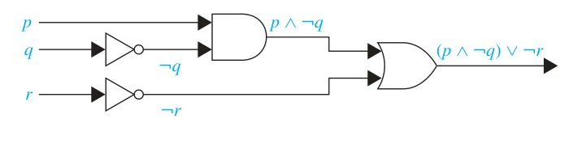
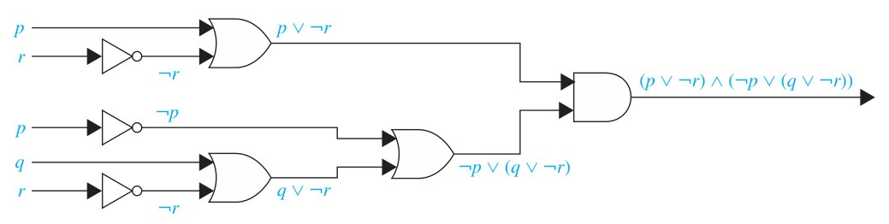

<!-- Page 16 -->

## 1.2 Applications of Propositional Logic

### Introduction

Logic has many important applications to mathematics, computer science, and numerous other disciplines. Statements in mathematics and the sciences and in natural language often are imprecise or ambiguous. To make such statements precise, they can be translated into the language of logic. For example, logic is used in the specification of software and hardware, because these specifications need to be precise before development begins. Furthermore, propositional logic and its rules can be used to design computer circuits, to construct computer programs, to verify the correctness of programs, and to build expert systems. Logic can be used to analyze and solve many familiar puzzles. Software systems based on the rules of logic have been developed for constructing some, but not all, types of proofs automatically. We will discuss some of these applications of propositional logic in this section and in later chapters.

---

### Translating English Sentences

There are many reasons to translate English sentences into expressions involving propositional variables and logical connectives. In particular, English (and every other human language) is

<!-- Page 17 -->

often ambiguous. Translating sentences into compound statements (and other types of logical expressions, which we will introduce later in this chapter) removes the ambiguity. Note that this may involve making a set of reasonable assumptions based on the intended meaning of the sentence. Moreover, once we have translated sentences from English into logical expressions we can analyze these logical expressions to determine their truth values, we can manipulate them, and we can use rules of inference (which are discussed in Section 1.6) to reason about them.

To illustrate the process of translating an English sentence into a logical expression, consider Examples 1 and 2.

#### EXAMPLE 1
How can this English sentence be translated into a logical expression?

"You can access the Internet from campus only if you are a computer science major or you are not a freshman."

**Solution:** There are many ways to translate this sentence into a logical expression. Although it is possible to represent the sentence by a single propositional variable, such as $p$, this would not be useful when analyzing its meaning or reasoning with it. Instead, we will use propositional variables to represent each sentence part and determine the appropriate logical connectives between them. In particular, we let $a$, $c$, and $f$ represent "You can access the Internet from campus," "You are a computer science major," and "You are a freshman," respectively. Noting that "only if" is one way a conditional statement can be expressed, this sentence can be represented as

$$a \to (c \vee \neg f).$$
$\blacktriangleleft$

#### EXAMPLE 2
How can this English sentence be translated into a logical expression?

"You cannot ride the roller coaster if you are under 4 feet tall unless you are older than 16 years old."

**Solution:** Let $q$, $r$, and $s$ represent "You can ride the roller coaster," "You are under 4 feet tall," and "You are older than 16 years old," respectively. Then the sentence can be translated to

$$(r \wedge \neg s) \to \neg q.$$

Of course, there are other ways to represent the original sentence as a logical expression, but the one we have used should meet our needs. $\blacktriangleleft$

---

### System Specifications

Translating sentences in natural language (such as English) into logical expressions is an essential part of specifying both hardware and software systems. System and software engineers take requirements in natural language and produce precise and unambiguous specifications that can be used as the basis for system development. Example 3 shows how compound propositions can be used in this process.

#### EXAMPLE 3
Express the specification "The automated reply cannot be sent when the file system is full" using logical connectives.

**Solution:** One way to translate this is to let $p$ denote "The automated reply can be sent" and $q$ denote "The file system is full." Then $\neg p$ represents "It is not the case that the automated

<!-- Page 18 -->

reply can be sent," which can also be expressed as "The automated reply cannot be sent." Consequently, our specification can be represented by the conditional statement $q \to \neg p$. $\blacktriangleleft$

---

System specifications should be **consistent**, that is, they should not contain conflicting requirements that could be used to derive a contradiction. When specifications are not consistent, there would be no way to develop a system that satisfies all specifications.

#### EXAMPLE 4
Determine whether these system specifications are consistent:
- "The diagnostic message is stored in the buffer or it is retransmitted."
- "The diagnostic message is not stored in the buffer."
- "If the diagnostic message is stored in the buffer, then it is retransmitted."

**Solution:** To determine whether these specifications are consistent, we first express them using logical expressions. Let $p$ denote "The diagnostic message is stored in the buffer" and let $q$ denote "The diagnostic message is retransmitted." The specifications can then be written as $p \vee q$, $\neg p$, and $p \to q$. An assignment of truth values that makes all three specifications true must have $p$ false to make $\neg p$ true. Because we want $p \vee q$ to be true but $p$ must be false, $q$ must be true. Because $p \to q$ is true when $p$ is false and $q$ is true, we conclude that these specifications are consistent, because they are all true when $p$ is false and $q$ is true. We could come to the same conclusion by use of a truth table to examine the four possible assignments of truth values to $p$ and $q$. $\blacktriangleleft$

#### EXAMPLE 5
Do the system specifications in Example 4 remain consistent if the specification "The diagnostic message is not retransmitted" is added?

**Solution:** By the reasoning in Example 4, the three specifications from that example are true only in the case when $p$ is false and $q$ is true. However, this new specification is $\neg q$, which is false when $q$ is true. Consequently, these four specifications are inconsistent. $\blacktriangleleft$

---

### Boolean Searches

Logical connectives are used extensively in searches of large collections of information, such as indexes of Web pages. Because these searches employ techniques from propositional logic, they are called **Boolean searches**.

In Boolean searches, the connective *AND* is used to match records that contain both of two search terms, the connective *OR* is used to match one or both of two search terms, and the connective *NOT* (sometimes written as *AND NOT*) is used to exclude a particular search term. Careful planning of how logical connectives are used is often required when Boolean searches are used to locate information of potential interest. Example 6 illustrates how Boolean searches are carried out.

#### EXAMPLE 6: Web Page Searching
Most Web search engines support Boolean searching techniques, which usually can help find Web pages about particular subjects. For instance, using Boolean searching to find Web pages about universities in New Mexico, we can look for pages matching $\text{NEW AND MEXICO AND UNIVERSITIES}$. The results of this search will include those pages that contain the three words $\text{NEW}$, $\text{MEXICO}$, and $\text{UNIVERSITIES}$. This will include all of the pages of interest, together with others such as a page about new universities in Mexico. (Note that in Google, and many other search engines, the word "AND" is not needed, although it is understood, because all search terms are included by default. These search engines also support the use of quotation marks to search for specific phrases. So, it may be more effective to search for pages matching "New Mexico" $\text{AND UNIVERSITIES}$.)

<!-- Page 19 -->

Next, to find pages that deal with universities in New Mexico or Arizona, we can search for pages matching $(\text{NEW AND MEXICO OR ARIZONA}) \text{ AND UNIVERSITIES}$. (*Note:* Here the $\text{AND}$ operator takes precedence over the $\text{OR}$ operator. Also, in Google, the terms used for this search would be $\text{NEW MEXICO OR ARIZONA}$.) The results of this search will include all pages that contain the word $\text{UNIVERSITIES}$ and either both the words $\text{NEW}$ and $\text{MEXICO}$ or the word $\text{ARIZONA}$. Again, pages besides those of interest will be listed. Finally, to find Web pages that deal with universities in Mexico (and not New Mexico), we might first look for pages matching $\text{MEXICO AND UNIVERSITIES}$, but because the results of this search will include pages about universities in New Mexico, as well as universities in Mexico, it might be better to search for pages matching $(\text{MEXICO AND UNIVERSITIES}) \text{ NOT NEW}$. The results of this search include pages that contain both the words $\text{MEXICO}$ and $\text{UNIVERSITIES}$ but do not contain the word $\text{NEW}$. (In Google, and many other search engines, the word "NOT" is replaced by the symbol "$-$". In Google, the terms used for this last search would be $\text{MEXICO UNIVERSITIES -NEW}$.) $\blacktriangleleft$

---

### Logic Puzzles

Puzzles that can be solved using logical reasoning are known as **logic puzzles**. Solving logic puzzles is an excellent way to practice working with the rules of logic. Also, computer programs designed to carry out logical reasoning often use well-known logic puzzles to illustrate their capabilities. Many people enjoy solving logic puzzles, published in periodicals, books, and on the Web, as a recreational activity.

We will discuss two logic puzzles here. We begin with a puzzle originally posed by Raymond Smullyan, a master of logic puzzles, who has published more than a dozen books containing challenging puzzles that involve logical reasoning. In Section 1.3 we will also discuss the extremely popular logic puzzle Sudoku.

#### EXAMPLE 7
In [Sm78] Smullyan posed many puzzles about an island that has two kinds of inhabitants, knights, who always tell the truth, and their opposites, knaves, who always lie. You encounter two people $A$ and $B$. What are $A$ and $B$ if $A$ says "$B$ is a knight" and $B$ says "The two of us are opposite types?"

**Solution:** Let $p$ and $q$ be the statements that $A$ is a knight and $B$ is a knight, respectively, so that $\neg p$ and $\neg q$ are the statements that $A$ is a knave and $B$ is a knave, respectively.

We first consider the possibility that $A$ is a knight; this is the statement that $p$ is true. If $A$ is a knight, then he is telling the truth when he says that $B$ is a knight, so that $q$ is true, and $A$ and $B$ are the same type. However, if $B$ is a knight, then $B$'s statement that $A$ and $B$ are of opposite types, the statement $(p \wedge \neg q) \vee (\neg p \wedge q)$, would have to be true, which it is not, because $A$ and $B$ are both knights. Consequently, we can conclude that $A$ is not a knight, that is, that $p$ is false.

If $A$ is a knave, then because everything a knave says is false, $A$'s statement that $B$ is a knight, that is, that $q$ is true, is a lie. This means that $q$ is false and $B$ is also a knave. Furthermore, if $B$ is a knave, then $B$'s statement that $A$ and $B$ are opposite types is a lie, which is consistent with both $A$ and $B$ being knaves. We can conclude that both $A$ and $B$ are knaves. $\blacktriangleleft$

---

We pose more of Smullyan's puzzles about knights and knaves in Exercises 19–23. In Exercises 24–31 we introduce related puzzles where we have three types of people, knights and knaves as in this puzzle together with spies who can lie.

Next, we pose a puzzle known as the **muddy children puzzle** for the case of two children.

<!-- Page 20 -->

#### EXAMPLE 8
A father tells his two children, a boy and a girl, to play in their backyard without getting dirty. However, while playing, both children get mud on their foreheads. When the children stop playing, the father says "At least one of you has a muddy forehead," and then asks the children to answer "Yes" or "No" to the question: "Do you know whether you have a muddy forehead?" The father asks this question twice. What will the children answer each time this question is asked, assuming that a child can see whether his or her sibling has a muddy forehead, but cannot see his or her own forehead? Assume that both children are honest and that the children answer each question simultaneously.

**Solution:** Let $s$ be the statement that the son has a muddy forehead and let $d$ be the statement that the daughter has a muddy forehead. When the father says that at least one of the two children has a muddy forehead, he is stating that the disjunction $s \vee d$ is true. Both children will answer "No" the first time the question is asked because each sees mud on the other child's forehead. That is, the son knows that $d$ is true, but does not know whether $s$ is true, and the daughter knows that $s$ is true, but does not know whether $d$ is true.

After the son has answered "No" to the first question, the daughter can determine that $d$ must be true. This follows because when the first question is asked, the son knows that $s \vee d$ is true, but cannot determine whether $s$ is true. Using this information, the daughter can conclude that $d$ must be true, for if $d$ were false, the son could have reasoned that because $s \vee d$ is true, then $s$ must be true, and he would have answered "Yes" to the first question. The son can reason in a similar way to determine that $s$ must be true. It follows that both children answer "Yes" the second time the question is asked. $\blacktriangleleft$

### Logic Circuits

Propositional logic can be applied to the design of computer hardware. This was first observed in 1938 by Claude Shannon in his MIT master's thesis. In Chapter 12 we will study this topic in depth. We give a brief introduction to this application here.

A **logic circuit** (or **digital circuit**) receives input signals $p_1, p_2, \dots, p_n$, each a bit [either 0 (off) or 1 (on)], and produces output signals $s_1, s_2, \dots, s_n$, each a bit. In this section we will restrict our attention to logic circuits with a single output signal; in general, digital circuits may have multiple outputs.

<!-- Page 21 -->

*Figure 1.5 — Basic logic gates (Inverter, OR gate, AND gate)*

Complicated digital circuits can be constructed from three basic circuits, called **gates**, shown in Figure 1.5 (Figure 1 in text):
- The **inverter**, or **NOT gate**, takes an input bit $p$, and produces as output $\neg p$.
- The **OR gate** takes two input signals $p$ and $q$, each a bit, and produces as output the signal $p \vee q$.
- The **AND gate** takes two input signals $p$ and $q$, each a bit, and produces as output the signal $p \wedge q$.

We use combinations of these three basic gates to build more complicated circuits, such as that shown in Figure 1.6 (Figure 2 in text).

*Figure 1.6 — A combinatorial circuit*

Given a circuit built from the basic logic gates and the inputs to the circuit, we determine the output by tracing through the circuit, as Example 9 shows.

#### EXAMPLE 9
Determine the output for the combinatorial circuit in Figure 2.

**Solution:** In Figure 2 we display the output of each logic gate in the circuit. We see that the AND gate takes input of $p$ and $\neg q$, the output of the inverter with input $q$, and produces $p \wedge \neg q$. Next, we note that the OR gate takes input $p \wedge \neg q$ and $\neg r$, the output of the inverter with input $r$, and produces the final output $(p \wedge \neg q) \vee \neg r$. $\blacktriangleleft$

---

Suppose that we have a formula for the output of a digital circuit in terms of negations, disjunctions, and conjunctions. Then, we can systematically build a digital circuit with the desired output, as illustrated in Example 10.

#### EXAMPLE 10
Build a digital circuit that produces the output $(p \vee \neg r) \wedge (\neg p \vee (q \vee \neg r))$ when given input bits $p, q$, and $r$.

**Solution:** To construct the desired circuit, we build separate circuits for $p \vee \neg r$ and for $\neg p \vee (q \vee \neg r)$ and combine them using an AND gate. To construct a circuit for $p \vee \neg r$, we use an inverter to produce $\neg r$ from the input $r$. Then, we use an OR gate to combine $p$ and $\neg r$. To build a circuit for $\neg p \vee (q \vee \neg r)$, we first use an inverter to obtain $\neg r$. Then we use an OR gate with inputs $q$ and $\neg r$ to obtain $q \vee \neg r$. Finally, we use another inverter and an OR gate to get $\neg p \vee (q \vee \neg r)$ from the inputs $p$ and $q \vee \neg r$.

To complete the construction, we employ a final AND gate, with inputs $p \vee \neg r$ and $\neg p \vee (q \vee \neg r)$. The resulting circuit is displayed in Figure 3. $\blacktriangleleft$

We will study logic circuits in great detail in Chapter 12 in the context of Boolean algebra, and with different notation.

<!-- Page 22 -->

*Figure 1.7 — The circuit for $(p \vee \neg r) \wedge (\neg p \vee (q \vee \neg r))$ (Figure 3 in text)*
