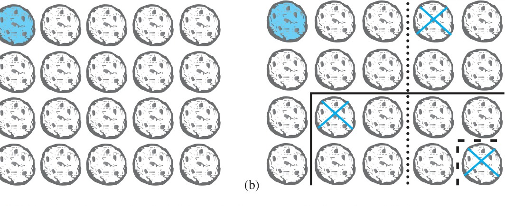
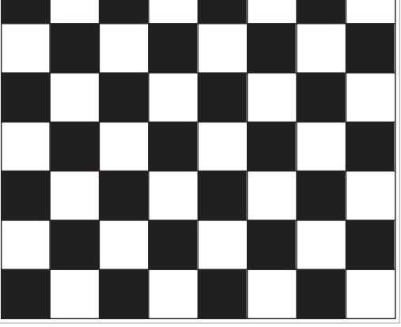
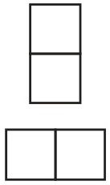
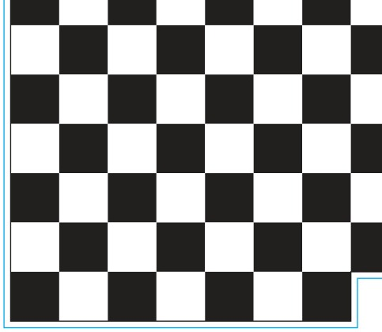
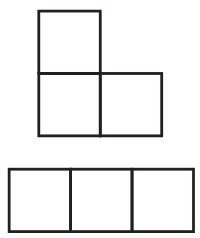
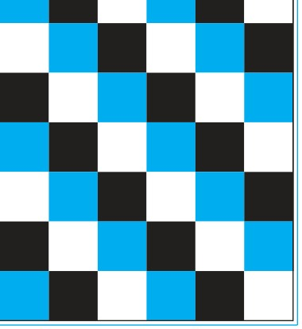

# 1.8 Proof Methods and Strategy

## Introduction
In Section 1.7 we introduced several important proof methods: direct proof, proof by contraposition, and proof by contradiction. We also introduced vacuous proofs and trivial proofs. We demonstrated how each of these methods can be used to prove various results. However, we have just begun our study of proofs. We need to introduce other proof methods, and we need to discuss proof strategy.

In this section we will introduce several additional proof methods. In particular, we will discuss **exhaustive proofs**, where a result is proved by checking a relatively small number of cases. We will also discuss **proof by cases**, where a result is proved by considering a collection of cases that cover all possibilities. We will introduce **existence proofs**, which are used to show that an object of a particular type exists. We will discuss both constructive and nonconstructive existence proofs. We will also discuss **uniqueness proofs**, which are used to show that there is exactly one element with a particular property.

After introducing these proof methods, we will discuss proof strategy. We will explain how to choose an appropriate proof method when confronted with a statement to prove. We will describe forward and backward reasoning. We will also explain how existing proofs can be adapted to prove new results. Finally, we will illustrate aspects of proof strategy by studying tilings of checkerboards.

---

## Exhaustive Proof and Proof by Cases
Sometimes we cannot prove a theorem using a single argument that holds for all possible cases. We may be able to prove a theorem by considering different cases separately. The method of proof by cases is based on the rule of inference
$$[(p_1 \vee p_2 \vee \dots \vee p_n) \to q] \leftrightarrow [(p_1 \to q) \wedge (p_2 \to q) \wedge \dots \wedge (p_n \to q)].$$
This rule of inference tells us that to prove that a conditional statement of the form $(p_1 \vee p_2 \vee \dots \vee p_n) \to q$ is true, we must prove each of the $n$ conditional statements $p_i \to q$ for $i = 1, 2, \dots, n$.

### EXHAUSTIVE PROOF
Some theorems can be proved by examining a relatively small number of examples. Such proofs are called **exhaustive proofs**, or **proofs by exhaustion** because these proofs proceed by exhausting all possibilities. An exhaustive proof is a special type of proof by cases where each case involves checking a single example. We now provide some illustrations of exhaustive proofs.

#### EXAMPLE 1
Prove that $(n + 1)^3 \ge 3^n$ if $n$ is a positive integer with $n \le 4$.

**Solution:** We use a proof by exhaustion. We only need verify the inequality $(n + 1)^3 \ge 3^n$ when $n = 1, 2, 3$, and $4$.
* For $n = 1$, we have $(n + 1)^3 = 2^3 = 8$ and $3^n = 3^1 = 3$;
* for $n = 2$, we have $(n + 1)^3 = 3^3 = 27$ and $3^n = 3^2 = 9$;
* for $n = 3$, we have $(n + 1)^3 = 4^3 = 64$ and $3^n = 3^3 = 27$; and
* for $n = 4$, we have $(n + 1)^3 = 5^3 = 125$ and $3^n = 3^4 = 81$.

In each of these four cases, we see that $(n + 1)^3 \ge 3^n$. We have used the method of exhaustion to prove that $(n + 1)^3 \ge 3^n$ if $n$ is a positive integer with $n \le 4$. $\blacktriangleleft$

#### EXAMPLE 2
Prove that the only consecutive positive integers not exceeding 100 that are perfect powers are 8 and 9. (An integer is a perfect power if it equals $n^a$, where $a$ is an integer greater than 1.)

**Solution:** We use a proof by exhaustion. In particular, we can prove this fact by examining positive integers $n$ not exceeding 100, first checking whether $n$ is a perfect power, and if it is, checking whether $n + 1$ is also a perfect power. A quicker way to do this is simply to look at all perfect powers not exceeding 100 and checking whether the next largest integer is also a perfect power. The squares of positive integers not exceeding 100 are 1, 4, 9, 16, 25, 36, 49, 64, 81, and 100. The cubes of positive integers not exceeding 100 are 1, 8, 27, and 64. The fourth powers of positive integers not exceeding 100 are 1, 16, and 81. The fifth powers of positive integers not exceeding 100 are 1 and 32. The sixth powers of positive integers not exceeding 100 are 1 and 64. There are no powers of positive integers higher than the sixth power not exceeding 100, other than 1. Looking at this list of perfect powers not exceeding 100, we see that $n = 8$ is the only perfect power $n$ for which $n + 1$ is also a perfect power. That is, $2^3 = 8$ and $3^2 = 9$ are the only two consecutive perfect powers not exceeding 100. $\blacktriangleleft$

People can carry out exhaustive proofs when it is necessary to check only a relatively small number of instances of a statement. Computers do not complain when they are asked to check a much larger number of instances of a statement, but they still have limitations. Note that not even a computer can check all instances when it is impossible to list all instances to check.

### PROOF BY CASES
A proof by cases must cover all possible cases that arise in a theorem. We illustrate proof by cases with a couple of examples. In each example, you should check that all possible cases are covered.

#### EXAMPLE 3
Prove that if $n$ is an integer, then $n^2 \ge n$.

**Solution:** We can prove that $n^2 \ge n$ for every integer by considering three cases, when $n = 0$, when $n \ge 1$, and when $n \le -1$. We split the proof into three cases because it is straightforward to prove the result by considering zero, positive integers, and negative integers separately.
* **Case (i):** When $n = 0$, because $0^2 = 0$, we see that $0^2 \ge 0$. It follows that $n^2 \ge n$ is true in this case.
* **Case (ii):** When $n \ge 1$, when we multiply both sides of the inequality $n \ge 1$ by the positive integer $n$, we obtain $n \cdot n \ge n \cdot 1$. This implies that $n^2 \ge n$ for $n \ge 1$.
* **Case (iii):** In this case $n \le -1$. However, $n^2 \ge 0$. It follows that $n^2 \ge n$.

Because the inequality $n^2 \ge n$ holds in all three cases, we can conclude that if $n$ is an integer, then $n^2 \ge n$. $\blacktriangleleft$

#### EXAMPLE 4
Use a proof by cases to show that $|xy| = |x||y|$, where $x$ and $y$ are real numbers. (Recall that $|a|$, the absolute value of $a$, equals $a$ when $a \ge 0$ and equals $-a$ when $a \le 0$.)

**Solution:** In our proof of this theorem, we remove absolute values using the fact that $|a| = a$ when $a \ge 0$ and $|a| = -a$ when $a < 0$. Because both $|x|$ and $|y|$ occur in our formula, we will need four cases: (i) $x$ and $y$ both nonnegative, (ii) $x$ nonnegative and $y$ is negative, (iii) $x$ negative and $y$ nonnegative, and (iv) $x$ negative and $y$ negative. We denote by $p_1, p_2, p_3$, and $p_4$, the proposition stating the assumption for each of these four cases, respectively.
(Note that we can remove the absolute value signs by making the appropriate choice of signs within each case.)
* **Case (i):** We see that $p_1 \to q$ because $xy \ge 0$ when $x \ge 0$ and $y \ge 0$, so that $|xy| = xy = |x||y|$.
* **Case (ii):** To see that $p_2 \to q$, note that if $x \ge 0$ and $y < 0$, then $xy \le 0$, so that $|xy| = -xy = x(-y) = |x||y|$. (Here, because $y < 0$, we have $|y| = -y$.)
* **Case (iii):** To see that $p_3 \to q$, we follow the same reasoning as the previous case with the roles of $x$ and $y$ reversed.
* **Case (iv):** To see that $p_4 \to q$, note that when $x < 0$ and $y < 0$, it follows that $xy > 0$. Hence, $|xy| = xy = (-x)(-y) = |x||y|$.

Because $|xy| = |x||y|$ holds in each of the four cases and these cases exhaust all possibilities, we can conclude that $|xy| = |x||y|$, whenever $x$ and $y$ are real numbers. $\blacktriangleleft$

### LEVERAGING PROOF BY CASES
The examples we have presented illustrating proof by cases provide some insight into when to use this method of proof. In particular, when it is not possible to consider all cases of a proof at the same time, a proof by cases should be considered. When should you use such a proof? Generally, look for a proof by cases when there is no obvious way to begin a proof, but when extra information in each case helps move the proof forward. Example 5 illustrates how the method of proof by cases can be used effectively.

#### EXAMPLE 5
Formulate a conjecture about the final decimal digit of the square of an integer and prove your result.

**Solution:** The smallest perfect squares are 1, 4, 9, 16, 25, 36, 49, 64, 81, 100, 121, 144, 169, 196, 225, and so on. We notice that the digits that occur as the final digit of a square are 0, 1, 4, 5, 6, and 9, with 2, 3, 7, and 8 never appearing as the final digit of a square. We conjecture this theorem: The final decimal digit of a perfect square is 0, 1, 4, 5, 6 or 9. How can we prove this theorem?

We first note that we can express an integer $n$ as $10a + b$, where $a$ and $b$ are positive integers and $b$ is 0, 1, 2, 3, 4, 5, 6, 7, 8, or 9. Here $a$ is the integer obtained by subtracting the final decimal digit of $n$ from $n$ and dividing by 10. Next, note that
$$(10a + b)^2 = 100a^2 + 20ab + b^2 = 10(10a^2 + 2ab) + b^2,$$
so that the final decimal digit of $n^2$ is the same as the final decimal digit of $b^2$. Furthermore, note that the final decimal digit of $b^2$ is the same as the final decimal digit of $(10 - b)^2 = 100 - 20b + b^2$. Consequently, we can reduce our proof to the consideration of six cases.
* **Case (i):** The final digit of $n$ is 1 or 9. Then the final decimal digit of $n^2$ is the final decimal digit of $1^2 = 1$ or $9^2 = 81$, namely 1.
* **Case (ii):** The final digit of $n$ is 2 or 8. Then the final decimal digit of $n^2$ is the final decimal digit of $2^2 = 4$ or $8^2 = 64$, namely 4.
* **Case (iii):** The final digit of $n$ is 3 or 7. Then the final decimal digit of $n^2$ is the final decimal digit of $3^2 = 9$ or $7^2 = 49$, namely 9.
* **Case (iv):** The final digit of $n$ is 4 or 6. Then the final decimal digit of $n^2$ is the final decimal digit of $4^2 = 16$ or $6^2 = 36$, namely 6.
* **Case (v):** The final decimal digit of $n$ is 5. Then the final decimal digit of $n^2$ is the final decimal digit of $5^2 = 25$, namely 5.
* **Case (vi):** The final decimal digit of $n$ is 0. Then the final decimal digit of $n^2$ is the final decimal digit of $0^2 = 0$, namely 0.

Because these six cases cover all possible final decimal digits of $n$, it follows that the final decimal digit of $n^2$ is 0, 1, 4, 5, 6, or 9. $\blacktriangleleft$

#### EXAMPLE 6
Show that there are no solutions in integers $x$ and $y$ of $x^2 + 3y^2 = 8$.

**Solution:** We can quickly reduce a proof to checking just a few simple cases because $x^2 > 8$ when $|x| \ge 3$ and $3y^2 > 8$ when $|y| \ge 2$. This leaves the cases when $x$ equals $-2, -1, 0, 1$, or $2$ and $y$ equals $-1, 0$, or $1$. We can finish using an exhaustive proof. To dispense with the remaining cases, we note that possible values for $x^2$ are 0, 1, and 4, and possible values for $3y^2$ are 0 and 3, and the largest sum of possible values for $x^2$ and $3y^2$ is 7. Consequently, it is impossible for $x^2 + 3y^2 = 8$ to hold when $x$ and $y$ are integers. $\blacktriangleleft$

### WITHOUT LOSS OF GENERALITY
In the proof in Example 4, we dismissed case (iii), where $x < 0$ and $y \ge 0$, because it is the same as case (ii), where $x \ge 0$ and $y < 0$, with the roles of $x$ and $y$ reversed. To shorten the proof, we could have proved cases (ii) and (iii) together by assuming, without loss of generality, that $x \ge 0$ and $y < 0$. Implicit in this statement is that we can complete the case with $x < 0$ and $y \ge 0$ using the same argument as we used for the case with $x \ge 0$ and $y < 0$, but with the obvious changes.

In general, when the phrase **“without loss of generality”** is used in a proof (often abbreviated as **WLOG**), we assert that by proving one case of a theorem, no additional argument is required to prove other specified cases. That is, other cases follow by making straightforward changes to the argument, or by filling in some straightforward initial step. Proofs by cases can often be made much more efficient when the notion of without loss of generality is employed. Of course, incorrect use of this principle can lead to unfortunate errors. Sometimes assumptions are made that lead to a loss in generality. Such assumptions can be made that do not take into account that one case may be substantially different from others. This can lead to an incomplete, and possibly unsalvageable, proof. In fact, many incorrect proofs of famous theorems turned out to rely on arguments that used the idea of “without loss of generality” to establish cases that could not be quickly proved from simpler cases.

We now illustrate a proof where without loss of generality is used effectively together with other proof techniques.

#### EXAMPLE 7
Show that if $x$ and $y$ are integers and both $xy$ and $x + y$ are even, then both $x$ and $y$ are even.

**Solution:** We will use proof by contraposition, the notion of without loss of generality, and proof by cases. First, suppose that $x$ and $y$ are not both even. That is, assume that $x$ is odd or that $y$ is odd (or both). Without loss of generality, we assume that $x$ is odd, so that $x = 2m + 1$ for some integer $m$.

To complete the proof, we need to show that $xy$ is odd or $x + y$ is odd. Consider two cases: (i) $y$ even, and (ii) $y$ odd.
* In (i), $y = 2n$ for some integer $n$, so that $x + y = (2m + 1) + 2n = 2(m + n) + 1$ is odd.
* In (ii), $y = 2n + 1$ for some integer $n$, so that $xy = (2m + 1)(2n + 1) = 4mn + 2m + 2n + 1 = 2(2mn + m + n) + 1$ is odd.

This completes the proof by contraposition. (Note that our use of without loss of generality within the proof is justified because the proof when $y$ is odd can be obtained by simply interchanging the roles of $x$ and $y$ in the proof we have given.) $\blacktriangleleft$

### COMMON ERRORS WITH EXHAUSTIVE PROOF AND PROOF BY CASES
A common error of reasoning is to draw incorrect conclusions from examples. No matter how many separate examples are considered, a theorem is not proved by considering examples unless every possible case is covered. The problem of proving a theorem is analogous to showing that a computer program always produces the output desired. No matter how many input values are tested, unless all input values are tested, we cannot conclude that the program always produces the correct output.

#### EXAMPLE 8
Is it true that every positive integer is the sum of 18 fourth powers of integers?

**Solution:** To determine whether a positive integer $n$ can be written as the sum of 18 fourth powers of integers, we might begin by examining whether $n$ is the sum of 18 fourth powers of integers for the smallest positive integers. Because the fourth powers of integers are 0, 1, 16, 81, $\dots$, if we can select 18 terms from these numbers that add up to $n$, then $n$ is the sum of 18 fourth powers. We can show that all positive integers up to 78 can be written as the sum of 18 fourth powers. (The details are left to the reader.) However, if we decided this was enough checking, we would come to the wrong conclusion. It is not true that every positive integer is the sum of 18 fourth powers because 79 is not the sum of 18 fourth powers (as the reader can verify). $\blacktriangleleft$

Another common error involves making unwarranted assumptions that lead to incorrect proofs by cases where not all cases are considered. This is illustrated in Example 9.

#### EXAMPLE 9
What is wrong with this “proof?”

“Theorem:” If $x$ is a real number, then $x^2$ is a positive real number.

“Proof:” Let $p_1$ be “$x$ is positive,” let $p_2$ be “$x$ is negative,” and let $q$ be “$x^2$ is positive.” To show that $p_1 \to q$ is true, note that when $x$ is positive, $x^2$ is positive because it is the product of two positive numbers, $x$ and $x$. To show that $p_2 \to q$, note that when $x$ is negative, $x^2$ is positive because it is the product of two negative numbers, $x$ and $x$. This completes the proof.

**Solution:** The problem with this “proof” is that we missed the case of $x = 0$. When $x = 0$, $x^2 = 0$ is not positive, so the supposed theorem is false. If $p$ is “$x$ is a real number,” then we can prove results where $p$ is the hypothesis with three cases, $p_1, p_2$, and $p_3$, where $p_1$ is “$x$ is positive,” $p_2$ is “$x$ is negative,” and $p_3$ is “$x = 0$” because of the equivalence $p \leftrightarrow p_1 \vee p_2 \vee p_3$. $\blacktriangleleft$

---

## Existence Proofs
Many theorems are assertions that objects of a particular type exist. A theorem of this type is a proposition of the form $\exists x P(x)$, where $P$ is a predicate. A proof of a proposition of the form $\exists x P(x)$ is called an **existence proof**. There are several ways to prove a theorem of this type. Sometimes an existence proof of $\exists x P(x)$ can be given by finding an element $a$, called a **witness**, such that $P(a)$ is true. This type of existence proof is called **constructive**. It is also possible to give an existence proof that is **nonconstructive**; that is, we do not find an element $a$ such that $P(a)$ is true, but rather prove that $\exists x P(x)$ is true in some other way. One common method of giving a nonconstructive existence proof is to use proof by contradiction and show that the negation of the existential quantification implies a contradiction. The concept of a constructive existence proof is illustrated by Example 10 and the concept of a nonconstructive existence proof is illustrated by Example 11.

#### EXAMPLE 10: A Constructive Existence Proof
Show that there is a positive integer that can be written as the sum of cubes of positive integers in two different ways.

**Solution:** After considerable computation (such as a computer search) we find that
$$1729 = 10^3 + 9^3 = 12^3 + 1^3.$$
Because we have displayed a positive integer that can be written as the sum of cubes in two different ways, we are done.

There is an interesting story pertaining to this example. The English mathematician G. H. Hardy, when visiting the ailing Indian prodigy Ramanujan in the hospital, remarked that 1729, the number of the cab he took, was rather dull. Ramanujan replied “No, it is a very interesting number; it is the smallest number expressible as the sum of cubes in two different ways.” $\blacktriangleleft$

#### EXAMPLE 11: A Nonconstructive Existence Proof
Show that there exist irrational numbers $x$ and $y$ such that $x^y$ is rational.

**Solution:** By Example 10 in Section 1.7 we know that $\sqrt{2}$ is irrational. Consider the number $\sqrt{2}^{\sqrt{2}}$. If it is rational, we have two irrational numbers $x$ and $y$ with $x^y$ rational, namely, $x = \sqrt{2}$ and $y = \sqrt{2}$. On the other hand if $\sqrt{2}^{\sqrt{2}}$ is irrational, then we can let $x = \sqrt{2}^{\sqrt{2}}$ and $y = \sqrt{2}$ so that
$$x^y = (\sqrt{2}^{\sqrt{2}})^{\sqrt{2}} = \sqrt{2}^{(\sqrt{2} \cdot \sqrt{2})} = \sqrt{2}^2 = 2.$$

This proof is an example of a nonconstructive existence proof because we have not found irrational numbers $x$ and $y$ such that $x^y$ is rational. Rather, we have shown that either the pair $x = \sqrt{2}, y = \sqrt{2}$ or the pair $x = \sqrt{2}^{\sqrt{2}}, y = \sqrt{2}$ have the desired property, but we do not know which of these two pairs works! $\blacktriangleleft$

Nonconstructive existence proofs often are quite subtle, as Example 12 illustrates.

#### EXAMPLE 12
**Chomp** is a game played by two players. In this game, cookies are laid out on a rectangular grid. The cookie in the top left position is poisoned, as shown in Figure 1(a). The two players take turns making moves; at each move, a player is required to eat a remaining cookie, together with all cookies to the right and/or below it (see Figure 1(b), for example). The loser is the player who has no choice but to eat the poisoned cookie. We ask whether one of the two players has a winning strategy. That is, can one of the players always make moves that are guaranteed to lead to a win?

*FIGURE 1 (a) Chomp (Top Left Cookie Poisoned). (b) Three Possible Moves.*

**Solution:** We will give a nonconstructive existence proof of a winning strategy for the first player. That is, we will show that the first player always has a winning strategy without explicitly describing the moves this player must follow.

First, note that the game ends and cannot finish in a draw because with each move at least one cookie is eaten, so after no more than $m \times n$ moves the game ends, where the initial grid is $m \times n$. Now, suppose that the first player begins the game by eating just the cookie in the bottom right corner. There are two possibilities, this is the first move of a winning strategy for the first player, or the second player can make a move that is the first move of a winning strategy for the second player. In this second case, instead of eating just the cookie in the bottom right corner, the first player could have made the same move that the second player made as the first move of a winning strategy (and then continued to follow that winning strategy). This would guarantee a win for the first player.

Note that we showed that a winning strategy exists, but we did not specify an actual winning strategy. Consequently, the proof is a nonconstructive existence proof. In fact, no one has been able to describe a winning strategy for that Chomp that applies for all rectangular grids by describing the moves that the first player should follow. However, winning strategies can be described for certain special cases, such as when the grid is square and when the grid only has two rows of cookies (see Exercises 15 and 16 in Section 5.2). $\blacktriangleleft$

---

## Uniqueness Proofs
Some theorems assert the existence of a unique element with a particular property. In other words, these theorems assert that there is exactly one element with this property. To prove a statement of this type we need to show that an element with this property exists and that no other element has this property. The two parts of a uniqueness proof are:
* **Existence:** We show that an element $x$ with the desired property exists.
* **Uniqueness:** We show that if $y \neq x$, then $y$ does not have the desired property. Equivalently, we can show that if $x$ and $y$ both have the desired property, then $x = y$.

> [!NOTE] Remark
> Showing that there is a unique element $x$ such that $P(x)$ is the same as proving the statement $\exists x(P(x) \wedge \forall y(y \neq x \to \neg P(y)))$.

We illustrate the elements of a uniqueness proof in Example 13.

#### EXAMPLE 13
Show that if $a$ and $b$ are real numbers and $a \neq 0$, then there is a unique real number $r$ such that $ar + b = 0$.

**Solution:** First, note that the real number $r = -b/a$ is a solution of $ar + b = 0$ because $a(-b/a) + b = -b + b = 0$. Consequently, a real number $r$ exists for which $ar + b = 0$. This is the existence part of the proof.

Second, suppose that $s$ is a real number such that $as + b = 0$. Then $ar + b = as + b$, where $r = -b/a$. Subtracting $b$ from both sides, we find that $ar = as$. Dividing both sides of this last equation by $a$, which is nonzero, we see that $r = s$. This means that if $s \neq r$, then $as + b \neq 0$. This establishes the uniqueness part of the proof. $\blacktriangleleft$

---

## Proof Strategies
Finding proofs can be a challenging business. When you are confronted with a statement to prove, you should first replace terms by their definitions and then carefully analyze what the hypotheses and the conclusion mean. After doing so, you can attempt to prove the result using one of the available methods of proof. Generally, if the statement is a conditional statement, you should first try a direct proof; if this fails, you can try an indirect proof. If neither of these approaches works, you might try a proof by contradiction.

### FORWARD AND BACKWARD REASONING
Whichever method you choose, you need a starting point for your proof. To begin a direct proof of a conditional statement, you start with the premises. Using these premises, together with axioms and known theorems, you can construct a proof using a sequence of steps that leads to the conclusion. This type of reasoning, called **forward reasoning**, is the most common type of reasoning used to prove relatively simple results. Similarly, with indirect reasoning you can start with the negation of the conclusion and, using a sequence of steps, obtain the negation of the premises.

Unfortunately, forward reasoning is often difficult to use to prove more complicated results, because the reasoning needed to reach the desired conclusion may be far from obvious. In such cases it may be helpful to use **backward reasoning**. To reason backward to prove a statement $q$, we find a statement $p$ that we can prove with the property that $p \to q$. (Note that it is not helpful to find a statement $r$ that you can prove such that $q \to r$, because it is the fallacy of begging the question to conclude from $q \to r$ and $r$ that $q$ is true.) Backward reasoning is illustrated in Examples 14 and 15.

#### EXAMPLE 14
Given two positive real numbers $x$ and $y$, their **arithmetic mean** is $(x + y)/2$ and their **geometric mean** is $\sqrt{xy}$. When we compare the arithmetic and geometric means of pairs of distinct positive real numbers, we find that the arithmetic mean is always greater than the geometric mean. [For example, when $x = 4$ and $y = 6$, we have $5 = (4 + 6)/2 > \sqrt{4 \cdot 6} = \sqrt{24}$.] Can we prove that this inequality is always true?

**Solution:** To prove that $(x + y)/2 > \sqrt{xy}$ when $x$ and $y$ are distinct positive real numbers, we can work backward. We construct a sequence of equivalent inequalities:
$$
\begin{aligned}
(x + y)/2 &> \sqrt{xy}, \\
(x + y)^2/4 &> xy, \\
(x + y)^2 &> 4xy, \\
x^2 + 2xy + y^2 &> 4xy, \\
x^2 - 2xy + y^2 &> 0, \\
(x - y)^2 &> 0.
\end{aligned}
$$
Because $(x - y)^2 > 0$ when $x \neq y$, it follows that the final inequality is true. Because all these inequalities are equivalent, it follows that $(x + y)/2 > \sqrt{xy}$ when $x \neq y$. Once we have carried out this backward reasoning, we can easily reverse the steps to construct a proof using forward reasoning. We now give this proof.

Suppose that $x$ and $y$ are distinct positive real numbers. Then $(x - y)^2 > 0$ because the square of a nonzero real number is positive (see Appendix 1). Because $(x - y)^2 = x^2 - 2xy + y^2$, this implies that $x^2 - 2xy + y^2 > 0$. Adding $4xy$ to both sides, we obtain $x^2 + 2xy + y^2 > 4xy$. Because $x^2 + 2xy + y^2 = (x + y)^2$, this means that $(x + y)^2 > 4xy$. Dividing both sides of this equation by 4, we see that $(x + y)^2/4 > xy$. Finally, taking square roots of both sides (which preserves the inequality because both sides are positive) yields $(x + y)/2 > \sqrt{xy}$. We conclude that if $x$ and $y$ are distinct positive real numbers, then their arithmetic mean $(x + y)/2$ is greater than their geometric mean $\sqrt{xy}$. $\blacktriangleleft$

#### EXAMPLE 15
Suppose that two people play a game taking turns removing one, two, or three stones at a time from a pile that begins with 15 stones. The person who removes the last stone wins the game. Show that the first player can win the game no matter what the second player does.

**Solution:** To prove that the first player can always win the game, we work backward. At the last step, the first player can win if this player is left with a pile containing one, two, or three stones. The second player will be forced to leave one, two, or three stones if this player has to remove stones from a pile containing four stones. Consequently, one way for the first person to win is to leave four stones for the second player on the next-to-last move. The first person can leave four stones when there are five, six, or seven stones left at the beginning of this player’s move, which happens when the second player has to remove stones from a pile with eight stones. Consequently, to force the second player to leave five, six, or seven stones, the first player should leave eight stones for the second player at the second-to-last move for the first player. This means that there are nine, ten, or eleven stones when the first player makes this move. Similarly, the first player should leave twelve stones when this player makes the first move. We can reverse this argument to show that the first player can always make moves so that this player wins the game no matter what the second player does. These moves successively leave twelve, eight, and four stones for the second player. $\blacktriangleleft$

### ADAPTING EXISTING PROOFS
An excellent way to look for possible approaches that can be used to prove a statement is to take advantage of existing proofs of similar results. Often an existing proof can be adapted to prove other facts. Even when this is not the case, some of the ideas used in existing proofs may be helpful. Because existing proofs provide clues for new proofs, you should read and understand the proofs you encounter in your studies. This process is illustrated in Example 16.

#### EXAMPLE 16
In Example 10 of Section 1.7 we proved that $\sqrt{2}$ is irrational. We now conjecture that $\sqrt{3}$ is irrational. Can we adapt the proof in Example 10 in Section 1.7 to show that $\sqrt{3}$ is irrational?

**Solution:** To adapt the proof in Example 10 in Section 1.7, we begin by mimicking the steps in that proof, but with $\sqrt{2}$ replaced with $\sqrt{3}$. First, we suppose that $\sqrt{3} = c/d$ where the fraction $c/d$ is in lowest terms. Squaring both sides tells us that $3 = c^2/d^2$, so that $3d^2 = c^2$. Can we use this equation to show that 3 must be a factor of both $c$ and $d$, similar to how we used the equation $2b^2 = a^2$ in Example 10 in Section 1.7 to show that 2 must be a factor of both $a$ and $b$? (Recall that an integer $s$ is a factor of the integer $t$ if $t/s$ is an integer. An integer $n$ is even if and only if 2 is a factor of $n$.) It turns out that we can, but we need some ammunition from number theory, which we will develop in Chapter 4. We sketch out the remainder of the proof, but leave the justification of these steps until Chapter 4.

Because 3 is a factor of $c^2$, it must also be a factor of $c$. Furthermore, because 3 is a factor of $c$, 9 is a factor of $c^2$, which means that 9 is a factor of $3d^2$. This implies that 3 is a factor of $d^2$, which means that 3 is a factor of $d$. This makes 3 a factor of both $c$ and $d$, which contradicts the assumption that $c/d$ is in lowest terms. After we have filled in the justification for these steps, we will have shown that $\sqrt{3}$ is irrational by adapting the proof that $\sqrt{2}$ is irrational. Note that this proof can be extended to show that $\sqrt{n}$ is irrational whenever $n$ is a positive integer that is not a perfect square. We leave the details of this to Chapter 4. $\blacktriangleleft$

A good tip is to look for existing proofs that you might adapt when you are confronted with proving a new theorem, particularly when the new theorem seems similar to one you have already proved.

---

## Looking for Counterexamples
In Section 1.7 we introduced the use of counterexamples to show that certain statements are false. When confronted with a conjecture, you might first try to prove this conjecture, and if your attempts are unsuccessful, you might try to find a counterexample, first by looking at the simplest, smallest examples. If you cannot find a counterexample, you might again try to prove the statement. In any case, looking for counterexamples is an extremely important pursuit, which often provides insights into problems. We will illustrate the role of counterexamples in Example 17.

#### EXAMPLE 17
In Example 14 in Section 1.7 we showed that the statement “Every positive integer is the sum of two squares of integers” is false by finding a counterexample. That is, there are positive integers that cannot be written as the sum of the squares of two integers. Although we cannot write every positive integer as the sum of the squares of two integers, maybe we can write every positive integer as the sum of the squares of three integers. That is, is the statement “Every positive integer is the sum of the squares of three integers” true or false?

**Solution:** Because we know that not every positive integer can be written as the sum of two squares of integers, we might initially be skeptical that every positive integer can be written as the sum of three squares of integers. So, we first look for a counterexample. That is, we can show that the statement “Every positive integer is the sum of three squares of integers” is false if we can find a particular integer that is not the sum of the squares of three integers. To look for a counterexample, we try to write successive positive integers as a sum of three squares. We find that
$$
\begin{aligned}
1 &= 0^2 + 0^2 + 1^2, \\
2 &= 0^2 + 1^2 + 1^2, \\
3 &= 1^2 + 1^2 + 1^2, \\
4 &= 0^2 + 0^2 + 2^2, \\
5 &= 0^2 + 1^2 + 2^2, \\
6 &= 1^2 + 1^2 + 2^2,
\end{aligned}
$$
but we cannot find a way to write 7 as the sum of three squares. To show that there are not three squares that add up to 7, we note that the only possible squares we can use are those not exceeding 7, namely, 0, 1, and 4. Because no three terms where each term is 0, 1, or 4 add up to 7, it follows that 7 is a counterexample. We conclude that the statement “Every positive integer is the sum of the squares of three integers” is false.

We have shown that not every positive integer is the sum of the squares of three integers. The next question to ask is whether every positive integer is the sum of the squares of four positive integers. Some experimentation provides evidence that the answer is yes. For example, $7 = 1^2 + 1^2 + 1^2 + 2^2$, $25 = 4^2 + 2^2 + 2^2 + 1^2$, and $87 = 9^2 + 2^2 + 1^2 + 1^2$. It turns out the conjecture “Every positive integer is the sum of the squares of four integers” is true. For a proof, see [Ro10]. $\blacktriangleleft$

---

## Proof Strategy in Action
Mathematics is generally taught as if mathematical facts were carved in stone. Mathematics texts (including the bulk of this book) formally present theorems and their proofs. Such presentations do not convey the discovery process in mathematics. This process begins with exploring concepts and examples, asking questions, formulating conjectures, and attempting to settle these conjectures either by proof or by counterexample. These are the day-to-day activities of mathematicians. Believe it or not, the material taught in textbooks was originally developed in this way.

People formulate conjectures on the basis of many types of possible evidence. The examination of special cases can lead to a conjecture, as can the identification of possible patterns. Altering the hypotheses and conclusions of known theorems also can lead to plausible conjectures. At other times, conjectures are made based on intuition or a belief that a result holds.

No matter how a conjecture was made, once it has been formulated, the goal is to prove or disprove it. When mathematicians believe that a conjecture may be true, they try to find a proof. If they cannot find a proof, they may look for a counterexample. When they cannot find a counterexample, they may switch gears and once again try to prove the conjecture. Although many conjectures are quickly settled, a few conjectures resist attack for hundreds of years and lead to the development of new parts of mathematics. We will mention a few famous conjectures later in this section.

---

## Tilings
We can illustrate aspects of proof strategy through a brief study of tilings of checkerboards. Looking at tilings of checkerboards is a fruitful way to quickly discover many different results and construct their proofs using a variety of proof methods. There are almost an endless number of conjectures that can be made and studied in this area too.

To begin, we need to define some terms. A **checkerboard** is a rectangle divided into squares of the same size by horizontal and vertical lines. The game of checkers is played on a board with 8 rows and 8 columns; this board is called the **standard checkerboard** and is shown in Figure 2. In this section we use the term **board** to refer to a checkerboard of any rectangular size as well as parts of checkerboards obtained by removing one or more squares. A **domino** is a rectangular piece that is one square by two squares, as shown in Figure 3. We say that a board is **tiled by dominoes** when all its squares are covered with no overlapping dominoes and no dominoes overhanging the board. We now develop some results about tiling boards using dominoes.

*FIGURE 2 The Standard Checkerboard.*

*FIGURE 3 Two Dominoes.*

#### EXAMPLE 18
Can we tile the standard checkerboard using dominoes?

**Solution:** We can find many ways to tile the standard checkerboard using dominoes. For example, we can tile it by placing 32 dominoes horizontally, as shown in Figure 4. The existence of one such tiling completes a constructive existence proof. Of course, there are a large number of other ways to do this tiling. We can place 32 dominoes vertically on the board or we can place some tiles vertically and some horizontally. But for a constructive existence proof we needed to find just one such tiling. $\blacktriangleleft$

*FIGURE 4 Tiling the Standard Checkerboard.*

*FIGURE 5 The Standard Checkerboard with the Upper Left and Lower Right Squares Removed.*

#### EXAMPLE 19
Can we tile a board obtained by removing one of the four corner squares of a standard checkerboard?

**Solution:** To answer this question, note that a standard checkerboard has 64 squares, so removing a square produces a board with 63 squares. Now suppose that we could tile a board obtained from the standard checkerboard by removing a corner square. The board has an even number of squares because each domino covers two squares and no two dominoes overlap and no dominoes overhang the board. Consequently, we can prove by contradiction that a standard checkerboard with one square removed cannot be tiled using dominoes because such a board has an odd number of squares. $\blacktriangleleft$

We now consider a trickier situation.

#### EXAMPLE 20
Can we tile the board obtained by deleting the upper left and lower right corner squares of a standard checkerboard, shown in Figure 5?

**Solution:** A board obtained by deleting two squares of a standard checkerboard contains $64 - 2 = 62$ squares. Because 62 is even, we cannot quickly rule out the existence of a tiling of the standard checkerboard with its upper left and lower right squares removed, unlike Example 19, where we ruled out the existence of a tiling of the standard checkerboard with one corner square removed. Trying to construct a tiling of this board by successively placing dominoes might be a first approach, as the reader should attempt. However, no matter how much we try, we cannot find such a tiling. Because our efforts do not produce a tiling, we are led to conjecture that no tiling exists.

We might try to prove that no tiling exists by showing that we reach a dead end however we successively place dominoes on the board. To construct such a proof, we would have to consider all possible cases that arise as we run through all possible choices of successively placing dominoes. For example, we have two choices for covering the square in the second column of the first row, next to the removed top left corner. We could cover it with a horizontally placed tile or a vertically placed tile. Each of these two choices leads to further choices, and so on. It does not take long to see that this is not a fruitful plan of attack for a person, although a computer could be used to complete such a proof by exhaustion. (Exercise 45 asks you to supply such a proof to show that a $4 \times 4$ checkerboard with opposite corners removed cannot be tiled.)

We need another approach. Perhaps there is an easier way to prove there is no tiling of a standard checkerboard with two opposite corners removed. As with many proofs, a key observation can help. We color the squares of this checkerboard using alternating white and black squares, as in Figure 2. Observe that a domino in a tiling of such a board covers one white square and one black square. Next, note that this board has unequal numbers of white squares and black squares. We can use these observations to prove by contradiction that a standard checkerboard with opposite corners removed cannot be tiled using dominoes. We now present such a proof.

**Proof:** Suppose we can use dominoes to tile a standard checkerboard with opposite corners removed. Note that the standard checkerboard with opposite corners removed contains $64 - 2 = 62$ squares. The tiling would use $62/2 = 31$ dominoes. Note that each domino in this tiling covers one white and one black square. Consequently, the tiling covers 31 white squares and 31 black squares. However, when we remove two opposite corner squares, either 32 of the remaining squares are white and 30 are black or else 30 are white and 32 are black. This contradicts the assumption that we can use dominoes to cover a standard checkerboard with opposite corners removed, completing the proof. $\blacktriangleleft$

*FIGURE 6 A Right Triomino and a Straight Triomino.*

We can use other types of pieces besides dominoes in tilings. Instead of dominoes we can study tilings that use identically shaped pieces constructed from congruent squares that are connected along their edges. Such pieces are called **polyominoes**, a term coined in 1953 by the mathematician Solomon Golomb, the author of an entertaining book about them [Go94]. We will consider two polyominoes with the same number of squares the same if we can rotate and/or flip one of the polyominoes to get the other one. For example, there are two types of **triominoes** (see Figure 6), which are polyominoes made up of three squares connected by their sides. One type of triomino, the **straight triomino**, has three horizontally connected squares; the other type, **right triominoes**, resembles the letter L in shape, flipped and/or rotated, if necessary. We will study the tilings of a checkerboard by straight triominoes here; we will study tilings by right triominoes in Section 5.1.

#### EXAMPLE 21
Can you use straight triominoes to tile a standard checkerboard?

**Solution:** The standard checkerboard contains 64 squares and each triomino covers three squares. Consequently, if triominoes tile a board, the number of squares of the board must be a multiple of 3. Because 64 is not a multiple of 3, triominoes cannot be used to cover an $8 \times 8$ checkerboard. $\blacktriangleleft$

#### EXAMPLE 22
Can we use straight triominoes to tile a standard checkerboard with one of its four corners removed? An $8 \times 8$ checkerboard with one corner removed contains $64 - 1 = 63$ squares. Any tiling by straight triominoes of one of these four boards uses $63/3 = 21$ triominoes. However, when we experiment, we cannot find a tiling of one of these boards using straight triominoes. A proof by exhaustion does not appear promising. Can we adapt our proof from Example 20 to prove that no such tiling exists?

**Solution:** We will color the squares of the checkerboard in an attempt to adapt the proof by contradiction we gave in Example 20 of the impossibility of using dominoes to tile a standard checkerboard with opposite corners removed. Because we are using straight triominoes rather than dominoes, we color the squares using three colors rather than two colors, as shown in Figure 7. Note that there are 21 blue squares, 21 black squares, and 22 white squares in this coloring. Next, we make the crucial observation that when a straight triomino covers three squares of the checkerboard, it covers one blue square, one black square, and one white square. Next, note that each of the three colors appears in a corner square. Thus without loss of generality, we may assume that we have rotated the coloring so that the missing square is colored blue. Therefore, we assume that the remaining board contains 20 blue squares, 21 black squares, and 22 white squares.

If we could tile this board using straight triominoes, then we would use $63/3 = 21$ straight triominoes. These triominoes would cover 21 blue squares, 21 black squares, and 21 white squares. This contradicts the fact that this board contains 20 blue squares, 21 black squares, and 22 white squares. Therefore we cannot tile this board using straight triominoes. $\blacktriangleleft$

*FIGURE 7 Coloring the Squares of the Standard Checkerboard with Three Colors.*

---

## The Role of Open Problems
Many advances in mathematics have been made by people trying to solve famous unsolved problems. In the past 20 years, many unsolved problems have finally been resolved, such as the proof of a conjecture in number theory made more than 300 years ago. This conjecture asserts the truth of the statement known as Fermat’s last theorem.

> [!NOTE] THEOREM 1: FERMAT’S LAST THEOREM
> The equation
> $$x^n + y^n = z^n$$
> has no solutions in integers $x, y,$ and $z$ with $xyz \neq 0$ whenever $n$ is an integer with $n > 2$.

> [!NOTE] Remark
> The equation $x^2 + y^2 = z^2$ has infinitely many solutions in integers $x, y,$ and $z$; these solutions are called Pythagorean triples and correspond to the lengths of the sides of right triangles with integer lengths. See Exercise 32.

This problem has a fascinating history. In the seventeenth century, Fermat jotted in the margin of his copy of the works of Diophantus that he had a “wondrous proof” that there are no integer solutions of $x^n + y^n = z^n$ when $n$ is an integer greater than 2 with $xyz \neq 0$. However, he never published a proof (Fermat published almost nothing), and no proof could be found in the papers he left when he died. Mathematicians looked for a proof for three centuries without success, although many people were convinced that a relatively simple proof could be found. (Proofs of special cases were found, such as the proof of the case when $n = 3$ by Euler and the proof of the $n = 4$ case by Fermat himself.) Over the years, several established mathematicians thought that they had proved this theorem. In the nineteenth century, one of these failed attempts led to the development of the part of number theory called algebraic number theory. A correct proof, requiring hundreds of pages of advanced mathematics, was not found until the 1990s, when Andrew Wiles used recently developed ideas from a sophisticated area of number theory called the theory of elliptic curves to prove Fermat’s last theorem. Wiles’s quest to find a proof of Fermat’s last theorem using this powerful theory, described in a program in the Nova series on public television, took close to ten years! Moreover, his proof was based on major contributions of many mathematicians. (The interested reader should consult [Ro10] for more information about Fermat’s last theorem and for additional references concerning this problem and its resolution.)

We now state an open problem that is simple to describe, but that seems quite difficult to resolve.

#### EXAMPLE 23: The $3x + 1$ Conjecture
Let $T$ be the transformation that sends an even integer $x$ to $x/2$ and an odd integer $x$ to $3x + 1$. A famous conjecture, sometimes known as the **$3x + 1$ conjecture**, states that for all positive integers $x$, when we repeatedly apply the transformation $T$, we will eventually reach the integer 1. For example, starting with $x = 13$, we find
$$
\begin{aligned}
T(13) &= 3 \cdot 13 + 1 = 40, \\
T(40) &= 40/2 = 20, \\
T(20) &= 20/2 = 10, \\
T(10) &= 10/2 = 5, \\
T(5) &= 3 \cdot 5 + 1 = 16, \\
T(16) &= 8, \\
T(8) &= 4, \\
T(4) &= 2, \quad \text{and} \\
T(2) &= 1.
\end{aligned}
$$
The $3x + 1$ conjecture has been verified using computers for all integers $x$ up to $5.6 \cdot 10^{13}$.

The $3x + 1$ conjecture has an interesting history and has attracted the attention of mathematicians since the 1950s. The conjecture has been raised many times and goes by many other names, including the Collatz problem, Hasse’s algorithm, Ulam’s problem, the Syracuse problem, and Kakutani’s problem. Many mathematicians have been diverted from their work to spend time attacking this conjecture. This led to the joke that this problem was part of a conspiracy to slow down American mathematical research. See the article by Jeffrey Lagarias [La10] for a fascinating discussion of this problem and the results that have been found by mathematicians attacking it. $\blacktriangleleft$

In Chapter 4 we will describe additional open questions about prime numbers. Students already familiar with the basic notions about primes might want to explore Section 4.3, where these open questions are discussed. We will mention other important open questions throughout the book.

---

## Additional Proof Methods
In this chapter we introduced the basic methods used in proofs. We also described how to leverage these methods to prove a variety of results. We will use these proof methods in all subsequent chapters. In particular, we will use them in Chapters 2, 3, and 4 to prove results about sets, functions, algorithms, and number theory and in Chapters 9, 10, and 11 to prove results in graph theory. Among the theorems we will prove is the famous halting theorem which states that there is a problem that cannot be solved using any procedure. However, there are many important proof methods besides those we have covered. We will introduce some of these methods later in this book. In particular, in Section 5.1 we will discuss mathematical induction, which is an extremely useful method for proving statements of the form $\forall n P(n)$, where the domain consists of all positive integers. In Section 5.3 we will introduce structural induction, which can be used to prove results about recursively defined sets. We will use the Cantor diagonalization method, which can be used to prove results about the size of infinite sets, in Section 2.5. In Chapter 6 we will introduce the notion of combinatorial proofs, which can be used to prove results by counting arguments. The reader should note that entire books have been devoted to the activities discussed in this section, including many excellent works by George Pólya ([Po61], [Po71], [Po90]).

Finally, note that we have not given a procedure that can be used for proving theorems in mathematics. It is a deep theorem of mathematical logic that there is no such procedure.
