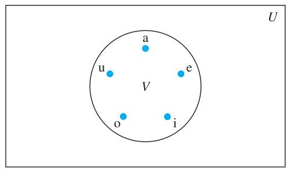
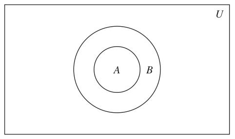

# Chapter 2: Basic Structures: Sets, Functions, Sequences, Sums, and Matrices

<!-- Page 1 -->

## Chapter Overview

Much of discrete mathematics is devoted to the study of discrete structures, used to represent discrete objects. Many important discrete structures are built using sets, which are collections of objects. Among the discrete structures built from sets are combinations, unordered collections of objects used extensively in counting; relations, sets of ordered pairs that represent relationships between objects; graphs, sets of vertices and edges that connect vertices; and finite state machines, used to model computing machines. These are some of the topics we will study in later chapters.

The concept of a function is extremely important in discrete mathematics. A function assigns to each element of a first set exactly one element of a second set, where the two sets are not necessarily distinct. Functions play important roles throughout discrete mathematics. They are used to represent the computational complexity of algorithms, to study the size of sets, to count objects, and in a myriad of other ways. Useful structures such as sequences and strings are special types of functions. In this chapter, we will introduce the notion of a sequence, which represents ordered lists of elements. Furthermore, we will introduce some important types of sequences and we will show how to define the terms of a sequence using earlier terms. We will also address the problem of identifying a sequence from its first few terms.

In our study of discrete mathematics, we will often add consecutive terms of a sequence of numbers. Because adding terms from a sequence, as well as other indexed sets of numbers, is such a common occurrence, a special notation has been developed for adding such terms. In this chapter, we will introduce the notation used to express summations. We will develop formulae for certain types of summations that appear throughout the study of discrete mathematics. For instance, we will encounter such summations in the analysis of the number of steps used by an algorithm to sort a list of numbers so that its terms are in increasing order.

The relative sizes of infinite sets can be studied by introducing the notion of the size, or cardinality, of a set. We say that a set is countable when it is finite or has the same size as the set of positive integers. In this chapter we will establish the surprising result that the set of rational numbers is countable, while the set of real numbers is not. We will also show how the concepts we discuss can be used to show that there are functions that cannot be computed using a computer program in any programming language.

Matrices are used in discrete mathematics to represent a variety of discrete structures. We will review the basic material about matrices and matrix arithmetic needed to represent relations and graphs. The matrix arithmetic we study will be used to solve a variety of problems involving these structures.

---

## 2.1 Sets

### Introduction

In this section, we study the fundamental discrete structure on which all other discrete structures are built, namely, the set. Sets are used to group objects together. Often, but not always, the objects in a set have similar properties. For instance, all the students who are currently enrolled in your school make up a set. Likewise, all the students currently taking a course in discrete mathematics at any school make up a set. In addition, those students enrolled in your school who are taking a course in discrete mathematics form a set that can be obtained by taking the elements common to the first two collections. The language of sets is a means to study such

<!-- Page 2 -->

collections in an organized fashion. We now provide a definition of a set. This definition is an intuitive definition, which is not part of a formal theory of sets.

> [!NOTE] DEFINITION 1
> A **set** is an unordered collection of objects, called **elements** or **members** of the set. A set is said to **contain** its elements. We write $a \in A$ to denote that $a$ is an element of the set $A$. The notation $a \notin A$ denotes that $a$ is not an element of the set $A$.

It is common for sets to be denoted using uppercase letters. Lowercase letters are usually used to denote elements of sets.

There are several ways to describe a set. One way is to list all the members of a set, when this is possible. We use a notation where all members of the set are listed between braces. For example, the notation $\{a, b, c, d\}$ represents the set with the four elements $a$, $b$, $c$, and $d$. This way of describing a set is known as the **roster method**.

#### EXAMPLE 1
The set $V$ of all vowels in the English alphabet can be written as $V = \{a, e, i, o, u\}$.
$\blacktriangleleft$

#### EXAMPLE 2
The set $O$ of odd positive integers less than 10 can be expressed by $O = \{1, 3, 5, 7, 9\}$.
$\blacktriangleleft$

#### EXAMPLE 3
Although sets are usually used to group together elements with common properties, there is nothing that prevents a set from having seemingly unrelated elements. For instance, $\{a, 2, \text{Fred}, \text{New Jersey}\}$ is the set containing the four elements $a$, $2$, $\text{Fred}$, and $\text{New Jersey}$.
$\blacktriangleleft$

Sometimes the roster method is used to describe a set without listing all its members. Some members of the set are listed, and then *ellipses* ($\dots$) are used when the general pattern of the elements is obvious.

#### EXAMPLE 4
The set of positive integers less than 100 can be denoted by $\{1, 2, 3, \dots, 99\}$.
$\blacktriangleleft$

Another way to describe a set is to use **set builder** notation. We characterize all those elements in the set by stating the property or properties they must have to be members. For instance, the set $O$ of all odd positive integers less than 10 can be written as
$$O = \{x \mid x \text{ is an odd positive integer less than } 10\},$$
or, specifying the universe as the set of positive integers, as
$$O = \{x \in \mathbf{Z}^+ \mid x \text{ is odd and } x < 10\}.$$

We often use this type of notation to describe sets when it is impossible to list all the elements of the set. For instance, the set $\mathbf{Q}^+$ of all positive rational numbers can be written as
$$\mathbf{Q}^+ = \{x \in \mathbf{R} \mid x = \frac{p}{q}, \text{ for some positive integers } p \text{ and } q\}.$$

These sets, each denoted using a boldface letter, play an important role in discrete mathematics:
- $\mathbf{N} = \{0, 1, 2, 3, \dots\}$, the set of **natural numbers**
- $\mathbf{Z} = \{\dots, -2, -1, 0, 1, 2, \dots\}$, the set of **integers**
- $\mathbf{Z}^+ = \{1, 2, 3, \dots\}$, the set of **positive integers**
- $\mathbf{Q} = \{p/q \mid p \in \mathbf{Z}, q \in \mathbf{Z}, \text{ and } q \neq 0\}$, the set of **rational numbers**
- $\mathbf{R}$, the set of **real numbers**
- $\mathbf{R}^+$, the set of **positive real numbers**
- $\mathbf{C}$, the set of **complex numbers**.

> [!NOTE]
> *Beware that mathematicians disagree whether 0 is a natural number. We consider it quite natural.*

<!-- Page 3 -->

(Note that some people do not consider 0 a natural number, so be careful to check how the term *natural numbers* is used when you read other books.)

Recall the notation for **intervals** of real numbers. When $a$ and $b$ are real numbers with $a < b$, we write
$$
\begin{aligned}
[a, b] &= \{x \mid a \le x \le b\} \\
[a, b) &= \{x \mid a \le x < b\} \\
(a, b] &= \{x \mid a < x \le b\} \\
(a, b) &= \{x \mid a < x < b\}
\end{aligned}
$$
Note that $[a, b]$ is called the **closed interval** from $a$ to $b$ and $(a, b)$ is called the **open interval** from $a$ to $b$.

Sets can have other sets as members, as Example 5 illustrates.

#### EXAMPLE 5
The set $\{\mathbf{N}, \mathbf{Z}, \mathbf{Q}, \mathbf{R}\}$ is a set containing four elements, each of which is a set. The four elements of this set are $\mathbf{N}$, the set of natural numbers; $\mathbf{Z}$, the set of integers; $\mathbf{Q}$, the set of rational numbers; and $\mathbf{R}$, the set of real numbers.
$\blacktriangleleft$

*Remark:* Note that the concept of a datatype, or type, in computer science is built upon the concept of a set. In particular, a **datatype** or **type** is the name of a set, together with a set of operations that can be performed on objects from that set. For example, *boolean* is the name of the set $\{0, 1\}$ together with operators on one or more elements of this set, such as AND, OR, and NOT.

Because many mathematical statements assert that two differently specified collections of objects are really the same set, we need to understand what it means for two sets to be equal.

> [!NOTE] DEFINITION 2
> Two sets are **equal** if and only if they have the same elements. Therefore, if $A$ and $B$ are sets, then $A$ and $B$ are equal if and only if $\forall x(x \in A \leftrightarrow x \in B)$. We write $A = B$ if $A$ and $B$ are equal sets.

#### EXAMPLE 6
The sets $\{1, 3, 5\}$ and $\{3, 5, 1\}$ are equal, because they have the same elements. Note that the order in which the elements of a set are listed does not matter. Note also that it does not matter if an element of a set is listed more than once, so $\{1, 3, 3, 3, 5, 5, 5, 5\}$ is the same as the set $\{1, 3, 5\}$ because they have the same elements.
$\blacktriangleleft$

<!-- Page 4 -->

### The Empty Set

**THE EMPTY SET** There is a special set that has no elements. This set is called the **empty set**, or **null set**, and is denoted by $\emptyset$. The empty set can also be denoted by $\{\ \}$ (that is, we represent the empty set with a pair of braces that encloses all the elements in this set). Often, a set of elements with certain properties turns out to be the null set. For instance, the set of all positive integers that are greater than their squares is the null set.

A set with one element is called a **singleton set**. A common error is to confuse the empty set $\emptyset$ with the set $\{\emptyset\}$, which is a singleton set. The single element of the set $\{\emptyset\}$ is the empty set itself! A useful analogy for remembering this difference is to think of folders in a computer file system. The empty set can be thought of as an empty folder and the set consisting of just the empty set can be thought of as a folder with exactly one folder inside, namely, the empty folder.

> [!NOTE]
> *$\{\emptyset\}$ has one more element than $\emptyset$.*

### Naive Set Theory

**NAIVE SET THEORY** Note that the term *object* has been used in the definition of a set, Definition 1, without specifying what an object is. This description of a set as a collection of objects, based on the intuitive notion of an object, was first stated in 1895 by the German mathematician Georg Cantor. The theory that results from this intuitive definition of a set, and the use of the intuitive notion that for any property whatever, there is a set consisting of exactly the objects with this property, leads to **paradoxes**, or logical inconsistencies. This was shown by the English philosopher Bertrand Russell in 1902 (see Exercise 46 for a description of one of these paradoxes). These logical inconsistencies can be avoided by building set theory beginning with axioms. However, we will use Cantor’s original version of set theory, known as **naive set theory**, in this book because all sets considered in this book can be treated consistently using Cantor’s original theory. Students will find familiarity with naive set theory helpful if they go on to learn about axiomatic set theory. They will also find the development of axiomatic set theory much more abstract than the material in this text. We refer the interested reader to [Su72] to learn more about axiomatic set theory.

### Venn Diagrams

Sets can be represented graphically using **Venn diagrams**, named after the English mathematician John Venn, who introduced their use in 1881. In Venn diagrams the **universal set** $U$, which contains all the objects under consideration, is represented by a rectangle. (Note that the universal set varies depending on which objects are of interest.) Inside this rectangle, circles or other geometrical figures are used to represent sets. Sometimes points are used to represent the particular elements of the set. Venn diagrams are often used to indicate the relationships between sets. We show how a Venn diagram can be used in Example 7.

#### EXAMPLE 7
Draw a Venn diagram that represents $V$, the set of vowels in the English alphabet.

**Solution:** We draw a rectangle to indicate the universal set $U$, which is the set of the 26 letters of the English alphabet. Inside this rectangle we draw a circle to represent $V$. Inside this circle we indicate the elements of $V$ with points (see Figure 1).
$\blacktriangleleft$

*FIGURE 1 — Venn Diagram for the Set of Vowels (Source: Page 118)*

<!-- Page 5 -->

### Subsets

It is common to encounter situations where the elements of one set are also the elements of a second set. We now introduce some terminology and notation to express such relationships between sets.

> [!NOTE] DEFINITION 3
> The set $A$ is a **subset** of $B$ if and only if every element of $A$ is also an element of $B$. We use the notation $A \subseteq B$ to indicate that $A$ is a subset of the set $B$.

We see that $A \subseteq B$ if and only if the quantification
$$\forall x(x \in A \to x \in B)$$
is true. Note that to show that $A$ is not a subset of $B$ we need only find one element $x \in A$ with $x \notin B$. Such an $x$ is a counterexample to the claim that $x \in A$ implies $x \in B$.

We have these useful rules for determining whether one set is a subset of another:
> **Showing that $A$ is a Subset of $B$** To show that $A \subseteq B$, show that if $x$ belongs to $A$ then $x$ also belongs to $B$.
>
> **Showing that $A$ is Not a Subset of $B$** To show that $A \not\subseteq B$, find a single $x \in A$ such that $x \notin B$.

#### EXAMPLE 8
The set of all odd positive integers less than 10 is a subset of the set of all positive integers less than 10, the set of rational numbers is a subset of the set of real numbers, the set of all computer science majors at your school is a subset of the set of all students at your school, and the set of all people in China is a subset of the set of all people in China (that is, it is a subset of itself). Each of these facts follows immediately by noting that an element that belongs to the first set in each pair of sets also belongs to the second set in that pair.
$\blacktriangleleft$

#### EXAMPLE 9
The set of integers with squares less than 100 is not a subset of the set of nonnegative integers because $-1$ is in the former set [as $(-1)^2 < 100$], but not the later set. The set of people who have taken discrete mathematics at your school is not a subset of the set of all computer science majors at your school if there is at least one student who has taken discrete mathematics who is not a computer science major.
$\blacktriangleleft$

<!-- Page 6 -->

*FIGURE 2 — Venn Diagram Showing that $A$ Is a Subset of $B$ (Source: Page 120)*

Theorem 1 shows that every nonempty set $S$ is guaranteed to have at least two subsets, the empty set and the set $S$ itself, that is, $\emptyset \subseteq S$ and $S \subseteq S$.

> [!NOTE] THEOREM 1
> For every set $S$,
> (i) $\emptyset \subseteq S$ and (ii) $S \subseteq S$.

*Proof:* We will prove (i) and leave the proof of (ii) as an exercise.

Let $S$ be a set. To show that $\emptyset \subseteq S$, we must show that $\forall x(x \in \emptyset \to x \in S)$ is true. Because the empty set contains no elements, it follows that $x \in \emptyset$ is always false. It follows that the conditional statement $x \in \emptyset \to x \in S$ is always true, because its hypothesis is always false and a conditional statement with a false hypothesis is true. Therefore, $\forall x(x \in \emptyset \to x \in S)$ is true. This completes the proof of (i). Note that this is an example of a vacuous proof. $\blacktriangleleft$

When we wish to emphasize that a set $A$ is a subset of a set $B$ but that $A \neq B$, we write $A \subset B$ and say that $A$ is a **proper subset** of $B$. For $A \subset B$ to be true, it must be the case that $A \subseteq B$ and there must exist an element $x$ of $B$ that is not an element of $A$. That is, $A$ is a proper subset of $B$ if and only if
$$\forall x(x \in A \to x \in B) \land \exists x(x \in B \land x \notin A)$$
is true. Venn diagrams can be used to illustrate that a set $A$ is a subset of a set $B$. We draw the universal set $U$ as a rectangle. Within this rectangle we draw a circle for $B$. Because $A$ is a subset of $B$, we draw the circle for $A$ within the circle for $B$. This relationship is shown in Figure 2.

A useful way to show that two sets have the same elements is to show that each set is a subset of the other. In other words, we can show that if $A$ and $B$ are sets with $A \subseteq B$ and $B \subseteq A$, then $A = B$. That is, $A = B$ if and only if $\forall x(x \in A \to x \in B)$ and $\forall x(x \in B \to x \in A)$ or equivalently if and only if $\forall x(x \in A \leftrightarrow x \in B)$, which is what it means for the $A$ and $B$ to be equal. Because this method of showing two sets are equal is so useful, we highlight it here.

<!-- Page 7 -->

> **Showing Two Sets are Equal** To show that two sets $A$ and $B$ are equal, show that $A \subseteq B$ and $B \subseteq A$.

Sets may have other sets as members. For instance, we have the sets
$$A = \{\emptyset, \{a\}, \{b\}, \{a, b\}\} \quad \text{and} \quad B = \{x \mid x \text{ is a subset of the set } \{a, b\}\}.$$
Note that these two sets are equal, that is, $A = B$. Also note that $\{a\} \in A$, but $a \notin A$.

### The Size of a Set

Sets are used extensively in counting problems, and for such applications we need to discuss the sizes of sets.

> [!NOTE] DEFINITION 4
> Let $S$ be a set. If there are exactly $n$ distinct elements in $S$ where $n$ is a nonnegative integer, we say that $S$ is a **finite set** and that $n$ is the **cardinality** of $S$. The cardinality of $S$ is denoted by $|S|$.

*Remark:* The term *cardinality* comes from the common usage of the term *cardinal number* as the size of a finite set.

#### EXAMPLE 10
Let $A$ be the set of odd positive integers less than 10. Then $|A| = 5$.
$\blacktriangleleft$

#### EXAMPLE 11
Let $S$ be the set of letters in the English alphabet. Then $|S| = 26$.
$\blacktriangleleft$

#### EXAMPLE 12
Because the null set has no elements, it follows that $|\emptyset| = 0$.
$\blacktriangleleft$

We will also be interested in sets that are not finite.

> [!NOTE] DEFINITION 5
> A set is said to be **infinite** if it is not finite.

#### EXAMPLE 13
The set of positive integers is infinite.
$\blacktriangleleft$

We will extend the notion of cardinality to infinite sets in Section 2.5, a challenging topic full of surprising results.

### Power Sets

Many problems involve testing all combinations of elements of a set to see if they satisfy some property. To consider all such combinations of elements of a set $S$, we build a new set that has as its members all the subsets of $S$.

> [!NOTE] DEFINITION 6
> Given a set $S$, the **power set** of $S$ is the set of all subsets of the set $S$. The power set of $S$ is denoted by $\mathcal{P}(S)$.

<!-- Page 8 -->

#### EXAMPLE 14
What is the power set of the set $\{0, 1, 2\}$?

**Solution:** The power set $\mathcal{P}(\{0, 1, 2\})$ is the set of all subsets of $\{0, 1, 2\}$. Hence,
$$\mathcal{P}(\{0, 1, 2\}) = \{\emptyset, \{0\}, \{1\}, \{2\}, \{0, 1\}, \{0, 2\}, \{1, 2\}, \{0, 1, 2\}\}.$$
Note that the empty set and the set itself are members of this set of subsets.
$\blacktriangleleft$

#### EXAMPLE 15
What is the power set of the empty set? What is the power set of the set $\{\emptyset\}$?

**Solution:** The empty set has exactly one subset, namely, itself. Consequently,
$$\mathcal{P}(\emptyset) = \{\emptyset\}.$$
The set $\{\emptyset\}$ has exactly two subsets, namely, $\emptyset$ and the set $\{\emptyset\}$ itself. Therefore,
$$\mathcal{P}(\{\emptyset\}) = \{\emptyset, \{\emptyset\}\}.$$
$\blacktriangleleft$

If a set has $n$ elements, then its power set has $2^n$ elements. We will demonstrate this fact in several ways in subsequent sections of the text.

### Cartesian Products

The order of elements in a collection is often important. Because sets are unordered, a different structure is needed to represent ordered collections. This is provided by **ordered $n$-tuples**.

> [!NOTE] DEFINITION 7
> The **ordered $n$-tuple** $(a_1, a_2, \dots, a_n)$ is the ordered collection that has $a_1$ as its first element, $a_2$ as its second element, $\dots$, and $a_n$ as its $n$th element.

We say that two ordered $n$-tuples are equal if and only if each corresponding pair of their elements is equal. In other words, $(a_1, a_2, \dots, a_n) = (b_1, b_2, \dots, b_n)$ if and only if $a_i = b_i$, for $i = 1, 2, \dots, n$. In particular, ordered 2-tuples are called **ordered pairs**. The ordered pairs $(a, b)$ and $(c, d)$ are equal if and only if $a = c$ and $b = d$. Note that $(a, b)$ and $(b, a)$ are not equal unless $a = b$.

<!-- Page 9 -->

Many of the discrete structures we will study in later chapters are based on the notion of the *Cartesian product* of sets (named after René Descartes). We first define the Cartesian product of two sets.

> [!NOTE] DEFINITION 8
> Let $A$ and $B$ be sets. The **Cartesian product** of $A$ and $B$, denoted by $A \times B$, is the set of all ordered pairs $(a, b)$, where $a \in A$ and $b \in B$. Hence,
> $$A \times B = \{(a, b) \mid a \in A \land b \in B\}.$$

#### EXAMPLE 16
Let $A$ represent the set of all students at a university, and let $B$ represent the set of all courses offered at the university. What is the Cartesian product $A \times B$ and how can it be used?

**Solution:** The Cartesian product $A \times B$ consists of all the ordered pairs of the form $(a, b)$, where $a$ is a student at the university and $b$ is a course offered at the university. One way to use the set $A \times B$ is to represent all possible enrollments of students in courses at the university.
$\blacktriangleleft$

#### EXAMPLE 17
What is the Cartesian product of $A = \{1, 2\}$ and $B = \{a, b, c\}$?

**Solution:** The Cartesian product $A \times B$ is
$$A \times B = \{(1, a), (1, b), (1, c), (2, a), (2, b), (2, c)\}.$$
$\blacktriangleleft$

Note that the Cartesian products $A \times B$ and $B \times A$ are not equal, unless $A = \emptyset$ or $B = \emptyset$ (so that $A \times B = \emptyset$) or $A = B$ (see Exercises 31 and 38). This is illustrated in Example 18.

#### EXAMPLE 18
Show that the Cartesian product $B \times A$ is not equal to the Cartesian product $A \times B$, where $A$ and $B$ are as in Example 17.

**Solution:** The Cartesian product $B \times A$ is
$$B \times A = \{(a, 1), (a, 2), (b, 1), (b, 2), (c, 1), (c, 2)\}.$$
This is not equal to $A \times B$, which was found in Example 17.
$\blacktriangleleft$

The Cartesian product of more than two sets can also be defined.

> [!NOTE] DEFINITION 9
> The **Cartesian product** of the sets $A_1, A_2, \dots, A_n$, denoted by $A_1 \times A_2 \times \dots \times A_n$, is the set of ordered $n$-tuples $(a_1, a_2, \dots, a_n)$, where $a_i$ belongs to $A_i$ for $i = 1, 2, \dots, n$. In other words,
> $$A_1 \times A_2 \times \dots \times A_n = \{(a_1, a_2, \dots, a_n) \mid a_i \in A_i \text{ for } i = 1, 2, \dots, n\}.$$

<!-- Page 10 -->

#### EXAMPLE 19
What is the Cartesian product $A \times B \times C$, where $A = \{0, 1\}$, $B = \{1, 2\}$, and $C = \{0, 1, 2\}$?

**Solution:** The Cartesian product $A \times B \times C$ consists of all ordered triples $(a, b, c)$, where $a \in A$, $b \in B$, and $c \in C$. Hence,
$$
\begin{aligned}
A \times B \times C = \{&(0, 1, 0), (0, 1, 1), (0, 1, 2), (0, 2, 0), (0, 2, 1), (0, 2, 2), \\
&(1, 1, 0), (1, 1, 1), (1, 1, 2), (1, 2, 0), (1, 2, 1), (1, 2, 2)\}.
\end{aligned}
$$
$\blacktriangleleft$

*Remark:* Note that when $A$, $B$, and $C$ are sets, $(A \times B) \times C$ is not the same as $A \times B \times C$ (see Exercise 39).

We use the notation $A^2$ to denote $A \times A$, the Cartesian product of the set $A$ with itself. Similarly, $A^3 = A \times A \times A$, $A^4 = A \times A \times A \times A$, and so on. More generally,
$$A^n = \{(a_1, a_2, \dots, a_n) \mid a_i \in A \text{ for } i = 1, 2, \dots, n\}.$$

#### EXAMPLE 20
Suppose that $A = \{1, 2\}$. It follows that $A^2 = \{(1, 1), (1, 2), (2, 1), (2, 2)\}$ and $A^3 = \{(1, 1, 1), (1, 1, 2), (1, 2, 1), (1, 2, 2), (2, 1, 1), (2, 1, 2), (2, 2, 1), (2, 2, 2)\}$.
$\blacktriangleleft$

A subset $R$ of the Cartesian product $A \times B$ is called a **relation** from the set $A$ to the set $B$. The elements of $R$ are ordered pairs, where the first element belongs to $A$ and the second to $B$. For example, $R = \{(a, 0), (a, 1), (a, 3), (b, 1), (b, 2), (c, 0), (c, 3)\}$ is a relation from the set $\{a, b, c\}$ to the set $\{0, 1, 2, 3\}$. A relation from a set $A$ to itself is called a **relation on $A$**.

#### EXAMPLE 21
What are the ordered pairs in the less than or equal to relation, which contains $(a, b)$ if $a \le b$, on the set $\{0, 1, 2, 3\}$?

**Solution:** The ordered pair $(a, b)$ belongs to $R$ if and only if both $a$ and $b$ belong to $\{0, 1, 2, 3\}$ and $a \le b$. Consequently, the ordered pairs in $R$ are $(0, 0), (0, 1), (0, 2), (0, 3), (1, 1), (1, 2), (1, 3), (2, 2), (2, 3)$, and $(3, 3)$.
$\blacktriangleleft$

We will study relations and their properties at length in Chapter 9.

### Using Set Notation with Quantifiers

Sometimes we restrict the domain of a quantified statement explicitly by making use of a particular notation. For example, $\forall x \in S(P(x))$ denotes the universal quantification of $P(x)$ over all elements in the set $S$. In other words, $\forall x \in S(P(x))$ is shorthand for $\forall x(x \in S \to P(x))$. Similarly, $\exists x \in S(P(x))$ denotes the existential quantification of $P(x)$ over all elements in $S$. That is, $\exists x \in S(P(x))$ is shorthand for $\exists x(x \in S \land P(x))$.

#### EXAMPLE 22
What do the statements $\forall x \in \mathbf{R} (x^2 \ge 0)$ and $\exists x \in \mathbf{Z} (x^2 = 1)$ mean?

**Solution:** The statement $\forall x \in \mathbf{R}(x^2 \ge 0)$ states that for every real number $x$, $x^2 \ge 0$. This statement can be expressed as “The square of every real number is nonnegative.” This is a true statement.

The statement $\exists x \in \mathbf{Z}(x^2 = 1)$ states that there exists an integer $x$ such that $x^2 = 1$. This statement can be expressed as “There is an integer whose square is 1.” This is also a true statement because $x = 1$ is such an integer (as is $-1$).
$\blacktriangleleft$

<!-- Page 11 -->

### Truth Sets and Quantifiers

We will now tie together concepts from set theory and from predicate logic. Given a predicate $P$, and a domain $D$, we define the **truth set** of $P$ to be the set of elements $x$ in $D$ for which $P(x)$ is true. The truth set of $P(x)$ is denoted by $\{x \in D \mid P(x)\}$.

#### EXAMPLE 23
What are the truth sets of the predicates $P(x)$, $Q(x)$, and $R(x)$, where the domain is the set of integers and $P(x)$ is “$|x| = 1$,\” $Q(x)$ is “$x^2 = 2$,\” and $R(x)$ is “$|x| = x$\”?

**Solution:** The truth set of $P$, $\{x \in \mathbf{Z} \mid |x| = 1\}$, is the set of integers for which $|x| = 1$. Because $|x| = 1$ when $x = 1$ or $x = -1$, and for no other integers $x$, we see that the truth set of $P$ is the set $\{-1, 1\}$.

The truth set of $Q$, $\{x \in \mathbf{Z} \mid x^2 = 2\}$, is the set of integers for which $x^2 = 2$. This is the empty set because there are no integers $x$ for which $x^2 = 2$.

The truth set of $R$, $\{x \in \mathbf{Z} \mid |x| = x\}$, is the set of integers for which $|x| = x$. Because $|x| = x$ if and only if $x \ge 0$, it follows that the truth set of $R$ is $\mathbf{N}$, the set of nonnegative integers.
$\blacktriangleleft$

Note that $\forall x P(x)$ is true over the domain $U$ if and only if the truth set of $P$ is the set $U$. Likewise, $\exists x P(x)$ is true over the domain $U$ if and only if the truth set of $P$ is nonempty.
