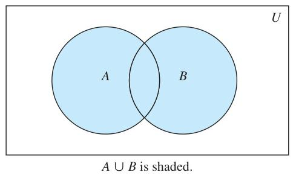
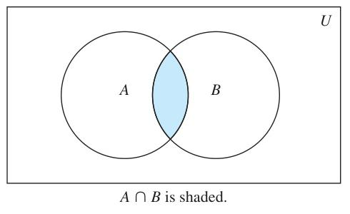
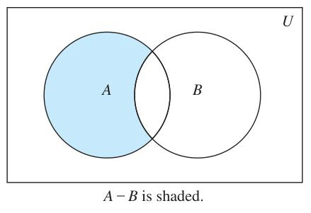
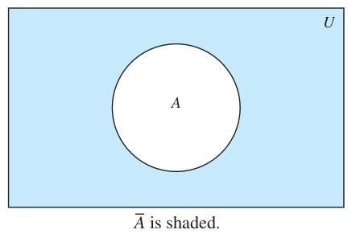
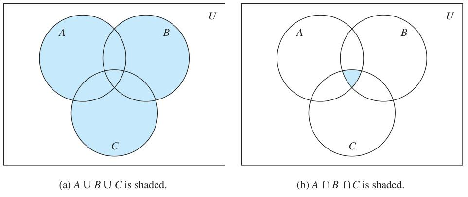

# 2.2 Set Operations

<!-- Page 13 -->

### Introduction

Two, or more, sets can be combined in many different ways. For instance, starting with the set of mathematics majors at your school and the set of computer science majors at your school, we can form the set of students who are mathematics majors or computer science majors, the set of students who are joint majors in mathematics and computer science, the set of all students not majoring in mathematics, and so on.

> [!NOTE] DEFINITION 1
> Let $A$ and $B$ be sets. The **union** of the sets $A$ and $B$, denoted by $A \cup B$, is the set that contains those elements that are either in $A$ or in $B$, or in both.

An element $x$ belongs to the union of the sets $A$ and $B$ if and only if $x$ belongs to $A$ or $x$ belongs to $B$. This tells us that
$$A \cup B = \{x \mid x \in A \lor x \in B\}.$$

The Venn diagram shown in Figure 1 represents the union of two sets $A$ and $B$. The area that represents $A \cup B$ is the shaded area within either the circle representing $A$ or the circle representing $B$.

We will give some examples of the union of sets.

#### EXAMPLE 1
The union of the sets $\{1, 3, 5\}$ and $\{1, 2, 3\}$ is the set $\{1, 2, 3, 5\}$; that is,
$$\{1, 3, 5\} \cup \{1, 2, 3\} = \{1, 2, 3, 5\}.$$
$\blacktriangleleft$

#### EXAMPLE 2
The union of the set of all computer science majors at your school and the set of all mathematics majors at your school is the set of students at your school who are majoring either in mathematics or in computer science (or in both).
$\blacktriangleleft$

> [!NOTE] DEFINITION 2
> Let $A$ and $B$ be sets. The **intersection** of the sets $A$ and $B$, denoted by $A \cap B$, is the set containing those elements in both $A$ and $B$.

An element $x$ belongs to the intersection of the sets $A$ and $B$ if and only if $x$ belongs to $A$ and $x$ belongs to $B$. This tells us that
$$A \cap B = \{x \mid x \in A \land x \in B\}.$$

|  |  |
| :---: | :---: |
| *FIGURE 1 — Venn Diagram of the Union of $A$ and $B$ (Source: Page 127)* | *FIGURE 2 — Venn Diagram of the Intersection of $A$ and $B$ (Source: Page 127)* |

<!-- Page 14 -->

The Venn diagram shown in Figure 2 represents the intersection of two sets $A$ and $B$. The shaded area that is within both the circles representing the sets $A$ and $B$ is the area that represents the intersection of $A$ and $B$.

We give some examples of the intersection of sets.

#### EXAMPLE 3
The intersection of the sets $\{1, 3, 5\}$ and $\{1, 2, 3\}$ is the set $\{1, 3\}$; that is,
$$\{1, 3, 5\} \cap \{1, 2, 3\} = \{1, 3\}.$$
$\blacktriangleleft$

#### EXAMPLE 4
The intersection of the set of all computer science majors at your school and the set of all mathematics majors is the set of all students who are joint majors in mathematics and computer science.
$\blacktriangleleft$

> [!NOTE] DEFINITION 3
> Two sets are called **disjoint** if their intersection is the empty set.

#### EXAMPLE 5
Let $A = \{1, 3, 5, 7, 9\}$ and $B = \{2, 4, 6, 8, 10\}$. Because $A \cap B = \emptyset$, $A$ and $B$ are disjoint.
$\blacktriangleleft$

We are often interested in finding the cardinality of a union of two finite sets $A$ and $B$. Note that $|A| + |B|$ counts each element that is in $A$ but not in $B$ or in $B$ but not in $A$ exactly once, and each element that is in both $A$ and $B$ exactly twice. Thus, if the number of elements that are in both $A$ and $B$ is subtracted from $|A| + |B|$, elements in $A \cap B$ will be counted only once. Hence,
$$|A \cup B| = |A| + |B| - |A \cap B|.$$

> [!NOTE]
> *Be careful not to overcount!*

The generalization of this result to unions of an arbitrary number of sets is called the **principle of inclusion–exclusion**. The principle of inclusion–exclusion is an important technique used in enumeration. We will discuss this principle and other counting techniques in detail in Chapters 6 and 8.

There are other important ways to combine sets.

> [!NOTE] DEFINITION 4
> Let $A$ and $B$ be sets. The **difference** of $A$ and $B$, denoted by $A - B$, is the set containing those elements that are in $A$ but not in $B$. The difference of $A$ and $B$ is also called the **complement of $B$ with respect to $A$**.

*Remark:* The difference of sets $A$ and $B$ is sometimes denoted by $A \setminus B$.

An element $x$ belongs to the difference of $A$ and $B$ if and only if $x \in A$ and $x \notin B$. This tells us that
$$A - B = \{x \mid x \in A \land x \notin B\}.$$

The Venn diagram shown in Figure 3 represents the difference of the sets $A$ and $B$. The shaded area inside the circle that represents $A$ and outside the circle that represents $B$ is the area that represents $A - B$.

We give some examples of differences of sets.

#### EXAMPLE 6
The difference of $\{1, 3, 5\}$ and $\{1, 2, 3\}$ is the set $\{5\}$; that is, $\{1, 3, 5\} - \{1, 2, 3\} = \{5\}$. This is different from the difference of $\{1, 2, 3\}$ and $\{1, 3, 5\}$, which is the set $\{2\}$.
$\blacktriangleleft$

#### EXAMPLE 7
The difference of the set of computer science majors at your school and the set of mathematics majors at your school is the set of all computer science majors at your school who are not also mathematics majors.
$\blacktriangleleft$

<!-- Page 15 -->

|  |  |
| :---: | :---: |
| *FIGURE 3 — Venn Diagram for the Difference of $A$ and $B$ (Source: Page 129)* | *FIGURE 4 — Venn Diagram for the Complement of the Set $A$ (Source: Page 129)* |

Once the universal set $U$ has been specified, the complement of a set can be defined.

> [!NOTE] DEFINITION 5
> Let $U$ be the universal set. The **complement** of the set $A$, denoted by $\overline{A}$, is the complement of $A$ with respect to $U$. Therefore, the complement of the set $A$ is $U - A$.

An element belongs to $\overline{A}$ if and only if $x \notin A$. This tells us that
$$\overline{A} = \{x \in U \mid x \notin A\}.$$

In Figure 4 the shaded area outside the circle representing $A$ is the area representing $\overline{A}$.

We give some examples of the complement of a set.

#### EXAMPLE 8
Let $A = \{a, e, i, o, u\}$ (where the universal set is the set of letters of the English alphabet). Then
$$\overline{A} = \{b, c, d, f, g, h, j, k, l, m, n, p, q, r, s, t, v, w, x, y, z\}.$$
$\blacktriangleleft$

#### EXAMPLE 9
Let $A$ be the set of positive integers greater than 10 (with universal set the set of all positive integers). Then
$$\overline{A} = \{1, 2, 3, 4, 5, 6, 7, 8, 9, 10\}.$$
$\blacktriangleleft$

It is left to the reader (Exercise 19) to show that we can express the difference of $A$ and $B$ as the intersection of $A$ and the complement of $B$. That is,
$$A - B = A \cap \overline{B}.$$

### Set Identities

Table 1 lists the most important set identities. We will prove several of these identities here, using three different methods. These methods are presented to illustrate that there are often many different approaches to the solution of a problem. The proofs of the remaining identities will be left as exercises. The reader should note the similarity between these set identities and the logical equivalences discussed in Section 1.3. (Compare Table 6 of Section 1.6 and Table 1.) In fact, the set identities given can be proved directly from the corresponding logical equivalences. Furthermore, both are special cases of identities that hold for Boolean algebra (discussed in Chapter 12).

> [!NOTE]
> *Set identities and propositional equivalences are just special cases of identities for Boolean algebra.*

One way to show that two sets are equal is to show that each is a subset of the other. Recall that to show that one set is a subset of a second set, we can show that if an element belongs to the first set, then it must also belong to the second set. We generally use a direct proof to do this. We illustrate this type of proof by establishing the first of De Morgan’s laws.

<!-- Page 16 -->

| TABLE 1 Set Identities. | |
| :--- | :--- |
| **Identity** | **Name** |
| $A \cap U = A$ $A \cup \emptyset = A$ | Identity laws |
| $A \cup U = U$ $A \cap \emptyset = \emptyset$ | Domination laws |
| $A \cup A = A$ $A \cap A = A$ | Idempotent laws |
| $\overline{(\overline{A})} = A$ | Complementation law |
| $A \cup B = B \cup A$ $A \cap B = B \cap A$ | Commutative laws |
| $A \cup (B \cup C) = (A \cup B) \cup C$ $A \cap (B \cap C) = (A \cap B) \cap C$ | Associative laws |
| $A \cup (B \cap C) = (A \cup B) \cap (A \cup C)$ $A \cap (B \cup C) = (A \cap B) \cup (A \cap C)$ | Distributive laws |
| $\overline{A \cap B} = \overline{A} \cup \overline{B}$ $\overline{A \cup B} = \overline{A} \cap \overline{B}$ | De Morgan’s laws |
| $A \cup (A \cap B) = A$ $A \cap (A \cup B) = A$ | Absorption laws |
| $A \cup \overline{A} = U$ $A \cap \overline{A} = \emptyset$ | Complement laws |

#### EXAMPLE 10
Prove that $\overline{A \cap B} = \overline{A} \cup \overline{B}$.

> [!NOTE]
> *This identity says that the complement of the intersection of two sets is the union of their complements.*

**Solution:** We will prove that the two sets $\overline{A \cap B}$ and $\overline{A} \cup \overline{B}$ are equal by showing that each set is a subset of the other.

First, we will show that $\overline{A \cap B} \subseteq \overline{A} \cup \overline{B}$. We do this by showing that if $x$ is in $\overline{A \cap B}$, then it must also be in $\overline{A} \cup \overline{B}$. Now suppose that $x \in \overline{A \cap B}$. By the definition of complement, $x \notin A \cap B$. Using the definition of intersection, we see that the proposition $\neg((x \in A) \land (x \in B))$ is true.

By applying De Morgan’s law for propositions, we see that $\neg(x \in A)$ or $\neg(x \in B)$. Using the definition of negation of propositions, we have $x \notin A$ or $x \notin B$. Using the definition of the complement of a set, we see that this implies that $x \in \overline{A}$ or $x \in \overline{B}$. Consequently, by the definition of union, we see that $x \in \overline{A} \cup \overline{B}$. We have now shown that $\overline{A \cap B} \subseteq \overline{A} \cup \overline{B}$.

Next, we will show that $\overline{A} \cup \overline{B} \subseteq \overline{A \cap B}$. We do this by showing that if $x$ is in $\overline{A} \cup \overline{B}$, then it must also be in $\overline{A \cap B}$. Now suppose that $x \in \overline{A} \cup \overline{B}$. By the definition of union, we know that $x \in \overline{A}$ or $x \in \overline{B}$. Using the definition of complement, we see that $x \notin A$ or $x \notin B$. Consequently, the proposition $\neg(x \in A) \lor \neg(x \in B)$ is true.

By De Morgan’s law for propositions, we conclude that $\neg((x \in A) \land (x \in B))$ is true. By the definition of intersection, it follows that $\neg(x \in A \cap B)$. We now use the definition of complement to conclude that $x \in \overline{A \cap B}$. This shows that $\overline{A} \cup \overline{B} \subseteq \overline{A \cap B}$.

Because we have shown that each set is a subset of the other, the two sets are equal, and the identity is proved.
$\blacktriangleleft$

We can more succinctly express the reasoning used in Example 10 using set builder notation, as Example 11 illustrates.

<!-- Page 17 -->

#### EXAMPLE 11
Use set builder notation and logical equivalences to establish the first De Morgan law $\overline{A \cap B} = \overline{A} \cup \overline{B}$.

**Solution:** We can prove this identity with the following steps.
$$
\begin{aligned}
\overline{A \cap B} &= \{x \mid x \notin A \cap B\} && \text{by definition of complement} \\
&= \{x \mid \neg(x \in (A \cap B))\} && \text{by definition of does not belong symbol} \\
&= \{x \mid \neg(x \in A \land x \in B)\} && \text{by definition of intersection} \\
&= \{x \mid \neg(x \in A) \lor \neg(x \in B)\} && \text{by the first De Morgan law for logical equivalences} \\
&= \{x \mid x \notin A \lor x \notin B\} && \text{by definition of does not belong symbol} \\
&= \{x \mid x \in \overline{A} \lor x \in \overline{B}\} && \text{by definition of complement} \\
&= \{x \mid x \in \overline{A} \cup \overline{B}\} && \text{by definition of union} \\
&= \overline{A} \cup \overline{B} && \text{by meaning of set builder notation}
\end{aligned}
$$

Note that besides the definitions of complement, union, set membership, and set builder notation, this proof uses the second De Morgan law for logical equivalences.
$\blacktriangleleft$

Proving a set identity involving more than two sets by showing each side of the identity is a subset of the other often requires that we keep track of different cases, as illustrated by the proof in Example 12 of one of the distributive laws for sets.

#### EXAMPLE 12
Prove the second distributive law from Table 1, which states that $A \cap (B \cup C) = (A \cap B) \cup (A \cap C)$ for all sets $A$, $B$, and $C$.

**Solution:** We will prove this identity by showing that each side is a subset of the other side.

Suppose that $x \in A \cap (B \cup C)$. Then $x \in A$ and $x \in B \cup C$. By the definition of union, it follows that $x \in A$, and $x \in B$ or $x \in C$ (or both). In other words, we know that the compound proposition $(x \in A) \land ((x \in B) \lor (x \in C))$ is true. By the distributive law for conjunction over disjunction, it follows that $((x \in A) \land (x \in B)) \lor ((x \in A) \land (x \in C))$. We conclude that either $x \in A$ and $x \in B$, or $x \in A$ and $x \in C$. By the definition of intersection, it follows that $x \in A \cap B$ or $x \in A \cap C$. Using the definition of union, we conclude that $x \in (A \cap B) \cup (A \cap C)$. We conclude that $A \cap (B \cup C) \subseteq (A \cap B) \cup (A \cap C)$.

Now suppose that $x \in (A \cap B) \cup (A \cap C)$. Then, by the definition of union, $x \in A \cap B$ or $x \in A \cap C$. By the definition of intersection, it follows that $x \in A$ and $x \in B$ or that $x \in A$ and $x \in C$. From this we see that $x \in A$, and $x \in B$ or $x \in C$. Consequently, by the definition of union we see that $x \in A$ and $x \in B \cup C$. Furthermore, by the definition of intersection, it follows that $x \in A \cap (B \cup C)$. We conclude that $(A \cap B) \cup (A \cap C) \subseteq A \cap (B \cup C)$. This completes the proof of the identity.
$\blacktriangleleft$

Set identities can also be proved using **membership tables**. We consider each combination of sets that an element can belong to and verify that elements in the same combinations of sets belong to both the sets in the identity. To indicate that an element is in a set, a 1 is used; to indicate that an element is not in a set, a 0 is used. (The reader should note the similarity between membership tables and truth tables.)

#### EXAMPLE 13
Use a membership table to show that $A \cap (B \cup C) = (A \cap B) \cup (A \cap C)$.

**Solution:** The membership table for these combinations of sets is shown in Table 2. This table has eight rows. Because the columns for $A \cap (B \cup C)$ and $(A \cap B) \cup (A \cap C)$ are the same, the identity is valid.
$\blacktriangleleft$

Additional set identities can be established using those that we have already proved. Consider Example 14.

<!-- Page 18 -->

| TABLE 2 A Membership Table for the Distributive Property. | | | | | | | |
| :---: | :---: | :---: | :---: | :---: | :---: | :---: | :---: |
| $A$ | $B$ | $C$ | $B \cup C$ | $A \cap (B \cup C)$ | $A \cap B$ | $A \cap C$ | $(A \cap B) \cup (A \cap C)$ |
| 1 | 1 | 1 | 1 | 1 | 1 | 1 | 1 |
| 1 | 1 | 0 | 1 | 1 | 1 | 0 | 1 |
| 1 | 0 | 1 | 1 | 1 | 0 | 1 | 1 |
| 1 | 0 | 0 | 0 | 0 | 0 | 0 | 0 |
| 0 | 1 | 1 | 1 | 0 | 0 | 0 | 0 |
| 0 | 1 | 0 | 1 | 0 | 0 | 0 | 0 |
| 0 | 0 | 1 | 1 | 0 | 0 | 0 | 0 |
| 0 | 0 | 0 | 0 | 0 | 0 | 0 | 0 |

#### EXAMPLE 14
Let $A$, $B$, and $C$ be sets. Show that
$$\overline{A \cup (B \cap C)} = (\overline{C} \cup \overline{B}) \cap \overline{A}.$$

**Solution:** We have
$$
\begin{aligned}
\overline{A \cup (B \cap C)} &= \overline{A} \cap \overline{(B \cap C)} && \text{by the first De Morgan law} \\
&= \overline{A} \cap (\overline{B} \cup \overline{C}) && \text{by the second De Morgan law} \\
&= (\overline{B} \cup \overline{C}) \cap \overline{A} && \text{by the commutative law for intersections} \\
&= (\overline{C} \cup \overline{B}) \cap \overline{A} && \text{by the commutative law for unions.}
\end{aligned}
$$
$\blacktriangleleft$

### Generalized Unions and Intersections

Because unions and intersections of sets satisfy associative laws, the sets $A \cup B \cup C$ and $A \cap B \cap C$ are well defined; that is, the meaning of this notation is unambiguous when $A$, $B$, and $C$ are sets. That is, we do not have to use parentheses to indicate which operation comes first because $A \cup (B \cup C) = (A \cup B) \cup C$ and $A \cap (B \cap C) = (A \cap B) \cap C$. Note that $A \cup B \cup C$ contains those elements that are in at least one of the sets $A$, $B$, and $C$, and that $A \cap B \cap C$ contains those elements that are in all of $A$, $B$, and $C$. These combinations of the three sets, $A$, $B$, and $C$, are shown in Figure 5.

*FIGURE 5 — The Union and Intersection of $A$, $B$, and $C$ (Source: Page 132)*

<!-- Page 19 -->

#### EXAMPLE 15
Let $A = \{0, 2, 4, 6, 8\}$, $B = \{0, 1, 2, 3, 4\}$, and $C = \{0, 3, 6, 9\}$. What are $A \cup B \cup C$ and $A \cap B \cap C$?

**Solution:** The set $A \cup B \cup C$ contains those elements in at least one of $A$, $B$, and $C$. Hence,
$$A \cup B \cup C = \{0, 1, 2, 3, 4, 6, 8, 9\}.$$
The set $A \cap B \cap C$ contains those elements in all three of $A$, $B$, and $C$. Thus,
$$A \cap B \cap C = \{0\}.$$
$\blacktriangleleft$

We can also consider unions and intersections of an arbitrary number of sets. We introduce these definitions.

> [!NOTE] DEFINITION 6
> The **union** of a collection of sets is the set that contains those elements that are members of at least one set in the collection.

We use the notation
$$A_1 \cup A_2 \cup \dots \cup A_n = \bigcup_{i=1}^n A_i$$
to denote the union of the sets $A_1, A_2, \dots, A_n$.

> [!NOTE] DEFINITION 7
> The **intersection** of a collection of sets is the set that contains those elements that are members of all the sets in the collection.

We use the notation
$$A_1 \cap A_2 \cap \dots \cap A_n = \bigcap_{i=1}^n A_i$$
to denote the intersection of the sets $A_1, A_2, \dots, A_n$. We illustrate generalized unions and intersections with Example 16.

#### EXAMPLE 16
For $i = 1, 2, \dots$, let $A_i = \{i, i + 1, i + 2, \dots\}$. Then,
$$\bigcup_{i=1}^n A_i = \bigcup_{i=1}^n \{i, i + 1, i + 2, \dots\} = \{1, 2, 3, \dots\},$$
and
$$\bigcap_{i=1}^n A_i = \bigcap_{i=1}^n \{i, i + 1, i + 2, \dots\} = \{n, n + 1, n + 2, \dots\} = A_n.$$
$\blacktriangleleft$

<!-- Page 20 -->

We can extend the notation we have introduced for unions and intersections to other families of sets. In particular, we use the notation
$$A_1 \cup A_2 \cup \dots \cup A_n \cup \dots = \bigcup_{i=1}^\infty A_i$$
to denote the union of the sets $A_1, A_2, \dots, A_n, \dots$. Similarly, the intersection of these sets is denoted by
$$A_1 \cap A_2 \cap \dots \cap A_n \cap \dots = \bigcap_{i=1}^\infty A_i.$$

More generally, when $I$ is a set, the notations $\bigcap_{i \in I} A_i$ and $\bigcup_{i \in I} A_i$ are used to denote the intersection and union of the sets $A_i$ for $i \in I$, respectively. Note that we have
$$\bigcap_{i \in I} A_i = \{x \mid \forall i \in I (x \in A_i)\} \quad \text{and} \quad \bigcup_{i \in I} A_i = \{x \mid \exists i \in I (x \in A_i)\}.$$

#### EXAMPLE 17
Suppose that $A_i = \{1, 2, 3, \dots, i\}$ for $i = 1, 2, 3, \dots$. Then,
$$\bigcup_{i=1}^\infty A_i = \bigcup_{i=1}^\infty \{1, 2, 3, \dots, i\} = \{1, 2, 3, \dots\} = \mathbf{Z}^+$$
and
$$\bigcap_{i=1}^\infty A_i = \bigcap_{i=1}^\infty \{1, 2, 3, \dots, i\} = \{1\}.$$

To see that the union of these sets is the set of positive integers, note that every positive integer $n$ is in at least one of the sets, because it belongs to $A_n = \{1, 2, \dots, n\}$, and every element of the sets in the union is a positive integer. To see that the intersection of these sets is the set $\{1\}$, note that the only element that belongs to all the sets $A_1, A_2, \dots$ is 1. To see this note that $A_1 = \{1\}$ and $1 \in A_i$ for $i = 1, 2, \dots$.
$\blacktriangleleft$

### Computer Representation of Sets

There are various ways to represent sets using a computer. One method is to store the elements of the set in an unordered fashion. However, if this is done, the operations of computing the union, intersection, or difference of two sets would be time-consuming, because each of these operations would require a large amount of searching for elements. We will present a method for storing elements using an arbitrary ordering of the elements of the universal set. This method of representing sets makes computing combinations of sets easy.

Assume that the universal set $U$ is finite (and of reasonable size so that the number of elements of $U$ is not larger than the memory size of the computer being used). First, specify an arbitrary ordering of the elements of $U$, for instance $a_1, a_2, \dots, a_n$. Represent a subset $A$ of $U$ with the bit string of length $n$, where the $i$th bit in this string is 1 if $a_i$ belongs to $A$ and is 0 if $a_i$ does not belong to $A$. Example 18 illustrates this technique.

#### EXAMPLE 18
Let $U = \{1, 2, 3, 4, 5, 6, 7, 8, 9, 10\}$, and the ordering of elements of $U$ has the elements in increasing order; that is, $a_i = i$. What bit strings represent the subset of all odd integers in $U$, the subset of all even integers in $U$, and the subset of integers not exceeding 5 in $U$?

<!-- Page 21 -->

**Solution:** The bit string that represents the set of odd integers in $U$, namely, $\{1, 3, 5, 7, 9\}$, has a one bit in the first, third, fifth, seventh, and ninth positions, and a zero elsewhere. It is
$$\text{10 1010 1010}.$$
(We have split this bit string of length ten into blocks of length four for easy reading.) Similarly, we represent the subset of all even integers in $U$, namely, $\{2, 4, 6, 8, 10\}$, by the string
$$\text{01 0101 0101}.$$
The set of all integers in $U$ that do not exceed 5, namely, $\{1, 2, 3, 4, 5\}$, is represented by the string
$$\text{11 1110 0000}.$$
$\blacktriangleleft$

Using bit strings to represent sets, it is easy to find complements of sets and unions, intersections, and differences of sets. To find the bit string for the complement of a set from the bit string for that set, we simply change each 1 to a 0 and each 0 to 1, because $x \in A$ if and only if $x \notin \overline{A}$. Note that this operation corresponds to taking the negation of each bit when we associate a bit with a truth value—with 1 representing true and 0 representing false.

#### EXAMPLE 19
We have seen that the bit string for the set $\{1, 3, 5, 7, 9\}$ (with universal set $\{1, 2, 3, 4, 5, 6, 7, 8, 9, 10\}$) is
$$\text{10 1010 1010}.$$
What is the bit string for the complement of this set?

**Solution:** The bit string for the complement of this set is obtained by replacing 0s with 1s and vice versa. This yields the string
$$\text{01 0101 0101},$$
which corresponds to the set $\{2, 4, 6, 8, 10\}$.
$\blacktriangleleft$

To obtain the bit string for the union and intersection of two sets we perform bitwise Boolean operations on the bit strings representing the two sets. The bit in the $i$th position of the bit string of the union is 1 if either of the bits in the $i$th position in the two strings is 1 (or both are 1), and is 0 when both bits are 0. Hence, the bit string for the union is the bitwise *OR* of the bit strings for the two sets. The bit in the $i$th position of the bit string of the intersection is 1 when the bits in the corresponding position in the two strings are both 1, and is 0 when either of the two bits is 0 (or both are). Hence, the bit string for the intersection is the bitwise *AND* of the bit strings for the two sets.

#### EXAMPLE 20
The bit strings for the sets $\{1, 2, 3, 4, 5\}$ and $\{1, 3, 5, 7, 9\}$ are $\text{11 1110 0000}$ and $\text{10 1010 1010}$, respectively. Use bit strings to find the union and intersection of these sets.

**Solution:** The bit string for the union of these sets is
$$\text{11 1110 0000} \lor \text{10 1010 1010} = \text{11 1110 1010},$$
which corresponds to the set $\{1, 2, 3, 4, 5, 7, 9\}$. The bit string for the intersection of these sets is
$$\text{11 1110 0000} \land \text{10 1010 1010} = \text{10 1010 0000},$$
which corresponds to the set $\{1, 3, 5\}$.
$\blacktriangleleft$
