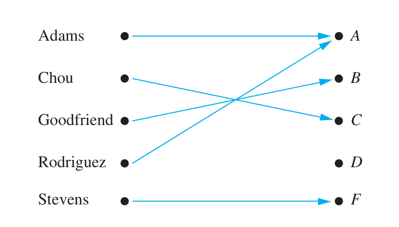
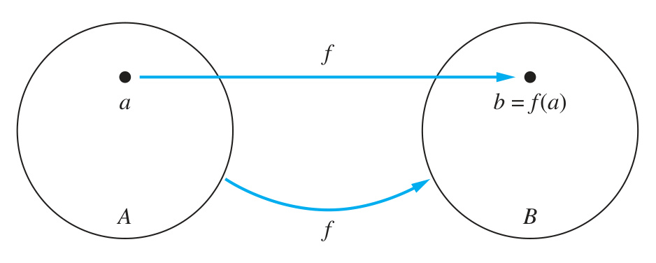
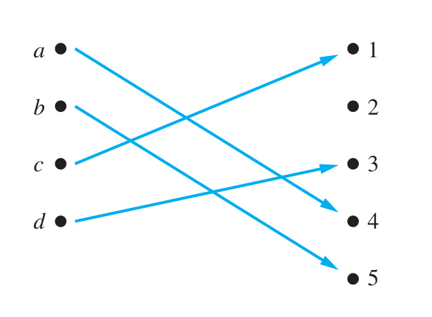
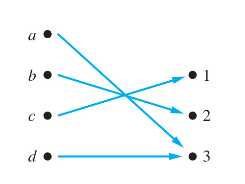
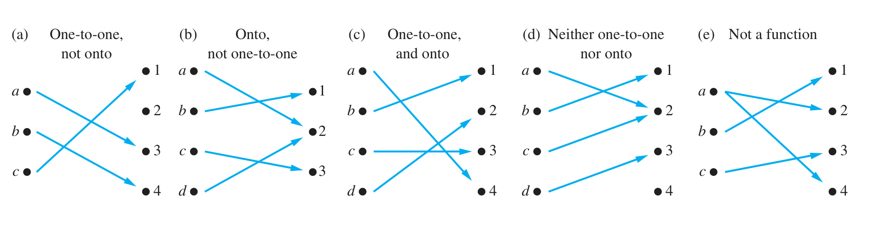
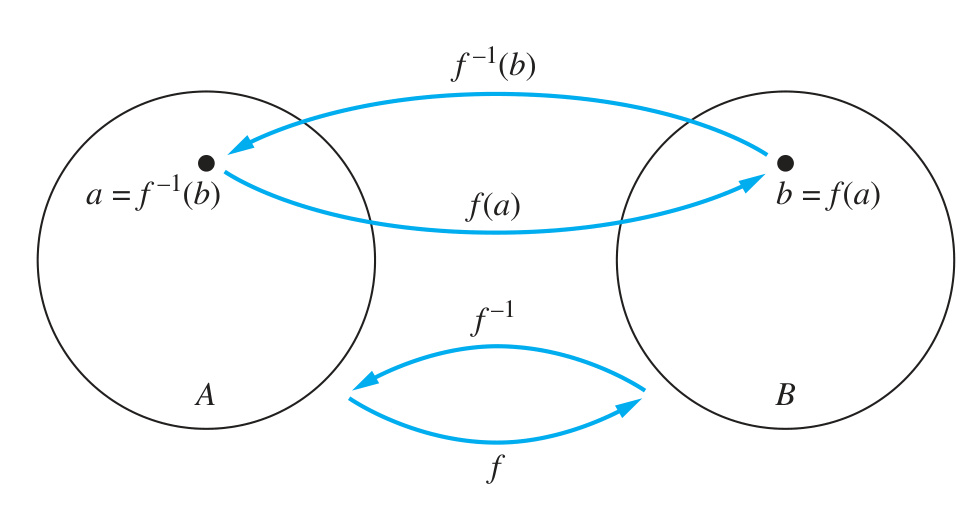
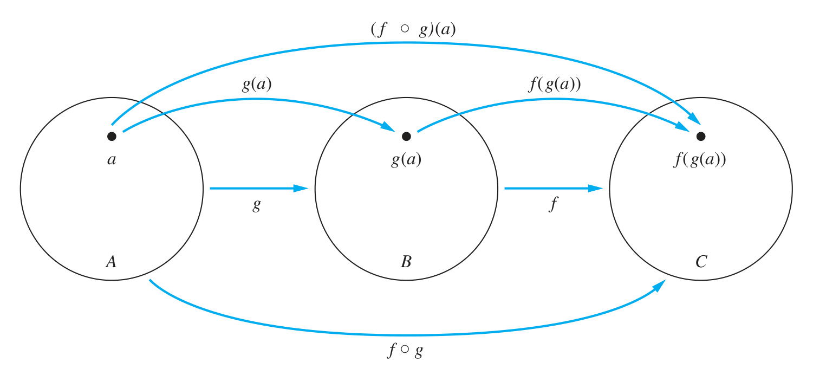
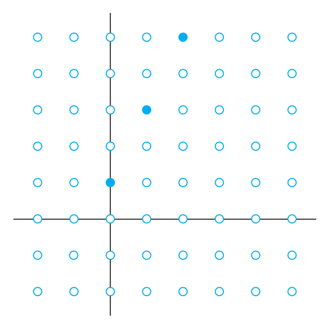
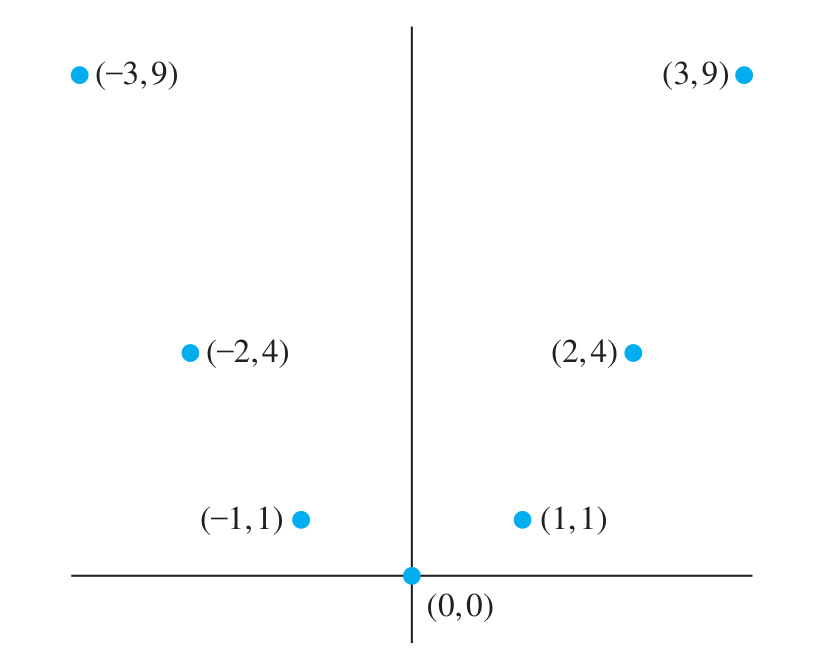
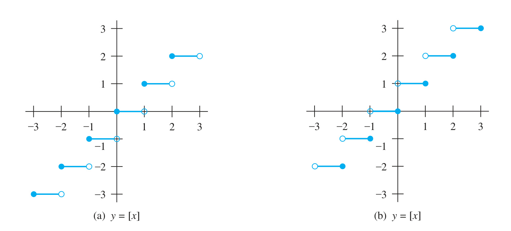

# 2.3 Functions

<!-- Page 24 -->

### Introduction

In many instances we assign to each element of a set a particular element of a second set (which may be the same as the first). For example, suppose that each student in a discrete mathematics class is assigned a letter grade from the set $\{A, B, C, D, F\}$. And suppose that the grades are $A$ for Adams, $C$ for Chou, $B$ for Goodfriend, $A$ for Rodriguez, and $F$ for Stevens. This assignment of grades is illustrated in Figure 1.

This assignment is an example of a function. The concept of a function is extremely important in mathematics and computer science. For example, in discrete mathematics functions are used in the definition of such discrete structures as sequences and strings. Functions are also used to represent how long it takes a computer to solve problems of a given size. Many computer programs and subroutines are designed to calculate values of functions. Recursive functions, which are functions defined in terms of themselves, are used throughout computer science; they will be studied in Chapter 5. This section reviews the basic concepts involving functions needed in discrete mathematics.

<!-- Page 25 -->

|  |
| :---: |
| *FIGURE 1 — Assignment of Grades in a Discrete Mathematics Class (Source: Page 139)* |

> [!NOTE] DEFINITION 1
> Let $A$ and $B$ be nonempty sets. A **function** $f$ from $A$ to $B$ is an assignment of exactly one element of $B$ to each element of $A$. We write $f(a) = b$ if $b$ is the unique element of $B$ assigned by the function $f$ to the element $a$ of $A$. If $f$ is a function from $A$ to $B$, we write $f : A \to B$.

> [!NOTE] Remark
> Functions are sometimes also called **mappings** or **transformations**.

Functions are specified in many different ways. Sometimes we explicitly state the assignments, as in Figure 1. Often we give a formula, such as $f(x) = x + 1$, to define a function. Other times we use a computer program to specify a function.

A function $f : A \to B$ can also be defined in terms of a relation from $A$ to $B$. Recall from Section 2.1 that a relation from $A$ to $B$ is just a subset of $A \times B$. A relation from $A$ to $B$ that contains one, and only one, ordered pair $(a, b)$ for every element $a \in A$, defines a function $f$ from $A$ to $B$. This function is defined by the assignment $f(a) = b$, where $(a, b)$ is the unique ordered pair in the relation that has $a$ as its first element.

> [!NOTE] DEFINITION 2
> If $f$ is a function from $A$ to $B$, we say that $A$ is the **domain** of $f$ and $B$ is the **codomain** of $f$. If $f(a) = b$, we say that $b$ is the **image** of $a$ and $a$ is a **preimage** of $b$. The **range**, or **image**, of $f$ is the set of all images of elements of $A$. Also, if $f$ is a function from $A$ to $B$, we say that $f$ **maps** $A$ to $B$.

Figure 2 represents a function $f$ from $A$ to $B$.

When we define a function we specify its domain, its codomain, and the mapping of elements of the domain to elements in the codomain. Two functions are equal when they have the same domain, have the same codomain, and map each element of their common domain to the same element in their common codomain. Note that if we change either the domain or the codomain of a function, then we obtain a different function. If we change the mapping of elements, then we also obtain a different function.

|  |
| :---: |
| *FIGURE 2 — The Function $f$ Maps $A$ to $B$ (Source: Page 139)* |

<!-- Page 26 -->

Examples 1–5 provide examples of functions. In each case, we describe the domain, the codomain, the range, and the assignment of values to elements of the domain.

#### EXAMPLE 1
What are the domain, codomain, and range of the function that assigns grades to students described in the first paragraph of the introduction of this section?

**Solution:** Let $G$ be the function that assigns a grade to a student in our discrete mathematics class. Note that $G(\text{Adams}) = A$, for instance. The domain of $G$ is the set $\{\text{Adams}, \text{Chou}, \text{Goodfriend}, \text{Rodriguez}, \text{Stevens}\}$, and the codomain is the set $\{A, B, C, D, F\}$. The range of $G$ is the set $\{A, B, C, F\}$, because each grade except $D$ is assigned to some student.
$\blacktriangleleft$

#### EXAMPLE 2
Let $R$ be the relation with ordered pairs $(\text{Abdul}, 22)$, $(\text{Brenda}, 24)$, $(\text{Carla}, 21)$, $(\text{Desire}, 22)$, $(\text{Eddie}, 24)$, and $(\text{Felicia}, 22)$. Here each pair consists of a graduate student and this student’s age. Specify a function determined by this relation.

**Solution:** If $f$ is a function specified by $R$, then $f(\text{Abdul}) = 22$, $f(\text{Brenda}) = 24$, $f(\text{Carla}) = 21$, $f(\text{Desire}) = 22$, $f(\text{Eddie}) = 24$, and $f(\text{Felicia}) = 22$. (Here, $f(x)$ is the age of $x$, where $x$ is a student.) For the domain, we take the set $\{\text{Abdul}, \text{Brenda}, \text{Carla}, \text{Desire}, \text{Eddie}, \text{Felicia}\}$. We also need to specify a codomain, which needs to contain all possible ages of students. Because it is highly likely that all students are less than 100 years old, we can take the set of positive integers less than 100 as the codomain. (Note that we could choose a different codomain, such as the set of all positive integers or the set of positive integers between 10 and 90, but that would change the function. Using this codomain will also allow us to extend the function by adding the names and ages of more students later.) The range of the function we have specified is the set of different ages of these students, which is the set $\{21, 22, 24\}$.
$\blacktriangleleft$

#### EXAMPLE 3
Let $f$ be the function that assigns the last two bits of a bit string of length 2 or greater to that string. For example, $f(11010) = 10$. Then, the domain of $f$ is the set of all bit strings of length 2 or greater, and both the codomain and range are the set $\{00, 01, 10, 11\}$.
$\blacktriangleleft$

#### EXAMPLE 4
Let $f : \mathbf{Z} \to \mathbf{Z}$ assign the square of an integer to this integer. Then, $f(x) = x^2$, where the domain of $f$ is the set of all integers, the codomain of $f$ is the set of all integers, and the range of $f$ is the set of all integers that are perfect squares, namely, $\{0, 1, 4, 9, \dots\}$.
$\blacktriangleleft$

#### EXAMPLE 5
The domain and codomain of functions are often specified in programming languages. For instance, the Java statement
```java
int floor(float real) { ... }
```
and the C++ function statement
```cpp
int function(float x) { ... }
```
both tell us that the domain of the `floor` function is the set of real numbers (represented by floating point numbers) and its codomain is the set of integers.
$\blacktriangleleft$

A function is called **real-valued** if its codomain is the set of real numbers, and it is called **integer-valued** if its codomain is the set of integers. Two real-valued functions or two integer-valued functions with the same domain can be added, as well as multiplied.

<!-- Page 27 -->

> [!NOTE] DEFINITION 3
> Let $f_1$ and $f_2$ be functions from $A$ to $\mathbf{R}$. Then $f_1 + f_2$ and $f_1 f_2$ are also functions from $A$ to $\mathbf{R}$ defined for all $x \in A$ by
> $$(f_1 + f_2)(x) = f_1(x) + f_2(x),$$
> $$(f_1 f_2)(x) = f_1(x) f_2(x).$$

Note that the functions $f_1 + f_2$ and $f_1 f_2$ have been defined by specifying their values at $x$ in terms of the values of $f_1$ and $f_2$ at $x$.

#### EXAMPLE 6
Let $f_1$ and $f_2$ be functions from $\mathbf{R}$ to $\mathbf{R}$ such that $f_1(x) = x^2$ and $f_2(x) = x - x^2$. What are the functions $f_1 + f_2$ and $f_1 f_2$?

**Solution:** From the definition of the sum and product of functions, it follows that
$$(f_1 + f_2)(x) = f_1(x) + f_2(x) = x^2 + (x - x^2) = x$$
and
$$(f_1 f_2)(x) = x^2(x - x^2) = x^3 - x^4.$$
$\blacktriangleleft$

When $f$ is a function from $A$ to $B$, the image of a subset of $A$ can also be defined.

> [!NOTE] DEFINITION 4
> Let $f$ be a function from $A$ to $B$ and let $S$ be a subset of $A$. The **image** of $S$ under the function $f$ is the subset of $B$ that consists of the images of the elements of $S$. We denote the image of $S$ by $f(S)$, so
> $$f(S) = \{t \mid \exists s \in S \, (t = f(s))\}.$$
> We also use the shorthand $\{f(s) \mid s \in S\}$ to denote this set.

> [!NOTE] Remark
> The notation $f(S)$ for the image of the set $S$ under the function $f$ is potentially ambiguous. Here, $f(S)$ denotes a set, and not the value of the function $f$ for the set $S$.

#### EXAMPLE 7
Let $A = \{a, b, c, d, e\}$ and $B = \{1, 2, 3, 4\}$ with $f(a) = 2$, $f(b) = 1$, $f(c) = 4$, $f(d) = 1$, and $f(e) = 1$. The image of the subset $S = \{b, c, d\}$ is the set $f(S) = \{1, 4\}$.
$\blacktriangleleft$

### One-to-One and Onto Functions

Some functions never assign the same value to two different domain elements. These functions are said to be one-to-one.

> [!NOTE] DEFINITION 5
> A function $f$ is said to be **one-to-one**, or an **injection**, if and only if $f(a) = f(b)$ implies that $a = b$ for all $a$ and $b$ in the domain of $f$. A function is said to be **injective** if it is one-to-one.

<!-- Page 28 -->

|  |
| :---: |
| *FIGURE 3 — A One-to-One Function (Source: Page 142)* |

Note that a function $f$ is one-to-one if and only if $f(a) \neq f(b)$ whenever $a \neq b$. This way of expressing that $f$ is one-to-one is obtained by taking the contrapositive of the implication in the definition.

> [!NOTE] Remark
> We can express that $f$ is one-to-one using quantifiers as $\forall a \forall b (f(a) = f(b) \to a = b)$ or equivalently $\forall a \forall b (a \neq b \to f(a) \neq f(b))$, where the universe of discourse is the domain of the function.

We illustrate this concept by giving examples of functions that are one-to-one and other functions that are not one-to-one.

#### EXAMPLE 8
Determine whether the function $f$ from $\{a, b, c, d\}$ to $\{1, 2, 3, 4, 5\}$ with $f(a) = 4$, $f(b) = 5$, $f(c) = 1$, and $f(d) = 3$ is one-to-one.

**Solution:** The function $f$ is one-to-one because $f$ takes on different values at the four elements of its domain. This is illustrated in Figure 3.
$\blacktriangleleft$

#### EXAMPLE 9
Determine whether the function $f(x) = x^2$ from the set of integers to the set of integers is one-to-one.

**Solution:** The function $f(x) = x^2$ is not one-to-one because, for instance, $f(1) = f(-1) = 1$, but $1 \neq -1$.

Note that the function $f(x) = x^2$ with its domain restricted to $\mathbf{Z}^+$ is one-to-one. (Technically, when we restrict the domain of a function, we obtain a new function whose values agree with those of the original function for the elements of the restricted domain. The restricted function is not defined for elements of the original domain outside of the restricted domain.)
$\blacktriangleleft$

#### EXAMPLE 10
Determine whether the function $f(x) = x + 1$ from the set of real numbers to itself is one-to-one.

**Solution:** The function $f(x) = x + 1$ is a one-to-one function. To demonstrate this, note that $x + 1 \neq y + 1$ when $x \neq y$.
$\blacktriangleleft$

#### EXAMPLE 11
Suppose that each worker in a group of employees is assigned a job from a set of possible jobs, each to be done by a single worker. In this situation, the function $f$ that assigns a job to each worker is one-to-one. To see this, note that if $x$ and $y$ are two different workers, then $f(x) \neq f(y)$ because the two workers $x$ and $y$ must be assigned different jobs.
$\blacktriangleleft$

We now give some conditions that guarantee that a function is one-to-one.

<!-- Page 29 -->

|  |
| :---: |
| *FIGURE 4 — An Onto Function (Source: Page 143)* |

> [!NOTE] DEFINITION 6
> A function $f$ whose domain and codomain are subsets of the set of real numbers is called **increasing** if $f(x) \le f(y)$, and **strictly increasing** if $f(x) < f(y)$, whenever $x < y$ and $x$ and $y$ are in the domain of $f$. Similarly, $f$ is called **decreasing** if $f(x) \ge f(y)$, and **strictly decreasing** if $f(x) > f(y)$, whenever $x < y$ and $x$ and $y$ are in the domain of $f$. (The word *strictly* in this definition indicates a strict inequality.)

> [!NOTE] Remark
> A function $f$ is increasing if $\forall x \forall y (x < y \to f(x) \le f(y))$, strictly increasing if $\forall x \forall y (x < y \to f(x) < f(y))$, decreasing if $\forall x \forall y (x < y \to f(x) \ge f(y))$, and strictly decreasing if $\forall x \forall y (x < y \to f(x) > f(y))$, where the universe of discourse is the domain of $f$.

From these definitions, it can be shown (see Exercises 26 and 27) that a function that is either strictly increasing or strictly decreasing must be one-to-one. However, a function that is increasing, but not strictly increasing, or decreasing, but not strictly decreasing, is not one-to-one.

For some functions the range and the codomain are equal. That is, every member of the codomain is the image of some element of the domain. Functions with this property are called onto functions.

> [!NOTE] DEFINITION 7
> A function $f$ from $A$ to $B$ is called **onto**, or a **surjection**, if and only if for every element $b \in B$ there is an element $a \in A$ with $f(a) = b$. A function $f$ is called **surjective** if it is onto.

> [!NOTE] Remark
> A function $f$ is onto if $\forall y \exists x (f(x) = y)$, where the domain for $x$ is the domain of the function and the domain for $y$ is the codomain of the function.

We now give examples of onto functions and functions that are not onto.

#### EXAMPLE 12
Let $f$ be the function from $\{a, b, c, d\}$ to $\{1, 2, 3\}$ defined by $f(a) = 3$, $f(b) = 2$, $f(c) = 1$, and $f(d) = 3$. Is $f$ an onto function?

**Solution:** Because all three elements of the codomain are images of elements in the domain, we see that $f$ is onto. This is illustrated in Figure 4. Note that if the codomain were $\{1, 2, 3, 4\}$, then $f$ would not be onto.
$\blacktriangleleft$

#### EXAMPLE 13
Is the function $f(x) = x^2$ from the set of integers to the set of integers onto?

**Solution:** The function $f$ is not onto because there is no integer $x$ with $x^2 = -1$, for instance.
$\blacktriangleleft$

#### EXAMPLE 14
Is the function $f(x) = x + 1$ from the set of integers to the set of integers onto?

<!-- Page 30 -->

**Solution:** This function is onto, because for every integer $y$ there is an integer $x$ such that $f(x) = y$. To see this, note that $f(x) = y$ if and only if $x + 1 = y$, which holds if and only if $x = y - 1$.
$\blacktriangleleft$

#### EXAMPLE 15
Consider the function $f$ in Example 11 that assigns jobs to workers. The function $f$ is onto if for every job there is a worker assigned this job. The function $f$ is not onto when there is at least one job that has no worker assigned it.
$\blacktriangleleft$

|  |
| :---: |
| *FIGURE 5 — Examples of Different Types of Correspondences: (a) One-to-one, not onto; (b) Onto, not one-to-one; (c) One-to-one, and onto; (d) Neither one-to-one nor onto; (e) Not a function (Source: Page 144)* |

> [!NOTE] DEFINITION 8
> The function $f$ is a **one-to-one correspondence**, or a **bijection**, if it is both one-to-one and onto. We also say that such a function is **bijective**.

Examples 16 and 17 illustrate the concept of a bijection.

#### EXAMPLE 16
Let $f$ be the function from $\{a, b, c, d\}$ to $\{1, 2, 3, 4\}$ with $f(a) = 4$, $f(b) = 2$, $f(c) = 1$, and $f(d) = 3$. Is $f$ a bijection?

**Solution:** The function $f$ is one-to-one and onto. It is one-to-one because no two values in the domain are assigned the same function value. It is onto because all four elements of the codomain are images of elements in the domain. Hence, $f$ is a bijection.
$\blacktriangleleft$

Figure 5 displays four functions where the first is one-to-one but not onto, the second is onto but not one-to-one, the third is both one-to-one and onto, and the fourth is neither one-to-one nor onto. The fifth correspondence in Figure 5 is not a function, because it sends an element to two different elements.

Suppose that $f$ is a function from a set $A$ to itself. If $A$ is finite, then $f$ is one-to-one if and only if it is onto. (This follows from the result in Exercise 72.) This is not necessarily the case if $A$ is infinite (as will be shown in Section 2.5).

#### EXAMPLE 17
Let $A$ be a set. The **identity function** on $A$ is the function $\iota_A : A \to A$, where
$$\iota_A(x) = x$$
for all $x \in A$. In other words, the identity function $\iota_A$ is the function that assigns each element to itself. The function $\iota_A$ is one-to-one and onto, so it is a bijection. (Note that $\iota$ is the Greek letter iota.)
$\blacktriangleleft$

For future reference, we summarize what needs be to shown to establish whether a function is one-to-one and whether it is onto. It is instructive to review Examples 8–17 in light of this summary.

<!-- Page 31 -->

> [!NOTE] Summary: Establishing Injectivity and Surjectivity
> Suppose that $f : A \to B$.
> 
> - **To show that $f$ is injective:** Show that if $f(x) = f(y)$ for arbitrary $x, y \in A$ with $x \neq y$, then $x = y$.
> - **To show that $f$ is not injective:** Find particular elements $x, y \in A$ such that $x \neq y$ and $f(x) = f(y)$.
> - **To show that $f$ is surjective:** Consider an arbitrary element $y \in B$ and find an element $x \in A$ such that $f(x) = y$.
> - **To show that $f$ is not surjective:** Find a particular $y \in B$ such that $f(x) \neq y$ for all $x \in A$.

### Inverse Functions and Compositions of Functions

Now consider a one-to-one correspondence $f$ from the set $A$ to the set $B$. Because $f$ is an onto function, every element of $B$ is the image of some element in $A$. Furthermore, because $f$ is also a one-to-one function, every element of $B$ is the image of a unique element of $A$. Consequently, we can define a new function from $B$ to $A$ that reverses the correspondence given by $f$. This leads to Definition 9.

> [!NOTE] DEFINITION 9
> Let $f$ be a one-to-one correspondence from the set $A$ to the set $B$. The **inverse function** of $f$ is the function that assigns to an element $b$ belonging to $B$ the unique element $a$ in $A$ such that $f(a) = b$. The inverse function of $f$ is denoted by $f^{-1}$. Hence, $f^{-1}(b) = a$ when $f(a) = b$.

> [!NOTE] Remark
> Be sure not to confuse the function $f^{-1}$ with the function $1/f$, which is the function that assigns to each $x$ in the domain the value $1/f(x)$. Notice that the latter makes sense only when $f(x)$ is a non-zero real number.

Figure 6 illustrates the concept of an inverse function.

If a function $f$ is not a one-to-one correspondence, we cannot define an inverse function of $f$. When $f$ is not a one-to-one correspondence, either it is not one-to-one or it is not onto. If $f$ is not one-to-one, some element $b$ in the codomain is the image of more than one element in the domain. If $f$ is not onto, for some element $b$ in the codomain, no element $a$ in the domain exists for which $f(a) = b$. Consequently, if $f$ is not a one-to-one correspondence, we cannot assign to each element $b$ in the codomain a unique element $a$ in the domain such that $f(a) = b$ (because for some $b$ there is either more than one such $a$ or no such $a$).

A one-to-one correspondence is called **invertible** because we can define an inverse of this function. A function is not invertible if it is not a one-to-one correspondence, because the inverse of such a function does not exist.

|  |
| :---: |
| *FIGURE 6 — The Function $f^{-1}$ Is the Inverse of Function $f$ (Source: Page 145)* |

<!-- Page 32 -->

#### EXAMPLE 18
Let $f$ be the function from $\{a, b, c\}$ to $\{1, 2, 3\}$ such that $f(a) = 2$, $f(b) = 3$, and $f(c) = 1$. Is $f$ invertible, and if it is, what is its inverse?

**Solution:** The function $f$ is invertible because it is a one-to-one correspondence. The inverse function $f^{-1}$ reverses the correspondence given by $f$, so $f^{-1}(1) = c$, $f^{-1}(2) = a$, and $f^{-1}(3) = b$.
$\blacktriangleleft$

#### EXAMPLE 19
Let $f : \mathbf{Z} \to \mathbf{Z}$ be such that $f(x) = x + 1$. Is $f$ invertible, and if it is, what is its inverse?

**Solution:** The function $f$ has an inverse because it is a one-to-one correspondence, as follows from Examples 10 and 14. To reverse the correspondence, suppose that $y$ is the image of $x$, so that $y = x + 1$. Then $x = y - 1$. This means that $y - 1$ is the unique element of $\mathbf{Z}$ that is sent to $y$ by $f$. Consequently, $f^{-1}(y) = y - 1$.
$\blacktriangleleft$

#### EXAMPLE 20
Let $f$ be the function from $\mathbf{R}$ to $\mathbf{R}$ with $f(x) = x^2$. Is $f$ invertible?

**Solution:** Because $f(-2) = f(2) = 4$, $f$ is not one-to-one. If an inverse function were defined, it would have to assign two elements to 4. Hence, $f$ is not invertible. (Note we can also show that $f$ is not invertible because it is not onto.)
$\blacktriangleleft$

Sometimes we can restrict the domain or the codomain of a function, or both, to obtain an invertible function, as Example 21 illustrates.

#### EXAMPLE 21
Show that if we restrict the function $f(x) = x^2$ in Example 20 to a function from the set of all nonnegative real numbers to the set of all nonnegative real numbers, then $f$ is invertible.

**Solution:** The function $f(x) = x^2$ from the set of nonnegative real numbers to the set of nonnegative real numbers is one-to-one. To see this, note that if $f(x) = f(y)$, then $x^2 = y^2$, so $x^2 - y^2 = (x + y)(x - y) = 0$. This means that $x + y = 0$ or $x - y = 0$, so $x = -y$ or $x = y$. Because both $x$ and $y$ are nonnegative, we must have $x = y$. So, this function is one-to-one. Furthermore, $f(x) = x^2$ is onto when the codomain is the set of all nonnegative real numbers, because each nonnegative real number has a square root. That is, if $y$ is a nonnegative real number, there exists a nonnegative real number $x$ such that $x = \sqrt{y}$, which means that $x^2 = y$. Because the function $f(x) = x^2$ from the set of nonnegative real numbers to the set of nonnegative real numbers is one-to-one and onto, it is invertible. Its inverse is given by the rule $f^{-1}(y) = \sqrt{y}$.
$\blacktriangleleft$

> [!NOTE] DEFINITION 10
> Let $g$ be a function from the set $A$ to the set $B$ and let $f$ be a function from the set $B$ to the set $C$. The **composition** of the functions $f$ and $g$, denoted for all $a \in A$ by $f \circ g$, is defined by
> $$(f \circ g)(a) = f(g(a)).$$

In other words, $f \circ g$ is the function that assigns to the element $a$ of $A$ the element assigned by $f$ to $g(a)$. That is, to find $(f \circ g)(a)$ we first apply the function $g$ to $a$ to obtain $g(a)$ and then we apply the function $f$ to the result $g(a)$ to obtain $(f \circ g)(a) = f(g(a))$. Note that the composition $f \circ g$ cannot be defined unless the range of $g$ is a subset of the domain of $f$. In Figure 7 the composition of functions is shown.

<!-- Page 33 -->

|  |
| :---: |
| *FIGURE 7 — The Composition of the Functions $f$ and $g$ (Source: Page 147)* |

#### EXAMPLE 22
Let $g$ be the function from the set $\{a, b, c\}$ to itself such that $g(a) = b$, $g(b) = c$, and $g(c) = a$. Let $f$ be the function from the set $\{a, b, c\}$ to the set $\{1, 2, 3\}$ such that $f(a) = 3$, $f(b) = 2$, and $f(c) = 1$. What is the composition of $f$ and $g$, and what is the composition of $g$ and $f$?

**Solution:** The composition $f \circ g$ is defined by
$$(f \circ g)(a) = f(g(a)) = f(b) = 2,$$
$$(f \circ g)(b) = f(g(b)) = f(c) = 1, \quad \text{and} \quad (f \circ g)(c) = f(g(c)) = f(a) = 3.$$
Note that $g \circ f$ is not defined, because the range of $f$ is not a subset of the domain of $g$.
$\blacktriangleleft$

#### EXAMPLE 23
Let $f$ and $g$ be the functions from the set of integers to the set of integers defined by $f(x) = 2x + 3$ and $g(x) = 3x + 2$. What is the composition of $f$ and $g$? What is the composition of $g$ and $f$?

**Solution:** Both the compositions $f \circ g$ and $g \circ f$ are defined. Moreover,
$$(f \circ g)(x) = f(g(x)) = f(3x + 2) = 2(3x + 2) + 3 = 6x + 7$$
and
$$(g \circ f)(x) = g(f(x)) = g(2x + 3) = 3(2x + 3) + 2 = 6x + 11.$$
$\blacktriangleleft$

> [!NOTE] Remark
> Note that even though $f \circ g$ and $g \circ f$ are defined for the functions $f$ and $g$ in Example 23, $f \circ g$ and $g \circ f$ are not equal. In other words, the **commutative law does not hold** for the composition of functions.

When the composition of a function and its inverse is formed, in either order, an identity function is obtained. To see this, suppose that $f$ is a one-to-one correspondence from the set $A$ to the set $B$. Then the inverse function $f^{-1}$ exists and is a one-to-one correspondence from $B$ to $A$. The inverse function reverses the correspondence of the original function, so $f^{-1}(b) = a$ when $f(a) = b$, and $f(a) = b$ when $f^{-1}(b) = a$. Hence,
$$(f^{-1} \circ f)(a) = f^{-1}(f(a)) = f^{-1}(b) = a,$$
and
$$(f \circ f^{-1})(b) = f(f^{-1}(b)) = f(a) = b.$$
Consequently $f^{-1} \circ f = \iota_A$ and $f \circ f^{-1} = \iota_B$, where $\iota_A$ and $\iota_B$ are the identity functions on the sets $A$ and $B$, respectively. That is, $(f^{-1})^{-1} = f$.

<!-- Page 34 -->

### The Graphs of Functions

We can associate a set of pairs in $A \times B$ to each function from $A$ to $B$. This set of pairs is called the **graph** of the function and is often displayed pictorially to aid in understanding the behavior of the function.

> [!NOTE] DEFINITION 11
> Let $f$ be a function from the set $A$ to the set $B$. The **graph** of the function $f$ is the set of ordered pairs $\{(a, b) \mid a \in A \text{ and } f(a) = b\}$.

From the definition, the graph of a function $f$ from $A$ to $B$ is the subset of $A \times B$ containing the ordered pairs with the second entry equal to the element of $B$ assigned by $f$ to the first entry. Also, note that the graph of a function $f$ from $A$ to $B$ is the same as the relation from $A$ to $B$ determined by the function $f$, as described on page 139.

#### EXAMPLE 24
Display the graph of the function $f(n) = 2n + 1$ from the set of integers to the set of integers.

**Solution:** The graph of $f$ is the set of ordered pairs of the form $(n, 2n + 1)$, where $n$ is an integer. This graph is displayed in Figure 8.
$\blacktriangleleft$

#### EXAMPLE 25
Display the graph of the function $f(x) = x^2$ from the set of integers to the set of integers.

**Solution:** The graph of $f$ is the set of ordered pairs of the form $(x, f(x)) = (x, x^2)$, where $x$ is an integer. This graph is displayed in Figure 9.
$\blacktriangleleft$

|  |  |
| :---: | :---: |
| *FIGURE 8 — The Graph of $f(n) = 2n + 1$ from $\mathbf{Z}$ to $\mathbf{Z}$ (Source: Page 148)* | *FIGURE 9 — The Graph of $f(x) = x^2$ from $\mathbf{Z}$ to $\mathbf{Z}$ (Source: Page 148)* |

### Some Important Functions

Next, we introduce two important functions in discrete mathematics, namely, the floor and ceiling functions. Let $x$ be a real number. The floor function rounds $x$ down to the closest integer less than or equal to $x$, and the ceiling function rounds $x$ up to the closest integer greater than or equal to $x$. These functions are often used when objects are counted. They play an important role in the analysis of the number of steps used by procedures to solve problems of a particular size.

<!-- Page 35 -->

> [!NOTE] DEFINITION 12
> The **floor function** assigns to the real number $x$ the largest integer that is less than or equal to $x$. The value of the floor function at $x$ is denoted by $\lfloor x \rfloor$. The **ceiling function** assigns to the real number $x$ the smallest integer that is greater than or equal to $x$. The value of the ceiling function at $x$ is denoted by $\lceil x \rceil$.

> [!NOTE] Remark
> The floor function is often also called the **greatest integer function**. It is often denoted by $[x]$.

#### EXAMPLE 26
These are some values of the floor and ceiling functions:
$$\lfloor \tfrac{1}{2} \rfloor = 0, \quad \lceil \tfrac{1}{2} \rceil = 1, \quad \lfloor -\tfrac{1}{2} \rfloor = -1, \quad \lceil -\tfrac{1}{2} \rceil = 0,$$
$$\lfloor 3.1 \rfloor = 3, \quad \lceil 3.1 \rceil = 4, \quad \lfloor 7 \rfloor = 7, \quad \lceil 7 \rceil = 7.$$
$\blacktriangleleft$

We display the graphs of the floor and ceiling functions in Figure 10. In Figure 10(a) we display the graph of the floor function $\lfloor x \rfloor$. Note that this function has the same value throughout the interval $[n, n + 1)$, namely $n$, and then it jumps up to $n + 1$ when $x = n + 1$. In Figure 10(b) we display the graph of the ceiling function $\lceil x \rceil$. Note that this function has the same value throughout the interval $(n, n + 1]$, namely $n + 1$, and then jumps to $n + 2$ when $x$ is a little larger than $n + 1$.

|  |
| :---: |
| *FIGURE 10 — Graphs of the (a) Floor and (b) Ceiling Functions (Source: Page 149)* |

The floor and ceiling functions are useful in a wide variety of applications, including those involving data storage and data transmission. Consider Examples 27 and 28, typical of basic calculations done when database and data communications problems are studied.

#### EXAMPLE 27
Data stored on a computer disk or transmitted over a data network are usually represented as a string of bytes. Each byte is made up of 8 bits. How many bytes are required to encode 100 bits of data?

**Solution:** To determine the number of bytes needed, we determine the smallest integer that is at least as large as the quotient when 100 is divided by 8, the number of bits in a byte. Consequently, $\lceil 100/8 \rceil = \lceil 12.5 \rceil = 13$ bytes are required.
$\blacktriangleleft$

#### EXAMPLE 28
In asynchronous transfer mode (ATM) (a communications protocol used on backbone networks), data are organized into cells of 53 bytes. How many ATM cells can be transmitted in 1 minute over a connection that transmits data at the rate of 500 kilobits per second?

**Solution:** In 1 minute, this connection can transmit $500,000 \cdot 60 = 30,000,000$ bits. Each ATM cell is 53 bytes long, which means that it is $53 \cdot 8 = 424$ bits long. To determine the number of cells that can be transmitted in 1 minute, we determine the largest integer not exceeding the quotient when 30,000,000 is divided by 424. Consequently,
$$\lfloor 30,000,000 / 424 \rfloor = 70,754 \text{ ATM cells}$$
can be transmitted in 1 minute over a 500 kilobit per second connection.
$\blacktriangleleft$

<!-- Page 36 -->

### Useful Properties of the Floor and Ceiling Functions

Table 1, with $x$ denoting a real number, displays some simple but important properties of the floor and ceiling functions. Because these functions appear so frequently in discrete mathematics, it is useful to look over these identities.

| Property | Description / Identity |
| :--- | :--- |
| **(1a)** | $\lfloor x \rfloor = n$ if and only if $n \le x < n + 1$ |
| **(1b)** | $\lceil x \rceil = n$ if and only if $n - 1 < x \le n$ |
| **(1c)** | $\lfloor x \rfloor = n$ if and only if $x - 1 < n \le x$ |
| **(1d)** | $\lceil x \rceil = n$ if and only if $x \le n < x + 1$ |
| **(2)** | $x - 1 < \lfloor x \rfloor \le x \le \lceil x \rceil < x + 1$ |
| **(3a)** | $\lfloor -x \rfloor = -\lceil x \rceil$ |
| **(3b)** | $\lceil -x \rceil = -\lfloor x \rfloor$ |
| **(4a)** | $\lfloor x + n \rfloor = \lfloor x \rfloor + n$ |
| **(4b)** | $\lceil x + n \rceil = \lceil x \rceil + n$ |

*(where $n$ is an integer, $x$ is a real number)*

Each property in this table can be established using the definitions of the floor and ceiling functions. Properties (1a), (1b), (1c), and (1d) follow directly from these definitions. For example, (1a) states that $\lfloor x \rfloor = n$ if and only if the integer $n$ is less than or equal to $x$ and $n + 1$ is larger than $x$. This is precisely what it means for $n$ to be the greatest integer not exceeding $x$, which is the definition of $\lfloor x \rfloor = n$. Properties (1b), (1c), and (1d) can be established similarly. We will prove property (4a) using a direct proof.

> [!NOTE] Proof of Property (4a)
> Suppose that $\lfloor x \rfloor = m$, where $m$ is a positive integer. By property (1a), it follows that $m \le x < m + 1$. Adding $n$ to all three quantities in this chain of two inequalities shows that $m + n \le x + n < m + n + 1$. Using property (1a) again, we see that $\lfloor x + n \rfloor = m + n = \lfloor x \rfloor + n$. This completes the proof. Proofs of the other properties are left as exercises.

The floor and ceiling functions enjoy many other useful properties besides those displayed in Table 1. There are also many statements about these functions that may appear to be correct, but actually are not. We will consider statements about the floor and ceiling functions in Examples 29 and 30.

A useful approach for considering statements about the floor function is to let $x = n + \epsilon$, where $n = \lfloor x \rfloor$ is an integer, and $\epsilon$, the fractional part of $x$, satisfies the inequality $0 \le \epsilon < 1$. Similarly, when considering statements about the ceiling function, it is useful to write $x = n - \epsilon$, where $n = \lceil x \rceil$ is an integer and $0 \le \epsilon < 1$.

#### EXAMPLE 29
Prove that if $x$ is a real number, then $\lfloor 2x \rfloor = \lfloor x \rfloor + \lfloor x + \frac{1}{2} \rfloor$.

**Solution:** To prove this statement we let $x = n + \epsilon$, where $n$ is an integer and $0 \le \epsilon < 1$. There are two cases to consider, depending on whether $\epsilon$ is less than, or greater than or equal to $\frac{1}{2}$. (The reason we choose these two cases will be made clear in the proof.)

<!-- Page 37 -->

We first consider the case when $0 \le \epsilon < \frac{1}{2}$. In this case, $2x = 2n + 2\epsilon$ and $\lfloor 2x \rfloor = 2n$ because $0 \le 2\epsilon < 1$. Similarly, $x + \frac{1}{2} = n + (\frac{1}{2} + \epsilon)$, so $\lfloor x + \frac{1}{2} \rfloor = n$, because $0 < \frac{1}{2} + \epsilon < 1$. Consequently, $\lfloor 2x \rfloor = 2n$ and $\lfloor x \rfloor + \lfloor x + \frac{1}{2} \rfloor = n + n = 2n$.

Next, we consider the case when $\frac{1}{2} \le \epsilon < 1$. In this case, $2x = 2n + 2\epsilon = (2n + 1) + (2\epsilon - 1)$. Because $0 \le 2\epsilon - 1 < 1$, it follows that $\lfloor 2x \rfloor = 2n + 1$. Because $\lfloor x + \frac{1}{2} \rfloor = \lfloor n + (\frac{1}{2} + \epsilon) \rfloor = \lfloor n + 1 + (\epsilon - \frac{1}{2}) \rfloor$ and $0 \le \epsilon - \frac{1}{2} < 1$, it follows that $\lfloor x + \frac{1}{2} \rfloor = n + 1$. Consequently, $\lfloor 2x \rfloor = 2n + 1$ and $\lfloor x \rfloor + \lfloor x + \frac{1}{2} \rfloor = n + (n + 1) = 2n + 1$. This concludes the proof.
$\blacktriangleleft$

#### EXAMPLE 30
Prove or disprove that $\lceil x + y \rceil = \lceil x \rceil + \lceil y \rceil$ for all real numbers $x$ and $y$.

**Solution:** Although this statement may appear reasonable, it is false. A counterexample is supplied by $x = \frac{1}{2}$ and $y = \frac{1}{2}$. With these values we find that $\lceil x + y \rceil = \lceil \frac{1}{2} + \frac{1}{2} \rceil = \lceil 1 \rceil = 1$, but $\lceil x \rceil + \lceil y \rceil = \lceil \frac{1}{2} \rceil + \lceil \frac{1}{2} \rceil = 1 + 1 = 2$.
$\blacktriangleleft$

There are certain types of functions that will be used throughout the text. These include polynomial, logarithmic, and exponential functions. A brief review of the properties of these functions needed in this text is given in Appendix 2. In this book the notation $\log x$ will be used to denote the logarithm to the base 2 of $x$, because 2 is the base that we will usually use for logarithms. We will denote logarithms to the base $b$, where $b$ is any real number greater than 1, by $\log_b x$, and the natural logarithm by $\ln x$.

Another function we will use throughout this text is the **factorial function** $f : \mathbf{N} \to \mathbf{Z}^+$, denoted by $f(n) = n!$. The value of $f(n) = n!$ is the product of the first $n$ positive integers, so
$$f(n) = 1 \cdot 2 \cdots (n - 1) \cdot n \quad [\text{and } f(0) = 0! = 1].$$

#### EXAMPLE 31
We have
$$f(1) = 1! = 1,$$
$$f(2) = 2! = 1 \cdot 2 = 2,$$
$$f(6) = 6! = 1 \cdot 2 \cdot 3 \cdot 4 \cdot 5 \cdot 6 = 720,$$
and
$$f(20) = 1 \cdot 2 \cdot 3 \cdot 4 \cdot 5 \cdot 6 \cdot 7 \cdot 8 \cdot 9 \cdot 10 \cdot 11 \cdot 12 \cdot 13 \cdot 14 \cdot 15 \cdot 16 \cdot 17 \cdot 18 \cdot 19 \cdot 20 = 2,432,902,008,176,640,000.$$
$\blacktriangleleft$

Example 31 illustrates that the factorial function grows extremely rapidly as $n$ grows. The rapid growth of the factorial function is made clearer by **Stirling’s formula**, a result from higher mathematics that tell us that
$$n! \sim \sqrt{2\pi n} \left(\frac{n}{e}\right)^n.$$
Here, we have used the notation $f(n) \sim g(n)$, which means that the ratio $f(n)/g(n)$ approaches 1 as $n$ grows without bound (that is, $\lim_{n \to \infty} f(n)/g(n) = 1$). The symbol $\sim$ is read “is asymptotic to.” Stirling’s formula is named after James Stirling, a Scottish mathematician of the eighteenth century.


<!-- Page 38 -->

### Partial Functions

A program designed to evaluate a function may not produce the correct value of the function for all elements in the domain of this function. For example, a program may not produce a correct value because evaluating the function may lead to an infinite loop or an overflow. Similarly, in abstract mathematics, we often want to discuss functions that are defined only for a subset of the real numbers, such as $1/x$, $\sqrt{x}$, and $\arcsin(x)$. Also, we may want to use such notions as the “youngest child” function, which is undefined for a couple having no children, or the “time of sunrise,” which is undefined for some days above the Arctic Circle. To study such situations, we use the concept of a partial function.

> [!NOTE] DEFINITION 13
> A **partial function** $f$ from a set $A$ to a set $B$ is an assignment to each element $a$ in a subset of $A$, called the **domain of definition** of $f$, of a unique element $b$ in $B$. The sets $A$ and $B$ are called the **domain** and **codomain** of $f$, respectively. We say that $f$ is **undefined** for elements in $A$ that are not in the domain of definition of $f$. When the domain of definition of $f$ equals $A$, we say that $f$ is a **total function**.

> [!NOTE] Remark
> We write $f : A \to B$ to denote that $f$ is a partial function from $A$ to $B$. Note that this is the same notation as is used for functions. The context in which the notation is used determines whether $f$ is a partial function or a total function.

#### EXAMPLE 32
The function $f : \mathbf{Z} \to \mathbf{R}$ where $f(n) = \sqrt{n}$ is a partial function from $\mathbf{Z}$ to $\mathbf{R}$ where the domain of definition is the set of nonnegative integers. Note that $f$ is undefined for negative integers.
$\blacktriangleleft$
