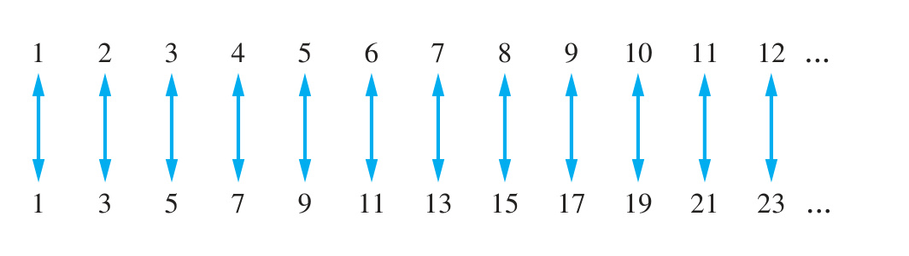
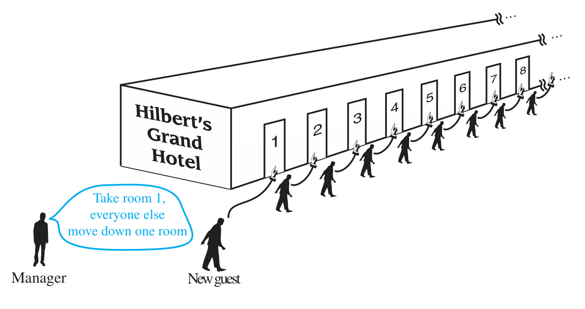
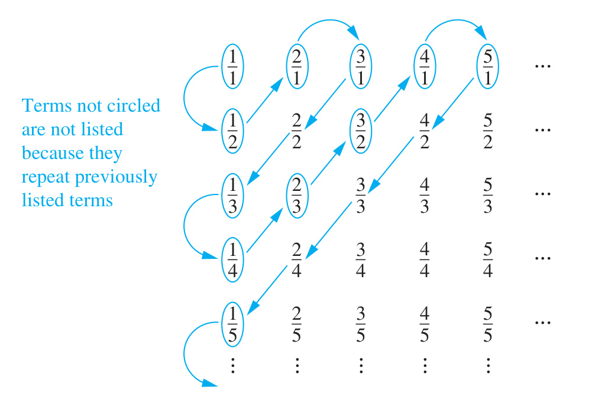

# 2.5 Cardinality of Sets

<!-- Page 56 -->

### Introduction

In Definition 4 of Section 2.1 we defined the cardinality of a finite set as the number of elements in the set. We use the cardinalities of finite sets to tell us when they have the same size, or when one is bigger than the other. In this section we extend this notion to infinite sets. That is, we will define what it means for two infinite sets to have the same cardinality, providing us with a way to measure the relative sizes of infinite sets.

We will be particularly interested in countably infinite sets, which are sets with the same cardinality as the set of positive integers. We will establish the surprising result that the set of rational numbers is countably infinite. We will also provide an example of an uncountable set when we show that the set of real numbers is not countable.

The concepts developed in this section have important applications to computer science. A function is called uncomputable if no computer program can be written to find all its values, even with unlimited time and memory. We will use the concepts in this section to explain why uncomputable functions exist.

We now define what it means for two sets to have the same size, or cardinality. In Section 2.1, we discussed the cardinality of finite sets and we defined the size, or cardinality, of such sets. In Exercise 79 of Section 2.3 we showed that there is a one-to-one correspondence between any two finite sets with the same number of elements. We use this observation to extend the concept of cardinality to all sets, both finite and infinite.

> [!NOTE] DEFINITION 1
> The sets $A$ and $B$ have the **same cardinality** if and only if there is a one-to-one correspondence from $A$ to $B$. When $A$ and $B$ have the same cardinality, we write $|A| = |B|$.

For infinite sets the definition of cardinality provides a relative measure of the sizes of two sets, rather than a measure of the size of one particular set. We can also define what it means for one set to have a smaller cardinality than another set.

> [!NOTE] DEFINITION 2
> If there is a one-to-one function from $A$ to $B$, the cardinality of $A$ is less than or the same as the cardinality of $B$ and we write $|A| \le |B|$. Moreover, when $|A| \le |B|$ and $A$ and $B$ have different cardinality, we say that the cardinality of $A$ is less than the cardinality of $B$ and we write $|A| < |B|$.

### Countable Sets

We will now split infinite sets into two groups, those with the same cardinality as the set of natural numbers and those with a different cardinality.

<!-- Page 57 -->

> [!NOTE] DEFINITION 3
> A set that is either finite or has the same cardinality as the set of positive integers is called **countable**. A set that is not countable is called **uncountable**. When an infinite set $S$ is countable, we denote the cardinality of $S$ by $\aleph_0$ (where $\aleph$ is aleph, the first letter of the Hebrew alphabet). We write $|S| = \aleph_0$ and say that $S$ has cardinality **aleph null**.

#### EXAMPLE 1
Show that the set of odd positive integers is a countable set.

**Solution:** To show that the set of odd positive integers is countable, we will exhibit a one-to-one correspondence between this set and the set of positive integers. Consider the function
$$f(n) = 2n - 1$$
from $\mathbf{Z}^+$ to the set of odd positive integers. We show that $f$ is a one-to-one correspondence by showing that it is both one-to-one and onto. To see that it is one-to-one, suppose that $f(n) = f(m)$. Then $2n - 1 = 2m - 1$, so $2n = 2m$, which implies that $n = m$. To see that it is onto, suppose that $t$ is an odd positive integer. Then $t$ is 1 less than an even integer $2k$, where $k$ is a natural number. Hence $t = 2k - 1 = f(k)$. We see that $f$ is a one-to-one correspondence, so the set of odd positive integers has the same cardinality as $\mathbf{Z}^+$ and is countably infinite. This one-to-one correspondence is shown in Figure 1.
$\blacktriangleleft$

|  |
| :---: |
| *FIGURE 1 — A One-to-One Correspondence Between $\mathbf{Z}^+$ and the Set of Odd Positive Integers (Source: Page 171)* |

**HILBERT’S GRAND HOTEL** We now describe a paradox that shows that something impossible with finite sets is possible with infinite sets. This paradox, which illustrates properties of infinite sets, was proposed by the famous German mathematician David Hilbert.

Suppose that the Grand Hotel has a countably infinite number of rooms, numbered $1, 2, 3, \dots$. Every room in the hotel is occupied. How can we accommodate a new guest who arrives at the hotel without evicting any of the current guests? The manager can simply move the guest in room 1 to room 2, the guest in room 2 to room 3, and in general, the guest in room $n$ to room $n + 1$. This leaves room 1 free for the new guest!

<!-- Page 58 -->

|  |
| :---: |
| *FIGURE 2 — A New Guest Arrives at Hilbert’s Grand Hotel (Source: Page 172)* |

When there are finitely many rooms in a hotel, the notion that all rooms are occupied is equivalent to the notion that no more guests can be accommodated. However, this is not true for a hotel with a countably infinite number of rooms, as Figure 2 illustrates.

An infinite set is countable if and only if it is possible to list the elements of the set in a sequence (indexed by the positive integers). To see this, suppose that $S$ is a countable set. Then there is a one-to-one correspondence $f$ from the set of positive integers to $S$. If we let $a_1 = f(1), a_2 = f(2), \dots, a_n = f(n), \dots$, then the elements of $S$ can be listed as $a_1, a_2, \dots, a_n, \dots$. Conversely, if $S$ is a set that can be listed as a sequence $a_1, a_2, \dots, a_n, \dots$, then the function $f$ with $f(n) = a_n$ is a one-to-one correspondence between the set of positive integers and $S$.

#### EXAMPLE 2
Show that the set of all integers is countable.

**Solution:** We can list the set of all integers in a sequence by starting with 0 and alternating between positive and negative integers:
$$0, 1, -1, 2, -2, 3, -3, \dots.$$
This sequence lists each integer exactly once. In other words, the function $f$ from $\mathbf{Z}^+$ to $\mathbf{Z}$ defined by
$$f(n) = \begin{cases} \dfrac{n}{2} & \text{if } n \text{ is even} \\[1em] -\dfrac{n - 1}{2} & \text{if } n \text{ is odd} \end{cases}$$
is a one-to-one correspondence. Hence, the set of all integers is countable.
$\blacktriangleleft$

#### EXAMPLE 3
Show that the set of positive rational numbers is countable.

**Solution:** A rational number can be expressed as the ratio of two integers $p/q$, where $p$ and $q$ are integers and $q \neq 0$. We can arrange the positive rational numbers in a grid according to their numerators and denominators, as shown in Figure 3.

<!-- Page 59 -->

|  |
| :---: |
| *FIGURE 3 — The Positive Rational Numbers Are Countable (Source: Page 173)* |

We list the positive rational numbers by following the path shown by the arrows in Figure 3. Whenever we encounter a number that has already been listed (such as $2/2 = 1/1$, $2/4 = 1/2$, etc.), we omit it from our list. The list begins with
$$\frac{1}{1}, \frac{1}{2}, \frac{2}{1}, \frac{3}{1}, \frac{1}{3}, \frac{1}{4}, \frac{2}{3}, \frac{3}{2}, \frac{4}{1}, \frac{5}{1}, \dots.$$
Because every positive rational number appears somewhere in the grid, and we eventually reach every grid point, this path gives a sequence that lists all positive rational numbers. Hence, the set of positive rational numbers is countable.
$\blacktriangleleft$

> [!NOTE] THEOREM 1
> If $A$ and $B$ are countable sets, then $A \cup B$ is also a countable set.

> [!NOTE] Proof
> Without loss of generality, we can assume that $A$ and $B$ are disjoint. (If they are not disjoint, we can replace $B$ with $B - A$, which is a subset of a countable set and therefore countable.) If $A$ and $B$ are both finite, then $A \cup B$ is finite and therefore countable. If $A$ and $B$ are countably infinite, we can list the elements of $A$ as $a_1, a_2, a_3, \dots$ and the elements of $B$ as $b_1, b_2, b_3, \dots$. Then we can list the elements of $A \cup B$ by alternating between elements of $A$ and elements of $B$:
> $$a_1, b_1, a_2, b_2, a_3, b_3, \dots.$$
> This sequence contains every element of $A \cup B$ exactly once, so $A \cup B$ is countably infinite. A similar argument works if one of $A$ and $B$ is finite and the other is countably infinite.

### An Uncountable Set

We have seen that the set of positive rational numbers is countable. It might seem that all infinite sets are countable. However, this is not true: there are sets that are not countable, called **uncountable sets**.

#### EXAMPLE 5: Cantor's Diagonalization Argument
Show that the set of real numbers is an uncountable set.

**Solution:** We will use a proof by contradiction. Suppose that the set of real numbers were countable. Then the subset of real numbers between 0 and 1 would also be countable (because a subset of a countable set is countable). Under this assumption, the real numbers between 0 and 1 could be listed in a sequence, say $r_1, r_2, r_3, \dots$.

<!-- Page 60 -->

Let the decimal representation of these real numbers be
$$\begin{aligned} r_1 &= 0.d_{11} d_{12} d_{13} d_{14} \dots \\ r_2 &= 0.d_{21} d_{22} d_{23} d_{24} \dots \\ r_3 &= 0.d_{31} d_{32} d_{33} d_{34} \dots \\ r_4 &= 0.d_{41} d_{42} d_{43} d_{44} \dots \\ &\;\;\vdots \end{aligned}$$
where $d_{ij} \in \{0, 1, 2, 3, 4, 5, 6, 7, 8, 9\}$.

We now form a new real number
$$r = 0.d_1 d_2 d_3 d_4 \dots,$$
where the decimal digits are determined by the following rule:
$$d_i = \begin{cases} 4 & \text{if } d_{ii} \neq 4 \\ 5 & \text{if } d_{ii} = 4. \end{cases}$$

(As an example, suppose that $r_1 = 0.23794102\dots$, $r_2 = 0.44590138\dots$, $r_3 = 0.09118764\dots$, $r_4 = 0.80553900\dots$, and so on. Then we have $r = 0.d_1 d_2 d_3 d_4\dots = 0.4544\dots$, where $d_1 = 4$ because $d_{11} \neq 4$, $d_2 = 5$ because $d_{22} = 4$, $d_3 = 4$ because $d_{33} \neq 4$, $d_4 = 4$ because $d_{44} \neq 4$, and so on.)

Every real number has a unique decimal expansion (when the possibility that the expansion has a tail end that consists entirely of the digit 9 is excluded). Therefore, the real number $r$ is not equal to any of $r_1, r_2, \dots$ because the decimal expansion of $r$ differs from the decimal expansion of $r_i$ in the $i$th place to the right of the decimal point, for each $i$.

Because there is a real number $r$ between 0 and 1 that is not in the list, the assumption that all the real numbers between 0 and 1 could be listed must be false. Therefore, all the real numbers between 0 and 1 cannot be listed. Consequently, the set of real numbers between 0 and 1 is uncountable. Because the set of real numbers contains an uncountable subset, the set of real numbers $\mathbf{R}$ is uncountable.
$\blacktriangleleft$

The method used in Example 5 to show that the real numbers are uncountable is called **Cantor’s diagonalization argument**, after Georg Cantor, who invented it in 1891.

> [!NOTE] THEOREM 2: The Schröder-Bernstein Theorem
> If $A$ and $B$ are sets such that $|A| \le |B|$ and $|B| \le |A|$, then $|A| = |B|$. In other words, if there are one-to-one functions $f$ from $A$ to $B$ and $g$ from $B$ to $A$, then there is a one-to-one correspondence between $A$ and $B$.

<!-- Page 61 -->

Because Theorem 2 seems to be quite straightforward, we might expect that it has an easy proof. However, even though it can be proved without using advanced mathematics, no known proof is easy to explain. Consequently, we omit a proof here. We refer the interested reader to [AiZiHo09] and [Ve06] for a proof. This result is called the **Schröder-Bernstein theorem** after Ernst Schröder who published a flawed proof of it in 1898 and Felix Bernstein, a student of Georg Cantor, who presented a proof in 1897. However, a proof of this theorem was found in notes of Richard Dedekind dated 1887. Dedekind was a German mathematician who made important contributions to the foundations of mathematics, abstract algebra, and number theory.

We illustrate the use of Theorem 2 with an example.

#### EXAMPLE 6
Show that $|(0, 1)| = |(0, 1]|$.

**Solution:** It is not at all obvious how to find a one-to-one correspondence between $(0, 1)$ and $(0, 1]$ to show that $|(0, 1)| = |(0, 1]|$. Fortunately, we can use the Schröder-Bernstein theorem instead. Finding a one-to-one function from $(0, 1)$ to $(0, 1]$ is simple. Because $(0, 1) \subset (0, 1]$, $f(x) = x$ is a one-to-one function from $(0, 1)$ to $(0, 1]$. Finding a one-to-one function from $(0, 1]$ to $(0, 1)$ is also not difficult. The function $g(x) = x/2$ is clearly one-to-one and maps $(0, 1]$ to $(0, 1/2] \subset (0, 1)$. As we have found one-to-one functions from $(0, 1)$ to $(0, 1]$ and from $(0, 1]$ to $(0, 1)$, the Schröder-Bernstein theorem tells us that $|(0, 1)| = |(0, 1]|$.
$\blacktriangleleft$

### Uncomputable Functions

We will now describe an important application of the concepts of this section to computer science. In particular, we will show that there are functions whose values cannot be computed by any computer program.

> [!NOTE] DEFINITION 4
> We say that a function is **computable** if there is a computer program in some programming language that finds the values of this function. If a function is not computable we say it is **uncomputable**.

To show that there are uncomputable functions, we need to establish two results. First, we need to show that the set of all computer programs in any particular programming language is countable. This can be proved by noting that a computer program in a particular language can be thought of as a string of characters from a finite alphabet (see Exercise 37). Next, we show that there are uncountably many different functions from a particular countably infinite set to itself. In particular, Exercise 38 shows that the set of functions from the set of positive integers to itself is uncountable. This is a consequence of the uncountability of the real numbers between 0 and 1 (see Example 5). Putting these two results together (Exercise 39) shows that there are uncomputable functions.

### The Continuum Hypothesis

We conclude this section with a brief discussion of a famous open question about cardinality. It can be shown that the power set of $\mathbf{Z}^+$ and the set of real numbers $\mathbf{R}$ have the same cardinality (see Exercise 38). In other words, we know that
$$|\mathcal{P}(\mathbf{Z}^+)| = |\mathbf{R}| = \mathfrak{c},$$
where $\mathfrak{c}$ denotes the cardinality of the set of real numbers ($\mathfrak{c}$ is the lowercase Fraktur c).

An important theorem of Cantor (Exercise 40) states that the cardinality of a set is always less than the cardinality of its power set. Hence, $|\mathbf{Z}^+| < |\mathcal{P}(\mathbf{Z}^+)|$. We can rewrite this as $\aleph_0 < 2^{\aleph_0}$, using the notation $2^{|S|}$ to denote the cardinality of the power set of the set $S$. Also, note that the relationship $|\mathcal{P}(\mathbf{Z}^+)| = |\mathbf{R}|$ can be expressed as $2^{\aleph_0} = \mathfrak{c}$.

This leads us to the famous **continuum hypothesis**, which asserts that there is no cardinal number $X$ between $\aleph_0$ and $\mathfrak{c}$. In other words, the continuum hypothesis states that there is no set $A$ such that $\aleph_0$, the cardinality of the set of positive integers, is less than $|A|$ and $|A|$ is less than $\mathfrak{c}$, the cardinality of the set of real numbers. It can be shown that the smallest infinite cardinal numbers form an infinite sequence $\aleph_0 < \aleph_1 < \aleph_2 < \dots$. If we assume that the continuum hypothesis is true, it would follow that $\mathfrak{c} = \aleph_1$, so that $2^{\aleph_0} = \aleph_1$.

<!-- Page 62 -->

The continuum hypothesis was stated by Cantor in 1877. He labored unsuccessfully to prove it, becoming extremely dismayed that he could not. By 1900, settling the continuum hypothesis was considered to be among the most important unsolved problems in mathematics. It was the first problem posed by David Hilbert in his famous 1900 list of open problems in mathematics.

The continuum hypothesis is still an open question and remains an area for active research. However, it has been shown that it can be neither proved nor disproved under the standard set theory axioms in modern mathematics, the Zermelo-Fraenkel axioms. The Zermelo-Fraenkel axioms were formulated to avoid the paradoxes of naive set theory, such as Russell’s paradox, but there is much controversy whether they should be replaced by some other set of axioms for set theory.
