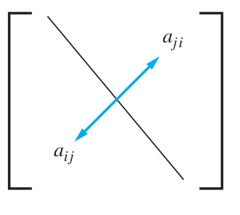

# 2.6 Matrices

<!-- Page 63 -->

### Introduction

Matrices are used throughout discrete mathematics to express relationships between elements in sets. In subsequent chapters we will use matrices in a wide variety of models. For instance, matrices will be used in models of communications networks and transportation systems. Many algorithms will be developed that use these matrix models. This section reviews matrix arithmetic that will be used in these algorithms.

<!-- Page 64 -->

> [!NOTE] DEFINITION 1
> A **matrix** is a rectangular array of numbers. A matrix with $m$ rows and $n$ columns is called an **$m \times n$ matrix**. The plural of matrix is **matrices**. A matrix with the same number of rows as columns is called **square**. Two matrices are **equal** if they have the same number of rows and the same number of columns and the corresponding entries in every position are equal.

#### EXAMPLE 1
The matrix
$$\begin{bmatrix} 1 & 1 \\ 0 & 2 \\ 1 & 3 \end{bmatrix}$$
is a $3 \times 2$ matrix.
$\blacktriangleleft$

We now introduce some terminology about matrices. Boldface uppercase letters will be used to represent matrices.

> [!NOTE] DEFINITION 2
> Let $m$ and $n$ be positive integers and let
> $$\mathbf{A} = \begin{bmatrix} a_{11} & a_{12} & \dots & a_{1n} \\ a_{21} & a_{22} & \dots & a_{2n} \\ \vdots & \vdots & \ddots & \vdots \\ a_{m1} & a_{m2} & \dots & a_{mn} \end{bmatrix}.$$
> The **$i$th row** of $\mathbf{A}$ is the $1 \times n$ matrix $[a_{i1}, a_{i2}, \dots, a_{in}]$. The **$j$th column** of $\mathbf{A}$ is the $m \times 1$ matrix
> $$\begin{bmatrix} a_{1j} \\ a_{2j} \\ \vdots \\ a_{mj} \end{bmatrix}.$$
> The **$(i, j)$th element** or **entry** of $\mathbf{A}$ is the element $a_{ij}$, that is, the number in the $i$th row and $j$th column of $\mathbf{A}$. A convenient shorthand notation for expressing the matrix $\mathbf{A}$ is to write $\mathbf{A} = [a_{ij}]$, which indicates that $\mathbf{A}$ is the matrix with its $(i, j)$th element equal to $a_{ij}$.

### Matrix Arithmetic

The basic operations of matrix arithmetic will now be discussed, beginning with a definition of matrix addition.

> [!NOTE] DEFINITION 3
> Let $\mathbf{A} = [a_{ij}]$ and $\mathbf{B} = [b_{ij}]$ be $m \times n$ matrices. The **sum** of $\mathbf{A}$ and $\mathbf{B}$, denoted by $\mathbf{A} + \mathbf{B}$, is the $m \times n$ matrix that has $a_{ij} + b_{ij}$ as its $(i, j)$th element. In other words, $\mathbf{A} + \mathbf{B} = [a_{ij} + b_{ij}]$.

The sum of two matrices of the same size is obtained by adding elements in the corresponding positions. Matrices of different sizes cannot be added, because the sum of two matrices is defined only when both matrices have the same number of rows and the same number of columns.

#### EXAMPLE 2
We have
$$\begin{bmatrix} 1 & 0 & -1 \\ 2 & 2 & -3 \\ 3 & 4 & 0 \end{bmatrix} + \begin{bmatrix} 3 & 4 & -1 \\ 1 & -3 & 0 \\ -1 & 1 & 2 \end{bmatrix} = \begin{bmatrix} 4 & 4 & -2 \\ 3 & -1 & -3 \\ 2 & 5 & 2 \end{bmatrix}.$$
$\blacktriangleleft$

<!-- Page 65 -->

We now discuss matrix products. A product of two matrices is defined only when the number of columns in the first matrix equals the number of rows of the second matrix.

> [!NOTE] DEFINITION 4
> Let $\mathbf{A}$ be an $m \times k$ matrix and $\mathbf{B}$ be a $k \times n$ matrix. The **product** of $\mathbf{A}$ and $\mathbf{B}$, denoted by $\mathbf{AB}$, is the $m \times n$ matrix with its $(i, j)$th entry equal to the sum of the products of the corresponding elements from the $i$th row of $\mathbf{A}$ and the $j$th column of $\mathbf{B}$. In other words, if $\mathbf{AB} = [c_{ij}]$, then
> $$c_{ij} = a_{i1} b_{1j} + a_{i2} b_{2j} + \dots + a_{ik} b_{kj}.$$

In Figure 1 the colored row of $\mathbf{A}$ and the colored column of $\mathbf{B}$ are used to compute the element $c_{ij}$ of $\mathbf{AB}$. The product of two matrices is not defined when the number of columns in the first matrix and the number of rows in the second matrix are not the same.

| ![Fig_Ch02_01_MatrixMul: The product of A = [aij] and B = [bij]](diagrams/Ch02_p65_fig01_matrix_multiplication.jpg) |
| :---: |
| *FIGURE 1 — The Product of $\mathbf{A} = [a_{ij}]$ and $\mathbf{B} = [b_{ij}]$ (Source: Page 179)* |

We now give some examples of matrix products.

#### EXAMPLE 3
Let
$$\mathbf{A} = \begin{bmatrix} 1 & 0 & 4 \\ 2 & 1 & 1 \\ 3 & 1 & 0 \\ 0 & 2 & 2 \end{bmatrix} \quad \text{and} \quad \mathbf{B} = \begin{bmatrix} 2 & 4 \\ 1 & 1 \\ 3 & 0 \end{bmatrix}.$$
Find $\mathbf{AB}$ if it is defined.

**Solution:** Because $\mathbf{A}$ is a $4 \times 3$ matrix and $\mathbf{B}$ is a $3 \times 2$ matrix, the product $\mathbf{AB}$ is defined and is a $4 \times 2$ matrix. To find the elements of $\mathbf{AB}$, the corresponding elements of the rows of $\mathbf{A}$ and the columns of $\mathbf{B}$ are first multiplied and then these products are added. For instance, the element in the $(3, 1)$th position of $\mathbf{AB}$ is the sum of the products of the corresponding elements of the third row of $\mathbf{A}$ and the first column of $\mathbf{B}$; namely, $3 \cdot 2 + 1 \cdot 1 + 0 \cdot 3 = 7$. When all the elements of $\mathbf{AB}$ are computed, we see that
$$\mathbf{AB} = \begin{bmatrix} 14 & 4 \\ 8 & 9 \\ 7 & 13 \\ 8 & 2 \end{bmatrix}.$$
$\blacktriangleleft$

Matrix multiplication is **not commutative**. That is, if $\mathbf{A}$ and $\mathbf{B}$ are two matrices, it is not necessarily true that $\mathbf{AB}$ and $\mathbf{BA}$ are the same. In fact, it may be that only one of these two products is defined. For instance, if $\mathbf{A}$ is $2 \times 3$ and $\mathbf{B}$ is $3 \times 4$, then $\mathbf{AB}$ is defined and is $2 \times 4$; however, $\mathbf{BA}$ is not defined, because it is impossible to multiply a $3 \times 4$ matrix and a $2 \times 3$ matrix.

In general, suppose that $\mathbf{A}$ is an $m \times n$ matrix and $\mathbf{B}$ is an $r \times s$ matrix. Then $\mathbf{AB}$ is defined only when $n = r$ and $\mathbf{BA}$ is defined only when $s = m$. Moreover, even when $\mathbf{AB}$ and $\mathbf{BA}$ are

<!-- Page 66 -->

both defined, they will not be the same size unless $m = n = r = s$. Hence, if both $\mathbf{AB}$ and $\mathbf{BA}$ are defined and are the same size, then both $\mathbf{A}$ and $\mathbf{B}$ must be square and of the same size. Furthermore, even with $\mathbf{A}$ and $\mathbf{B}$ both $n \times n$ matrices, $\mathbf{AB}$ and $\mathbf{BA}$ are not necessarily equal, as Example 4 demonstrates.

#### EXAMPLE 4
Let
$$\mathbf{A} = \begin{bmatrix} 1 & 1 \\ 2 & 1 \end{bmatrix} \quad \text{and} \quad \mathbf{B} = \begin{bmatrix} 2 & 1 \\ 1 & 1 \end{bmatrix}.$$
Does $\mathbf{AB} = \mathbf{BA}$?

**Solution:** We find that
$$\mathbf{AB} = \begin{bmatrix} 3 & 2 \\ 5 & 3 \end{bmatrix} \quad \text{and} \quad \mathbf{BA} = \begin{bmatrix} 4 & 3 \\ 3 & 2 \end{bmatrix}.$$
Hence, $\mathbf{AB} \neq \mathbf{BA}$.
$\blacktriangleleft$

### Transposes and Powers of Matrices

We now introduce an important matrix with entries that are zeros and ones.

> [!NOTE] DEFINITION 5
> The **identity matrix of order $n$** is the $n \times n$ matrix $\mathbf{I}_n = [\delta_{ij}]$, where $\delta_{ij} = 1$ if $i = j$ and $\delta_{ij} = 0$ if $i \neq j$. Hence
> $$\mathbf{I}_n = \begin{bmatrix} 1 & 0 & \dots & 0 \\ 0 & 1 & \dots & 0 \\ \vdots & \vdots & \ddots & \vdots \\ 0 & 0 & \dots & 1 \end{bmatrix}.$$

Multiplying a matrix by an appropriately sized identity matrix does not change this matrix. In other words, when $\mathbf{A}$ is an $m \times n$ matrix, we have
$$\mathbf{A}\mathbf{I}_n = \mathbf{I}_m\mathbf{A} = \mathbf{A}.$$

Powers of square matrices can be defined. When $\mathbf{A}$ is an $n \times n$ matrix, we have
$$\mathbf{A}^0 = \mathbf{I}_n,$$
$$\mathbf{A}^r = \underbrace{\mathbf{A}\mathbf{A}\mathbf{A} \cdots \mathbf{A}}_{r \text{ times}}.$$

The operation of interchanging the rows and columns of a square matrix arises in many contexts.

<!-- Page 67 -->

> [!NOTE] DEFINITION 6
> Let $\mathbf{A} = [a_{ij}]$ be an $m \times n$ matrix. The **transpose** of $\mathbf{A}$, denoted by $\mathbf{A}^t$, is the $n \times m$ matrix obtained by interchanging the rows and columns of $\mathbf{A}$. In other words, if $\mathbf{A}^t = [b_{ij}]$, then $b_{ij} = a_{ji}$ for $i = 1, 2, \dots, n$ and $j = 1, 2, \dots, m$.

#### EXAMPLE 5
The transpose of the matrix
$$\begin{bmatrix} 1 & 2 & 3 \\ 4 & 5 & 6 \end{bmatrix}$$
is the matrix
$$\begin{bmatrix} 1 & 4 \\ 2 & 5 \\ 3 & 6 \end{bmatrix}.$$
$\blacktriangleleft$

Matrices that do not change when their rows and columns are interchanged are often important.

> [!NOTE] DEFINITION 7
> A square matrix $\mathbf{A}$ is called **symmetric** if $\mathbf{A} = \mathbf{A}^t$. Thus $\mathbf{A} = [a_{ij}]$ is symmetric if $a_{ij} = a_{ji}$ for all $i$ and $j$ with $1 \le i \le n$ and $1 \le j \le n$.

Note that a matrix is symmetric if and only if it is square and it is symmetric with respect to its main diagonal (which consists of entries that are in the $i$th row and $i$th column for some $i$). This symmetry is displayed in Figure 2.

#### EXAMPLE 6
The matrix
$$\begin{bmatrix} 1 & 1 & 0 \\ 1 & 0 & 1 \\ 0 & 1 & 0 \end{bmatrix}$$
is symmetric.
$\blacktriangleleft$

|  |
| :---: |
| *FIGURE 2 — A Symmetric Matrix (Source: Page 181)* |

### Zero–One Matrices

A matrix all of whose entries are either 0 or 1 is called a **zero–one matrix**. Zero–one matrices are often used to represent discrete structures, as we will see in Chapters 9 and 10. Algorithms using these structures are based on Boolean arithmetic with zero–one matrices. This arithmetic is based on the Boolean operations $\land$ and $\lor$, which operate on pairs of bits, defined by
$$b_1 \land b_2 = \begin{cases} 1 & \text{if } b_1 = b_2 = 1 \\ 0 & \text{otherwise}, \end{cases}$$
$$b_1 \lor b_2 = \begin{cases} 1 & \text{if } b_1 = 1 \text{ or } b_2 = 1 \\ 0 & \text{otherwise}. \end{cases}$$

> [!NOTE] DEFINITION 8
> Let $\mathbf{A} = [a_{ij}]$ and $\mathbf{B} = [b_{ij}]$ be $m \times n$ zero–one matrices. Then the **join** of $\mathbf{A}$ and $\mathbf{B}$ is the zero–one matrix with $(i, j)$th entry $a_{ij} \lor b_{ij}$. The join of $\mathbf{A}$ and $\mathbf{B}$ is denoted by $\mathbf{A} \lor \mathbf{B}$. The **meet** of $\mathbf{A}$ and $\mathbf{B}$ is the zero–one matrix with $(i, j)$th entry $a_{ij} \land b_{ij}$. The meet of $\mathbf{A}$ and $\mathbf{B}$ is denoted by $\mathbf{A} \land \mathbf{B}$.

#### EXAMPLE 7
Find the join and meet of the zero–one matrices
$$\mathbf{A} = \begin{bmatrix} 1 & 0 & 1 \\ 0 & 1 & 0 \end{bmatrix}, \quad \mathbf{B} = \begin{bmatrix} 0 & 1 & 0 \\ 1 & 1 & 0 \end{bmatrix}.$$

<!-- Page 68 -->

**Solution:** We find that the join of $\mathbf{A}$ and $\mathbf{B}$ is
$$\mathbf{A} \lor \mathbf{B} = \begin{bmatrix} 1 \lor 0 & 0 \lor 1 & 1 \lor 0 \\ 0 \lor 1 & 1 \lor 1 & 0 \lor 0 \end{bmatrix} = \begin{bmatrix} 1 & 1 & 1 \\ 1 & 1 & 0 \end{bmatrix}.$$
The meet of $\mathbf{A}$ and $\mathbf{B}$ is
$$\mathbf{A} \land \mathbf{B} = \begin{bmatrix} 1 \land 0 & 0 \land 1 & 1 \land 0 \\ 0 \land 1 & 1 \land 1 & 0 \land 0 \end{bmatrix} = \begin{bmatrix} 0 & 0 & 0 \\ 0 & 1 & 0 \end{bmatrix}.$$
$\blacktriangleleft$

We now define the Boolean product of two matrices.

> [!NOTE] DEFINITION 9
> Let $\mathbf{A} = [a_{ij}]$ be an $m \times k$ zero–one matrix and $\mathbf{B} = [b_{ij}]$ be a $k \times n$ zero–one matrix. Then the **Boolean product** of $\mathbf{A}$ and $\mathbf{B}$, denoted by $\mathbf{A} \odot \mathbf{B}$, is the $m \times n$ matrix with $(i, j)$th entry $c_{ij}$ where
> $$c_{ij} = (a_{i1} \land b_{1j}) \lor (a_{i2} \land b_{2j}) \lor \dots \lor (a_{ik} \land b_{kj}).$$

Note that the Boolean product of $\mathbf{A}$ and $\mathbf{B}$ is obtained in an analogous way to the ordinary product of these matrices, but with addition replaced with the operation $\lor$ and with multiplication replaced with the operation $\land$. We give an example of the Boolean products of matrices.

#### EXAMPLE 8
Find the Boolean product of $\mathbf{A}$ and $\mathbf{B}$, where
$$\mathbf{A} = \begin{bmatrix} 1 & 0 \\ 0 & 1 \\ 1 & 0 \end{bmatrix}, \quad \mathbf{B} = \begin{bmatrix} 1 & 1 & 0 \\ 0 & 1 & 1 \end{bmatrix}.$$

**Solution:** The Boolean product $\mathbf{A} \odot \mathbf{B}$ is given by
$$\begin{aligned} \mathbf{A} \odot \mathbf{B} &= \begin{bmatrix} (1 \land 1) \lor (0 \land 0) & (1 \land 1) \lor (0 \land 1) & (1 \land 0) \lor (0 \land 1) \\ (0 \land 1) \lor (1 \land 0) & (0 \land 1) \lor (1 \land 1) & (0 \land 0) \lor (1 \land 1) \\ (1 \land 1) \lor (0 \land 0) & (1 \land 1) \lor (0 \land 1) & (1 \land 0) \lor (0 \land 1) \end{bmatrix} \\ &= \begin{bmatrix} 1 \lor 0 & 1 \lor 0 & 0 \lor 0 \\ 0 \lor 0 & 0 \lor 1 & 0 \lor 1 \\ 1 \lor 0 & 1 \lor 0 & 0 \lor 0 \end{bmatrix} \\ &= \begin{bmatrix} 1 & 1 & 0 \\ 0 & 1 & 1 \\ 1 & 1 & 0 \end{bmatrix}. \end{aligned}$$
$\blacktriangleleft$

We can also define the Boolean powers of a square zero–one matrix. These powers will be used in our subsequent studies of paths in graphs, which are used to model such things as communications paths in computer networks.

<!-- Page 69 -->

> [!NOTE] DEFINITION 10
> Let $\mathbf{A}$ be a square zero–one matrix and let $r$ be a positive integer. The **$r$th Boolean power** of $\mathbf{A}$ is the Boolean product of $r$ factors of $\mathbf{A}$. The $r$th Boolean product of $\mathbf{A}$ is denoted by $\mathbf{A}^{[r]}$. Hence
> $$\mathbf{A}^{[r]} = \underbrace{\mathbf{A} \odot \mathbf{A} \odot \mathbf{A} \odot \dots \odot \mathbf{A}}_{r \text{ times}}.$$
> (This is well defined because the Boolean product of matrices is associative.) We also define $\mathbf{A}^{[0]}$ to be $\mathbf{I}_n$.

#### EXAMPLE 9
Let $\mathbf{A} = \begin{bmatrix} 0 & 0 & 1 \\ 1 & 0 & 0 \\ 1 & 1 & 0 \end{bmatrix}$. Find $\mathbf{A}^{[n]}$ for all positive integers $n$.

**Solution:** We find that
$$\mathbf{A}^{[2]} = \mathbf{A} \odot \mathbf{A} = \begin{bmatrix} 1 & 1 & 0 \\ 0 & 0 & 1 \\ 1 & 0 & 1 \end{bmatrix}.$$
We also find that
$$\mathbf{A}^{[3]} = \mathbf{A}^{[2]} \odot \mathbf{A} = \begin{bmatrix} 1 & 0 & 1 \\ 1 & 1 & 0 \\ 1 & 1 & 1 \end{bmatrix},$$
$$\mathbf{A}^{[4]} = \mathbf{A}^{[3]} \odot \mathbf{A} = \begin{bmatrix} 1 & 1 & 1 \\ 1 & 0 & 1 \\ 1 & 1 & 1 \end{bmatrix}.$$
Additional computation shows that
$$\mathbf{A}^{[5]} = \begin{bmatrix} 1 & 1 & 1 \\ 1 & 1 & 1 \\ 1 & 1 & 1 \end{bmatrix}.$$
The reader can now see that $\mathbf{A}^{[n]} = \mathbf{A}^{[5]}$ for all positive integers $n$ with $n \ge 5$.
$\blacktriangleleft$
