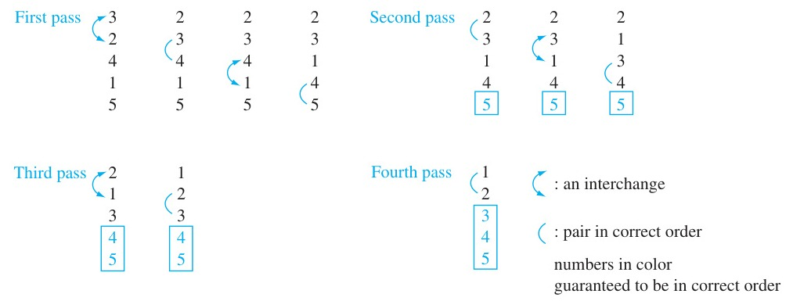
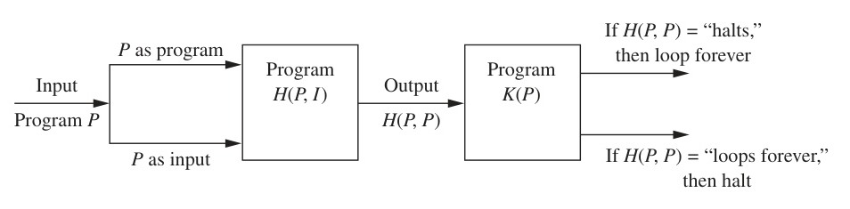

<!-- Page 1 -->

# Chapter 3: Algorithms

Many problems can be solved by considering them as special cases of general problems. For instance, consider the problem of locating the largest integer in the sequence $101, 12, 144, 212, 98$. This is a specific case of the problem of locating the largest integer in a sequence of integers. To solve this general problem we must give an algorithm, which specifies a sequence of steps used to solve this general problem. We will study algorithms for solving many different types of problems in this book. For example, in this chapter we will introduce algorithms for two of the most important problems in computer science, searching for an element in a list and sorting a list so its elements are in some prescribed order, such as increasing, decreasing, or alphabetic. Later in the book we will develop algorithms that find the greatest common divisor of two integers, that generate all the orderings of a finite set, that find the shortest path between nodes in a network, and for solving many other problems.

We will also introduce the notion of an algorithmic paradigm, which provides a general method for designing algorithms. In particular we will discuss brute-force algorithms, which find solutions using a straightforward approach without introducing any cleverness. We will also discuss greedy algorithms, a class of algorithms used to solve optimization problems. Proofs are important in the study of algorithms. In this chapter we illustrate this by proving that a particular greedy algorithm always finds an optimal solution.

One important consideration concerning an algorithm is its computational complexity, which measures the processing time and computer memory required by the algorithm to solve problems of a particular size. To measure the complexity of algorithms we use big-$O$ and big-Theta notation, which we develop in this chapter. We will illustrate the analysis of the complexity of algorithms in this chapter, focusing on the time an algorithm takes to solve a problem. Furthermore, we will discuss what the time complexity of an algorithm means in practical and theoretical terms.

---

## 3.1 Algorithms

### Introduction

There are many general classes of problems that arise in discrete mathematics. For instance: given a sequence of integers, find the largest one; given a set, list all its subsets; given a set of integers, put them in increasing order; given a network, find the shortest path between two vertices. When presented with such a problem, the first thing to do is to construct a model that translates the problem into a mathematical context. Discrete structures used in such models include sets, sequences, and functions—structures discussed in Chapter 2—as well as such other structures as permutations, relations, graphs, trees, networks, and finite state machines—concepts that will be discussed in later chapters.

Setting up the appropriate mathematical model is only part of the solution. To complete the solution, a method is needed that will solve the general problem using the model. Ideally, what is required is a procedure that follows a sequence of steps that leads to the desired answer. Such a sequence of steps is called an algorithm.

> [!NOTE] DEFINITION 1
> An **algorithm** is a finite sequence of precise instructions for performing a computation or for solving a problem.

<!-- Page 2 -->

In this book, we will discuss algorithms that solve a wide variety of problems. In this section we will use the problem of finding the largest integer in a finite sequence of integers to illustrate the concept of an algorithm and the properties algorithms have. Also, we will describe algorithms for locating a particular element in a finite set. In subsequent sections, procedures for finding the greatest common divisor of two integers, for finding the shortest path between two points in a network, for multiplying matrices, and so on, will be discussed.

#### EXAMPLE 1
Describe an algorithm for finding the maximum (largest) value in a finite sequence of integers.

Even though the problem of finding the maximum element in a sequence is relatively trivial, it provides a good illustration of the concept of an algorithm. Also, there are many instances where the largest integer in a finite sequence of integers is required. For instance, a university may need to find the highest score on a competitive exam taken by thousands of students. Or a sports organization may want to identify the member with the highest rating each month. We want to develop an algorithm that can be used whenever the problem of finding the largest element in a finite sequence of integers arises.

We can specify a procedure for solving this problem in several ways. One method is simply to use the English language to describe the sequence of steps used. We now provide such a solution.

**Solution:** We perform the following steps:
1. Set the temporary maximum equal to the first integer in the sequence. (The temporary maximum will be the largest integer examined at any stage of the procedure.)
2. Compare the next integer in the sequence to the temporary maximum, and if it is larger than the temporary maximum, set the temporary maximum equal to this integer.
3. Repeat the previous step if there are more integers in the sequence.
4. Stop when there are no integers left in the sequence. The temporary maximum at this point is the largest integer in the sequence. $\blacktriangleleft$

An algorithm can also be described using a computer language. However, when that is done, only those instructions permitted in the language can be used. This often leads to a description of the algorithm that is complicated and difficult to understand. Furthermore, because many programming languages are in common use, it would be undesirable to choose one particular language. So, instead of using a particular computer language to specify algorithms, a form of pseudocode, described in Appendix 3, will be used in this book. (We will also describe algorithms using the English language.) Pseudocode provides an intermediate step between

<!-- Page 3 -->

an English language description of an algorithm and an implementation of this algorithm in a programming language. The steps of the algorithm are specified using instructions resembling those used in programming languages. However, in pseudocode, the instructions used can include any well-defined operations or statements. A computer program can be produced in any computer language using the pseudocode description as a starting point.

The pseudocode used in this book is designed to be easily understood. It can serve as an intermediate step in the construction of programs implementing algorithms in one of a variety of different programming languages. Although this pseudocode does not follow the syntax of Java, C, C++, or any other programming language, students familiar with a modern programming language will find it easy to follow. A key difference between this pseudocode and code in a programming language is that we can use any well-defined instruction even if it would take many lines of code to implement this instruction. The details of the pseudocode used in the text are given in Appendix 3. The reader should refer to this appendix whenever the need arises.

A pseudocode description of the algorithm for finding the maximum element in a finite sequence follows.

```pascal
ALGORITHM 1 Finding the Maximum Element in a Finite Sequence.
procedure max(a1, a2, ..., an: integers)
    max := a1
    for i := 2 to n
        if max < ai then max := ai
    return max {max is the largest element}
```

This algorithm first assigns the initial term of the sequence, $a_1$, to the variable $max$. The "for" loop is used to successively examine terms of the sequence. If a term is greater than the current value of $max$, it is assigned to be the new value of $max$.

### Properties of Algorithms
There are several properties that algorithms generally share. They are useful to keep in mind when algorithms are described. These properties are:
- **Input.** An algorithm has input values from a specified set.
- **Output.** From each set of input values an algorithm produces output values from a specified set. The output values are the solution to the problem.
- **Definiteness.** The steps of an algorithm must be defined precisely.
- **Correctness.** An algorithm should produce the correct output values for each set of input values.
- **Finiteness.** An algorithm should produce the desired output after a finite (but perhaps large) number of steps for any input in the set.
- **Effectiveness.** It must be possible to perform each step of an algorithm exactly and in a finite amount of time.
- **Generality.** The procedure should be applicable for all problems of the desired form, not just for a particular set of input values.

#### EXAMPLE 2
Show that Algorithm 1 for finding the maximum element in a finite sequence of integers has all the properties listed.

**Solution:** The input to Algorithm 1 is a sequence of integers. The output is the largest integer in the sequence. Each step of the algorithm is precisely defined, because only assignments, a finite loop, and conditional statements occur. To show that the algorithm is correct, we must show that when the algorithm terminates, the value of the variable $max$ equals the maximum

<!-- Page 4 -->

of the terms of the sequence. To see this, note that the initial value of $max$ is the first term of the sequence; as successive terms of the sequence are examined, $max$ is updated to the value of a term if the term exceeds the maximum of the terms previously examined. This (informal) argument shows that when all the terms have been examined, $max$ equals the value of the largest term. (A rigorous proof of this requires techniques developed in Section 5.1.) The algorithm uses a finite number of steps, because it terminates after all the integers in the sequence have been examined. The algorithm can be carried out in a finite amount of time because each step is either a comparison or an assignment, there are a finite number of these steps, and each of these two operations takes a finite amount of time. Finally, Algorithm 1 is general, because it can be used to find the maximum of any finite sequence of integers. $\blacktriangleleft$

### Searching Algorithms

The problem of locating an element in an ordered list occurs in many contexts. For instance, a program that checks the spelling of words searches for them in a dictionary, which is just an ordered list of words. Problems of this kind are called searching problems. We will discuss several algorithms for searching in this section. We will study the number of steps used by each of these algorithms in Section 3.3.

The general searching problem can be described as follows: Locate an element $x$ in a list of distinct elements $a_1, a_2, \dots, a_n$, or determine that it is not in the list. The solution to this search problem is the location of the term in the list that equals $x$ (that is, $i$ is the solution if $x = a_i$) and is $0$ if $x$ is not in the list.

#### The Linear Search
The first algorithm that we will present is called the **linear search**, or **sequential search**, algorithm. The linear search algorithm begins by comparing $x$ and $a_1$. When $x = a_1$, the solution is the location of $a_1$, namely, $1$. When $x \neq a_1$, compare $x$ with $a_2$. If $x = a_2$, the solution is the location of $a_2$, namely, $2$. When $x \neq a_2$, compare $x$ with $a_3$. Continue this process, comparing $x$ successively with each term of the list until a match is found, where the solution is the location of that term, unless no match occurs. If the entire list has been searched without locating $x$, the solution is $0$. The pseudocode for the linear search algorithm is displayed as Algorithm 2.

```pascal
ALGORITHM 2 The Linear Search Algorithm.
procedure linear search(x: integer, a1, a2, ..., an: distinct integers)
    i := 1
    while (i ≤ n and x ≠ ai)
        i := i + 1
    if i ≤ n then location := i
    else location := 0
    return location {location is the subscript of the term that equals x, or is 0 if x is not found}
```

#### The Binary Search
We will now consider another searching algorithm. This algorithm can be used when the list has terms occurring in order of increasing size (for instance: if the terms are numbers, they are listed from smallest to largest; if they are words, they are listed in lexicographic, or alphabetic, order). This second searching algorithm is called the **binary search** algorithm. It proceeds by comparing the element to be located to the middle term of the list. The list is then split into two smaller sublists of the same size, or where one of these smaller lists has one fewer term than the other. The search continues by restricting the search to the appropriate sublist based on the comparison of the element to be located and the middle term. In Section 3.3, it will be shown that the binary search algorithm is much more efficient than the linear search algorithm. Example 3 demonstrates how a binary search works.

<!-- Page 5 -->

#### EXAMPLE 3
To search for $19$ in the list
$$1 \quad 2 \quad 3 \quad 5 \quad 6 \quad 7 \quad 8 \quad 10 \quad 12 \quad 13 \quad 15 \quad 16 \quad 18 \quad 19 \quad 20 \quad 22,$$
first split this list, which has $16$ terms, into two smaller lists with eight terms each, namely,
$$1 \quad 2 \quad 3 \quad 5 \quad 6 \quad 7 \quad 8 \quad 10$$
$$12 \quad 13 \quad 15 \quad 16 \quad 18 \quad 19 \quad 20 \quad 22.$$
Then, compare $19$ and the largest term in the first list. Because $10 < 19$, the search for $19$ can be restricted to the list containing the 9th through the 16th terms of the original list. Next, split this list, which has eight terms, into the two smaller lists of four terms each, namely,
$$12 \quad 13 \quad 15 \quad 16$$
$$18 \quad 19 \quad 20 \quad 22.$$
Because $16 < 19$ (comparing $19$ with the largest term of the first list) the search is restricted to the second of these lists, which contains the 13th through the 16th terms of the original list. The list $18 \quad 19 \quad 20 \quad 22$ is split into two lists, namely,
$$18 \quad 19$$
$$20 \quad 22.$$
Because $19$ is not greater than the largest term of the first of these two lists, which is also $19$, the search is restricted to the first list: $18 \quad 19$, which contains the 13th and 14th terms of the original list. Next, this list of two terms is split into two lists of one term each: $18$ and $19$. Because $18 < 19$, the search is restricted to the second list: the list containing the 14th term of the list, which is $19$. Now that the search has been narrowed down to one term, a comparison is made, and $19$ is located as the 14th term in the original list. $\blacktriangleleft$

We now specify the steps of the binary search algorithm. To search for the integer $x$ in the list $a_1, a_2, \dots, a_n$, where $a_1 < a_2 < \dots < a_n$, begin by comparing $x$ with the middle term $a_m$ of the list, where $m = \lfloor (n + 1)/2 \rfloor$. (Recall that $\lfloor x \rfloor$ is the greatest integer not exceeding $x$.) If $x > a_m$, the search for $x$ is restricted to the second half of the list, which is $a_{m+1}, a_{m+2}, \dots, a_n$. If $x$ is not greater than $a_m$, the search for $x$ is restricted to the first half of the list, which is $a_1, a_2, \dots, a_m$.

The search has now been restricted to a list with no more than $\lceil n/2 \rceil$ elements. (Recall that $\lceil x \rceil$ is the smallest integer greater than or equal to $x$.) Using the same procedure, compare $x$ to the middle term of the restricted list. Then restrict the search to the first or second half of the list. Repeat this process until a list with one term is obtained. Then determine whether this term is $x$. Pseudocode for the binary search algorithm is displayed as Algorithm 3.

```pascal
ALGORITHM 3 The Binary Search Algorithm.
procedure binary search(x: integer, a1, a2, ..., an: increasing integers)
    i := 1 {i is left endpoint of search interval}
    j := n {j is right endpoint of search interval}
    while i < j
        m := ⌊(i + j)/2⌋
        if x > am then i := m + 1
        else j := m
    if x = ai then location := i
    else location := 0
    return location {location is the subscript i of the term ai equal to x, or 0 if x is not found}
```

<!-- Page 6 -->

Algorithm 3 proceeds by successively narrowing down the part of the sequence being searched. At any given stage only the terms from $a_i$ to $a_j$ are under consideration. In other words, $i$ and $j$ are the smallest and largest subscripts of the remaining terms, respectively. Algorithm 3 continues narrowing the part of the sequence being searched until only one term of the sequence remains. When this is done, a comparison is made to see whether this term equals $x$.

### Sorting

Ordering the elements of a list is a problem that occurs in many contexts. For example, to produce a telephone directory it is necessary to alphabetize the names of subscribers. Similarly, producing a directory of songs available for downloading requires that their titles be put in alphabetic order. Putting addresses in order in an e-mail mailing list can determine whether there are duplicated addresses. Creating a useful dictionary requires that words be put in alphabetical order. Similarly, generating a parts list requires that we order them according to increasing part number.

Suppose that we have a list of elements of a set. Furthermore, suppose that we have a way to order elements of the set. (The notion of ordering elements of sets will be discussed in detail in Section 9.6.) **Sorting** is putting these elements into a list in which the elements are in increasing order. For instance, sorting the list $7, 2, 1, 4, 5, 9$ produces the list $1, 2, 4, 5, 7, 9$. Sorting the list $d, h, c, a, f$ (using alphabetical order) produces the list $a, c, d, f, h$.

An amazingly large percentage of computing resources is devoted to sorting one thing or another. Hence, much effort has been devoted to the development of sorting algorithms. A surprisingly large number of sorting algorithms have been devised using distinct strategies, with new ones introduced regularly. In his fundamental work, *The Art of Computer Programming*, Donald Knuth devotes close to 400 pages to sorting, covering around 15 different sorting algorithms in depth! More than 100 sorting algorithms have been devised, and it is surprising how often new sorting algorithms are developed. Among the newest sorting algorithms that have caught on is the library sort, also known as the gapped insertion sort, invented as recently as 2006. There are many reasons why sorting algorithms interest computer scientists and mathematicians. Among these reasons are that some algorithms are easier to implement, some algorithms are more efficient (either in general, or when given input with certain characteristics, such as lists slightly out of order), some algorithms take advantage of particular computer architectures, and some algorithms are particularly clever. In this section we will introduce two sorting algorithms, the bubble sort and the insertion sort. Two other sorting algorithms, the selection sort and the binary insertion sort, are introduced in the exercises, and the shaker sort is introduced in the Supplementary Exercises. In Section 5.4 we will discuss the merge sort and introduce the quick sort in the exercises in that section; the tournament sort is introduced in the exercise set in Section 11.2. We cover sorting algorithms both because sorting is an important problem and because these algorithms can serve as examples for many important concepts.

#### The Bubble Sort
The **bubble sort** is one of the simplest sorting algorithms, but not one of the most efficient. It puts a list into increasing order by successively comparing adjacent elements, interchanging them if they are in the wrong order. To carry out the bubble sort, we perform the basic operation, that is, interchanging a larger element with a smaller one following it, starting at the beginning of the list, for a full pass. We iterate this procedure until the sort is complete. Pseudocode for the bubble sort is given as Algorithm 4. We can imagine the elements in the list placed in a column. In the bubble sort, the smaller elements "bubble" to the top as they are interchanged with larger elements. The larger elements "sink" to the bottom. This is illustrated in Example 4.

#### EXAMPLE 4
Use the bubble sort to put $3, 2, 4, 1, 5$ into increasing order.

<!-- Page 7 -->

|  |
| :---: |
| *Figure 1 — The Steps of a Bubble Sort.* |

**Solution:** The steps of this algorithm are illustrated in Figure 1. Begin by comparing the first two elements, $3$ and $2$. Because $3 > 2$, interchange $3$ and $2$, producing the list $2, 3, 4, 1, 5$. Because $3 < 4$, continue by comparing $4$ and $1$. Because $4 > 1$, interchange $1$ and $4$, producing the list $2, 3, 1, 4, 5$. Because $4 < 5$, the first pass is complete. The first pass guarantees that the largest element, $5$, is in the correct position.

The second pass begins by comparing $2$ and $3$. Because these are in the correct order, $3$ and $1$ are compared. Because $3 > 1$, these numbers are interchanged, producing $2, 1, 3, 4, 5$. Because $3 < 4$, these numbers are in the correct order. It is not necessary to do any more comparisons for this pass because $5$ is already in the correct position. The second pass guarantees that the two largest elements, $4$ and $5$, are in their correct positions.

The third pass begins by comparing $2$ and $1$. These are interchanged because $2 > 1$, producing $1, 2, 3, 4, 5$. Because $2 < 3$, these two elements are in the correct order. It is not necessary to do any more comparisons for this pass because $4$ and $5$ are already in the correct positions. The third pass guarantees that the three largest elements, $3, 4$, and $5$, are in their correct positions.

The fourth pass consists of one comparison, namely, the comparison of $1$ and $2$. Because $1 < 2$, these elements are in the correct order. This completes the bubble sort. $\blacktriangleleft$

```pascal
ALGORITHM 4 The Bubble Sort.
procedure bubblesort(a1, ..., an: real numbers with n ≥ 2)
    for i := 1 to n - 1
        for j := 1 to n - i
            if aj > aj+1 then interchange aj and aj+1
    {a1, ..., an is in increasing order}
```

#### The Insertion Sort
The **insertion sort** is a simple sorting algorithm, but it is usually not the most efficient. To sort a list with $n$ elements, the insertion sort begins with the second element. The insertion sort compares this second element with the first element and inserts it before the first element if it does not exceed the first element and after the first element if it exceeds the first element. At this point, the first two elements are in the correct order. The third element is then compared with the first element, and if it is larger than the first element, it is compared with the second element; it is inserted into the correct position among the first three elements.

In general, in the $j$th step of the insertion sort, the $j$th element of the list is inserted into the correct position in the list of the previously sorted $j - 1$ elements. To insert the $j$th element in the list, a linear search technique is used; the $j$th element is successively compared with the already sorted $j - 1$ elements at the start of the list until the first element that

<!-- Page 8 -->

is not less than this element is found or until it has been compared with all $j - 1$ elements; the $j$th element is inserted in the correct position so that the first $j$ elements are sorted. The algorithm continues until the last element is placed in the correct position relative to the already sorted list of the first $n - 1$ elements. The insertion sort is described in pseudocode in Algorithm 5.

#### EXAMPLE 5
Use the insertion sort to put the elements of the list $3, 2, 4, 1, 5$ in increasing order.

**Solution:** The insertion sort first compares $2$ and $3$. Because $3 > 2$, it places $2$ in the first position, producing the list $2, 3, 4, 1, 5$. At this point, $2$ and $3$ are in the correct order. Next, it inserts the third element, $4$, into the already sorted part of the list by making the comparisons $4 > 2$ and $4 > 3$. Because $4 > 3$, $4$ remains in the third position.

At this point, the list is $2, 3, 4, 1, 5$ and we know that the ordering of the first three elements is correct. Next, we find the correct place for the fourth element, $1$, among the already sorted elements, $2, 3, 4$. Because $1 < 2$, we obtain the list $1, 2, 3, 4, 5$. Finally, we insert $5$ into the correct position by successively comparing it to $1, 2, 3$, and $4$. Because $5 > 4$, it stays at the end of the list, producing the correct order for the entire list. $\blacktriangleleft$

```pascal
ALGORITHM 5 The Insertion Sort.
procedure insertion sort(a1, a2, ..., an: real numbers with n ≥ 2)
    for j := 2 to n
        i := 1
        while aj > ai
            i := i + 1
        m := aj
        for k := 0 to j - i - 1
            aj-k := aj-k-1
        ai := m
    {a1, ..., an is in increasing order}
```

### Greedy Algorithms

Many algorithms we will study in this book are designed to solve optimization problems. The goal of such problems is to find a solution to the given problem that either minimizes or maximizes the value of some parameter. Optimization problems studied later in this text include finding a route between two cities with smallest total mileage, determining a way to encode messages using the fewest bits possible, and finding a set of fiber links between network nodes using the least amount of fiber.

Surprisingly, one of the simplest approaches often leads to a solution of an optimization problem. This approach selects the best choice at each step, instead of considering all sequences of steps that may lead to an optimal solution. Algorithms that make what seems to be the "best" choice at each step are called **greedy algorithms**. Once we know that a greedy algorithm finds a feasible solution, we need to determine whether it has found an optimal solution. (Note that we call the algorithm "greedy" whether or not it finds an optimal solution.) To do this, we either prove that the solution is optimal or we show that there is a counterexample where the algorithm yields a nonoptimal solution. To make these concepts more concrete, we will consider an algorithm that makes change using coins.

<!-- Page 9 -->

#### EXAMPLE 6
Consider the problem of making $n$ cents change with quarters, dimes, nickels, and pennies, and using the least total number of coins. We can devise a greedy algorithm for making change for $n$ cents by making a locally optimal choice at each step; that is, at each step we choose the coin of the largest denomination possible to add to the pile of change without exceeding $n$ cents. For example, to make change for $67$ cents, we first select a quarter (leaving $42$ cents). We next select a second quarter (leaving $17$ cents), followed by a dime (leaving $7$ cents), followed by a nickel (leaving $2$ cents), followed by a penny (leaving $1$ cent), followed by a penny. $\blacktriangleleft$

We display a greedy change-making algorithm for $n$ cents, using any set of denominations of coins, as Algorithm 6.

```pascal
ALGORITHM 6 Greedy Change-Making Algorithm.
procedure change(c1, c2, ..., cr: values of denominations of coins, where
                 c1 > c2 > ... > cr; n: a positive integer)
    for i := 1 to r
        di := 0 {di counts the coins of denomination ci used}
        while n ≥ ci
            di := di + 1 {add a coin of denomination ci}
            n := n - ci
    {di is the number of coins of denomination ci in the change for i = 1, 2, ..., r}
```

We have described a greedy algorithm for making change using any finite set of coins with denominations $c_1, c_2, \dots, c_r$. In the particular case where the four denominations are quarters, dimes, nickels, and pennies, we have $c_1 = 25$, $c_2 = 10$, $c_3 = 5$, and $c_4 = 1$. For this case, we will show that this algorithm leads to an optimal solution in the sense that it uses the fewest coins possible. Before we embark on our proof, we show that there are sets of coins for which the greedy algorithm (Algorithm 6) does not necessarily produce change using the fewest coins possible. For example, if we have only quarters, dimes, and pennies (and no nickels) to use, the greedy algorithm would make change for $30$ cents using six coins—a quarter and five pennies—whereas we could have used three coins, namely, three dimes.

> [!NOTE] LEMMA 1
> If $n$ is a positive integer, then $n$ cents in change using quarters, dimes, nickels, and pennies using the fewest coins possible has at most two dimes, at most one nickel, at most four pennies, and cannot have two dimes and a nickel. The amount of change in dimes, nickels, and pennies cannot exceed $24$ cents.

**Proof:** We use a proof by contradiction. We will show that if we had more than the specified number of coins of each type, we could replace them using fewer coins that have the same value. We note that if we had three dimes we could replace them with a quarter and a nickel, if we had two nickels we could replace them with a dime, if we had five pennies we could replace them with a nickel, and if we had two dimes and a nickel we could replace them with a quarter. Because we can have at most two dimes, one nickel, and four pennies, but we cannot have two dimes and a nickel, it follows that $24$ cents is the most money we can have in dimes, nickels, and pennies when we make change using the fewest number of coins for $n$ cents. $\blacksquare$

> [!NOTE] THEOREM 1
> The greedy algorithm (Algorithm 6) produces change using the fewest coins possible.

<!-- Page 10 -->

**Proof:** We will use a proof by contradiction. Suppose that there is a positive integer $n$ such that there is a way to make change for $n$ cents using quarters, dimes, nickels, and pennies that uses fewer coins than the greedy algorithm finds. We first note that $q'$, the number of quarters used in this optimal way to make change for $n$ cents, must be the same as $q$, the number of quarters used by the greedy algorithm. To show this, first note that the greedy algorithm uses the most quarters possible, so $q' \le q$. However, it is also the case that $q'$ cannot be less than $q$. If it were, we would need to make up at least $25$ cents from dimes, nickels, and pennies in this optimal way to make change. But this is impossible by Lemma 1.

Because there must be the same number of quarters in the two ways to make change, the value of the dimes, nickels, and pennies in these two ways must be the same, and these coins are worth no more than $24$ cents. There must be the same number of dimes, because the greedy algorithm used the most dimes possible and by Lemma 1, when change is made using the fewest coins possible, at most one nickel and at most four pennies are used, so that the most dimes possible are also used in the optimal way to make change. Similarly, we have the same number of nickels and, finally, the same number of pennies. $\blacksquare$

A greedy algorithm makes the best choice at each step according to a specified criterion. The next example shows that it can be difficult to determine which of many possible criteria to choose.

#### EXAMPLE 7
Suppose we have a group of proposed talks with preset start and end times. Devise a greedy algorithm to schedule as many of these talks as possible in a lecture hall, under the assumptions that once a talk starts, it continues until it ends, no two talks can proceed at the same time, and a talk can begin at the same time another one ends. Assume that talk $j$ begins at time $s_j$ (where $s$ stands for start) and ends at time $e_j$ (where $e$ stands for end).

**Solution:** To use a greedy algorithm to schedule the most talks, that is, an optimal schedule, we need to decide how to choose which talk to add at each step. There are many criteria we could use to select a talk at each step, where we chose from the talks that do not overlap talks already selected. For example, we could add talks in order of earliest start time, we could add talks in order of shortest time, we could add talks in order of earliest finish time, or we could use some other criterion.

We now consider these possible criteria. Suppose we add the talk that starts earliest among the talks compatible with those already selected. We can construct a counterexample to see that the resulting algorithm does not always produce an optimal schedule. For instance, suppose that we have three talks: Talk 1 starts at 8 a.m. and ends at 12 noon, Talk 2 starts at 9 a.m. and ends at 10 a.m., and Talk 3 starts at 11 a.m. and ends at 12 noon. We first select Talk 1 because it starts earliest. But once we have selected Talk 1 we cannot select either Talk 2 or Talk 3 because both overlap Talk 1. Hence, this greedy algorithm selects only one talk. This is not optimal because we could schedule Talk 2 and Talk 3, which do not overlap.

Now suppose we add the talk that is shortest among the talks that do not overlap any of those already selected. Again we can construct a counterexample to show that this greedy algorithm does not always produce an optimal schedule. So, suppose that we have three talks: Talk 1 starts at 8 a.m. and ends at 9:15 a.m., Talk 2 starts at 9 a.m. and ends at 10 a.m., and Talk 3 starts at 9:45 a.m. and ends at 11 a.m. We select Talk 2 because it is shortest, requiring one hour. Once we select Talk 2, we cannot select either Talk 1 or Talk 3 because neither is compatible with Talk 2. Hence, this greedy algorithm selects only one talk. However, it is possible to select two talks, Talk 1 and Talk 3, which are compatible.

However, it can be shown that we schedule the most talks possible if in each step we select the talk with the earliest ending time among the talks compatible with those already selected. We will prove this in Chapter 5 using the method of mathematical induction. The first step we will make is to sort the talks according to increasing finish time. After this sorting, we relabel the talks so that $e_1 \le e_2 \le \dots \le e_n$. The resulting greedy algorithm is given as Algorithm 7. $\blacktriangleleft$

<!-- Page 11 -->

```pascal
ALGORITHM 7 Greedy Algorithm for Scheduling Talks.
procedure schedule(s1 ≤ s2 ≤ ... ≤ sn: start times of talks,
                   e1 ≤ e2 ≤ ... ≤ en: ending times of talks)
    sort talks by finish time and reorder so that e1 ≤ e2 ≤ ... ≤ en
    S := ∅
    for j := 1 to n
        if talk j is compatible with S then
            S := S ∪ {talk j}
    return S {S is the set of talks scheduled}
```

### The Halting Problem

We will now describe a proof of one of the most famous theorems in computer science. We will show that there is a problem that cannot be solved using any procedure. That is, we will show there are unsolvable problems. The problem we will study is the **halting problem**. It asks whether there is a procedure that does this: It takes as input a computer program and input to the program and determines whether the program will eventually stop when run with this input. It would be convenient to have such a procedure, if it existed. Certainly being able to test whether a program entered into an infinite loop would be helpful when writing and debugging programs. However, in 1936 Alan Turing showed that no such procedure exists.

Before we present a proof that the halting problem is unsolvable, first note that we cannot simply run a program and observe what it does to determine whether it terminates when run with the given input. If the program halts, we have our answer, but if it is still running after any fixed length of time has elapsed, we do not know whether it will never halt or we just did not wait long enough for it to terminate. After all, it is not hard to design a program that will stop only after more than a billion years has elapsed.

We will describe Turing's proof that the halting problem is unsolvable; it is a proof by contradiction. (The reader should note that our proof is not completely rigorous, because we have not explicitly defined what a procedure is. To remedy this, the concept of a Turing machine is needed. This concept is introduced in Section 13.5.)

**Proof:** Assume there is a solution to the halting problem, a procedure called $H(P, I)$. The procedure $H(P, I)$ takes two inputs, one a program $P$ and the other $I$, an input to the program $P$. $H(P, I)$ generates the string "halt" as output if $H$ determines that $P$ stops when given $I$ as input. Otherwise, $H(P, I)$ generates the string "loops forever" as output. We will now derive a contradiction.

When a procedure is coded, it is expressed as a string of characters; this string can be interpreted as a sequence of bits. This means that a program itself can be used as data. Therefore a program can be thought of as input to another program, or even itself. Hence, $H$ can take a program $P$ as both of its inputs, which are a program and input to this program. $H$ should be able to determine whether $P$ will halt when it is given a copy of itself as input.

To show that no procedure $H$ exists that solves the halting problem, we construct a simple procedure $K(P)$, which works as follows, making use of the output $H(P, P)$. If the output of $H(P, P)$ is "loops forever," which means that $P$ loops forever when given a copy of itself as input, then $K(P)$ halts. If the output of $H(P, P)$ is "halt," which means that $P$ halts when given a copy of itself as input, then $K(P)$ loops forever. That is, $K(P)$ does the opposite of what the output of $H(P, P)$ specifies. (See Figure 2.)

Now suppose we provide $K$ as input to $K$. We note that if the output of $H(K, K)$ is "loops forever," then by the definition of $K$ we see that $K(K)$ halts. Otherwise, if the output of $H(K, K)$

<!-- Page 12 -->

|  |
| :---: |
| *Figure 2 — Showing that the Halting Problem is Unsolvable.* |

is "halt," then by the definition of $K$ we see that $K(K)$ loops forever, in violation of what $H$ tells us. In both cases, we have a contradiction.

Thus, $H$ cannot always give the correct answers. Consequently, there is no procedure that solves the halting problem. $\blacksquare$
