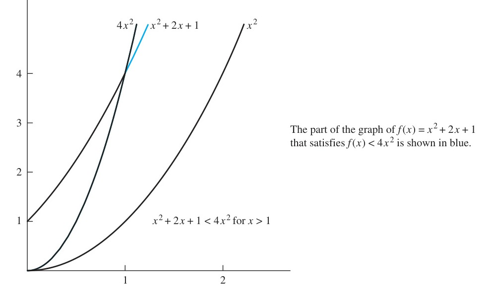
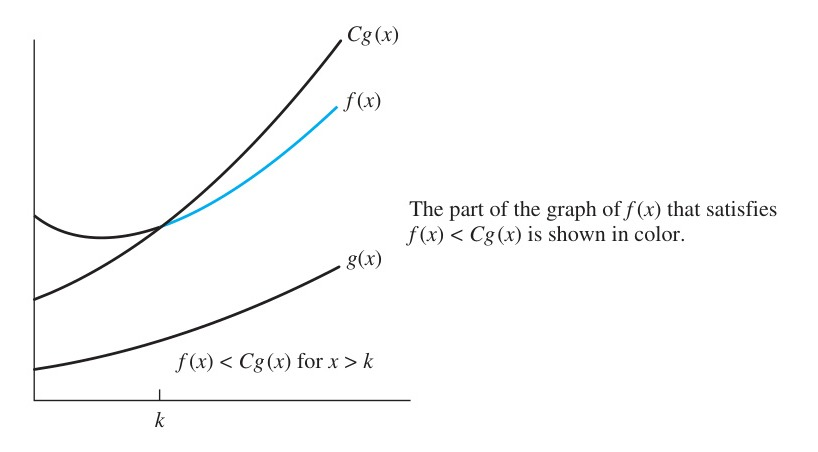

# 3.2 The Growth of Functions

<!-- Page 14 -->

### Introduction

In Section 3.1 we discussed the concept of an algorithm. We introduced algorithms that solve a variety of problems, including searching for an element in a list and sorting a list. In Section 3.3 we will study the number of operations used by these algorithms. In particular, we will estimate the number of comparisons used by the linear and binary search algorithms to find an element in a sequence of $n$ elements. We will also estimate the number of comparisons used by the

<!-- Page 15 -->

bubble sort and by the insertion sort to sort a list of $n$ elements. The time required to solve a problem depends on more than only the number of operations it uses. The time also depends on the hardware and software used to run the program that implements the algorithm. However, when we change the hardware and software used to implement an algorithm, we can closely approximate the time required to solve a problem of size $n$ by multiplying the previous time required by a constant factor. For instance, if we run a program on a computer that is twice as fast, it will take half as long to solve this problem.

One of the most important things to know when we design or use an algorithm is how it behaves as its input grows. With the help of this notation, we can determine whether it is practical to use a particular algorithm to solve a problem as the size of the input increases. Furthermore, with big-$O$ notation we can compare the efficiency of two different algorithms for solving the same problem to determine which is more efficient, especially when the size of the input grows. For instance, if we have two algorithms for solving a problem, one using $100n$ operations and the other using $n^2$ operations, big-$O$ notation helps us see that the first algorithm is much more efficient than the second for large inputs.

### Big-O Notation

> [!NOTE] DEFINITION 1
> Let $f$ and $g$ be functions from the set of integers or the set of real numbers to the set of real numbers. We say that $f(x)$ is $O(g(x))$ if there are constants $C$ and $k$ such that
> $$|f(x)| \le C|g(x)|$$
> whenever $x > k$. [This is read as "$f(x)$ is big-$O$ of $g(x)$."]

The constants $C$ and $k$ in the definition of big-$O$ notation are called **witnesses** to the relationship $f(x)$ is $O(g(x))$. To establish that $f(x)$ is $O(g(x))$ we need only find one pair of each of witnesses $C$ and $k$. That is, to show that $f(x)$ is $O(g(x))$, we need only find a pair of constants $C$ and $k$, the witnesses, such that $|f(x)| \le C|g(x)|$ whenever $x > k$.

<!-- Page 16 -->

#### Working with the Definition of Big-O Notation
A useful approach for finding a pair of witnesses is to first select a value for $k$ for which the size of $|f(x)|$ can be easily estimated when $x > k$. Then, a value for $C$ can be established using this estimate. This approach is illustrated in Example 1.

#### EXAMPLE 1
Show that $f(x) = x^2 + 2x + 1$ is $O(x^2)$.

**Solution:** We observe that we can readily estimate the size of $f(x)$ when $x > 1$ because $x < x^2$ and $1 < x^2$ when $x > 1$. It follows that
$$0 \le x^2 + 2x + 1 \le x^2 + 2x^2 + x^2 = 4x^2$$
whenever $x > 1$, as shown in Figure 1. Consequently, we can take $C = 4$ and $k = 1$ as witnesses to show that $f(x)$ is $O(x^2)$. That is, $f(x) = x^2 + 2x + 1 < 4x^2$ whenever $x > 1$.

Alternatively, we can estimate $f(x)$ by noting that when $x > 2$, then $2x \le x^2$ and $1 \le x^2$. Consequently, if $x > 2$, we have
$$0 \le x^2 + 2x + 1 \le x^2 + x^2 + x^2 = 3x^2.$$
It follows that $C = 3$ and $k = 2$ are also witnesses to the relation $f(x)$ is $O(x^2)$.

|  |
| :---: |
| *Figure 1 — The Function $x^2 + 2x + 1$ is $O(x^2)$.* |

<!-- Page 17 -->

Observe that in the relationship "$f(x)$ is $O(x^2)$," $x^2$ can be replaced by any function with larger values than $x^2$. For example, $f(x)$ is $O(x^3)$, $f(x)$ is $O(x^2 + x + 7)$, and so on.

It is also true that $x^2$ is $O(x^2 + 2x + 1)$, because $x^2 < x^2 + 2x + 1$ whenever $x > 1$. This means that $C = 1$ and $k = 1$ are witnesses to the relationship $x^2$ is $O(x^2 + 2x + 1)$. $\blacktriangleleft$

Note that in Example 1 we have two functions, $f(x) = x^2 + 2x + 1$ and $g(x) = x^2$, such that $f(x)$ is $O(g(x))$ and $g(x)$ is $O(f(x))$—the latter fact following from the inequality $x^2 \le x^2 + 2x + 1$, which holds for all nonnegative real numbers $x$. We say that two functions $f(x)$ and $g(x)$ that satisfy both of these big-$O$ relationships are of the same order. We will return to this notion later in this section.

> [!NOTE] REMARK
> The fact that $f(x)$ is $O(g(x))$ is sometimes written $f(x) = O(g(x))$. However, the equals sign in this notation does not represent a genuine equality. Rather, this notation tells us that an inequality holds relating the values of the functions $f$ and $g$ for sufficiently large numbers in the domains of these functions. However, it is acceptable to write $f(x) \in O(g(x))$ because $O(g(x))$ represents the set of functions that are $O(g(x))$.

When $f(x)$ is $O(g(x))$, and $h(x)$ is a function that has larger absolute values than $g(x)$ does for sufficiently large values of $x$, it follows that $f(x)$ is $O(h(x))$. In other words, the function $g(x)$ in the relationship $f(x)$ is $O(g(x))$ can be replaced by a function with larger absolute values. To see this, note that if
$$|f(x)| \le C|g(x)| \quad \text{if } x > k,$$
and if $|h(x)| > |g(x)|$ for all $x > k$, then
$$|f(x)| \le C|h(x)| \quad \text{if } x > k.$$
Hence, $f(x)$ is $O(h(x))$.

When big-$O$ notation is used, the function $g$ in the relationship $f(x)$ is $O(g(x))$ is chosen to be as small as possible (sometimes from a set of reference functions, such as functions of the form $x^n$, where $n$ is a positive integer).

<!-- Page 18 -->

|  |
| :---: |
| *Figure 2 — The Function $f(x)$ is $O(g(x))$.* |

In subsequent discussions, we will almost always deal with functions that take on only positive values. All references to absolute values can be dropped when working with big-$O$ estimates for such functions. Figure 2 illustrates the relationship $f(x)$ is $O(g(x))$.

Example 2 illustrates how big-$O$ notation is used to estimate the growth of functions.

#### EXAMPLE 2
Show that $7x^2$ is $O(x^3)$.

**Solution:** Note that when $x > 7$, we have $7x^2 < x^3$. (We can obtain this inequality by multiplying both sides of $x > 7$ by $x^2$.) Consequently, we can take $C = 1$ and $k = 7$ as witnesses to establish

<!-- Page 19 -->

the relationship $7x^2$ is $O(x^3)$. Alternatively, when $x > 1$, we have $7x^2 < 7x^3$, so that $C = 7$ and $k = 1$ are also witnesses to the relationship $7x^2$ is $O(x^3)$. $\blacktriangleleft$

Example 3 illustrates how to show that a big-$O$ relationship does not hold.

#### EXAMPLE 3
Show that $n^2$ is not $O(n)$.

**Solution:** To show that $n^2$ is not $O(n)$, we must show that no pair of witnesses $C$ and $k$ exist such that $n^2 \le Cn$ whenever $n > k$. We will use a proof by contradiction to show this.

Suppose that there are constants $C$ and $k$ for which $n^2 \le Cn$ whenever $n > k$. Observe that when $n > 0$ we can divide both sides of the inequality $n^2 \le Cn$ by $n$ to obtain the equivalent inequality $n \le C$. However, no matter what $C$ and $k$ are, the inequality $n \le C$ cannot hold for all $n$ with $n > k$. In particular, once we set a value of $k$, we see that when $n$ is larger than the maximum of $k$ and $C$, it is not true that $n \le C$ even though $n > k$. This contradiction shows that $n^2$ is not $O(n)$. $\blacktriangleleft$

#### EXAMPLE 4
Example 2 shows that $7x^2$ is $O(x^3)$. Is it also true that $x^3$ is $O(7x^2)$?

**Solution:** To determine whether $x^3$ is $O(7x^2)$, we need to determine whether witnesses $C$ and $k$ exist, so that $x^3 \le C(7x^2)$ whenever $x > k$. We will show that no such witnesses exist using a proof by contradiction.

If $C$ and $k$ are witnesses, the inequality $x^3 \le C(7x^2)$ holds for all $x > k$. Observe that the inequality $x^3 \le C(7x^2)$ is equivalent to the inequality $x \le 7C$, which follows by dividing both sides by the positive quantity $x^2$. However, no matter what $C$ is, it is not the case that $x \le 7C$ for all $x > k$ no matter what $k$ is, because $x$ can be made arbitrarily large. It follows that no witnesses $C$ and $k$ exist for this proposed big-$O$ relationship. Hence, $x^3$ is not $O(7x^2)$. $\blacktriangleleft$

### Big-O Estimates for Some Important Functions

Polynomials can often be used to estimate the growth of functions. Instead of analyzing the growth of polynomials each time they occur, we would like a result that can always be used to estimate the growth of a polynomial. Theorem 1 does this. It shows that the leading term of a polynomial dominates its growth by asserting that a polynomial of degree $n$ or less is $O(x^n)$.

> [!NOTE] THEOREM 1
> Let $f(x) = a_n x^n + a_{n-1} x^{n-1} + \dots + a_1 x + a_0$, where $a_0, a_1, \dots, a_{n-1}, a_n$ are real numbers. Then $f(x)$ is $O(x^n)$.

**Proof:** Using the triangle inequality (see Exercise 7 in Section 1.8), if $x > 1$ we have
$$
\begin{aligned}
|f(x)| &= |a_n x^n + a_{n-1} x^{n-1} + \dots + a_1 x + a_0| \\
&\le |a_n| x^n + |a_{n-1}| x^{n-1} + \dots + |a_1| x + |a_0| \\
&= x^n \left(|a_n| + |a_{n-1}|/x + \dots + |a_1|/x^{n-1} + |a_0|/x^n\right) \\
&\le x^n \left(|a_n| + |a_{n-1}| + \dots + |a_1| + |a_0|\right).
\end{aligned}
$$
This shows that
$$|f(x)| \le C x^n,$$

<!-- Page 20 -->

where $C = |a_n| + |a_{n-1}| + \dots + |a_0|$ whenever $x > 1$. Hence, the witnesses $C = |a_n| + |a_{n-1}| + \dots + |a_0|$ and $k = 1$ show that $f(x)$ is $O(x^n)$. $\blacksquare$

We now give some examples involving functions that have the set of positive integers as their domains.

#### EXAMPLE 5
How can big-$O$ notation be used to estimate the sum of the first $n$ positive integers?

**Solution:** Because each of the integers in the sum of the first $n$ positive integers does not exceed $n$, it follows that
$$1 + 2 + \dots + n \le n + n + \dots + n = n^2.$$
From this inequality it follows that $1 + 2 + 3 + \dots + n$ is $O(n^2)$, taking $C = 1$ and $k = 1$ as witnesses. (In this example the domains of the functions in the big-$O$ relationship are the set of positive integers.) $\blacktriangleleft$

In Example 6 big-$O$ estimates will be developed for the factorial function and its logarithm. These estimates will be important in the analysis of the number of steps used in sorting procedures.

#### EXAMPLE 6
Give big-$O$ estimates for the factorial function and the logarithm of the factorial function, where the factorial function $f(n) = n!$ is defined by
$$n! = 1 \cdot 2 \cdot 3 \cdots n$$
whenever $n$ is a positive integer, and $0! = 1$. For example,
$$
\begin{aligned}
1! &= 1, \\
2! &= 1 \cdot 2 = 2, \\
3! &= 1 \cdot 2 \cdot 3 = 6, \\
4! &= 1 \cdot 2 \cdot 3 \cdot 4 = 24.
\end{aligned}
$$
Note that the function $n!$ grows rapidly. For instance,
$$20! = 2,432,902,008,176,640,000.$$

**Solution:** A big-$O$ estimate for $n!$ can be obtained by noting that each term in the product does not exceed $n$. Hence,
$$
\begin{aligned}
n! &= 1 \cdot 2 \cdot 3 \cdots n \\
&\le n \cdot n \cdot n \cdots n \\
&= n^n.
\end{aligned}
$$
This inequality shows that $n!$ is $O(n^n)$, taking $C = 1$ and $k = 1$ as witnesses. Taking logarithms of both sides of the inequality established for $n!$, we obtain
$$\log n! \le \log n^n = n \log n.$$
This implies that $\log n!$ is $O(n \log n)$, again taking $C = 1$ and $k = 1$ as witnesses. $\blacktriangleleft$

<!-- Page 21 -->

#### EXAMPLE 7
In Section 4.1, we will show that $n < 2^n$ whenever $n$ is a positive integer. Show that this inequality implies that $n$ is $O(2^n)$ and that $\log n$ is $O(n)$.

**Solution:** Using the inequality $n < 2^n$, we quickly can conclude that $n$ is $O(2^n)$ by taking $k = C = 1$ as witnesses. Note that by taking the base $2$ logarithm of both sides of the inequality $n < 2^n$, we see that
$$\log n < n.$$
It follows that
$$\log n \text{ is } O(n).$$
(Again we take $C = k = 1$ as witnesses.) If we have logarithms to a base $b$, where $b$ is different from $2$, we still have $\log_b n$ is $O(n)$ because
$$\log_b n = \frac{\log n}{\log b} < \frac{n}{\log b}$$
whenever $n$ is a positive integer. We take $C = 1/\log b$ and $k = 1$ as witnesses. (We have used Theorem 3 in Appendix 2 to express $\log_b n$ in terms of $\log n$.) $\blacktriangleleft$

As mentioned before, big-$O$ notation is used to estimate the number of operations needed to solve a problem using a specified algorithm. We will display a list of the functions commonly used in big-$O$ estimates for the number of operations used by an algorithm. In this list, the functions are ordered so that each function is big-$O$ of the next function. That is,
$$1, \log n, n, n \log n, n^2, 2^n, n!$$

Using calculus it can be shown that each function in the list is smaller than the succeeding function, in the sense that the ratio of this function and the next function tends to zero as $n$ grows without bound. Figure 3 displays the graphs of these functions, using a scale for the vertical axis that doubles each unit.

|  |
| :---: |
| *Figure 3 — A Display of the Growth of Functions Commonly Used in Big-$O$ Estimates.* |

<!-- Page 22 -->

#### Useful Big-O Estimates Involving Logarithms, Powers, and Exponential Functions
We now give some useful facts that help us determine whether big-$O$ relationships hold between pairs of functions when each of the functions is a power of a logarithm, a power, or an exponential function of the form $b^n$ where $b > 1$. Their proofs are left as Exercises 57–60 for readers skilled with calculus.

Theorem 1 shows that if $f(n)$ is a polynomial of degree $d$, then $f(n)$ is $O(n^d)$. Applying this theorem, we see that if $d > c > 1$, then $n^c$ is $O(n^d)$. We leave it to the reader to show that the reverse of this relationship does not hold. Putting these facts together, we see that if $d > c > 1$, then
$$n^c \text{ is } O(n^d), \text{ but } n^d \text{ is not } O(n^c).$$

In Example 7 we showed that $\log_b n$ is $O(n)$ whenever $b > 1$. More generally, whenever $b > 1$ and $c$ and $d$ are positive, we have
$$(\log_b n)^c \text{ is } O(n^d), \text{ but } n^d \text{ is not } O\left((\log_b n)^c\right).$$
This tells us that every positive power of the logarithm of $n$ to the base $b$, where $b > 1$, is big-$O$ of every positive power of $n$, but the reverse relationship never holds.

In Example 7, we also showed that $n$ is $O(2^n)$. More generally, whenever $d$ is positive and $b > 1$, we have
$$n^d \text{ is } O(b^n), \text{ but } b^n \text{ is not } O(n^d).$$
This tells us that every power of $n$ is big-$O$ of every exponential function of $n$ with a base that is greater than one, but the reverse relationship never holds. Furthermore, we have when $c > b > 1$,
$$b^n \text{ is } O(c^n) \text{ but } c^n \text{ is not } O(b^n).$$
This tells us that if we have two exponential functions with different bases greater than one, one of these functions is big-$O$ of the other if and only if its base is smaller or equal.

### The Growth of Combinations of Functions

Many algorithms are made up of two or more separate subprocedures. The number of steps used by a computer to solve a problem with input of a specified size using such an algorithm is the sum of the number of steps used by these subprocedures. To give a big-$O$ estimate for the number of steps needed, it is necessary to find big-$O$ estimates for the number of steps used by each subprocedure and then combine these estimates.

Big-$O$ estimates of combinations of functions can be provided if care is taken when different big-$O$ estimates are combined. In particular, it is often necessary to estimate the growth of the sum and the product of two functions. What can be said if big-$O$ estimates for each of two functions are known? To see what sort of estimates hold for the sum and the product of two functions, suppose that $f_1(x)$ is $O(g_1(x))$ and $f_2(x)$ is $O(g_2(x))$.

From the definition of big-$O$ notation, there are constants $C_1, C_2, k_1$, and $k_2$ such that
$$|f_1(x)| \le C_1 |g_1(x)| \quad \text{when } x > k_1,$$
and
$$|f_2(x)| \le C_2 |g_2(x)| \quad \text{when } x > k_2.$$

<!-- Page 23 -->

To estimate the sum of $f_1(x)$ and $f_2(x)$, note that
$$
\begin{aligned}
|(f_1 + f_2)(x)| &= |f_1(x) + f_2(x)| \\
&\le |f_1(x)| + |f_2(x)|
\end{aligned}
$$
using the triangle inequality $|a + b| \le |a| + |b|$.

When $x$ is greater than both $k_1$ and $k_2$, it follows from the inequalities for $|f_1(x)|$ and $|f_2(x)|$ that
$$
\begin{aligned}
|f_1(x)| + |f_2(x)| &\le C_1 |g_1(x)| + C_2 |g_2(x)| \\
&\le C_1 |g(x)| + C_2 |g(x)| \\
&= (C_1 + C_2)|g(x)| \\
&= C|g(x)|,
\end{aligned}
$$
where $C = C_1 + C_2$ and $g(x) = \max(|g_1(x)|, |g_2(x)|)$. [Here $\max(a, b)$ denotes the maximum, or larger, of $a$ and $b$.]

This inequality shows that $|(f_1 + f_2)(x)| \le C|g(x)|$ whenever $x > k$, where $k = \max(k_1, k_2)$. We state this useful result as Theorem 2.

> [!NOTE] THEOREM 2
> Suppose that $f_1(x)$ is $O(g_1(x))$ and that $f_2(x)$ is $O(g_2(x))$. Then $(f_1 + f_2)(x)$ is $O(\max(|g_1(x)|, |g_2(x)|))$.

We often have big-$O$ estimates for $f_1$ and $f_2$ in terms of the same function $g$. In this situation, Theorem 2 can be used to show that $(f_1 + f_2)(x)$ is also $O(g(x))$, because $\max(g(x), g(x)) = g(x)$. This result is stated in Corollary 1.

> [!NOTE] COROLLARY 1
> Suppose that $f_1(x)$ and $f_2(x)$ are both $O(g(x))$. Then $(f_1 + f_2)(x)$ is $O(g(x))$.

In a similar way big-$O$ estimates can be derived for the product of the functions $f_1$ and $f_2$. When $x$ is greater than $\max(k_1, k_2)$ it follows that
$$
\begin{aligned}
|(f_1 f_2)(x)| &= |f_1(x)| |f_2(x)| \\
&\le C_1 |g_1(x)| C_2 |g_2(x)| \\
&\le C_1 C_2 |(g_1 g_2)(x)| \\
&\le C |(g_1 g_2)(x)|,
\end{aligned}
$$
where $C = C_1 C_2$. From this inequality, it follows that $f_1(x) f_2(x)$ is $O(g_1(x) g_2(x))$, because there are constants $C$ and $k$, namely, $C = C_1 C_2$ and $k = \max(k_1, k_2)$, such that $|(f_1 f_2)(x)| \le C |g_1(x) g_2(x)|$ whenever $x > k$. This result is stated in Theorem 3.

> [!NOTE] THEOREM 3
> Suppose that $f_1(x)$ is $O(g_1(x))$ and $f_2(x)$ is $O(g_2(x))$. Then $(f_1 f_2)(x)$ is $O(g_1(x) g_2(x))$.

The goal in using big-$O$ notation to estimate functions is to choose a function $g(x)$ as simple as possible, that grows relatively slowly so that $f(x)$ is $O(g(x))$. Examples 8 and 9 illustrate how to use Theorems 2 and 3 to do this. The type of analysis given in these examples is often used in the analysis of the time used to solve problems using computer programs.

<!-- Page 24 -->

#### EXAMPLE 8
Give a big-$O$ estimate for $f(n) = 3n \log(n!) + (n^2 + 3) \log n$, where $n$ is a positive integer.

**Solution:** First, the product $3n \log(n!)$ will be estimated. From Example 6 we know that $\log(n!)$ is $O(n \log n)$. Using this estimate and the fact that $3n$ is $O(n)$, Theorem 3 gives the estimate that $3n \log(n!)$ is $O(n^2 \log n)$.

Next, the product $(n^2 + 3) \log n$ will be estimated. Because $(n^2 + 3) < 2n^2$ when $n > 2$, it follows that $n^2 + 3$ is $O(n^2)$. Thus, from Theorem 3 it follows that $(n^2 + 3) \log n$ is $O(n^2 \log n)$.

Using Theorem 2 to combine the two big-$O$ estimates for the products shows that $f(n) = 3n \log(n!) + (n^2 + 3) \log n$ is $O(n^2 \log n)$. $\blacktriangleleft$

#### EXAMPLE 9
Give a big-$O$ estimate for $f(x) = (x + 1) \log(x^2 + 1) + 3x^2$.

**Solution:** First, a big-$O$ estimate for $(x + 1) \log(x^2 + 1)$ will be found. Note that $(x + 1)$ is $O(x)$. Furthermore, $x^2 + 1 \le 2x^2$ when $x > 1$. Hence,
$$\log(x^2 + 1) \le \log(2x^2) = \log 2 + \log x^2 = \log 2 + 2 \log x \le 3 \log x,$$
if $x > 2$. This shows that $\log(x^2 + 1)$ is $O(\log x)$.

From Theorem 3 it follows that $(x + 1) \log(x^2 + 1)$ is $O(x \log x)$. Because $3x^2$ is $O(x^2)$, Theorem 2 tells us that $f(x)$ is $O(\max(x \log x, x^2))$. Because $x \log x \le x^2$, for $x > 1$, it follows that $f(x)$ is $O(x^2)$. $\blacktriangleleft$

### Big-Omega and Big-Theta Notation

Big-$O$ notation is used extensively to describe the growth of functions, but it has limitations. In particular, when $f(x)$ is $O(g(x))$, we have an upper bound, in terms of $g(x)$, for the size of $f(x)$ for large values of $x$. However, big-$O$ notation does not provide a lower bound for the size of $f(x)$ for large $x$. For this, we use big-Omega (big-$\Omega$) notation. When we want to give both an upper and a lower bound on the size of a function $f(x)$, relative to a reference function $g(x)$, we use big-Theta (big-$\Theta$) notation. Both big-Omega and big-Theta notation were introduced by Donald Knuth in the 1970s. His motivation for introducing these notations was the common misuse of big-$O$ notation when both an upper and a lower bound on the size of a function are needed.

We now define big-Omega notation and illustrate its use. After doing so, we will do the same for big-Theta notation.

> [!NOTE] DEFINITION 2
> Let $f$ and $g$ be functions from the set of integers or the set of real numbers to the set of real numbers. We say that $f(x)$ is $\Omega(g(x))$ if there are positive constants $C$ and $k$ such that
> $$|f(x)| \ge C|g(x)|$$
> whenever $x > k$. [This is read as "$f(x)$ is big-Omega of $g(x)$."]

There is a strong connection between big-$O$ and big-Omega notation. In particular, $f(x)$ is $\Omega(g(x))$ if and only if $g(x)$ is $O(f(x))$. We leave the verification of this fact as a straightforward exercise for the reader.

#### EXAMPLE 10
The function $f(x) = 8x^3 + 5x^2 + 7$ is $\Omega(g(x))$, where $g(x)$ is the function $g(x) = x^3$. This is easy to see because $f(x) = 8x^3 + 5x^2 + 7 \ge 8x^3$ for all positive real numbers $x$. This is equivalent to saying that $g(x) = x^3$ is $O(8x^3 + 5x^2 + 7)$, which can be established directly by turning the inequality around. $\blacktriangleleft$

<!-- Page 25 -->

Often, it is important to know the order of growth of a function in terms of some relatively simple reference function such as $x^n$ when $n$ is a positive integer or $c^x$, where $c > 1$. Knowing the order of growth requires that we have both an upper bound and a lower bound for the size of the function. That is, given a function $f(x)$, we want a reference function $g(x)$ such that $f(x)$ is $O(g(x))$ and $f(x)$ is $\Omega(g(x))$. Big-Theta notation, defined as follows, is used to express both of these relationships, providing both an upper and a lower bound on the size of a function.

> [!NOTE] DEFINITION 3
> Let $f$ and $g$ be functions from the set of integers or the set of real numbers to the set of real numbers. We say that $f(x)$ is $\Theta(g(x))$ if $f(x)$ is $O(g(x))$ and $f(x)$ is $\Omega(g(x))$. When $f(x)$ is $\Theta(g(x))$ we say that $f$ is **big-Theta of** $g(x)$, that $f(x)$ is **of order** $g(x)$, and that $f(x)$ and $g(x)$ are of the **same order**.

When $f(x)$ is $\Theta(g(x))$, it is also the case that $g(x)$ is $\Theta(f(x))$. Also note that $f(x)$ is $\Theta(g(x))$ if and only if $f(x)$ is $O(g(x))$ and $g(x)$ is $O(f(x))$. Furthermore, note that $f(x)$ is $\Theta(g(x))$ if and only if there are real numbers $C_1$ and $C_2$ and a positive real number $k$ such that
$$C_1 |g(x)| \le |f(x)| \le C_2 |g(x)|$$
whenever $x > k$. The existence of the constants $C_1, C_2$, and $k$ tells us that $f(x)$ is $\Omega(g(x))$ and that $f(x)$ is $O(g(x))$, respectively.

Usually, when big-Theta notation is used, the function $g(x)$ in $\Theta(g(x))$ is a relatively simple reference function, such as $x^n, c^x, \log x$, and so on, while $f(x)$ can be relatively complicated.

#### EXAMPLE 11
We showed (in Example 5) that the sum of the first $n$ positive integers is $O(n^2)$. Is this sum of order $n^2$?

**Solution:** Let $f(n) = 1 + 2 + 3 + \dots + n$. Because we already know that $f(n)$ is $O(n^2)$, to show that $f(n)$ is of order $n^2$ we need to find a positive constant $C$ such that $f(n) > C n^2$ for sufficiently large integers $n$. To obtain a lower bound for this sum, we can ignore the first half of the terms. Summing only the terms greater than $\lceil n/2 \rceil$, we find that
$$
\begin{aligned}
1 + 2 + \dots + n &\ge \lceil n/2 \rceil + (\lceil n/2 \rceil + 1) + \dots + n \\
&\ge \lceil n/2 \rceil + \lceil n/2 \rceil + \dots + \lceil n/2 \rceil \\
&= (n - \lceil n/2 \rceil + 1) \lceil n/2 \rceil \\
&\ge (n/2)(n/2) \\
&= n^2/4.
\end{aligned}
$$
This shows that $f(n)$ is $\Omega(n^2)$. We conclude that $f(n)$ is of order $n^2$, or in symbols, $f(n)$ is $\Theta(n^2)$. $\blacktriangleleft$

#### EXAMPLE 12
Show that $3x^2 + 8x \log x$ is $\Theta(x^2)$.

**Solution:** Because $0 \le 8x \log x \le 8x^2$, it follows that $3x^2 + 8x \log x \le 11x^2$ for $x > 1$. Consequently, $3x^2 + 8x \log x$ is $O(x^2)$. Clearly, $x^2$ is $O(3x^2 + 8x \log x)$. Consequently, $3x^2 + 8x \log x$ is $\Theta(x^2)$. $\blacktriangleleft$

<!-- Page 26 -->

One useful fact is that the leading term of a polynomial determines its order. For example, if $f(x) = 3x^5 + x^4 + 17x^3 + 2$, then $f(x)$ is of order $x^5$. This is stated in Theorem 4, whose proof is left as Exercise 50.

> [!NOTE] THEOREM 4
> Let $f(x) = a_n x^n + a_{n-1} x^{n-1} + \dots + a_1 x + a_0$, where $a_0, a_1, \dots, a_n$ are real numbers with $a_n \neq 0$. Then $f(x)$ is of order $x^n$.

#### EXAMPLE 13
The polynomials $3x^8 + 10x^7 + 221x^2 + 1444$, $x^{19} - 18x^4 - 10,112$, and $-x^{99} + 40,001x^{98} + 100,003x$ are of orders $x^8, x^{19}$, and $x^{99}$, respectively. $\blacktriangleleft$

Unfortunately, as Knuth observed, big-$O$ notation is often used by careless writers and speakers as if it had the same meaning as big-Theta notation. Keep this in mind when you see big-$O$ notation used. The recent trend has been to use big-Theta notation whenever both upper and lower bounds on the size of a function are needed.
