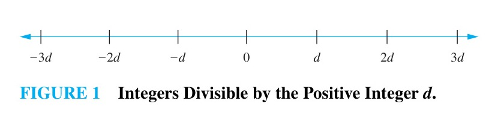

# Chapter 4: Number Theory and Cryptography

<!-- Page 1 -->

## Chapter Overview

The part of mathematics devoted to the study of the set of integers and their properties is known as number theory. In this chapter we will develop some of the important concepts of number theory including many of those used in computer science. As we develop number theory, we will use the proof methods developed in Chapter 1 to prove many theorems.

We will first introduce the notion of divisibility of integers, which we use to introduce modular, or clock, arithmetic. Modular arithmetic operates with the remainders of integers when they are divided by a fixed positive integer, called the modulus. We will prove many important results about modular arithmetic which we will use extensively in this chapter.

Integers can be represented with any positive integer $b$ greater than 1 as a base. In this chapter we discuss base $b$ representations of integers and give an algorithm for finding them. In particular, we will discuss binary, octal, and hexadecimal (base 2, 8, and 16) representations. We will describe algorithms for carrying out arithmetic using these representations and study their complexity. These algorithms were the first procedures called algorithms.

We will discuss prime numbers, the positive integers that have only 1 and themselves as positive divisors. We will prove that there are infinitely many primes; the proof we give is considered to be one of the most beautiful proofs in mathematics. We will discuss the distribution of primes and many famous open questions concerning primes. We will introduce the concept of greatest common divisors and study the Euclidean algorithm for computing them. This algorithm was first described thousands of years ago. We will introduce the fundamental theorem of arithmetic, a key result which tells us that every positive integer has a unique factorization into primes.

We will explain how to solve linear congruences, as well as systems of linear congruences, which we solve using the famous Chinese remainder theorem. We will introduce the notion of pseudoprimes, which are composite integers masquerading as primes, and show how this notion can help us rapidly generate prime numbers.

This chapter introduces several important applications of number theory. In particular, we will use number theory to generate pseudorandom numbers, to assign memory locations to computer files, and to find check digits used to detect errors in various kinds of identification numbers. We also introduce the subject of cryptography. Number theory plays an essential role both in classical cryptography, first used thousands of years ago, and modern cryptography, which plays an essential role in electronic communication. We will show how the ideas we develop can be used in cryptographical protocols, introducing protocols for sharing keys and for sending signed messages. Number theory, once considered the purest of subjects, has become an essential tool in providing computer and Internet security.

---

## 4.1 Divisibility and Modular Arithmetic

### Introduction

The ideas that we will develop in this section are based on the notion of divisibility. Division of an integer by a positive integer produces a quotient and a remainder. Working with these remainders leads to modular arithmetic, which plays an important role in mathematics and which is used throughout computer science. We will discuss some important applications of modular arithmetic later in this chapter, including generating pseudorandom numbers, assigning computer memory locations to files, constructing check digits, and encrypting messages.

<!-- Page 2 -->

### Division

When one integer is divided by a second nonzero integer, the quotient may or may not be an integer. For example, $12/3 = 4$ is an integer, whereas $11/4 = 2.75$ is not. This leads to Definition 1.

> [!NOTE] DEFINITION 1
> If $a$ and $b$ are integers with $a \neq 0$, we say that $a$ **divides** $b$ if there is an integer $c$ such that $b = ac$, or equivalently, if $\frac{b}{a}$ is an integer. When $a$ divides $b$ we say that $a$ is a **factor** or **divisor** of $b$, and that $b$ is a **multiple** of $a$. The notation $a \mid b$ denotes that $a$ divides $b$. We write $a \nmid b$ when $a$ does not divide $b$.

> [!NOTE] Remark
> We can express $a \mid b$ using quantifiers as $\exists c (ac = b)$, where the universe of discourse is the set of integers.

In Figure 1 a number line indicates which integers are divisible by the positive integer $d$.

*Figure 1 — Integers Divisible by the Positive Integer $d$.*

#### EXAMPLE 1
Determine whether $3 \mid 7$ and whether $3 \mid 12$.

**Solution:** We see that $3 \nmid 7$, because $7/3$ is not an integer. On the other hand, $3 \mid 12$ because $12/3 = 4$. $\blacktriangleleft$

#### EXAMPLE 2
Let $n$ and $d$ be positive integers. How many positive integers not exceeding $n$ are divisible by $d$?

**Solution:** The positive integers divisible by $d$ are all the integers of the form $dk$, where $k$ is a positive integer. Hence, the number of positive integers divisible by $d$ that do not exceed $n$ equals the number of integers $k$ with $0 < dk \leq n$, or with $0 < k \leq n/d$. Therefore, there are $\lfloor n/d \rfloor$ positive integers not exceeding $n$ that are divisible by $d$. $\blacktriangleleft$

Some of the basic properties of divisibility of integers are given in Theorem 1.

> [!NOTE] THEOREM 1
> Let $a$, $b$, and $c$ be integers, where $a \neq 0$. Then
> 1. if $a \mid b$ and $a \mid c$, then $a \mid (b + c)$;
> 2. if $a \mid b$, then $a \mid bc$ for all integers $c$;
> 3. if $a \mid b$ and $b \mid c$, then $a \mid c$.

**Proof:** We will give a direct proof of (i). Suppose that $a \mid b$ and $a \mid c$. Then, from the definition of divisibility, it follows that there are integers $s$ and $t$ with $b = as$ and $c = at$. Hence,
$$b + c = as + at = a(s + t).$$
Therefore, $a$ divides $b + c$. This establishes part (i) of the theorem. The proofs of parts (ii) and (iii) are left as Exercises 3 and 4. $\blacksquare$

<!-- Page 3 -->

Theorem 1 has this useful consequence.

> [!NOTE] COROLLARY 1
> If $a$, $b$, and $c$ are integers, where $a \neq 0$, such that $a \mid b$ and $a \mid c$, then $a \mid mb + nc$ whenever $m$ and $n$ are integers.

**Proof:** We will give a direct proof. By part (ii) of Theorem 1 we see that $a \mid mb$ and $a \mid nc$ whenever $m$ and $n$ are integers. By part (i) of Theorem 1 it follows that $a \mid mb + nc$. $\blacksquare$

### The Division Algorithm

When an integer is divided by a positive integer, there is a quotient and a remainder, as the division algorithm shows.

> [!NOTE] THEOREM 2: THE DIVISION ALGORITHM
> Let $a$ be an integer and $d$ a positive integer. Then there are unique integers $q$ and $r$, with $0 \leq r < d$, such that $a = dq + r$.

We defer the proof of the division algorithm to Section 5.2.

> [!NOTE] Remark
> Theorem 2 is not really an algorithm. (Why not?) Nevertheless, we use its traditional name.

> [!NOTE] DEFINITION 2
> In the equality given in the division algorithm, $d$ is called the **divisor**, $a$ is called the **dividend**, $q$ is called the **quotient**, and $r$ is called the **remainder**. This notation is used to express the quotient and remainder:
> $$q = a \text{ div } d,$$
> $$r = a \bmod d.$$

> [!NOTE] Remark
> Note that both $a \text{ div } d$ and $a \bmod d$ for a fixed $d$ are functions on the set of integers. Furthermore, when $a$ is an integer and $d$ is a positive integer, we have $a \text{ div } d = \lfloor a/d \rfloor$ and $a \bmod d = a - d \lfloor a/d \rfloor$.

Examples 3 and 4 illustrate the division algorithm.

#### EXAMPLE 3
What are the quotient and remainder when 101 is divided by 11?

**Solution:** We have
$$101 = 11 \cdot 9 + 2.$$
Hence, the quotient when 101 is divided by 11 is $9 = 101 \text{ div } 11$, and the remainder is $2 = 101 \bmod 11$. $\blacktriangleleft$

<!-- Page 4 -->

#### EXAMPLE 4
What are the quotient and remainder when $-11$ is divided by 3?

**Solution:** We have
$$-11 = 3(-4) + 1.$$
Hence, the quotient when $-11$ is divided by 3 is $-4 = -11 \text{ div } 3$, and the remainder is $1 = -11 \bmod 3$.

Note that the remainder cannot be negative. Consequently, the remainder is not $-2$, even though
$$-11 = 3(-3) - 2,$$
because $r = -2$ does not satisfy $0 \leq r < 3$. $\blacktriangleleft$

Note that the integer $a$ is divisible by the integer $d$ if and only if the remainder is zero when $a$ is divided by $d$.

> [!NOTE] Remark
> A programming language may have one, or possibly two, operators for modular arithmetic, denoted by `mod` (in BASIC, Maple, Mathematica, EXCEL, and SQL), `%` (in C, C++, Java, and Python), `rem` (in Ada and Lisp), or something else. Be careful when using them, because for $a < 0$, some of these operators return $a - m\lceil a/m \rceil$ instead of $a \bmod m = a - m\lfloor a/m \rfloor$. Also, unlike $a \bmod m$, some of these operators are defined when $m < 0$, and even when $m = 0$.

### Modular Arithmetic

In some situations we care only about the remainder of an integer when it is divided by some specified positive integer. For instance, when we ask what time it will be (on a 24-hour clock) 50 hours from now, we care only about the remainder when 50 plus the current hour is divided by 24. Because we are often interested only in remainders, we have special notations for them. We have already introduced the notation $a \bmod m$ to represent the remainder when an integer $a$ is divided by the positive integer $m$. We now introduce a different, but related, notation that indicates that two integers have the same remainder when they are divided by the positive integer $m$.

> [!NOTE] DEFINITION 3
> If $a$ and $b$ are integers and $m$ is a positive integer, then $a$ is **congruent to** $b$ **modulo** $m$ if $m$ divides $a - b$. We use the notation $a \equiv b \pmod m$ to indicate that $a$ is congruent to $b$ modulo $m$. We say that $a \equiv b \pmod m$ is a **congruence** and that $m$ is its **modulus** (plural *moduli*). If $a$ and $b$ are not congruent modulo $m$, we write $a \not\equiv b \pmod m$.

Although both notations $a \equiv b \pmod m$ and $a \bmod m = b$ include "$\text{mod}$," they represent fundamentally different concepts. The first represents a relation on the set of integers, whereas the second represents a function. However, the relation $a \equiv b \pmod m$ and the $\bmod m$ function are closely related, as described in Theorem 3.

<!-- Page 5 -->

> [!NOTE] THEOREM 3
> Let $a$ and $b$ be integers, and let $m$ be a positive integer. Then $a \equiv b \pmod m$ if and only if $a \bmod m = b \bmod m$.

The proof of Theorem 3 is left as Exercises 15 and 16. Recall that $a \bmod m$ and $b \bmod m$ are the remainders when $a$ and $b$ are divided by $m$, respectively. Consequently, Theorem 3 also says that $a \equiv b \pmod m$ if and only if $a$ and $b$ have the same remainder when divided by $m$.

#### EXAMPLE 5
Determine whether 17 is congruent to 5 modulo 6 and whether 24 and 14 are congruent modulo 6.

**Solution:** Because 6 divides $17 - 5 = 12$, we see that $17 \equiv 5 \pmod 6$. However, because $24 - 14 = 10$ is not divisible by 6, we see that $24 \not\equiv 14 \pmod 6$. $\blacktriangleleft$

The concept of congruences was developed by Karl Friedrich Gauss at the end of the eighteenth century. The notion of congruences has played an important role in the development of number theory.

Theorem 4 provides a useful way to work with congruences.

> [!NOTE] THEOREM 4
> Let $m$ be a positive integer. The integers $a$ and $b$ are congruent modulo $m$ if and only if there is an integer $k$ such that $a = b + km$.

**Proof:** If $a \equiv b \pmod m$, by the definition of congruence (Definition 3), we know that $m \mid (a - b)$. This means that there is an integer $k$ such that $a - b = km$, so that $a = b + km$.

Conversely, if there is an integer $k$ such that $a = b + km$, then $km = a - b$. Hence, $m$ divides $a - b$, so that $a \equiv b \pmod m$. $\blacksquare$

The set of all integers congruent to an integer $a$ modulo $m$ is called the **congruence class** of $a$ modulo $m$. In Chapter 9 we will show that there are $m$ pairwise disjoint equivalence classes modulo $m$ and that the union of these equivalence classes is the set of integers.

<!-- Page 6 -->

Theorem 5 shows that additions and multiplications preserve congruences.

> [!NOTE] THEOREM 5
> Let $m$ be a positive integer. If $a \equiv b \pmod m$ and $c \equiv d \pmod m$, then
> $$a + c \equiv b + d \pmod m$$
> and
> $$ac \equiv bd \pmod m.$$

**Proof:** We use a direct proof. Because $a \equiv b \pmod m$ and $c \equiv d \pmod m$, by Theorem 4 there are integers $s$ and $t$ with $b = a + sm$ and $d = c + tm$. Hence,
$$b + d = (a + sm) + (c + tm) = (a + c) + m(s + t)$$
and
$$bd = (a + sm)(c + tm) = ac + m(at + cs + stm).$$
Hence,
$$a + c \equiv b + d \pmod m$$
and
$$ac \equiv bd \pmod m.$$ $\blacksquare$

#### EXAMPLE 6
Because $7 \equiv 2 \pmod 5$ and $11 \equiv 1 \pmod 5$, it follows from Theorem 5 that
$$18 = 7 + 11 \equiv 2 + 1 = 3 \pmod 5$$
and that
$$77 = 7 \cdot 11 \equiv 2 \cdot 1 = 2 \pmod 5.$$ $\blacktriangleleft$

> [!WARNING] You cannot always divide both sides of a congruence by the same number!
> We must be careful working with congruences. Some properties we may expect to be true are not valid. For example, if $ac \equiv bc \pmod m$, the congruence $a \equiv b \pmod m$ may be false. Similarly, if $a \equiv b \pmod m$ and $c \equiv d \pmod m$, the congruence $a^c \equiv b^d \pmod m$ may be false.

Corollary 2 shows how to find the values of the $\bmod m$ function at the sum and product of two integers using the values of this function at each of these integers. We will use this result in Section 5.4.

> [!NOTE] COROLLARY 2
> Let $m$ be a positive integer and let $a$ and $b$ be integers. Then
> $$(a + b) \bmod m = ((a \bmod m) + (b \bmod m)) \bmod m$$
> and
> $$ab \bmod m = ((a \bmod m)(b \bmod m)) \bmod m.$$

**Proof:** By the definitions of $\bmod m$ and of congruence modulo $m$, we know that $a \equiv (a \bmod m) \pmod m$ and $b \equiv (b \bmod m) \pmod m$. Hence, Theorem 5 tells us that
$$a + b \equiv (a \bmod m) + (b \bmod m) \pmod m$$
and
$$ab \equiv (a \bmod m)(b \bmod m) \pmod m.$$
The equalities in this corollary follow from these last two congruences by Theorem 3. $\blacksquare$

<!-- Page 7 -->

### Arithmetic Modulo $m$

We can define arithmetic operations on $\mathbf{Z}_m$, the set of nonnegative integers less than $m$, that is, the set $\{0, 1, \dots, m - 1\}$. In particular, we define addition of these integers, denoted by $+_m$, by
$$a +_m b = (a + b) \bmod m,$$
where the addition on the right-hand side of this equation is the ordinary addition of integers, and we define multiplication of these integers, denoted by $\cdot_m$, by
$$a \cdot_m b = (a \cdot b) \bmod m,$$
where the multiplication on the right-hand side of this equation is the ordinary multiplication of integers. The operations $+_m$ and $\cdot_m$ are called **addition and multiplication modulo** $m$ and when we use these operations, we are said to be doing **arithmetic modulo** $m$.

#### EXAMPLE 7
Use the definition of addition and multiplication in $\mathbf{Z}_m$ to find $7 +_{11} 9$ and $7 \cdot_{11} 9$.

**Solution:** Using the definition of addition modulo 11, we find that
$$7 +_{11} 9 = (7 + 9) \bmod 11 = 16 \bmod 11 = 5,$$
and
$$7 \cdot_{11} 9 = (7 \cdot 9) \bmod 11 = 63 \bmod 11 = 8.$$
Hence $7 +_{11} 9 = 5$ and $7 \cdot_{11} 9 = 8$. $\blacktriangleleft$

The operations $+_m$ and $\cdot_m$ satisfy many of the same properties of ordinary addition and multiplication of integers. In particular, they satisfy these properties:

- **Closure:** If $a$ and $b$ belong to $\mathbf{Z}_m$, then $a +_m b$ and $a \cdot_m b$ belong to $\mathbf{Z}_m$.
- **Associativity:** If $a, b,$ and $c$ belong to $\mathbf{Z}_m$, then $(a +_m b) +_m c = a +_m (b +_m c)$ and $(a \cdot_m b) \cdot_m c = a \cdot_m (b \cdot_m c)$.
- **Commutativity:** If $a$ and $b$ belong to $\mathbf{Z}_m$, then $a +_m b = b +_m a$ and $a \cdot_m b = b \cdot_m a$.
- **Identity elements:** The elements 0 and 1 are identity elements for addition and multiplication modulo $m$, respectively. That is, if $a$ belongs to $\mathbf{Z}_m$, then $a +_m 0 = 0 +_m a = a$ and $a \cdot_m 1 = 1 \cdot_m a = a$.
- **Additive inverses:** If $a \neq 0$ belongs to $\mathbf{Z}_m$, then $m - a$ is an additive inverse of $a$ modulo $m$ and 0 is its own additive inverse. That is, $a +_m (m - a) = 0$ and $0 +_m 0 = 0$.
- **Distributivity:** If $a, b,$ and $c$ belong to $\mathbf{Z}_m$, then $a \cdot_m (b +_m c) = (a \cdot_m b) +_m (a \cdot_m c)$ and $(a +_m b) \cdot_m c = (a \cdot_m c) +_m (b \cdot_m c)$.

These properties follow from the properties we have developed for congruences and remainders modulo $m$, together with the properties of integers; we leave their proofs as Exercises 42–44.

Note that we have listed the property that every element of $\mathbf{Z}_m$ has an additive inverse, but no analogous property for multiplicative inverses has been included. This is because multiplicative inverses do not always exist modulo $m$. For instance, there is no multiplicative inverse of 2 modulo 6, as the reader can verify. We will return to the question of when an integer has a multiplicative inverse modulo $m$ later in this chapter.

<!-- Page 8 -->

> [!NOTE] Remark
> Because $\mathbf{Z}_m$ with the operations of addition and multiplication modulo $m$ satisfies the properties listed, $\mathbf{Z}_m$ with modular addition is said to be a **commutative group** and $\mathbf{Z}_m$ with both of these operations is said to be a **commutative ring**. Note that the set of integers with ordinary addition and multiplication also forms a commutative ring. Groups and rings are studied in courses that cover abstract algebra.

> [!NOTE] Remark
> In Exercise 30, and in later sections, we will use the notations $+$ and $\cdot$ for $+_m$ and $\cdot_m$ without the subscript $m$ on the symbol for the operator whenever we work with $\mathbf{Z}_m$.
