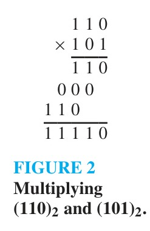

<!-- Page 9 -->

## 4.2 Integer Representations and Algorithms

### Introduction

Integers can be expressed using any integer greater than one as a base, as we will show in this section. Although we commonly use decimal (base 10) representations, binary (base 2), octal (base 8), and hexadecimal (base 16) representations are often used, especially in computer science. Given a base $b$ and an integer $n$, we will show how to construct the base $b$ representation of this integer. We will also explain how to quickly convert between binary and octal and between binary and hexadecimal notations.

<!-- Page 10 -->

As mentioned in Section 3.1, the term algorithm originally referred to procedures for performing arithmetic operations using the decimal representations of integers. These algorithms, adapted for use with binary representations, are the basis for computer arithmetic. They provide good illustrations of the concept of an algorithm and the complexity of algorithms. For these reasons, they will be discussed in this section.

We will also introduce an algorithm for finding $a \text{ div } d$ and $a \bmod d$ where $a$ and $d$ are integers with $d > 1$. Finally, we will describe an efficient algorithm for modular exponentiation, which is a particularly important algorithm for cryptography, as we will see in Section 4.6.

### Representations of Integers

In everyday life we use decimal notation to express integers. For example, 965 is used to denote $9 \cdot 10^2 + 6 \cdot 10 + 5$. However, it is often convenient to use bases other than 10. In particular, computers usually use binary notation (with 2 as the base) when carrying out arithmetic, and octal (base 8) or hexadecimal (base 16) notation when expressing characters, such as letters or digits. In fact, we can use any integer greater than 1 as the base when expressing integers. This is stated in Theorem 1.

> [!NOTE] THEOREM 1
> Let $b$ be an integer greater than 1. Then if $n$ is a positive integer, it can be expressed uniquely in the form
> $$n = a_k b^k + a_{k-1} b^{k-1} + \dots + a_1 b + a_0,$$
> where $k$ is a nonnegative integer, $a_0, a_1, \dots, a_k$ are nonnegative integers less than $b$, and $a_k \neq 0$.

A proof of this theorem can be constructed using mathematical induction, a proof method that is discussed in Section 5.1. The representation of $n$ given in Theorem 1 is called the **base $b$ expansion of $n$**. The base $b$ expansion of $n$ is denoted by $(a_k a_{k-1} \dots a_1 a_0)_b$. For instance, $(245)_8$ represents $2 \cdot 8^2 + 4 \cdot 8 + 5 = 165$. Typically, the subscript 10 is omitted for base 10 expansions of integers because base 10, or decimal expansions, are commonly used to represent integers.

#### Binary Expansions
Choosing 2 as the base gives binary expansions of integers. In binary notation each digit is either a 0 or a 1. In other words, the binary expansion of an integer is just a bit string. Binary expansions (and related expansions that are variants of binary expansions) are used by computers to represent and do arithmetic with integers.

#### EXAMPLE 1
What is the decimal expansion of the integer that has $(1\ 0101\ 1111)_2$ as its binary expansion?

**Solution:** We have
$$(1\ 0101\ 1111)_2 = 1 \cdot 2^8 + 0 \cdot 2^7 + 1 \cdot 2^6 + 0 \cdot 2^5 + 1 \cdot 2^4 + 1 \cdot 2^3 + 1 \cdot 2^2 + 1 \cdot 2^1 + 1 \cdot 2^0 = 351.$$ $\blacktriangleleft$

#### Octal and Hexadecimal Expansions
Among the most important bases in computer science are base 2, base 8, and base 16. Base 8 expansions are called **octal expansions** and base 16 expansions are **hexadecimal expansions**.

<!-- Page 11 -->

#### EXAMPLE 2
What is the decimal expansion of the number with octal expansion $(7016)_8$?

**Solution:** Using the definition of a base $b$ expansion with $b = 8$ tells us that
$$(7016)_8 = 7 \cdot 8^3 + 0 \cdot 8^2 + 1 \cdot 8 + 6 = 3598.$$ $\blacktriangleleft$

Sixteen different digits are required for hexadecimal expansions. Usually, the hexadecimal digits used are $0, 1, 2, 3, 4, 5, 6, 7, 8, 9, \text{A}, \text{B}, \text{C}, \text{D}, \text{E},$ and $\text{F}$, where the letters $\text{A}$ through $\text{F}$ represent the digits corresponding to the numbers 10 through 15 (in decimal notation).

#### EXAMPLE 3
What is the decimal expansion of the number with hexadecimal expansion $(2\text{AE}0\text{B})_{16}$?

**Solution:** Using the definition of a base $b$ expansion with $b = 16$ tells us that
$$(2\text{AE}0\text{B})_{16} = 2 \cdot 16^4 + 10 \cdot 16^3 + 14 \cdot 16^2 + 0 \cdot 16 + 11 = 175627.$$ $\blacktriangleleft$

Each hexadecimal digit can be represented using four bits. For instance, we see that $(1110\ 0101)_2 = (\text{E}5)_{16}$ because $(1110)_2 = (\text{E})_{16}$ and $(0101)_2 = (5)_{16}$. Bytes, which are bit strings of length eight, can be represented by two hexadecimal digits.

#### Base Conversion
We will now describe an algorithm for constructing the base $b$ expansion of an integer $n$. First, divide $n$ by $b$ to obtain a quotient and remainder, that is,
$$n = b q_0 + a_0, \quad 0 \leq a_0 < b.$$
The remainder, $a_0$, is the rightmost digit in the base $b$ expansion of $n$. Next, divide $q_0$ by $b$ to obtain
$$q_0 = b q_1 + a_1, \quad 0 \leq a_1 < b.$$
We see that $a_1$ is the second digit from the right in the base $b$ expansion of $n$. Continue this process, successively dividing the quotients by $b$, obtaining additional base $b$ digits as the remainders. This process terminates when we obtain a quotient equal to zero. It produces the base $b$ digits of $n$ from the right to the left.

#### EXAMPLE 4
Find the octal expansion of $(12345)_{10}$.

**Solution:** First, divide 12345 by 8 to obtain
$$12345 = 8 \cdot 1543 + 1.$$
Successively dividing quotients by 8 gives
$$
\begin{aligned}
1543 &= 8 \cdot 192 + 7, \\
192 &= 8 \cdot 24 + 0, \\
24 &= 8 \cdot 3 + 0, \\
3 &= 8 \cdot 0 + 3.
\end{aligned}
$$
The successive remainders that we have found, 1, 7, 0, 0, and 3, are the digits from the right to the left of 12345 in base 8. Hence,
$$(12345)_{10} = (30071)_8.$$ $\blacktriangleleft$

<!-- Page 12 -->

#### EXAMPLE 5
Find the hexadecimal expansion of $(177130)_{10}$.

**Solution:** First divide 177130 by 16 to obtain
$$177130 = 16 \cdot 11070 + 10.$$
Successively dividing quotients by 16 gives
$$
\begin{aligned}
11070 &= 16 \cdot 691 + 14, \\
691 &= 16 \cdot 43 + 3, \\
43 &= 16 \cdot 2 + 11, \\
2 &= 16 \cdot 0 + 2.
\end{aligned}
$$
The successive remainders that we have found, 10, 14, 3, 11, 2, give us the digits from the right to the left of 177130 in the hexadecimal (base 16) expansion of $(177130)_{10}$. It follows that
$$(177130)_{10} = (2\text{B}3\text{EA})_{16}.$$
(Recall that the integers 10, 11, and 14 correspond to the hexadecimal digits $\text{A}, \text{B},$ and $\text{E}$, respectively.) $\blacktriangleleft$

#### EXAMPLE 6
Find the binary expansion of $(241)_{10}$.

**Solution:** First divide 241 by 2 to obtain
$$241 = 2 \cdot 120 + 1.$$
Successively dividing quotients by 2 gives
$$
\begin{aligned}
120 &= 2 \cdot 60 + 0, \\
60 &= 2 \cdot 30 + 0, \\
30 &= 2 \cdot 15 + 0, \\
15 &= 2 \cdot 7 + 1, \\
7 &= 2 \cdot 3 + 1, \\
3 &= 2 \cdot 1 + 1, \\
1 &= 2 \cdot 0 + 1.
\end{aligned}
$$
The successive remainders that we have found, 1, 0, 0, 0, 1, 1, 1, 1, are the digits from the right to the left in the binary (base 2) expansion of $(241)_{10}$. Hence,
$$(241)_{10} = (1111\ 0001)_2.$$ $\blacktriangleleft$

The pseudocode given in Algorithm 1 finds the base $b$ expansion $(a_{k-1} \dots a_1 a_0)_b$ of the integer $n$.

<!-- Page 13 -->

##### TABLE 1 Hexadecimal, Octal, and Binary Representation of the Integers 0 through 15.

| Decimal | Hexadecimal | Octal | Binary |
| :---: | :---: | :---: | :---: |
| 0 | 0 | 0 | 0 |
| 1 | 1 | 1 | 1 |
| 2 | 2 | 2 | 10 |
| 3 | 3 | 3 | 11 |
| 4 | 4 | 4 | 100 |
| 5 | 5 | 5 | 101 |
| 6 | 6 | 6 | 110 |
| 7 | 7 | 7 | 111 |
| 8 | 8 | 10 | 1000 |
| 9 | 9 | 11 | 1001 |
| 10 | A | 12 | 1010 |
| 11 | B | 13 | 1011 |
| 12 | C | 14 | 1100 |
| 13 | D | 15 | 1101 |
| 14 | E | 16 | 1110 |
| 15 | F | 17 | 1111 |

> [!NOTE] ALGORITHM 1: Constructing Base $b$ Expansions.
> ```pascal
> procedure base b expansion(n, b: positive integers with b > 1)
> q := n
> k := 0
> while q ≠ 0
>     ak := q mod b
>     q := q div b
>     k := k + 1
> return (ak-1, ..., a1, a0) {(ak-1 ... a1 a0)_b is the base b expansion of n}
> ```

In Algorithm 1, $q$ represents the quotient obtained by successive divisions by $b$, starting with $q = n$. The digits in the base $b$ expansion are the remainders of these divisions and are given by $q \bmod b$. The algorithm terminates when a quotient $q = 0$ is reached.

> [!NOTE] Remark
> Note that Algorithm 1 can be thought of as a greedy algorithm, as the base $b$ digits are taken as large as possible in each step.

#### Conversion Between Binary, Octal, and Hexadecimal Expansions
Conversion between binary and octal and between binary and hexadecimal expansions is extremely easy because each octal digit corresponds to a block of three binary digits and each hexadecimal digit corresponds to a block of four binary digits, with these correspondences shown in Table 1 without initial 0s shown. This conversion is illustrated in Example 7.

#### EXAMPLE 7
Find the octal and hexadecimal expansions of $(11\ 1110\ 1011\ 1100)_2$ and the binary expansions of $(765)_8$ and $(\text{A8D})_{16}$.

**Solution:** To convert $(11\ 1110\ 1011\ 1100)_2$ into octal notation we group the binary digits into blocks of three, adding initial zeros at the start of the leftmost block if necessary. These blocks, from left to right, are $011, 111, 010, 111,$ and $100$, corresponding to $3, 7, 2, 7,$ and $4$, respectively. Consequently, $(11\ 1110\ 1011\ 1100)_2 = (37274)_8$.

To convert $(11\ 1110\ 1011\ 1100)_2$ into hexadecimal notation we group the binary digits into blocks of four, adding initial zeros at the start of the leftmost block if necessary. These blocks, from left to right, are $0011, 1110, 1011,$ and $1100$, corresponding to the hexadecimal digits $3, \text{E}, \text{B},$ and $\text{C}$, respectively. Consequently, $(11\ 1110\ 1011\ 1100)_2 = (3\text{EBC})_{16}$.

To convert $(765)_8$ into binary notation, we replace each octal digit by a block of three binary digits. These blocks are $111, 110,$ and $101$. Hence, $(765)_8 = (11111\ 0101)_2$.

To convert $(\text{A8D})_{16}$ into binary notation, we replace each hexadecimal digit by a block of four binary digits. These blocks are $1010, 1000,$ and $1101$. Hence, $(\text{A8D})_{16} = (1010\ 1000\ 1101)_2$. $\blacktriangleleft$

<!-- Page 14 -->

### Algorithms for Integer Operations

The algorithms for performing operations with integers using their binary expansions are extremely important in computer arithmetic. We will describe algorithms for the addition and the multiplication of two integers expressed in binary notation. We will also analyze the computational complexity of these algorithms, in terms of the actual number of bit operations used.

Throughout this discussion, suppose that the binary expansions of $a$ and $b$ are
$$a = (a_{n-1} a_{n-2} \dots a_1 a_0)_2, \quad b = (b_{n-1} b_{n-2} \dots b_1 b_0)_2,$$
so that $a$ and $b$ each have $n$ bits (putting bits equal to 0 at the beginning of one of these expansions if necessary). We will measure the complexity of algorithms for integer arithmetic in terms of the number of bits in these numbers.

#### Addition Algorithm
Consider the problem of adding two integers in binary notation. A procedure to perform addition can be based on the usual method for adding numbers with pencil and paper. This method proceeds by adding pairs of binary digits together with carries, when they occur, to compute the sum of two integers. This procedure will now be specified in detail.

To add $a$ and $b$, first add their rightmost bits. This gives
$$a_0 + b_0 = c_0 \cdot 2 + s_0,$$
where $s_0$ is the rightmost bit in the binary expansion of $a + b$ and $c_0$ is the carry, which is either 0 or 1. Then add the next pair of bits and the carry,
$$a_1 + b_1 + c_0 = c_1 \cdot 2 + s_1,$$
where $s_1$ is the next bit (from the right) in the binary expansion of $a + b$, and $c_1$ is the carry. Continue this process, adding the corresponding bits in the two binary expansions and the carry, to determine the next bit from the right in the binary expansion of $a + b$. At the last stage, add $a_{n-1}, b_{n-1},$ and $c_{n-2}$ to obtain $c_{n-1} \cdot 2 + s_{n-1}$. The leading bit of the sum is $s_n = c_{n-1}$. This procedure produces the binary expansion of the sum, namely, $a + b = (s_n s_{n-1} s_{n-2} \dots s_1 s_0)_2$.

#### EXAMPLE 8
Add $a = (1110)_2$ and $b = (1011)_2$.

**Solution:** Following the procedure specified in the algorithm, first note that
$$a_0 + b_0 = 0 + 1 = 0 \cdot 2 + 1,$$
so that $c_0 = 0$ and $s_0 = 1$. Then, because
$$a_1 + b_1 + c_0 = 1 + 1 + 0 = 1 \cdot 2 + 0,$$
it follows that $c_1 = 1$ and $s_1 = 0$. Continuing,
$$a_2 + b_2 + c_1 = 1 + 0 + 1 = 1 \cdot 2 + 0,$$
so that $c_2 = 1$ and $s_2 = 0$. Finally, because
$$a_3 + b_3 + c_2 = 1 + 1 + 1 = 1 \cdot 2 + 1,$$

<!-- Page 15 -->

follows that $c_3 = 1$ and $s_3 = 1$. This means that $s_4 = c_3 = 1$. Therefore, $s = a + b = (1\ 1001)_2$. This addition is displayed in Figure 1, where carries are shown in blue. $\blacktriangleleft$


*Figure 1 — Adding $(1110)_2$ and $(1011)_2$.*

The algorithm for addition can be described using pseudocode as follows.

> [!NOTE] ALGORITHM 2: Addition of Integers.
> ```pascal
> procedure add(a, b: positive integers)
> {the binary expansions of a and b are (an-1 an-2 ... a1 a0)_2
> and (bn-1 bn-2 ... b1 b0)_2, respectively}
> c := 0
> for j := 0 to n - 1
>     d := floor((aj + bj + c)/2)
>     sj := aj + bj + c - 2d
>     c := d
> sn := c
> return (s0, s1, ..., sn) {the binary expansion of the sum is (sn sn-1 ... s0)_2}
> ```

Next, the number of additions of bits used by Algorithm 2 will be analyzed.

#### EXAMPLE 9
How many additions of bits are required to use Algorithm 2 to add two integers with $n$ bits (or less) in their binary representations?

**Solution:** Two integers are added by successively adding pairs of bits and, when it occurs, a carry. Adding each pair of bits and the carry requires two additions of bits. Thus, the total number of additions of bits used is less than twice the number of bits in the expansion. Hence, the number of additions of bits used by Algorithm 2 to add two $n$-bit integers is $O(n)$. $\blacktriangleleft$

#### Multiplication Algorithm
Next, consider the multiplication of two $n$-bit integers $a$ and $b$. The conventional algorithm (used when multiplying with pencil and paper) works as follows. Using the distributive law, we see that
$$
\begin{aligned}
ab &= a(b_0 2^0 + b_1 2^1 + \dots + b_{n-1} 2^{n-1}) \\
&= a(b_0 2^0) + a(b_1 2^1) + \dots + a(b_{n-1} 2^{n-1}).
\end{aligned}
$$
We can compute $ab$ using this equation. We first note that $a b_j = a$ if $b_j = 1$ and $a b_j = 0$ if $b_j = 0$. Each time we multiply a term by 2, we shift its binary expansion one place to the left and add a zero at the tail end of the expansion. Consequently, we can obtain $(a b_j)2^j$ by shifting the binary expansion of $a b_j$ $j$ places to the left, adding $j$ zero bits at the tail end of this binary expansion. Finally, we obtain $ab$ by adding the $n$ integers $a b_j 2^j, j = 0, 1, 2, \dots, n - 1$. Algorithm 3 displays this procedure for multiplication.

<!-- Page 16 -->

> [!NOTE] ALGORITHM 3: Multiplication of Integers.
> ```pascal
> procedure multiply(a, b: positive integers)
> {the binary expansions of a and b are (an-1 an-2 ... a1 a0)_2
> and (bn-1 bn-2 ... b1 b0)_2, respectively}
> for j := 0 to n - 1
>     if bj = 1 then cj := a shifted j places
>     else cj := 0
> {c0, c1, ..., cn-1 are the partial products}
> p := 0
> for j := 0 to n - 1
>     p := p + cj
> return p {p is the value of ab}
> ```

Example 10 illustrates the use of this algorithm.

#### EXAMPLE 10
Find the product of $a = (110)_2$ and $b = (101)_2$.

**Solution:** First note that
$$
\begin{aligned}
a b_0 \cdot 2^0 &= (110)_2 \cdot 1 \cdot 2^0 = (110)_2, \\
a b_1 \cdot 2^1 &= (110)_2 \cdot 0 \cdot 2^1 = (0000)_2,
\end{aligned}
$$
and
$$a b_2 \cdot 2^2 = (110)_2 \cdot 1 \cdot 2^2 = (11000)_2.$$
To find the product, add $(110)_2, (0000)_2,$ and $(11000)_2$. Carrying out these additions (using Algorithm 2, including initial zero bits when necessary) shows that $ab = (1\ 1110)_2$. This multiplication is displayed in Figure 2. $\blacktriangleleft$


*Figure 2 — Multiplying $(110)_2$ and $(101)_2$.*

Next, we determine the number of additions of bits and shifts of bits used by Algorithm 3 to multiply two integers.

#### EXAMPLE 11
How many additions of bits and shifts of bits are used to multiply $a$ and $b$ using Algorithm 3?

**Solution:** Algorithm 3 computes the products of $a$ and $b$ by adding the partial products $c_0, c_1, c_2, \dots,$ and $c_{n-1}$. When $b_j = 1$, we compute the partial product $c_j$ by shifting the binary expansion of $a$ by $j$ bits. When $b_j = 0$, no shifts are required because $c_j = 0$. Hence, to find all $n$ of the integers $a b_j 2^j, j = 0, 1, \dots, n - 1$, requires at most
$$0 + 1 + 2 + \dots + n - 1$$
shifts. Hence, by Example 5 in Section 3.2 the number of shifts required is $O(n^2)$.

To add the integers $a b_j$ from $j = 0$ to $j = n - 1$ requires the addition of an $n$-bit integer, an $(n + 1)$-bit integer, $\dots,$ and a $(2n)$-bit integer. We know from Example 9 that each of these additions requires $O(n)$ additions of bits. Consequently, a total of $O(n^2)$ additions of bits are required for all $n$ additions. $\blacktriangleleft$

Surprisingly, there are more efficient algorithms than the conventional algorithm for multiplying integers. One such algorithm, which uses $O(n^{1.585})$ bit operations to multiply $n$-bit numbers, will be described in Section 8.3.

<!-- Page 17 -->

#### Algorithm for div and mod
Given integers $a$ and $d$, $d > 0$, we can find $q = a \text{ div } d$ and $r = a \bmod d$ using Algorithm 4. In this brute-force algorithm, when $a$ is positive we subtract $d$ from $a$ as many times as necessary until what is left is less than $d$. The number of times we perform this subtraction is the quotient and what is left over after all these subtractions is the remainder. Algorithm 4 also covers the case where $a$ is negative. This algorithm finds the quotient $q$ and remainder $r$ when $|a|$ is divided by $d$. Then, when $a < 0$ and $r > 0$, it uses these to find the quotient $-(q + 1)$ and remainder $d - r$ when $a$ is divided by $d$. Assuming that $a > d$, this algorithm uses $O(q \log a)$ bit operations.

> [!NOTE] ALGORITHM 4: Computing div and mod.
> ```pascal
> procedure division algorithm(a: integer, d: positive integer)
> q := 0
> r := |a|
> while r ≥ d
>     r := r - d
>     q := q + 1
> if a < 0 and r > 0 then
>     r := d - r
>     q := -(q + 1)
> return (q, r) {q = a div d is the quotient, r = a mod d is the remainder}
> ```

There are more efficient algorithms than Algorithm 4 for determining the quotient $q = a \text{ div } d$ and the remainder $r = a \bmod d$ when a positive integer $a$ is divided by a positive integer $d$ (see [Kn98] for details). These algorithms require $O(\log a \cdot \log d)$ bit operations. If both of the binary expansions of $a$ and $d$ contain $n$ or fewer bits, then we can replace $\log a \cdot \log d$ by $n^2$. This means that we need $O(n^2)$ bit operations to find the quotient and remainder when $a$ is divided by $d$.

### Modular Exponentiation

In cryptography it is important to be able to find $b^n \bmod m$ efficiently, where $b, n,$ and $m$ are large integers. It is impractical to first compute $b^n$ and then find its remainder when divided by $m$ because $b^n$ will be a huge number. Instead, we can use an algorithm that employs the binary expansion of the exponent $n$.

Before we present this algorithm, we illustrate its basic idea. We will explain how to use the binary expansion of $n$, say $n = (a_{k-1} \dots a_1 a_0)_2$, to compute $b^n$. First, note that
$$b^n = b^{a_{k-1} \cdot 2^{k-1} + \dots + a_1 \cdot 2 + a_0} = b^{a_{k-1} \cdot 2^{k-1}} \dots b^{a_1 \cdot 2} \cdot b^{a_0}.$$
This shows that to compute $b^n$, we need only compute the values of $b, b^2, (b^2)^2 = b^4, (b^4)^2 = b^8, \dots, b^{2^k}$. Once we have these values, we multiply the terms $b^{2^j}$ in this list, where $a_j = 1$. (For efficiency, after multiplying by each term, we reduce the result modulo $m$.) This gives us $b^n$. For example, to compute $3^{11}$ we first note that $11 = (1011)_2$, so that $3^{11} = 3^8 3^2 3^1$. By successively squaring, we find that $3^2 = 9, 3^4 = 9^2 = 81,$ and $3^8 = (81)^2 = 6561$. Consequently, $3^{11} = 3^8 3^2 3^1 = 6561 \cdot 9 \cdot 3 = 177,147$.

<!-- Page 18 -->

The algorithm successively finds $b \bmod m, b^2 \bmod m, b^4 \bmod m, \dots, b^{2^{k-1}} \bmod m$ and multiplies together those terms $b^{2^j} \bmod m$ where $a_j = 1$, finding the remainder of the product when divided by $m$ after each multiplication. Pseudocode for this algorithm is shown in Algorithm 5.

> [!NOTE] ALGORITHM 5: Modular Exponentiation.
> ```pascal
> procedure modular exponentiation(b: integer, n = (ak-1 ak-2 ... a1 a0)_2, m: positive integers)
> x := 1
> power := b mod m
> for i := 0 to k - 1
>     if ai = 1 then x := (x · power) mod m
>     power := (power · power) mod m
> return x {x equals b^n mod m}
> ```

We illustrate how Algorithm 5 works in Example 12.

#### EXAMPLE 12
Use Algorithm 5 to find $3^{644} \bmod 645$.

**Solution:** Algorithm 5 initially sets $x = 1$ and $\text{power} = 3 \bmod 645 = 3$. In the computation of $3^{644} \bmod 645$, this algorithm determines $3^{2^j} \bmod 645$ for $j = 1, 2, \dots, 9$ by successively squaring and reducing modulo 645. If $a_j = 1$ (where $a_j$ is the bit in the $j$th position in the binary expansion of 644, which is $(1010000100)_2$), it multiplies the current value of $x$ by $3^{2^j} \bmod 645$ and reduces the result modulo 645. Here are the steps used:

- $i = 0$: Because $a_0 = 0$, we have $x = 1$ and $\text{power} = 3^2 \bmod 645 = 9 \bmod 645 = 9$;
- $i = 1$: Because $a_1 = 0$, we have $x = 1$ and $\text{power} = 9^2 \bmod 645 = 81 \bmod 645 = 81$;
- $i = 2$: Because $a_2 = 1$, we have $x = (1 \cdot 81) \bmod 645 = 81$ and $\text{power} = 81^2 \bmod 645 = 6561 \bmod 645 = 111$;
- $i = 3$: Because $a_3 = 0$, we have $x = 81$ and $\text{power} = 111^2 \bmod 645 = 12,321 \bmod 645 = 66$;
- $i = 4$: Because $a_4 = 0$, we have $x = 81$ and $\text{power} = 66^2 \bmod 645 = 4356 \bmod 645 = 486$;
- $i = 5$: Because $a_5 = 0$, we have $x = 81$ and $\text{power} = 486^2 \bmod 645 = 236,196 \bmod 645 = 126$;
- $i = 6$: Because $a_6 = 0$, we have $x = 81$ and $\text{power} = 126^2 \bmod 645 = 15,876 \bmod 645 = 396$;
- $i = 7$: Because $a_7 = 1$, we find that $x = (81 \cdot 396) \bmod 645 = 471$ and $\text{power} = 396^2 \bmod 645 = 156,816 \bmod 645 = 81$;
- $i = 8$: Because $a_8 = 0$, we have $x = 471$ and $\text{power} = 81^2 \bmod 645 = 6561 \bmod 645 = 111$;
- $i = 9$: Because $a_9 = 1$, we find that $x = (471 \cdot 111) \bmod 645 = 36$.

This shows that following the steps of Algorithm 5 produces the result $3^{644} \bmod 645 = 36$. $\blacktriangleleft$

Algorithm 5 is quite efficient; it uses $O((\log m)^2 \log n)$ bit operations to find $b^n \bmod m$.
