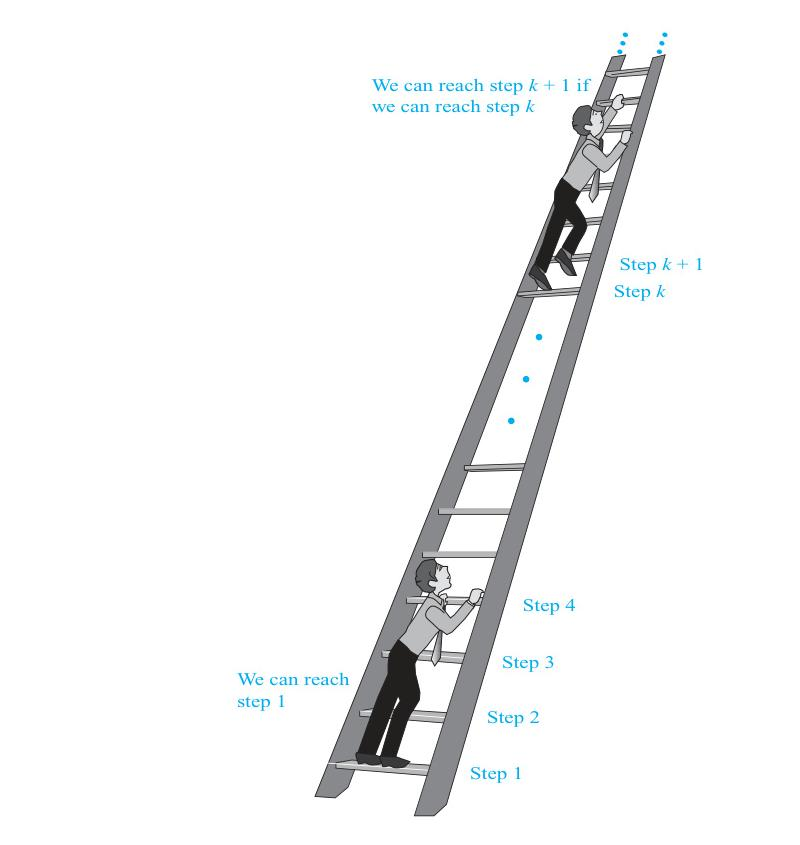
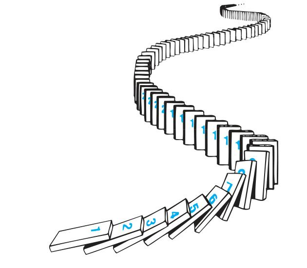
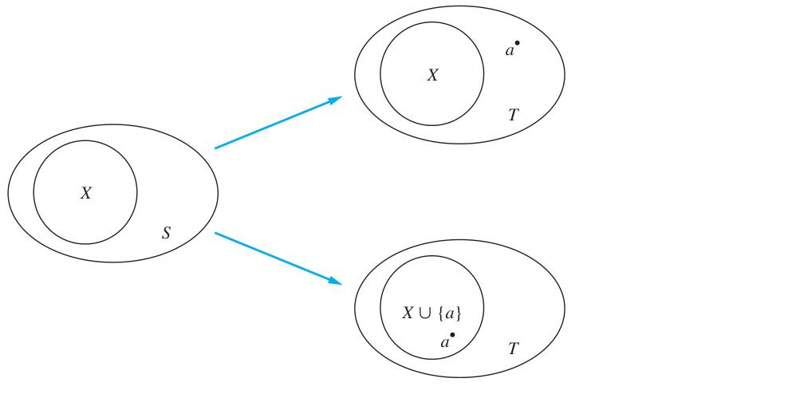
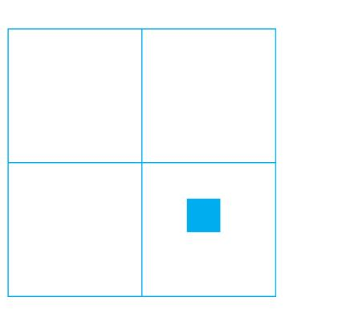
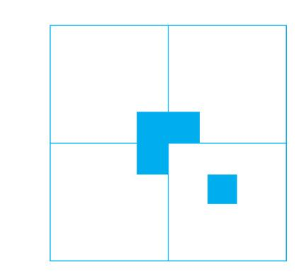

# Chapter 5: Induction and Recursion

<!-- Page 1 -->

## Chapter Overview

Many mathematical statements assert that a property is true for all positive integers. Examples of such statements are that for every positive integer $n$: $n! \le n^n$; $n^3 - n$ is divisible by $3$; a set with $n$ elements has $2^n$ subsets; and the sum of the first $n$ positive integers is $n(n + 1)/2$. A major goal of this chapter, and the book, is to give the student a thorough understanding of mathematical induction, which is used to prove results of this kind.

Proofs using mathematical induction have two parts. First, they show that the statement holds for the positive integer 1. Second, they show that if the statement holds for a positive integer then it must also hold for the next larger integer. Mathematical induction is based on the rule of inference that tells us that if $P(1)$ and $\forall k(P(k) \to P(k + 1))$ are true for the domain of positive integers, then $\forall n P(n)$ is true. Mathematical induction can be used to prove a tremendous variety of results. Understanding how to read and construct proofs by mathematical induction is a key goal of learning discrete mathematics.

In Chapter 2 we explicitly defined sets and functions. That is, we described sets by listing their elements or by giving some property that characterizes these elements. We gave formulae for the values of functions. There is another important way to define such objects, based on mathematical induction. To define functions, some initial terms are specified, and a rule is given for finding subsequent values from values already known. (We briefly touched on this sort of definition in Chapter 2 when we showed how sequences can be defined using recurrence relations.) Sets can be defined by listing some of their elements and giving rules for constructing elements from those already known to be in the set. Such definitions, called recursive definitions, are used throughout discrete mathematics and computer science. Once we have defined a set recursively, we can use a proof method called structural induction to prove results about this set.

When a procedure is specified for solving a problem, this procedure must always solve the problem correctly. Just testing to see that the correct result is obtained for a set of input values does not show that the procedure always works correctly. The correctness of a procedure can be guaranteed only by proving that it always yields the correct result. The final section of this chapter contains an introduction to the techniques of program verification. This is a formal technique to verify that procedures are correct. Program verification serves as the basis for attempts under way to prove in a mechanical fashion that programs are correct.

---

## 5.1 Mathematical Induction

### Introduction

Suppose that we have an infinite ladder, as shown in Figure 1, and we want to know whether we can reach every step on this ladder. We know two things:
1. We can reach the first rung of the ladder.
2. If we can reach a particular rung of the ladder, then we can reach the next rung.

Can we conclude that we can reach every rung? By (1), we know that we can reach the first rung of the ladder. Moreover, because we can reach the first rung, by (2), we can also reach the second rung; it is the next rung after the first rung. Applying (2) again, because we can reach the second rung, we can also reach the third rung. Continuing in this way, we can show that we can reach the fourth rung, the fifth rung, and so on. For example, after 100 uses of (2), we know that we can reach the 101st rung. But can we conclude that we are able to reach every rung of this infinite ladder? The answer is yes, something we can verify using an important proof technique called mathematical induction. That is, we can show that $P(n)$ is true for every positive integer $n$, where $P(n)$ is the statement that we can reach the $n$th rung of the ladder.

<!-- Page 2 -->

*Figure 1 — Climbing an Infinite Ladder.*

Mathematical induction is an extremely important proof technique that can be used to prove assertions of this type. As we will see in this section and in subsequent sections of this chapter and later chapters, mathematical induction is used extensively to prove results about a large variety of discrete objects. For example, it is used to prove results about the complexity of algorithms, the correctness of certain types of computer programs, theorems about graphs and trees, as well as a wide range of identities and inequalities.

In this section, we will describe how mathematical induction can be used and why it is a valid proof technique. It is extremely important to note that mathematical induction can be used only to prove results obtained in some other way. It is not a tool for discovering formulae or theorems.

### Mathematical Induction

In general, mathematical induction can be used to prove statements that assert that $P(n)$ is true for all positive integers $n$, where $P(n)$ is a propositional function. A proof by mathematical induction has two parts, a basis step, where we show that $P(1)$ is true, and an inductive step, where we show that for all positive integers $k$, if $P(k)$ is true, then $P(k + 1)$ is true.

<!-- Page 3 -->

> [!NOTE] PRINCIPLE OF MATHEMATICAL INDUCTION
> To prove that $P(n)$ is true for all positive integers $n$, where $P(n)$ is a propositional function, we complete two steps:
> 
> **BASIS STEP:** We verify that $P(1)$ is true.
> 
> **INDUCTIVE STEP:** We show that the conditional statement $P(k) \to P(k + 1)$ is true for all positive integers $k$.

To complete the inductive step of a proof using the principle of mathematical induction, we assume that $P(k)$ is true for an arbitrary positive integer $k$ and show that under this assumption, $P(k + 1)$ must also be true. The assumption that $P(k)$ is true is called the **inductive hypothesis**. Once we complete both steps in a proof by mathematical induction, we have shown that $P(n)$ is true for all positive integers, that is, we have shown that $\forall n P(n)$ is true where the quantification is over the set of positive integers. In the inductive step, we show that $\forall k(P(k) \to P(k + 1))$ is true, where again, the domain is the set of positive integers.

Expressed as a rule of inference, this proof technique can be stated as
$$(P(1) \land \forall k(P(k) \to P(k + 1))) \to \forall n P(n),$$
when the domain is the set of positive integers. Because mathematical induction is such an important technique, it is worthwhile to explain in detail the steps of a proof using this technique.

The first thing we do to prove that $P(n)$ is true for all positive integers $n$ is to show that $P(1)$ is true. This amounts to showing that the particular statement obtained when $n$ is replaced by 1 in $P(n)$ is true. Then we must show that $P(k) \to P(k + 1)$ is true for every positive integer $k$. To prove that this conditional statement is true for every positive integer $k$, we need to show that $P(k + 1)$ cannot be false when $P(k)$ is true. This can be accomplished by assuming that $P(k)$ is true and showing that under this hypothesis $P(k + 1)$ must also be true.

> [!NOTE] Remark
> In a proof by mathematical induction it is not assumed that $P(k)$ is true for all positive integers! It is only shown that if it is assumed that $P(k)$ is true, then $P(k + 1)$ is also true. Thus, a proof by mathematical induction is not a case of begging the question, or circular reasoning.

When we use mathematical induction to prove a theorem, we first show that $P(1)$ is true. Then we know that $P(2)$ is true, because $P(1)$ implies $P(2)$. Further, we know that $P(3)$ is true, because $P(2)$ implies $P(3)$. Continuing along these lines, we see that $P(n)$ is true for every positive integer $n$.

<!-- Page 4 -->

*Figure 2 — Illustrating How Mathematical Induction Works Using Dominoes.*

#### Ways to Remember How Mathematical Induction Works

Thinking of the infinite ladder and the rules for reaching steps can help you remember how mathematical induction works. Note that statements (1) and (2) for the infinite ladder are exactly the basis step and inductive step, respectively, of the proof that $P(n)$ is true for all positive integers $n$, where $P(n)$ is the statement that we can reach the $n$th rung of the ladder. Consequently, we can invoke mathematical induction to conclude that we can reach every rung.

Another way to illustrate the principle of mathematical induction is to consider an infinite row of dominoes, labeled $1, 2, 3, \dots, n, \dots$, where each domino is standing up. Let $P(n)$ be the proposition that domino $n$ is knocked over. If the first domino is knocked over—i.e., if $P(1)$ is true—and if, whenever the $k$th domino is knocked over, it also knocks the $(k + 1)$st domino over—i.e., if $P(k) \to P(k + 1)$ is true for all positive integers $k$—then all the dominoes are knocked over. This is illustrated in Figure 2.

#### Why Mathematical Induction is Valid

Why is mathematical induction a valid proof technique? The reason comes from the well-ordering property, listed in Appendix 1, as an axiom for the set of positive integers, which states that every nonempty subset of the set of positive integers has a least element.

> [!NOTE] AXIOM 1: The Well-Ordering Property
> Every nonempty subset of the set of positive integers has a least element.

So, suppose we know that $P(1)$ is true and that the proposition $P(k) \to P(k + 1)$ is true for all positive integers $k$. To show that $P(n)$ must be true for all positive integers $n$, assume that there is at least one positive integer for which $P(n)$ is false. Then the set $S$ of positive integers for which $P(n)$ is false is nonempty. Thus, by the well-ordering property, $S$ has a least element, which will be denoted by $m$. We know that $m$ cannot be 1, because $P(1)$ is true. Because $m$ is positive and greater than 1, $m - 1$ is a positive integer. Furthermore, because $m - 1$ is less than $m$, it is not in $S$, so $P(m - 1)$ must be true. Because the conditional statement $P(m - 1) \to P(m)$ is also true, it must be the case that $P(m)$ is true. This contradicts the choice of $m$. Hence, $P(n)$ must be true for every positive integer $n$.

#### The Good and the Bad of Mathematical Induction

An important point needs to be made about mathematical induction before we commence a study of its use. The good thing about mathematical induction is that it can be used to prove a conjecture once it has been made (and is true). The bad thing about it is that it cannot be used to find new theorems. Mathematicians sometimes find proofs by mathematical induction unsatisfying because they do not provide insights as to why theorems are true. Many theorems can be proved in many ways, including by mathematical induction. Proofs of these theorems by methods other than mathematical induction are often preferred because of the insights they bring.

<!-- Page 5 -->

### Examples of Proofs by Mathematical Induction

Many theorems assert that $P(n)$ is true for all positive integers $n$, where $P(n)$ is a propositional function. Mathematical induction is a technique for proving theorems of this kind. In other words, mathematical induction can be used to prove statements of the form $\forall n P(n)$, where the domain is the set of positive integers. Mathematical induction can be used to prove an extremely wide variety of theorems, each of which is a statement of this form. (Remember, many mathematical assertions include an implicit universal quantifier. The statement “if $n$ is a positive integer, then $n^3 - n$ is divisible by 3” is an example of this. Making the implicit universal quantifier explicit yields the statement “for every positive integer $n$, $n^3 - n$ is divisible by 3.”)

We will see how theorems are proved using mathematical induction. The theorems we will prove include summation formulae, inequalities, identities for combinations of sets, divisibility results, theorems about algorithms, and some other creative results. In this section and in later sections, we will employ mathematical induction to prove many other types of results, including the correctness of computer programs and algorithms. Mathematical induction can be used to prove a wide variety of theorems, not just summation formulae, inequalities, and other types of examples we illustrate here.

Note that there are many opportunities for errors in induction proofs. We will describe some incorrect proofs by mathematical induction at the end of this section and in the exercises. To avoid making errors in proofs by mathematical induction, try to follow the guidelines for such proofs given at the end of this section.

#### Seeing Where the Inductive Hypothesis is Used

To help the reader understand each of the mathematical induction proofs in this section, we will note where the inductive hypothesis is used. We indicate this use in three different ways: by explicit mention in the text, by inserting the acronym $\text{IH}$ (for inductive hypothesis) over an equals sign or a sign for an inequality ($\overset{\text{IH}}{=}$ or $\overset{\text{IH}}{\le}$), or by specifying the inductive hypothesis as the reason for a step in a multi-line display.

#### Proving Summation Formulae

We begin by using mathematical induction to prove several summation formulae. As we will see, mathematical induction is particularly well suited for proving that such formulae are valid. However, summation formulae can be proven in other ways. This is not surprising because there are often different ways to prove a theorem. The major disadvantage of using mathematical induction to prove a summation formula is that you cannot use it to derive this formula. That is, you must already have the formula before you attempt to prove it by mathematical induction.

Examples 1–4 illustrate how to use mathematical induction to prove summation formulae. The first summation formula we will prove by mathematical induction, in Example 1, is a closed formula for the sum of the smallest $n$ positive integers.

<!-- Page 6 -->

#### EXAMPLE 1
Show that if $n$ is a positive integer, then
$$1 + 2 + \dots + n = \frac{n(n + 1)}{2}.$$

**Solution:** Let $P(n)$ be the proposition that the sum of the first $n$ positive integers, $1 + 2 + \dots + n = n(n + 1)/2$, is $n(n + 1)/2$. We must do two things to prove that $P(n)$ is true for $n = 1, 2, 3, \dots$. Namely, we must show that $P(1)$ is true and that the conditional statement $P(k)$ implies $P(k + 1)$ is true for $k = 1, 2, 3, \dots$.

**BASIS STEP:** $P(1)$ is true, because $1 = \frac{1(1 + 1)}{2}$. (The left-hand side of this equation is 1 because 1 is the sum of the first positive integer. The right-hand side is found by substituting 1 for $n$ in $n(n + 1)/2$.)

**INDUCTIVE STEP:** For the inductive hypothesis we assume that $P(k)$ holds for an arbitrary positive integer $k$. That is, we assume that
$$1 + 2 + \dots + k = \frac{k(k + 1)}{2}.$$

Under this assumption, it must be shown that $P(k + 1)$ is true, namely, that
$$1 + 2 + \dots + k + (k + 1) = \frac{(k + 1)[(k + 1) + 1]}{2} = \frac{(k + 1)(k + 2)}{2}$$
is also true. When we add $k + 1$ to both sides of the equation in $P(k)$, we obtain
$$
\begin{aligned}
1 + 2 + \dots + k + (k + 1) &\overset{\text{IH}}{=} \frac{k(k + 1)}{2} + (k + 1) \\
&= \frac{k(k + 1) + 2(k + 1)}{2} \\
&= \frac{(k + 1)(k + 2)}{2}.
\end{aligned}
$$

This last equation shows that $P(k + 1)$ is true under the assumption that $P(k)$ is true. This completes the inductive step.

We have completed the basis step and the inductive step, so by mathematical induction we know that $P(n)$ is true for all positive integers $n$. That is, we have proven that $1 + 2 + \dots + n = n(n + 1)/2$ for all positive integers $n$.
$\blacktriangleleft$

As we noted, mathematical induction is not a tool for finding theorems about all positive integers. Rather, it is a proof method for proving such results once they are conjectured. In Example 2, using mathematical induction to prove a summation formula, we will both formulate and then prove a conjecture.

#### EXAMPLE 2
Conjecture a formula for the sum of the first $n$ positive odd integers. Then prove your conjecture using mathematical induction.

**Solution:** The sums of the first $n$ positive odd integers for $n = 1, 2, 3, 4, 5$ are
$$
\begin{aligned}
1 &= 1, \\
1 + 3 &= 4, \\
1 + 3 + 5 &= 9, \\
1 + 3 + 5 + 7 &= 16, \\
1 + 3 + 5 + 7 + 9 &= 25.
\end{aligned}
$$

<!-- Page 7 -->

From these values it is reasonable to conjecture that the sum of the first $n$ positive odd integers is $n^2$, that is, $1 + 3 + 5 + \dots + (2n - 1) = n^2$. We need a method to prove that this conjecture is correct, if in fact it is.

Let $P(n)$ denote the proposition that the sum of the first $n$ odd positive integers is $n^2$. Our conjecture is that $P(n)$ is true for all positive integers. To use mathematical induction to prove this conjecture, we must first complete the basis step; that is, we must show that $P(1)$ is true. Then we must carry out the inductive step; that is, we must show that $P(k + 1)$ is true when $P(k)$ is assumed to be true. We now attempt to complete these two steps.

**BASIS STEP:** $P(1)$ states that the sum of the first one odd positive integer is $1^2$. This is true because the sum of the first odd positive integer is 1. The basis step is complete.

**INDUCTIVE STEP:** To complete the inductive step we must show that the proposition $P(k) \to P(k + 1)$ is true for every positive integer $k$. To do this, we first assume the inductive hypothesis. The inductive hypothesis is the statement that $P(k)$ is true for an arbitrary positive integer $k$, that is,
$$1 + 3 + 5 + \dots + (2k - 1) = k^2.$$

(Note that the $k$th odd positive integer is $(2k - 1)$, because this integer is obtained by adding 2 a total of $k - 1$ times to 1.) To show that $\forall k(P(k) \to P(k + 1))$ is true, we must show that if $P(k)$ is true (the inductive hypothesis), then $P(k + 1)$ is true. Note that $P(k + 1)$ is the statement that
$$1 + 3 + 5 + \dots + (2k - 1) + (2k + 1) = (k + 1)^2.$$

So, assuming that $P(k)$ is true, it follows that
$$
\begin{aligned}
1 + 3 + 5 + \dots + (2k - 1) + (2k + 1) &= [1 + 3 + \dots + (2k - 1)] + (2k + 1) \\
&\overset{\text{IH}}{=} k^2 + (2k + 1) \\
&= k^2 + 2k + 1 \\
&= (k + 1)^2.
\end{aligned}
$$

This shows that $P(k + 1)$ follows from $P(k)$. Note that we used the inductive hypothesis $P(k)$ in the second equality to replace the sum of the first $k$ odd positive integers by $k^2$.

We have now completed both the basis step and the inductive step. That is, we have shown that $P(1)$ is true and the conditional statement $P(k) \to P(k + 1)$ is true for all positive integers $k$. Consequently, by the principle of mathematical induction we can conclude that $P(n)$ is true for all positive integers $n$. That is, we know that $1 + 3 + 5 + \dots + (2n - 1) = n^2$ for all positive integers $n$.
$\blacktriangleleft$

Often, we will need to show that $P(n)$ is true for $n = b, b + 1, b + 2, \dots$, where $b$ is an integer other than 1. We can use mathematical induction to accomplish this, as long as we change the basis step by replacing $P(1)$ with $P(b)$. In other words, to use mathematical induction to show that $P(n)$ is true for $n = b, b + 1, b + 2, \dots$, where $b$ is an integer other than 1, we show that $P(b)$ is true in the basis step. In the inductive step, we show that the conditional statement $P(k) \to P(k + 1)$ is true for $k = b, b + 1, b + 2, \dots$. Note that $b$ can be negative, zero, or positive. Following the domino analogy we used earlier, imagine that we begin by knocking down the $b$th domino (the basis step), and as each domino falls, it knocks down the next domino (the inductive step).

We illustrate this notion in Example 3, which states that a summation formula is valid for all nonnegative integers. In this example, we need to prove that $P(n)$ is true for $n = 0, 1, 2, \dots$. So, the basis step in Example 3 shows that $P(0)$ is true.

<!-- Page 8 -->

#### EXAMPLE 3
Use mathematical induction to show that
$$1 + 2 + 2^2 + \dots + 2^n = 2^{n+1} - 1$$
for all nonnegative integers $n$.

**Solution:** Let $P(n)$ be the proposition that $1 + 2 + 2^2 + \dots + 2^n = 2^{n+1} - 1$ for the integer $n$.

**BASIS STEP:** $P(0)$ is true because $2^0 = 1 = 2^1 - 1$. This completes the basis step.

**INDUCTIVE STEP:** For the inductive hypothesis, we assume that $P(k)$ is true for an arbitrary nonnegative integer $k$. That is, we assume that
$$1 + 2 + 2^2 + \dots + 2^k = 2^{k+1} - 1.$$

To carry out the inductive step using this assumption, we must show that when we assume that $P(k)$ is true, then $P(k + 1)$ is also true. That is, we must show that
$$1 + 2 + 2^2 + \dots + 2^k + 2^{k+1} = 2^{(k+1)+1} - 1 = 2^{k+2} - 1$$
assuming the inductive hypothesis $P(k)$. Under the assumption of $P(k)$, we see that
$$
\begin{aligned}
1 + 2 + 2^2 + \dots + 2^k + 2^{k+1} &= (1 + 2 + 2^2 + \dots + 2^k) + 2^{k+1} \\
&\overset{\text{IH}}{=} (2^{k+1} - 1) + 2^{k+1} \\
&= 2 \cdot 2^{k+1} - 1 \\
&= 2^{k+2} - 1.
\end{aligned}
$$

Note that we used the inductive hypothesis in the second equation in this string of equalities to replace $1 + 2 + 2^2 + \dots + 2^k$ by $2^{k+1} - 1$. We have completed the inductive step.

Because we have completed the basis step and the inductive step, by mathematical induction we know that $P(n)$ is true for all nonnegative integers $n$. That is, $1 + 2 + \dots + 2^n = 2^{n+1} - 1$ for all nonnegative integers $n$.
$\blacktriangleleft$

The formula given in Example 3 is a special case of a general result for the sum of terms of a geometric progression (Theorem 1 in Section 2.4). We will use mathematical induction to provide an alternative proof of this formula.

#### EXAMPLE 4 Sums of Geometric Progressions
Use mathematical induction to prove this formula for the sum of a finite number of terms of a geometric progression with initial term $a$ and common ratio $r$:
$$\sum_{j=0}^n ar^j = a + ar + ar^2 + \dots + ar^n = \frac{ar^{n+1} - a}{r - 1} \quad \text{when } r \neq 1,$$
where $n$ is a nonnegative integer.

**Solution:** To prove this formula using mathematical induction, let $P(n)$ be the statement that the sum of the first $n + 1$ terms of a geometric progression in this formula is correct.

**BASIS STEP:** $P(0)$ is true, because
$$\frac{ar^{0+1} - a}{r - 1} = \frac{ar - a}{r - 1} = \frac{a(r - 1)}{r - 1} = a.$$

<!-- Page 9 -->

**INDUCTIVE STEP:** The inductive hypothesis is the statement that $P(k)$ is true, where $k$ is an arbitrary nonnegative integer. That is, $P(k)$ is the statement that
$$a + ar + ar^2 + \dots + ar^k = \frac{ar^{k+1} - a}{r - 1}.$$

To complete the inductive step we must show that if $P(k)$ is true, then $P(k + 1)$ is also true. To show that this is the case, we first add $ar^{k+1}$ to both sides of the equality asserted by $P(k)$. We find that
$$a + ar + ar^2 + \dots + ar^k + ar^{k+1} \overset{\text{IH}}{=} \frac{ar^{k+1} - a}{r - 1} + ar^{k+1}.$$

Rewriting the right-hand side of this equation shows that
$$\frac{ar^{k+1} - a}{r - 1} + ar^{k+1} = \frac{ar^{k+1} - a}{r - 1} + \frac{ar^{k+2} - ar^{k+1}}{r - 1} = \frac{ar^{k+2} - a}{r - 1}.$$

Combining these last two equations gives
$$a + ar + ar^2 + \dots + ar^k + ar^{k+1} = \frac{ar^{k+2} - a}{r - 1}.$$

This shows that if the inductive hypothesis $P(k)$ is true, then $P(k + 1)$ must also be true. This completes the inductive argument.

We have completed the basis step and the inductive step, so by mathematical induction $P(n)$ is true for all nonnegative integers $n$. This shows that the formula for the sum of the terms of a geometric series is correct.
$\blacktriangleleft$

As previously mentioned, the formula in Example 3 is the case of the formula in Example 4 with $a = 1$ and $r = 2$. The reader should verify that putting these values for $a$ and $r$ into the general formula gives the same formula as in Example 3.

#### Proving Inequalities

Mathematical induction can be used to prove a variety of inequalities that hold for all positive integers greater than a particular positive integer, as Examples 5–7 illustrate.

#### EXAMPLE 5
Use mathematical induction to prove the inequality
$$n < 2^n$$
for all positive integers $n$.

**Solution:** Let $P(n)$ be the proposition that $n < 2^n$.

**BASIS STEP:** $P(1)$ is true, because $1 < 2^1 = 2$. This completes the basis step.

**INDUCTIVE STEP:** We first assume the inductive hypothesis that $P(k)$ is true for an arbitrary positive integer $k$. That is, the inductive hypothesis $P(k)$ is the statement that $k < 2^k$. To complete the inductive step, we need to show that if $P(k)$ is true, then $P(k + 1)$, which is the statement that $k + 1 < 2^{k+1}$, is true. That is, we need to show that if $k < 2^k$, then $k + 1 < 2^{k+1}$. To show

<!-- Page 10 -->

that this conditional statement is true for the positive integer $k$, we first add 1 to both sides of $k < 2^k$, and then note that $1 \le 2^k$. This tells us that
$$k + 1 \overset{\text{IH}}{<} 2^k + 1 \le 2^k + 2^k = 2 \cdot 2^k = 2^{k+1}.$$

This shows that $P(k + 1)$ is true, namely, that $k + 1 < 2^{k+1}$, based on the assumption that $P(k)$ is true. The induction step is complete.

Therefore, because we have completed both the basis step and the inductive step, by the principle of mathematical induction we have shown that $n < 2^n$ is true for all positive integers $n$.
$\blacktriangleleft$

#### EXAMPLE 6
Use mathematical induction to prove that $2^n < n!$ for every integer $n$ with $n \ge 4$. (Note that this inequality is false for $n = 1, 2,$ and $3$.)

**Solution:** Let $P(n)$ be the proposition that $2^n < n!$.

**BASIS STEP:** To prove the inequality for $n \ge 4$ requires that the basis step be $P(4)$. Note that $P(4)$ is true, because $2^4 = 16 < 24 = 4!$.

**INDUCTIVE STEP:** For the inductive step, we assume that $P(k)$ is true for an arbitrary integer $k$ with $k \ge 4$. That is, we assume that $2^k < k!$ for the positive integer $k$ with $k \ge 4$. We must show that under this hypothesis, $P(k + 1)$ is also true. That is, we must show that if $2^k < k!$ for an arbitrary positive integer $k$ where $k \ge 4$, then $2^{k+1} < (k + 1)!$. We have
$$
\begin{aligned}
2^{k+1} &= 2 \cdot 2^k &&\text{by definition of exponent} \\
&< 2 \cdot k! &&\text{by the inductive hypothesis} \\
&< (k + 1)k! &&\text{because } 2 < k + 1 \\
&= (k + 1)! &&\text{by definition of factorial function.}
\end{aligned}
$$

This shows that $P(k + 1)$ is true when $P(k)$ is true. This completes the inductive step of the proof.

We have completed the basis step and the inductive step. Hence, by mathematical induction $P(n)$ is true for all integers $n$ with $n \ge 4$. That is, we have proved that $2^n < n!$ is true for all integers $n$ with $n \ge 4$.
$\blacktriangleleft$

An important inequality for the sum of the reciprocals of a set of positive integers will be proved in Example 7.

#### EXAMPLE 7 An Inequality for Harmonic Numbers
The harmonic numbers $H_j, j = 1, 2, 3, \dots$, are defined by
$$H_j = 1 + \frac{1}{2} + \frac{1}{3} + \dots + \frac{1}{j}.$$
For instance,
$$H_4 = 1 + \frac{1}{2} + \frac{1}{3} + \frac{1}{4} = \frac{25}{12}.$$
Use mathematical induction to show that
$$H_{2^n} \ge 1 + \frac{n}{2},$$
whenever $n$ is a nonnegative integer.

<!-- Page 11 -->

**Solution:** To carry out the proof, let $P(n)$ be the proposition that $H_{2^n} \ge 1 + \frac{n}{2}$.

**BASIS STEP:** $P(0)$ is true, because $H_{2^0} = H_1 = 1 \ge 1 + \frac{0}{2}$.

**INDUCTIVE STEP:** The inductive hypothesis is the statement that $P(k)$ is true, that is, $H_{2^k} \ge 1 + \frac{k}{2}$, where $k$ is an arbitrary nonnegative integer. We must show that if $P(k)$ is true, then $P(k + 1)$, which states that $H_{2^{k+1}} \ge 1 + \frac{k + 1}{2}$, is also true. So, assuming the inductive hypothesis, it follows that
$$
\begin{aligned}
H_{2^{k+1}} &= 1 + \frac{1}{2} + \frac{1}{3} + \dots + \frac{1}{2^k} + \frac{1}{2^k + 1} + \dots + \frac{1}{2^{k+1}} &&\text{by the definition of harmonic number} \\
&= H_{2^k} + \frac{1}{2^k + 1} + \dots + \frac{1}{2^{k+1}} &&\text{by the definition of } 2^k\text{th harmonic number} \\
&\ge \left(1 + \frac{k}{2}\right) + \frac{1}{2^k + 1} + \dots + \frac{1}{2^{k+1}} &&\text{by the inductive hypothesis} \\
&\ge \left(1 + \frac{k}{2}\right) + 2^k \cdot \frac{1}{2^{k+1}} &&\text{because there are } 2^k \text{ terms each } \ge 1/2^{k+1} \\
&= \left(1 + \frac{k}{2}\right) + \frac{1}{2} &&\text{canceling a common factor of } 2^k \text{ in second term} \\
&= 1 + \frac{k + 1}{2}.
\end{aligned}
$$

This establishes the inductive step of the proof.

We have completed the basis step and the inductive step. Thus, by mathematical induction $P(n)$ is true for all nonnegative integers $n$. That is, the inequality $H_{2^n} \ge 1 + \frac{n}{2}$ for the harmonic numbers holds for all nonnegative integers $n$.
$\blacktriangleleft$

> [!NOTE] Remark
> The inequality established here shows that the harmonic series
> $$1 + \frac{1}{2} + \frac{1}{3} + \dots + \frac{1}{n} + \dots$$
> is a divergent infinite series. This is an important example in the study of infinite series.

#### Proving Divisibility Results

Mathematical induction can be used to prove divisibility results about integers. Although such results are often easier to prove using basic results in number theory, it is instructive to see how to prove such results using mathematical induction, as Examples 8 and 9 illustrate.

#### EXAMPLE 8
Use mathematical induction to prove that $n^3 - n$ is divisible by 3 whenever $n$ is a positive integer. (Note that this is the statement with $p = 3$ of Fermat’s little theorem, which is Theorem 3 of Section 4.4.)

**Solution:** To construct the proof, let $P(n)$ denote the proposition: “$n^3 - n$ is divisible by 3.”

**BASIS STEP:** The statement $P(1)$ is true because $1^3 - 1 = 0$ is divisible by 3. This completes the basis step.

**INDUCTIVE STEP:** For the inductive hypothesis we assume that $P(k)$ is true; that is, we assume that $k^3 - k$ is divisible by 3 for an arbitrary positive integer $k$. To complete the inductive

<!-- Page 12 -->

step, we must show that when we assume the inductive hypothesis, it follows that $P(k + 1)$, the statement that $(k + 1)^3 - (k + 1)$ is divisible by 3, is also true. That is, we must show that $(k + 1)^3 - (k + 1)$ is divisible by 3. Note that
$$
\begin{aligned}
(k + 1)^3 - (k + 1) &= (k^3 + 3k^2 + 3k + 1) - (k + 1) \\
&= (k^3 - k) + 3(k^2 + k).
\end{aligned}
$$

Using the inductive hypothesis, we conclude that the first term $k^3 - k$ is divisible by 3. The second term is divisible by 3 because it is 3 times an integer. So, by part (i) of Theorem 1 in Section 4.1, we know that $(k + 1)^3 - (k + 1)$ is also divisible by 3. This completes the inductive step.

Because we have completed both the basis step and the inductive step, by the principle of mathematical induction we know that $n^3 - n$ is divisible by 3 whenever $n$ is a positive integer.
$\blacktriangleleft$

The next example presents a more challenging proof by mathematical induction of a divisibility result.

#### EXAMPLE 9
Use mathematical induction to prove that $7^{n+2} + 8^{2n+1}$ is divisible by 57 for every nonnegative integer $n$.

**Solution:** To construct the proof, let $P(n)$ denote the proposition: “$7^{n+2} + 8^{2n+1}$ is divisible by 57.”

**BASIS STEP:** To complete the basis step, we must show that $P(0)$ is true, because we want to prove that $P(n)$ is true for every nonnegative integer. We see that $P(0)$ is true because $7^{0+2} + 8^{2 \cdot 0 + 1} = 7^2 + 8^1 = 57$ is divisible by 57. This completes the basis step.

**INDUCTIVE STEP:** For the inductive hypothesis we assume that $P(k)$ is true for an arbitrary nonnegative integer $k$; that is, we assume that $7^{k+2} + 8^{2k+1}$ is divisible by 57. To complete the inductive step, we must show that when we assume that the inductive hypothesis $P(k)$ is true, then $P(k + 1)$, the statement that $7^{(k+1)+2} + 8^{2(k+1)+1}$ is divisible by 57, is also true.

The difficult part of the proof is to see how to use the inductive hypothesis. To take advantage of the inductive hypothesis, we use these steps:
$$
\begin{aligned}
7^{(k+1)+2} + 8^{2(k+1)+1} &= 7^{k+3} + 8^{2k+3} \\
&= 7 \cdot 7^{k+2} + 8^2 \cdot 8^{2k+1} \\
&= 7 \cdot 7^{k+2} + 64 \cdot 8^{2k+1} \\
&= 7(7^{k+2} + 8^{2k+1}) + 57 \cdot 8^{2k+1}.
\end{aligned}
$$

We can now use the inductive hypothesis, which states that $7^{k+2} + 8^{2k+1}$ is divisible by 57. We will use parts (i) and (ii) of Theorem 1 in Section 4.1. By part (ii) of this theorem, and the inductive hypothesis, we conclude that the first term in this last sum, $7(7^{k+2} + 8^{2k+1})$, is divisible by 57. By part (ii) of this theorem, the second term in this sum, $57 \cdot 8^{2k+1}$, is divisible by 57. Hence, by part (i) of this theorem, we conclude that $7(7^{k+2} + 8^{2k+1}) + 57 \cdot 8^{2k+1} = 7^{k+3} + 8^{2k+3}$ is divisible by 57. This completes the inductive step.

Because we have completed both the basis step and the inductive step, by the principle of mathematical induction we know that $7^{n+2} + 8^{2n+1}$ is divisible by 57 for every nonnegative integer $n$.
$\blacktriangleleft$

#### Proving Results About Sets

Mathematical induction can be used to prove many results about sets. In particular, in Example 10 we prove a formula for the number of subsets of a finite set and in Example 11 we establish a set identity.

<!-- Page 13 -->

*Figure 3 — Generating Subsets of a Set with $k + 1$ Elements. Here $T = S \cup \{a\}$.*

#### EXAMPLE 10 The Number of Subsets of a Finite Set
Use mathematical induction to show that if $S$ is a finite set with $n$ elements, where $n$ is a nonnegative integer, then $S$ has $2^n$ subsets. (We will prove this result directly in several ways in Chapter 6.)

**Solution:** Let $P(n)$ be the proposition that a set with $n$ elements has $2^n$ subsets.

**BASIS STEP:** $P(0)$ is true, because a set with zero elements, the empty set, has exactly $2^0 = 1$ subset, namely, itself.

**INDUCTIVE STEP:** For the inductive hypothesis we assume that $P(k)$ is true for an arbitrary nonnegative integer $k$, that is, we assume that every set with $k$ elements has $2^k$ subsets. It must be shown that under this assumption, $P(k + 1)$, which is the statement that every set with $k + 1$ elements has $2^{k+1}$ subsets, must also be true. To show this, let $T$ be a set with $k + 1$ elements. Then, it is possible to write $T = S \cup \{a\}$, where $a$ is one of the elements of $T$ and $S = T - \{a\}$ (and hence $|S| = k$). The subsets of $T$ can be obtained in the following way. For each subset $X$ of $S$ there are exactly two subsets of $T$, namely, $X$ and $X \cup \{a\}$. (This is illustrated in Figure 3.) These constitute all the subsets of $T$ and are all distinct. We now use the inductive hypothesis to conclude that $S$ has $2^k$ subsets, because it has $k$ elements. We also know that there are two subsets of $T$ for each subset of $S$. Therefore, there are $2 \cdot 2^k = 2^{k+1}$ subsets of $T$. This finishes the inductive argument.

Because we have completed the basis step and the inductive step, by mathematical induction it follows that $P(n)$ is true for all nonnegative integers $n$. That is, we have proved that a set with $n$ elements has $2^n$ subsets whenever $n$ is a nonnegative integer.
$\blacktriangleleft$

#### EXAMPLE 11
Use mathematical induction to prove the following generalization of one of De Morgan’s laws:
$$\overline{\bigcap_{j=1}^n A_j} = \bigcup_{j=1}^n \overline{A_j}$$
whenever $A_1, A_2, \dots, A_n$ are subsets of a universal set $U$ and $n \ge 2$.

**Solution:** Let $P(n)$ be the identity for $n$ sets.

**BASIS STEP:** The statement $P(2)$ asserts that $\overline{A_1 \cap A_2} = \overline{A_1} \cup \overline{A_2}$. This is one of De Morgan’s laws; it was proved in Example 11 of Section 2.2.

<!-- Page 14 -->

**INDUCTIVE STEP:** The inductive hypothesis is the statement that $P(k)$ is true, where $k$ is an arbitrary integer with $k \ge 2$; that is, it is the statement that
$$\overline{\bigcap_{j=1}^k A_j} = \bigcup_{j=1}^k \overline{A_j}$$
whenever $A_1, A_2, \dots, A_k$ are subsets of the universal set $U$. To carry out the inductive step, we need to show that this assumption implies that $P(k + 1)$ is true. That is, we need to show that if this equality holds for every collection of $k$ subsets of $U$, then it must also hold for every collection of $k + 1$ subsets of $U$. Suppose that $A_1, A_2, \dots, A_k, A_{k+1}$ are subsets of $U$. When the inductive hypothesis is assumed to hold, it follows that
$$
\begin{aligned}
\overline{\bigcap_{j=1}^{k+1} A_j} &= \overline{\left(\bigcap_{j=1}^k A_j\right) \cap A_{k+1}} &&\text{by the definition of intersection} \\
&= \overline{\left(\bigcap_{j=1}^k A_j\right)} \cup \overline{A_{k+1}} &&\text{by De Morgan's law (where the two sets are } \bigcap_{j=1}^k A_j \text{ and } A_{k+1}\text{)} \\
&\overset{\text{IH}}{=} \left(\bigcup_{j=1}^k \overline{A_j}\right) \cup \overline{A_{k+1}} &&\text{by the inductive hypothesis} \\
&= \bigcup_{j=1}^{k+1} \overline{A_j} &&\text{by the definition of union.}
\end{aligned}
$$

This completes the inductive step.

Because we have completed both the basis step and the inductive step, by mathematical induction we know that $P(n)$ is true whenever $n$ is a positive integer, $n \ge 2$. That is, we know that
$$\overline{\bigcap_{j=1}^n A_j} = \bigcup_{j=1}^n \overline{A_j}$$
whenever $A_1, A_2, \dots, A_n$ are subsets of a universal set $U$.
$\blacktriangleleft$

#### Proving Results About Algorithms

#### EXAMPLE 12
Recall the algorithm for scheduling talks discussed in Example 7 of Section 3.1. The input to this algorithm is a group of $m$ proposed talks with preset starting and ending times. The goal is to schedule as many of these lectures as possible in the main lecture hall so that no two talks overlap. Suppose that talk $t_j$ begins at time $s_j$ and ends at time $e_j$. (No two lectures can proceed in the main lecture hall at the same time, but a lecture in this hall can begin at the same time another one ends.)

Without loss of generality, we assume that the talks are listed in order of nondecreasing ending time, so that $e_1 \le e_2 \le \dots \le e_m$. The greedy algorithm proceeds by selecting at each stage a talk with the earliest ending time among all those talks that begin no sooner than when

<!-- Page 15 -->

the last talk scheduled in the main lecture hall has ended. Note that a talk with the earliest end time is always selected first by the algorithm. We will show that this greedy algorithm is optimal in the sense that it always schedules the most talks possible in the main lecture hall. To prove the optimality of this algorithm we use mathematical induction on the variable $n$, the number of talks scheduled by the algorithm. We let $P(n)$ be the proposition that if the greedy algorithm schedules $n$ talks in the main lecture hall, then it is not possible to schedule more than $n$ talks in this hall.

**BASIS STEP:** Suppose that the greedy algorithm managed to schedule just one talk, $t_1$, in the main lecture hall. This means that no other talk can start at or after $e_1$, the end time of $t_1$. Otherwise, the first such talk we come to as we go through the talks in order of nondecreasing end times could be added. Hence, at time $e_1$ each of the remaining talks needs to use the main lecture hall because they all start before $e_1$ and end after $e_1$. It follows that no two talks can be scheduled because both need to use the main lecture hall at time $e_1$. This shows that $P(1)$ is true and completes the basis step.

**INDUCTIVE STEP:** The inductive hypothesis is that $P(k)$ is true, where $k$ is an arbitrary positive integer, that is, that the greedy algorithm always schedules the most possible talks when it selects $k$ talks, where $k$ is a positive integer, given any set of talks, no matter how many. We must show that $P(k + 1)$ follows from the assumption that $P(k)$ is true, that is, we must show that under the assumption of $P(k)$, the greedy algorithm always schedules the most possible talks when it selects $k + 1$ talks.

Now suppose that the greedy algorithm has selected $k + 1$ talks. Our first step in completing the inductive step is to show there is a schedule including the most talks possible that contains talk $t_1$, a talk with the earliest end time. This is easy to see because a schedule that begins with the talk $t_i$ in the list, where $i > 1$, can be changed so that talk $t_1$ replaces talk $t_i$. To see this, note that because $e_1 \le e_i$, all talks that were scheduled to follow talk $t_i$ can still be scheduled.

Once we included talk $t_1$, scheduling the talks so that as many as possible are scheduled is reduced to scheduling as many talks as possible that begin at or after time $e_1$. So, if we have scheduled as many talks as possible, the schedule of talks other than talk $t_1$ is an optimal schedule of the original talks that begin once talk $t_1$ has ended. Because the greedy algorithm schedules $k$ talks when it creates this schedule, we can apply the inductive hypothesis to conclude that it has scheduled the most possible talks. It follows that the greedy algorithm has scheduled the most possible talks, $k + 1$, when it produced a schedule with $k + 1$ talks, so $P(k + 1)$ is true. This completes the inductive step.

We have completed the basis step and the inductive step. So, by mathematical induction we know that $P(n)$ is true for all positive integers $n$. This completes the proof of optimality. That is, we have proved that when the greedy algorithm schedules $n$ talks, when $n$ is a positive integer, then it is not possible to schedule more than $n$ talks.
$\blacktriangleleft$

#### Creative Uses of Mathematical Induction

Mathematical induction can often be used in unexpected ways. We will illustrate two particularly clever uses of mathematical induction here, the first relating to survivors in a pie fight and the second relating to tilings with regular triominoes of checkerboards with one square missing.

#### EXAMPLE 13 Odd Pie Fights
An odd number of people stand in a yard at mutually distinct distances. At the same time each person throws a pie at their nearest neighbor, hitting this person. Use mathematical induction to show that there is at least one survivor, that is, at least one person who is not hit by a pie. (This problem was introduced by Carmony [Ca79]. Note that this result is false when there are an even number of people; see Exercise 75.)

**Solution:** Let $P(n)$ be the statement that there is a survivor whenever $2n + 1$ people stand in a yard at distinct mutual distances and each person throws a pie at their nearest neighbor. To prove this result, we will show that $P(n)$ is true for all positive integers $n$. This follows because as $n$ runs through all positive integers, $2n + 1$ runs through all odd integers greater than or equal

<!-- Page 16 -->

to 3. Note that one person cannot engage in a pie fight because there is no one else to throw the pie at.

**BASIS STEP:** When $n = 1$, there are $2n + 1 = 3$ people in the pie fight. Of the three people, suppose that the closest pair are $A$ and $B$, and $C$ is the third person. Because distances between pairs of people are different, the distance between $A$ and $C$ and the distance between $B$ and $C$ are both different from, and greater than, the distance between $A$ and $B$. It follows that $A$ and $B$ throw pies at each other, while $C$ throws a pie at either $A$ or $B$, whichever is closer. Hence, $C$ is not hit by a pie. This shows that at least one of the three people is not hit by a pie, completing the basis step.

**INDUCTIVE STEP:** For the inductive step, assume that $P(k)$ is true for an arbitrary positive integer $k \ge 1$. That is, assume that there is at least one survivor whenever $2k + 1$ people stand in a yard at distinct mutual distances and each throws a pie at their nearest neighbor. We must show that if the inductive hypothesis $P(k)$ is true, then $P(k + 1)$, the statement that there is at least one survivor whenever $2(k + 1) + 1 = 2k + 3$ people stand in a yard at distinct mutual distances and each throws a pie at their nearest neighbor, is also true.

So suppose that we have $2(k + 1) + 1 = 2k + 3$ people in a yard with distinct distances between pairs of people. Let $A$ and $B$ be the closest pair of people in this group of $2k + 3$ people. When each person throws a pie at the nearest person, $A$ and $B$ throw pies at each other. We have two cases to consider, (i) when someone else throws a pie at either $A$ or $B$ and (ii) when no one else throws a pie at either $A$ or $B$.

- **Case (i):** Because $A$ and $B$ throw pies at each other and someone else throws a pie at either $A$ or $B$, at least three pies are thrown at $A$ and $B$, and at most $(2k + 3) - 3 = 2k$ pies are thrown at the remaining $2k + 1$ people. This guarantees that at least one person is a survivor, for if each of these $2k + 1$ people was hit by at least one pie, a total of at least $2k + 1$ pies would have to be thrown at them. (The reasoning used in this last step is an example of the pigeonhole principle discussed further in Section 6.2.)
- **Case (ii):** No one else throws a pie at either $A$ or $B$. Besides $A$ and $B$, there are $2k + 1$ people. Because the distances between pairs of these people are all different, we can use the inductive hypothesis to conclude that there is at least one survivor $S$ when these $2k + 1$ people each throws a pie at their nearest neighbor. Furthermore, $S$ is also not hit by either the pie thrown by $A$ or the pie thrown by $B$ because $A$ and $B$ throw their pies at each other, so $S$ is a survivor because $S$ is not hit by any of the pies thrown by these $2k + 3$ people.

We have completed both the basis step and the inductive step, using a proof by cases. So by mathematical induction it follows that $P(n)$ is true for all positive integers $n$. We conclude that whenever an odd number of people located in a yard at distinct mutual distances each throws a pie at their nearest neighbor, there is at least one survivor.
$\blacktriangleleft$

*Figure 4 — A Right Triomino.*

In Section 1.8 we discussed the tiling of checkerboards by polyominoes. Example 14 illustrates how mathematical induction can be used to prove a result about covering checkerboards with right triominoes, pieces shaped like the letter “L.”

#### EXAMPLE 14
Let $n$ be a positive integer. Show that every $2^n \times 2^n$ checkerboard with one square removed can be tiled using right triominoes, where these pieces cover three squares at a time, as shown in Figure 4.

**Solution:** Let $P(n)$ be the proposition that every $2^n \times 2^n$ checkerboard with one square removed can be tiled using right triominoes. We can use mathematical induction to prove that $P(n)$ is true for all positive integers $n$.

**BASIS STEP:** $P(1)$ is true, because each of the four $2 \times 2$ checkerboards with one square removed can be tiled using one right triomino, as shown in Figure 5.

<!-- Page 17 -->

*Figure 5 — Tiling $2 \times 2$ Checkerboards with One Square Removed.*

**INDUCTIVE STEP:** The inductive hypothesis is the assumption that $P(k)$ is true for the positive integer $k$; that is, it is the assumption that every $2^k \times 2^k$ checkerboard with one square removed can be tiled using right triominoes. It must be shown that under the assumption of the inductive hypothesis, $P(k + 1)$ must also be true; that is, any $2^{k+1} \times 2^{k+1}$ checkerboard with one square removed can be tiled using right triominoes.

To see this, consider a $2^{k+1} \times 2^{k+1}$ checkerboard with one square removed. Split this checkerboard into four checkerboards of size $2^k \times 2^k$, by dividing it in half in both directions. This is illustrated in Figure 6. No square has been removed from three of these four checkerboards. The fourth $2^k \times 2^k$ checkerboard has one square removed, so we now use the inductive hypothesis to conclude that it can be covered by right triominoes. Now temporarily remove the square from each of the other three $2^k \times 2^k$ checkerboards that has the center of the original, larger checkerboard as one of its corners, as shown in Figure 7. By the inductive hypothesis, each of these three $2^k \times 2^k$ checkerboards with a square removed can be tiled by right triominoes. Furthermore, the three squares that were temporarily removed can be covered by one right triomino. Hence, the entire $2^{k+1} \times 2^{k+1}$ checkerboard can be tiled with right triominoes.

We have completed the basis step and the inductive step. Therefore, by mathematical induction $P(n)$ is true for all positive integers $n$. This shows that we can tile every $2^n \times 2^n$ checkerboard, where $n$ is a positive integer, with one square removed, using right triominoes.
$\blacktriangleleft$

|  |  |
| :---: | :---: |
| *Figure 6 — Dividing a $2^{k+1} \times 2^{k+1}$ Checkerboard into Four $2^k \times 2^k$ Checkerboards.* | *Figure 7 — Tiling the $2^{k+1} \times 2^{k+1}$ Checkerboard with One Square Removed.* |

### Mistaken Proofs by Mathematical Induction

As with every proof method, there are many opportunities for making errors when using mathematical induction. Many well-known mistaken, and often entertaining, proofs by mathematical induction of clearly false statements have been devised, as exemplified by Example 15 and Exercises 49–51. Often, it is not easy to find where the error in reasoning occurs in such mistaken proofs.

<!-- Page 18 -->

To uncover errors in proofs by mathematical induction, remember that in every such proof, both the basis step and the inductive step must be done correctly. Not completing the basis step in a supposed proof by mathematical induction can lead to mistaken proofs of clearly ridiculous statements such as “$n = n + 1$ whenever $n$ is a positive integer.” (We leave it to the reader to show that it is easy to construct a correct inductive step in an attempted proof of this statement.)

Locating the error in a faulty proof by mathematical induction, as Example 15 illustrates, can be quite tricky, especially when the error is hidden in the basis step.

#### EXAMPLE 15
Find the error in this “proof” of the clearly false claim that every set of lines in the plane, no two of which are parallel, meet in a common point.

*“Proof:”* Let $P(n)$ be the statement that every set of $n$ lines in the plane, no two of which are parallel, meet in a common point. We will attempt to prove that $P(n)$ is true for all positive integers $n \ge 2$.

**BASIS STEP:** The statement $P(2)$ is true because any two lines in the plane that are not parallel meet in a common point (by the definition of parallel lines).

**INDUCTIVE STEP:** The inductive hypothesis is the statement that $P(k)$ is true for the positive integer $k$, that is, it is the assumption that every set of $k$ lines in the plane, no two of which are parallel, meet in a common point. To complete the inductive step, we must show that if $P(k)$ is true, then $P(k + 1)$ must also be true. That is, we must show that if every set of $k$ lines in the plane, no two of which are parallel, meet in a common point, then every set of $k + 1$ lines in the plane, no two of which are parallel, meet in a common point. So, consider a set of $k + 1$ distinct lines in the plane. By the inductive hypothesis, the first $k$ of these lines meet in a common point $p_1$. Moreover, by the inductive hypothesis, the last $k$ of these lines meet in a common point $p_2$. We will show that $p_1$ and $p_2$ must be the same point. If $p_1$ and $p_2$ were different points, all lines containing both of them must be the same line because two points determine a line. This contradicts our assumption that all these lines are distinct. Thus, $p_1$ and $p_2$ are the same point. We conclude that the point $p_1 = p_2$ lies on all $k + 1$ lines. We have shown that $P(k + 1)$ is true assuming that $P(k)$ is true. That is, we have shown that if we assume that every $k, k \ge 2$, distinct lines meet in a common point, then every $k + 1$ distinct lines meet in a common point. This completes the inductive step.

We have completed the basis step and the inductive step, and supposedly we have a correct proof by mathematical induction.

**Solution:** Examining this supposed proof by mathematical induction it appears that everything is in order. However, there is an error, as there must be. The error is rather subtle. Carefully looking at the inductive step shows that this step requires that $k \ge 3$. We cannot show that $P(2)$ implies $P(3)$. When $k = 2$, our goal is to show that every three distinct lines meet in a common point. The first two lines must meet in a common point $p_1$ and the last two lines must meet in a common point $p_2$. But in this case, $p_1$ and $p_2$ do not have to be the same, because only the second line is common to both sets of lines. Here is where the inductive step fails.
$\blacktriangleleft$

### Guidelines for Proofs by Mathematical Induction

Examples 1–14 illustrate proofs by mathematical induction of a diverse collection of theorems. Each of these examples includes all the elements needed in a proof by mathematical induction. We have provided an example of an invalid proof by mathematical induction. Summarizing what we have learned from these examples, we can provide some useful guidelines for constructing correct proofs by mathematical induction. We now present these guidelines.

<!-- Page 19 -->

#### Template for Proofs by Mathematical Induction

1. Express the statement that is to be proved in the form “for all $n \ge b, P(n)$” for a fixed integer $b$.
2. Write out the words “Basis Step.” Then show that $P(b)$ is true, taking care that the correct value of $b$ is used. This completes the first part of the proof.
3. Write out the words “Inductive Step.”
4. State, and clearly identify, the inductive hypothesis, in the form “assume that $P(k)$ is true for an arbitrary fixed integer $k \ge b$.”
5. State what needs to be proved under the assumption that the inductive hypothesis is true. That is, write out what $P(k + 1)$ says.
6. Prove the statement $P(k + 1)$ making use of the assumption $P(k)$. Be sure that your proof is valid for all integers $k$ with $k \ge b$, taking care that the proof works for small values of $k$, including $k = b$.
7. Clearly identify the conclusion of the inductive step, such as by saying “this completes the inductive step.”
8. After completing the basis step and the inductive step, state the conclusion, namely that by mathematical induction, $P(n)$ is true for all integers $n$ with $n \ge b$.

It is worthwhile to revisit each of the mathematical induction proofs in Examples 1–14 to see how these steps are completed. It will be helpful to follow these guidelines in the solutions of the exercises that ask for proofs by mathematical induction. The guidelines that we presented can be adapted for each of the variants of mathematical induction that we introduce in the exercises and later in this chapter.
