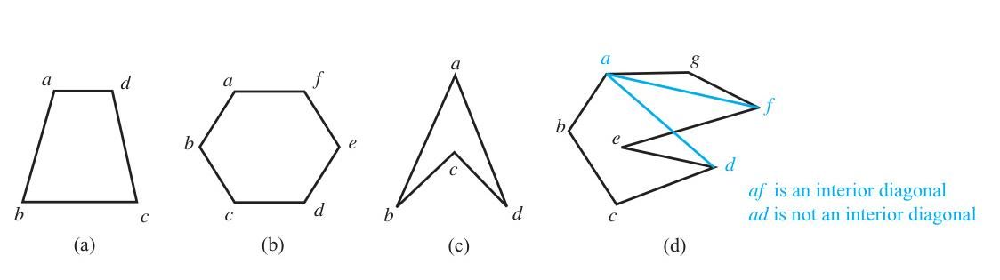
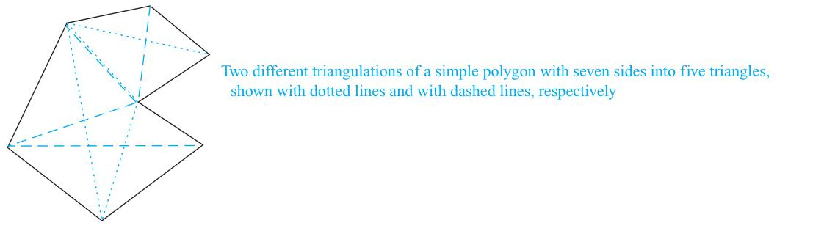
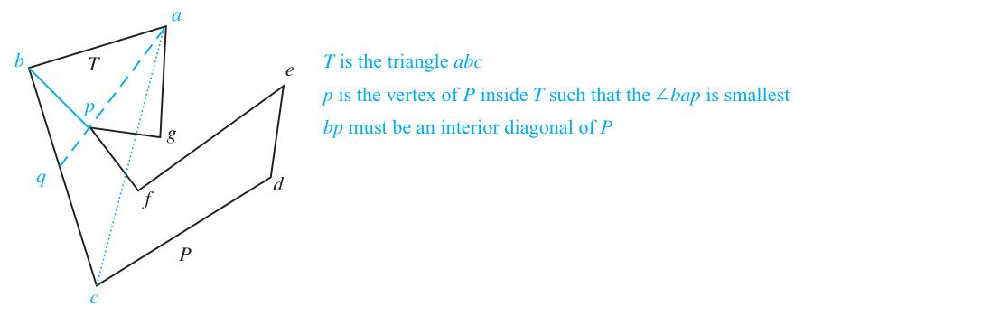

# 5.2 Strong Induction and Well-Ordering

<!-- Page 23 -->

### Introduction

In Section 5.1 we introduced mathematical induction and we showed how to use it to prove a wide variety of results. In this section we will introduce another form of mathematical induction, called **strong induction**, that can often be used when we cannot easily prove a result using mathematical induction. We will also show that mathematical induction, strong induction, and well-ordering are all equivalent principles. That is, the validity of each of these three principles implies the validity of the other two principles.

Before we define strong induction, it is important to point out that mathematical induction and strong induction are based on the same underlying principle. The names "mathematical induction" and "strong induction" are unfortunately chosen because strong induction is not stronger than mathematical induction! In fact, the two forms of mathematical induction are equivalent; that is, any theorem that can be proved using mathematical induction can also be proved using strong induction, and any theorem that can be proved using strong induction can also be proved using mathematical induction. However, it is often much easier to prove results using strong induction than using mathematical induction.

Before we describe the principle of strong induction, it will be helpful to review how mathematical induction works. A proof by mathematical induction consists of two parts. First, we show that the base case $P(1)$ is true. Second, we show that the conditional statement $P(k) \to P(k + 1)$ is true for all positive integers $k$. That is, we show that if $P(k)$ is true, then $P(k + 1)$ is true.

Strong induction is similar. It also has two parts. The basis step is the same as the basis step of mathematical induction. However, in the inductive step of a proof by strong induction, we show that if the conditional statement $[P(1) \land P(2) \land \dots \land P(k)] \to P(k + 1)$ is true for all positive integers $k$, then $P(n)$ is true for all positive integers $n$. That is, in the inductive step we assume that $P(j)$ is true for all integers $j$ with $1 \le j \le k$, and then we show that $P(k + 1)$ is true.

<!-- Page 24 -->

> [!NOTE] STRONG INDUCTION
> To prove that $P(n)$ is true for all positive integers $n$, where $P(n)$ is a propositional function, we complete two steps:
> 
> **BASIS STEP:** We verify that the proposition $P(1)$ is true.
> 
> **INDUCTIVE STEP:** We show that the conditional statement $[P(1) \land P(2) \land \dots \land P(k)] \to P(k + 1)$ is true for all positive integers $k$.

To see why strong induction is valid, consider what we know after completing both steps of a proof by strong induction. In the basis step we verify that $P(1)$ is true. In the inductive step we know that $[P(1) \land P(2) \land \dots \land P(k)] \to P(k + 1)$ is true for every positive integer $k$. Because $P(1)$ is true, it follows that $P(2)$ is true from the inductive step with $k = 1$ (because $P(1) \to P(2)$ is true). Next, because both $P(1)$ and $P(2)$ are true, it follows that $P(3)$ is true from the inductive step with $k = 2$ (because $[P(1) \land P(2)] \to P(3)$ is true). Continuing along these lines, we see that $P(n)$ is true for every positive integer $n$.

Expressed as a rule of inference, strong induction can be stated as
$$[P(1) \land \forall k([P(1) \land P(2) \land \dots \land P(k)] \to P(k + 1))] \to \forall n P(n),$$
where the domain is the set of positive integers.

#### Strong Induction and the Infinite Ladder

To better understand the difference between mathematical induction and strong induction, consider the infinite ladder in Section 5.1. Strong induction tells us that we can reach all rungs of the ladder if:
1. We can reach the first rung of the ladder.
2. For every positive integer $k$, if we can reach all rungs up to and including the $k$th rung, then we can reach the $(k + 1)$st rung.

Contrast this with mathematical induction, which tells us that we can reach all rungs of the ladder if:
1. We can reach the first rung of the ladder.
2. For every positive integer $k$, if we can reach the $k$th rung, then we can reach the $(k + 1)$st rung.

Example 1 illustrates how strong induction can help us prove a result that cannot easily be proved using mathematical induction.

<!-- Page 25 -->

#### EXAMPLE 1
Suppose we can reach the first and second rungs of an infinite ladder, and we know that if we can reach a rung, then we can reach two rungs higher. Can we prove that we can reach every rung using the principle of mathematical induction? Can we prove that we can reach every rung using strong induction?

**Solution:** We first try to prove this result using the principle of mathematical induction.

**BASIS STEP:** The basis step of such a proof holds; here it simply verifies that we can reach the first rung.

**ATTEMPTED INDUCTIVE STEP:** The inductive hypothesis is the statement that we can reach the $k$th rung of the ladder. To complete the inductive step, we need to show that if we assume the inductive hypothesis for the positive integer $k$, namely, if we assume that we can reach the $k$th rung of the ladder, then we can show that we can reach the $(k + 1)$st rung of the ladder. However, there is no obvious way to complete this inductive step because we do not know from the given information that we can reach the $(k + 1)$st rung from the $k$th rung. After all, we only know that if we can reach a rung we can reach the rung two higher.

Now consider a proof using strong induction.

**BASIS STEP:** The basis step is the same as before; it simply verifies that we can reach the first rung.

**INDUCTIVE STEP:** The inductive hypothesis states that we can reach each of the first $k$ rungs. To complete the inductive step, we need to show that if we assume that the inductive hypothesis is true, that is, if we can reach each of the first $k$ rungs, then we can reach the $(k + 1)$st rung. We already know that we can reach the second rung. We can complete the inductive step by noting that as long as $k \ge 2$, we can reach the $(k + 1)$st rung from the $(k - 1)$st rung because we know we can climb two rungs from a rung we can already reach, and because $k - 1 \le k$, by the inductive hypothesis we can reach the $(k - 1)$st rung. This completes the inductive step and finishes the proof by strong induction.

We have proved that if we can reach the first two rungs of an infinite ladder and for every positive integer $k$ if we can reach all the first $k$ rungs then we can reach the $(k + 1)$st rung, then we can reach all rungs of the ladder.
$\blacktriangleleft$

### Examples of Proofs Using Strong Induction

Now that we have both mathematical induction and strong induction, how do we decide which method to apply in a particular situation? Although there is no cut-and-dried answer, we can supply some useful pointers. In practice, you should use mathematical induction when it is straightforward to prove that $P(k) \to P(k + 1)$ is true for all positive integers $k$. This is the case for all the proofs in the examples in Section 5.1. In general, you should restrict your use of the principle of mathematical induction to such scenarios. Unless you can clearly see that the inductive step of a proof by mathematical induction goes through, you should attempt a proof by strong induction. That is, use strong induction and not mathematical induction when you see how to prove that $P(k + 1)$ is true from the assumption that $P(j)$ is true for all positive integers $j$ not exceeding $k$, but you cannot see how to prove that $P(k + 1)$ follows from just $P(k)$. Keep this in mind as you examine the proofs in this section. For each of these proofs, consider why strong induction works better than mathematical induction.

We will illustrate how strong induction is employed in Examples 2–4. In these examples, we will prove a diverse collection of results. Pay particular attention to the inductive step in each of these examples, where we show that a result $P(k + 1)$ follows under the assumption that $P(j)$ holds for all positive integers $j$ not exceeding $k$, where $P(n)$ is a propositional function.

<!-- Page 26 -->

We begin with one of the most prominent uses of strong induction, the part of the fundamental theorem of arithmetic that tells us that every positive integer can be written as the product of primes.

#### EXAMPLE 2
Show that if $n$ is an integer greater than 1, then $n$ can be written as the product of primes.

**Solution:** Let $P(n)$ be the proposition that $n$ can be written as the product of primes.

**BASIS STEP:** $P(2)$ is true, because 2 can be written as the product of one prime, itself. (Note that $P(2)$ is the first case we need to establish.)

**INDUCTIVE STEP:** The inductive hypothesis is the assumption that $P(j)$ is true for all integers $j$ with $2 \le j \le k$, that is, the assumption that $j$ can be written as the product of primes whenever $j$ is a positive integer at least 2 and not exceeding $k$. To complete the inductive step, it must be shown that $P(k + 1)$ is true under this assumption, that is, that $k + 1$ is the product of primes.

There are two cases to consider, namely, when $k + 1$ is prime and when $k + 1$ is composite. If $k + 1$ is prime, we immediately see that $P(k + 1)$ is true. Otherwise, $k + 1$ is composite and can be written as the product of two positive integers $a$ and $b$ with $2 \le a \le b < k + 1$. Because both $a$ and $b$ are integers at least 2 and not exceeding $k$, we can use the inductive hypothesis to write both $a$ and $b$ as the product of primes. Thus, if $k + 1$ is composite, it can be written as the product of primes, namely, those primes in the factorization of $a$ and those in the factorization of $b$.
$\blacktriangleleft$

> [!NOTE] Remark
> Because 1 can be thought of as the empty product of no primes, we could have started the proof in Example 2 with $P(1)$ as the basis step. We chose not to do so because many people find this confusing.

Example 2 completes the proof of the fundamental theorem of arithmetic, which asserts that every positive integer can be written uniquely as the product of primes in nondecreasing order. We showed in Section 4.3 that an integer has at most one such factorization into primes. Example 2 shows there is at least one such factorization.

Next, we show how strong induction can be used to prove that a player has a winning strategy in a game.

#### EXAMPLE 3
Consider a game in which two players take turns removing any positive number of matches they want from one of two piles of matches. The player who removes the last match wins the game. Show that if the two piles contain the same number of matches initially, the second player can always guarantee a win.

**Solution:** Let $n$ be the number of matches in each pile. We will use strong induction to prove $P(n)$, the statement that the second player can win when there are initially $n$ matches in each pile.

**BASIS STEP:** When $n = 1$, the first player has only one choice, removing one match from one of the piles, leaving a single pile with a single match, which the second player can remove to win the game.

**INDUCTIVE STEP:** The inductive hypothesis is the statement that $P(j)$ is true for all $j$ with $1 \le j \le k$, that is, the assumption that the second player can always win whenever there are $j$ matches, where $1 \le j \le k$, in each of the two piles at the start of the game. We need to show that $P(k + 1)$ is true, that is, that the second player can win when there are initially $k + 1$ matches in each pile, under the assumption that $P(j)$ is true for $j = 1, 2, \dots, k$. So suppose that there are $k + 1$ matches in each of the two piles at the start of the game and suppose that the first player removes $r$ matches ($1 \le r \le k$) from one of the piles, leaving $k + 1 - r$ matches in this pile. By removing the same number of matches from the other pile, the second player creates the

<!-- Page 27 -->

situation where there are two piles each with $k + 1 - r$ matches. Because $1 \le k + 1 - r \le k$, we can now use the inductive hypothesis to conclude that the second player can always win. We complete the proof by noting that if the first player removes all $k + 1$ matches from one of the piles, the second player can win by removing all the remaining matches.
$\blacktriangleleft$

Using the principle of mathematical induction, instead of strong induction, to prove the results in Examples 2 and 3 is difficult. However, as Example 4 shows, some results can be readily proved using either the principle of mathematical induction or strong induction.

Before we present Example 4, note that we can slightly modify strong induction to handle a wider variety of situations. In particular, we can adapt strong induction to handle cases where the inductive step is valid only for integers greater than a particular integer. Let $b$ be a fixed integer and $j$ a fixed positive integer. The form of strong induction we need tells us that $P(n)$ is true for all integers $n$ with $n \ge b$ if we can complete these two steps:

**BASIS STEP:** We verify that the propositions $P(b), P(b + 1), \dots, P(b + j)$ are true.
**INDUCTIVE STEP:** We show that $[P(b) \land P(b + 1) \land \dots \land P(k)] \to P(k + 1)$ is true for every integer $k \ge b + j$.

We will use this alternative form in the strong induction proof in Example 4. That this alternative form is equivalent to strong induction is left as Exercise 28.

#### EXAMPLE 4
Prove that every amount of postage of 12 cents or more can be formed using just 4-cent and 5-cent stamps.

**Solution:** We will prove this result using the principle of mathematical induction. Then we will present a proof using strong induction. Let $P(n)$ be the statement that postage of $n$ cents can be formed using 4-cent and 5-cent stamps.

We begin by using the principle of mathematical induction.

**BASIS STEP:** Postage of 12 cents can be formed using three 4-cent stamps.

**INDUCTIVE STEP:** The inductive hypothesis is the statement that $P(k)$ is true. That is, under this hypothesis, postage of $k$ cents can be formed using 4-cent and 5-cent stamps. To complete the inductive step, we need to show that when we assume $P(k)$ is true, then $P(k + 1)$ is also true where $k \ge 12$. That is, we need to show that if we can form postage of $k$ cents, then we can form postage of $k + 1$ cents. So, assume the inductive hypothesis is true; that is, assume that we can form postage of $k$ cents using 4-cent and 5-cent stamps. We consider two cases, when at least one 4-cent stamp has been used and when no 4-cent stamps have been used. First, suppose that at least one 4-cent stamp was used to form postage of $k$ cents. Then we can replace this stamp with a 5-cent stamp to form postage of $k + 1$ cents. But if no 4-cent stamps were used, we can form postage of $k$ cents using only 5-cent stamps. Moreover, because $k \ge 12$, we needed at least three 5-cent stamps to form postage of $k$ cents. So, we can replace three 5-cent stamps with four 4-cent stamps to form postage of $k + 1$ cents. This completes the inductive step.

Because we have completed the basis step and the inductive step, we know that $P(n)$ is true for all $n \ge 12$. That is, we can form postage of $n$ cents, where $n \ge 12$ using just 4-cent and 5-cent stamps. This completes the proof by mathematical induction.

Next, we will use strong induction to prove the same result. In this proof, in the basis step we show that $P(12), P(13), P(14),$ and $P(15)$ are true, that is, that postage of 12, 13, 14, or 15 cents can be formed using just 4-cent and 5-cent stamps. In the inductive step we show how to get postage of $k + 1$ cents for $k \ge 15$ from postage of $k - 3$ cents.

**BASIS STEP:** We can form postage of 12, 13, 14, and 15 cents using three 4-cent stamps, two 4-cent stamps and one 5-cent stamp, one 4-cent stamp and two 5-cent stamps, and three 5-cent stamps, respectively. This shows that $P(12), P(13), P(14),$ and $P(15)$ are true. This completes the basis step.

<!-- Page 28 -->

**INDUCTIVE STEP:** The inductive hypothesis is the statement that $P(j)$ is true for $12 \le j \le k$, where $k$ is an integer with $k \ge 15$. To complete the inductive step, we assume that we can form postage of $j$ cents, where $12 \le j \le k$. We need to show that under the assumption that $P(k + 1)$ is true, we can also form postage of $k + 1$ cents. Using the inductive hypothesis, we can assume that $P(k - 3)$ is true because $k - 3 \ge 12$, that is, we can form postage of $k - 3$ cents using just 4-cent and 5-cent stamps. To form postage of $k + 1$ cents, we need only add another 4-cent stamp to the stamps we used to form postage of $k - 3$ cents. That is, we have shown that if the inductive hypothesis is true, then $P(k + 1)$ is also true. This completes the inductive step.

Because we have completed the basis step and the inductive step of a strong induction proof, we know by strong induction that $P(n)$ is true for all integers $n$ with $n \ge 12$. That is, we know that every postage of $n$ cents, where $n$ is at least 12, can be formed using 4-cent and 5-cent stamps. This finishes the proof by strong induction.
$\blacktriangleleft$

### Using Strong Induction in Computational Geometry

Our next example of strong induction will come from computational geometry, the part of discrete mathematics that studies computational problems involving geometric objects. Computational geometry is used extensively in computer graphics, computer games, robotics, scientific calculations, and a vast array of other areas. Before we can present this result, we introduce some terminology, possibly familiar from earlier studies in geometry.

A **polygon** is a closed geometric figure consisting of a sequence of line segments $s_1, s_2, \dots, s_n$, called **sides**. Each pair of consecutive sides, $s_i$ and $s_{i+1}, i = 1, 2, \dots, n - 1$, as well as the last side $s_n$ and the first side $s_1$, of the polygon meet at a common endpoint, called a **vertex**. A polygon is called **simple** if no two nonconsecutive sides intersect. Every simple polygon divides the plane into two regions: its interior, consisting of the points inside the curve, and its exterior, consisting of the points outside the curve. This last fact is surprisingly complicated to prove. It is a special case of the famous Jordan curve theorem, which tells us that every simple curve divides the plane into two regions.

A polygon is called **convex** if every line segment connecting two points in the interior of the polygon lies entirely inside the polygon. (A polygon that is not convex is said to be nonconvex.) Figure 1 displays some polygons; polygons (a) and (b) are convex, but polygons (c) and (d) are not. A **diagonal** of a simple polygon is a line segment connecting two nonconsecutive vertices of the polygon, and a diagonal is called an **interior diagonal** if it lies entirely inside the polygon, except for its endpoints. For example, in polygon (d), the line segment connecting $a$ and $f$ is an interior diagonal, but the line segment connecting $a$ and $d$ is a diagonal that is not an interior diagonal.

*Figure 1 — Convex and Nonconvex Polygons.*

One of the most basic operations of computational geometry involves dividing a simple polygon into triangles by adding nonintersecting diagonals. This process is called **triangulation**. Note that a simple polygon can have many different triangulations, as shown in Figure 2. Perhaps the most basic fact in computational geometry is that it is possible to triangulate every simple

<!-- Page 29 -->

*Figure 2 — Triangulations of a Polygon.*

polygon, as we state in Theorem 1. Furthermore, this theorem tells us how many triangles are produced by every triangulation of a simple polygon.

> [!NOTE] THEOREM 1
> A simple polygon with $n$ sides, where $n$ is an integer with $n \ge 3$, can be triangulated into $n - 2$ triangles.

It seems obvious that we should be able to triangulate a simple polygon by adding nonintersecting interior diagonals one at a time until no more can be added. But how do we know that we can always find an interior diagonal of a simple polygon when $n \ge 4$? We cannot assume this without proof! Fortunately, we can establish this fact, which we state as Lemma 1. Although Lemma 1 seems particularly simple, it is surprisingly tricky to prove. For this reason, we will postpone the proof of Lemma 1 until after we prove Theorem 1.

> [!NOTE] LEMMA 1
> Every simple polygon with at least four sides has an interior diagonal.

We now prove Theorem 1 using strong induction.

**Proof of Theorem 1:** We will prove this result using strong induction on $n$, the number of sides of the polygon. Let $T(n)$ be the proposition that every simple polygon with $n$ sides can be triangulated into $n - 2$ triangles.

**BASIS STEP:** $T(3)$ is true because a simple polygon with three sides is a triangle and does not need any diagonals to triangulate it into $3 - 2 = 1$ triangle.

**INDUCTIVE STEP:** For the inductive hypothesis, we assume that $T(j)$ is true for all integers $j$ with $3 \le j \le k$. That is, we assume that every simple polygon with $j$ sides, where $3 \le j \le k$, can be triangulated into $j - 2$ triangles. To complete the inductive step, we must show that when we assume the inductive hypothesis, $T(k + 1)$ is true, that is, that every simple polygon with $k + 1$ sides can be triangulated into $(k + 1) - 2 = k - 1$ triangles.

So, suppose that we have a simple polygon $P$ with $k + 1$ sides. Because $k + 1 \ge 4$, Lemma 1 tells us that $P$ has an interior diagonal $ab$. Now, $ab$ splits $P$ into two simple polygons $Q$, with $s$ sides, and $R$, with $t$ sides. The sides of $Q$ and $R$ are the sides of $P$, together with the side $ab$, which is a side of both $Q$ and $R$. Note that $3 \le s \le k$ and $3 \le t \le k$ because both $Q$ and $R$ have at least one fewer side than $P$ does (after all, each of these is formed from $P$ by deleting at least two sides and replacing these sides by the diagonal $ab$). Furthermore, the number of sides of $P$ is two less than the sum of the numbers of sides of $Q$ and the number of

<!-- Page 30 -->

*Figure 3 — Constructing an Interior Diagonal of a Simple Polygon.*

sides of $R$, because each side of $P$ is a side of either $Q$ or of $R$, but not both, and the diagonal $ab$ is a side of both $Q$ and $R$, but not $P$. That is, $k + 1 = s + t - 2$.

We now use the inductive hypothesis. Because both $3 \le s \le k$ and $3 \le t \le k$, by the inductive hypothesis we can triangulate $Q$ and $R$ into $s - 2$ and $t - 2$ triangles, respectively. Next, note that these triangulations together produce a triangulation of $P$. (Each diagonal added to triangulate one of these smaller polygons is also a diagonal of $P$.) Consequently, we can triangulate $P$ into a total of $(s - 2) + (t - 2) = s + t - 4 = (k + 1) - 2$ triangles. This completes the proof by strong induction. That is, we have shown that every simple polygon with $n$ sides, where $n \ge 3$, can be triangulated into $n - 2$ triangles.
$\blacksquare$

We now return to our proof of Lemma 1. We present a proof published by Chung-Wu Ho [Ho75].

**Proof of Lemma 1:** Suppose that $P$ is a simple polygon drawn in the plane. Furthermore, suppose that $b$ is the point of $P$ or in the interior of $P$ with the least $y$-coordinate among the vertices with the smallest $x$-coordinate. Then $b$ must be a vertex of $P$, for if it is an interior point, there would have to be a vertex of $P$ with a smaller $x$-coordinate. Two other vertices each share an edge with $b$, say $a$ and $c$. It follows that the angle in the interior of $P$ formed by $ab$ and $bc$ must be less than 180 degrees (otherwise, there would be points of $P$ with smaller $x$-coordinates than $b$).

Now let $T$ be the triangle $\triangle abc$. If there are no vertices of $P$ on or inside $T$, we can connect $a$ and $c$ to obtain an interior diagonal. On the other hand, if there are vertices of $P$ inside $T$, we will find a vertex $p$ of $P$ on or inside $T$ such that $bp$ is an interior diagonal. The key is to select a vertex $p$ such that the angle $\angle bap$ is smallest. To see this, note that the ray starting at $a$ and passing through $p$ hits the line segment $bc$ at a point, say $q$. It then follows that the triangle $\triangle baq$ cannot contain any vertices of $P$ in its interior. Hence, we can connect $b$ and $p$ to produce an interior diagonal of $P$. Locating this vertex $p$ is illustrated in Figure 3.
$\blacksquare$

### Proofs Using the Well-Ordering Property

The validity of both the principle of mathematical induction and strong induction follows from a fundamental axiom of the set of integers, the **well-ordering property** (see Appendix 1). The well-ordering property states that every nonempty set of nonnegative integers has a least element.

We will show how the well-ordering property can be used directly in proofs. Furthermore, it can be shown that the well-ordering property, the principle of mathematical induction, and strong induction are all equivalent. That is, the validity of each of these three proof techniques implies the validity of the other two techniques. In Section 5.1 we

<!-- Page 31 -->

showed that the principle of mathematical induction follows from the well-ordering property.

> [!NOTE] AXIOM 2: The Well-Ordering Property
> Every nonempty set of nonnegative integers has a least element.

The well-ordering property can often be used directly in proofs.

#### EXAMPLE 5
Use the well-ordering property to prove the division algorithm. Recall that the division algorithm states that if $a$ is an integer and $d$ is a positive integer, then there are unique integers $q$ and $r$ with $0 \le r < d$ and $a = dq + r$.

**Solution:** Let $S$ be the set of nonnegative integers of the form $a - dq$, where $q$ is an integer. This set is nonempty because $-dq$ can be made as large as desired (taking $q$ to be a negative integer with large absolute value). By the well-ordering property, $S$ has a least element $r = a - dq_0$.

The integer $r$ is nonnegative. It is also the case that $r < d$. If it were not, then there would be a smaller nonnegative element in $S$, namely, $a - d(q_0 + 1)$. To see this, suppose that $r \ge d$. Because $a = dq_0 + r$, it follows that $a - d(q_0 + 1) = (a - dq_0) - d = r - d \ge 0$. Consequently, there are integers $q$ and $r$ with $0 \le r < d$. The proof that $q$ and $r$ are unique is left as Exercise 37.
$\blacktriangleleft$

#### EXAMPLE 6
In a round-robin tournament every player plays every other player exactly once and each match has a winner and a loser. We say that the players $p_1, p_2, \dots, p_m$ form a **cycle** if $p_1$ beats $p_2$, $p_2$ beats $p_3$, $\dots$, $p_{m-1}$ beats $p_m$, and $p_m$ beats $p_1$. Use the well-ordering principle to show that if there is a cycle of length $m$ ($m \ge 3$) among the players in a round-robin tournament, there must be a cycle of three of these players.

**Solution:** We assume that there is no cycle of three players. Because there is at least one cycle in the round-robin tournament, the set of all positive integers $n$ for which there is a cycle of length $n$ is nonempty. By the well-ordering property, this set of positive integers has a least element $k$, which by assumption must be greater than three. Consequently, there exists a cycle of players $p_1, p_2, p_3, \dots, p_k$ and no shorter cycle exists.

Because there is no cycle of three players, we know that $k > 3$. Consider the first three elements of this cycle, $p_1, p_2,$ and $p_3$. There are two possible outcomes of the match between $p_1$ and $p_3$. If $p_3$ beats $p_1$, it follows that $p_1, p_2, p_3$ is a cycle of length three, contradicting our assumption that there is no cycle of three players. Consequently, it must be the case that $p_1$ beats $p_3$. This means that we can omit $p_2$ from the cycle $p_1, p_2, p_3, \dots, p_k$ to obtain the cycle $p_1, p_3, p_4, \dots, p_k$ of length $k - 1$, contradicting the assumption that the smallest cycle has length $k$. We conclude that there must be a cycle of length three.
$\blacktriangleleft$
