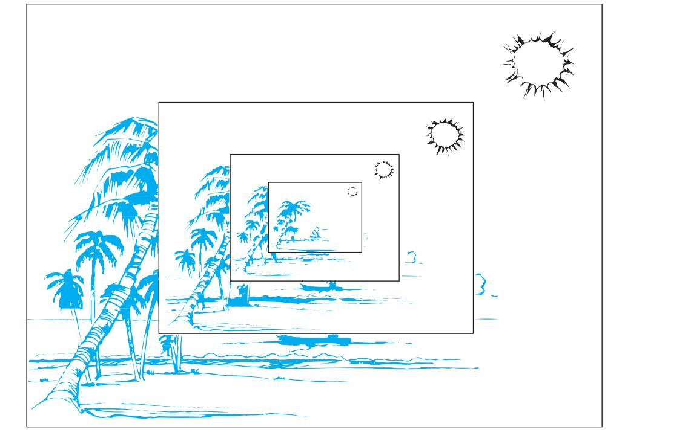
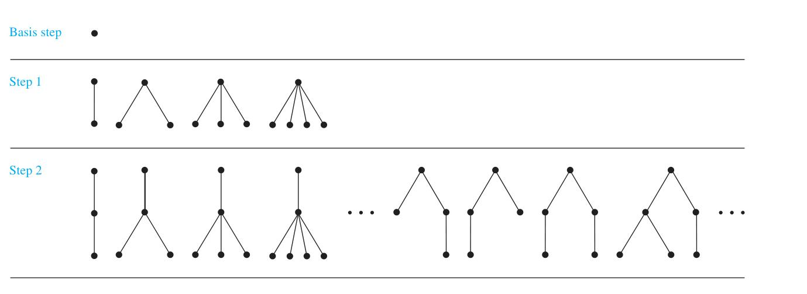
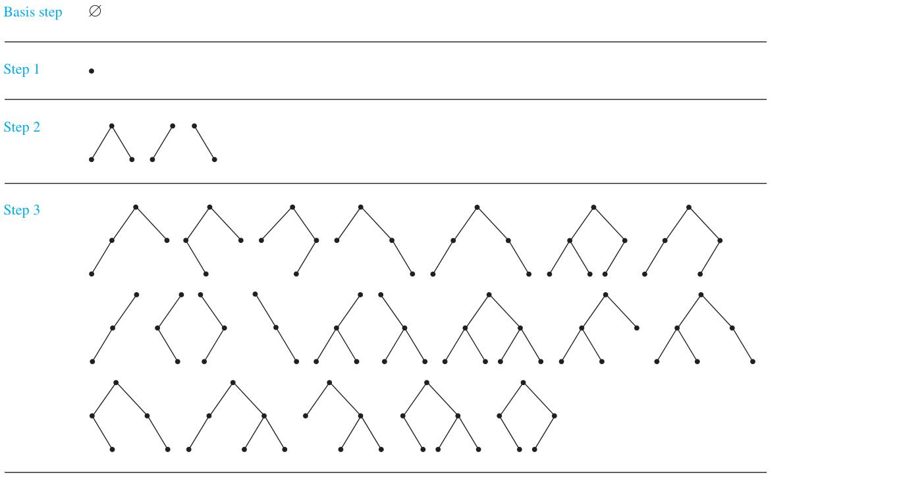
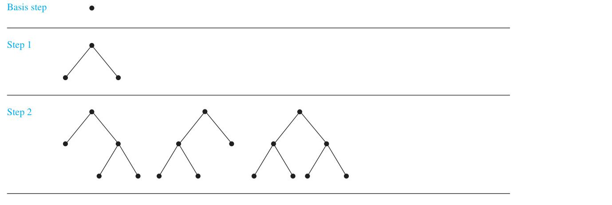

# 5.3 Recursive Definitions and Structural Induction

<!-- Page 34 -->

### Introduction

Sometimes it is difficult to define an object explicitly. However, it may be easy to define this object in terms of itself. This process is called **recursion**. For instance, the picture shown in Figure 1 is produced recursively. First, an original picture is given. Then a process of successively superimposing centered smaller pictures on top of the previous pictures is carried out.

<!-- Page 35 -->

*Figure 1 — A Recursively Defined Picture.*

We can use recursion to define sequences, functions, and sets. In Section 2.4, and in most beginning mathematics courses, the terms of a sequence are specified using an explicit formula. For instance, the sequence of powers of 2 is given by $a_n = 2^n$ for $n = 0, 1, 2, \dots$. Recall from Section 2.4 that we can also define a sequence recursively by specifying how terms of the sequence are found from previous terms. The sequence of powers of 2 can also be defined by giving the first term of the sequence, namely, $a_0 = 1$, and a rule for finding a term of the sequence from the previous one, namely, $a_{n+1} = 2a_n$ for $n = 0, 1, 2, \dots$. When we define a sequence recursively by specifying how terms of the sequence are found from previous terms, we can use induction to prove results about the sequence.

When we define a set recursively, we specify some initial elements in a basis step and provide a rule for constructing new elements from those we already have in the recursive step. To prove results about recursively defined sets we use a method called **structural induction**.

### Recursively Defined Functions

We use two steps to define a function with the set of nonnegative integers as its domain:
- **BASIS STEP:** Specify the value of the function at zero.
- **RECURSIVE STEP:** Give a rule for finding its value at an integer from its values at smaller integers.

Such a definition is called a **recursive** or **inductive definition**. Note that a function $f(n)$ from the set of nonnegative integers to the set of real numbers is the same as a sequence $a_0, a_1, \dots$ where $a_i$ is a real number for every nonnegative integer $i$. So, defining a real-valued sequence $a_0, a_1, \dots$ using a recurrence relation, as was done in Section 2.4, is the same as defining a function from the set of nonnegative integers to the set of real numbers.

<!-- Page 36 -->

#### EXAMPLE 1
Suppose that $f$ is defined recursively by
$$
\begin{aligned}
f(0) &= 3, \\
f(n + 1) &= 2f(n) + 3.
\end{aligned}
$$
Find $f(1), f(2), f(3),$ and $f(4)$.

**Solution:** From the recursive definition it follows that
$$
\begin{aligned}
f(1) &= 2f(0) + 3 = 2 \cdot 3 + 3 = 9, \\
f(2) &= 2f(1) + 3 = 2 \cdot 9 + 3 = 21, \\
f(3) &= 2f(2) + 3 = 2 \cdot 21 + 3 = 45, \\
f(4) &= 2f(3) + 3 = 2 \cdot 45 + 3 = 93.
\end{aligned}
$$
$\blacktriangleleft$

Recursively defined functions are well defined. That is, for every positive integer, the value of the function at this integer is determined in an unambiguous way. This means that given any positive integer, we can use the two parts of the definition to find the value of the function at that integer, and that we obtain the same value no matter how we apply the two parts of the definition. This is a consequence of the principle of mathematical induction. Additional examples of recursive definitions are given in Examples 2 and 3.

#### EXAMPLE 2
Give a recursive definition of $a^n$, where $a$ is a nonzero real number and $n$ is a nonnegative integer.

**Solution:** The recursive definition contains two parts. First $a^0$ is specified, namely, $a^0 = 1$. Then the rule for finding $a^{n+1}$ from $a^n$, namely, $a^{n+1} = a \cdot a^n$, for $n = 0, 1, 2, 3, \dots$, is given. These two equations uniquely define $a^n$ for all nonnegative integers $n$.
$\blacktriangleleft$

#### EXAMPLE 3
Give a recursive definition of $\sum_{k=0}^n a_k$.

**Solution:** The first part of the recursive definition is
$$\sum_{k=0}^0 a_k = a_0.$$
The second part is
$$\sum_{k=0}^{n+1} a_k = \left(\sum_{k=0}^n a_k\right) + a_{n+1}.$$
$\blacktriangleleft$

In some recursive definitions of functions, the values of the function at the first $k$ positive integers are specified, and a rule is given for determining the value of the function at larger integers from its values at some or all of the preceding $k$ integers. That recursive definitions defined in this way produce well-defined functions follows from strong induction.

<!-- Page 37 -->

Recall from Section 2.4 that the **Fibonacci numbers**, $f_0, f_1, f_2, \dots$, are defined by the equations $f_0 = 0$, $f_1 = 1$, and
$$f_n = f_{n-1} + f_{n-2}$$
for $n = 2, 3, 4, \dots$. [We can think of the Fibonacci number $f_n$ either as the $n$th term of the sequence of Fibonacci numbers $f_0, f_1, \dots$ or as the value at the integer $n$ of a function $f(n)$.]

We can use the recursive definition of the Fibonacci numbers to prove many properties of these numbers. We give one such property in Example 4.

#### EXAMPLE 4
Show that whenever $n \ge 3$, $f_n > \alpha^{n-2}$, where $\alpha = (1 + \sqrt{5})/2$.

**Solution:** We can use strong induction to prove this inequality. Let $P(n)$ be the statement $f_n > \alpha^{n-2}$. We want to show that $P(n)$ is true whenever $n$ is an integer greater than or equal to 3.

**BASIS STEP:** First, note that
$$
\begin{aligned}
\alpha &< 2 = f_3, \\
\alpha^2 &= (3 + \sqrt{5})/2 < 3 = f_4,
\end{aligned}
$$
so $P(3)$ and $P(4)$ are true.

**INDUCTIVE STEP:** Assume that $P(j)$ is true, namely, that $f_j > \alpha^{j-2}$, for all integers $j$ with $3 \le j \le k$, where $k \ge 4$. We must show that $P(k + 1)$ is true, that is, that $f_{k+1} > \alpha^{k-1}$. Because $\alpha$ is a solution of $x^2 - x - 1 = 0$ (as the quadratic formula shows), it follows that $\alpha^2 = \alpha + 1$. Therefore,
$$\alpha^{k-1} = \alpha^2 \cdot \alpha^{k-3} = (\alpha + 1)\alpha^{k-3} = \alpha \cdot \alpha^{k-3} + 1 \cdot \alpha^{k-3} = \alpha^{k-2} + \alpha^{k-3}.$$

By the inductive hypothesis, because $k \ge 4$, we have
$$
\begin{aligned}
f_{k-1} &> \alpha^{k-3}, \\
f_k &> \alpha^{k-2}.
\end{aligned}
$$
Therefore, it follows that
$$f_{k+1} = f_k + f_{k-1} > \alpha^{k-2} + \alpha^{k-3} = \alpha^{k-1}.$$
Hence, $P(k + 1)$ is true. This completes the proof.
$\blacktriangleleft$

> [!NOTE] Remark
> The inductive step shows that whenever $k \ge 4$, $P(k + 1)$ follows from the assumption that $P(j)$ is true for $3 \le j \le k$. Hence, the inductive step does not show that $P(3) \to P(4)$. Therefore, we had to show that $P(4)$ is true separately.

We can now show that the Euclidean algorithm, introduced in Section 4.3, uses $O(\log b)$ divisions to find the greatest common divisor of the positive integers $a$ and $b$, where $a \ge b$.

> [!NOTE] THEOREM 1: Lamé’s Theorem
> Let $a$ and $b$ be positive integers with $a \ge b$. Then the number of divisions used by the Euclidean algorithm to find $\gcd(a, b)$ is less than or equal to five times the number of decimal digits in $b$.

<!-- Page 38 -->

**Proof:** Recall that when the Euclidean algorithm is applied to find $\gcd(a, b)$ with $a \ge b$, this sequence of equations (where $a = r_0$ and $b = r_1$) is obtained:
$$
\begin{aligned}
r_0 &= r_1 q_1 + r_2 && 0 \le r_2 < r_1, \\
r_1 &= r_2 q_2 + r_3 && 0 \le r_3 < r_2, \\
&\;\vdots \\
r_{n-2} &= r_{n-1} q_{n-1} + r_n && 0 \le r_n < r_{n-1}, \\
r_{n-1} &= r_n q_n.
\end{aligned}
$$

Here $n$ divisions have been used to find $r_n = \gcd(a, b)$. Note that the quotients $q_1, q_2, \dots, q_{n-1}$ are all at least 1. Moreover, $q_n \ge 2$, because $r_n < r_{n-1}$. This implies that
$$
\begin{aligned}
r_n &\ge 1 = f_2, \\
r_{n-1} &\ge 2r_n \ge 2f_2 = f_3, \\
r_{n-2} &\ge r_{n-1} + r_n \ge f_3 + f_2 = f_4, \\
&\;\vdots \\
r_2 &\ge r_3 + r_4 \ge f_{n-1} + f_{n-2} = f_n, \\
b = r_1 &\ge r_2 + r_3 \ge f_n + f_{n-1} = f_{n+1}.
\end{aligned}
$$

It follows that if $n$ divisions are used by the Euclidean algorithm to find $\gcd(a, b)$ with $a \ge b$, then $b \ge f_{n+1}$. By Example 4 we know that $f_{n+1} > \alpha^{n-1}$ for $n > 2$, where $\alpha = (1 + \sqrt{5})/2$. Therefore, it follows that $b > \alpha^{n-1}$. Furthermore, because $\log_{10} \alpha \approx 0.208 > 1/5$, we see that
$$\log_{10} b > (n - 1) \log_{10} \alpha > (n - 1)/5.$$

Hence, $n - 1 < 5 \cdot \log_{10} b$. Now suppose that $b$ has $k$ decimal digits. Then $b < 10^k$ and $\log_{10} b < k$. It follows that $n - 1 < 5k$, and because $k$ is an integer, it follows that $n \le 5k$. This finishes the proof.
$\blacksquare$

Because the number of decimal digits in $b$, which equals $\lfloor\log_{10} b\rfloor + 1$, is less than or equal to $\log_{10} b + 1$, Theorem 1 tells us that the number of divisions required to find $\gcd(a, b)$ with

<!-- Page 39 -->

$a > b$ is less than or equal to $5(\log_{10} b + 1)$. Because $5(\log_{10} b + 1)$ is $O(\log b)$, we see that $O(\log b)$ divisions are used by the Euclidean algorithm to find $\gcd(a, b)$ whenever $a > b$.

### Recursively Defined Sets and Structures

We have explored how functions can be defined recursively. We now turn our attention to how sets can be defined recursively. Just as in the recursive definition of functions, recursive definitions of sets have two parts, a basis step and a recursive step. In the basis step, an initial collection of elements is specified. In the recursive step, rules for forming new elements in the set from those already known to be in the set are provided. Recursive definitions may also include an **exclusion rule**, which specifies that a recursively defined set contains nothing other than those elements specified in the basis step or generated by applications of the recursive step. In our discussions, we will always tacitly assume that the exclusion rule holds and no element belongs to a recursively defined set unless it is in the initial collection specified in the basis step or can be generated using the recursive step one or more times. Later we will see how we can use a technique known as **structural induction** to prove results about recursively defined sets.

Examples 5, 6, 8, and 9 illustrate the recursive definition of sets. In each example, we show those elements generated by the first few applications of the recursive step.

#### EXAMPLE 5
Consider the subset $S$ of the set of integers recursively defined by
- **BASIS STEP:** $3 \in S$.
- **RECURSIVE STEP:** If $x \in S$ and $y \in S$, then $x + y \in S$.

The new elements found to be in $S$ are 3 by the basis step, $3 + 3 = 6$ at the first application of the recursive step, $3 + 6 = 6 + 3 = 9$ and $6 + 6 = 12$ at the second application of the recursive step, and so on. We will show in Example 10 that $S$ is the set of all positive multiples of 3.
$\blacktriangleleft$

Recursive definitions play an important role in the study of strings. (See Chapter 13 for an introduction to the theory of formal languages, for example.) Recall from Section 2.4 that a **string** over an alphabet $\Sigma$ is a finite sequence of symbols from $\Sigma$. We can define $\Sigma^*$, the set of strings over $\Sigma$, recursively, as Definition 1 shows.

> [!NOTE] DEFINITION 1
> The set $\Sigma^*$ of strings over the alphabet $\Sigma$ is defined recursively by
> - **BASIS STEP:** $\lambda \in \Sigma^*$ (where $\lambda$ is the empty string containing no symbols).
> - **RECURSIVE STEP:** If $w \in \Sigma^*$ and $x \in \Sigma$, then $wx \in \Sigma^*$.

<!-- Page 40 -->

The basis step of the recursive definition of strings says that the empty string belongs to $\Sigma^*$. The recursive step states that new strings are produced by adding a symbol from $\Sigma$ to the end of strings in $\Sigma^*$. At each application of the recursive step, strings containing one additional symbol are generated.

#### EXAMPLE 6
If $\Sigma = \{0, 1\}$, the strings found to be in $\Sigma^*$, the set of all bit strings, are $\lambda$, specified to be in $\Sigma^*$ in the basis step, $0$ and $1$ formed during the first application of the recursive step, $00, 01, 10,$ and $11$ formed during the second application of the recursive step, and so on.
$\blacktriangleleft$

Recursive definitions can be used to define operations or functions on the elements of recursively defined sets. This is illustrated in Definition 2 of the concatenation of two strings and Example 7 concerning the length of a string.

> [!NOTE] DEFINITION 2
> Two strings can be combined via the operation of concatenation. Let $\Sigma$ be a set of symbols and $\Sigma^*$ the set of strings formed from symbols in $\Sigma$. We can define the **concatenation** of two strings, denoted by $\cdot$, recursively as follows:
> - **BASIS STEP:** If $w \in \Sigma^*$, then $w \cdot \lambda = w$, where $\lambda$ is the empty string.
> - **RECURSIVE STEP:** If $w_1 \in \Sigma^*$ and $w_2 \in \Sigma^*$ and $x \in \Sigma$, then $w_1 \cdot (w_2 x) = (w_1 \cdot w_2)x$.

The concatenation of the strings $w_1$ and $w_2$ is often written as $w_1 w_2$ rather than $w_1 \cdot w_2$. By repeated application of the recursive definition, it follows that the concatenation of two strings $w_1$ and $w_2$ consists of the symbols in $w_1$ followed by the symbols in $w_2$. For instance, the concatenation of $w_1 = \text{abra}$ and $w_2 = \text{cadabra}$ is $w_1 w_2 = \text{abracadabra}$.

#### EXAMPLE 7 Length of a String
Give a recursive definition of $l(w)$, the length of the string $w$.

**Solution:** The length of a string can be recursively defined by
$$
\begin{aligned}
l(\lambda) &= 0; \\
l(wx) &= l(w) + 1 \quad \text{if } w \in \Sigma^* \text{ and } x \in \Sigma.
\end{aligned}
$$
$\blacktriangleleft$

Another important use of recursive definitions is to define well-formed formulae of various types. This is illustrated in Examples 8 and 9.

#### EXAMPLE 8 Well-Formed Formulae in Propositional Logic
We can define the set of well-formed formulae in propositional logic involving $\mathbf{T}, \mathbf{F}$, propositional variables, and operators from the set $\{\neg, \land, \lor, \to, \leftrightarrow\}$.
- **BASIS STEP:** $\mathbf{T}, \mathbf{F}$, and $s$, where $s$ is a propositional variable, are well-formed formulae.
- **RECURSIVE STEP:** If $E$ and $F$ are well-formed formulae, then $(\neg E), (E \land F), (E \lor F), (E \to F),$ and $(E \leftrightarrow F)$ are well-formed formulae.

For example, by the basis step we know that $\mathbf{T}, \mathbf{F}, p,$ and $q$ are well-formed formulae, where $p$ and $q$ are propositional variables. From an initial application of the recursive step, we know that $(p \lor q), (p \to \mathbf{F}), (\mathbf{F} \to q),$ and $(q \land \mathbf{F})$ are well-formed formulae. A second application of the recursive step shows that $((p \lor q) \to (q \land \mathbf{F})), (q \lor (p \lor q)),$ and $((p \to \mathbf{F}) \to \mathbf{T})$ are well-formed formulae. We leave it to the reader to show that $p\neg \land q, pq\land,$ and $\neg \land pq$ are not well-formed formulae, by showing that none can be obtained using the basis step and one or more applications of the recursive step.
$\blacktriangleleft$

<!-- Page 41 -->

#### EXAMPLE 9 Well-Formed Formulae of Operators and Operands
We can define the set of well-formed formulae consisting of variables, numerals, and operators from the set $\{+, -, *, /, \uparrow\}$ (where $*$ denotes multiplication and $\uparrow$ denotes exponentiation) recursively:
- **BASIS STEP:** $x$ is a well-formed formula if $x$ is a numeral or a variable.
- **RECURSIVE STEP:** If $F$ and $G$ are well-formed formulae, then $(F + G), (F - G), (F * G), (F / G),$ and $(F \uparrow G)$ are well-formed formulae.

For example, by the basis step we see that $x, y, 0,$ and $3$ are well-formed formulae (as is any variable or numeral). Well-formed formulae generated by applying the recursive step once include $(x + 3), (3 + y), (x - y), (3 - 0), (x * 3), (3 * y), (3 / 0), (x / y), (3 \uparrow x),$ and $(0 \uparrow 3)$. Applying the recursive step twice shows that formulae such as $((x + 3) + 3)$ and $(x - (3 * y))$ are well-formed formulae. [Note that $(3 / 0)$ is a well-formed formula because we are concerned only with syntax matters here.] We leave it to the reader to show that each of the formulae $x3+, y*+x,$ and $*x/y$ is not a well-formed formula by showing that none of them can be obtained from the basis step and one or more applications of the recursive step.
$\blacktriangleleft$

We will study trees extensively in Chapter 11. A **tree** is a special type of a graph; a graph is made up of vertices and edges connecting some pairs of vertices. We will study graphs in Chapter 10. We will briefly introduce them here to illustrate how they can be defined recursively.

> [!NOTE] DEFINITION 3
> The set of **rooted trees**, where a rooted tree consists of a set of vertices containing a distinguished vertex called the **root**, and edges connecting these vertices, can be defined recursively by these steps:
> - **BASIS STEP:** A single vertex $r$ is a rooted tree.
> - **RECURSIVE STEP:** Suppose that $T_1, T_2, \dots, T_n$ are disjoint rooted trees with roots $r_1, r_2, \dots, r_n$, respectively. Then the graph formed by starting with a root $r$, which is not in any of the rooted trees $T_1, T_2, \dots, T_n$, and adding an edge from $r$ to each of the vertices $r_1, r_2, \dots, r_n$, is also a rooted tree.

In Figure 2 we illustrate some of the rooted trees formed starting with the basis step and applying the recursive step one time and two times. Note that infinitely many rooted trees are formed at each application of the recursive definition.

*Figure 2 — Building Up Rooted Trees.*

<!-- Page 42 -->

*Figure 3 — Building Up Extended Binary Trees.*

Binary trees are a special type of rooted trees. We will provide recursive definitions of two types of binary trees—**full binary trees** and **extended binary trees**. In the recursive step of the definition of each type of binary tree, two binary trees are combined to form a new tree with one of these trees designated the left subtree and the other the right subtree. In extended binary trees, the left subtree or the right subtree can be empty, but in full binary trees this is not possible. Binary trees are one of the most important types of structures in computer science. In Chapter 11 we will see how they can be used in searching and sorting algorithms, in algorithms for compressing data, and in many other applications. We first define extended binary trees.

> [!NOTE] DEFINITION 4
> The set of **extended binary trees** can be defined recursively by these steps:
> - **BASIS STEP:** The empty set is an extended binary tree.
> - **RECURSIVE STEP:** If $T_1$ and $T_2$ are disjoint extended binary trees, there is an extended binary tree, denoted by $T_1 \cdot T_2$, consisting of a root $r$ together with edges connecting the root to each of the roots of the left subtree $T_1$ and the right subtree $T_2$ when these trees are nonempty.

Figure 3 shows how extended binary trees are built up by applying the recursive step from one to three times.

We now show how to define the set of full binary trees. Note that the difference between this recursive definition and that of extended binary trees lies entirely in the basis step.

<!-- Page 43 -->

*Figure 4 — Building Up Full Binary Trees.*

> [!NOTE] DEFINITION 5
> The set of **full binary trees** can be defined recursively by these steps:
> - **BASIS STEP:** There is a full binary tree consisting only of a single vertex $r$.
> - **RECURSIVE STEP:** If $T_1$ and $T_2$ are disjoint full binary trees, there is a full binary tree, denoted by $T_1 \cdot T_2$, consisting of a root $r$ together with edges connecting the root to each of the roots of the left subtree $T_1$ and the right subtree $T_2$.

Figure 4 shows how full binary trees are built up by applying the recursive step one and two times.

### Structural Induction

To prove results about recursively defined sets, we generally use some form of mathematical induction. Example 10 illustrates the connection between recursively defined sets and mathematical induction.

#### EXAMPLE 10
Show that the set $S$ defined in Example 5 by specifying that $3 \in S$ and that if $x \in S$ and $y \in S$, then $x + y \in S$, is the set of all positive integers that are multiples of 3.

**Solution:** Let $A$ be the set of all positive integers divisible by 3. To prove that $A = S$, we must show that $A$ is a subset of $S$ and that $S$ is a subset of $A$. To prove that $A$ is a subset of $S$, we must show that every positive integer divisible by 3 is in $S$. We will use mathematical induction to prove this.

Let $P(n)$ be the statement that $3n$ belongs to $S$. The basis step holds because by the first part of the recursive definition of $S$, $3 \cdot 1 = 3$ is in $S$. To establish the inductive step, assume that $P(k)$ is true, namely, that $3k$ is in $S$. Because $3k$ is in $S$ and because 3 is in $S$, it follows from the second part of the recursive definition of $S$ that $3k + 3 = 3(k + 1)$ is also in $S$.

To prove that $S$ is a subset of $A$, we use the recursive definition of $S$. First, the basis step of the definition specifies that 3 is in $S$. Because $3 = 3 \cdot 1$, all elements specified to be in $S$ in this step are divisible by 3 and are therefore in $A$. To finish the proof, we must show that all integers in $S$ generated using the second part of the recursive definition are in $A$. This consists of showing that $x + y$ is in $A$ whenever $x$ and $y$ are elements of $S$ also assumed to be in $A$. Now if $x$ and $y$ are both in $A$, it follows that $3 \mid x$ and $3 \mid y$. By part (i) of Theorem 1 of Section 4.1, it follows that $3 \mid x + y$, completing the proof.
$\blacktriangleleft$

<!-- Page 44 -->

In Example 10 we used mathematical induction over the set of positive integers and a recursive definition to prove a result about a recursively defined set. However, instead of using mathematical induction directly to prove results about recursively defined sets, we can use a more convenient form of induction known as **structural induction**. A proof by structural induction consists of two parts. These parts are:
- **BASIS STEP:** Show that the result holds for all elements specified in the basis step of the recursive definition to be in the set.
- **RECURSIVE STEP:** Show that if the statement is true for each of the elements used to construct new elements in the recursive step of the definition, the result holds for these new elements.

The validity of structural induction follows from the principle of mathematical induction for the nonnegative integers. To see this, let $P(n)$ state that the claim is true for all elements of the set that are generated by $n$ or fewer applications of the rules in the recursive step of a recursive definition. We will have established that the principle of mathematical induction implies the principle of structural induction if we can show that $P(n)$ is true whenever $n$ is a positive integer. In the basis step of a proof by structural induction we show that $P(0)$ is true. That is, we show that the result is true of all elements specified to be in the set in the basis step of the definition. A consequence of the recursive step is that if we assume $P(k)$ is true, it follows that $P(k + 1)$ is true. When we have completed a proof using structural induction, we have shown that $P(0)$ is true and that $P(k)$ implies $P(k + 1)$. By mathematical induction it follows that $P(n)$ is true for all nonnegative integers $n$. This also shows that the result is true for all elements generated by the recursive definition, and shows that structural induction is a valid proof technique.

#### Examples of Proofs Using Structural Induction

Structural induction can be used to prove that all members of a set constructed recursively have a particular property. We will illustrate this idea by using structural induction to prove results about well-formed formulae, strings, and binary trees. For each proof, we have to carry out the appropriate basis step and the appropriate recursive step. For example, to use structural induction to prove a result about the set of well-formed formulae defined in Example 8, where we specify that $\mathbf{T}, \mathbf{F}$, and every propositional variable $s$ are well-formed formulae and where we specify that if $E$ and $F$ are well-formed formulae, then $(\neg E), (E \land F), (E \lor F), (E \to F),$ and $(E \leftrightarrow F)$ are well-formed formulae, we need to complete this basis step and this recursive step:
- **BASIS STEP:** Show that the result is true for $\mathbf{T}, \mathbf{F},$ and $s$ whenever $s$ is a propositional variable.
- **RECURSIVE STEP:** Show that if the result is true for the compound propositions $p$ and $q$, it is also true for $(\neg p), (p \lor q), (p \land q), (p \to q),$ and $(p \leftrightarrow q)$.

Example 11 illustrates how we can prove results about well-formed formulae using structural induction.

#### EXAMPLE 11
Show that every well-formed formula for compound propositions, as defined in Example 8, contains an equal number of left and right parentheses.

**Solution:**
**BASIS STEP:** Each of the formula $\mathbf{T}, \mathbf{F},$ and $s$ contains no parentheses, so clearly they contain an equal number of left and right parentheses.

**RECURSIVE STEP:** Assume $p$ and $q$ are well-formed formulae each containing an equal number of left and right parentheses. That is, if $l_p$ and $l_q$ are the number of left parentheses in $p$ and $q$, respectively, and $r_p$ and $r_q$ are the number of right parentheses in $p$ and $q$, respectively, then $l_p = r_p$ and $l_q = r_q$. To complete the inductive step, we need to show that each of

<!-- Page 45 -->

$(\neg p), (p \lor q), (p \land q), (p \to q),$ and $(p \leftrightarrow q)$ also contains an equal number of left and right parentheses. The number of left parentheses in the first of these compound propositions equals $l_p + 1$ and in each of the other compound propositions equals $l_p + l_q + 1$. Similarly, the number of right parentheses in the first of these compound propositions equals $r_p + 1$ and in each of the other compound propositions equals $r_p + r_q + 1$. Because $l_p = r_p$ and $l_q = r_q$, it follows that each of these compound expressions contains the same number of left and right parentheses. This completes the proof by structural induction.
$\blacktriangleleft$

Suppose that $P(w)$ is a propositional function over the set of strings $w \in \Sigma^*$. To use structural induction to prove that $P(w)$ holds for all strings $w \in \Sigma^*$, we need to complete both a basis step and a recursive step. These steps are:
- **BASIS STEP:** Show that $P(\lambda)$ is true.
- **RECURSIVE STEP:** Assume that $P(w)$ is true, where $w \in \Sigma^*$. Show that if $x \in \Sigma$, then $P(wx)$ must also be true.

Example 12 illustrates how structural induction can be used in proofs about strings.

#### EXAMPLE 12
Use structural induction to prove that $l(xy) = l(x) + l(y)$, where $x$ and $y$ belong to $\Sigma^*$, the set of strings over the alphabet $\Sigma$.

**Solution:** We will base our proof on the recursive definition of the set $\Sigma^*$ given in Definition 1 and the definition of the length of a string in Example 7, which specifies that $l(\lambda) = 0$ and $l(wx) = l(w) + 1$ when $w \in \Sigma^*$ and $x \in \Sigma$. Let $P(y)$ be the statement that $l(xy) = l(x) + l(y)$ whenever $x$ belongs to $\Sigma^*$.

**BASIS STEP:** To complete the basis step, we must show that $P(\lambda)$ is true. That is, we must show that $l(x\lambda) = l(x) + l(\lambda)$ for all $x \in \Sigma^*$. Because $l(x\lambda) = l(x) = l(x) + 0 = l(x) + l(\lambda)$ for every string $x$, it follows that $P(\lambda)$ is true.

**RECURSIVE STEP:** To complete the inductive step, we assume that $P(y)$ is true and show that this implies that $P(ya)$ is true whenever $a \in \Sigma$. What we need to show is that $l(xya) = l(x) + l(ya)$ for every $a \in \Sigma$. To show this, note that by the recursive definition of $l(w)$ (given in Example 7), we have $l(xya) = l(xy) + 1$ and $l(ya) = l(y) + 1$. And, by the inductive hypothesis, $l(xy) = l(x) + l(y)$. We conclude that $l(xya) = l(x) + l(y) + 1 = l(x) + l(ya)$.
$\blacktriangleleft$

We can prove results about trees or special classes of trees using structural induction. For example, to prove a result about full binary trees using structural induction we need to complete this basis step and this recursive step:
- **BASIS STEP:** Show that the result is true for the tree consisting of a single vertex.
- **RECURSIVE STEP:** Show that if the result is true for the trees $T_1$ and $T_2$, then it is true for tree $T_1 \cdot T_2$ consisting of a root $r$, which has $T_1$ as its left subtree and $T_2$ as its right subtree.

Before we provide an example showing how structural induction can be used to prove a result about full binary trees, we need some definitions. We will recursively define the height $h(T)$ and the number of vertices $n(T)$ of a full binary tree $T$. We begin by defining the height of a full binary tree.

> [!NOTE] DEFINITION 6
> We define the **height** $h(T)$ of a full binary tree $T$ recursively:
> - **BASIS STEP:** The height of the full binary tree $T$ consisting of only a root $r$ is $h(T) = 0$.
> - **RECURSIVE STEP:** If $T_1$ and $T_2$ are full binary trees, then the full binary tree $T = T_1 \cdot T_2$ has height $h(T) = 1 + \max(h(T_1), h(T_2))$.

<!-- Page 46 -->

If we let $n(T)$ denote the number of vertices in a full binary tree, we observe that $n(T)$ satisfies the following recursive formula:
- **BASIS STEP:** The number of vertices $n(T)$ of the full binary tree $T$ consisting of only a root $r$ is $n(T) = 1$.
- **RECURSIVE STEP:** If $T_1$ and $T_2$ are full binary trees, then the number of vertices of the full binary tree $T = T_1 \cdot T_2$ is $n(T) = 1 + n(T_1) + n(T_2)$.

We now show how structural induction can be used to prove a result about full binary trees.

> [!NOTE] THEOREM 2
> If $T$ is a full binary tree, then $n(T) \le 2^{h(T)+1} - 1$.

**Proof:** We prove this inequality using structural induction.

**BASIS STEP:** For the full binary tree consisting of just the root $r$ the result is true because $n(T) = 1$ and $h(T) = 0$, so that $n(T) = 1 \le 2^{0+1} - 1 = 1$.

**RECURSIVE STEP:** For the inductive hypothesis we assume that $n(T_1) \le 2^{h(T_1)+1} - 1$ and $n(T_2) \le 2^{h(T_2)+1} - 1$ whenever $T_1$ and $T_2$ are full binary trees. By the recursive formulae for $n(T)$ and $h(T)$ we have $n(T) = 1 + n(T_1) + n(T_2)$ and $h(T) = 1 + \max(h(T_1), h(T_2))$. We find that
$$
\begin{aligned}
n(T) &= 1 + n(T_1) + n(T_2) &&\text{by the recursive formula for } n(T) \\
&\le 1 + (2^{h(T_1)+1} - 1) + (2^{h(T_2)+1} - 1) &&\text{by the inductive hypothesis} \\
&\le 2 \cdot \max(2^{h(T_1)+1}, 2^{h(T_2)+1}) - 1 &&\text{because the sum of two terms is at most 2 times the larger} \\
&= 2 \cdot 2^{\max(h(T_1), h(T_2))+1} - 1 &&\text{because } \max(2^x, 2^y) = 2^{\max(x, y)} \\
&= 2 \cdot 2^{h(T)} - 1 &&\text{by the recursive definition of } h(T) \\
&= 2^{h(T)+1} - 1.
\end{aligned}
$$

This completes the recursive step.
$\blacksquare$

### Generalized Induction

We can extend mathematical induction to prove results about other sets that have the well-ordering property besides the set of integers. Although we will discuss this concept in detail in Section 9.6, we provide an example here to illustrate the usefulness of such an approach.

As an example, note that we can define an ordering on $\mathbf{N} \times \mathbf{N}$, the ordered pairs of nonnegative integers, by specifying that $(x_1, y_1)$ is less than or equal to $(x_2, y_2)$ if either $x_1 < x_2$, or $x_1 = x_2$ and $y_1 < y_2$; this is called the **lexicographic ordering**. The set $\mathbf{N} \times \mathbf{N}$ with this ordering has the property that every subset of $\mathbf{N} \times \mathbf{N}$ has a least element (see Exercise 53 in Section 9.6). This implies that we can recursively define the terms $a_{m,n}$, with $m \in \mathbf{N}$ and $n \in \mathbf{N}$, and prove results about them using a variant of mathematical induction, as illustrated in Example 13.

<!-- Page 47 -->

#### EXAMPLE 13
Suppose that $a_{m,n}$ is defined recursively for $(m, n) \in \mathbf{N} \times \mathbf{N}$ by $a_{0,0} = 0$ and
$$
a_{m,n} = \begin{cases}
a_{m-1,n} + 1 & \text{if } n = 0 \text{ and } m > 0 \\
a_{m,n-1} + n & \text{if } n > 0.
\end{cases}
$$
Show that $a_{m,n} = m + n(n + 1)/2$ for all $(m, n) \in \mathbf{N} \times \mathbf{N}$, that is, for all pairs of nonnegative integers.

**Solution:** We can prove that $a_{m,n} = m + n(n + 1)/2$ using a generalized version of mathematical induction. The basis step requires that we show that this formula is valid when $(m, n) = (0, 0)$. The induction step requires that we show that if the formula holds for all pairs smaller than $(m, n)$ in the lexicographic ordering of $\mathbf{N} \times \mathbf{N}$, then it also holds for $(m, n)$.

**BASIS STEP:** Let $(m, n) = (0, 0)$. Then by the basis case of the recursive definition of $a_{m,n}$ we have $a_{0,0} = 0$. Furthermore, when $m = n = 0$, $m + n(n + 1)/2 = 0 + (0 \cdot 1)/2 = 0$. This completes the basis step.

**INDUCTIVE STEP:** Suppose that $a_{m',n'} = m' + n'(n' + 1)/2$ whenever $(m', n')$ is less than $(m, n)$ in the lexicographic ordering of $\mathbf{N} \times \mathbf{N}$. By the recursive definition, if $n = 0$, then $a_{m,n} = a_{m-1,n} + 1$. Because $(m - 1, n)$ is smaller than $(m, n)$, the inductive hypothesis tells us that $a_{m-1,n} = m - 1 + n(n + 1)/2$, so that $a_{m,n} = m - 1 + n(n + 1)/2 + 1 = m + n(n + 1)/2$, giving us the desired equality. Now suppose that $n > 0$, so $a_{m,n} = a_{m,n-1} + n$. Because $(m, n - 1)$ is smaller than $(m, n)$, the inductive hypothesis tells us that $a_{m,n-1} = m + (n - 1)n/2$, so $a_{m,n} = m + (n - 1)n/2 + n = m + (n^2 - n + 2n)/2 = m + n(n + 1)/2$. This finishes the inductive step.
$\blacktriangleleft$
