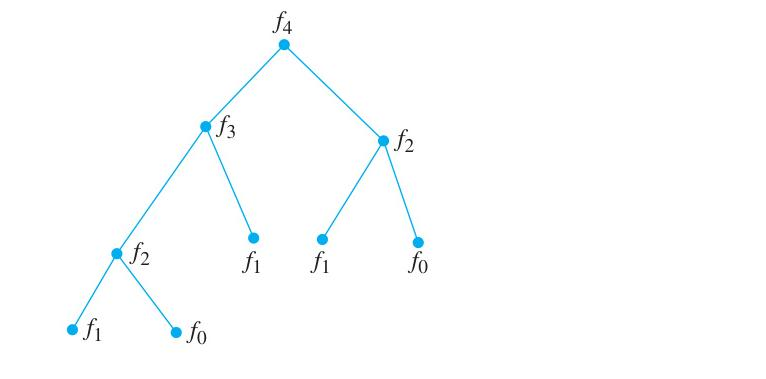
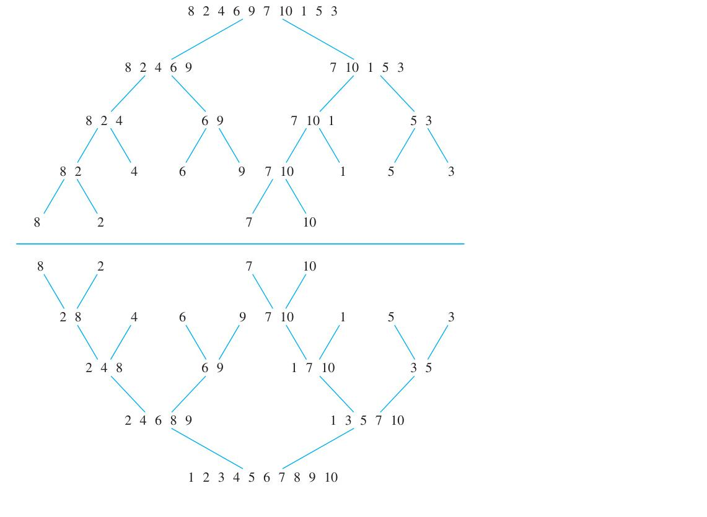

# 5.4 Recursive Algorithms

<!-- Page 50 -->

### Introduction

Sometimes we can reduce the solution to a problem with a particular set of input values to the solution of the same problem with smaller input values. For instance, the problem of finding the greatest common divisor of two positive integers $a$ and $b$, where $b > a$, can be reduced to finding the greatest common divisor of a pair of smaller integers, namely, $b \bmod a$ and $a$, because $\gcd(b \bmod a, a) = \gcd(a, b)$. When such a reduction can be done, the solution to the original problem can be found with a sequence of reductions, until the problem has been reduced to some initial case for which the solution is known. For instance, for finding the greatest common divisor, the reduction continues until the smaller of the two numbers is zero, because $\gcd(a, 0) = a$ when $a > 0$.

We will see that algorithms that successively reduce a problem to the same problem with smaller input are used to solve a wide variety of problems.

<!-- Page 51 -->

> [!NOTE] DEFINITION 1
> An algorithm is called **recursive** if it solves a problem by reducing it to an instance of the same problem with smaller input.

We will describe a variety of different recursive algorithms in this section.

#### EXAMPLE 1
Give a recursive algorithm for computing $n!$, where $n$ is a nonnegative integer.

**Solution:** We can build a recursive algorithm that finds $n!$, where $n$ is a nonnegative integer, based on the recursive definition of $n!$, which specifies that $n! = n \cdot (n - 1)!$ when $n$ is a positive integer, and that $0! = 1$. To find $n!$ for a particular integer, we use the recursive step $n$ times, each time replacing a value of the factorial function with the value of the factorial function at the next smaller integer. At this last step, we insert the value of $0!$. The recursive algorithm we obtain is displayed as Algorithm 1.

To help understand how this algorithm works, we trace the steps used by the algorithm to compute $4!$. First, we use the recursive step to write $4! = 4 \cdot 3!$. We then use the recursive step repeatedly to write $3! = 3 \cdot 2!, 2! = 2 \cdot 1!,$ and $1! = 1 \cdot 0!$. Inserting the value of $0! = 1$, and working back through the steps, we see that $1! = 1 \cdot 1 = 1, 2! = 2 \cdot 1! = 2, 3! = 3 \cdot 2! = 3 \cdot 2 = 6,$ and $4! = 4 \cdot 3! = 4 \cdot 6 = 24$.
$\blacktriangleleft$

> [!NOTE] ALGORITHM 1: A Recursive Algorithm for Computing $n!$
> **procedure** *factorial*($n$: nonnegative integer)  
> **if** $n = 0$ **then return** 1  
> **else return** $n \cdot \text{factorial}(n - 1)$  
> {output is $n!$}

Example 2 shows how a recursive algorithm can be constructed to evaluate a function from its recursive definition.

#### EXAMPLE 2
Give a recursive algorithm for computing $a^n$, where $a$ is a nonzero real number and $n$ is a nonnegative integer.

**Solution:** We can base a recursive algorithm on the recursive definition of $a^n$. This definition states that $a^{n+1} = a \cdot a^n$ for $n > 0$ and the initial condition $a^0 = 1$. To find $a^n$, successively use the recursive step to reduce the exponent until it becomes zero. We give this procedure in Algorithm 2.
$\blacktriangleleft$

> [!NOTE] ALGORITHM 2: A Recursive Algorithm for Computing $a^n$
> **procedure** *power*($a$: nonzero real number, $n$: nonnegative integer)  
> **if** $n = 0$ **then return** 1  
> **else return** $a \cdot \text{power}(a, n - 1)$  
> {output is $a^n$}

Next we give a recursive algorithm for finding greatest common divisors.

<!-- Page 52 -->

#### EXAMPLE 3
Give a recursive algorithm for computing the greatest common divisor of two nonnegative integers $a$ and $b$ with $a < b$.

**Solution:** We can base a recursive algorithm on the reduction $\gcd(a, b) = \gcd(b \bmod a, a)$ and the condition $\gcd(0, b) = b$ when $b > 0$. This produces the procedure in Algorithm 3, which is a recursive version of the Euclidean algorithm.

We illustrate the workings of Algorithm 3 with a trace when the input is $a = 5, b = 8$. With this input, the algorithm uses the “else” clause to find that $\gcd(5, 8) = \gcd(8 \bmod 5, 5) = \gcd(3, 5)$. It uses this clause again to find that $\gcd(3, 5) = \gcd(5 \bmod 3, 3) = \gcd(2, 3)$, then to get $\gcd(2, 3) = \gcd(3 \bmod 2, 2) = \gcd(1, 2)$, then to get $\gcd(1, 2) = \gcd(2 \bmod 1, 1) = \gcd(0, 1)$. Finally, to find $\gcd(0, 1)$ it uses the first step with $a = 0$ to find that $\gcd(0, 1) = 1$. Consequently, the algorithm finds that $\gcd(5, 8) = 1$.
$\blacktriangleleft$

> [!NOTE] ALGORITHM 3: A Recursive Algorithm for Computing $\gcd(a, b)$
> **procedure** *gcd*($a, b$: nonnegative integers with $a < b$)  
> **if** $a = 0$ **then return** $b$  
> **else return** $\text{gcd}(b \bmod a, a)$  
> {output is $\gcd(a, b)$}

#### EXAMPLE 4
Devise a recursive algorithm for computing $b^n \bmod m$, where $b, n,$ and $m$ are integers with $m \ge 2, n \ge 0,$ and $1 \le b < m$.

**Solution:** We can base a recursive algorithm on the fact that
$$b^n \bmod m = (b \cdot (b^{n-1} \bmod m)) \bmod m,$$
which follows by Corollary 2 in Section 4.1, and the initial condition $b^0 \bmod m = 1$.

However, we can devise a much more efficient recursive algorithm based on the observation that
$$b^n \bmod m = (b^{n/2} \bmod m)^2 \bmod m$$
when $n$ is even and
$$b^n \bmod m = ((b^{\lfloor n/2 \rfloor} \bmod m)^2 \bmod m \cdot b \bmod m) \bmod m$$
when $n$ is odd, which we describe in pseudocode as Algorithm 4.

We trace the execution of Algorithm 4 with input $b = 2, n = 5,$ and $m = 3$ to illustrate how it works. First, because $n = 5$ is odd we use the “else” clause to see that $\text{mpower}(2, 5, 3) = (\text{mpower}(2, 2, 3)^2 \bmod 3 \cdot 2 \bmod 3) \bmod 3$. We next use the “else if” clause to see that $\text{mpower}(2, 2, 3) = \text{mpower}(2, 1, 3)^2 \bmod 3$. Using the “else” clause again, we see that $\text{mpower}(2, 1, 3) = (\text{mpower}(2, 0, 3)^2 \bmod 3 \cdot 2 \bmod 3) \bmod 3$. Finally, using the “if” clause, we see that $\text{mpower}(2, 0, 3) = 1$. Working backwards, it follows that $\text{mpower}(2, 1, 3) = (1^2 \bmod 3 \cdot 2 \bmod 3) \bmod 3 = 2$, so $\text{mpower}(2, 2, 3) = 2^2 \bmod 3 = 1$, and finally $\text{mpower}(2, 5, 3) = (1^2 \bmod 3 \cdot 2 \bmod 3) \bmod 3 = 2$.
$\blacktriangleleft$

<!-- Page 53 -->

> [!NOTE] ALGORITHM 4: Recursive Modular Exponentiation
> **procedure** *mpower*($b, n, m$: integers with $b > 0$ and $m \ge 2, n \ge 0$)  
> **if** $n = 0$ **then**  
> &emsp;**return** 1  
> **else if** $n$ is even **then**  
> &emsp;**return** $\text{mpower}(b, n/2, m)^2 \bmod m$  
> **else**  
> &emsp;**return** $(\text{mpower}(b, \lfloor n/2 \rfloor, m)^2 \bmod m \cdot b \bmod m) \bmod m$  
> {output is $b^n \bmod m$}

We will now give recursive versions of searching algorithms that were introduced in Section 3.1.

#### EXAMPLE 5
Express the linear search algorithm as a recursive procedure.

**Solution:** To search for the first occurrence of $x$ in the sequence $a_1, a_2, \dots, a_n$, at the $i$th step of the algorithm, $x$ and $a_i$ are compared. If $x$ equals $a_i$, then the algorithm returns $i$, the location of $x$ in the sequence. Otherwise, the search for the first occurrence of $x$ is reduced to a search in a sequence with one fewer element, namely, the sequence $a_{i+1}, \dots, a_n$. The algorithm returns 0 when $x$ is never found in the sequence after all terms have been examined. We can now give a recursive procedure, which is displayed as pseudocode in Algorithm 5.

Let $\text{search}(i, j, x)$ be the procedure that searches for the first occurrence of $x$ in the sequence $a_i, a_{i+1}, \dots, a_j$. The input to the procedure consists of the triple $(1, n, x)$. The algorithm terminates at a step if the first term of the remaining sequence is $x$ or if there is only one term of the sequence and this is not $x$. If $x$ is not the first term and there are additional terms, the same procedure is carried out but with a search sequence of one fewer term, obtained by deleting the first term of the search sequence. If the algorithm terminates without $x$ having been found, the algorithm returns the value 0.
$\blacktriangleleft$

> [!NOTE] ALGORITHM 5: A Recursive Linear Search Algorithm
> **procedure** *search*($i, j, x$: $i, j, x$ integers, $1 \le i \le j \le n$)  
> **if** $a_i = x$ **then**  
> &emsp;**return** $i$  
> **else if** $i = j$ **then**  
> &emsp;**return** 0  
> **else**  
> &emsp;**return** $\text{search}(i + 1, j, x)$  
> {output is the location of $x$ in $a_1, a_2, \dots, a_n$ if it appears; otherwise it is 0}

#### EXAMPLE 6
Construct a recursive version of a binary search algorithm.

**Solution:** Suppose we want to locate $x$ in the sequence $a_1, a_2, \dots, a_n$ of integers in increasing order. To perform a binary search, we begin by comparing $x$ with the middle term, $a_{\lfloor(n+1)/2\rfloor}$. Our algorithm will terminate if $x$ equals this term and return the location of this term in the sequence. Otherwise, we reduce the search to a smaller search sequence, namely, the first half of the sequence if $x$ is smaller than the middle term of the original sequence, and the second half otherwise. We have reduced the solution of the search problem to the solution of the same

<!-- Page 54 -->

problem with a sequence at most half as long. If we have never encountered the search term $x$, our algorithm returns the value 0. We express this recursive version of a binary search algorithm as Algorithm 6.
$\blacktriangleleft$

> [!NOTE] ALGORITHM 6: A Recursive Binary Search Algorithm
> **procedure** *binary search*($i, j, x$: $i, j, x$ integers, $1 \le i \le j \le n$)  
> $m := \lfloor(i + j)/2\rfloor$  
> **if** $x = a_m$ **then**  
> &emsp;**return** $m$  
> **else if** ($x < a_m$ and $i < m$) **then**  
> &emsp;**return** $\text{binary search}(i, m - 1, x)$  
> **else if** ($x > a_m$ and $j > m$) **then**  
> &emsp;**return** $\text{binary search}(m + 1, j, x)$  
> **else return** 0  
> {output is location of $x$ in $a_1, a_2, \dots, a_n$ if it appears; otherwise it is 0}

### Proving Recursive Algorithms Correct

Mathematical induction, and its variant strong induction, can be used to prove that a recursive algorithm is correct, that is, that it produces the desired output for all possible input values. Examples 7 and 8 illustrate how mathematical induction or strong induction can be used to prove that recursive algorithms are correct. First, we will show that Algorithm 2 is correct.

#### EXAMPLE 7
Prove that Algorithm 2, which computes powers of real numbers, is correct.

**Solution:** We use mathematical induction on the exponent $n$.

**BASIS STEP:** If $n = 0$, the first step of the algorithm tells us that $\text{power}(a, 0) = 1$. This is correct because $a^0 = 1$ for every nonzero real number $a$. This completes the basis step.

**INDUCTIVE STEP:** The inductive hypothesis is the statement that $\text{power}(a, k) = a^k$ for all $a \neq 0$ for an arbitrary nonnegative integer $k$. That is, the inductive hypothesis is the statement that the algorithm correctly computes $a^k$. To complete the inductive step, we show that if the inductive hypothesis is true, then the algorithm correctly computes $a^{k+1}$. Because $k + 1$ is a positive integer, when the algorithm computes $a^{k+1}$, the algorithm sets $\text{power}(a, k + 1) = a \cdot \text{power}(a, k)$. By the inductive hypothesis, we have $\text{power}(a, k) = a^k$, so $\text{power}(a, k + 1) = a \cdot \text{power}(a, k) = a \cdot a^k = a^{k+1}$. This completes the inductive step.

We have completed the basis step and the inductive step, so we can conclude that Algorithm 2 always computes $a^n$ correctly when $a \neq 0$ and $n$ is a nonnegative integer.
$\blacktriangleleft$

Generally, we need to use strong induction to prove that recursive algorithms are correct, rather than just mathematical induction. Example 8 illustrates this; it shows how strong induction can be used to prove that Algorithm 4 is correct.

#### EXAMPLE 8
Prove that Algorithm 4, which computes modular powers, is correct.

**Solution:** We use strong induction on the exponent $n$.

**BASIS STEP:** Let $b$ be an integer and $m$ an integer with $m \ge 2$. When $n = 0$, the algorithm sets $\text{mpower}(b, n, m)$ equal to 1. This is correct because $b^0 \bmod m = 1$. The basis step is complete.

<!-- Page 55 -->

**INDUCTIVE STEP:** For the inductive hypothesis we assume that $\text{mpower}(b, j, m) = b^j \bmod m$ for all integers $0 \le j < k$ whenever $b$ is a positive integer and $m$ is an integer with $m \ge 2$. To complete the inductive step, we show that if the inductive hypothesis is correct, then $\text{mpower}(b, k, m) = b^k \bmod m$. Because the recursive algorithm handles odd and even values of $k$ differently, we split the inductive step into two cases.

When $k$ is even, we have
$$\text{mpower}(b, k, m) = (\text{mpower}(b, k/2, m))^2 \bmod m = (b^{k/2} \bmod m)^2 \bmod m = b^k \bmod m,$$
where we have used the inductive hypothesis to replace $\text{mpower}(b, k/2, m)$ by $b^{k/2} \bmod m$.

When $k$ is odd, we have
$$
\begin{aligned}
\text{mpower}(b, k, m) &= ((\text{mpower}(b, \lfloor k/2 \rfloor, m))^2 \bmod m \cdot b \bmod m) \bmod m \\
&= ((b^{\lfloor k/2 \rfloor} \bmod m)^2 \bmod m \cdot b \bmod m) \bmod m \\
&= b^{2\lfloor k/2 \rfloor + 1} \bmod m = b^k \bmod m,
\end{aligned}
$$
using Corollary 2 in Section 4.1, because $2\lfloor k/2 \rfloor + 1 = 2(k - 1)/2 + 1 = k$ when $k$ is odd. Here we have used the inductive hypothesis to replace $\text{mpower}(b, \lfloor k/2 \rfloor, m)$ by $b^{\lfloor k/2 \rfloor} \bmod m$. This completes the inductive step.

We have completed the basis step and the inductive step, so by strong induction we know that Algorithm 4 is correct.
$\blacktriangleleft$

### Recursion and Iteration

A recursive definition expresses the value of a function at a positive integer in terms of the values of the function at smaller integers. This means that we can devise a recursive algorithm to evaluate a recursively defined function at a positive integer. Instead of successively reducing the computation to the evaluation of the function at smaller integers, we can start with the value of the function at one or more integers, the base cases, and successively apply the recursive definition to find the values of the function at successive larger integers. Such a procedure is called **iterative**.

Often an iterative approach for the evaluation of a recursively defined sequence requires much less computation than a procedure using recursion (unless special-purpose recursive machines are used). This is illustrated by the iterative and recursive procedures for finding the $n$th Fibonacci number. The recursive procedure is given first.

> [!NOTE] ALGORITHM 7: A Recursive Algorithm for Fibonacci Numbers
> **procedure** *fibonacci*($n$: nonnegative integer)  
> **if** $n = 0$ **then return** 0  
> **else if** $n = 1$ **then return** 1  
> **else return** $\text{fibonacci}(n - 1) + \text{fibonacci}(n - 2)$  
> {output is $\text{fibonacci}(n)$}

When we use a recursive procedure to find $f_n$, we first express $f_n$ as $f_{n-1} + f_{n-2}$. Then we replace both of these Fibonacci numbers by the sum of two previous Fibonacci numbers, and so on. When $f_1$ or $f_0$ arises, it is replaced by its value.

Note that at each stage of the recursion, until $f_1$ or $f_0$ is obtained, the number of Fibonacci numbers to be evaluated has doubled. For instance, when we find $f_4$ using this recursive algorithm, we must carry out all the computations illustrated in the tree diagram in Figure 1.

<!-- Page 56 -->

*Figure 1 — Evaluating $f_4$ Recursively.*

This tree consists of a root labeled with $f_4$, and branches from the root to vertices labeled with the two Fibonacci numbers $f_3$ and $f_2$ that occur in the reduction of the computation of $f_4$. Each subsequent reduction produces two branches in the tree. This branching ends when $f_0$ and $f_1$ are reached. This algorithm requires $f_{n+1} - 1$ additions to find $f_n$.

Now consider the amount of computation required to find $f_n$ using the iterative approach in Algorithm 8.

> [!NOTE] ALGORITHM 8: An Iterative Algorithm for Computing Fibonacci Numbers
> **procedure** *iterative fibonacci*($n$: nonnegative integer)  
> **if** $n = 0$ **then return** 0  
> **else**  
> &emsp;$x := 0$  
> &emsp;$y := 1$  
> &emsp;**for** $i := 1$ **to** $n - 1$  
> &emsp;&emsp;$z := x + y$  
> &emsp;&emsp;$x := y$  
> &emsp;&emsp;$y := z$  
> &emsp;**return** $y$  
> {output is the $n$th Fibonacci number}

This procedure initializes $x$ as $f_0 = 0$ and $y$ as $f_1 = 1$. When the loop is traversed, the sum of $x$ and $y$ is assigned to the auxiliary variable $z$. Then $x$ is assigned the value of $y$ and $y$ is assigned the value of the auxiliary variable $z$. Therefore, after going through the loop the first time, it follows that $x$ equals $f_1$ and $y$ equals $f_0 + f_1 = f_2$. Furthermore, after going through the loop $n - 1$ times, $x$ equals $f_{n-1}$ and $y$ equals $f_n$. Only $n - 1$ additions have been used to find $f_n$ with this iterative approach when $n > 1$. Consequently, this algorithm requires far less computation than does the recursive algorithm.

We have shown that a recursive algorithm may require far more computation than an iterative one when a recursively defined function is evaluated. It is sometimes preferable to use a recursive procedure even if it is less efficient than the iterative procedure. In particular, this is true when the recursive approach is easily implemented and the iterative approach is not.

<!-- Page 57 -->

### The Merge Sort

The **merge sort** is a popular sorting algorithm that sorts a list of $n$ elements by recursively splitting the list into two sublists of equal (or near equal) size, sorting each sublist recursively using merge sort, and then merging the two sorted sublists into a single sorted list.

*Figure 2 — The Merge Sort of 8, 2, 4, 6, 9, 7, 10, 1, 5, 3.*

#### EXAMPLE 9
Use the merge sort to sort the list $8, 2, 4, 6, 9, 7, 10, 1, 5, 3$.

**Solution:** A merge sort begins by splitting the list into individual elements by successively dividing lists into two smaller lists. The original list has 10 elements. It is split into two lists of 5 elements each: $8, 2, 4, 6, 9$ and $7, 10, 1, 5, 3$. Each of these 5-element lists is split into a 3-element list and a 2-element list. The list $8, 2, 4, 6, 9$ is split into $8, 2, 4$ and $6, 9$; the list $7, 10, 1, 5, 3$ is split into $7, 10, 1$ and $5, 3$. This splitting process continues until lists with a single element are produced.

Once the list has been split into 1-element lists, pairs of lists are merged into 2-element ordered lists. Next, pairs of 2-element lists are merged into 4-element ordered lists, and so on, until the original elements have been merged into a single sorted list. This entire process is illustrated in Figure 2.
$\blacktriangleleft$

<!-- Page 58 -->

> [!NOTE] ALGORITHM 9: A Recursive Merge Sort
> **procedure** *mergesort*($L = a_1, a_2, \dots, a_n$)  
> **if** $n > 1$ **then**  
> &emsp;$m := \lfloor n/2 \rfloor$  
> &emsp;$L_1 := a_1, a_2, \dots, a_m$  
> &emsp;$L_2 := a_{m+1}, a_{m+2}, \dots, a_n$  
> &emsp;$L := \text{merge}(\text{mergesort}(L_1), \text{mergesort}(L_2))$  
> {output is $L$ sorted in increasing order}

#### EXAMPLE 10
Merge the two sorted lists $2, 3, 5, 6$ and $1, 4$.

**Solution:** To merge the lists $2, 3, 5, 6$ and $1, 4$, we compare the first element of each list, 2 and 1. Because 1 is smaller, we place 1 in the combined list and remove it from the second list, leaving $2, 3, 5, 6$ and 4. We next compare the first elements of the remaining lists, 2 and 4. Because 2 is smaller, we put 2 at the end of the combined list, which now contains 1, 2, and remove 2 from the first list. Next, we compare 3 and 4; 3 is smaller, so it is placed in the combined list, giving 1, 2, 3. Next, 5 and 4 are compared; 4 is smaller, so it is placed in the combined list, giving 1, 2, 3, 4.

Finally, because the second list is empty, all elements of the first list can be appended to the end of the combined list in the order they occur in the first list. This produces the ordered list $1, 2, 3, 4, 5, 6$.
$\blacktriangleleft$

##### TABLE 1: Merging the Two Sorted Lists 2, 3, 5, 6 and 1, 4.

| First List | Second List | Merged List | Comparison |
| :---: | :---: | :---: | :---: |
| $2\ 3\ 5\ 6$ | $1\ 4$ | | $1 < 2$ |
| $2\ 3\ 5\ 6$ | $4$ | $1$ | $2 < 4$ |
| $3\ 5\ 6$ | $4$ | $1\ 2$ | $3 < 4$ |
| $5\ 6$ | $4$ | $1\ 2\ 3$ | $4 < 5$ |
| $5\ 6$ | | $1\ 2\ 3\ 4$ | |
| | | $1\ 2\ 3\ 4\ 5\ 6$ | |

<!-- Page 59 -->

We will now consider the general problem of merging two ordered lists $L_1$ and $L_2$ into an ordered list $L$. We will describe an algorithm for solving this problem. Start with an empty list $L$. Compare the smallest elements of the two lists. Put the smaller of these two elements at the right end of $L$, and remove it from the list it was in. Next, if one of $L_1$ and $L_2$ is empty, append the other (nonempty) list to $L$, which completes the merging. If neither $L_1$ nor $L_2$ is empty, repeat this process. Algorithm 10 gives a pseudocode description of this procedure.

> [!NOTE] ALGORITHM 10: Merging Two Lists
> **procedure** *merge*($L_1, L_2$: sorted lists)  
> $L := \text{empty list}$  
> **while** $L_1$ and $L_2$ are both nonempty  
> &emsp;remove smaller of first elements of $L_1$ and $L_2$ from its list; put it at the right end of $L$  
> **if** this removal makes one list empty **then**  
> &emsp;remove all elements from the other list and append them to $L$  
> **return** $L$ {$L$ is the merged list with elements in increasing order}

We will need estimates for the number of comparisons used to merge two ordered lists in the analysis of the merge sort. We can easily obtain such an estimate for Algorithm 10. Each time a comparison of an element from $L_1$ and an element from $L_2$ is made, an additional element is added to the merged list $L$. However, when either $L_1$ or $L_2$ is empty, no more comparisons are needed. Hence, Algorithm 10 is least efficient when $m + n - 2$ comparisons are carried out, where $m$ and $n$ are the number of elements in $L_1$ and $L_2$, respectively, leaving one element in each of $L_1$ and $L_2$. The next comparison will be the last one needed, because it will make one of these lists empty. Hence, Algorithm 10 uses no more than $m + n - 1$ comparisons. Lemma 1 summarizes this estimate.

> [!NOTE] LEMMA 1
> Two sorted lists with $m$ elements and $n$ elements can be merged into a sorted list using no more than $m + n - 1$ comparisons.

Sometimes two sorted lists of length $m$ and $n$ can be merged using far fewer than $m + n - 1$ comparisons. For instance, when $m = 1$, a binary search procedure can be applied to put the one element in the first list into the second list. This requires only $\lceil\log n\rceil$ comparisons, which is much smaller than $m + n - 1 = n$, for $m = 1$. On the other hand, for some values of $m$ and $n$, Lemma 1 gives the best possible bound. That is, there are lists with $m$ and $n$ elements that cannot be merged using fewer than $m + n - 1$ comparisons.

We can now analyze the complexity of the merge sort. Instead of studying the general problem, we will assume that $n$, the number of elements in the list, is a power of 2, say $2^m$. This will make the analysis less complicated, but when this is not the case, various modifications can be applied that will yield the same estimate.

At the first stage of the splitting procedure, the list is split into two sublists, of $2^{m-1}$ elements each, at level 1 of the tree generated by the splitting. This process continues, splitting the two sublists with $2^{m-1}$ elements into four sublists of $2^{m-2}$ elements each at level 2, and so on. In general, there are $2^{k-1}$ lists at level $k - 1$, each with $2^{m-k+1}$ elements. These lists at level $k - 1$ are split into $2^k$ lists at level $k$, each with $2^{m-k}$ elements. At the end of this process, we have $2^m$ lists each with one element at level $m$.

We start merging by combining pairs of the $2^m$ lists of one element into $2^{m-1}$ lists, at level $m - 1$, each with two elements. To do this, $2^{m-1}$ pairs of lists with one element each are merged. The merger of each pair requires exactly one comparison.

The procedure continues, so that at level $k$ ($k = m, m - 1, m - 2, \dots, 3, 2, 1$), $2^k$ lists each with $2^{m-k}$ elements are merged into $2^{k-1}$ lists, each with $2^{m-k+1}$ elements, at level $k - 1$. To do this a total of $2^{k-1}$ mergers of two lists, each with $2^{m-k}$ elements, are needed. But,

<!-- Page 60 -->

by Lemma 1, each of these mergers can be carried out using at most $2^{m-k} + 2^{m-k} - 1 = 2^{m-k+1} - 1$ comparisons. Hence, going from level $k$ to $k - 1$ can be accomplished using at most $2^{k-1}(2^{m-k+1} - 1)$ comparisons.

Summing all these estimates shows that the number of comparisons required for the merge sort is at most
$$\sum_{k=1}^m 2^{k-1}(2^{m-k+1} - 1) = \sum_{k=1}^m 2^m - \sum_{k=1}^m 2^{k-1} = m 2^m - (2^m - 1) = n \log n - n + 1,$$
because $m = \log n$ and $n = 2^m$. (We evaluated $\sum_{k=1}^m 2^m$ by noting that it is the sum of $m$ identical terms, each equal to $2^m$. We evaluated $\sum_{k=1}^m 2^{k-1}$ using the formula for the sum of the terms of a geometric progression from Theorem 1 of Section 2.4.)

Theorem 1 summarizes what we have discovered about the worst-case complexity of the merge sort algorithm.

> [!NOTE] THEOREM 1
> The number of comparisons needed to merge sort a list with $n$ elements is $O(n \log n)$.

In Chapter 11 we will show that the fastest comparison-based sorting algorithms have $O(n \log n)$ time complexity. (A comparison-based sorting algorithm has the comparison of two elements as its basic operation.) Theorem 1 tells us that the merge sort achieves this best possible big-$O$ estimate for the complexity of a sorting algorithm.
