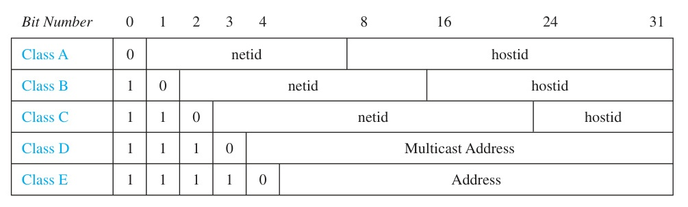
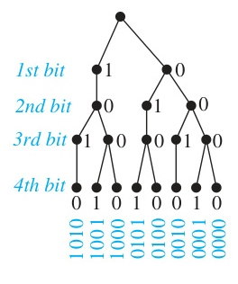
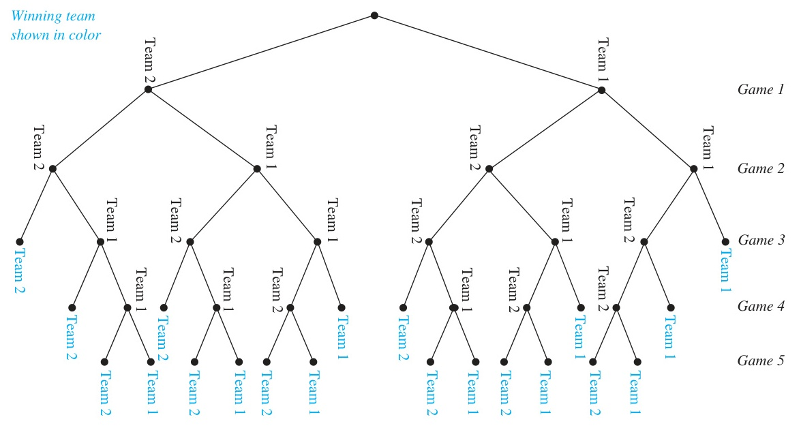
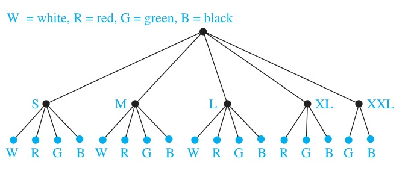

# Chapter 6: Counting

<!-- Page 1 -->

## Chapter Overview

Combinatorics, the study of arrangements of objects, is an important part of discrete mathematics. This subject was studied as long ago as the seventeenth century, when combinatorial questions arose in the study of gambling games. Enumeration, the counting of objects with certain properties, is an important part of combinatorics. We must count objects to solve many different types of problems. For instance, counting is used to determine the complexity of algorithms. Counting is also required to determine whether there are enough telephone numbers or Internet protocol addresses to meet demand. Recently, it has played a key role in mathematical biology, especially in sequencing DNA. Furthermore, counting techniques are used extensively when probabilities of events are computed.

The basic rules of counting, which we will study in Section 6.1, can solve a tremendous variety of problems. For instance, we can use these rules to enumerate the different telephone numbers possible in the United States, the allowable passwords on a computer system, and the different orders in which the runners in a race can finish. Another important combinatorial tool is the pigeonhole principle, which we will study in Section 6.2. This states that when objects are placed in boxes and there are more objects than boxes, then there is a box containing at least two objects. For instance, we can use this principle to show that among a set of 15 or more students, at least 3 were born on the same day of the week.

We can phrase many counting problems in terms of ordered or unordered arrangements of the objects of a set with or without repetitions. These arrangements, called permutations and combinations, are used in many counting problems. For instance, suppose the 100 top finishers on a competitive exam taken by 2000 students are invited to a banquet. We can count the possible sets of 100 students that will be invited, as well as the ways in which the top 10 prizes can be awarded.

Another problem in combinatorics involves generating all the arrangements of a specified kind. This is often important in computer simulations. We will devise algorithms to generate arrangements of various types.

---

## 6.1 The Basics of Counting

### Introduction

Suppose that a password on a computer system consists of six, seven, or eight characters. Each of these characters must be a digit or a letter of the alphabet. Each password must contain at least one digit. How many such passwords are there? The techniques needed to answer this question and a wide variety of other counting problems will be introduced in this section.

Counting problems arise throughout mathematics and computer science. For example, we must count the successful outcomes of experiments and all the possible outcomes of these experiments to determine probabilities of discrete events. We need to count the number of operations used by an algorithm to study its time complexity.

We will introduce the basic techniques of counting in this section. These methods serve as the foundation for almost all counting techniques.

<!-- Page 2 -->

### Basic Counting Principles

We first present two basic counting principles, the product rule and the sum rule. Then we will show how they can be used to solve many different counting problems.

The product rule applies when a procedure is made up of separate tasks.

> [!NOTE] THE PRODUCT RULE
> Suppose that a procedure can be broken down into a sequence of two tasks. If there are $n_1$ ways to do the first task and for each of these ways of doing the first task, there are $n_2$ ways to do the second task, then there are $n_1n_2$ ways to do the procedure.

Examples 1–10 show how the product rule is used.

#### EXAMPLE 1
A new company with just two employees, Sanchez and Patel, rents a floor of a building with 12 offices. How many ways are there to assign different offices to these two employees?

**Solution:** The procedure of assigning offices to these two employees consists of assigning an office to Sanchez, which can be done in 12 ways, then assigning an office to Patel different from the office assigned to Sanchez, which can be done in 11 ways. By the product rule, there are $12 \cdot 11 = 132$ ways to assign offices to these two employees. $\blacktriangleleft$

#### EXAMPLE 2
The chairs of an auditorium are to be labeled with an uppercase English letter followed by a positive integer not exceeding 100. What is the largest number of chairs that can be labeled differently?

**Solution:** The procedure of labeling a chair consists of two tasks, namely, assigning to the seat one of the 26 uppercase English letters, and then assigning to it one of the 100 possible integers. The product rule shows that there are $26 \cdot 100 = 2600$ different ways that a chair can be labeled. Therefore, the largest number of chairs that can be labeled differently is 2600. $\blacktriangleleft$

#### EXAMPLE 3
There are 32 microcomputers in a computer center. Each microcomputer has 24 ports. How many different ports to a microcomputer in the center are there?

**Solution:** The procedure of choosing a port consists of two tasks, first picking a microcomputer and then picking a port on this microcomputer. Because there are 32 ways to choose the microcomputer and 24 ways to choose the port no matter which microcomputer has been selected, the product rule shows that there are $32 \cdot 24 = 768$ ports. $\blacktriangleleft$

An extended version of the product rule is often useful. Suppose that a procedure is carried out by performing the tasks $T_1, T_2, \dots, T_m$ in sequence. If each task $T_i$, $i = 1, 2, \dots, m$, can be done in $n_i$ ways, regardless of how the previous tasks were done, then there are $n_1 \cdot n_2 \cdots n_m$ ways to carry out the procedure. This version of the product rule can be proved by mathematical induction from the product rule for two tasks (see Exercise 72).

#### EXAMPLE 4
How many different bit strings of length seven are there?

**Solution:** Each of the seven bits can be chosen in two ways, because each bit is either 0 or 1. Therefore, the product rule shows there are a total of $2^7 = 128$ different bit strings of length seven. $\blacktriangleleft$

<!-- Page 3 -->

#### EXAMPLE 5
How many different license plates can be made if each plate contains a sequence of three uppercase English letters followed by three digits (and no sequences of letters are prohibited, even if they are obscene)?

**Solution:** There are 26 choices for each of the three uppercase English letters and ten choices for each of the three digits. Hence, by the product rule there are a total of
$$26 \cdot 26 \cdot 26 \cdot 10 \cdot 10 \cdot 10 = 17,576,000$$
possible license plates. $\blacktriangleleft$

#### EXAMPLE 6: Counting Functions
How many functions are there from a set with $m$ elements to a set with $n$ elements?

**Solution:** A function corresponds to a choice of one of the $n$ elements in the codomain for each of the $m$ elements in the domain. Hence, by the product rule there are $n \cdot n \cdots n = n^m$ functions from a set with $m$ elements to one with $n$ elements. For example, there are $5^3 = 125$ different functions from a set with three elements to a set with five elements. $\blacktriangleleft$

#### EXAMPLE 7: Counting One-to-One Functions
How many one-to-one functions are there from a set with $m$ elements to one with $n$ elements?

**Solution:** First note that when $m > n$ there are no one-to-one functions from a set with $m$ elements to a set with $n$ elements.

Now let $m \le n$. Suppose the elements in the domain are $a_1, a_2, \dots, a_m$. There are $n$ ways to choose the value of the function at $a_1$. Because the function is one-to-one, the value of the function at $a_2$ can be picked in $n - 1$ ways (because the value used for $a_1$ cannot be used again). In general, the value of the function at $a_k$ can be chosen in $n - k + 1$ ways. By the product rule, there are $n(n - 1)(n - 2) \cdots (n - m + 1)$ one-to-one functions from a set with $m$ elements to one with $n$ elements.

For example, there are $5 \cdot 4 \cdot 3 = 60$ one-to-one functions from a set with three elements to a set with five elements. $\blacktriangleleft$

#### EXAMPLE 8: The Telephone Numbering Plan
The North American numbering plan (NANP) specifies the format of telephone numbers in the U.S., Canada, and many other parts of North America. A telephone number in this plan consists of 10 digits, which are split into a three-digit area code, a three-digit office code, and a four-digit station code. Because of signaling considerations, there are certain restrictions on some of these digits. To specify the allowable format, let $X$ denote a digit that can take any of the values 0 through 9, let $N$ denote a digit that can take any of the values 2 through 9, and let $Y$ denote a digit that must be a 0 or a 1. Two numbering plans, which will be called the old plan, and the new plan, will be discussed. (The old plan, in use in the 1960s, has been replaced by the new plan, but the recent rapid growth in demand for new numbers for mobile phones and devices will eventually make even this new plan obsolete. In this example, the letters used to represent digits follow the conventions of the North American Numbering Plan.) As will be shown, the new plan allows the use of more numbers.

In the old plan, the formats of the area code, office code, and station code are $NYX$, $NNX$, and $XXXX$, respectively, so that telephone numbers had the form $NYX\text{-}NNX\text{-}XXXX$. In the new plan, the formats of these codes are $NXX$, $NXX$, and $XXXX$, respectively, so that telephone numbers have the form $NXX\text{-}NXX\text{-}XXXX$. How many different North American telephone numbers are possible under the old plan and under the new plan?

**Solution:** By the product rule, there are $8 \cdot 2 \cdot 10 = 160$ area codes with format $NYX$ and $8 \cdot 10 \cdot 10 = 800$ area codes with format $NXX$. Similarly, by the product rule, there are $8 \cdot 8 \cdot 10 = 640$ office codes with format $NNX$. The product rule also shows that there are $10 \cdot 10 \cdot 10 \cdot 10 = 10,000$ station codes with format $XXXX$.

<!-- Page 4 -->

Consequently, applying the product rule again, it follows that under the old plan there are
$$160 \cdot 640 \cdot 10,000 = 1,024,000,000$$
different numbers available in North America. Under the new plan, there are
$$800 \cdot 800 \cdot 10,000 = 6,400,000,000$$
different numbers available. $\blacktriangleleft$

#### EXAMPLE 9
What is the value of $k$ after the following code, where $n_1, n_2, \dots, n_m$ are positive integers, has been executed?
```pascal
k := 0
for i1 := 1 to n1
    for i2 := 1 to n2
        .
        .
        .
        for im := 1 to nm
            k := k + 1
```

**Solution:** The initial value of $k$ is zero. Each time the nested loop is traversed, 1 is added to $k$. Let $T_i$ be the task of traversing the $i$th loop. Then the number of times the loop is traversed is the number of ways to do the tasks $T_1, T_2, \dots, T_m$. The number of ways to carry out the task $T_j$, $j = 1, 2, \dots, m$, is $n_j$, because the $j$th loop is traversed once for each integer $i_j$ with $1 \le i_j \le n_j$. By the product rule, it follows that the nested loop is traversed $n_1n_2 \cdots n_m$ times. Hence, the final value of $k$ is $n_1n_2 \cdots n_m$. $\blacktriangleleft$

#### EXAMPLE 10: Counting Subsets of a Finite Set
Use the product rule to show that the number of different subsets of a finite set $S$ is $2^{|S|}$.

**Solution:** Let $S$ be a finite set. List the elements of $S$ in arbitrary order. Recall from Section 2.2 that there is a one-to-one correspondence between subsets of $S$ and bit strings of length $|S|$. Namely, a subset of $S$ is associated with the bit string with a 1 in the $i$th position if the $i$th element in the list is in the subset, and a 0 in this position otherwise. By the product rule, there are $2^{|S|}$ bit strings of length $|S|$. Hence, $|\mathcal{P}(S)| = 2^{|S|}$. (Recall that we used mathematical induction to prove this fact in Example 10 of Section 5.1.) $\blacktriangleleft$

The product rule is often phrased in terms of sets in this way: If $A_1, A_2, \dots, A_m$ are finite sets, then the number of elements in the Cartesian product of these sets is the product of the number of elements in each set. To relate this to the product rule, note that the task of choosing an element in the Cartesian product $A_1 \times A_2 \times \dots \times A_m$ is done by choosing an element in $A_1$, an element in $A_2, \dots,$ and an element in $A_m$. By the product rule it follows that
$$|A_1 \times A_2 \times \dots \times A_m| = |A_1| \cdot |A_2| \cdots |A_m|.$$

#### EXAMPLE 11: DNA and Genomes
The hereditary information of a living organism is encoded using deoxyribonucleic acid (DNA), or in certain viruses, ribonucleic acid (RNA). DNA and RNA are extremely complex molecules, with different molecules interacting in a vast variety of ways to

<!-- Page 5 -->

enable living process. For our purposes, we give only the briefest description of how DNA and RNA encode genetic information.

DNA molecules consist of two strands consisting of blocks known as nucleotides. Each nucleotide contains subcomponents called bases, each of which is adenine (A), cytosine (C), guanine (G), or thymine (T). The two strands of DNA are held together by hydrogen bonds connecting different bases, with A bonding only with T, and C bonding only with G. Unlike DNA, RNA is single stranded, with uracil (U) replacing thymine as a base. So, in DNA the possible base pairs are A-T and C-G, while in RNA they are A-U, and C-G. The DNA of a living creature consists of multiple pieces of DNA forming separate chromosomes. A gene is a segment of a DNA molecule that encodes a particular protein. The entirety of genetic information of an organism is called its genome.

Sequences of bases in DNA and RNA encode long chains of proteins called amino acids. There are 22 essential amino acids for human beings. We can quickly see that a sequence of at least three bases are needed to encode these 22 different amino acid. First note, that because there are four possibilities for each base in DNA, A, C, G, and T, by the product rule there are $4^2 = 16 < 22$ different sequences of two bases. However, there are $4^3 = 64$ different sequences of three bases, which provide enough different sequences to encode the 22 different amino acids (even after taking into account that several different sequences of three bases encode the same amino acid).

The DNA of simple living creatures such as algae and bacteria have between $10^5$ and $10^7$ links, where each link is one of the four possible bases. More complex organisms, such as insects, birds, and mammals have between $10^8$ and $10^{10}$ links in their DNA. So, by the product rule, there are at least $4^{10^5}$ different sequences of bases in the DNA of simple organisms and at least $4^{10^8}$ different sequences of bases in the DNA of more complex organisms. These are both incredibly huge numbers, which helps explain why there is such tremendous variability among living organisms. In the past several decades techniques have been developed for determining the genome of different organisms. The first step is to locate each gene in the DNA of an organism. The next task, called gene sequencing, is the determination of the sequence of links on each gene. (Of course, the specific sequence of kinks on these genes depends on the particular individual representative of a species whose DNA is analyzed.) For example, the human genome includes approximately 23,000 genes, each with 1,000 or more links. Gene sequencing techniques take advantage of many recently developed algorithms and are based on numerous new ideas in combinatorics. Many mathematicians and computer scientists work on problems involving genomes, taking part in the fast moving fields of bioinformatics and computational biology. $\blacktriangleleft$

We now introduce the sum rule.

> [!NOTE] THE SUM RULE
> If a task can be done either in one of $n_1$ ways or in one of $n_2$ ways, where none of the set of $n_1$ ways is the same as any of the set of $n_2$ ways, then there are $n_1 + n_2$ ways to do the task.

Example 12 illustrates how the sum rule is used.

#### EXAMPLE 12
Suppose that either a member of the mathematics faculty or a student who is a mathematics major is chosen as a representative to a university committee. How many different choices are there for this representative if there are 37 members of the mathematics faculty and 83 mathematics majors and no one is both a faculty member and a student?

**Solution:** There are 37 ways to choose a member of the mathematics faculty and there are 83 ways to choose a student who is a mathematics major. Choosing a member of the mathematics faculty is never the same as choosing a student who is a mathematics major because no one is

<!-- Page 6 -->

both a faculty member and a student. By the sum rule it follows that there are $37 + 83 = 120$ possible ways to pick this representative. $\blacktriangleleft$

We can extend the sum rule to more than two tasks. Suppose that a task can be done in one of $n_1$ ways, in one of $n_2$ ways, $\dots$, or in one of $n_m$ ways, where none of the set of $n_i$ ways of doing the task is the same as any of the set of $n_j$ ways, for all pairs $i$ and $j$ with $1 \le i < j \le m$. Then the number of ways to do the task is $n_1 + n_2 + \dots + n_m$. This extended version of the sum rule is often useful in counting problems, as Examples 13 and 14 show. This version of the sum rule can be proved using mathematical induction from the sum rule for two sets. (This is Exercise 71.)

#### EXAMPLE 13
A student can choose a computer project from one of three lists. The three lists contain 23, 15, and 19 possible projects, respectively. No project is on more than one list. How many possible projects are there to choose from?

**Solution:** The student can choose a project by selecting a project from the first list, the second list, or the third list. Because no project is on more than one list, by the sum rule there are
$$23 + 15 + 19 = 57$$
ways to choose a project. $\blacktriangleleft$

#### EXAMPLE 14
What is the value of $k$ after the following code, where $n_1, n_2, \dots, n_m$ are positive integers, has been executed?
```pascal
k := 0
for i1 := 1 to n1
    k := k + 1
for i2 := 1 to n2
    k := k + 1
.
.
.
for im := 1 to nm
    k := k + 1
```

**Solution:** The initial value of $k$ is zero. This block of code is made up of $m$ different loops. Each time a loop is traversed, 1 is added to $k$. To determine the value of $k$ after this code has been executed, we need to determine how many times we traverse a loop. Note that there are $n_i$ ways to traverse the $i$th loop. Because we only traverse one loop at a time, the sum rule shows that the final value of $k$, which is the number of ways to traverse one of the $m$ loops is $n_1 + n_2 + \dots + n_m$. $\blacktriangleleft$

The sum rule can be phrased in terms of sets as: If $A_1, A_2, \dots, A_m$ are pairwise disjoint finite sets, then the number of elements in the union of these sets is the sum of the numbers of elements in the sets. To relate this to our statement of the sum rule, note there are $|A_i|$ ways to choose an element from $A_i$ for $i = 1, 2, \dots, m$. Because the sets are pairwise disjoint, when we select an element from one of the sets $A_i$, we do not also select an element from a different set $A_j$. Consequently, by the sum rule, because we cannot select an element from two of these sets at the same time, the number of ways to choose an element from one of the sets, which is the number of elements in the union, is
$$|A_1 \cup A_2 \cup \dots \cup A_m| = |A_1| + |A_2| + \dots + |A_m| \quad \text{when } A_i \cap A_j = \emptyset \text{ for all } i \ne j.$$

This equality applies only when the sets in question are pairwise disjoint. The situation is much more complicated when these sets have elements in common. That situation will be briefly discussed later in this section and discussed in more depth in Chapter 8.

<!-- Page 7 -->

### More Complex Counting Problems

Many counting problems cannot be solved using just the sum rule or just the product rule. However, many complicated counting problems can be solved using both of these rules in combination. We begin by counting the number of variable names in the programming language BASIC. (In the exercises, we consider the number of variable names in JAVA.) Then we will count the number of valid passwords subject to a particular set of restrictions.

#### EXAMPLE 15
In a version of the computer language BASIC, the name of a variable is a string of one or two alphanumeric characters, where uppercase and lowercase letters are not distinguished. (An alphanumeric character is either one of the 26 English letters or one of the 10 digits.) Moreover, a variable name must begin with a letter and must be different from the five strings of two characters that are reserved for programming use. How many different variable names are there in this version of BASIC?

**Solution:** Let $V$ equal the number of different variable names in this version of BASIC. Let $V_1$ be the number of these that are one character long and $V_2$ be the number of these that are two characters long. Then by the sum rule, $V = V_1 + V_2$. Note that $V_1 = 26$, because a one-character variable name must be a letter. Furthermore, by the product rule there are $26 \cdot 36$ strings of length two that begin with a letter and end with an alphanumeric character. However, five of these are excluded, so $V_2 = 26 \cdot 36 - 5 = 931$. Hence, there are
$$V = V_1 + V_2 = 26 + 931 = 957$$
different names for variables in this version of BASIC. $\blacktriangleleft$

#### EXAMPLE 16
Each user on a computer system has a password, which is six to eight characters long, where each character is an uppercase letter or a digit. Each password must contain at least one digit. How many possible passwords are there?

**Solution:** Let $P$ be the total number of possible passwords, and let $P_6, P_7,$ and $P_8$ denote the number of possible passwords of length 6, 7, and 8, respectively. By the sum rule, $P = P_6 + P_7 + P_8$. We will now find $P_6, P_7,$ and $P_8$. Finding $P_6$ directly is difficult. To find $P_6$ it is easier to find the number of strings of uppercase letters and digits that are six characters long, including those with no digits, and subtract from this the number of strings with no digits. By the product rule, the number of strings of six characters is $36^6$, and the number of strings with no digits is $26^6$. Hence,
$$P_6 = 36^6 - 26^6 = 2,176,782,336 - 308,915,776 = 1,867,866,560.$$
Similarly, we have
$$P_7 = 36^7 - 26^7 = 78,364,164,096 - 8,031,810,176 = 70,332,353,920$$
and
$$P_8 = 36^8 - 26^8 = 2,821,109,907,456 - 208,827,064,576 = 2,612,282,842,880.$$
Consequently,
$$P = P_6 + P_7 + P_8 = 2,684,483,063,360.$$ $\blacktriangleleft$

#### EXAMPLE 17: Counting Internet Addresses
In the Internet, which is made up of interconnected physical networks of computers, each computer (or more precisely, each network connection of a computer) is assigned an Internet address. In Version 4 of the Internet Protocol (IPv4), now in use,

<!-- Page 8 -->


*Figure 1 — Internet Addresses (IPv4).*

an address is a string of 32 bits. It begins with a network number (*netid*). The *netid* is followed by a host number (*hostid*), which identifies a computer as a member of a particular network.

Three forms of addresses are used, with different numbers of bits used for *netids* and *hostids*. **Class A addresses**, used for the largest networks, consist of 0, followed by a 7-bit *netid* and a 24-bit *hostid*. **Class B addresses**, used for medium-sized networks, consist of 10, followed by a 14-bit *netid* and a 16-bit *hostid*. **Class C addresses**, used for the smallest networks, consist of 110, followed by a 21-bit *netid* and an 8-bit *hostid*. There are several restrictions on addresses because of special uses: 1111111 is not available as the *netid* of a Class A network, and the *hostids* consisting of all 0s and all 1s are not available for use in any network. A computer on the Internet has either a Class A, a Class B, or a Class C address. (Besides Class A, B, and C addresses, there are also Class D addresses, reserved for use in multicasting when multiple computers are addressed at a single time, consisting of 1110 followed by 28 bits, and Class E addresses, reserved for future use, consisting of 11110 followed by 27 bits. Neither Class D nor Class E addresses are assigned as the IPv4 address of a computer on the Internet.)

Figure 1 illustrates IPv4 addressing. (Limitations on the number of Class A and Class B *netids* have made IPv4 addressing inadequate; IPv6, a new version of IP, uses 128-bit addresses to solve this problem.)

How many different IPv4 addresses are available for computers on the Internet?

**Solution:** Let $x$ be the number of available addresses for computers on the Internet, and let $x_A, x_B,$ and $x_C$ denote the number of Class A, Class B, and Class C addresses available, respectively. By the sum rule, $x = x_A + x_B + x_C$.

To find $x_A$, note that there are $2^7 - 1 = 127$ Class A *netids*, recalling that the *netid* 1111111 is unavailable. For each *netid*, there are $2^{24} - 2 = 16,777,214$ *hostids*, recalling that the *hostids* consisting of all 0s and all 1s are unavailable. Consequently, $x_A = 127 \cdot 16,777,214 = 2,130,706,178$.

To find $x_B$ and $x_C$, note that there are $2^{14} = 16,384$ Class B *netids* and $2^{21} = 2,097,152$ Class C *netids*. For each Class B *netid*, there are $2^{16} - 2 = 65,534$ *hostids*, and for each Class C *netid*, there are $2^8 - 2 = 254$ *hostids*, recalling that in each network the *hostids* consisting of all 0s and all 1s are unavailable. Consequently, $x_B = 1,073,709,056$ and $x_C = 532,676,608$.

We conclude that the total number of IPv4 addresses available is
$$x = x_A + x_B + x_C = 2,130,706,178 + 1,073,709,056 + 532,676,608 = 3,737,091,842.$$ $\blacktriangleleft$

### The Subtraction Rule (Inclusion–Exclusion for Two Sets)

Suppose that a task can be done in one of two ways, but some of the ways to do it are common to both ways. In this situation, we cannot use the sum rule to count the number of ways to do the task. If we add the number of ways to do the tasks in these two ways, we get an overcount of the total number of ways to do it, because the ways to do the task that are common to the two ways are counted twice. To correctly count the number of ways to do the two tasks, we must subtract the number of ways that are counted twice. This leads us to an important counting rule.

<!-- Page 9 -->

> [!NOTE] THE SUBTRACTION RULE (The Principle of Inclusion–Exclusion for Two Sets)
> If a task can be done in either $n_1$ ways or $n_2$ ways, then the number of ways to do the task is $n_1 + n_2$ minus the number of ways to do the task that are common to the two different ways.

The subtraction rule is also known as the **principle of inclusion–exclusion**, especially when it is used to count the number of elements in the union of two sets. Suppose that $A_1$ and $A_2$ are sets. Then, there are $|A_1|$ ways to select an element from $A_1$ and $|A_2|$ ways to select an element from $A_2$. The number of ways to select an element from $A_1$ or from $A_2$, that is, the number of ways to select an element from their union, is the sum of the number of ways to select an element from $A_1$ and the number of ways to select an element from $A_2$, minus the number of ways to select an element that is in both $A_1$ and $A_2$. Because there are $|A_1 \cup A_2|$ ways to select an element in either $A_1$ or in $A_2$, and $|A_1 \cap A_2|$ ways to select an element common to both sets, we have
$$|A_1 \cup A_2| = |A_1| + |A_2| - |A_1 \cap A_2|.$$
This is the formula given in Section 2.2 for the number of elements in the union of two sets.

Example 18 illustrates how we can solve counting problems using the subtraction principle.

#### EXAMPLE 18
How many bit strings of length eight either start with a 1 bit or end with the two bits 00?

**Solution:** We can construct a bit string of length eight that either starts with a 1 bit or ends with the two bits 00, by constructing a bit string of length eight beginning with a 1 bit or by constructing a bit string of length eight that ends with the two bits 00. We can construct a bit string of length eight that begins with a 1 in $2^7 = 128$ ways. This follows by the product rule, because the first bit can be chosen in only one way and each of the other seven bits can be chosen in two ways. Similarly, we can construct a bit string of length eight ending with the two bits 00, in $2^6 = 64$ ways. This follows by the product rule, because each of the first six bits can be chosen in two ways and the last two bits can be chosen in only one way.

Some of the ways to construct a bit string of length eight starting with a 1 are the same as the ways to construct a bit string of length eight that ends with the two bits 00. There are $2^5 = 32$ ways to construct such a string. This follows by the product rule, because the first bit can be chosen in only one way, each of the second through the sixth bits can be chosen in two ways, and the last two bits can be chosen in one way. Consequently, the number of bit strings of length eight that begin with a 1 or end with a 00, which equals the number of ways to construct a bit string of length eight that begins with a 1 or that ends with 00, equals
$$128 + 64 - 32 = 160.$$ $\blacktriangleleft$

We present an example that illustrates how the formulation of the principle of inclusion–exclusion can be used to solve counting problems.

#### EXAMPLE 19
A computer company receives 350 applications from computer graduates for a job planning a line of new Web servers. Suppose that 220 of these applicants majored in computer science, 147 majored in business, and 51 majored both in computer science and in business. How many of these applicants majored neither in computer science nor in business?

**Solution:** To find the number of these applicants who majored neither in computer science nor in business, we can subtract the number of students who majored either in computer science or in business (or both) from the total number of applicants. Let $A_1$ be the set of students who majored in computer science and $A_2$ the set of students who majored in business. Then $A_1 \cup A_2$ is the set of students who majored in computer science or business (or both), and $A_1 \cap A_2$ is the

<!-- Page 10 -->

set of students who majored both in computer science and in business. By the subtraction rule the number of students who majored either in computer science or in business (or both) equals
$$|A_1 \cup A_2| = |A_1| + |A_2| - |A_1 \cap A_2| = 220 + 147 - 51 = 316.$$
We conclude that $350 - 316 = 34$ of the applicants majored neither in computer science nor in business. $\blacktriangleleft$

The subtraction rule, or the principle of inclusion–exclusion, can be generalized to find the number of ways to do one of $n$ different tasks or, equivalently, to find the number of elements in the union of $n$ sets, whenever $n$ is a positive integer. We will study the inclusion–exclusion principle and some of its many applications in Chapter 8.

### The Division Rule

We have introduced the product, sum, and subtraction rules for counting. You may wonder whether there is also a division rule for counting. In fact, there is such a rule, which can be useful when solving certain types of enumeration problems.

> [!NOTE] THE DIVISION RULE
> There are $n/d$ ways to do a task if it can be done using a procedure that can be carried out in $n$ ways, and for every way $w$, exactly $d$ of the $n$ ways correspond to way $w$.

We can restate the division rule in terms of sets: "If the finite set $A$ is the union of $n$ pairwise disjoint subsets each with $d$ elements, then $n = |A|/d$."

We can also formulate the division rule in terms of functions: "If $f$ is a function from $A$ to $B$ where $A$ and $B$ are finite sets, and that for every value $y \in B$ there are exactly $d$ values $x \in A$ such that $f(x) = y$ (in which case, we say that $f$ is $d$-to-one), then $|B| = |A|/d$."

We illustrate the use of the division rule for counting with an example.

#### EXAMPLE 20
How many different ways are there to seat four people around a circular table, where two seatings are considered the same when each person has the same left neighbor and the same right neighbor?

**Solution:** We arbitrarily select a seat at the table and label it seat 1. We number the rest of the seats in numerical order, proceeding clockwise around the table. Note that there are four ways to select the person for seat 1, three ways to select the person for seat 2, two ways to select the person for seat 3, and one way to select the person for seat 4. Thus, there are $4! = 24$ ways to order the given four people for these seats. However, each of the four choices for seat 1 leads to the same arrangement, as we distinguish two arrangements only when one of the people has a different immediate left or immediate right neighbor. Because there are four ways to choose the person for seat 1, by the division rule there are $24/4 = 6$ different seating arrangements of four people around the circular table. $\blacktriangleleft$

### Tree Diagrams

Counting problems can be solved using **tree diagrams**. A tree consists of a root, a number of branches leaving the root, and possible additional branches leaving the endpoints of other branches. (We will study trees in detail in Chapter 11.) To use trees in counting, we use a branch to represent each possible choice. We represent the possible outcomes by the leaves, which are the endpoints of branches not having other branches starting at them.

Note that when a tree diagram is used to solve a counting problem, the number of choices of which branch to follow to reach a leaf can vary (see Example 21, for example).

<!-- Page 11 -->


*Figure 2 — Bit Strings of Length Four without Consecutive 1s.*

#### EXAMPLE 21
How many bit strings of length four do not have two consecutive 1s?

**Solution:** The tree diagram in Figure 2 displays all bit strings of length four without two consecutive 1s. We see that there are eight bit strings of length four without two consecutive 1s. $\blacktriangleleft$

#### EXAMPLE 22
A playoff between two teams consists of at most five games. The first team that wins three games wins the playoff. In how many different ways can the playoff occur?

**Solution:** The tree diagram in Figure 3 displays all the ways the playoff can proceed, with the winner of each game shown. We see that there are 20 different ways for the playoff to occur. $\blacktriangleleft$


*Figure 3 — Best Three Games Out of Five Playoffs.*

#### EXAMPLE 23
Suppose that "I Love New Jersey" T-shirts come in five different sizes: S, M, L, XL, and XXL. Further suppose that each size comes in four colors, white, red, green, and black, except for XL, which comes only in red, green, and black, and XXL, which comes only in green and black. How many different shirts does a souvenir shop have to stock to have at least one of each available size and color of the T-shirt?

**Solution:** The tree diagram in Figure 4 displays all possible size and color pairs. It follows that the souvenir shop owner needs to stock 17 different T-shirts. $\blacktriangleleft$


*Figure 4 — Counting Varieties of T-Shirts.*
