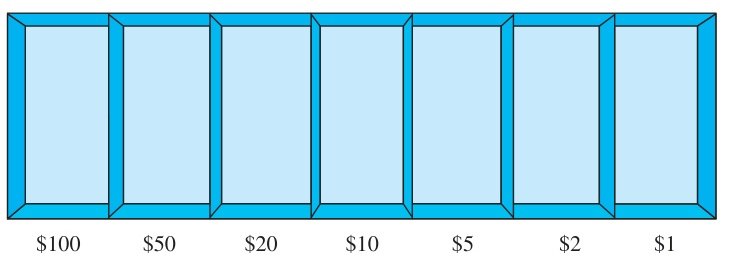
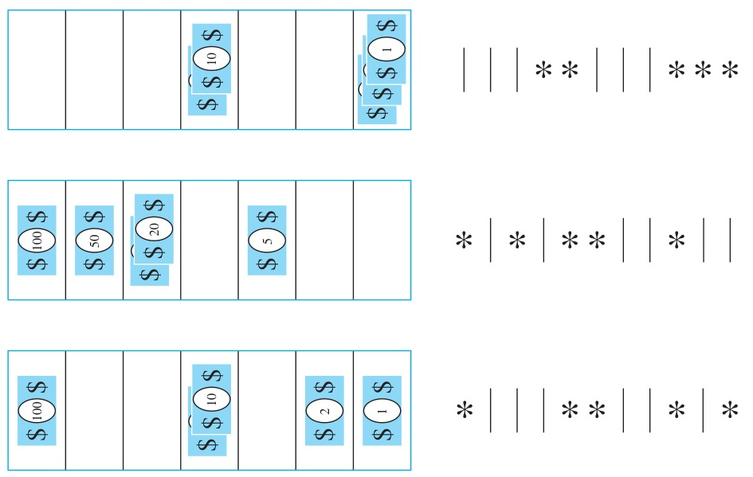

<!-- Page 39 -->

# Chapter 6: Counting

## 6.5 Generalized Permutations and Combinations

### Introduction

In many counting problems, elements may be used repeatedly. For instance, a letter or digit may be used more than once on a license plate. When a dozen donuts are selected, each variety can be chosen repeatedly. This contrasts with the counting problems discussed earlier in the chapter where we considered only permutations and combinations in which each item could be used at most once. In this section we will show how to solve counting problems where elements may be used more than once.

Also, some counting problems involve indistinguishable elements. For instance, to count the number of ways the letters of the word SUCCESS can be rearranged, the placement of identical letters must be considered. This contrasts with the counting problems discussed earlier where all elements were considered distinguishable. In this section we will describe how to solve counting problems in which some elements are indistinguishable.

Moreover, in this section we will explain how to solve another important class of counting problems, problems involving counting the ways distinguishable elements can be placed in boxes. An example of this type of problem is the number of different ways poker hands can be dealt to four players.

Taken together, the methods described earlier in this chapter and the methods introduced in this section form a useful toolbox for solving a wide range of counting problems. When the additional methods discussed in Chapter 8 are added to this arsenal, you will be able to solve a large percentage of the counting problems that arise in a wide range of areas of study.

### Permutations with Repetition

Counting permutations when repetition of elements is allowed can easily be done using the product rule, as Example 1 shows.

#### EXAMPLE 1
How many strings of length $r$ can be formed from the uppercase letters of the English alphabet?

**Solution:** By the product rule, because there are 26 uppercase English letters, and because each letter can be used repeatedly, we see that there are $26^r$ strings of uppercase English letters of length $r$. $\blacktriangleleft$

The number of $r$-permutations of a set with $n$ elements when repetition is allowed is given in Theorem 1.

> [!NOTE] THEOREM 1
> The number of $r$-permutations of a set of $n$ objects with repetition allowed is $n^r$.

**Proof:** There are $n$ ways to select an element of the set for each of the $r$ positions in the $r$-permutation when repetition is allowed, because for each choice all $n$ objects are available. Hence, by the product rule there are $n^r$ $r$-permutations when repetition is allowed. $\blacksquare$

<!-- Page 40 -->

### Combinations with Repetition

Consider these examples of combinations with repetition of elements allowed.

#### EXAMPLE 2
How many ways are there to select four pieces of fruit from a bowl containing apples, oranges, and pears if the order in which the pieces are selected does not matter, only the type of fruit and not the individual piece matters, and there are at least four pieces of each type of fruit in the bowl?

**Solution:** To solve this problem we list all the ways possible to select the fruit. There are 15 ways:
- 4 apples
- 4 oranges
- 4 pears
- 3 apples, 1 orange
- 3 apples, 1 pear
- 3 oranges, 1 apple
- 3 oranges, 1 pear
- 3 pears, 1 apple
- 3 pears, 1 orange
- 2 apples, 2 oranges
- 2 apples, 2 pears
- 2 oranges, 2 pears
- 2 apples, 1 orange, 1 pear
- 2 oranges, 1 apple, 1 pear
- 2 pears, 1 apple, 1 orange

The solution is the number of 4-combinations with repetition allowed from a three-element set, $\{\text{apple}, \text{orange}, \text{pear}\}$. $\blacktriangleleft$

To solve more complex counting problems of this type, we need a general method for counting the $r$-combinations of an $n$-element set. In Example 3 we will illustrate such a method.

#### EXAMPLE 3
How many ways are there to select five bills from a cash box containing \$1 bills, \$2 bills, \$5 bills, \$10 bills, \$20 bills, \$50 bills, and \$100 bills? Assume that the order in which the bills are chosen does not matter, that the bills of each denomination are indistinguishable, and that there are at least five bills of each type.

**Solution:** Because the order in which the bills are selected does not matter and seven different types of bills can be selected as many as five times, this problem involves counting 5-combinations with repetition allowed from a set with seven elements. Listing all possibilities would be tedious, because there are a large number of solutions. Instead, we will illustrate the use of a technique for counting combinations with repetition allowed.

Suppose that a cash box has seven compartments, one to hold each type of bill, as illustrated in Figure 1. These compartments are separated by six dividers, as shown in the picture. The choice of five bills corresponds to placing five markers in the compartments holding different types of bills. Figure 2 illustrates this correspondence for three different ways to select five bills, where the six dividers are represented by bars and the five bills by stars.

The number of ways to select five bills corresponds to the number of ways to arrange six bars and five stars in a row with a total of 11 positions. Consequently, the number of ways to select the five bills is the number of ways to select the positions of the five stars from the 11 positions. This corresponds to the number of unordered selections of 5 objects from a set of 11


*Figure 1 — Cash Box with Seven Types of Bills.*

<!-- Page 41 -->


*Figure 2 — Examples of Ways to Select Five Bills.*

objects, which can be done in $C(11, 5)$ ways. Consequently, there are
$$C(11, 5) = \frac{11!}{5! 6!} = 462$$
ways to choose five bills from the cash box with seven types of bills. $\blacktriangleleft$

Theorem 2 generalizes this discussion.

> [!NOTE] THEOREM 2
> There are $C(n + r - 1, r) = C(n + r - 1, n - 1)$ $r$-combinations from a set with $n$ elements when repetition of elements is allowed.

**Proof:** Each $r$-combination of a set with $n$ elements when repetition is allowed can be represented by a list of $n - 1$ bars and $r$ stars. The $n - 1$ bars are used to mark off $n$ different cells, with the $i$th cell containing a star for each time the $i$th element of the set occurs in the combination. For instance, a 6-combination of a set with four elements is represented with three bars and six stars. Here
$$** | * | | ***$$
represents the combination containing exactly two of the first element, one of the second element, none of the third element, and three of the fourth element of the set.

As we have seen, each different list containing $n - 1$ bars and $r$ stars corresponds to an $r$-combination of the set with $n$ elements, when repetition is allowed. The number of such lists is $C(n - 1 + r, r)$, because each list corresponds to a choice of the $r$ positions to place the $r$ stars from the $n - 1 + r$ positions that contain $r$ stars and $n - 1$ bars. The number of such lists is also equal to $C(n - 1 + r, n - 1)$, because each list corresponds to a choice of the $n - 1$ positions to place the $n - 1$ bars. $\blacksquare$

Examples 4–6 show how Theorem 2 is applied.

<!-- Page 42 -->

#### EXAMPLE 4
Suppose that a cookie shop has four different kinds of cookies. How many different ways can six cookies be chosen? Assume that only the type of cookie, and not the individual cookies or the order in which they are chosen, matters.

**Solution:** The number of ways to choose six cookies is the number of 6-combinations of a set with four elements. From Theorem 2 this equals $C(4 + 6 - 1, 6) = C(9, 6)$. Because
$$C(9, 6) = C(9, 3) = \frac{9 \cdot 8 \cdot 7}{1 \cdot 2 \cdot 3} = 84,$$
there are 84 different ways to choose the six cookies. $\blacktriangleleft$

Theorem 2 can also be used to find the number of solutions of certain linear equations where the variables are integers subject to constraints. This is illustrated by Example 5.

#### EXAMPLE 5
How many solutions does the equation
$$x_1 + x_2 + x_3 = 11$$
have, where $x_1, x_2,$ and $x_3$ are nonnegative integers?

**Solution:** To count the number of solutions, we note that a solution corresponds to a way of selecting 11 items from a set with three elements so that $x_1$ items of type one, $x_2$ items of type two, and $x_3$ items of type three are chosen. Hence, the number of solutions is equal to the number of 11-combinations with repetition allowed from a set with three elements. From Theorem 2 it follows that there are
$$C(3 + 11 - 1, 11) = C(13, 11) = C(13, 2) = \frac{13 \cdot 12}{1 \cdot 2} = 78$$
solutions.

The number of solutions of this equation can also be found when the variables are subject to constraints. For instance, we can find the number of solutions where the variables are integers with $x_1 \ge 1, x_2 \ge 2,$ and $x_3 \ge 3$. A solution to the equation subject to these constraints corresponds to a selection of 11 items with $x_1$ items of type one, $x_2$ items of type two, and $x_3$ items of type three, where, in addition, there is at least one item of type one, two items of type two, and three items of type three. So, a solution corresponds to a choice of one item of type one, two of type two, and three of type three, together with a choice of five additional items of any type. By Theorem 2 this can be done in
$$C(3 + 5 - 1, 5) = C(7, 5) = C(7, 2) = \frac{7 \cdot 6}{1 \cdot 2} = 21$$
ways. Thus, there are 21 solutions of the equation subject to the given constraints. $\blacktriangleleft$

Example 6 shows how counting the number of combinations with repetition allowed arises in determining the value of a variable that is incremented each time a certain type of nested loop is traversed.

<!-- Page 43 -->

### Table 1: Combinations and Permutations With and Without Repetition

| Type | Repetition Allowed? | Formula |
| :--- | :---: | :---: |
| $r$-permutations | No | $\dfrac{n!}{(n - r)!}$ |
| $r$-combinations | No | $\dfrac{n!}{r!(n - r)!}$ |
| $r$-permutations | Yes | $n^r$ |
| $r$-combinations | Yes | $\dfrac{(n + r - 1)!}{r!(n - 1)!}$ |

#### EXAMPLE 6
What is the value of $k$ after the following pseudocode has been executed?
```pascal
k := 0
for i1 := 1 to n
    for i2 := 1 to i1
        .
        .
        .
        for im := 1 to im-1
            k := k + 1
```

**Solution:** Note that the initial value of $k$ is 0 and that 1 is added to $k$ each time the nested loop is traversed with a sequence of integers $i_1, i_2, \dots, i_m$ such that
$$1 \le i_m \le i_{m-1} \le \dots \le i_1 \le n.$$
The number of such sequences of integers is the number of ways to choose $m$ integers from $\{1, 2, \dots, n\}$, with repetition allowed. (To see this, note that once such a sequence has been selected, if we order the integers in the sequence in nondecreasing order, this uniquely defines an assignment of $i_m, i_{m-1}, \dots, i_1$. Conversely, every such assignment corresponds to a unique unordered set.) Hence, from Theorem 2, it follows that $k = C(n + m - 1, m)$ after this code has been executed. $\blacktriangleleft$

The formulae for the numbers of ordered and unordered selections of $r$ elements, chosen with and without repetition allowed from a set with $n$ elements, are shown in Table 1.

### Permutations with Indistinguishable Objects

Some elements may be indistinguishable in counting problems. When this is the case, care must be taken to avoid counting things more than once. Consider Example 7.

#### EXAMPLE 7
How many different strings can be made by reordering the letters of the word SUCCESS?

**Solution:** Because some of the letters of SUCCESS are the same, the answer is not given by the number of permutations of seven letters. This word contains three Ss, two Cs, one U, and one E. To determine the number of different strings that can be made by reordering the letters, first note that the three Ss can be placed among the seven positions in $C(7, 3)$ different ways, leaving four

<!-- Page 44 -->

positions free. Then the two Cs can be placed in $C(4, 2)$ ways, leaving two free positions. The U can be placed in $C(2, 1)$ ways, leaving just one position free. Hence E can be placed in $C(1, 1)$ way. Consequently, from the product rule, the number of different strings that can be made is
$$C(7, 3)C(4, 2)C(2, 1)C(1, 1) = \frac{7!}{3! 4!} \cdot \frac{4!}{2! 2!} \cdot \frac{2!}{1! 1!} \cdot \frac{1!}{1! 0!} = \frac{7!}{3! 2! 1! 1!} = 420.$$ $\blacktriangleleft$

We can prove Theorem 3 using the same sort of reasoning as in Example 7.

> [!NOTE] THEOREM 3
> The number of different permutations of $n$ objects, where there are $n_1$ indistinguishable objects of type 1, $n_2$ indistinguishable objects of type 2, $\dots$, and $n_k$ indistinguishable objects of type $k$, is
> $$\frac{n!}{n_1! n_2! \cdots n_k!}.$$

**Proof:** To determine the number of permutations, first note that the $n_1$ objects of type one can be placed among the $n$ positions in $C(n, n_1)$ ways, leaving $n - n_1$ positions free. Then the objects of type two can be placed in $C(n - n_1, n_2)$ ways, leaving $n - n_1 - n_2$ positions free. Continue placing the objects of type three, $\dots$, type $k - 1$, until at the last stage, $n_k$ objects of type $k$ can be placed in $C(n - n_1 - n_2 - \dots - n_{k-1}, n_k)$ ways. Hence, by the product rule, the total number of different permutations is
$$
\begin{aligned}
&C(n, n_1)C(n - n_1, n_2) \cdots C(n - n_1 - \dots - n_{k-1}, n_k) \\
&= \frac{n!}{n_1! (n - n_1)!} \frac{(n - n_1)!}{n_2! (n - n_1 - n_2)!} \cdots \frac{(n - n_1 - \dots - n_{k-1})!}{n_k! 0!} \\
&= \frac{n!}{n_1! n_2! \cdots n_k!}.
\end{aligned}
$$

$\blacksquare$

### Distributing Objects into Boxes

Many counting problems can be solved by enumerating the ways objects can be placed into boxes (where the order these objects are placed into the boxes does not matter). The objects can be either distinguishable, that is, different from each other, or indistinguishable, that is, considered identical. Distinguishable objects are sometimes said to be labeled, whereas indistinguishable objects are said to be unlabeled. Similarly, boxes can be distinguishable, that is, different, or indistinguishable, that is, identical. Distinguishable boxes are often said to be labeled, while indistinguishable boxes are said to be unlabeled. When you solve a counting problem using the model of distributing objects into boxes, you need to determine whether the objects are distinguishable and whether the boxes are distinguishable. Although the context of the counting problem makes these two decisions clear, counting problems are sometimes ambiguous and it may be unclear which model applies. In such a case it is best to state whatever assumptions you are making and explain why the particular model you choose conforms to your assumptions.

<!-- Page 45 -->

We will see that there are closed formulae for counting the ways to distribute objects, distinguishable or indistinguishable, into distinguishable boxes. We are not so lucky when we count the ways to distribute objects, distinguishable or indistinguishable, into indistinguishable boxes; there are no closed formulae to use in these cases.

#### Distinguishable Objects and Distinguishable Boxes

We first consider the case when distinguishable objects are placed into distinguishable boxes. Consider Example 8 in which the objects are cards and the boxes are hands of players.

#### EXAMPLE 8
How many ways are there to distribute hands of 5 cards to each of four players from the standard deck of 52 cards?

**Solution:** We will use the product rule to solve this problem. To begin, note that the first player can be dealt 5 cards in $C(52, 5)$ ways. The second player can be dealt 5 cards in $C(47, 5)$ ways, because only 47 cards are left. The third player can be dealt 5 cards in $C(42, 5)$ ways. Finally, the fourth player can be dealt 5 cards in $C(37, 5)$ ways. Hence, the total number of ways to deal four players 5 cards each is
$$C(52, 5)C(47, 5)C(42, 5)C(37, 5) = \frac{52!}{47! 5!} \cdot \frac{47!}{42! 5!} \cdot \frac{42!}{37! 5!} \cdot \frac{37!}{32! 5!} = \frac{52!}{5! 5! 5! 5! 32!}.$$ $\blacktriangleleft$

> [!NOTE] Remark
> The solution to Example 8 equals the number of permutations of 52 objects, with 5 indistinguishable objects of each of four different types, and 32 objects of a fifth type. This equality can be seen by defining a one-to-one correspondence between permutations of this type and distributions of cards to the players. To define this correspondence, first order the cards from 1 to 52. Then cards dealt to the first player correspond to the cards in the positions assigned to objects of the first type in the permutation. Similarly, cards dealt to the second, third, and fourth players, respectively, correspond to cards in the positions assigned to objects of the second, third, and fourth type, respectively. The cards not dealt to any player correspond to cards in the positions assigned to objects of the fifth type. The reader should verify that this is a one-to-one correspondence.

Example 8 is a typical problem that involves distributing distinguishable objects into distinguishable boxes. The distinguishable objects are the 52 cards, and the five distinguishable boxes are the hands of the four players and the rest of the deck. Counting problems that involve distributing distinguishable objects into boxes can be solved using Theorem 4.

> [!NOTE] THEOREM 4
> The number of ways to distribute $n$ distinguishable objects into $k$ distinguishable boxes so that $n_i$ objects are placed into box $i$, $i = 1, 2, \dots, k$, equals
> $$\frac{n!}{n_1! n_2! \cdots n_k!}.$$

#### Indistinguishable Objects and Distinguishable Boxes

Counting the number of ways of placing $n$ indistinguishable objects into $k$ distinguishable boxes turns out to be the same as counting the number of $n$-combinations for a set with $k$ elements when repetitions are allowed. The reason behind this is that there is a one-to-one correspondence between

<!-- Page 46 -->

$n$-combinations from a set with $k$ elements when repetition is allowed and the ways to place $n$ indistinguishable balls into $k$ distinguishable boxes. To set up this correspondence, we put a ball in the $i$th bin each time the $i$th element of the set is included in the $n$-combination.

#### EXAMPLE 9
How many ways are there to place 10 indistinguishable balls into eight distinguishable bins?

**Solution:** The number of ways to place 10 indistinguishable balls into eight bins equals the number of 10-combinations from a set with eight elements when repetition is allowed. Consequently, there are
$$C(8 + 10 - 1, 10) = C(17, 10) = \frac{17!}{10!7!} = 19,448.$$ $\blacktriangleleft$

This means that there are $C(n + r - 1, n - 1)$ ways to place $r$ indistinguishable objects into $n$ distinguishable boxes.

#### Distinguishable Objects and Indistinguishable Boxes

Counting the ways to place $n$ distinguishable objects into $k$ indistinguishable boxes is more difficult than counting the ways to place objects, distinguishable or indistinguishable objects, into distinguishable boxes. We illustrate this with an example.

#### EXAMPLE 10
How many ways are there to put four different employees into three indistinguishable offices, when each office can contain any number of employees?

**Solution:** We will solve this problem by enumerating all the ways these employees can be placed into the offices. We represent the four employees by $A, B, C,$ and $D$. First, we note that we can distribute employees so that all four are put into one office, three are put into one office and a fourth is put into a second office, two employees are put into one office and two put into a second office, and finally, two are put into one office, and one each put into the other two offices. Each way to distribute these employees to these offices can be represented by a way to partition the elements $A, B, C,$ and $D$ into disjoint subsets.

We can put all four employees into one office in exactly one way, represented by $\{\{A, B, C, D\}\}$. We can put three employees into one office and the fourth employee into a different office in exactly four ways, represented by $\{\{A, B, C\}, \{D\}\}$, $\{\{A, B, D\}, \{C\}\}$, $\{\{A, C, D\}, \{B\}\}$, and $\{\{B, C, D\}, \{A\}\}$. We can put two employees into one office and two into a second office in exactly three ways, represented by $\{\{A, B\}, \{C, D\}\}$, $\{\{A, C\}, \{B, D\}\}$, and $\{\{A, D\}, \{B, C\}\}$. Finally, we can put two employees into one office, and one each into each of the remaining two offices in six ways, represented by $\{\{A, B\}, \{C\}, \{D\}\}$, $\{\{A, C\}, \{B\}, \{D\}\}$, $\{\{A, D\}, \{B\}, \{C\}\}$, $\{\{B, C\}, \{A\}, \{D\}\}$, $\{\{B, D\}, \{A\}, \{C\}\}$, and $\{\{C, D\}, \{A\}, \{B\}\}$.

Counting all the possibilities, we find that there are 14 ways to put four different employees into three indistinguishable offices. Another way to look at this problem is to look at the number of offices into which we put employees. Note that there are six ways to put four different employees into three indistinguishable offices so that no office is empty, seven ways to put four different employees into two indistinguishable offices so that no office is empty, and one way to put four employees into one office so that it is not empty. $\blacktriangleleft$

There is no simple closed formula for the number of ways to distribute $n$ distinguishable objects into $j$ indistinguishable boxes. However, there is a formula involving a summation, which we will now describe. Let $S(n, j)$ denote the number of ways to distribute $n$ distinguishable objects into $j$ indistinguishable boxes so that no box is empty. The numbers $S(n, j)$ are called **Stirling numbers of the second kind**. For instance, Example 10 shows that $S(4, 3) = 6$, $S(4, 2) = 7$, and $S(4, 1) = 1$. We see that the number of ways to distribute $n$ distinguishable objects into $k$ indistinguishable boxes (where the number of boxes that are nonempty equals $k, k - 1, \dots, 2,$ or $1$) equals $\sum_{j=1}^k S(n, j)$. For instance, following the reasoning in Example 10, the number of ways to distribute four distinguishable objects into three indistinguishable boxes

<!-- Page 47 -->

equals $S(4, 1) + S(4, 2) + S(4, 3) = 1 + 7 + 6 = 14$. Using the inclusion–exclusion principle (see Section 8.6) it can be shown that
$$S(n, j) = \frac{1}{j!} \sum_{i=0}^{j-1} (-1)^i \binom{j}{i} (j - i)^n.$$
Consequently, the number of ways to distribute $n$ distinguishable objects into $k$ indistinguishable boxes equals
$$\sum_{j=1}^k S(n, j) = \sum_{j=1}^k \frac{1}{j!} \sum_{i=0}^{j-1} (-1)^i \binom{j}{i} (j - i)^n.$$

> [!NOTE] Remark
> The reader may be curious about the Stirling numbers of the first kind. A combinatorial definition of the signless Stirling numbers of the first kind, the absolute values of the Stirling numbers of the first kind, can be found in the preamble to Exercise 47 in the Supplementary Exercises.

#### Indistinguishable Objects and Indistinguishable Boxes

Some counting problems can be solved by determining the number of ways to distribute indistinguishable objects into indistinguishable boxes. We illustrate this principle with an example.

#### EXAMPLE 11
How many ways are there to pack six copies of the same book into four identical boxes, where a box can contain as many as six books?

**Solution:** We will enumerate all ways to pack the books. For each way to pack the books, we will list the number of books in the box with the largest number of books, followed by the numbers of books in each box containing at least one book, in order of decreasing number of books in a box. The ways we can pack the books are:
- $6$
- $5, 1$
- $4, 2$
- $4, 1, 1$
- $3, 3$
- $3, 2, 1$
- $3, 1, 1, 1$
- $2, 2, 2$
- $2, 2, 1, 1$

For example, $4, 1, 1$ indicates that one box contains four books, a second box contains a single book, and a third box contains a single book (and the fourth box is empty). We conclude that there are nine allowable ways to pack the books, because we have listed them all. $\blacktriangleleft$

Observe that distributing $n$ indistinguishable objects into $k$ indistinguishable boxes is the same as writing $n$ as the sum of at most $k$ positive integers in nonincreasing order. If $a_1 + a_2 + \dots + a_j = n$, where $a_1, a_2, \dots, a_j$ are positive integers with $a_1 \ge a_2 \ge \dots \ge a_j$, we say that $a_1, a_2, \dots, a_j$ is a **partition** of the positive integer $n$ into $j$ positive integers. We see that if $p_k(n)$ is the number of partitions of $n$ into at most $k$ positive integers, then there are $p_k(n)$ ways to distribute $n$ indistinguishable objects into $k$ indistinguishable boxes. No simple closed formula exists for this number.
