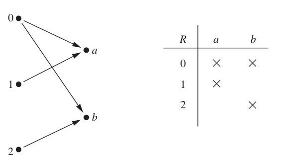
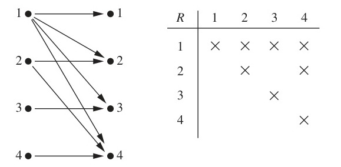

# Chapter 9: Relations

<!-- Page 1 -->

## Chapter Overview

Relationships between elements of sets occur in many contexts. Every day we deal with relationships such as those between a business and its telephone number, an employee and his or her salary, a person and a relative, and so on. In mathematics we study relationships such as those between a positive integer and one that it divides, an integer and one that it is congruent to modulo 5, a real number and one that is larger than it, a real number $x$ and the value $f(x)$ where $f$ is a function, and so on. Relationships such as that between a program and a variable it uses, and that between a computer language and a valid statement in this language often arise in computer science.

Relationships between elements of sets are represented using the structure called a relation, which is just a subset of the Cartesian product of the sets. Relations can be used to solve problems such as determining which pairs of cities are linked by airline flights in a network, finding a viable order for the different phases of a complicated project, or producing a useful way to store information in computer databases.

In some computer languages, only the first 31 characters of the name of a variable matter. The relation consisting of ordered pairs of strings where the first string has the same initial 31 characters as the second string is an example of a special type of relation, known as an equivalence relation. Equivalence relations arise throughout mathematics and computer science. We will study equivalence relations, and other special types of relations, in this chapter.

---

## 9.1 Relations and Their Properties

### Introduction

The most direct way to express a relationship between elements of two sets is to use ordered pairs made up of two related elements. For this reason, sets of ordered pairs are called binary relations. In this section we introduce the basic terminology used to describe binary relations. Later in this chapter we will use relations to solve problems involving communications networks, project scheduling, and identifying elements in sets with common properties.

> [!NOTE] DEFINITION 1
> Let $A$ and $B$ be sets. A **binary relation** from $A$ to $B$ is a subset of $A \times B$.

In other words, a binary relation from $A$ to $B$ is a set $R$ of ordered pairs where the first element of each ordered pair comes from $A$ and the second element comes from $B$. We use the notation $a \, R \, b$ to denote that $(a, b) \in R$ and $a \mathbin{\not R} b$ to denote that $(a, b) \notin R$. Moreover, when $(a, b)$ belongs to $R$, $a$ is said to be **related to** $b$ by $R$.

Binary relations represent relationships between the elements of two sets. We will introduce $n$-ary relations, which express relationships among elements of more than two sets, later in this chapter. We will omit the word *binary* when there is no danger of confusion.

Examples 1–3 illustrate the notion of a relation.

#### EXAMPLE 1
Let $A$ be the set of students in your school, and let $B$ be the set of courses. Let $R$ be the relation that consists of those pairs $(a, b)$, where $a$ is a student enrolled in course $b$. For instance, if Jason Goodfriend and Deborah Sherman are enrolled in CS518, the pairs

<!-- Page 2 -->

(Jason Goodfriend, CS518) and (Deborah Sherman, CS518) belong to $R$. If Jason Goodfriend is also enrolled in CS510, then the pair (Jason Goodfriend, CS510) is also in $R$. However, if Deborah Sherman is not enrolled in CS510, then the pair (Deborah Sherman, CS510) is not in $R$.

Note that if a student is not currently enrolled in any courses there will be no pairs in $R$ that have this student as the first element. Similarly, if a course is not currently being offered there will be no pairs in $R$ that have this course as their second element. $\blacktriangleleft$

#### EXAMPLE 2
Let $A$ be the set of cities in the U.S.A., and let $B$ be the set of the 50 states in the U.S.A. Define the relation $R$ by specifying that $(a, b)$ belongs to $R$ if a city with name $a$ is in the state $b$. For instance, (Boulder, Colorado), (Bangor, Maine), (Ann Arbor, Michigan), (Middletown, New Jersey), (Middletown, New York), (Cupertino, California), and (Red Bank, New Jersey) are in $R$. $\blacktriangleleft$

#### EXAMPLE 3
Let $A = \{0, 1, 2\}$ and $B = \{a, b\}$. Then $\{(0, a), (0, b), (1, a), (2, b)\}$ is a relation from $A$ to $B$. This means, for instance, that $0 \, R \, a$, but that $1 \mathbin{\not R} b$. Relations can be represented graphically, as shown in Figure 1, using arrows to represent ordered pairs. Another way to represent this relation is to use a table, which is also done in Figure 1. We will discuss representations of relations in more detail in Section 9.3. $\blacktriangleleft$

*Figure 1 — Displaying the Ordered Pairs in the Relation $R$ from Example 3.*

### Functions as Relations

Recall that a function $f$ from a set $A$ to a set $B$ (as defined in Section 2.3) assigns exactly one element of $B$ to each element of $A$. The graph of $f$ is the set of ordered pairs $(a, b)$ such that $b = f(a)$. Because the graph of $f$ is a subset of $A \times B$, it is a relation from $A$ to $B$. Moreover, the graph of a function has the property that every element of $A$ is the first element of exactly one ordered pair of the graph.

Conversely, if $R$ is a relation from $A$ to $B$ such that every element in $A$ is the first element of exactly one ordered pair of $R$, then a function can be defined with $R$ as its graph. This can be done by assigning to an element $a$ of $A$ the unique element $b \in B$ such that $(a, b) \in R$. (Note that the relation $R$ in Example 2 is not the graph of a function because Middletown occurs more than once as the first element of an ordered pair in $R$.)

A relation can be used to express a one-to-many relationship between the elements of the sets $A$ and $B$ (as in Example 2), where an element of $A$ may be related to more than one element of $B$. A function represents a relation where exactly one element of $B$ is related to each element of $A$.

Relations are a generalization of graphs of functions; they can be used to express a much wider class of relationships between sets. (Recall that the graph of the function $f$ from $A$ to $B$ is the set of ordered pairs $(a, f(a))$ for $a \in A$.)

<!-- Page 3 -->

### Relations on a Set

Relations from a set $A$ to itself are of special interest.

> [!NOTE] DEFINITION 2
> A **relation on a set** $A$ is a relation from $A$ to $A$.

In other words, a relation on a set $A$ is a subset of $A \times A$.

#### EXAMPLE 4
Let $A$ be the set $\{1, 2, 3, 4\}$. Which ordered pairs are in the relation $R = \{(a, b) \mid a \text{ divides } b\}$?

**Solution:** Because $(a, b)$ is in $R$ if and only if $a$ and $b$ are positive integers not exceeding 4 such that $a$ divides $b$, we see that
$$R = \{(1, 1), (1, 2), (1, 3), (1, 4), (2, 2), (2, 4), (3, 3), (4, 4)\}.$$
The pairs in this relation are displayed both graphically and in tabular form in Figure 2. $\blacktriangleleft$

Next, some examples of relations on the set of integers will be given in Example 5.

#### EXAMPLE 5
Consider these relations on the set of integers:
$$R_1 = \{(a, b) \mid a \leq b\},$$
$$R_2 = \{(a, b) \mid a > b\},$$
$$R_3 = \{(a, b) \mid a = b \text{ or } a = -b\},$$
$$R_4 = \{(a, b) \mid a = b\},$$
$$R_5 = \{(a, b) \mid a = b + 1\},$$
$$R_6 = \{(a, b) \mid a + b \leq 3\}.$$
Which of these relations contain each of the pairs $(1, 1)$, $(1, 2)$, $(2, 1)$, $(1, -1)$, and $(2, 2)$?

> [!NOTE] Remark
> Unlike the relations in Examples 1–4, these are relations on an infinite set.

**Solution:** The pair $(1, 1)$ is in $R_1$, $R_3$, $R_4$, and $R_6$; $(1, 2)$ is in $R_1$ and $R_6$; $(2, 1)$ is in $R_2$, $R_5$, and $R_6$; $(1, -1)$ is in $R_2$, $R_3$, and $R_6$; and finally, $(2, 2)$ is in $R_1$, $R_3$, and $R_4$. $\blacktriangleleft$

It is not hard to determine the number of relations on a finite set, because a relation on a set $A$ is simply a subset of $A \times A$.

*Figure 2 — Displaying the Ordered Pairs in the Relation $R$ from Example 4.*

<!-- Page 4 -->

#### EXAMPLE 6
How many relations are there on a set with $n$ elements?

**Solution:** A relation on a set $A$ is a subset of $A \times A$. Because $A \times A$ has $n^2$ elements when $A$ has $n$ elements, and a set with $m$ elements has $2^m$ subsets, there are $2^{n^2}$ subsets of $A \times A$. Thus, there are $2^{n^2}$ relations on a set with $n$ elements. For example, there are $2^{3^2} = 2^9 = 512$ relations on the set $\{a, b, c\}$. $\blacktriangleleft$

### Properties of Relations

There are several properties that are used to classify relations on a set. We will introduce the most important of these here.

In some relations an element is always related to itself. For instance, let $R$ be the relation on the set of all people consisting of pairs $(x, y)$ where $x$ and y have the same mother and the same father. Then $x \, R \, x$ for every person $x$.

> [!NOTE] DEFINITION 3
> A relation $R$ on a set $A$ is called **reflexive** if $(a, a) \in R$ for every element $a \in A$.

> [!NOTE] Remark
> Using quantifiers we see that the relation $R$ on the set $A$ is reflexive if $\forall a ((a, a) \in R)$, where the universe of discourse is the set of all elements in $A$.

We see that a relation on $A$ is reflexive if every element of $A$ is related to itself. Examples 7–9 illustrate the concept of a reflexive relation.

#### EXAMPLE 7
Consider the following relations on $\{1, 2, 3, 4\}$:
$$R_1 = \{(1, 1), (1, 2), (2, 1), (2, 2), (3, 4), (4, 1), (4, 4)\},$$
$$R_2 = \{(1, 1), (1, 2), (2, 1)\},$$
$$R_3 = \{(1, 1), (1, 2), (1, 4), (2, 1), (2, 2), (3, 3), (4, 1), (4, 4)\},$$
$$R_4 = \{(2, 1), (3, 1), (3, 2), (4, 1), (4, 2), (4, 3)\},$$
$$R_5 = \{(1, 1), (1, 2), (1, 3), (1, 4), (2, 2), (2, 3), (2, 4), (3, 3), (3, 4), (4, 4)\},$$
$$R_6 = \{(3, 4)\}.$$
Which of these relations are reflexive?

**Solution:** The relations $R_3$ and $R_5$ are reflexive because they both contain all pairs of the form $(a, a)$, namely, $(1, 1)$, $(2, 2)$, $(3, 3)$, and $(4, 4)$. The other relations are not reflexive because they do not contain all of these ordered pairs. In particular, $R_1$, $R_2$, $R_4$, and $R_6$ are not reflexive because $(3, 3)$ is not in any of these relations. $\blacktriangleleft$

#### EXAMPLE 8
Which of the relations from Example 5 are reflexive?

**Solution:** The reflexive relations from Example 5 are $R_1$ (because $a \leq a$ for every integer $a$), $R_3$, and $R_4$. For each of the other relations in this example it is easy to find a pair of the form $(a, a)$ that is not in the relation. (This is left as an exercise for the reader.) $\blacktriangleleft$

#### EXAMPLE 9
Is the “divides” relation on the set of positive integers reflexive?

**Solution:** Because $a \mid a$ whenever $a$ is a positive integer, the “divides” relation is reflexive. (Note that if we replace the set of positive integers with the set of all integers the relation is not reflexive because by definition 0 does not divide 0.) $\blacktriangleleft$

<!-- Page 5 -->

In some relations an element is related to a second element if and only if the second element is also related to the first element. The relation consisting of pairs $(x, y)$, where $x$ and $y$ are students at your school with at least one common class has this property. Other relations have the property that if an element is related to a second element, then this second element is not related to the first. The relation consisting of the pairs $(x, y)$, where $x$ and $y$ are students at your school, where $x$ has a higher grade point average than $y$ has this property.

> [!NOTE] DEFINITION 4
> A relation $R$ on a set $A$ is called **symmetric** if $(b, a) \in R$ whenever $(a, b) \in R$, for all $a, b \in A$. A relation $R$ on a set $A$ such that for all $a, b \in A$, if $(a, b) \in R$ and $(b, a) \in R$, then $a = b$ is called **antisymmetric**.

> [!NOTE] Remark
> Using quantifiers, we see that the relation $R$ on the set $A$ is symmetric if $\forall a \forall b ((a, b) \in R \to (b, a) \in R)$. Similarly, the relation $R$ on the set $A$ is antisymmetric if $\forall a \forall b (((a, b) \in R \wedge (b, a) \in R) \to (a = b))$.

That is, a relation is symmetric if and only if $a$ is related to $b$ implies that $b$ is related to $a$. A relation is antisymmetric if and only if there are no pairs of distinct elements $a$ and $b$ with $a$ related to $b$ and $b$ related to $a$. That is, the only way to have $a$ related to $b$ and $b$ related to $a$ is for $a$ and $b$ to be the same element. The terms *symmetric* and *antisymmetric* are not opposites, because a relation can have both of these properties or may lack both of them (see Exercise 10). A relation cannot be both symmetric and antisymmetric if it contains some pair of the form $(a, b)$, where $a \neq b$.

> [!NOTE] Remark
> Although relatively few of the $2^{n^2}$ relations on a set with $n$ elements are symmetric or antisymmetric, as counting arguments can show, many important relations have one of these properties. (See Exercise 47.)

#### EXAMPLE 10
Which of the relations from Example 7 are symmetric and which are antisymmetric?

**Solution:** The relations $R_2$ and $R_3$ are symmetric, because in each case $(b, a)$ belongs to the relation whenever $(a, b)$ does. For $R_2$, the only thing to check is that both $(2, 1)$ and $(1, 2)$ are in the relation. For $R_3$, it is necessary to check that both $(1, 2)$ and $(2, 1)$ belong to the relation, and $(1, 4)$ and $(4, 1)$ belong to the relation. The reader should verify that none of the other relations is symmetric. This is done by finding a pair $(a, b)$ such that it is in the relation but $(b, a)$ is not.

$R_4$, $R_5$, and $R_6$ are all antisymmetric. For each of these relations there is no pair of elements $a$ and $b$ with $a \neq b$ such that both $(a, b)$ and $(b, a)$ belong to the relation. The reader should verify that none of the other relations is antisymmetric. This is done by finding a pair $(a, b)$ with $a \neq b$ such that $(a, b)$ and $(b, a)$ are both in the relation. $\blacktriangleleft$

#### EXAMPLE 11
Which of the relations from Example 5 are symmetric and which are antisymmetric?

**Solution:** The relations $R_3$, $R_4$, and $R_6$ are symmetric. $R_3$ is symmetric, for if $a = b$ or $a = -b$, then $b = a$ or $b = -a$. $R_4$ is symmetric because $a = b$ implies that $b = a$. $R_6$ is symmetric because $a + b \leq 3$ implies that $b + a \leq 3$. The reader should verify that none of the other relations is symmetric.

The relations $R_1$, $R_2$, $R_4$, and $R_5$ are antisymmetric. $R_1$ is antisymmetric because the inequalities $a \leq b$ and $b \leq a$ imply that $a = b$. $R_2$ is antisymmetric because it is impossible that $a > b$ and $b > a$. $R_4$ is antisymmetric, because two elements are related with respect to $R_4$ if and only if they are equal. $R_5$ is antisymmetric because it is impossible that $a = b + 1$ and $b = a + 1$. The reader should verify that none of the other relations is antisymmetric. $\blacktriangleleft$

<!-- Page 6 -->

#### EXAMPLE 12
Is the “divides” relation on the set of positive integers symmetric? Is it antisymmetric?

**Solution:** This relation is not symmetric because $1 \mid 2$, but $2 \nmid 1$. It is antisymmetric, for if $a$ and $b$ are positive integers with $a \mid b$ and $b \mid a$, then $a = b$ (the verification of this is left as an exercise for the reader). $\blacktriangleleft$

Let $R$ be the relation consisting of all pairs $(x, y)$ of students at your school, where $x$ has taken more credits than $y$. Suppose that $x$ is related to $y$ and $y$ is related to $z$. This means that $x$ has taken more credits than $y$ and $y$ has taken more credits than $z$. We can conclude that $x$ has taken more credits than $z$, so that $x$ is related to $z$. What we have shown is that $R$ has the transitive property, which is defined as follows.

> [!NOTE] DEFINITION 5
> A relation $R$ on a set $A$ is called **transitive** if whenever $(a, b) \in R$ and $(b, c) \in R$, then $(a, c) \in R$, for all $a, b, c \in A$.

> [!NOTE] Remark
> Using quantifiers we see that the relation $R$ on a set $A$ is transitive if we have $\forall a \forall b \forall c (((a, b) \in R \wedge (b, c) \in R) \to (a, c) \in R)$.

#### EXAMPLE 13
Which of the relations in Example 7 are transitive?

**Solution:** $R_4$, $R_5$, and $R_6$ are transitive. For each of these relations, we can show that it is transitive by verifying that if $(a, b)$ and $(b, c)$ belong to this relation, then $(a, c)$ also does. For instance, $R_4$ is transitive, because $(3, 2)$ and $(2, 1)$, $(4, 2)$ and $(2, 1)$, $(4, 3)$ and $(3, 1)$, and $(4, 3)$ and $(3, 2)$ are the only such sets of pairs, and $(3, 1)$, $(4, 1)$, and $(4, 2)$ belong to $R_4$. The reader should verify that $R_5$ and $R_6$ are transitive.

$R_1$ is not transitive because $(3, 4)$ and $(4, 1)$ belong to $R_1$, but $(3, 1)$ does not. $R_2$ is not transitive because $(2, 1)$ and $(1, 2)$ belong to $R_2$, but $(2, 2)$ does not. $R_3$ is not transitive because $(4, 1)$ and $(1, 2)$ belong to $R_3$, but $(4, 2)$ does not. $\blacktriangleleft$

#### EXAMPLE 14
Which of the relations in Example 5 are transitive?

**Solution:** The relations $R_1$, $R_2$, $R_3$, and $R_4$ are transitive. $R_1$ is transitive because $a \leq b$ and $b \leq c$ imply that $a \leq c$. $R_2$ is transitive because $a > b$ and $b > c$ imply that $a > c$. $R_3$ is transitive because $a = \pm b$ and $b = \pm c$ imply that $a = \pm c$. $R_4$ is clearly transitive, as the reader should verify. $R_5$ is not transitive because $(2, 1)$ and $(1, 0)$ belong to $R_5$, but $(2, 0)$ does not. $R_6$ is not transitive because $(2, 1)$ and $(1, 2)$ belong to $R_6$, but $(2, 2)$ does not. $\blacktriangleleft$

#### EXAMPLE 15
Is the “divides” relation on the set of positive integers transitive?

**Solution:** Suppose that $a$ divides $b$ and $b$ divides $c$. Then there are positive integers $k$ and $l$ such that $b = ak$ and $c = bl$. Hence, $c = a(kl)$, so $a$ divides $c$. It follows that this relation is transitive. $\blacktriangleleft$

We can use counting techniques to determine the number of relations with specific properties. Finding the number of relations with a particular property provides information about how common this property is in the set of all relations on a set with $n$ elements.

#### EXAMPLE 16
How many reflexive relations are there on a set with $n$ elements?

**Solution:** A relation $R$ on a set $A$ is a subset of $A \times A$. Consequently, a relation is determined by specifying whether each of the $n^2$ ordered pairs in $A \times A$ is in $R$. However, if $R$ is reflexive, each of the $n$ ordered pairs $(a, a)$ for $a \in A$ must be in $R$. Each of the other $n(n - 1)$ ordered

<!-- Page 7 -->

pairs of the form $(a, b)$, where $a \neq b$, may or may not be in $R$. Hence, by the product rule for counting, there are $2^{n(n - 1)}$ reflexive relations [this is the number of ways to choose whether each element $(a, b)$, with $a \neq b$, belongs to $R$]. $\blacktriangleleft$

Formulas for the number of symmetric relations and the number of antisymmetric relations on a set with $n$ elements can be found using reasoning similar to that in Example 16 (see Exercise 47). However, no general formula is known that counts the transitive relations on a set with $n$ elements. Currently, $T(n)$, the number of transitive relations on a set with $n$ elements, is known only for $n \leq 17$. For example, $T(4) = 3,994$, $T(5) = 154,303$, and $T(6) = 9,415,189$.

### Combining Relations

Because relations from $A$ to $B$ are subsets of $A \times B$, two relations from $A$ to $B$ can be combined in any way two sets can be combined. Consider Examples 17–19.

#### EXAMPLE 17
Let $A = \{1, 2, 3\}$ and $B = \{1, 2, 3, 4\}$. The relations $R_1 = \{(1, 1), (2, 2), (3, 3)\}$ and $R_2 = \{(1, 1), (1, 2), (1, 3), (1, 4)\}$ can be combined to obtain
$$R_1 \cup R_2 = \{(1, 1), (1, 2), (1, 3), (1, 4), (2, 2), (3, 3)\},$$
$$R_1 \cap R_2 = \{(1, 1)\},$$
$$R_1 - R_2 = \{(2, 2), (3, 3)\},$$
$$R_2 - R_1 = \{(1, 2), (1, 3), (1, 4)\}. \quad \blacktriangleleft$$

#### EXAMPLE 18
Let $A$ and $B$ be the set of all students and the set of all courses at a school, respectively. Suppose that $R_1$ consists of all ordered pairs $(a, b)$, where $a$ is a student who has taken course $b$, and $R_2$ consists of all ordered pairs $(a, b)$, where $a$ is a student who requires course $b$ to graduate. What are the relations $R_1 \cup R_2$, $R_1 \cap R_2$, $R_1 \oplus R_2$, $R_1 - R_2$, and $R_2 - R_1$?

**Solution:** The relation $R_1 \cup R_2$ consists of all ordered pairs $(a, b)$, where $a$ is a student who either has taken course $b$ or needs course $b$ to graduate, and $R_1 \cap R_2$ is the set of all ordered pairs $(a, b)$, where $a$ is a student who has taken course $b$ and needs this course to graduate. Also, $R_1 \oplus R_2$ consists of all ordered pairs $(a, b)$, where student $a$ has taken course $b$ but does not need it to graduate or needs course $b$ to graduate but has not taken it. $R_1 - R_2$ is the set of ordered pairs $(a, b)$, where $a$ has taken course $b$ but does not need it to graduate; that is, $b$ is an elective course that $a$ has taken. $R_2 - R_1$ is the set of all ordered pairs $(a, b)$, where $b$ is a course that $a$ needs to graduate but has not taken. $\blacktriangleleft$

#### EXAMPLE 19
Let $R_1$ be the “less than” relation on the set of real numbers and let $R_2$ be the “greater than” relation on the set of real numbers, that is, $R_1 = \{(x, y) \mid x < y\}$ and $R_2 = \{(x, y) \mid x > y\}$. What are $R_1 \cup R_2$, $R_1 \cap R_2$, $R_1 - R_2$, $R_2 - R_1$, and $R_1 \oplus R_2$?

**Solution:** We note that $(x, y) \in R_1 \cup R_2$ if and only if $(x, y) \in R_1$ or $(x, y) \in R_2$. Hence, $(x, y) \in R_1 \cup R_2$ if and only if $x < y$ or $x > y$. Because the condition $x < y$ or $x > y$ is the same as the condition $x \neq y$, it follows that $R_1 \cup R_2 = \{(x, y) \mid x \neq y\}$. In other words, the union of the “less than” relation and the “greater than” relation is the “not equals” relation.

Next, note that it is impossible for a pair $(x, y)$ to belong to both $R_1$ and $R_2$ because it is impossible that $x < y$ and $x > y$. It follows that $R_1 \cap R_2 = \emptyset$. We also see that $R_1 - R_2 = R_1$, $R_2 - R_1 = R_2$, and $R_1 \oplus R_2 = R_1 \cup R_2 - R_1 \cap R_2 = \{(x, y) \mid x \neq y\}$. $\blacktriangleleft$

There is another way that relations are combined that is analogous to the composition of functions.

<!-- Page 8 -->

> [!NOTE] DEFINITION 6
> Let $R$ be a relation from a set $A$ to a set $B$ and $S$ a relation from $B$ to a set $C$. The **composite** of $R$ and $S$ is the relation consisting of ordered pairs $(a, c)$, where $a \in A$, $c \in C$, and for which there exists an element $b \in B$ such that $(a, b) \in R$ and $(b, c) \in S$. We denote the composite of $R$ and $S$ by $S \circ R$.

Computing the composite of two relations requires that we find elements that are the second element of ordered pairs in the first relation and the first element of ordered pairs in the second relation, as Examples 20 and 21 illustrate.

#### EXAMPLE 20
What is the composite of the relations $R$ and $S$, where $R$ is the relation from $\{1, 2, 3\}$ to $\{1, 2, 3, 4\}$ with $R = \{(1, 1), (1, 4), (2, 3), (3, 1), (3, 4)\}$ and $S$ is the relation from $\{1, 2, 3, 4\}$ to $\{0, 1, 2\}$ with $S = \{(1, 0), (2, 0), (3, 1), (3, 2), (4, 1)\}$?

**Solution:** $S \circ R$ is constructed using all ordered pairs in $R$ and ordered pairs in $S$, where the second element of the ordered pair in $R$ agrees with the first element of the ordered pair in $S$. For example, the ordered pairs $(2, 3)$ in $R$ and $(3, 1)$ in $S$ produce the ordered pair $(2, 1)$ in $S \circ R$. Computing all the ordered pairs in the composite, we find
$$S \circ R = \{(1, 0), (1, 1), (2, 1), (2, 2), (3, 0), (3, 1)\}. \quad \blacktriangleleft$$

#### EXAMPLE 21: Composing the Parent Relation with Itself
Let $R$ be the relation on the set of all people such that $(a, b) \in R$ if person $a$ is a parent of person $b$. Then $(a, c) \in R \circ R$ if and only if there is a person $b$ such that $(a, b) \in R$ and $(b, c) \in R$, that is, if and only if there is a person $b$ such that $a$ is a parent of $b$ and $b$ is a parent of $c$. In other words, $(a, c) \in R \circ R$ if and only if $a$ is a grandparent of $c$. $\blacktriangleleft$

The powers of a relation $R$ can be recursively defined from the definition of a composite of two relations.

> [!NOTE] DEFINITION 7
> Let $R$ be a relation on the set $A$. The powers $R^n$, $n = 1, 2, 3, \dots$, are defined recursively by
> $$R^1 = R \quad \text{and} \quad R^{n+1} = R^n \circ R.$$

The definition shows that $R^2 = R \circ R$, $R^3 = R^2 \circ R = (R \circ R) \circ R$, and so on.

#### EXAMPLE 22
Let $R = \{(1, 1), (2, 1), (3, 2), (4, 3)\}$. Find the powers $R^n$, $n = 2, 3, 4, \dots$.

**Solution:** Because $R^2 = R \circ R$, we find that $R^2 = \{(1, 1), (2, 1), (3, 1), (4, 2)\}$. Furthermore, because $R^3 = R^2 \circ R$, $R^3 = \{(1, 1), (2, 1), (3, 1), (4, 1)\}$. Additional computation shows that $R^4$ is the same as $R^3$, so $R^4 = \{(1, 1), (2, 1), (3, 1), (4, 1)\}$. It also follows that $R^n = R^3$ for $n = 5, 6, 7, \dots$. The reader should verify this. $\blacktriangleleft$

The following theorem shows that the powers of a transitive relation are subsets of this relation. It will be used in Section 9.4.

> [!NOTE] THEOREM 1
> The relation $R$ on a set $A$ is transitive if and only if $R^n \subseteq R$ for $n = 1, 2, 3, \dots$.

<!-- Page 9 -->

**Proof:** We first prove the “if” part of the theorem. We suppose that $R^n \subseteq R$ for $n = 1, 2, 3, \dots$. In particular, $R^2 \subseteq R$. To see that this implies $R$ is transitive, note that if $(a, b) \in R$ and $(b, c) \in R$, then by the definition of composition, $(a, c) \in R^2$. Because $R^2 \subseteq R$, this means that $(a, c) \in R$. Hence, $R$ is transitive.

We will use mathematical induction to prove the only if part of the theorem. Note that this part of the theorem is trivially true for $n = 1$.

Assume that $R^n \subseteq R$, where $n$ is a positive integer. This is the inductive hypothesis. To complete the inductive step we must show that this implies that $R^{n+1}$ is also a subset of $R$. To show this, assume that $(a, b) \in R^{n+1}$. Then, because $R^{n+1} = R^n \circ R$, there is an element $x$ with $x \in A$ such that $(a, x) \in R$ and $(x, b) \in R^n$. The inductive hypothesis, namely, that $R^n \subseteq R$, implies that $(x, b) \in R$. Furthermore, because $R$ is transitive, and $(a, x) \in R$ and $(x, b) \in R$, it follows that $(a, b) \in R$. This shows that $R^{n+1} \subseteq R$, completing the proof. $\blacksquare$
