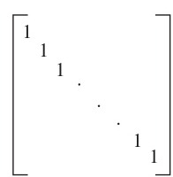
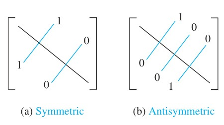
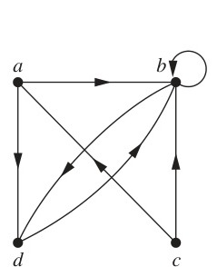
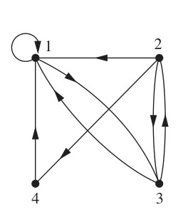
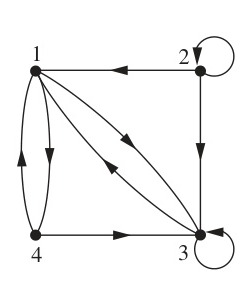
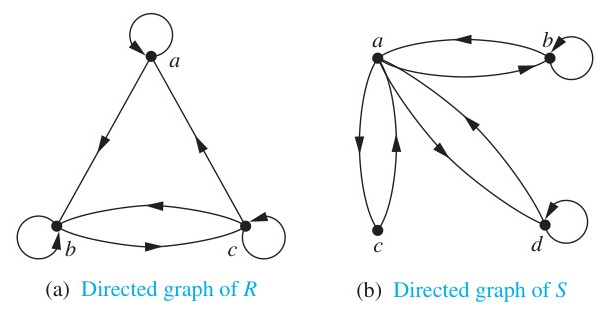

<!-- Page 19 -->

## 9.3 Representing Relations

### Introduction

In this section, and in the remainder of this chapter, all relations we study will be binary relations. Because of this, in this section and in the rest of this chapter, the word relation will always refer to a binary relation. There are many ways to represent a relation between finite sets. As we have seen in Section 9.1, one way is to list its ordered pairs. Another way to represent a relation is to use a table, as we did in Example 3 in Section 9.1. In this section we will discuss two alternative methods for representing relations. One method uses zero–one matrices. The other method uses pictorial representations called directed graphs, which we will discuss later in this section.

Generally, matrices are appropriate for the representation of relations in computer programs. On the other hand, people often find the representation of relations using directed graphs useful for understanding the properties of these relations.

### Representing Relations Using Matrices

A relation between finite sets can be represented using a zero–one matrix. Suppose that $R$ is a relation from $A = \{a_1, a_2, \dots, a_m\}$ to $B = \{b_1, b_2, \dots, b_n\}$. (Here the elements of the sets $A$ and $B$ have been listed in a particular, but arbitrary, order. Furthermore, when $A = B$ we use the same ordering for $A$ and $B$.) The relation $R$ can be represented by the matrix $\mathbf{M}_R = [m_{ij}]$, where

$$m_{ij} = \begin{cases} 1 & \text{if } (a_i, b_j) \in R, \\ 0 & \text{if } (a_i, b_j) \notin R. \end{cases}$$

In other words, the zero–one matrix representing $R$ has a 1 as its $(i, j)$ entry when $a_i$ is related to $b_j$, and a 0 in this position if $a_i$ is not related to $b_j$. (Such a representation depends on the orderings used for $A$ and $B$.)

The use of matrices to represent relations is illustrated in Examples 1–6.

#### EXAMPLE 1
Suppose that $A = \{1, 2, 3\}$ and $B = \{1, 2\}$. Let $R$ be the relation from $A$ to $B$ containing $(a, b)$ if $a \in A$, $b \in B$, and $a > b$. What is the matrix representing $R$ if $a_1 = 1$, $a_2 = 2$, and $a_3 = 3$, and $b_1 = 1$ and $b_2 = 2$?

**Solution:** Because $R = \{(2, 1), (3, 1), (3, 2)\}$, the matrix for $R$ is

$$\mathbf{M}_R = \begin{bmatrix} 0 & 0 \\ 1 & 0 \\ 1 & 1 \end{bmatrix}.$$

The 1s in $\mathbf{M}_R$ show that the pairs $(2, 1)$, $(3, 1)$, and $(3, 2)$ belong to $R$. The 0s show that no other pairs belong to $R$. $\blacktriangleleft$

#### EXAMPLE 2
Let $A = \{a_1, a_2, a_3\}$ and $B = \{b_1, b_2, b_3, b_4, b_5\}$. Which ordered pairs are in the relation $R$ represented by the matrix

$$\mathbf{M}_R = \begin{bmatrix} 0 & 1 & 0 & 0 & 0 \\ 1 & 0 & 1 & 1 & 0 \\ 1 & 0 & 1 & 0 & 1 \end{bmatrix}?$$

<!-- Page 20 -->

**Solution:** Because $R$ consists of those ordered pairs $(a_i, b_j)$ with $m_{ij} = 1$, it follows that

$$R = \{(a_1, b_2), (a_2, b_1), (a_2, b_3), (a_2, b_4), (a_3, b_1), (a_3, b_3), (a_3, b_5)\}. \quad \blacktriangleleft$$

The matrix of a relation on a set, which is a square matrix, can be used to determine whether the relation has certain properties. Recall that a relation $R$ on $A$ is reflexive if $(a, a) \in R$ whenever $a \in A$. Thus, $R$ is reflexive if and only if $(a_i, a_i) \in R$ for $i = 1, 2, \dots, n$. Hence, $R$ is reflexive if and only if $m_{ii} = 1$, for $i = 1, 2, \dots, n$. In other words, $R$ is reflexive if all the elements on the main diagonal of $\mathbf{M}_R$ are equal to 1, as shown in Figure 1. Note that the elements off the main diagonal can be either 0 or 1.

*Figure 1 — The Zero–One Matrix for a Reflexive Relation. (Off Diagonal Elements Can Be 0 or 1.)*

The relation $R$ is symmetric if $(a, b) \in R$ implies that $(b, a) \in R$. Consequently, the relation $R$ on the set $A = \{a_1, a_2, \dots, a_n\}$ is symmetric if and only if $(a_j, a_i) \in R$ whenever $(a_i, a_j) \in R$. In terms of the entries of $\mathbf{M}_R$, $R$ is symmetric if and only if $m_{ji} = 1$ whenever $m_{ij} = 1$. This also means $m_{ji} = 0$ whenever $m_{ij} = 0$. Consequently, $R$ is symmetric if and only if $m_{ij} = m_{ji}$, for all pairs of integers $i$ and $j$ with $i = 1, 2, \dots, n$ and $j = 1, 2, \dots, n$. Recalling the definition of the transpose of a matrix from Section 2.6, we see that $R$ is symmetric if and only if

$$\mathbf{M}_R = (\mathbf{M}_R)^t,$$

that is, if $\mathbf{M}_R$ is a symmetric matrix. The form of the matrix for a symmetric relation is illustrated in Figure 2(a).

The relation $R$ is antisymmetric if and only if $(a, b) \in R$ and $(b, a) \in R$ imply that $a = b$. Consequently, the matrix of an antisymmetric relation has the property that if $m_{ij} = 1$ with $i \neq j$, then $m_{ji} = 0$. Or, in other words, either $m_{ij} = 0$ or $m_{ji} = 0$ when $i \neq j$. The form of the matrix for an antisymmetric relation is illustrated in Figure 2(b).

*Figure 2 — The Zero–One Matrices for Symmetric and Antisymmetric Relations.*

#### EXAMPLE 3
Suppose that the relation $R$ on a set is represented by the matrix

$$\mathbf{M}_R = \begin{bmatrix} 1 & 1 & 0 \\ 1 & 1 & 1 \\ 0 & 1 & 1 \end{bmatrix}.$$

Is $R$ reflexive, symmetric, and/or antisymmetric?

**Solution:** Because all the diagonal elements of this matrix are equal to 1, $R$ is reflexive. Moreover, because $\mathbf{M}_R$ is symmetric, it follows that $R$ is symmetric. It is also easy to see that $R$ is not antisymmetric. $\blacktriangleleft$

The Boolean operations join and meet (discussed in Section 2.6) can be used to find the matrices representing the union and the intersection of two relations. Suppose that $R_1$ and $R_2$ are relations on a set $A$ represented by the matrices $\mathbf{M}_{R_1}$ and $\mathbf{M}_{R_2}$, respectively. The matrix

<!-- Page 21 -->

representing the union of these relations has a 1 in the positions where either $\mathbf{M}_{R_1}$ or $\mathbf{M}_{R_2}$ has a 1. The matrix representing the intersection of these relations has a 1 in the positions where both $\mathbf{M}_{R_1}$ and $\mathbf{M}_{R_2}$ have a 1. Thus, the matrices representing the union and intersection of these relations are

$$\mathbf{M}_{R_1 \cup R_2} = \mathbf{M}_{R_1} \vee \mathbf{M}_{R_2} \quad \text{and} \quad \mathbf{M}_{R_1 \cap R_2} = \mathbf{M}_{R_1} \wedge \mathbf{M}_{R_2}.$$

#### EXAMPLE 4
Suppose that the relations $R_1$ and $R_2$ on a set $A$ are represented by the matrices

$$\mathbf{M}_{R_1} = \begin{bmatrix} 1 & 0 & 1 \\ 1 & 0 & 0 \\ 0 & 1 & 0 \end{bmatrix} \quad \text{and} \quad \mathbf{M}_{R_2} = \begin{bmatrix} 1 & 0 & 1 \\ 0 & 1 & 1 \\ 1 & 0 & 0 \end{bmatrix}.$$

What are the matrices representing $R_1 \cup R_2$ and $R_1 \cap R_2$?

**Solution:** The matrices of these relations are

$$\mathbf{M}_{R_1 \cup R_2} = \mathbf{M}_{R_1} \vee \mathbf{M}_{R_2} = \begin{bmatrix} 1 & 0 & 1 \\ 1 & 1 & 1 \\ 1 & 1 & 0 \end{bmatrix},$$

$$\mathbf{M}_{R_1 \cap R_2} = \mathbf{M}_{R_1} \wedge \mathbf{M}_{R_2} = \begin{bmatrix} 1 & 0 & 1 \\ 0 & 0 & 0 \\ 0 & 0 & 0 \end{bmatrix}. \quad \blacktriangleleft$$

We now turn our attention to determining the matrix for the composite of relations. This matrix can be found using the Boolean product of the matrices (discussed in Section 2.6) for these relations. In particular, suppose that $R$ is a relation from $A$ to $B$ and $S$ is a relation from $B$ to $C$. Suppose that $A$, $B$, and $C$ have $m$, $n$, and $p$ elements, respectively. Let the zero–one matrices for $S \circ R$, $R$, and $S$ be $\mathbf{M}_{S \circ R} = [t_{ij}]$, $\mathbf{M}_R = [r_{ij}]$, and $\mathbf{M}_S = [s_{ij}]$, respectively (these matrices have sizes $m \times p$, $m \times n$, and $n \times p$, respectively). The ordered pair $(a_i, c_j)$ belongs to $S \circ R$ if and only if there is an element $b_k$ such that $(a_i, b_k)$ belongs to $R$ and $(b_k, c_j)$ belongs to $S$. It follows that $t_{ij} = 1$ if and only if $r_{ik} = s_{kj} = 1$ for some $k$. From the definition of the Boolean product, this means that

$$\mathbf{M}_{S \circ R} = \mathbf{M}_R \odot \mathbf{M}_S.$$

#### EXAMPLE 5
Find the matrix representing the relations $S \circ R$, where the matrices representing $R$ and $S$ are

$$\mathbf{M}_R = \begin{bmatrix} 1 & 0 & 1 \\ 1 & 1 & 0 \\ 0 & 0 & 0 \end{bmatrix} \quad \text{and} \quad \mathbf{M}_S = \begin{bmatrix} 0 & 1 & 0 \\ 0 & 0 & 1 \\ 1 & 0 & 1 \end{bmatrix}.$$

**Solution:** The matrix for $S \circ R$ is

$$\mathbf{M}_{S \circ R} = \mathbf{M}_R \odot \mathbf{M}_S = \begin{bmatrix} 1 & 1 & 1 \\ 0 & 1 & 1 \\ 0 & 0 & 0 \end{bmatrix}. \quad \blacktriangleleft$$

<!-- Page 22 -->

The matrix representing the composite of two relations can be used to find the matrix for $\mathbf{M}_{R^n}$. In particular,

$$\mathbf{M}_{R^n} = \mathbf{M}_R^{[n]},$$

from the definition of Boolean powers. Exercise 35 asks for a proof of this formula.

#### EXAMPLE 6
Find the matrix representing the relation $R^2$, where the matrix representing $R$ is

$$\mathbf{M}_R = \begin{bmatrix} 0 & 1 & 0 \\ 0 & 1 & 1 \\ 1 & 0 & 0 \end{bmatrix}.$$

**Solution:** The matrix for $R^2$ is

$$\mathbf{M}_{R^2} = \mathbf{M}_R^{[2]} = \begin{bmatrix} 0 & 1 & 1 \\ 1 & 1 & 1 \\ 0 & 1 & 0 \end{bmatrix}. \quad \blacktriangleleft$$

### Representing Relations Using Digraphs

We have shown that a relation can be represented by listing all of its ordered pairs or by using a zero–one matrix. There is another important way of representing a relation using a pictorial representation. Each element of the set is represented by a point, and each ordered pair is represented using an arc with its direction indicated by an arrow. We use such pictorial representations when we think of relations on a finite set as **directed graphs**, or **digraphs**.

> [!NOTE] DEFINITION 1
> A **directed graph**, or **digraph**, consists of a set $V$ of **vertices** (or **nodes**) together with a set $E$ of ordered pairs of elements of $V$ called **edges** (or **arcs**). The vertex $a$ is called the **initial vertex** of the edge $(a, b)$, and the vertex $b$ is called the **terminal vertex** of this edge.

An edge of the form $(a, a)$ is represented using an arc from the vertex $a$ back to itself. Such an edge is called a **loop**.

#### EXAMPLE 7
The directed graph with vertices $a$, $b$, $c$, and $d$, and edges $(a, b)$, $(a, d)$, $(b, b)$, $(b, d)$, $(c, a)$, $(c, b)$, and $(d, b)$ is displayed in Figure 3. $\blacktriangleleft$

The relation $R$ on a set $A$ is represented by the directed graph that has the elements of $A$ as its vertices and the ordered pairs $(a, b)$, where $(a, b) \in R$, as edges. This assignment sets up a one-to-one correspondence between the relations on a set $A$ and the directed graphs with $A$ as their set of vertices. Thus, every statement about relations corresponds to a statement about directed graphs, and vice versa. Directed graphs give a visual display of information about relations. As such, they are often used to study relations and their properties. (Note that relations from a set $A$ to a set $B$ can be represented by a directed graph where there is a vertex for each element of $A$ and a vertex for each element of $B$, as shown in Section 9.1. However, when $A = B$, such representation provides much less insight than the digraph representations described here.) The use of directed graphs to represent relations on a set is illustrated in Examples 8–10.

*Figure 3 — A Directed Graph.*

<!-- Page 23 -->

#### EXAMPLE 8
The directed graph of the relation

$$R = \{(1, 1), (1, 3), (2, 1), (2, 3), (2, 4), (3, 1), (3, 2), (4, 1)\}$$

on the set $\{1, 2, 3, 4\}$ is shown in Figure 4. $\blacktriangleleft$

#### EXAMPLE 9
What are the ordered pairs in the relation $R$ represented by the directed graph shown in Figure 5?

**Solution:** The ordered pairs $(x, y)$ in the relation are

$$R = \{(1, 3), (1, 4), (2, 1), (2, 2), (2, 3), (3, 1), (3, 3), (4, 1), (4, 3)\}.$$

Each of these pairs corresponds to an edge of the directed graph, with $(2, 2)$ and $(3, 3)$ corresponding to loops. $\blacktriangleleft$

The directed graph representing a relation can be used to determine whether the relation has various properties. For instance, a relation is reflexive if and only if there is a loop at every vertex of the directed graph, so that every ordered pair of the form $(x, x)$ occurs in the relation. A relation is symmetric if and only if for every edge between distinct vertices in its digraph there is an edge in the opposite direction, so that $(y, x)$ is in the relation whenever $(x, y)$ is in the relation. Similarly, a relation is antisymmetric if and only if there are never two edges in opposite directions between distinct vertices. Finally, a relation is transitive if and only if whenever there is an edge from a vertex $x$ to a vertex $y$ and an edge from a vertex $y$ to a vertex $z$, there is an edge from $x$ to $z$ (completing a triangle where each side is a directed edge with the correct direction).

> [!NOTE] Remark
> Note that a symmetric relation can be represented by an undirected graph, which is a graph where edges do not have directions. We will study undirected graphs in Chapter 10.

#### EXAMPLE 10
Determine whether the relations for the directed graphs shown in Figure 6 are reflexive, symmetric, antisymmetric, and/or transitive.

**Solution:** Because there are loops at every vertex of the directed graph of $R$, it is reflexive. $R$ is neither symmetric nor antisymmetric because there is an edge from $a$ to $b$ but not one from $b$ to $a$, but there are edges in both directions connecting $b$ and $c$. Finally, $R$ is not transitive because there is an edge from $a$ to $b$ and an edge from $b$ to $c$, but no edge from $a$ to $c$.

*Figure 4 — The Directed Graph of the Relation $R$.*

*Figure 5 — The Directed Graph of the Relation $R$.*

*Figure 6 — The Directed Graphs of the Relations $R$ and $S$.*

<!-- Page 24 -->

Because loops are not present at all the vertices of the directed graph of $S$, this relation is not reflexive. It is symmetric and not antisymmetric, because every edge between distinct vertices is accompanied by an edge in the opposite direction. It is also not hard to see from the directed graph that $S$ is not transitive, because $(c, a)$ and $(a, b)$ belong to $S$, but $(c, b)$ does not belong to $S$. $\blacktriangleleft$
