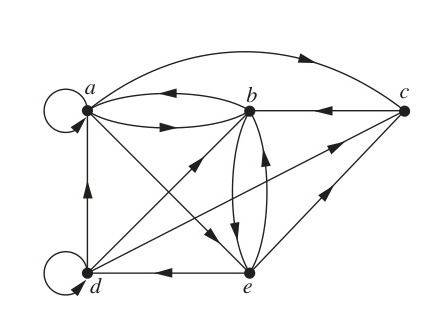
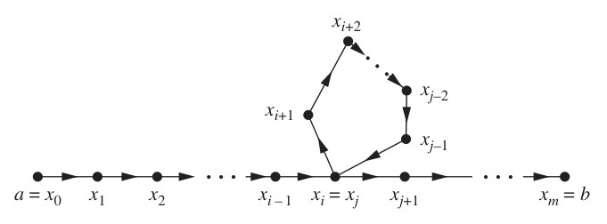
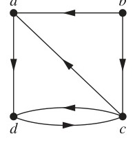
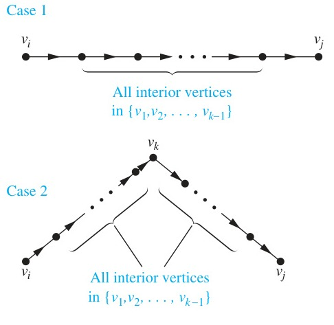

<!-- Page 25 -->

## 9.4 Closures of Relations

### Introduction

A computer network has data centers in Boston, Chicago, Denver, Detroit, New York, and San Diego. There are direct, one-way telephone lines from Boston to Chicago, from Boston to Detroit, from Chicago to Detroit, from Detroit to Denver, and from New York to San Diego. Let $R$ be the relation containing $(a, b)$ if there is a telephone line from the data center in $a$ to that in $b$. How can we determine if there is some (possibly indirect) link composed of one or more telephone lines from one center to another? Because not all links are direct, such as the link from Boston to Denver that goes through Detroit, $R$ cannot be used directly to answer this. In the language of relations, $R$ is not transitive, so it does not contain all the pairs that can be linked. As we will show in this section, we can find all pairs of data centers that have a link by constructing a transitive relation $S$ containing $R$ such that $S$ is a subset of every transitive relation containing $R$. Here, $S$ is the smallest transitive relation that contains $R$. This relation is called the transitive closure of $R$.

In general, let $R$ be a relation on a set $A$. $R$ may or may not have some property $\mathbf{P}$, such as reflexivity, symmetry, or transitivity. If there is a relation $S$ with property $\mathbf{P}$ containing $R$ such that $S$ is a subset of every relation with property $\mathbf{P}$ containing $R$, then $S$ is called the closure of $R$ with respect to $\mathbf{P}$. (Note that the closure of a relation with respect to a property may not exist; see Exercises 15 and 35.) We will show how reflexive, symmetric, and transitive closures of relations can be found.

<!-- Page 26 -->

### Closures

The relation $R = \{(1, 1), (1, 2), (2, 1), (3, 2)\}$ on the set $A = \{1, 2, 3\}$ is not reflexive. How can we produce a reflexive relation containing $R$ that is as small as possible? This can be done by adding $(2, 2)$ and $(3, 3)$ to $R$, because these are the only pairs of the form $(a, a)$ that are not in $R$. Clearly, this new relation contains $R$. Furthermore, any reflexive relation that contains $R$ must also contain $(2, 2)$ and $(3, 3)$. Because this relation contains $R$, is reflexive, and is contained within every reflexive relation that contains $R$, it is called the **reflexive closure** of $R$.

As this example illustrates, given a relation $R$ on a set $A$, the reflexive closure of $R$ can be formed by adding to $R$ all pairs of the form $(a, a)$ with $a \in A$, not already in $R$. The addition of these pairs produces a new relation that is reflexive, contains $R$, and is contained within any reflexive relation containing $R$. We see that the reflexive closure of $R$ equals $R \cup \Delta$, where $\Delta = \{(a, a) \mid a \in A\}$ is the diagonal relation on $A$. (The reader should verify this.)

#### EXAMPLE 1
What is the reflexive closure of the relation $R = \{(a, b) \mid a < b\}$ on the set of integers?

**Solution:** The reflexive closure of $R$ is

$$R \cup \Delta = \{(a, b) \mid a < b\} \cup \{(a, a) \mid a \in \mathbf{Z}\} = \{(a, b) \mid a \le b\}. \quad \blacktriangleleft$$

The relation $\{(1, 1), (1, 2), (2, 2), (2, 3), (3, 1), (3, 2)\}$ on $\{1, 2, 3\}$ is not symmetric. How can we produce a symmetric relation that is as small as possible and contains $R$? To do this, we need only add $(2, 1)$ and $(1, 3)$, because these are the only pairs of the form $(b, a)$ with $(a, b) \in R$ that are not in $R$. This new relation is symmetric and contains $R$. Furthermore, any symmetric relation that contains $R$ must contain this new relation, because a symmetric relation that contains $R$ must contain $(2, 1)$ and $(1, 3)$. Consequently, this new relation is called the **symmetric closure** of $R$.

As this example illustrates, the symmetric closure of a relation $R$ can be constructed by adding all ordered pairs of the form $(b, a)$, where $(a, b)$ is in the relation, that are not already present in $R$. Adding these pairs produces a relation that is symmetric, that contains $R$, and that is contained in any symmetric relation that contains $R$. The symmetric closure of a relation can be constructed by taking the union of a relation with its inverse (defined in the preamble of Exercise 26 in Section 9.1); that is, $R \cup R^{-1}$ is the symmetric closure of $R$, where $R^{-1} = \{(b, a) \mid (a, b) \in R\}$. The reader should verify this statement.

#### EXAMPLE 2
What is the symmetric closure of the relation $R = \{(a, b) \mid a > b\}$ on the set of positive integers?

**Solution:** The symmetric closure of $R$ is the relation

$$R \cup R^{-1} = \{(a, b) \mid a > b\} \cup \{(b, a) \mid a > b\} = \{(a, b) \mid a \neq b\}.$$

This last equality follows because $R$ contains all ordered pairs of positive integers where the first element is greater than the second element and $R^{-1}$ contains all ordered pairs of positive integers where the first element is less than the second. $\blacktriangleleft$

Suppose that a relation $R$ is not transitive. How can we produce a transitive relation that contains $R$ such that this new relation is contained within any transitive relation that contains $R$? Can the transitive closure of a relation $R$ be produced by adding all the pairs of the form $(a, c)$, where $(a, b)$ and $(b, c)$ are already in the relation? Consider the relation

<!-- Page 27 -->

$R = \{(1, 3), (1, 4), (2, 1), (3, 2)\}$ on the set $\{1, 2, 3, 4\}$. This relation is not transitive because it does not contain all pairs of the form $(a, c)$ where $(a, b)$ and $(b, c)$ are in $R$. The pairs of this form not in $R$ are $(1, 2)$, $(2, 3)$, $(2, 4)$, and $(3, 1)$. Adding these pairs does not produce a transitive relation, because the resulting relation contains $(3, 1)$ and $(1, 4)$ but does not contain $(3, 4)$. This shows that constructing the transitive closure of a relation is more complicated than constructing either the reflexive or symmetric closure. The rest of this section develops algorithms for constructing transitive closures. As will be shown later in this section, the transitive closure of a relation can be found by adding new ordered pairs that must be present and then repeating this process until no new ordered pairs are needed.

### Paths in Directed Graphs

We will see that representing relations by directed graphs helps in the construction of transitive closures. We now introduce some terminology that we will use for this purpose.

A path in a directed graph is obtained by traversing along edges (in the same direction as indicated by the arrow on the edge).

> [!NOTE] DEFINITION 1
> A **path** from $a$ to $b$ in the directed graph $G$ is a sequence of edges $(x_0, x_1), (x_1, x_2), (x_2, x_3), \dots, (x_{n-1}, x_n)$ in $G$, where $n$ is a nonnegative integer, and $x_0 = a$ and $x_n = b$, that is, a sequence of edges where the terminal vertex of an edge is the same as the initial vertex in the next edge in the path. This path is denoted by $x_0, x_1, x_2, \dots, x_{n-1}, x_n$ and has **length** $n$. We view the empty set of edges as a path of length zero from $a$ to $a$. A path of length $n \ge 1$ that begins and ends at the same vertex is called a **circuit** or **cycle**.

A path in a directed graph can pass through a vertex more than once. Moreover, an edge in a directed graph can occur more than once in a path.

#### EXAMPLE 3
Which of the following are paths in the directed graph shown in Figure 1: $a, b, e, d$; $a, e, c, d, b$; $b, a, c, b, a, a, b$; $d, c$; $c, b, a$; $e, b, a, b, a, b, e$? What are the lengths of those that are paths? Which of the paths in this list are circuits?


*Figure 1 — A Directed Graph.*

**Solution:** Because each of $(a, b)$, $(b, e)$, and $(e, d)$ is an edge, $a, b, e, d$ is a path of length three. Because $(c, d)$ is not an edge, $a, e, c, d, b$ is not a path. Also, $b, a, c, b, a, a, b$ is a path of length six because $(b, a)$, $(a, c)$, $(c, b)$, $(b, a)$, $(a, a)$, and $(a, b)$ are all edges. We see that $d, c$ is a path of length one, because $(d, c)$ is an edge. Also $c, b, a$ is a path of length two, because $(c, b)$ and $(b, a)$ are edges. All of $(e, b)$, $(b, a)$, $(a, b)$, $(b, a)$, $(a, b)$, and $(b, e)$ are edges, so $e, b, a, b, a, b, e$ is a path of length six.

The two paths $b, a, c, b, a, a, b$ and $e, b, a, b, a, b, e$ are circuits because they begin and end at the same vertex. The paths $a, b, e, d$; $c, b, a$; and $d, c$ are not circuits. $\blacktriangleleft$

<!-- Page 28 -->

The term path also applies to relations. Carrying over the definition from directed graphs to relations, there is a path from $a$ to $b$ in $R$ if there is a sequence of elements $a, x_1, x_2, \dots, x_{n-1}, b$ with $(a, x_1) \in R$, $(x_1, x_2) \in R$, $\dots$, and $(x_{n-1}, b) \in R$. Theorem 1 can be obtained from the definition of a path in a relation.

> [!NOTE] THEOREM 1
> Let $R$ be a relation on a set $A$. There is a path of length $n$, where $n$ is a positive integer, from $a$ to $b$ if and only if $(a, b) \in R^n$.

**Proof:** We will use mathematical induction. By definition, there is a path from $a$ to $b$ of length one if and only if $(a, b) \in R$, so the theorem is true when $n = 1$.

Assume that the theorem is true for the positive integer $n$. This is the inductive hypothesis. There is a path of length $n + 1$ from $a$ to $b$ if and only if there is an element $c \in A$ such that there is a path of length one from $a$ to $c$, so $(a, c) \in R$, and a path of length $n$ from $c$ to $b$, that is, $(c, b) \in R^n$. Consequently, by the inductive hypothesis, there is a path of length $n + 1$ from $a$ to $b$ if and only if there is an element $c$ with $(a, c) \in R$ and $(c, b) \in R^n$. But there is such an element if and only if $(a, b) \in R^{n+1}$. Therefore, there is a path of length $n + 1$ from $a$ to $b$ if and only if $(a, b) \in R^{n+1}$. This completes the proof. $\blacksquare$

### Transitive Closures

We now show that finding the transitive closure of a relation is equivalent to determining which pairs of vertices in the associated directed graph are connected by a path. With this in mind, we define a new relation.

> [!NOTE] DEFINITION 2
> Let $R$ be a relation on a set $A$. The **connectivity relation** $R^*$ consists of the pairs $(a, b)$ such that there is a path of length at least one from $a$ to $b$ in $R$.

Because $R^n$ consists of the pairs $(a, b)$ such that there is a path of length $n$ from $a$ to $b$, it follows that $R^*$ is the union of all the sets $R^n$. In other words,

$$R^* = \bigcup_{n=1}^\infty R^n.$$

The connectivity relation is useful in many models.

#### EXAMPLE 4
Let $R$ be the relation on the set of all people in the world that contains $(a, b)$ if $a$ has met $b$. What is $R^n$, where $n$ is a positive integer greater than one? What is $R^*$?

**Solution:** The relation $R^2$ contains $(a, b)$ if there is a person $c$ such that $(a, c) \in R$ and $(c, b) \in R$, that is, if there is a person $c$ such that $a$ has met $c$ and $c$ has met $b$. Similarly, $R^n$ consists of those pairs $(a, b)$ such that there are people $x_1, x_2, \dots, x_{n-1}$ such that $a$ has met $x_1$, $x_1$ has met $x_2$, $\dots$, and $x_{n-1}$ has met $b$.

The relation $R^*$ contains $(a, b)$ if there is a sequence of people, starting with $a$ and ending with $b$, such that each person in the sequence has met the next person in the sequence. (There are many interesting conjectures about $R^*$. Do you think that this connectivity relation includes the pair with you as the first element and the president of Mongolia as the second element? We will use graphs to model this application in Chapter 10.) $\blacktriangleleft$

<!-- Page 29 -->

#### EXAMPLE 5
Let $R$ be the relation on the set of all subway stops in New York City that contains $(a, b)$ if it is possible to travel from stop $a$ to stop $b$ without changing trains. What is $R^n$ when $n$ is a positive integer? What is $R^*$?

**Solution:** The relation $R^n$ contains $(a, b)$ if it is possible to travel from stop $a$ to stop $b$ by making at most $n - 1$ changes of trains. The relation $R^*$ consists of the ordered pairs $(a, b)$ where it is possible to travel from stop $a$ to stop $b$ making as many changes of trains as necessary. (The reader should verify these statements.) $\blacktriangleleft$

#### EXAMPLE 6
Let $R$ be the relation on the set of all states in the United States that contains $(a, b)$ if state $a$ and state $b$ have a common border. What is $R^n$, where $n$ is a positive integer? What is $R^*$?

**Solution:** The relation $R^n$ consists of the pairs $(a, b)$, where it is possible to go from state $a$ to state $b$ by crossing exactly $n$ state borders. $R^*$ consists of the ordered pairs $(a, b)$, where it is possible to go from state $a$ to state $b$ crossing as many borders as necessary. (The reader should verify these statements.) The only ordered pairs not in $R^*$ are those containing states that are not connected to the continental United States (i.e., those pairs containing Alaska or Hawaii). $\blacktriangleleft$

Theorem 2 shows that the transitive closure of a relation and the associated connectivity relation are the same.

> [!NOTE] THEOREM 2
> The transitive closure of a relation $R$ equals the connectivity relation $R^*$.

**Proof:** Note that $R^*$ contains $R$ by definition. To show that $R^*$ is the transitive closure of $R$ we must also show that $R^*$ is transitive and that $R^* \subseteq S$ whenever $S$ is a transitive relation that contains $R$.

First, we show that $R^*$ is transitive. If $(a, b) \in R^*$ and $(b, c) \in R^*$, then there are paths from $a$ to $b$ and from $b$ to $c$ in $R$. We obtain a path from $a$ to $c$ by starting with the path from $a$ to $b$ and following it with the path from $b$ to $c$. Hence, $(a, c) \in R^*$. It follows that $R^*$ is transitive.

Now suppose that $S$ is a transitive relation containing $R$. Because $S$ is transitive, $S^n$ also is transitive (the reader should verify this) and $S^n \subseteq S$ (by Theorem 1 of Section 9.1). Furthermore, because

$$S^* = \bigcup_{k=1}^\infty S^k$$

and $S^k \subseteq S$, it follows that $S^* \subseteq S$. Now note that if $R \subseteq S$, then $R^* \subseteq S^*$, because any path in $R$ is also a path in $S$. Consequently, $R^* \subseteq S^* \subseteq S$. Thus, any transitive relation that contains $R$ must also contain $R^*$. Therefore, $R^*$ is the transitive closure of $R$. $\blacksquare$

Now that we know that the transitive closure equals the connectivity relation, we turn our attention to the problem of computing this relation. We do not need to examine arbitrarily long paths to determine whether there is a path between two vertices in a finite directed graph. As Lemma 1 shows, it is sufficient to examine paths containing no more than $n$ edges, where $n$ is the number of elements in the set.

> [!NOTE] LEMMA 1
> Let $A$ be a set with $n$ elements, and let $R$ be a relation on $A$. If there is a path of length at least one in $R$ from $a$ to $b$, then there is such a path with length not exceeding $n$. Moreover, when $a \neq b$, if there is a path of length at least one in $R$ from $a$ to $b$, then there is such a path with length not exceeding $n - 1$.

<!-- Page 30 -->


*Figure 2 — Producing a Path with Length Not Exceeding $n$.*

**Proof:** Suppose there is a path from $a$ to $b$ in $R$. Let $m$ be the length of the shortest such path. Suppose that $x_0, x_1, x_2, \dots, x_{m-1}, x_m$, where $x_0 = a$ and $x_m = b$, is such a path.

Suppose that $a = b$ and that $m > n$, so that $m \ge n + 1$. By the pigeonhole principle, because there are $n$ vertices in $A$, among the $m$ vertices $x_0, x_1, \dots, x_{m-1}$, at least two are equal (see Figure 2).

Suppose that $x_i = x_j$ with $0 \le i < j \le m - 1$. Then the path contains a circuit from $x_i$ to itself. This circuit can be deleted from the path from $a$ to $b$, leaving a path, namely, $x_0, x_1, \dots, x_i, x_{j+1}, \dots, x_{m-1}, x_m$, from $a$ to $b$ of shorter length. Hence, the path of shortest length must have length less than or equal to $n$.

The case where $a \neq b$ is left as an exercise for the reader. $\blacksquare$

From Lemma 1, we see that the transitive closure of $R$ is the union of $R, R^2, R^3, \dots,$ and $R^n$. This follows because there is a path in $R^*$ between two vertices if and only if there is a path between these vertices in $R^i$, for some positive integer $i$ with $i \le n$. Because

$$R^* = R \cup R^2 \cup R^3 \cup \dots \cup R^n$$

and the zero–one matrix representing a union of relations is the join of the zero–one matrices of these relations, the zero–one matrix for the transitive closure is the join of the zero–one matrices of the first $n$ powers of the zero–one matrix of $R$.

> [!NOTE] THEOREM 3
> Let $\mathbf{M}_R$ be the zero–one matrix of the relation $R$ on a set with $n$ elements. Then the zero–one matrix of the transitive closure $R^*$ is
> 
> $$\mathbf{M}_{R^*} = \mathbf{M}_R \vee \mathbf{M}_R^{[2]} \vee \mathbf{M}_R^{[3]} \vee \dots \vee \mathbf{M}_R^{[n]}.$$

#### EXAMPLE 7
Find the zero–one matrix of the transitive closure of the relation $R$ where

$$\mathbf{M}_R = \begin{bmatrix} 1 & 0 & 1 \\ 0 & 1 & 0 \\ 1 & 1 & 0 \end{bmatrix}.$$

**Solution:** By Theorem 3, it follows that the zero–one matrix of $R^*$ is

$$\mathbf{M}_{R^*} = \mathbf{M}_R \vee \mathbf{M}_R^{[2]} \vee \mathbf{M}_R^{[3]}.$$

Because

$$\mathbf{M}_R^{[2]} = \begin{bmatrix} 1 & 1 & 1 \\ 0 & 1 & 0 \\ 1 & 1 & 1 \end{bmatrix} \quad \text{and} \quad \mathbf{M}_R^{[3]} = \begin{bmatrix} 1 & 1 & 1 \\ 0 & 1 & 0 \\ 1 & 1 & 1 \end{bmatrix},$$

<!-- Page 31 -->

it follows that

$$\mathbf{M}_{R^*} = \begin{bmatrix} 1 & 0 & 1 \\ 0 & 1 & 0 \\ 1 & 1 & 0 \end{bmatrix} \vee \begin{bmatrix} 1 & 1 & 1 \\ 0 & 1 & 0 \\ 1 & 1 & 1 \end{bmatrix} \vee \begin{bmatrix} 1 & 1 & 1 \\ 0 & 1 & 0 \\ 1 & 1 & 1 \end{bmatrix} = \begin{bmatrix} 1 & 1 & 1 \\ 0 & 1 & 0 \\ 1 & 1 & 1 \end{bmatrix}. \quad \blacktriangleleft$$

Theorem 3 can be used as a basis for an algorithm for computing the matrix of the relation $R^*$. To find this matrix, the successive Boolean powers of $\mathbf{M}_R$, up to the $n$th power, are computed. As each power is calculated, its join with the join of all smaller powers is formed. When this is done with the $n$th power, the matrix for $R^*$ has been found. This procedure is displayed as Algorithm 1.

```pascal
ALGORITHM 1 A Procedure for Computing the Transitive Closure.
procedure transitive closure (MR : zero–one n × n matrix)
A := MR
B := A
for i := 2 to n
    A := A ⊙ MR
    B := B ∨ A
return B {B is the zero–one matrix for R*}
```

We can easily find the number of bit operations used by Algorithm 1 to determine the transitive closure of a relation. Computing the Boolean powers $\mathbf{M}_R, \mathbf{M}_R^{[2]}, \dots, \mathbf{M}_R^{[n]}$ requires that $n - 1$ Boolean products of $n \times n$ zero–one matrices be found. Each of these Boolean products can be found using $n^2(2n - 1)$ bit operations. Hence, these products can be computed using $n^2(2n - 1)(n - 1)$ bit operations.

To find $\mathbf{M}_{R^*}$ from the $n$ Boolean powers of $\mathbf{M}_R$, $n - 1$ joins of zero–one matrices need to be found. Computing each of these joins uses $n^2$ bit operations. Hence, $(n - 1)n^2$ bit operations are used in this part of the computation. Therefore, when Algorithm 1 is used, the matrix of the transitive closure of a relation on a set with $n$ elements can be found using $n^2(2n - 1)(n - 1) + (n - 1)n^2 = 2n^3(n - 1)$, which is $O(n^4)$ bit operations. The remainder of this section describes a more efficient algorithm for finding transitive closures.

### Warshall's Algorithm

Warshall's algorithm, named after Stephen Warshall, who described this algorithm in 1960, is an efficient method for computing the transitive closure of a relation. Algorithm 1 can find the transitive closure of a relation on a set with $n$ elements using $2n^3(n - 1)$ bit operations. However, the transitive closure can be found by Warshall's algorithm using only $2n^3$ bit operations.

> [!NOTE] Remark
> Warshall's algorithm is sometimes called the Roy–Warshall algorithm, because Bernard Roy described this algorithm in 1959.

Suppose that $R$ is a relation on a set with $n$ elements. Let $v_1, v_2, \dots, v_n$ be an arbitrary listing of these $n$ elements. The concept of the interior vertices of a path is used in Warshall's algorithm. If $a, x_1, x_2, \dots, x_{m-1}, b$ is a path, its **interior vertices** are $x_1, x_2, \dots, x_{m-1}$, that is, all the vertices of the path that occur somewhere other than as the first and last vertices in the path. For instance, the interior vertices of a path $a, c, d, f, g, h, b, j$ in a directed graph

<!-- Page 32 -->

are $c, d, f, g, h$, and $b$. The interior vertices of $a, c, d, a, f, b$ are $c, d, a$, and $f$. (Note that the first vertex in the path is not an interior vertex unless it is visited again by the path, except as the last vertex. Similarly, the last vertex in the path is not an interior vertex unless it was visited previously by the path, except as the first vertex.)

Warshall's algorithm is based on the construction of a sequence of zero–one matrices. These matrices are $W_0, W_1, \dots, W_n$, where $W_0 = \mathbf{M}_R$ is the zero–one matrix of this relation, and $W_k = [w_{ij}^{[k]}]$, where $w_{ij}^{[k]} = 1$ if there is a path from $v_i$ to $v_j$ such that all the interior vertices of this path are in the set $\{v_1, v_2, \dots, v_k\}$ (the first $k$ vertices in the list) and is $0$ otherwise. (The first and last vertices in the path may be outside the set of the first $k$ vertices in the list.) Note that $W_n = \mathbf{M}_{R^*}$, because the $(i, j)$th entry of $\mathbf{M}_{R^*}$ is $1$ if and only if there is a path from $v_i$ to $v_j$, with all interior vertices in the set $\{v_1, v_2, \dots, v_n\}$ (but these are the only vertices in the directed graph). Example 8 illustrates what the matrix $W_k$ represents.

#### EXAMPLE 8
Let $R$ be the relation with directed graph shown in Figure 3. Let $a, b, c, d$ be a listing of the elements of the set. Find the matrices $W_0, W_1, W_2, W_3$, and $W_4$. The matrix $W_4$ is the transitive closure of $R$.


*Figure 3 — The Directed Graph of the Relation $R$.*

**Solution:** Let $v_1 = a, v_2 = b, v_3 = c$, and $v_4 = d$. $W_0$ is the matrix of the relation. Hence,

$$W_0 = \begin{bmatrix} 0 & 0 & 0 & 1 \\ 1 & 0 & 1 & 0 \\ 1 & 0 & 0 & 1 \\ 0 & 0 & 1 & 0 \end{bmatrix}.$$

$W_1$ has $1$ as its $(i, j)$th entry if there is a path from $v_i$ to $v_j$ that has only $v_1 = a$ as an interior vertex. Note that all paths of length one can still be used because they have no interior vertices. Also, there is now an allowable path from $b$ to $d$, namely, $b, a, d$. Hence,

$$W_1 = \begin{bmatrix} 0 & 0 & 0 & 1 \\ 1 & 0 & 1 & 1 \\ 1 & 0 & 0 & 1 \\ 0 & 0 & 1 & 0 \end{bmatrix}.$$

$W_2$ has $1$ as its $(i, j)$th entry if there is a path from $v_i$ to $v_j$ that has only $v_1 = a$ and/or $v_2 = b$ as its interior vertices, if any. Because there are no edges that have $b$ as a terminal vertex, no new paths are obtained when we permit $b$ to be an interior vertex. Hence, $W_2 = W_1$.

<!-- Page 33 -->

$W_3$ has $1$ as its $(i, j)$th entry if there is a path from $v_i$ to $v_j$ that has only $v_1 = a$, $v_2 = b$, and/or $v_3 = c$ as its interior vertices, if any. We now have paths from $d$ to $a$, namely, $d, c, a$, and from $d$ to $d$, namely, $d, c, d$. Hence,

$$W_3 = \begin{bmatrix} 0 & 0 & 0 & 1 \\ 1 & 0 & 1 & 1 \\ 1 & 0 & 0 & 1 \\ 1 & 0 & 1 & 1 \end{bmatrix}.$$

Finally, $W_4$ has $1$ as its $(i, j)$th entry if there is a path from $v_i$ to $v_j$ that has $v_1 = a$, $v_2 = b$, $v_3 = c$, and/or $v_4 = d$ as interior vertices, if any. Because these are all the vertices of the graph, this entry is $1$ if and only if there is a path from $v_i$ to $v_j$. Hence,

$$W_4 = \begin{bmatrix} 1 & 0 & 1 & 1 \\ 1 & 0 & 1 & 1 \\ 1 & 0 & 1 & 1 \\ 1 & 0 & 1 & 1 \end{bmatrix}.$$

This last matrix, $W_4$, is the matrix of the transitive closure. $\blacktriangleleft$

Warshall's algorithm computes $\mathbf{M}_{R^*}$ by efficiently computing $W_0 = \mathbf{M}_R, W_1, W_2, \dots, W_n = \mathbf{M}_{R^*}$. This observation shows that we can compute $W_k$ directly from $W_{k-1}$: There is a path from $v_i$ to $v_j$ with no vertices other than $v_1, v_2, \dots, v_k$ as interior vertices if and only if either there is a path from $v_i$ to $v_j$ with its interior vertices among the first $k - 1$ vertices in the list, or there are paths from $v_i$ to $v_k$ and from $v_k$ to $v_j$ that have interior vertices only among the first $k - 1$ vertices in the list. That is, either a path from $v_i$ to $v_j$ already existed before $v_k$ was permitted as an interior vertex, or allowing $v_k$ as an interior vertex produces a path that goes from $v_i$ to $v_k$ and then from $v_k$ to $v_j$. These two cases are shown in Figure 4.

The first type of path exists if and only if $w_{ij}^{[k-1]} = 1$, and the second type of path exists if and only if both $w_{ik}^{[k-1]}$ and $w_{kj}^{[k-1]}$ are $1$. Hence, $w_{ij}^{[k]}$ is $1$ if and only if either $w_{ij}^{[k-1]}$ is $1$ or both $w_{ik}^{[k-1]}$ and $w_{kj}^{[k-1]}$ are $1$. This gives us Lemma 2.


*Figure 4 — Adding $v_k$ to the Set of Allowable Interior Vertices.*

<!-- Page 34 -->

> [!NOTE] LEMMA 2
> Let $W_k = [w_{ij}^{[k]}]$ be the zero–one matrix that has a $1$ in its $(i, j)$th position if and only if there is a path from $v_i$ to $v_j$ with interior vertices from the set $\{v_1, v_2, \dots, v_k\}$. Then
> 
> $$w_{ij}^{[k]} = w_{ij}^{[k-1]} \vee (w_{ik}^{[k-1]} \wedge w_{kj}^{[k-1]}),$$
> 
> whenever $i$, $j$, and $k$ are positive integers not exceeding $n$.

Lemma 2 gives us the means to compute efficiently the matrices $W_k, k = 1, 2, \dots, n$. We display the pseudocode for Warshall's algorithm, using Lemma 2, as Algorithm 2.

```pascal
ALGORITHM 2 Warshall Algorithm.
procedure Warshall (MR : n × n zero–one matrix)
W := MR
for k := 1 to n
    for i := 1 to n
        for j := 1 to n
            wij := wij ∨ (wik ∧ wkj)
return W {W = [wij] is MR*}
```

The computational complexity of Warshall's algorithm can easily be computed in terms of bit operations. To find the entry $w_{ij}^{[k]}$ from the entries $w_{ij}^{[k-1]}$, $w_{ik}^{[k-1]}$, and $w_{kj}^{[k-1]}$ using Lemma 2 requires two bit operations. To find all $n^2$ entries of $W_k$ from those of $W_{k-1}$ requires $2n^2$ bit operations. Because Warshall's algorithm begins with $W_0 = \mathbf{M}_R$ and computes the sequence of $n$ zero–one matrices $W_1, W_2, \dots, W_n = \mathbf{M}_{R^*}$, the total number of bit operations used is $n \cdot 2n^2 = 2n^3$.
