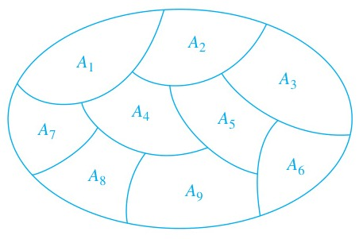

<!-- Page 35 -->

## 9.5 Equivalence Relations

### Introduction

In some programming languages the names of variables can contain an unlimited number of characters. However, there is a limit on the number of characters that are checked when a compiler determines whether two variables are equal. For instance, in traditional C, only the first eight characters of a variable name are checked by the compiler. (These characters are

<!-- Page 36 -->

uppercase or lowercase letters, digits, or underscores.) Consequently, the compiler considers strings longer than eight characters that agree in their first eight characters the same. Let $R$ be the relation on the set of strings of characters such that $s R t$, where $s$ and $t$ are two strings, if $s$ and $t$ are at least eight characters long and the first eight characters of $s$ and $t$ agree, or $s = t$. It is easy to see that $R$ is reflexive, symmetric, and transitive. Moreover, $R$ divides the set of all strings into classes, where all strings in a particular class are considered the same by a compiler for traditional C.

The integers $a$ and $b$ are related by the "congruence modulo 4" relation when $4$ divides $a - b$. We will show later that this relation is reflexive, symmetric, and transitive. It is not hard to see that $a$ is related to $b$ if and only if $a$ and $b$ have the same remainder when divided by $4$. It follows that this relation splits the set of integers into four different classes. When we care only what remainder an integer leaves when it is divided by $4$, we need only know which class it is in, not its particular value.

These two relations, $R$ and congruence modulo 4, are examples of equivalence relations, namely, relations that are reflexive, symmetric, and transitive. In this section we will show that such relations split sets into disjoint classes of equivalent elements. Equivalence relations arise whenever we care only whether an element of a set is in a certain class of elements, instead of caring about its particular identity.

### Equivalence Relations

In this section we will study relations with a particular combination of properties that allows them to be used to relate objects that are similar in some way.

> [!NOTE] DEFINITION 1
> A relation on a set $A$ is called an **equivalence relation** if it is reflexive, symmetric, and transitive.

Equivalence relations are important throughout mathematics and computer science. One reason for this is that in an equivalence relation, when two elements are related it makes sense to say they are equivalent.

> [!NOTE] DEFINITION 2
> Two elements $a$ and $b$ that are related by an equivalence relation are called **equivalent**. The notation $a \sim b$ is often used to denote that $a$ and $b$ are equivalent elements with respect to a particular equivalence relation.

For the notion of equivalent elements to make sense, every element should be equivalent to itself, as the reflexive property guarantees for an equivalence relation. It makes sense to say that $a$ and $b$ are related (not just that $a$ is related to $b$) by an equivalence relation, because when $a$ is related to $b$, by the symmetric property, $b$ is related to $a$. Furthermore, because an equivalence relation is transitive, if $a$ and $b$ are equivalent and $b$ and $c$ are equivalent, it follows that $a$ and $c$ are equivalent.

Examples 1–5 illustrate the notion of an equivalence relation.

#### EXAMPLE 1
Let $R$ be the relation on the set of integers such that $a R b$ if and only if $a = b$ or $a = -b$. In Section 9.1 we showed that $R$ is reflexive, symmetric, and transitive. It follows that $R$ is an equivalence relation. $\blacktriangleleft$

#### EXAMPLE 2
Let $R$ be the relation on the set of real numbers such that $a R b$ if and only if $a - b$ is an integer. Is $R$ an equivalence relation?

<!-- Page 37 -->

**Solution:** Because $a - a = 0$ is an integer for all real numbers $a$, $a R a$ for all real numbers $a$. Hence, $R$ is reflexive. Now suppose that $a R b$. Then $a - b$ is an integer, so $b - a$ is also an integer. Hence, $b R a$. It follows that $R$ is symmetric. If $a R b$ and $b R c$, then $a - b$ and $b - c$ are integers. Therefore, $a - c = (a - b) + (b - c)$ is also an integer. Hence, $a R c$. Thus, $R$ is transitive. Consequently, $R$ is an equivalence relation. $\blacktriangleleft$

One of the most widely used equivalence relations is congruence modulo $m$, where $m$ is an integer greater than 1.

#### EXAMPLE 3 Congruence Modulo $m$
Let $m$ be an integer with $m > 1$. Show that the relation

$$R = \{(a, b) \mid a \equiv b \pmod m\}$$

is an equivalence relation on the set of integers.

**Solution:** Recall from Section 4.1 that $a \equiv b \pmod m$ if and only if $m$ divides $a - b$. Note that $a - a = 0$ is divisible by $m$, because $0 = 0 \cdot m$. Hence, $a \equiv a \pmod m$, so congruence modulo $m$ is reflexive. Now suppose that $a \equiv b \pmod m$. Then $a - b$ is divisible by $m$, so $a - b = km$, where $k$ is an integer. It follows that $b - a = (-k)m$, so $b \equiv a \pmod m$. Hence, congruence modulo $m$ is symmetric. Next, suppose that $a \equiv b \pmod m$ and $b \equiv c \pmod m$. Then $m$ divides both $a - b$ and $b - c$. Therefore, there are integers $k$ and $l$ with $a - b = km$ and $b - c = lm$. Adding these two equations shows that $a - c = (a - b) + (b - c) = km + lm = (k + l)m$. Thus, $a \equiv c \pmod m$. Therefore, congruence modulo $m$ is transitive. It follows that congruence modulo $m$ is an equivalence relation. $\blacktriangleleft$

#### EXAMPLE 4
Suppose that $R$ is the relation on the set of strings of English letters such that $a R b$ if and only if $l(a) = l(b)$, where $l(x)$ is the length of the string $x$. Is $R$ an equivalence relation?

**Solution:** Because $l(a) = l(a)$, it follows that $a R a$ whenever $a$ is a string, so that $R$ is reflexive. Next, suppose that $a R b$, so that $l(a) = l(b)$. Then $b R a$, because $l(b) = l(a)$. Hence, $R$ is symmetric. Finally, suppose that $a R b$ and $b R c$. Then $l(a) = l(b)$ and $l(b) = l(c)$. Hence, $l(a) = l(c)$, so $a R c$. Consequently, $R$ is transitive. Because $R$ is reflexive, symmetric, and transitive, it is an equivalence relation. $\blacktriangleleft$

#### EXAMPLE 5
Let $n$ be a positive integer and $S$ a set of strings. Suppose that $R_n$ is the relation on $S$ such that $s R_n t$ if and only if $s = t$, or both $s$ and $t$ have at least $n$ characters and the first $n$ characters of $s$ and $t$ are the same. That is, a string of fewer than $n$ characters is related only to itself; a string $s$ with at least $n$ characters is related to a string $t$ if and only if $t$ has at least $n$ characters and $t$ begins with the $n$ characters at the start of $s$. For example, let $n = 3$ and let $S$ be the set of all bit strings. Then $s R_3 t$ either when $s = t$ or both $s$ and $t$ are bit strings of length 3 or more that begin with the same three bits. For instance, $01 R_3 01$ and $00111 R_3 00101$, but $01 \not R_3 010$ and $01011 \not R_3 01110$.

Show that for every set $S$ of strings and every positive integer $n$, $R_n$ is an equivalence relation on $S$.

**Solution:** The relation $R_n$ is reflexive because $s = s$, so that $s R_n s$ whenever $s$ is a string in $S$.

If $s R_n t$, then either $s = t$ or $s$ and $t$ are both at least $n$ characters long that begin with the same $n$ characters. This means that $t R_n s$. We conclude that $R_n$ is symmetric.

Now suppose that $s R_n t$ and $t R_n u$. Then either $s = t$ or $s$ and $t$ are at least $n$ characters long and $s$ and $t$ begin with the same $n$ characters, and either $t = u$ or $t$ and $u$ are at least $n$ characters long and $t$ and $u$ begin with the same $n$ characters. From this, we can deduce that either $s = u$ or both $s$ and $u$ are $n$ characters long and $s$ and $u$ begin with the same $n$ characters (because in this case we know that $s, t$, and $u$ are all at least $n$ characters long and both $s$ and $u$ begin with the same $n$ characters as $t$ does). Consequently, $R_n$ is transitive. It follows that $R_n$ is an equivalence relation. $\blacktriangleleft$

<!-- Page 38 -->

In Examples 6 and 7 we look at two relations that are not equivalence relations.

#### EXAMPLE 6
Show that the "divides" relation is the set of positive integers in not an equivalence relation.

**Solution:** By Examples 9 and 15 in Section 9.1, we know that the "divides" relation is reflexive and transitive. However, by Example 12 in Section 9.1, we know that this relation is not symmetric (for instance, $2 \mid 4$ but $4 \nmid 2$). We conclude that the "divides" relation on the set of positive integers is not an equivalence relation. $\blacktriangleleft$

#### EXAMPLE 7
Let $R$ be the relation on the set of real numbers such that $x R y$ if and only if $x$ and $y$ are real numbers that differ by less than 1, that is $|x - y| < 1$. Show that $R$ is not an equivalence relation.

**Solution:** $R$ is reflexive because $|x - x| = 0 < 1$ whenever $x \in \mathbf{R}$. $R$ is symmetric, for if $x R y$, where $x$ and $y$ are real numbers, then $|x - y| < 1$, which tells us that $|y - x| = |x - y| < 1$, so that $y R x$. However, $R$ is not an equivalence relation because it is not transitive. Take $x = 2.8, y = 1.9$, and $z = 1.1$, so that $|x - y| = |2.8 - 1.9| = 0.9 < 1$, $|y - z| = |1.9 - 1.1| = 0.8 < 1$, but $|x - z| = |2.8 - 1.1| = 1.7 > 1$. That is, $2.8 R 1.9, 1.9 R 1.1$, but $2.8 \not R 1.1$. $\blacktriangleleft$

### Equivalence Classes

Let $A$ be the set of all students in your school who graduated from high school. Consider the relation $R$ on $A$ that consists of all pairs $(x, y)$, where $x$ and $y$ graduated from the same high school. Given a student $x$, we can form the set of all students equivalent to $x$ with respect to $R$. This set consists of all students who graduated from the same high school as $x$ did. This subset of $A$ is called an equivalence class of the relation.

> [!NOTE] DEFINITION 3
> Let $R$ be an equivalence relation on a set $A$. The set of all elements that are related to an element $a$ of $A$ is called the **equivalence class** of $a$. The equivalence class of $a$ with respect to $R$ is denoted by $[a]_R$. When only one relation is under consideration, we can delete the subscript $R$ and write $[a]$ for this equivalence class.

In other words, if $R$ is an equivalence relation on a set $A$, the equivalence class of the element $a$ is

$$[a]_R = \{s \mid (a, s) \in R\}.$$

If $b \in [a]_R$, then $b$ is called a **representative** of this equivalence class. Any element of a class can be used as a representative of this class. That is, there is nothing special about the particular element chosen as the representative of the class.

#### EXAMPLE 8
What is the equivalence class of an integer for the equivalence relation of Example 1?

**Solution:** Because an integer is equivalent to itself and its negative in this equivalence relation, it follows that $[a] = \{-a, a\}$. This set contains two distinct integers unless $a = 0$. For instance, $[7] = \{-7, 7\}$, $[-5] = \{-5, 5\}$, and $[0] = \{0\}$. $\blacktriangleleft$

#### EXAMPLE 9
What are the equivalence classes of 0 and 1 for congruence modulo 4?

**Solution:** The equivalence class of 0 contains all integers $a$ such that $a \equiv 0 \pmod 4$. The integers in this class are those divisible by 4. Hence, the equivalence class of 0 for this relation is

$$[0] = \{\dots, -8, -4, 0, 4, 8, \dots\}.$$

<!-- Page 39 -->

The equivalence class of 1 contains all the integers $a$ such that $a \equiv 1 \pmod 4$. The integers in this class are those that have a remainder of 1 when divided by 4. Hence, the equivalence class of 1 for this relation is

$$[1] = \{\dots, -7, -3, 1, 5, 9, \dots\}. \quad \blacktriangleleft$$

In Example 9 the equivalence classes of 0 and 1 with respect to congruence modulo 4 were found. Example 9 can easily be generalized, replacing 4 with any positive integer $m$. The equivalence classes of the relation congruence modulo $m$ are called the **congruence classes modulo $m$**. The congruence class of an integer $a$ modulo $m$ is denoted by $[a]_m$, so $[a]_m = \{\dots, a - 2m, a - m, a, a + m, a + 2m, \dots\}$. For instance, from Example 9 it follows that $[0]_4 = \{\dots, -8, -4, 0, 4, 8, \dots\}$ and $[1]_4 = \{\dots, -7, -3, 1, 5, 9, \dots\}$.

#### EXAMPLE 10
What is the equivalence class of the string $0111$ with respect to the equivalence relation $R_3$ from Example 5 on the set of all bit strings? (Recall that $s R_3 t$ if and only if $s$ and $t$ are bit strings with $s = t$ or $s$ and $t$ are strings of at least three bits that start with the same three bits.)

**Solution:** The bit strings equivalent to $0111$ are the bit strings with at least three bits that begin with $011$. These are the bit strings $011, 0110, 0111, 01100, 01101, 01110, 01111$, and so on. Consequently,

$$[011]_{R_3} = \{011, 0110, 0111, 01100, 01101, 01110, 01111, \dots\}. \quad \blacktriangleleft$$

#### EXAMPLE 11 Identifiers in the C Programming Language
In the C programming language, an identifier is the name of a variable, a function, or another type of entity. Each identifier is a nonempty string of characters where each character is a lowercase or an uppercase English letter, a digit, or an underscore, and the first character is a lowercase or an uppercase English letter. Identifiers can be any length. This allows developers to use as many characters as they want to name an entity, such as a variable. However, for compilers for some versions of C, there is a limit on the number of characters checked when two names are compared to see whether they refer to the same thing. For example, Standard C compilers consider two identifiers the same when they agree in their first 31 characters. Consequently, developers must be careful not to use identifiers with the same initial 31 characters for different things. We see that two identifiers are considered the same when they are related by the relation $R_{31}$ in Example 5. Using Example 5, we know that $R_{31}$, on the set of all identifiers in Standard C, is an equivalence relation.

What are the equivalence classes of each of the identifiers `Number_of_tropical_storms`, `Number_of_named_tropical_storms`, and `Number_of_named_tropical_storms_in_the_Atlantic_in_2005`?

**Solution:** Note that when an identifier is less than 31 characters long, by the definition of $R_{31}$, its equivalence class contains only itself. Because the identifier `Number_of_tropical_storms` is 25 characters long, its equivalence class contains exactly one element, namely, itself.

The identifier `Number_of_named_tropical_storms` is exactly 31 characters long. An identifier is equivalent to it when it starts with these same 31 characters. Consequently, every identifier at least 31 characters long that starts with `Number_of_named_tropical_storms` is equivalent to this identifier. It follows that the equivalence class of `Number_of_named_tropical_storms` is the set of all identifiers that begin with the 31 characters `Number_of_named_tropical_storms`.

An identifier is equivalent to `Number_of_named_tropical_storms_in_the_Atlantic_in_2005` if and only if it begins with its first 31 characters. Because these characters are `Number_of_named_tropical_storms`, we see that an identifier is equivalent to `Number_of_named_tropical_storms_in_the_Atlantic_in_2005` if and only if it is equivalent to `Number_of_named_tropical_storms`. It follows that these last two identifiers have the same equivalence class. $\blacktriangleleft$

<!-- Page 40 -->

### Equivalence Classes and Partitions

Let $A$ be the set of students at your school who are majoring in exactly one subject, and let $R$ be the relation on $A$ consisting of pairs $(x, y)$, where $x$ and y are students with the same major. Then $R$ is an equivalence relation, as the reader should verify. We can see that $R$ splits all students in $A$ into a collection of disjoint subsets, where each subset contains students with a specified major. For instance, one subset contains all students majoring (just) in computer science, and a second subset contains all students majoring in history. Furthermore, these subsets are equivalence classes of $R$. This example illustrates how the equivalence classes of an equivalence relation partition a set into disjoint, nonempty subsets. We will make these notions more precise in the following discussion.

Let $R$ be a relation on the set $A$. Theorem 1 shows that the equivalence classes of two elements of $A$ are either identical or disjoint.

> [!NOTE] THEOREM 1
> Let $R$ be an equivalence relation on a set $A$. These statements for elements $a$ and $b$ of $A$ are equivalent:
> 
> (i) $a R b$  
> (ii) $[a] = [b]$  
> (iii) $[a] \cap [b] \neq \emptyset$

**Proof:** We first show that (i) implies (ii). Assume that $a R b$. We will prove that $[a] = [b]$ by showing $[a] \subseteq [b]$ and $[b] \subseteq [a]$. Suppose $c \in [a]$. Then $a R c$. Because $a R b$ and $R$ is symmetric, we know that $b R a$. Furthermore, because $R$ is transitive and $b R a$ and $a R c$, it follows that $b R c$. Hence, $c \in [b]$. This shows that $[a] \subseteq [b]$. The proof that $[b] \subseteq [a]$ is similar; it is left as an exercise for the reader.

Second, we will show that (ii) implies (iii). Assume that $[a] = [b]$. It follows that $[a] \cap [b] \neq \emptyset$ because $[a]$ is nonempty (because $a \in [a]$ because $R$ is reflexive).

Next, we will show that (iii) implies (i). Suppose that $[a] \cap [b] \neq \emptyset$. Then there is an element $c$ with $c \in [a]$ and $c \in [b]$. In other words, $a R c$ and $b R c$. By the symmetric property, $c R b$. Then by transitivity, because $a R c$ and $c R b$, we have $a R b$.

Because (i) implies (ii), (ii) implies (iii), and (iii) implies (i), the three statements, (i), (ii), and (iii), are equivalent. $\blacksquare$

We are now in a position to show how an equivalence relation partitions a set. Let $R$ be an equivalence relation on a set $A$. The union of the equivalence classes of $R$ is all of $A$, because an element $a$ of $A$ is in its own equivalence class, namely, $[a]_R$. In other words,

$$\bigcup_{a \in A} [a]_R = A.$$

In addition, from Theorem 1, it follows that these equivalence classes are either equal or disjoint, so

$$[a]_R \cap [b]_R = \emptyset, \quad \text{when } [a]_R \neq [b]_R.$$

These two observations show that the equivalence classes form a partition of $A$, because they split $A$ into disjoint subsets. More precisely, a **partition** of a set $S$ is a collection of disjoint nonempty subsets of $S$ that have $S$ as their union. In other words, the collection of subsets $A_i, i \in I$ (where $I$ is an index set) forms a partition of $S$ if and only if

$$A_i \neq \emptyset \quad \text{for } i \in I,$$

$$A_i \cap A_j = \emptyset \quad \text{when } i \neq j,$$

<!-- Page 41 -->

and

$$\bigcup_{i \in I} A_i = S.$$

(Here the notation $\bigcup_{i \in I} A_i$ represents the union of the sets $A_i$ for all $i \in I$.) Figure 1 illustrates the concept of a partition of a set.

*Figure 1 — A Partition of a Set.*

#### EXAMPLE 12
Suppose that $S = \{1, 2, 3, 4, 5, 6\}$. The collection of sets $A_1 = \{1, 2, 3\}, A_2 = \{4, 5\}$, and $A_3 = \{6\}$ forms a partition of $S$, because these sets are disjoint and their union is $S$. $\blacktriangleleft$

We have seen that the equivalence classes of an equivalence relation on a set form a partition of the set. The subsets in this partition are the equivalence classes. Conversely, every partition of a set can be used to form an equivalence relation. Two elements are equivalent with respect to this relation if and only if they are in the same subset of the partition.

To see this, assume that $\{A_i \mid i \in I\}$ is a partition on $S$. Let $R$ be the relation on $S$ consisting of the pairs $(x, y)$, where $x$ and $y$ belong to the same subset $A_i$ in the partition. To show that $R$ is an equivalence relation we must show that $R$ is reflexive, symmetric, and transitive.

We see that $(a, a) \in R$ for every $a \in S$, because $a$ is in the same subset as itself. Hence, $R$ is reflexive. If $(a, b) \in R$, then $b$ and $a$ are in the same subset of the partition, so that $(b, a) \in R$ as well. Hence, $R$ is symmetric. If $(a, b) \in R$ and $(b, c) \in R$, then $a$ and $b$ are in the same subset $X$ in the partition, and $b$ and $c$ are in the same subset $Y$ of the partition. Because the subsets of the partition are disjoint and $b$ belongs to $X$ and $Y$, it follows that $X = Y$. Consequently, $a$ and $c$ belong to the same subset of the partition, so $(a, c) \in R$. Thus, $R$ is transitive.

It follows that $R$ is an equivalence relation. The equivalence classes of $R$ consist of subsets of $S$ containing related elements, and by the definition of $R$, these are the subsets of the partition. Theorem 2 summarizes the connections we have established between equivalence relations and partitions.

> [!NOTE] THEOREM 2
> Let $R$ be an equivalence relation on a set $S$. Then the equivalence classes of $R$ form a partition of $S$. Conversely, given a partition $\{A_i \mid i \in I\}$ of the set $S$, there is an equivalence relation $R$ that has the sets $A_i, i \in I$, as its equivalence classes.

Example 13 shows how to construct an equivalence relation from a partition.

#### EXAMPLE 13
List the ordered pairs in the equivalence relation $R$ produced by the partition $A_1 = \{1, 2, 3\}, A_2 = \{4, 5\}$, and $A_3 = \{6\}$ of $S = \{1, 2, 3, 4, 5, 6\}$, given in Example 12.

<!-- Page 42 -->

**Solution:** The subsets in the partition are the equivalence classes of $R$. The pair $(a, b) \in R$ if and only if $a$ and $b$ are in the same subset of the partition. The pairs $(1, 1), (1, 2), (1, 3), (2, 1), (2, 2), (2, 3), (3, 1), (3, 2)$, and $(3, 3)$ belong to $R$ because $A_1 = \{1, 2, 3\}$ is an equivalence class; the pairs $(4, 4), (4, 5), (5, 4)$, and $(5, 5)$ belong to $R$ because $A_2 = \{4, 5\}$ is an equivalence class; and finally the pair $(6, 6)$ belongs to $R$ because $\{6\}$ is an equivalence class. No pair other than those listed belongs to $R$. $\blacktriangleleft$

The congruence classes modulo $m$ provide a useful illustration of Theorem 2. There are $m$ different congruence classes modulo $m$, corresponding to the $m$ different remainders possible when an integer is divided by $m$. These $m$ congruence classes are denoted by $[0]_m, [1]_m, \dots, [m - 1]_m$. They form a partition of the set of integers.

#### EXAMPLE 14
What are the sets in the partition of the integers arising from congruence modulo 4?

**Solution:** There are four congruence classes, corresponding to $[0]_4, [1]_4, [2]_4$, and $[3]_4$. They are the sets

$$[0]_4 = \{\dots, -8, -4, 0, 4, 8, \dots\},$$

$$[1]_4 = \{\dots, -7, -3, 1, 5, 9, \dots\},$$

$$[2]_4 = \{\dots, -6, -2, 2, 6, 10, \dots\},$$

$$[3]_4 = \{\dots, -5, -1, 3, 7, 11, \dots\}.$$

These congruence classes are disjoint, and every integer is in exactly one of them. In other words, as Theorem 2 says, these congruence classes form a partition. $\blacktriangleleft$

We now provide an example of a partition of the set of all strings arising from an equivalence relation on this set.

#### EXAMPLE 15
Let $R_3$ be the relation from Example 5. What are the sets in the partition of the set of all bit strings arising from the relation $R_3$ on the set of all bit strings? (Recall that $s R_3 t$, where $s$ and $t$ are bit strings, if $s = t$ or $s$ and $t$ are bit strings with at least three bits that agree in their first three bits.)

**Solution:** Note that every bit string of length less than three is equivalent only to itself. Hence $[\lambda]_{R_3} = \{\lambda\}$, $[0]_{R_3} = \{0\}$, $[1]_{R_3} = \{1\}$, $[00]_{R_3} = \{00\}$, $[01]_{R_3} = \{01\}$, $[10]_{R_3} = \{10\}$, and $[11]_{R_3} = \{11\}$. Note that every bit string of length three or more is equivalent to one of the eight bit strings $000, 001, 010, 011, 100, 101, 110$, and $111$. We have

$$[000]_{R_3} = \{000, 0000, 0001, 00000, 00001, 00010, 00011, \dots\},$$

$$[001]_{R_3} = \{001, 0010, 0011, 00100, 00101, 00110, 00111, \dots\},$$

$$[010]_{R_3} = \{010, 0100, 0101, 01000, 01001, 01010, 01011, \dots\},$$

$$[011]_{R_3} = \{011, 0110, 0111, 01100, 01101, 01110, 01111, \dots\},$$

$$[100]_{R_3} = \{100, 1000, 1001, 10000, 10001, 10010, 10011, \dots\},$$

$$[101]_{R_3} = \{101, 1010, 1011, 10100, 10101, 10110, 10111, \dots\},$$

$$[110]_{R_3} = \{110, 1100, 1101, 11000, 11001, 11010, 11011, \dots\},$$

$$[111]_{R_3} = \{111, 1110, 1111, 11100, 11101, 11110, 11111, \dots\}.$$

These 15 equivalence classes are disjoint and every bit string is in exactly one of them. As Theorem 2 tells us, these equivalence classes partition the set of all bit strings. $\blacktriangleleft$
