<!-- Page 46 -->

## 9.6 Partial Orderings

### Introduction

We often use relations to order some or all of the elements of sets. For instance, we order words using the relation containing pairs of words $(x, y)$, where $x$ comes before $y$ in the dictionary. We schedule projects using the relation consisting of pairs $(x, y)$, where $x$ and $y$ are tasks in a project such that $x$ must be completed before $y$ begins. We order the set of integers using the relation containing the pairs $(x, y)$, where $x$ is less than $y$. When we add all of the pairs of the form $(x, x)$ to these relations, we obtain a relation that is reflexive, antisymmetric, and transitive. These are properties that characterize relations used to order the elements of sets.

> [!NOTE] DEFINITION 1
> A relation $R$ on a set $S$ is called a **partial ordering** or **partial order** if it is reflexive, antisymmetric, and transitive. A set $S$ together with a partial ordering $R$ is called a **partially ordered set**, or **poset**, and is denoted by $(S, R)$. Members of $S$ are called **elements** of the poset.

We give examples of posets in Examples 1–3.

#### EXAMPLE 1
Show that the "greater than or equal" relation ($\ge$) is a partial ordering on the set of integers.

<!-- Page 47 -->

**Solution:** Because $a \ge a$ for every integer $a$, $\ge$ is reflexive. If $a \ge b$ and $b \ge a$, then $a = b$. Hence, $\ge$ is antisymmetric. Finally, $\ge$ is transitive because $a \ge b$ and $b \ge c$ imply that $a \ge c$. It follows that $\ge$ is a partial ordering on the set of integers and $(\mathbf{Z}, \ge)$ is a poset. $\blacktriangleleft$

#### EXAMPLE 2
The divisibility relation $\mid$ is a partial ordering on the set of positive integers, because it is reflexive, antisymmetric, and transitive, as was shown in Section 9.1. We see that $(\mathbf{Z}^+, \mid)$ is a poset. Recall that ($\mathbf{Z}^+$ denotes the set of positive integers.) $\blacktriangleleft$

#### EXAMPLE 3
Show that the inclusion relation $\subseteq$ is a partial ordering on the power set of a set $S$.

**Solution:** Because $A \subseteq A$ whenever $A$ is a subset of $S$, $\subseteq$ is reflexive. It is antisymmetric because $A \subseteq B$ and $B \subseteq A$ imply that $A = B$. Finally, $\subseteq$ is transitive, because $A \subseteq B$ and $B \subseteq C$ imply that $A \subseteq C$. Hence, $\subseteq$ is a partial ordering on $\mathcal{P}(S)$, and $(\mathcal{P}(S), \subseteq)$ is a poset. $\blacktriangleleft$

Example 4 illustrates a relation that is not a partial ordering.

#### EXAMPLE 4
Let $R$ be the relation on the set of people such that $x R y$ if $x$ and $y$ are people and $x$ is older than $y$. Show that $R$ is not a partial ordering.

**Solution:** Note that $R$ is antisymmetric because if a person $x$ is older than a person $y$, then $y$ is not older than $x$. That is, if $x R y$, then $y \not R x$. The relation $R$ is transitive because if person $x$ is older than person $y$ and $y$ is older than person $z$, then $x$ is older than $z$. That is, if $x R y$ and $y R z$, then $x R z$. However, $R$ is not reflexive, because no person is older than himself or herself. That is, $x \not R x$ for all people $x$. It follows that $R$ is not a partial ordering. $\blacktriangleleft$

In different posets different symbols such as $\le$, $\subseteq$, and $\mid$, are used for a partial ordering. However, we need a symbol that we can use when we discuss the ordering relation in an arbitrary poset. Customarily, the notation $a \preceq b$ is used to denote that $(a, b) \in R$ in an arbitrary poset $(S, R)$. This notation is used because the "less than or equal to" relation on the set of real numbers is the most familiar example of a partial ordering and the symbol $\preceq$ is similar to the $\le$ symbol. (Note that the symbol $\preceq$ is used to denote the relation in any poset, not just the "less than or equals" relation.) The notation $a \prec b$ denotes that $a \preceq b$, but $a \neq b$. Also, we say "$a$ is less than $b$" or "$b$ is greater than $a$" if $a \prec b$.

When $a$ and $b$ are elements of the poset $(S, \preceq)$, it is not necessary that either $a \preceq b$ or $b \preceq a$. For instance, in $(\mathcal{P}(\mathbf{Z}), \subseteq)$, $\{1, 2\}$ is not related to $\{1, 3\}$, and vice versa, because neither set is contained within the other. Similarly, in $(\mathbf{Z}^+, \mid)$, $2$ is not related to $3$ and $3$ is not related to $2$, because $2 \nmid 3$ and $3 \nmid 2$. This leads to Definition 2.

> [!NOTE] DEFINITION 2
> The elements $a$ and $b$ of a poset $(S, \preceq)$ are called **comparable** if either $a \preceq b$ or $b \preceq a$. When $a$ and $b$ are elements of $S$ such that neither $a \preceq b$ nor $b \preceq a$, $a$ and $b$ are called **incomparable**.

#### EXAMPLE 5
In the poset $(\mathbf{Z}^+, \mid)$, are the integers 3 and 9 comparable? Are 5 and 7 comparable?

**Solution:** The integers 3 and 9 are comparable, because $3 \mid 9$. The integers 5 and 7 are incomparable, because $5 \nmid 7$ and $7 \nmid 5$. $\blacktriangleleft$

The adjective "partial" is used to describe partial orderings because pairs of elements may be incomparable. When every two elements in the set are comparable, the relation is called a total ordering.

> [!NOTE] DEFINITION 3
> If $(S, \preceq)$ is a poset and every two elements of $S$ are comparable, $S$ is called a **totally ordered** or **linearly ordered** set, and $\preceq$ is called a **total order** or a **linear order**. A totally ordered set is also called a **chain**.

<!-- Page 48 -->

#### EXAMPLE 6
The poset $(\mathbf{Z}, \le)$ is totally ordered, because $a \le b$ or $b \le a$ whenever $a$ and $b$ are integers. $\blacktriangleleft$

#### EXAMPLE 7
The poset $(\mathbf{Z}^+, \mid)$ is not totally ordered because it contains elements that are incomparable, such as 5 and 7. $\blacktriangleleft$

In Chapter 6 we noted that $(\mathbf{Z}^+, \le)$ is well-ordered, where $\le$ is the usual "less than or equal to" relation. We now define well-ordered sets.

> [!NOTE] DEFINITION 4
> $(S, \preceq)$ is a **well-ordered set** if it is a poset such that $\preceq$ is a total ordering and every nonempty subset of $S$ has a least element.

#### EXAMPLE 8
The set of ordered pairs of positive integers, $\mathbf{Z}^+ \times \mathbf{Z}^+$, with $(a_1, a_2) \preceq (b_1, b_2)$ if $a_1 < b_1$, or if $a_1 = b_1$ and $a_2 \le b_2$ (the lexicographic ordering), is a well-ordered set. The verification of this is left as Exercise 53. The set $\mathbf{Z}$, with the usual $\le$ ordering, is not well-ordered because the set of negative integers, which is a subset of $\mathbf{Z}$, has no least element. $\blacktriangleleft$

At the end of Section 5.3 we showed how to use the principle of well-ordered induction (there called generalized induction) to prove results about a well-ordered set. We now state and prove that this proof technique is valid.

> [!NOTE] THEOREM 1 THE PRINCIPLE OF WELL-ORDERED INDUCTION
> Suppose that $S$ is a well-ordered set. Then $P(x)$ is true for all $x \in S$, if
> 
> **INDUCTIVE STEP:** For every $y \in S$, if $P(x)$ is true for all $x \in S$ with $x \prec y$, then $P(y)$ is true.

**Proof:** Suppose it is not the case that $P(x)$ is true for all $x \in S$. Then there is an element $y \in S$ such that $P(y)$ is false. Consequently, the set $A = \{x \in S \mid P(x) \text{ is false}\}$ is nonempty. Because $S$ is well ordered, $A$ has a least element $a$. By the choice of $a$ as a least element of $A$, we know that $P(x)$ is true for all $x \in S$ with $x \prec a$. This implies by the inductive step $P(a)$ is true. This contradiction shows that $P(x)$ must be true for all $x \in S$. $\blacksquare$

> [!NOTE] Remark
> We do not need a basis step in a proof using the principle of well-ordered induction because if $x_0$ is the least element of a well ordered set, the inductive step tells us that $P(x_0)$ is true. This follows because there are no elements $x \in S$ with $x \prec x_0$, so we know (using a vacuous proof) that $P(x)$ is true for all $x \in S$ with $x \prec x_0$.

The principle of well-ordered induction is a versatile technique for proving results about well-ordered sets. Even when it is possible to use mathematical induction for the set of positive integers to prove a theorem, it may be simpler to use the principle of well-ordered induction, as we saw in Examples 5 and 6 in Section 6.2, where we proved a result about the well-ordered set $(\mathbf{N} \times \mathbf{N}, \preceq)$ where $\preceq$ is lexicographic ordering on $\mathbf{N} \times \mathbf{N}$.

### Lexicographic Order

The words in a dictionary are listed in alphabetic, or lexicographic, order, which is based on the ordering of the letters in the alphabet. This is a special case of an ordering of strings on a set

<!-- Page 49 -->

constructed from a partial ordering on the set. We will show how this construction works in any poset.

First, we will show how to construct a partial ordering on the Cartesian product of two posets, $(A_1, \preceq_1)$ and $(A_2, \preceq_2)$. The **lexicographic ordering** $\preceq$ on $A_1 \times A_2$ is defined by specifying that one pair is less than a second pair if the first entry of the first pair is less than (in $A_1$) the first entry of the second pair, or if the first entries are equal, but the second entry of this pair is less than (in $A_2$) the second entry of the second pair. In other words, $(a_1, a_2)$ is less than $(b_1, b_2)$, that is,

$$(a_1, a_2) \prec (b_1, b_2),$$

either if $a_1 \prec_1 b_1$ or if both $a_1 = b_1$ and $a_2 \prec_2 b_2$.

We obtain a partial ordering $\preceq$ by adding equality to the ordering $\prec$ on $A_1 \times A_2$. The verification of this is left as an exercise.

#### EXAMPLE 9
Determine whether $(3, 5) \prec (4, 8)$, whether $(3, 8) \prec (4, 5)$, and whether $(4, 9) \prec (4, 11)$ in the poset $(\mathbf{Z} \times \mathbf{Z}, \preceq)$, where $\preceq$ is the lexicographic ordering constructed from the usual $\le$ relation on $\mathbf{Z}$.

**Solution:** Because $3 < 4$, it follows that $(3, 5) \prec (4, 8)$ and that $(3, 8) \prec (4, 5)$. We have $(4, 9) \prec (4, 11)$, because the first entries of $(4, 9)$ and $(4, 11)$ are the same but $9 < 11$. $\blacktriangleleft$

In Figure 1 the ordered pairs in $\mathbf{Z}^+ \times \mathbf{Z}^+$ that are less than $(3, 4)$ are highlighted.

A lexicographic ordering can be defined on the Cartesian product of $n$ posets $(A_1, \preceq_1), (A_2, \preceq_2), \dots, (A_n, \preceq_n)$. Define the partial ordering $\preceq$ on $A_1 \times A_2 \times \dots \times A_n$ by

$$(a_1, a_2, \dots, a_n) \prec (b_1, b_2, \dots, b_n)$$

if $a_1 \prec_1 b_1$, or if there is an integer $i > 0$ such that $a_1 = b_1, \dots, a_i = b_i$, and $a_{i+1} \prec_{i+1} b_{i+1}$.

In other words, one $n$-tuple is less than a second $n$-tuple if the entry of the first $n$-tuple in the first position where the two $n$-tuples disagree is less than the entry in that position in the second $n$-tuple.

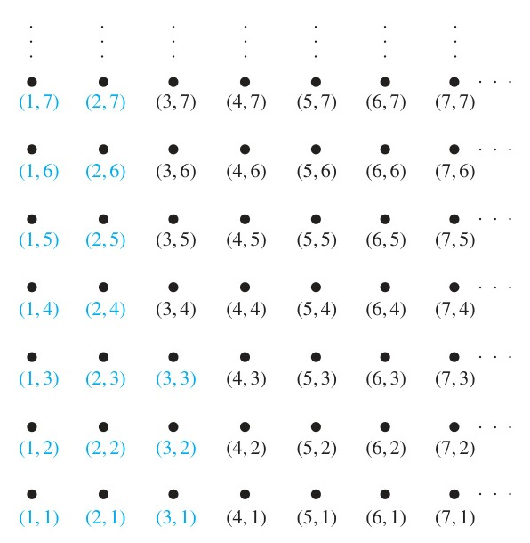
*Figure 1 — The Ordered Pairs Less Than $(3, 4)$ in Lexicographic Order.*

<!-- Page 50 -->

#### EXAMPLE 10
Note that $(1, 2, 3, 5) \prec (1, 2, 4, 3)$, because the entries in the first two positions of these 4-tuples agree, but in the third position the entry in the first 4-tuple, 3, is less than that in the second 4-tuple, 4. (Here the ordering on 4-tuples is the lexicographic ordering that comes from the usual "less than or equals" relation on the set of integers.) $\blacktriangleleft$

We can now define lexicographic ordering of strings. Consider the strings $a_1 a_2 \dots a_m$ and $b_1 b_2 \dots b_n$ on a partially ordered set $S$. Suppose these strings are not equal. Let $t$ be the minimum of $m$ and $n$. The definition of lexicographic ordering is that the string $a_1 a_2 \dots a_m$ is less than $b_1 b_2 \dots b_n$ if and only if

$$(a_1, a_2, \dots, a_t) \prec (b_1, b_2, \dots, b_t), \quad \text{or}$$

$$(a_1, a_2, \dots, a_t) = (b_1, b_2, \dots, b_t) \quad \text{and} \quad m < n,$$

where $\prec$ in this inequality represents the lexicographic ordering of $S^t$. In other words, to determine the ordering of two different strings, the longer string is truncated to the length of the shorter string, namely, to $t = \min(m, n)$ terms. Then the $t$-tuples made up of the first $t$ terms of each string are compared using the lexicographic ordering on $S^t$. One string is less than another string if the $t$-tuple corresponding to the first string is less than the $t$-tuple of the second string, or if these two $t$-tuples are the same, but the second string is longer. The verification that this is a partial ordering is left as Exercise 38 for the reader.

#### EXAMPLE 11
Consider the set of strings of lowercase English letters. Using the ordering of letters in the alphabet, a lexicographic ordering on the set of strings can be constructed. A string is less than a second string if the letter in the first string in the first position where the strings differ comes before the letter in the second string in this position, or if the first string and the second string agree in all positions, but the second string has more letters. This ordering is the same as that used in dictionaries. For example,

$$\text{discreet} \prec \text{discrete},$$

because these strings differ first in the seventh position, and $\text{e} \prec \text{t}$. Also,

$$\text{discreet} \prec \text{discreetness},$$

because the first eight letters agree, but the second string is longer. Furthermore,

$$\text{discrete} \prec \text{discretion},$$

because $\text{discrete} \prec \text{discreti}$. $\blacktriangleleft$

### Hasse Diagrams

Many edges in the directed graph for a finite poset do not have to be shown because they must be present. For instance, consider the directed graph for the partial ordering $\{(a, b) \mid a \le b\}$ on the set $\{1, 2, 3, 4\}$, shown in Figure 2(a). Because this relation is a partial ordering, it is reflexive, and its directed graph has loops at all vertices. Consequently, we do not have to show these loops because they must be present; in Figure 2(b) loops are not shown. Because a partial ordering is transitive, we do not have to show those edges that must be present because of transitivity. For example, in Figure 2(c) the edges $(1, 3), (1, 4)$, and $(2, 4)$ are not shown because they must be present. If we assume that all edges are pointed "upward" (as they are drawn in the figure), we do not have to show the directions of the edges; Figure 2(c) does not show directions.

In general, we can represent a finite poset $(S, \preceq)$ using this procedure: Start with the directed graph for this relation. Because a partial ordering is reflexive, a loop $(a, a)$ is present at every vertex $a$. Remove these loops. Next, remove all edges that must be in the partial ordering because of the presence of other edges and transitivity. That is, remove all edges $(x, y)$ for which there is an element $z \in S$ such that $x \prec z$ and $z \prec y$. Finally, arrange each edge so that

<!-- Page 51 -->

its initial vertex is below its terminal vertex (as it is drawn on paper). Remove all the arrows on the directed edges, because all edges point "upward" toward their terminal vertex.

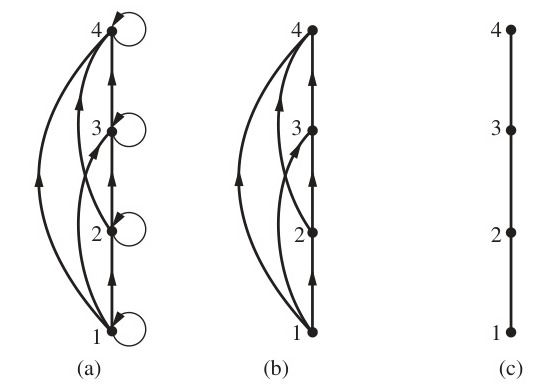
*Figure 2 — Constructing the Hasse Diagram for $(\{1, 2, 3, 4\}, \le)$.*

These steps are well defined, and only a finite number of steps need to be carried out for a finite poset. When all the steps have been taken, the resulting diagram contains sufficient information to find the partial ordering, as we will explain later. The resulting diagram is called the **Hasse diagram** of $(S, \preceq)$, named after the twentieth-century German mathematician Helmut Hasse who made extensive use of them.

Let $(S, \preceq)$ be a poset. We say that an element $y \in S$ **covers** an element $x \in S$ if $x \prec y$ and there is no element $z \in S$ such that $x \prec z \prec y$. The set of pairs $(x, y)$ such that $y$ covers $x$ is called the **covering relation** of $(S, \preceq)$. From the description of the Hasse diagram of a poset, we see that the edges in the Hasse diagram of $(S, \preceq)$ are upwardly pointing edges corresponding to the pairs in the covering relation of $(S, \preceq)$. Furthermore, we can recover a poset from its covering relation, because it is the reflexive transitive closure of its covering relation. (Exercise 31 asks for a proof of this fact.) This tells us that we can construct a partial ordering from its Hasse diagram.

#### EXAMPLE 12
Draw the Hasse diagram representing the partial ordering $\{(a, b) \mid a \text{ divides } b\}$ on $\{1, 2, 3, 4, 6, 8, 12\}$.

**Solution:** Begin with the digraph for this partial order, as shown in Figure 3(a). Remove all loops, as shown in Figure 3(b). Then delete all the edges implied by the transitive property. These are $(1, 4), (1, 6), (1, 8), (1, 12), (2, 8), (2, 12)$, and $(3, 12)$. Arrange all edges to point upward, and delete all arrows to obtain the Hasse diagram. The resulting Hasse diagram is shown in Figure 3(c). $\blacktriangleleft$

#### EXAMPLE 13
Draw the Hasse diagram for the partial ordering $\{(A, B) \mid A \subseteq B\}$ on the power set $\mathcal{P}(S)$ where $S = \{a, b, c\}$.

<!-- Page 52 -->

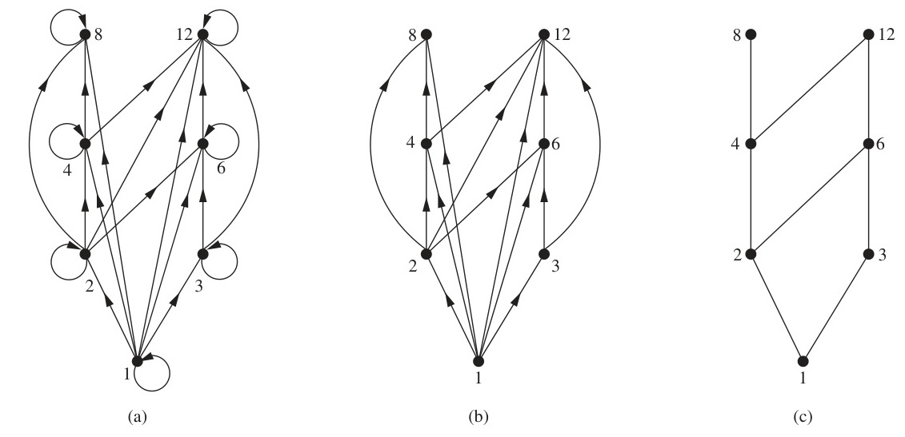
*Figure 3 — Constructing the Hasse Diagram of $(\{1, 2, 3, 4, 6, 8, 12\}, \mid)$.*

**Solution:** The Hasse diagram for this partial ordering is obtained from the associated digraph by deleting all the loops and all the edges that occur from transitivity, namely, $(\emptyset, \{a, b\}), (\emptyset, \{a, c\}), (\emptyset, \{b, c\}), (\emptyset, \{a, b, c\}), (\{a\}, \{a, b, c\}), (\{b\}, \{a, b, c\})$, and $(\{c\}, \{a, b, c\})$. Finally all edges point upward, and arrows are deleted. The resulting Hasse diagram is illustrated in Figure 4. $\blacktriangleleft$

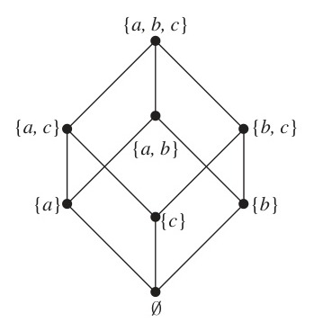
*Figure 4 — The Hasse Diagram of $(\mathcal{P}(\{a, b, c\}), \subseteq)$.*

### Maximal and Minimal Elements

Elements of posets that have certain extremal properties are important for many applications. An element of a poset is called **maximal** if it is not less than any element of the poset. That is, $a$ is maximal in the poset $(S, \preceq)$ if there is no $b \in S$ such that $a \prec b$. Similarly, an element of a poset is called **minimal** if it is not greater than any element of the poset. That is, $a$ is minimal if there is no element $b \in S$ such that $b \prec a$. Maximal and minimal elements are easy to spot using a Hasse diagram. They are the "top" and "bottom" elements in the diagram.

#### EXAMPLE 14
Which elements of the poset $(\{2, 4, 5, 10, 12, 20, 25\}, \mid)$ are maximal, and which are minimal?

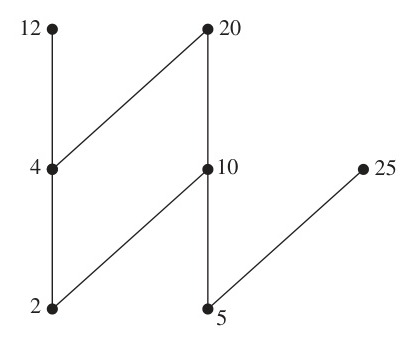
*Figure 5 — The Hasse Diagram of a Poset.*

**Solution:** The Hasse diagram in Figure 5 for this poset shows that the maximal elements are 12, 20, and 25, and the minimal elements are 2 and 5. As this example shows, a poset can have more than one maximal element and more than one minimal element. $\blacktriangleleft$

Sometimes there is an element in a poset that is greater than every other element. Such an element is called the **greatest element**. That is, $a$ is the greatest element of the poset $(S, \preceq)$

<!-- Page 53 -->

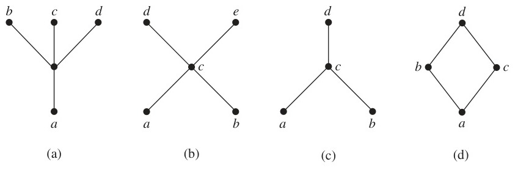
*Figure 6 — Hasse Diagrams of Four Posets.*

if $b \preceq a$ for all $b \in S$. The greatest element is unique when it exists [see Exercise 40(a)]. Likewise, an element is called the **least element** if it is less than all the other elements in the poset. That is, $a$ is the least element of $(S, \preceq)$ if $a \preceq b$ for all $b \in S$. The least element is unique when it exists [see Exercise 40(b)].

#### EXAMPLE 15
Determine whether the posets represented by each of the Hasse diagrams in Figure 6 have a greatest element and a least element.

**Solution:** The least element of the poset with Hasse diagram (a) is $a$. This poset has no greatest element. The poset with Hasse diagram (b) has neither a least nor a greatest element. The poset with Hasse diagram (c) has no least element. Its greatest element is $d$. The poset with Hasse diagram (d) has least element $a$ and greatest element $d$. $\blacktriangleleft$

#### EXAMPLE 16
Let $S$ be a set. Determine whether there is a greatest element and a least element in the poset $(\mathcal{P}(S), \subseteq)$.

**Solution:** The least element is the empty set, because $\emptyset \subseteq T$ for any subset $T$ of $S$. The set $S$ is the greatest element in this poset, because $T \subseteq S$ whenever $T$ is a subset of $S$. $\blacktriangleleft$

#### EXAMPLE 17
Is there a greatest element and a least element in the poset $(\mathbf{Z}^+, \mid)$?

**Solution:** The integer 1 is the least element because $1 \mid n$ whenever $n$ is a positive integer. Because there is no integer that is divisible by all positive integers, there is no greatest element. $\blacktriangleleft$

Sometimes it is possible to find an element that is greater than or equal to all the elements in a subset $A$ of a poset $(S, \preceq)$. If $u$ is an element of $S$ such that $a \preceq u$ for all elements $a \in A$, then $u$ is called an **upper bound** of $A$. Likewise, there may be an element less than or equal to all the elements in $A$. If $l$ is an element of $S$ such that $l \preceq a$ for all elements $a \in A$, then $l$ is called a **lower bound** of $A$.

#### EXAMPLE 18
Find the lower and upper bounds of the subsets $\{a, b, c\}, \{j, h\}$, and $\{a, c, d, f\}$ in the poset with the Hasse diagram shown in Figure 7.

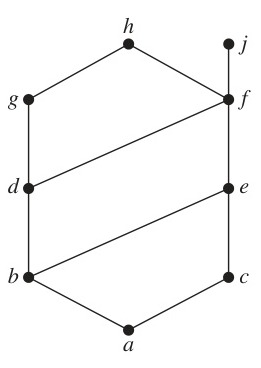
*Figure 7 — The Hasse Diagram of a Poset.*

**Solution:** The upper bounds of $\{a, b, c\}$ are $e, f, j$, and $h$, and its only lower bound is $a$. There are no upper bounds of $\{j, h\}$, and its lower bounds are $a, b, c, d, e$, and $f$. The upper bounds of $\{a, c, d, f\}$ are $f, h$, and $j$, and its lower bound is $a$. $\blacktriangleleft$

The element $x$ is called the **least upper bound** of the subset $A$ if $x$ is an upper bound that is less than every other upper bound of $A$. Because there is only one such element, if it exists, it makes sense to call this element the least upper bound [see Exercise 42(a)]. That is, $x$ is the least upper bound of $A$ if $a \preceq x$ whenever $a \in A$, and $x \preceq z$ whenever $z$ is an upper bound of $A$. Similarly, the element $y$ is called the **greatest lower bound** of $A$ if $y$ is a lower bound of $A$ and $z \preceq y$ whenever $z$ is a lower bound of $A$. The greatest lower bound of $A$ is unique if it exists [see Exercise 42(b)]. The greatest lower bound and least upper bound of a subset $A$ are denoted by $\text{glb}(A)$ and $\text{lub}(A)$, respectively.

<!-- Page 54 -->

#### EXAMPLE 19
Find the greatest lower bound and the least upper bound of $\{b, d, g\}$, if they exist, in the poset shown in Figure 7.

**Solution:** The upper bounds of $\{b, d, g\}$ are $g$ and $h$. Because $g \prec h$, $g$ is the least upper bound. The lower bounds of $\{b, d, g\}$ are $a$ and $b$. Because $a \prec b$, $b$ is the greatest lower bound. $\blacktriangleleft$

#### EXAMPLE 20
Find the greatest lower bound and the least upper bound of the sets $\{3, 9, 12\}$ and $\{1, 2, 4, 5, 10\}$, if they exist, in the poset $(\mathbf{Z}^+, \mid)$.

**Solution:** An integer is a lower bound of $\{3, 9, 12\}$ if 3, 9, and 12 are divisible by this integer. The only such integers are 1 and 3. Because $1 \mid 3$, 3 is the greatest lower bound of $\{3, 9, 12\}$. The only lower bound for the set $\{1, 2, 4, 5, 10\}$ with respect to $\mid$ is the element 1. Hence, 1 is the greatest lower bound for $\{1, 2, 4, 5, 10\}$.

An integer is an upper bound for $\{3, 9, 12\}$ if and only if it is divisible by 3, 9, and 12. The integers with this property are those divisible by the least common multiple of 3, 9, and 12, which is 36. Hence, 36 is the least upper bound of $\{3, 9, 12\}$. A positive integer is an upper bound for the set $\{1, 2, 4, 5, 10\}$ if and only if it is divisible by 1, 2, 4, 5, and 10. The integers with this property are those integers divisible by the least common multiple of these integers, which is 20. Hence, 20 is the least upper bound of $\{1, 2, 4, 5, 10\}$. $\blacktriangleleft$

### Lattices

A partially ordered set in which every pair of elements has both a least upper bound and a greatest lower bound is called a **lattice**. Lattices have many special properties. Furthermore, lattices are used in many different applications such as models of information flow and play an important role in Boolean algebra.

#### EXAMPLE 21
Determine whether the posets represented by each of the Hasse diagrams in Figure 8 are lattices.

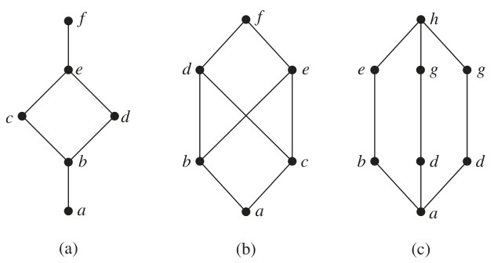
*Figure 8 — Hasse Diagrams of Three Posets.*

**Solution:** The posets represented by the Hasse diagrams in (a) and (c) are both lattices because in each poset every pair of elements has both a least upper bound and a greatest lower bound, as the reader should verify. On the other hand, the poset with the Hasse diagram shown in (b) is not a lattice, because the elements $b$ and $c$ have no least upper bound. To see this, note that each of the elements $d, e$, and $f$ is an upper bound, but none of these three elements precedes the other two with respect to the ordering of this poset. $\blacktriangleleft$

<!-- Page 55 -->

#### EXAMPLE 22
Is the poset $(\mathbf{Z}^+, \mid)$ a lattice?

**Solution:** Let $a$ and $b$ be two positive integers. The least upper bound and greatest lower bound of these two integers are the least common multiple and the greatest common divisor of these integers, respectively, as the reader should verify. It follows that this poset is a lattice. $\blacktriangleleft$

#### EXAMPLE 23
Determine whether the posets $(\{1, 2, 3, 4, 5\}, \mid)$ and $(\{1, 2, 4, 8, 16\}, \mid)$ are lattices.

**Solution:** Because 2 and 3 have no upper bounds in $(\{1, 2, 3, 4, 5\}, \mid)$, they certainly do not have a least upper bound. Hence, the first poset is not a lattice.

Every two elements of the second poset have both a least upper bound and a greatest lower bound. The least upper bound of two elements in this poset is the larger of the elements and the greatest lower bound of two elements is the smaller of the elements, as the reader should verify. Hence, this second poset is a lattice. $\blacktriangleleft$

#### EXAMPLE 24
Determine whether $(\mathcal{P}(S), \subseteq)$ is a lattice where $S$ is a set.

**Solution:** Let $A$ and $B$ be two subsets of $S$. The least upper bound and the greatest lower bound of $A$ and $B$ are $A \cup B$ and $A \cap B$, respectively, as the reader can show. Hence, $(\mathcal{P}(S), \subseteq)$ is a lattice. $\blacktriangleleft$

#### EXAMPLE 25 The Lattice Model of Information Flow
In many settings the flow of information from one person or computer program to another is restricted via security clearances. We can use a lattice model to represent different information flow policies. For example, one common information flow policy is the multilevel security policy used in government and military systems. Each piece of information is assigned to a security class, and each security class is represented by a pair $(A, C)$ where $A$ is an authority level and $C$ is a category. People and computer programs are then allowed access to information from a specific restricted set of security classes.

The typical authority levels used in the U.S. government are unclassified (0), confidential (1), secret (2), and top secret (3). (Information is said to be classified if it is confidential, secret, or top secret.) Categories used in security classes are the subsets of a set of all compartments relevant to a particular area of interest. Each compartment represents a particular subject area. For example, if the set of compartments is $\{\text{spies}, \text{moles}, \text{double agents}\}$, then there are eight different categories, one for each of the eight subsets of the set of compartments, such as $\{\text{spies}, \text{moles}\}$.

We can order security classes by specifying that $(A_1, C_1) \preceq (A_2, C_2)$ if and only if $A_1 \le A_2$ and $C_1 \subseteq C_2$. Information is permitted to flow from security class $(A_1, C_1)$ into security class $(A_2, C_2)$ if and only if $(A_1, C_1) \preceq (A_2, C_2)$. For example, information is permitted to flow from the security class $(\text{secret}, \{\text{spies}, \text{moles}\})$ into the security class $(\text{top secret}, \{\text{spies}, \text{moles}, \text{double agents}\})$, whereas information is not allowed to flow from the security class $(\text{top secret}, \{\text{spies}, \text{moles}\})$ into either of the security classes $(\text{secret}, \{\text{spies}, \text{moles}, \text{double agents}\})$ or $(\text{top secret}, \{\text{spies}\})$.

We leave it to the reader (see Exercise 48) to show that the set of all security classes with the ordering defined in this example forms a lattice. $\blacktriangleleft$

### Topological Sorting

Suppose that a project is made up of 20 different tasks. Some tasks can be completed only after others have been finished. How can an order be found for these tasks? To model this problem we set up a partial order on the set of tasks so that $a \prec b$ if and only if $a$ and $b$ are tasks where $b$

<!-- Page 56 -->

cannot be started until $a$ has been completed. To produce a schedule for the project, we need to produce an order for all 20 tasks that is compatible with this partial order. We will show how this can be done.

We begin with a definition. A total ordering $\preceq$ is said to be **compatible** with the partial ordering $R$ if $a \preceq b$ whenever $a R b$. Constructing a compatible total ordering from a partial ordering is called **topological sorting**.\* We will need to use Lemma 1.

> [!NOTE] LEMMA 1
> Every finite nonempty poset $(S, \preceq)$ has at least one minimal element.

**Proof:** Choose an element $a_0$ of $S$. If $a_0$ is not minimal, then there is an element $a_1$ with $a_1 \prec a_0$. If $a_1$ is not minimal, there is an element $a_2$ with $a_2 \prec a_1$. Continue this process, so that if $a_n$ is not minimal, there is an element $a_{n+1}$ with $a_{n+1} \prec a_n$. Because there are only a finite number of elements in the poset, this process must end with a minimal element $a_n$. $\blacksquare$

The topological sorting algorithm we will describe works for any finite nonempty poset. To define a total ordering on the poset $(A, \preceq)$, first choose a minimal element $a_1$; such an element exists by Lemma 1. Next, note that $(A - \{a_1\}, \preceq)$ is also a poset, as the reader should verify. (Here by $\preceq$ we mean the restriction of the original relation $\preceq$ on $A$ to $A - \{a_1\}$.) If it is nonempty, choose a minimal element $a_2$ of this poset. Then remove $a_2$ as well, and if there are additional elements left, choose a minimal element $a_3$ in $A - \{a_1, a_2\}$. Continue this process by choosing $a_{k+1}$ to be a minimal element in $A - \{a_1, a_2, \dots, a_k\}$, as long as elements remain.

Because $A$ is a finite set, this process must terminate. The end product is a sequence of elements $a_1, a_2, \dots, a_n$. The desired total ordering $\preceq_t$ is defined by

$$a_1 \prec_t a_2 \prec_t \dots \prec_t a_n.$$

This total ordering is compatible with the original partial ordering. To see this, note that if $b \prec c$ in the original partial ordering, $c$ is chosen as the minimal element at a phase of the algorithm where $b$ has already been removed, for otherwise $c$ would not be a minimal element. Pseudocode for this topological sorting algorithm is shown in Algorithm 1.

```pascal
ALGORITHM 1 Topological Sorting.
procedure topological sort ((S, ≼): finite poset)
k := 1
while S ≠ ∅
    ak := a minimal element of S {such an element exists by Lemma 1}
    S := S - {ak}
    k := k + 1
return a1, a2, ..., an {a1, a2, ..., an is a compatible total ordering of S}
```

#### EXAMPLE 26
Find a compatible total ordering for the poset $(\{1, 2, 4, 5, 12, 20\}, \mid)$.

---
\* "Topological sorting" is terminology used by computer scientists; mathematicians use the terminology "linearization of a partial ordering" for the same thing. In mathematics, topology is the branch of geometry dealing with properties of geometric figures that hold for all figures that can be transformed into one another by continuous bijections. In computer science, a topology is any arrangement of objects that can be connected with edges.

<!-- Page 57 -->

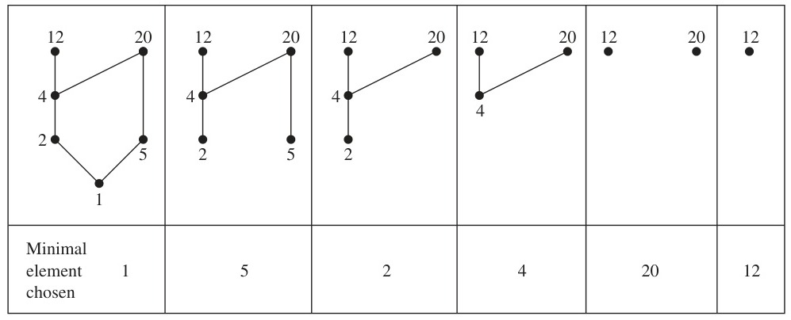
*Figure 9 — A Topological Sort of $(\{1, 2, 4, 5, 12, 20\}, \mid)$.*

**Solution:** The first step is to choose a minimal element. This must be 1, because it is the only minimal element. Next, select a minimal element of $(\{2, 4, 5, 12, 20\}, \mid)$. There are two minimal elements in this poset, namely, 2 and 5. We select 5. The remaining elements are $\{2, 4, 12, 20\}$. The only minimal element at this stage is 2. Next, 4 is chosen because it is the only minimal element of $(\{4, 12, 20\}, \mid)$. Because both 12 and 20 are minimal elements of $(\{12, 20\}, \mid)$, either can be chosen next. We select 20, which leaves 12 as the last element left. This produces the total ordering

$$1 \prec 5 \prec 2 \prec 4 \prec 20 \prec 12.$$

The steps used by this sorting algorithm are displayed in Figure 9. $\blacktriangleleft$

Topological sorting has an application to the scheduling of projects.

#### EXAMPLE 27
A development project at a computer company requires the completion of seven tasks. Some of these tasks can be started only after other tasks are finished. A partial ordering on tasks is set up by considering task $X \prec \text{task } Y$ if task $Y$ cannot be started until task $X$ has been completed. The Hasse diagram for the seven tasks, with respect to this partial ordering, is shown in Figure 10. Find an order in which these tasks can be carried out to complete the project.

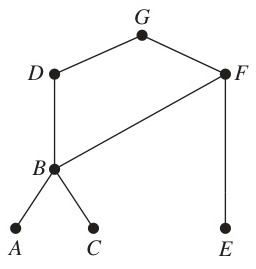
*Figure 10 — The Hasse Diagram for Seven Tasks.*

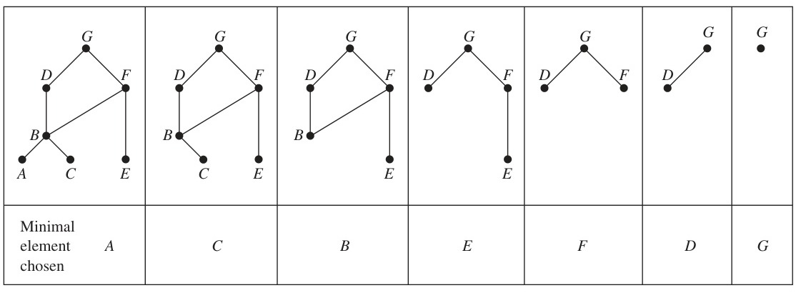
*Figure 11 — A Topological Sort of the Tasks.*

**Solution:** An ordering of the seven tasks can be obtained by performing a topological sort. The steps of a sort are illustrated in Figure 11. The result of this sort,

$$A \prec C \prec B \prec E \prec F \prec D \prec G,$$

gives one possible order for the tasks. $\blacktriangleleft$
