# Chapter 10: Graphs

<!-- Page 1 -->

## Chapter Overview

Graphs are discrete structures consisting of vertices and edges that connect these vertices. There are different kinds of graphs, depending on whether edges have directions, whether multiple edges can connect the same pair of vertices, and whether loops are allowed. Problems in almost every conceivable discipline can be solved using graph models. We will give examples to illustrate how graphs are used as models in a variety of areas. For instance, we will show how graphs are used to represent the competition of different species in an ecological niche, how graphs are used to represent who influences whom in an organization, and how graphs are used to represent the outcomes of round-robin tournaments. We will describe how graphs can be used to model acquaintanceships between people, collaboration between researchers, telephone calls between telephone numbers, and links between websites. We will show how graphs can be used to model roadmaps and the assignment of jobs to employees of an organization.

Using graph models, we can determine whether it is possible to walk down all the streets in a city without going down a street twice, and we can find the number of colors needed to color the regions of a map. Graphs can be used to determine whether a circuit can be implemented on a planar circuit board. We can distinguish between two chemical compounds with the same molecular formula but different structures using graphs. We can determine whether two computers are connected by a communications link using graph models of computer networks. Graphs with weights assigned to their edges can be used to solve problems such as finding the shortest path between two cities in a transportation network. We can also use graphs to schedule exams and assign channels to television stations. This chapter will introduce the basic concepts of graph theory and present many different graph models. To solve the wide variety of problems that can be studied using graphs, we will introduce many different graph algorithms. We will also study the complexity of these algorithms.

---

## 10.1 Graphs and Graph Models

### Introduction

We begin with the definition of a graph.

> [!NOTE] DEFINITION 1
> A **graph** $G = (V, E)$ consists of $V$, a nonempty set of *vertices* (or *nodes*) and $E$, a set of *edges*. Each edge has either one or two vertices associated with it, called its *endpoints*. An edge is said to *connect* its endpoints.

> [!NOTE] Remark
> The set of vertices $V$ of a graph $G$ may be infinite. A graph with an infinite vertex set or an infinite number of edges is called an **infinite graph**, and in comparison, a graph with a finite vertex set and a finite edge set is called a **finite graph**. In this book we will usually consider only finite graphs.

Now suppose that a network is made up of data centers and communication links between computers. We can represent the location of each data center by a point and each communications link by a line segment, as shown in Figure 1.

This computer network can be modeled using a graph in which the vertices of the graph represent the data centers and the edges represent communication links. In general, we visualize graphs by using points to represent vertices and line segments, possibly curved, to represent edges, where the endpoints of a line segment representing an edge are the points representing the endpoints of the edge. When we draw a graph, we generally try to draw edges so that they do not cross. However, this is not necessary because any depiction using points to represent vertices and any form of connection between vertices can be used. Indeed, there are some graphs that cannot be drawn in the plane without edges crossing (see Section 10.7). The key point is that the way we draw a graph is arbitrary, as long as the correct connections between vertices are depicted.

<!-- Page 2 -->

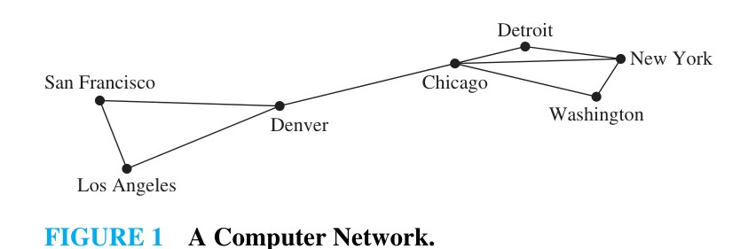
*Figure 1 — A Computer Network.*

Note that each edge of the graph representing this computer network connects two different vertices. That is, no edge connects a vertex to itself. Furthermore, no two different edges connect the same pair of vertices. A graph in which each edge connects two different vertices and where no two edges connect the same pair of vertices is called a **simple graph**. Note that in a simple graph, each edge is associated to an unordered pair of vertices, and no other edge is associated to this same edge. Consequently, when there is an edge of a simple graph associated to $\{u, v\}$, we can also say, without possible confusion, that $\{u, v\}$ is an edge of the graph.

A computer network may contain multiple links between data centers, as shown in Figure 2. To model such networks we need graphs that have more than one edge connecting the same pair of vertices. Graphs that may have **multiple edges** connecting the same vertices are called **multigraphs**. When there are $m$ different edges associated to the same unordered pair of vertices $\{u, v\}$, we also say that $\{u, v\}$ is an edge of multiplicity $m$. That is, we can think of this set of edges as $m$ different copies of an edge $\{u, v\}$.

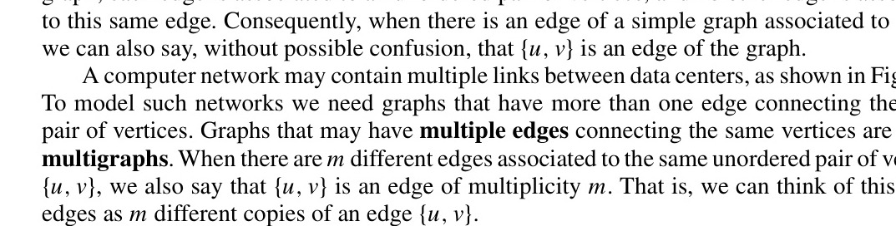
*Figure 2 — A Computer Network with Multiple Links between Data Centers.*

Sometimes a communications link connects a data center with itself, perhaps a feedback loop for diagnostic purposes. Such a network is illustrated in Figure 3. To model this network we need to include edges that connect a vertex to itself. Such edges are called **loops**, and sometimes we may even have more than one loop at a vertex. Graphs that may include loops, and possibly multiple edges connecting the same pair of vertices or a vertex to itself, are sometimes called **pseudographs**.

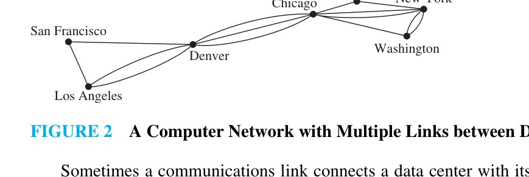
*Figure 3 — A Computer Network with Diagnostic Links.*

<!-- Page 3 -->

So far the graphs we have introduced are **undirected graphs**. Their edges are also said to be **undirected**. However, to construct a graph model, we may find it necessary to assign directions to the edges of a graph. For example, in a computer network, some links may operate in only one direction (such links are called single duplex lines). This may be the case if there is a large amount of traffic sent to some data centers, with little or no traffic going in the opposite direction. Such a network is shown in Figure 4.

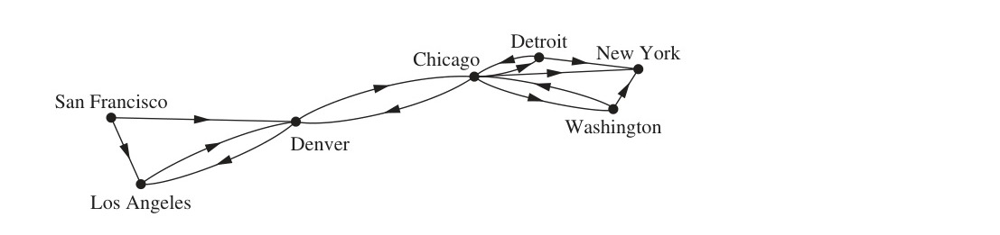
*Figure 4 — A Communications Network with One-Way Communications Links.*

To model such a computer network we use a directed graph. Each edge of a directed graph is associated to an ordered pair. The definition of directed graph we give here is more general than the one we used in Chapter 9, where we used directed graphs to represent relations.

> [!NOTE] DEFINITION 2
> A **directed graph** (or **digraph**) $(V, E)$ consists of a nonempty set of vertices $V$ and a set of **directed edges** (or **arcs**) $E$. Each directed edge is associated with an ordered pair of vertices. The directed edge associated with the ordered pair $(u, v)$ is said to *start* at $u$ and *end* at $v$.

When we depict a directed graph with a line drawing, we use an arrow pointing from $u$ to $v$ to indicate the direction of an edge that starts at $u$ and ends at $v$. A directed graph may contain loops and it may contain multiple directed edges that start and end at the same vertices. A directed graph may also contain directed edges that connect vertices $u$ and $v$ in both directions; that is, when a digraph contains an edge from $u$ to $v$, it may also contain one or more edges from $v$ to $u$. Note that we obtain a directed graph when we assign a direction to each edge in an undirected graph. When a directed graph has no loops and has no multiple directed edges, it is called a **simple directed graph**. Because a simple directed graph has at most one edge associated to each ordered pair of vertices $(u, v)$, we call $(u, v)$ an edge if there is an edge associated to it in the graph.

In some computer networks, multiple communication links between two data centers may be present, as illustrated in Figure 5. Directed graphs that may have **multiple directed edges** from a vertex to a second (possibly the same) vertex are used to model such networks. We called such graphs **directed multigraphs**. When there are $m$ directed edges, each associated to an ordered pair of vertices $(u, v)$, we say that $(u, v)$ is an edge of **multiplicity** $m$.

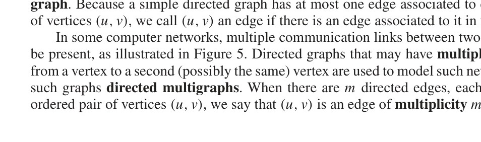
*Figure 5 — A Computer Network with Multiple One-Way Links.*

<!-- Page 4 -->

For some models we may need a graph where some edges are undirected, while others are directed. A graph with both directed and undirected edges is called a **mixed graph**. For example, a mixed graph might be used to model a computer network containing links that operate in both directions and other links that operate only in one direction.

This terminology for the various types of graphs is summarized in Table 1. We will sometimes use the term **graph** as a general term to describe graphs with directed or undirected edges (or both), with or without loops, and with or without multiple edges. At other times, when the context is clear, we will use the term graph to refer only to undirected graphs.

| Type | Edges | Multiple Edges Allowed? | Loops Allowed? |
| :--- | :--- | :--- | :--- |
| Simple graph | Undirected | No | No |
| Multigraph | Undirected | Yes | No |
| Pseudograph | Undirected | Yes | Yes |
| Simple directed graph | Directed | No | No |
| Directed multigraph | Directed | Yes | Yes |
| Mixed graph | Directed and undirected | Yes | Yes |
*TABLE 1 — Graph Terminology.*

Because of the relatively modern interest in graph theory, and because it has applications to a wide variety of disciplines, many different terminologies of graph theory have been introduced. The reader should determine how such terms are being used whenever they are encountered. The terminology used by mathematicians to describe graphs has been increasingly standardized, but the terminology used to discuss graphs when they are used in other disciplines is still quite varied. Although the terminology used to describe graphs may vary, three key questions can help us understand the structure of a graph:

- Are the edges of the graph undirected or directed (or both)?
- If the graph is undirected, are multiple edges present that connect the same pair of vertices? If the graph is directed, are multiple directed edges present?
- Are loops present?

Answering such questions helps us understand graphs. It is less important to remember the particular terminology used.

### Graph Models

Graphs are used in a wide variety of models. We began this section by describing how to construct graph models of communications networks linking data centers. We will complete this section by describing some diverse graph models for some interesting applications. We will return to many of these applications later in this chapter and in Chapter 11. We will introduce additional graph models in subsequent sections of this and later chapters. Also, recall that directed graph models for some applications were introduced in Chapter 9. When we build a graph model, we need to make sure that we have correctly answered the three key questions we posed about the structure of a graph.

#### Social Networks

Graphs are extensively used to model social structures based on different kinds of relationships between people or groups of people. These social structures, and the graphs that represent them, are known as **social networks**. In these graph models, individuals or organizations are represented by vertices; relationships between individuals or organizations are represented by edges. The study of social networks is an extremely active multidisciplinary area, and many different types of relationships between people have been studied using them.

<!-- Page 5 -->

We will introduce some of the most commonly studied social networks here. More information about social networks can be found in [Ne10] and [EaKl10].

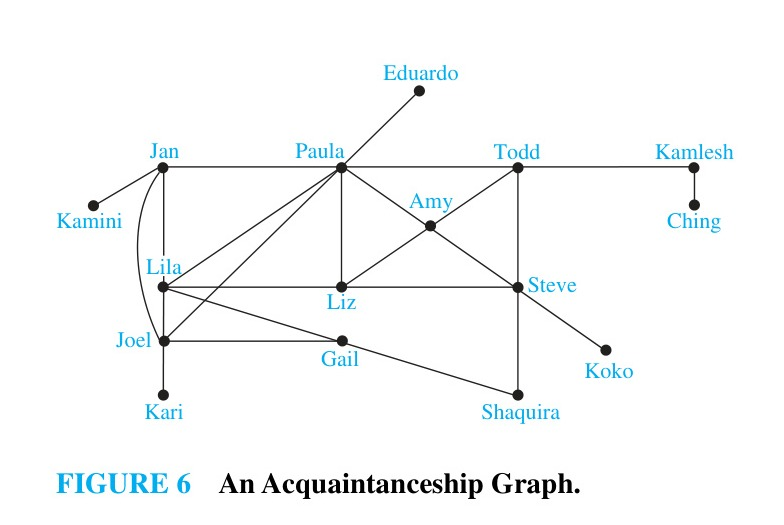
*Figure 6 — An Acquaintanceship Graph.*

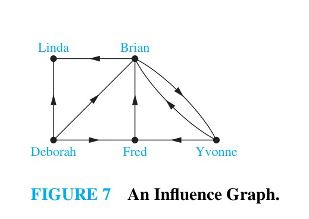
*Figure 7 — An Influence Graph.*

##### EXAMPLE 1: Acquaintanceship and Friendship Graphs
We can use a simple graph to represent whether two people know each other, that is, whether they are acquainted, or whether they are friends (either in the real world in the virtual world via a social networking site such as Facebook). Each person in a particular group of people is represented by a vertex. An undirected edge is used to connect two people when these people know each other, when we are concerned only with acquaintanceship, or whether they are friends. No multiple edges and usually no loops are used. (If we want to include the notion of self-knowledge, we would include loops.) A small acquaintanceship graph is shown in Figure 6. The acquaintanceship graph of all people in the world has more than six billion vertices and probably more than one trillion edges! We will discuss this graph further in Section 10.4. $\blacktriangleleft$

##### EXAMPLE 2: Influence Graphs
In studies of group behavior it is observed that certain people can influence the thinking of others. A directed graph called an **influence graph** can be used to model this behavior. Each person of the group is represented by a vertex. There is a directed edge from vertex $a$ to vertex $b$ when the person represented by vertex $a$ can influence the person represented by vertex $b$. This graph does not contain loops and it does not contain multiple directed edges. An example of an influence graph for members of a group is shown in Figure 7. In the group modeled by this influence graph, Deborah cannot be influenced, but she can influence Brian, Fred, and Linda. Also, Yvonne and Brian can influence each other. $\blacktriangleleft$

##### EXAMPLE 3: Collaboration Graphs
A **collaboration graph** is used to model social networks where two people are related by working together in a particular way. Collaboration graphs are simple graphs, as edges in these graphs are undirected and there are no multiple edges or loops. Vertices in these graphs represent people; two people are connected by an undirected edge when the people have collaborated. There are no loops nor multiple edges in these graphs. The **Hollywood graph** is a collaborator graph that represents actors by vertices and connects two actors with an edge if they have worked together on a movie or television show. The Hollywood graph is a huge graph with more than 1.5 million vertices (as of early 2011). We will discuss some aspects of the Hollywood graph later in Section 10.4.

In an **academic collaboration graph**, vertices represent people (perhaps restricted to members of a certain academic community), and edges link two people if they have jointly published a paper. The collaboration graph for people who have published research papers in mathematics was found in 2004 to have more than 400,000 vertices and 675,000 edges, and these numbers have grown considerably since then. We will have more to say about this graph in Section 10.4. Collaboration graphs have also been used in sports, where two professional athletes are considered to have collaborated if they have ever played on the same team during a regular season of their sport. $\blacktriangleleft$

<!-- Page 6 -->

#### Communication Networks

We can model different communications networks using vertices to represent devices and edges to represent the particular type of communications links of interest. We have already modeled a data network in the first part of this section.

##### EXAMPLE 4: Call Graphs
Graphs can be used to model telephone calls made in a network, such as a long-distance telephone network. In particular, a directed multigraph can be used to model calls where each telephone number is represented by a vertex and each telephone call is represented by a directed edge. The edge representing a call starts at the telephone number from which the call was made and ends at the telephone number to which the call was made. We need directed edges because the direction in which the call is made matters. We need multiple directed edges because we want to represent each call made from a particular telephone number to a second number.

A small telephone call graph is displayed in Figure 8(a), representing seven telephone numbers. This graph shows, for instance, that three calls have been made from 732-555-1234 to 732-555-9876 and two in the other direction, but no calls have been made from 732-555-4444 to any of the other six numbers except 732-555-0011. When we care only whether there has been a call connecting two telephone numbers, we use an undirected graph with an edge connecting telephone numbers when there has been a call between these numbers. This version of the call graph is displayed in Figure 8(b).

Call graphs that model actual calling activities can be huge. For example, one call graph studied at AT&T, which models calls during 20 days, has about 290 million vertices and 4 billion edges. We will discuss call graphs further in Section 10.4. $\blacktriangleleft$

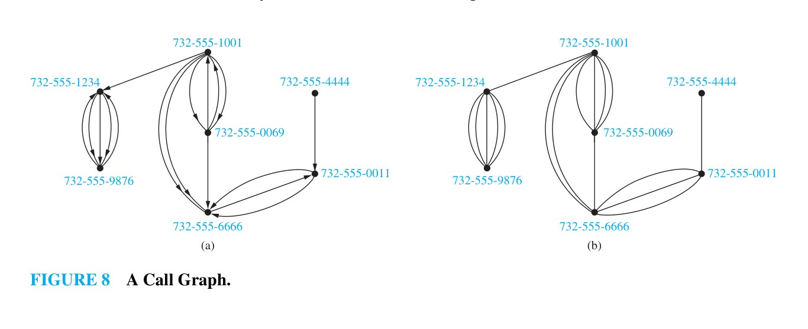
*Figure 8 — A Call Graph.*

#### Information Networks

Graphs can be used to model various networks that link particular types of information. Here, we will describe how to model the World Wide Web using a graph. We will also describe how to use a graph to model the citations in different types of documents.

##### EXAMPLE 5: The Web Graph
The World Wide Web can be modeled as a directed graph where each Web page is represented by a vertex and where an edge starts at the Web page $a$ and ends at the Web page $b$ if there is a link on $a$ pointing to $b$. Because new Web pages are created and others removed somewhere on the Web almost every second, the Web graph changes on an almost continual basis. Many people are studying the properties of the Web graph to better understand the nature of the Web. We will return to Web graphs in Section 10.4, and in Chapter 11 we will explain how the Web graph is used by the Web crawlers that search engines use to create indexes of Web pages. $\blacktriangleleft$

##### EXAMPLE 6: Citation Graphs
Graphs can be used to represent citations in different types of documents, including academic papers, patents, and legal opinions. In such graphs, each document is represented by a vertex, and there is an edge from one document to a second document if the first document cites the second in its citation list. (In an academic paper, the citation list is the bibliography, or list of references; in a patent it is the list of previous patents that are cited; and in a legal opinion it is the list of previous opinions cited.) A citation graph is a directed graph without loops or multiple edges. $\blacktriangleleft$

<!-- Page 7 -->

#### Software Design Applications

Graph models are useful tools in the design of software. We will briefly describe two of these models here.

##### EXAMPLE 7: Module Dependency Graphs
One of the most important tasks in designing software is how to structure a program into different parts, or modules. Understanding how the different modules of a program interact is essential not only for program design, but also for testing and maintenance of the resulting software. A **module dependency graph** provides a useful tool for understanding how different modules of a program interact. In a program dependency graph, each module is represented by a vertex. There is a directed edge from a module to a second module if the second module depends on the first. An example of a program dependency graph for a web browser is shown in Figure 9. $\blacktriangleleft$

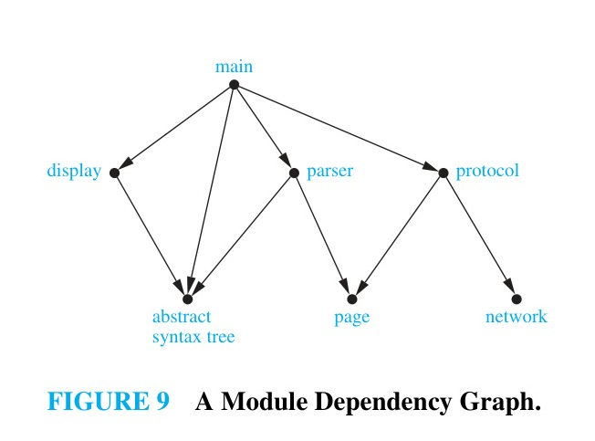
*Figure 9 — A Module Dependency Graph.*

##### EXAMPLE 8: Precedence Graphs and Concurrent Processing
Computer programs can be executed more rapidly by executing certain statements concurrently. It is important not to execute a statement that requires results of statements not yet executed. The dependence of statements on previous statements can be represented by a directed graph. Each statement is represented by a vertex, and there is an edge from one statement to a second statement if the second statement cannot be executed before the first statement. This resulting graph is called a **precedence graph**. A computer program and its graph are displayed in Figure 10. For instance, the graph shows that statement $S_5$ cannot be executed before statements $S_1$, $S_2$, and $S_4$ are executed. $\blacktriangleleft$

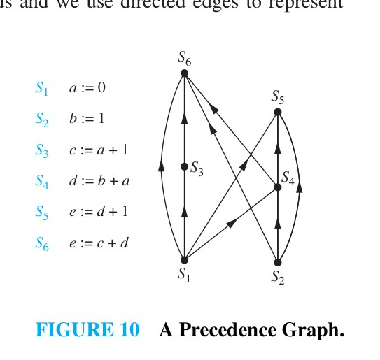
*Figure 10 — A Precedence Graph.*

#### Transportation Networks

We can use graphs to model many different types of transportation networks, including road, air, and rail networks, as well shipping networks.

##### EXAMPLE 9: Airline Routes
We can model airline networks by representing each airport by a vertex. In particular, we can model all the flights by a particular airline each day using a directed edge to represent each flight, going from the vertex representing the departure airport to the vertex representing the destination airport. The resulting graph will generally be a directed multigraph, as there may be multiple flights from one airport to some other airport during the same day. $\blacktriangleleft$

##### EXAMPLE 10: Road Networks
Graphs can be used to model road networks. In such models, vertices represent intersections and edges represent roads. When all roads are two-way and there is at most one road connecting two intersections, we can use a simple undirected graph to model the road network. However, we will often want to model road networks when some roads are one-way and when there may be more than one road between two intersections. To build such models, we use undirected edges to represent two-way roads and we use directed edges to represent one-way roads. Multiple undirected edges represent multiple two-way roads connecting the same two intersections. Multiple directed edges represent multiple one-way roads that start at one intersection and end at a second intersection. Loops represent loop roads. Mixed graphs are needed to model road networks that include both one-way and two-way roads. $\blacktriangleleft$

<!-- Page 8 -->

#### Biological Networks

Many aspects of the biological sciences can be modeled using graphs.

##### EXAMPLE 11: Niche Overlap Graphs in Ecology
Graphs are used in many models involving the interaction of different species of animals. For instance, the competition between species in an ecosystem can be modeled using a **niche overlap graph**. Each species is represented by a vertex. An undirected edge connects two vertices if the two species represented by these vertices compete (that is, some of the food resources they use are the same). A niche overlap graph is a simple graph because no loops or multiple edges are needed in this model. The graph in Figure 11 models the ecosystem of a forest. We see from this graph that squirrels and raccoons compete but that crows and shrews do not. $\blacktriangleleft$

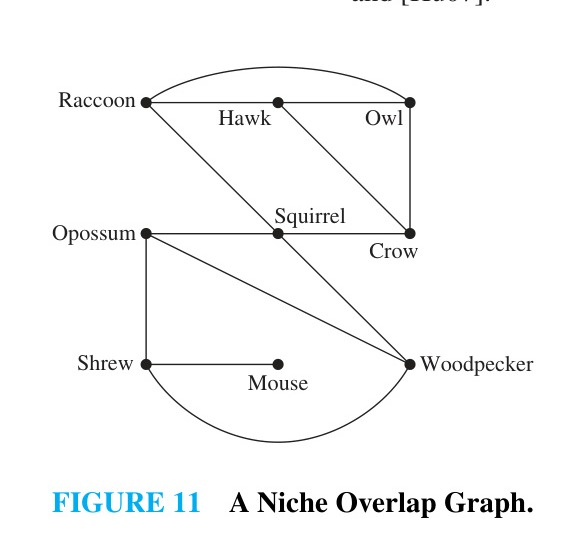
*Figure 11 — A Niche Overlap Graph.*

##### EXAMPLE 12: Protein Interaction Graphs
A protein interaction in a living cell occurs when two or more proteins in that cell bind to perform a biological function. Because protein interactions are crucial for most biological functions, many scientists work on discovering new proteins and understanding interactions between proteins. Protein interactions within a cell can be modeled using a **protein interaction graph** (also called a **protein–protein interaction network**), an undirected graph in which each protein is represented by a vertex, with an edge connecting the vertices representing each pair of proteins that interact. It is a challenging problem to determine genuine protein interactions in a cell, as experiments often produce false positives, which conclude that two proteins interact when they really do not. Protein interaction graphs can be used to deduce important biological information, such as by identifying the most important proteins for various functions and the functionality of newly discovered proteins.

Because there are thousands of different proteins in a typical cell, the protein interaction graph of a cell is extremely large and complex. For example, yeast cells have more than 6,000 proteins, and more than 80,000 interactions between them are known, and human cells have more than 100,000 proteins, with perhaps as many as 1,000,000 interactions between them. Additional vertices and edges are added to a protein interaction graph when new proteins and interactions between proteins are discovered. Because of the complexity of protein interaction graphs, they are often split into smaller graphs called modules that represent groups of proteins that are involved in a particular function of a cell. Figure 12 illustrates a module of the protein interaction graph described in [Bo04], comprising the complex of proteins that degrade RNA in human cells. To learn more about protein interaction graphs, see [Bo04], [Ne10], and [Hu07]. $\blacktriangleleft$

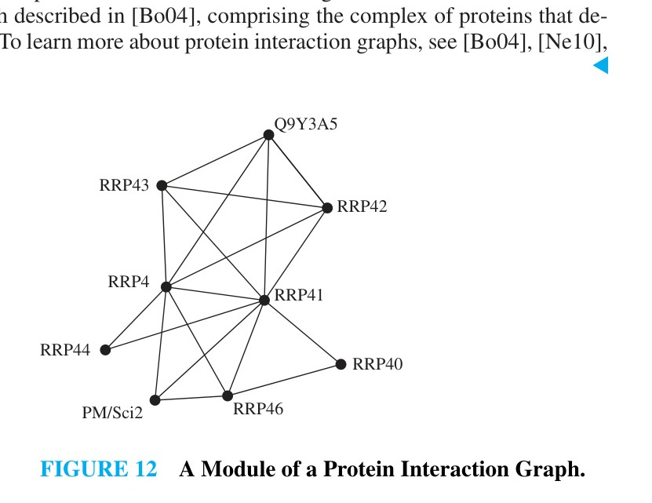
*Figure 12 — A Module of a Protein Interaction Graph.*

<!-- Page 9 -->

#### Tournaments

We now give some examples that show how graphs can also be used to model different kinds of tournaments.

##### EXAMPLE 13: Round-Robin Tournaments
A tournament where each team plays every other team exactly once and no ties are allowed is called a **round-robin tournament**. Such tournaments can be modeled using directed graphs where each team is represented by a vertex. Note that $(a, b)$ is an edge if team $a$ beats team $b$. This graph is a simple directed graph, containing no loops or multiple directed edges (because no two teams play each other more than once). Such a directed graph model is presented in Figure 13. We see that Team 1 is undefeated in this tournament, and Team 3 is winless. $\blacktriangleleft$

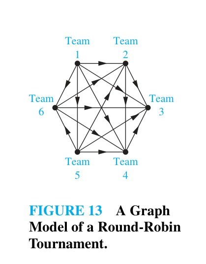
*Figure 13 — A Graph Model of a Round-Robin Tournament.*

##### EXAMPLE 14: Single-Elimination Tournaments
A tournament where each contestant is eliminated after one loss is called a **single-elimination tournament**. Single-elimination tournaments are often used in sports, including tennis championships and the yearly NCAA basketball championship. We can model such a tournament using a vertex to represent each game and a directed edge to connect a game to the next game the winner of this game played in. The graph in Figure 14 represents the games played by the final 16 teams in the 2010 NCAA women’s basketball tournament. $\blacktriangleleft$

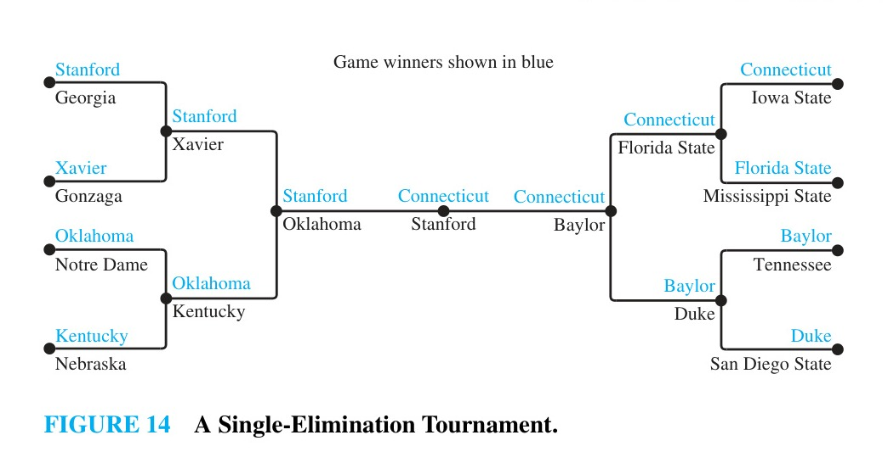
*Figure 14 — A Single-Elimination Tournament.*
