<!-- Page 11 -->

## 10.2 Graph Terminology and Special Types of Graphs

### Introduction

We introduce some of the basic vocabulary of graph theory in this section. We will use this vocabulary later in this chapter when we solve many different types of problems. One such problem involves determining whether a graph can be drawn in the plane so that no two of its edges cross. Another example is deciding whether there is a one-to-one correspondence between the vertices of two graphs that produces a one-to-one correspondence between the edges of the graphs. We will also introduce several important families of graphs often used as examples and in models. Several important applications will be described where these special types of graphs arise.

### Basic Terminology

First, we give some terminology that describes the vertices and edges of undirected graphs.

> [!NOTE] DEFINITION 1
> Two vertices $u$ and $v$ in an undirected graph $G$ are called **adjacent** (or **neighbors**) in $G$ if $u$ and $v$ are endpoints of an edge $e$ of $G$. Such an edge $e$ is called **incident with** the vertices $u$ and $v$ and $e$ is said to **connect** $u$ and $v$.

<!-- Page 12 -->

> [!NOTE] DEFINITION 2
> The set of all neighbors of a vertex $v$ of $G = (V, E)$, denoted by $N(v)$, is called the **neighborhood** of $v$. If $A$ is a subset of $V$, we denote by $N(A)$ the set of all vertices in $G$ that are adjacent to at least one vertex in $A$. So, $N(A) = \bigcup_{v \in A} N(v)$.

> [!NOTE] DEFINITION 3
> The **degree of a vertex in an undirected graph** is the number of edges incident with it, except that a loop at a vertex contributes two to the degree of that vertex. The degree of the vertex $v$ is denoted by $\deg(v)$.

#### EXAMPLE 1
What are the degrees and what are the neighborhoods of the vertices in the graphs $G$ and $H$ displayed in Figure 1?

**Solution:** In $G$, $\deg(a) = 2$, $\deg(b) = \deg(c) = \deg(f) = 4$, $\deg(d) = 1$, $\deg(e) = 3$, and $\deg(g) = 0$. The neighborhoods of these vertices are $N(a) = \{b, f\}$, $N(b) = \{a, c, e, f\}$, $N(c) = \{b, d, e, f\}$, $N(d) = \{c\}$, $N(e) = \{b, c, f\}$, $N(f) = \{a, b, c, e\}$, and $N(g) = \emptyset$.

In $H$, $\deg(a) = 4$, $\deg(b) = \deg(e) = 6$, $\deg(c) = 1$, and $\deg(d) = 5$. The neighborhoods of these vertices are $N(a) = \{b, e\}$, $N(b) = \{a, b, c, d, e\}$, $N(c) = \{b\}$, $N(d) = \{b, d, e\}$, and $N(e) = \{a, b, d, e\}$. $\blacktriangleleft$

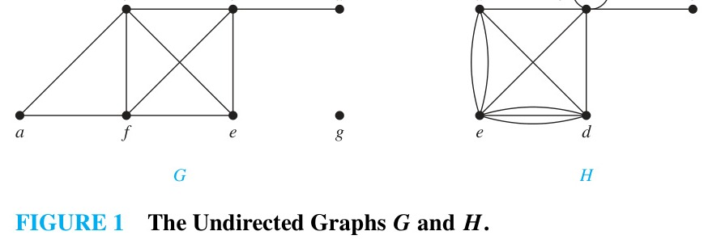
*Figure 1 — The Undirected Graphs $G$ and $H$.*

A vertex of degree zero is called **isolated**. It follows that an isolated vertex is not adjacent to any vertex. Vertex $g$ in graph $G$ in Example 1 is isolated. A vertex is **pendant** if and only if it has degree one. Consequently, a pendant vertex is adjacent to exactly one other vertex. Vertex $d$ in graph $G$ in Example 1 is pendant.

#### EXAMPLE 2
What does the degree of a vertex in a niche overlap graph (introduced in Example 11 in Section 10.1) represent? What does the degree of a vertex in a social network (such as the acquaintanceship graph in Example 1 in Section 10.1) represent? Use Figure 11 of Section 10.1 to interpret your answers.

**Solution:** In a niche overlap graph, the degree of a vertex is the number of other species that compete with the species represented by this vertex for food resources. For instance, the degree of the vertex representing the squirrel in the niche overlap graph in Figure 11 in Section 10.1 is four, because the squirrel competes with four other species: the raccoon, crow, shrew, and mouse.

<!-- Page 13 -->

In an acquaintanceship graph, the degree of a vertex representing a person is the number of people in the group who are acquainted with this person. For instance, in the acquaintanceship graph in Figure 6 in Section 10.1, the degree of the vertex representing Paula is six, because she is acquainted with Jan, Lila, Joel, Liz, Eduardo, and Todd. $\blacktriangleleft$

What do we get when we add the degrees of all the vertices of a graph $G = (V, E)$? Each edge contributes two to the sum of the degrees of the vertices because an edge is incident with exactly two vertices (unless it is a loop, which also contributes two to the degree of its single endpoint). This leads to Theorem 1, which is called the handshaking theorem, because of the analogy between an edge and a handshake between two people.

> [!NOTE] THEOREM 1: THE HANDSHAKING THEOREM
> Let $G = (V, E)$ be an undirected graph with $m$ edges. Then
> $$2m = \sum_{v \in V} \deg(v).$$
> (Note that this applies even if multiple edges and loops are present.)

**Proof:** Each edge has two endpoints. When we add the degrees of all vertices, each edge is counted twice, once for each of its endpoints. (If an edge is a loop, it contributes 2 to the degree of its single endpoint, so it is also counted twice.) Therefore, the sum of the degrees of all vertices equals twice the number of edges. $\blacksquare$

#### EXAMPLE 3
How many edges are there in a graph with 10 vertices each of degree six?

**Solution:** Because the sum of the degrees of the vertices is $10 \cdot 6 = 60$, it follows that $2m = 60$ where $m$ is the number of edges. Therefore, $m = 30$. $\blacktriangleleft$

Theorem 1 shows that the sum of the degrees of the vertices of an undirected graph is even. This leads to the following result.

> [!NOTE] THEOREM 2
> An undirected graph has an even number of vertices of odd degree.

**Proof:** Let $V_1$ and $V_2$ be the set of vertices resulting from partitioning the vertex set $V$ of an undirected graph $G = (V, E)$ into vertices of even degree and vertices of odd degree, respectively. Then
$$2m = \sum_{v \in V} \deg(v) = \sum_{v \in V_1} \deg(v) + \sum_{v \in V_2} \deg(v).$$
Because $\deg(v)$ is even for $v \in V_1$, the first term in the sum on the right-hand side of this equation is even. Furthermore, the sum of the two terms on the right-hand side of this equation is even, because this sum is $2m$. Hence, the second term in the sum, which is the sum of the degrees of the vertices in $V_2$, must be even. Because the degree of each vertex in $V_2$ is odd, there must be an even number of such vertices. $\blacksquare$

<!-- Page 14 -->

### Terminology for Directed Graphs

Now we turn our attention to graphs with directed edges.

> [!NOTE] DEFINITION 4
> When $(u, v)$ is an edge of the graph $G$ with directed edges, $u$ is said to be **adjacent to** $v$ and $v$ is said to be **adjacent from** $u$. The vertex $u$ is called the **initial vertex** of $(u, v)$, and $v$ is called the **terminal** or **end vertex** of $(u, v)$. The initial vertex and terminal vertex of a loop are the same.

Because the edges in graphs with directed edges are ordered pairs, the definition of the degree of a vertex can be refined to reflect the number of edges with this vertex as their initial vertex and as their terminal vertex.

> [!NOTE] DEFINITION 5
> In a graph with directed edges the **in-degree** of a vertex $v$, denoted by $\deg^-(v)$, is the number of edges with $v$ as their terminal vertex. The **out-degree** of $v$, denoted by $\deg^+(v)$, is the number of edges with $v$ as their initial vertex. (Note that a loop at a vertex contributes 1 to both the in-degree and the out-degree of this vertex.)

#### EXAMPLE 4
Find the in-degree and out-degree of each vertex in the graph $G$ with directed edges shown in Figure 2.

**Solution:** The in-degrees in $G$ are $\deg^-(a) = 2$, $\deg^-(b) = 2$, $\deg^-(c) = 3$, $\deg^-(d) = 2$, $\deg^-(e) = 3$, and $\deg^-(f) = 0$. The out-degrees are $\deg^+(a) = 4$, $\deg^+(b) = 1$, $\deg^+(c) = 2$, $\deg^+(d) = 2$, $\deg^+(e) = 3$, and $\deg^+(f) = 0$. $\blacktriangleleft$

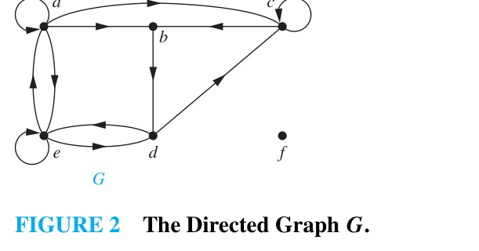
*Figure 2 — The Directed Graph $G$.*

Because each directed edge has an initial vertex and a terminal vertex, the sum of the in-degrees and the sum of the out-degrees of all vertices in a graph with directed edges are the same. Both of these sums are the number of edges in the graph. This result is stated as Theorem 3.

> [!NOTE] THEOREM 3
> Let $G = (V, E)$ be a graph with directed edges. Then
> $$\sum_{v \in V} \deg^-(v) = \sum_{v \in V} \deg^+(v) = |E|.$$

**Proof:** Each edge $(u, v)$ contributes 1 to the out-degree of its initial vertex $u$ and 1 to the in-degree of its terminal vertex $v$. Therefore, when we sum the out-degrees of all vertices, each edge contributes 1 to this sum, so the sum equals $|E|$. Similarly, when we sum the in-degrees of all vertices, each edge contributes 1 to this sum, so this sum also equals $|E|$. $\blacksquare$

There are many properties of a graph with directed edges that do not depend on the direction of its edges. Consequently, it is often useful to ignore these directions. The undirected graph that results from ignoring directions of edges is called the **underlying undirected graph**. A graph with directed edges and its underlying undirected graph have the same vertices.

<!-- Page 15 -->

### Some Special Simple Graphs

We will now introduce several basic families of simple graphs. These graphs are often used as examples and arise in many applications.

#### EXAMPLE 5: Complete Graphs
A **complete graph** on $n$ vertices, denoted by $K_n$, is a simple graph that contains exactly one edge between each pair of distinct vertices. The graphs $K_n$, for $n = 1, 2, 3, 4, 5, 6$, are displayed in Figure 3. A simple graph for which there is at least one pair of distinct vertices not connected by an edge is called **noncomplete**. $\blacktriangleleft$

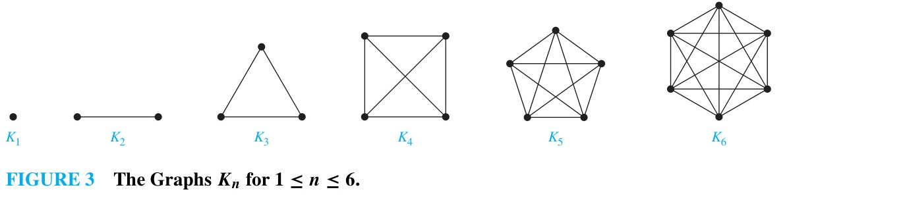
*Figure 3 — The Graphs $K_n$ for $1 \leq n \leq 6$.*

#### EXAMPLE 6: Cycles
A **cycle** $C_n, n \geq 3$, consists of $n$ vertices $v_1, v_2, \dots, v_n$ and edges $\{v_1, v_2\}, \{v_2, v_3\}, \dots, \{v_{n-1}, v_n\}$, and $\{v_n, v_1\}$. The cycles $C_3, C_4, C_5,$ and $C_6$ are displayed in Figure 4. $\blacktriangleleft$

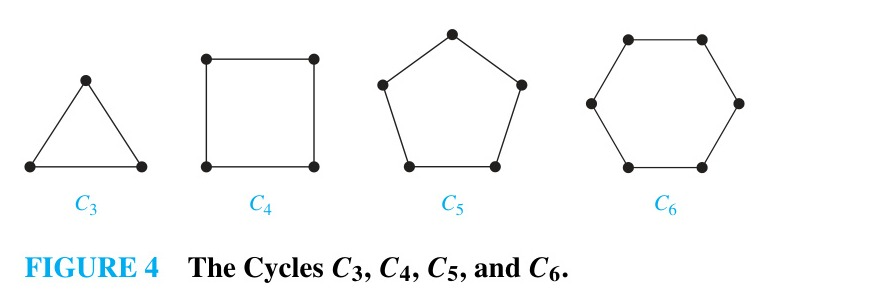
*Figure 4 — The Cycles $C_3, C_4, C_5,$ and $C_6$.*

#### EXAMPLE 7: Wheels
We obtain a **wheel** $W_n$ when we add an additional vertex to a cycle $C_n$, for $n \geq 3$, and connect this new vertex to each of the $n$ vertices in $C_n$, by new edges. The wheels $W_3, W_4, W_5,$ and $W_6$ are displayed in Figure 5. $\blacktriangleleft$

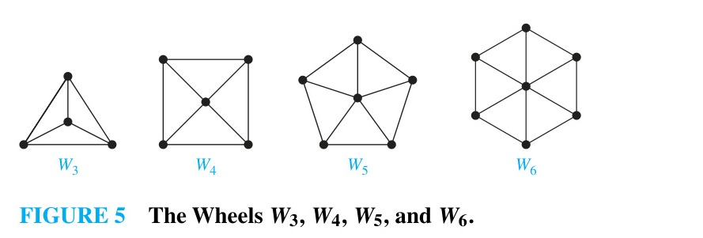
*Figure 5 — The Wheels $W_3, W_4, W_5,$ and $W_6$.*

#### EXAMPLE 8: $n$-Cubes
An $n$-dimensional hypercube, or **$n$-cube**, denoted by $Q_n$, is a graph that has $2^n$ vertices representing the $2^n$ bit strings of length $n$. Two vertices are adjacent if and only if the bit strings that they represent differ in exactly one bit position. We display $Q_1, Q_2,$ and $Q_3$ in Figure 6.

<!-- Page 16 -->

Note that you can construct the $(n+1)$-cube $Q_{n+1}$ from two copies of the $n$-cube $Q_n$. To see this, draw two copies of $Q_n$. Make the vertex representing the bit string $v$ in the first copy adjacent to the vertex representing the bit string $v$ in the second copy, and prefix the labels of the vertices in the first copy with 0 and the labels of the vertices in the second copy with 1. In Figure 6, $Q_3$ is constructed from $Q_2$ by drawing two copies of $Q_2$ as the top and bottom faces of $Q_3$, and connecting corresponding vertices. $\blacktriangleleft$

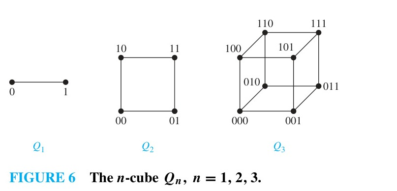
*Figure 6 — The $n$-cube $Q_n, n = 1, 2, 3$.*

### Bipartite Graphs

Sometimes a graph has the property that its vertex set can be divided into two disjoint subsets such that each edge connects a vertex in one subset to a vertex in the other subset. For instance, consider the graph representing the relationships between men and women at a dance where each edge connects a man and a woman who dance together. The vertex set of this graph can be partitioned into two subsets: the set of men and the set of women. Every edge connects a vertex in the set of men to a vertex in the set of women.

> [!NOTE] DEFINITION 6
> A simple graph $G$ is called **bipartite** if its vertex set $V$ can be partitioned into two disjoint sets $V_1$ and $V_2$ such that every edge in the graph connects a vertex in $V_1$ and a vertex in $V_2$ (so that no edge in $G$ connects either two vertices in $V_1$ or two vertices in $V_2$). When this condition holds, we call the pair $(V_1, V_2)$ a **bipartition** of the vertex set $V$ of $G$.

#### EXAMPLE 9
$C_6$ is bipartite, as shown in Figure 7, because its vertex set can be partitioned into the two sets $V_1 = \{v_1, v_3, v_5\}$ and $V_2 = \{v_2, v_4, v_6\}$, and every edge of $C_6$ connects a vertex in $V_1$ and a vertex in $V_2$. $\blacktriangleleft$

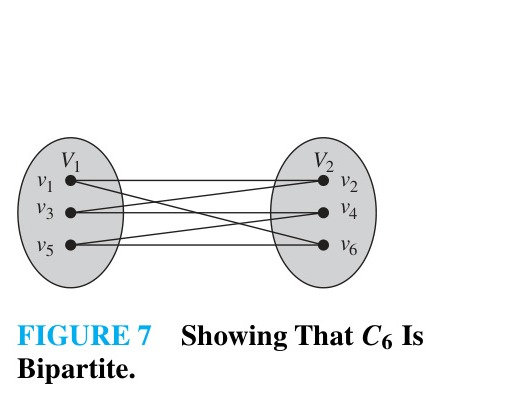
*Figure 7 — Showing That $C_6$ Is Bipartite.*

#### EXAMPLE 10
$K_3$ is not bipartite. To verify this, note that if we divide the vertex set of $K_3$ into two disjoint sets, one of the two sets must contain two vertices. If the graph were bipartite, these two vertices could not be connected by an edge, but in $K_3$ each vertex is connected to every other vertex by an edge. $\blacktriangleleft$

#### EXAMPLE 11
Are the graphs $G$ and $H$ displayed in Figure 8 bipartite?

**Solution:** Graph $G$ is bipartite because its vertex set is the union of two disjoint sets, $\{a, b, d\}$ and $\{c, e, f, g\}$, and each edge connects a vertex in one of these sets to a vertex in the other set (as the reader should verify).

Graph $H$ is not bipartite because its vertex set cannot be partitioned into two subsets so that edges connect only vertices in different subsets. To see this, suppose that $H$ is bipartite. Then the vertex set can be partitioned into two disjoint subsets $V_1$ and $V_2$. Without loss of generality, assume that $a \in V_1$. Then $b, d, f \in V_2$ because they are adjacent to $a$. Because $b \in V_2$ and $d \in V_2$, but there is an edge connecting $b$ and $d$, vertices in the same subset are adjacent. This contradicts the assumption that $H$ is bipartite. $\blacktriangleleft$

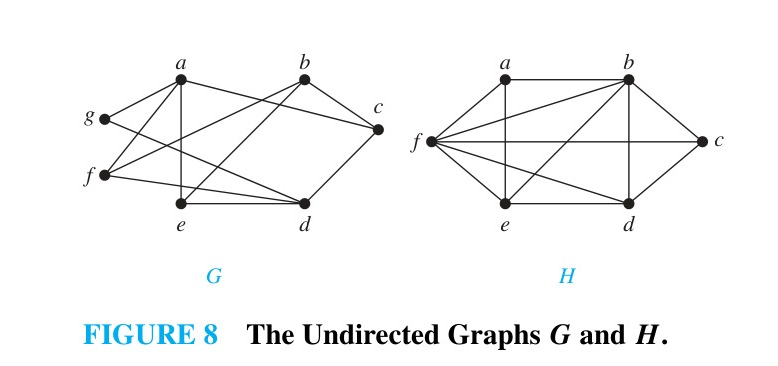
*Figure 8 — The Undirected Graphs $G$ and $H$.*

<!-- Page 17 -->

Theorem 4 provides a useful characterization of bipartite graphs.

> [!NOTE] THEOREM 4
> A simple graph is bipartite if and only if it is possible to assign one of two different colors to each vertex of the graph so that no two adjacent vertices are assigned the same color.

**Proof:** First, suppose that $G = (V, E)$ is a bipartite simple graph. Then $V = V_1 \cup V_2$, where $V_1$ and $V_2$ are disjoint sets and every edge in $E$ connects a vertex in $V_1$ and a vertex in $V_2$. If we assign one color to each vertex in $V_1$ and a second color to each vertex in $V_2$, no two adjacent vertices are assigned the same color.

Now, suppose that it is possible to assign one of two different colors to each vertex of the graph so that no two adjacent vertices are assigned the same color. Let $V_1$ be the set of vertices assigned the first color and $V_2$ be the set of vertices assigned the second color. Then $V_1$ and $V_2$ are disjoint and $V = V_1 \cup V_2$. Furthermore, no two vertices in $V_1$ are adjacent, and no two vertices in $V_2$ are adjacent. Consequently, each edge connects a vertex in $V_1$ and a vertex in $V_2$. Hence, $G$ is bipartite. $\blacksquare$

#### EXAMPLE 12
Use Theorem 4 to determine whether the graphs in Figure 8 are bipartite.

**Solution:** We first consider the graph $G$. We try to color vertices with two colors, blue and red. First, assign blue to $a$. Because $a$ is adjacent to $c, e,$ and $f$, these three vertices must be red. Because $c$ is adjacent to $b$ and $d$, these two vertices must be blue. Now check whether all other edges connect a blue vertex and a red vertex. The edge $\{b, e\}$ connects blue $b$ and red $e$; $\{b, f\}$ connects blue $b$ and red $f$; $\{d, e\}$ connects blue $d$ and red $e$; and $\{d, f\}$ connects blue $d$ and red $f$. Because $g$ is connected only to $a$, and $a$ is blue, we can color $g$ red. All edges connect vertices of different colors. Hence, $G$ is bipartite.

Next, consider the graph $H$. Try to color the vertices of $H$ with two colors. First, assign blue to $a$. Because $a$ is adjacent to $b, d,$ and $f$, these vertices must be red. But $b$ and $d$ are adjacent, so we have two adjacent vertices of the same color. It is impossible to color the vertices of $H$ with two colors so that no two adjacent vertices have the same color. Hence, $H$ is not bipartite. $\blacktriangleleft$

Another useful criterion for determining whether a graph is bipartite is that a graph is bipartite if and only if it does not contain an odd cycle, that is, a cycle with an odd number of edges. We will prove this result in Section 10.4.

<!-- Page 18 -->

### Complete Bipartite Graphs

#### EXAMPLE 13: Complete Bipartite Graphs
A **complete bipartite graph** $K_{m,n}$ is a graph that has its vertex set partitioned into two subsets of $m$ and $n$ vertices, respectively, such that there is an edge between two vertices if and only if one vertex is in the first subset and the other vertex is in the second subset. The complete bipartite graphs $K_{2,3}, K_{3,3}, K_{3,5},$ and $K_{2,6}$ are displayed in Figure 9. $\blacktriangleleft$

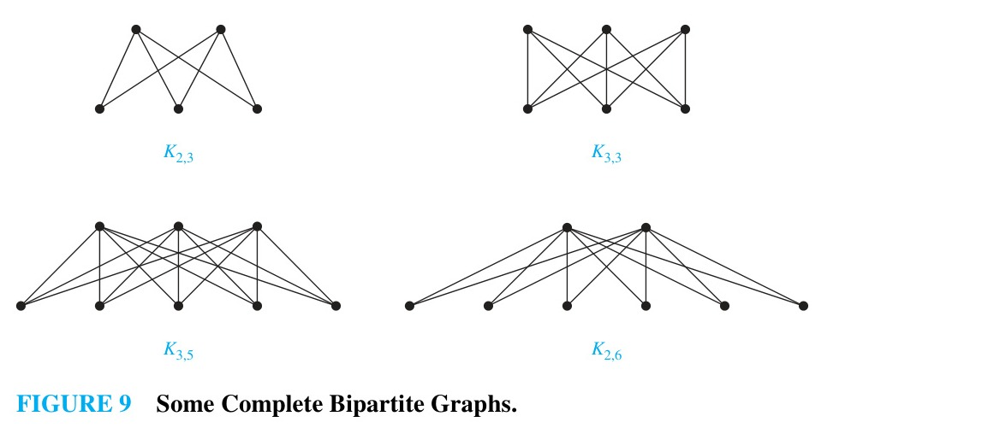
*Figure 9 — Some Complete Bipartite Graphs.*

### Bipartite Graphs and Matchings

Bipartite graphs are used to model many types of problems that involve matching the elements of one set to elements of another, as Example 14 shows.

#### EXAMPLE 14: Job Assignments
Suppose that there are $m$ employees and $n$ jobs to be performed. Each employee is trained for one or more jobs. We can model employee capabilities using a bipartite graph where the vertices represent employees and jobs, and an edge connects an employee to a job if the employee has been trained for that job.

Suppose that four employees—Alvarez, Berkowitz, Chen, and Davis—are trained for jobs. Alvarez is trained for requirements; Berkowitz is trained for requirements and architecture; Chen is trained for requirements, architecture, and implementation; and Davis is trained for requirements. We model these capabilities using the bipartite graph in Figure 10(a).

Can we assign employees to jobs so that each job is assigned an employee trained for it, and each employee is assigned at most one job? We can do this if there is a matching in the bipartite graph that includes all vertices representing jobs, as shown in Figure 10(a) (where blue lines show this assignment of jobs).

Now suppose that a different company has four employees—Washington, Xuan, Ybarra, and Ziegler—and the same four jobs. The capabilities of these employees are shown in Figure 10(b). Can we assign these employees to jobs so that each job is assigned a trained employee? This is impossible because there are only two employees, Xuan and Ziegler, who have been trained for at least one of the three jobs of requirements, implementation, and testing. Consequently, there is no way to assign three different employees to these three jobs. $\blacktriangleleft$

<!-- Page 19 -->

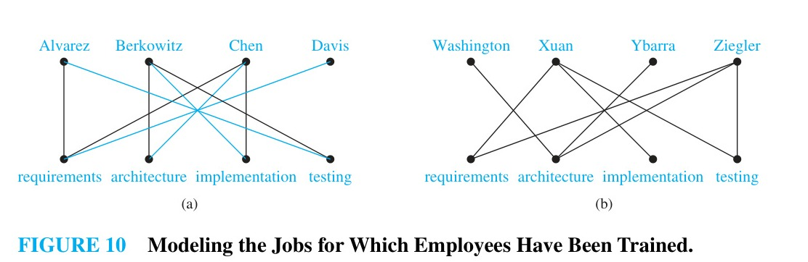
*Figure 10 — Modeling the Jobs for Which Employees Have Been Trained.*

Finding an assignment of jobs to employees can be thought of as finding a matching in the graph model, where a **matching** $M$ in a simple graph $G = (V, E)$ is a subset of the set $E$ of edges of the graph such that no two edges are incident with the same vertex. In other words, a matching is a subset of edges such that if $\{s, t\}$ and $\{u, v\}$ are distinct edges of the matching, then $s, t, u,$ and $v$ are distinct. A vertex that is the endpoint of an edge of a matching $M$ is said to be **matched** in $M$; otherwise it is said to be **unmatched**. A **maximum matching** is a matching with the largest number of edges. We say that a matching $M$ in a bipartite graph $G = (V, E)$ with bipartition $(V_1, V_2)$ is a **complete matching from $V_1$ to $V_2$** if every vertex in $V_1$ is the endpoint of an edge in the matching, or equivalently, if $|M| = |V_1|$.

#### EXAMPLE 15: Marriages on an Island
Suppose that there are $m$ men and $w$ women on an island. Each person has a list of members of the opposite sex who are acceptable marriage partners. We can model this situation using a bipartite graph where the vertices represent the men and women, and an edge connects a man and a woman if they are acceptable marriage partners to each other. A complete matching from the set of men to the set of women is an assignment of a wife to each man such that each man is married to a woman who is acceptable to him, and each woman is married to at most one man. $\blacktriangleleft$

Hall's marriage theorem gives a necessary and sufficient condition for the existence of a complete matching in a bipartite graph.

> [!NOTE] THEOREM 5: HALL'S MARRIAGE THEOREM
> The bipartite graph $G = (V, E)$ with bipartition $(V_1, V_2)$ has a complete matching from $V_1$ to $V_2$ if and only if $|N(A)| \geq |A|$ for all subsets $A$ of $V_1$.

<!-- Page 20 -->

**Proof:** We first prove the only if part of the theorem. To do so, suppose that there is a complete matching $M$ from $V_1$ to $V_2$. Then, if $A \subseteq V_1$, for every vertex $v \in A$, there is an edge in $M$ connecting $v$ to a vertex in $V_2$. Consequently, there are at least as many vertices in $V_2$ that are neighbors of vertices in $A$ as there are vertices in $A$. It follows that $|N(A)| \geq |A|$.

To prove the if part of the theorem, the more difficult part, we need to show that if $|N(A)| \geq |A|$ for all $A \subseteq V_1$, then there is a complete matching $M$ from $V_1$ to $V_2$. We will use strong induction on $|V_1|$ to prove this.

**Basis step:** If $|V_1| = 1$, then $V_1$ contains a single vertex $v_0$. Because $|N(\{v_0\})| \geq |\{v_0\}| = 1$, there is at least one edge connecting $v_0$ and a vertex $w_0 \in V_2$. Any such edge forms a complete matching from $V_1$ to $V_2$.

**Inductive step:** We first state the inductive hypothesis.
*Inductive hypothesis:* Let $k$ be a positive integer. If $G = (V, E)$ is a bipartite graph with bipartition $(V_1, V_2)$, and $|V_1| = j \leq k$, then there is a complete matching $M$ from $V_1$ to $V_2$ whenever the condition that $|N(A)| \geq |A|$ for all $A \subseteq V_1$ is met.

Now suppose that $H = (W, F)$ is a bipartite graph with bipartition $(W_1, W_2)$ and $|W_1| = k + 1$. We will prove that the inductive step holds using a proof by cases, using two cases. Case (i) applies when for all integers $j$ with $1 \leq j \leq k$, the vertices in every set of $j$ elements from $W_1$ are adjacent to at least $j + 1$ elements of $W_2$. Case (ii) applies when for some $j$ with $1 \leq j \leq k$ there is a subset $W'_1$ of $j$ vertices such that there are exactly $j$ neighbors of these vertices in $W_2$. Because either Case (i) or Case (ii) holds, we need only consider these cases to complete the inductive step.

*Case (i):* Suppose that for all integers $j$ with $1 \leq j \leq k$, the vertices in every subset of $j$ elements from $W_1$ are adjacent to at least $j + 1$ elements of $W_2$. Then, we select a vertex $v \in W_1$ and an element $w \in N(\{v\})$, which must exist by our assumption that $|N(\{v\})| \geq |\{v\}| = 1$. We delete $v$ and $w$ and all edges incident to them from $H$. This produces a bipartite graph $H'$ with bipartition $(W_1 - \{v\}, W_2 - \{w\})$. Because $|W_1 - \{v\}| = k$, the inductive hypothesis tells us there is a complete matching from $W_1 - \{v\}$ to $W_2 - \{w\}$. Adding the edge from $v$ to $w$ to this complete matching produces a complete matching from $W_1$ to $W_2$.

*Case (ii):* Suppose that for some $j$ with $1 \leq j \leq k$, there is a subset $W'_1$ of $j$ vertices such that there are exactly $j$ neighbors of these vertices in $W_2$. Let $W'_2$ be the set of these neighbors. Then, by the inductive hypothesis there is a complete matching from $W'_1$ to $W'_2$. Remove these $2j$ vertices from $W_1$ and $W_2$ and all incident edges to produce a bipartite graph $K$ with bipartition $(W_1 - W'_1, W_2 - W'_2)$.

We will show that the graph $K$ satisfies the condition $|N(A)| \geq |A|$ for all subsets $A$ of $W_1 - W'_1$. If not, there would be a subset of $t$ vertices of $W_1 - W'_1$ where $1 \leq t \leq k + 1 - j$ such that the vertices in this subset have fewer than $t$ vertices of $W_2 - W'_2$ as neighbors. Then, the set of $j + t$ vertices of $W_1$ consisting of these $t$ vertices together with the $j$ vertices we removed from $W_1$ has fewer than $j + t$ neighbors in $W_2$, contradicting the hypothesis that $|N(A)| \geq |A|$ for all $A \subseteq W_1$.

<!-- Page 21 -->

Hence, by the inductive hypothesis, the graph $K$ has a complete matching. Combining this complete matching with the complete matching from $W'_1$ to $W'_2$, we obtain a complete matching from $W_1$ to $W_2$.

We have shown that in both cases there is a complete matching from $W_1$ to $W_2$. This completes the inductive step and completes the proof. $\blacksquare$

### Some Applications of Special Types of Graphs

Special types of graphs are used in many different applications. We present a few examples here.

#### EXAMPLE 16: Local Area Networks
The various computers in a building, such as minicomputers and personal computers, as well as peripheral devices such as printers and plotters, can be connected using a local area network. Some of these networks are based on a star topology, where all devices are connected to a central device. A local area network can be represented using a complete bipartite graph $K_{1,n}$, as shown in Figure 11(a). Messages are sent from device to device through the central device.

Other local area networks are based on a ring topology, where each device is connected to exactly two others. A local area network with a ring topology can be modeled using a cycle $C_n$, as shown in Figure 11(b). Messages are sent from device to device around the cycle until the destination is reached.

Finally, other local area networks are based on a hybrid topology, which combines the star and ring topologies. A local area network with a hybrid topology can be modeled using a wheel $W_n$, as shown in Figure 11(c). Messages can be sent around the ring or through the central device. $\blacktriangleleft$

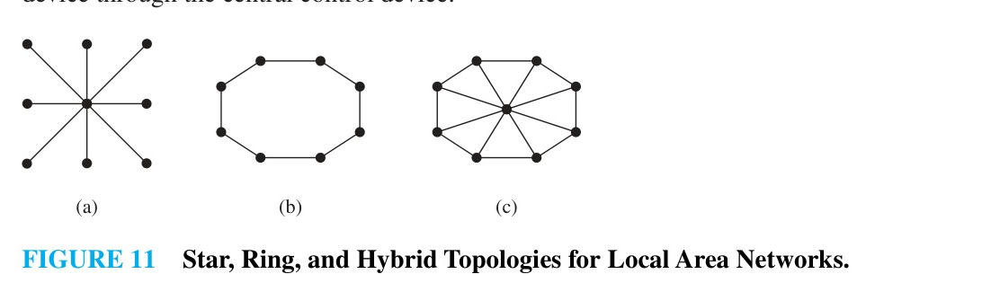
*Figure 11 — Star, Ring, and Hybrid Topologies for Local Area Networks.*

#### EXAMPLE 17: Interconnection Networks for Parallel Computation
For parallel computation, we need computers with multiple processors that can communicate with each other. We can model the interconnection network of processors using a graph with vertices representing processors and edges representing direct communication links between processors.

<!-- Page 22 -->

In a **linear array**, $n$ processors $P_1, P_2, \dots, P_n$ are connected in line: $P_1$ is connected only to $P_2$, $P_i$ is connected to $P_{i-1}$ and $P_{i+1}$ for $i = 2, 3, \dots, n-1$, and $P_n$ is connected only to $P_{n-1}$. The linear array for six processors is shown in Figure 12. The advantage of a linear array is that each processor needs to be directly connected to at most two other processors. However, it can take up to $n-1$ steps for two processors to communicate.

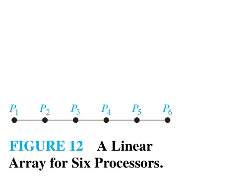
*Figure 12 — A Linear Array for Six Processors.*

A **mesh network** connects $m \times n$ processors arranged in a grid of $m$ rows and $n$ columns. A processor $P_{i,j}$ in row $i$ and column $j$ is connected to its horizontal and vertical neighbors: $P_{i-1,j}, P_{i+1,j}, P_{i,j-1},$ and $P_{i,j+1}$ (when these processors exist). The graph representing the mesh network for 16 processors is shown in Figure 13. In a mesh network with $m \times n$ processors, each processor is directly connected to at most four others. Two processors can communicate in at most $(m-1) + (n-1)$ steps.

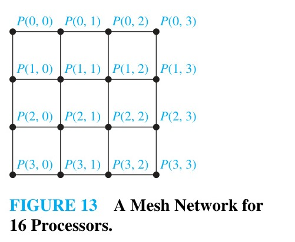
*Figure 13 — A Mesh Network for 16 Processors.*

<!-- Page 23 -->

In a **hypercube network**, the $n$-cube $Q_n$ represents the hypercube network with $N = 2^n$ processors. Figure 14 displays the hypercube network for eight processors ($n = 3$). In a hypercube network, each processor is directly connected to $n = \log_2 N$ other processors, and any two processors can communicate in at most $n = \log_2 N$ steps. $\blacktriangleleft$

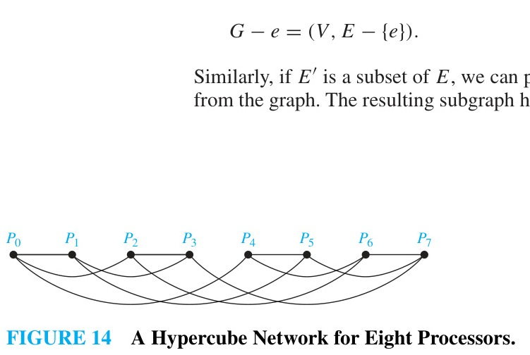
*Figure 14 — A Hypercube Network for Eight Processors.*

### New Graphs from Old

Sometimes we need only part of a graph to solve a problem. For instance, in an acquaintanceship graph, we may want to study the relationships among a small group of people. We can do this by considering the subgraph induced by the vertices representing these people.

> [!NOTE] DEFINITION 7
> A **subgraph** of a graph $G = (V, E)$ is a graph $H = (W, F)$, where $W \subseteq V$ and $F \subseteq E$. A subgraph $H$ of $G$ is a **proper subgraph** of $G$ if $H \neq G$.

> [!NOTE] DEFINITION 8
> Let $G = (V, E)$ be a simple graph. The **subgraph induced by a subset** $W$ of the vertex set $V$ is the graph $(W, F)$, where the edge set $F$ contains an edge in $E$ if and only if both endpoints of this edge are in $W$.

#### EXAMPLE 18
The graph $G$ shown in Figure 15 is a subgraph of $K_5$. If we add the edge connecting $c$ and $e$ to $G$, we obtain the subgraph induced by $W = \{a, b, c, d, e\}$. $\blacktriangleleft$

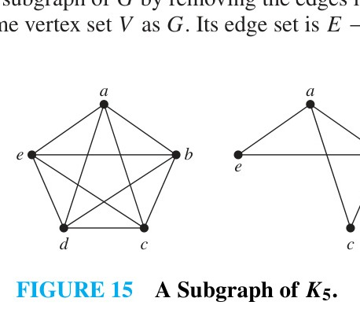
*Figure 15 — A Subgraph of $K_5$.*

We can produce new graphs from a graph $G = (V, E)$ by deleting edges or vertices. When an edge $e$ is removed from $G$, the resulting graph $G - e$ has the same vertex set as $G$ and edge set $E - \{e\}$. When a vertex $v$ and all edges incident with it are removed from $G$, the resulting graph $G - v$ is the subgraph of $G$ induced by $V - \{v\}$.

<!-- Page 24 -->

We can also produce new graphs by adding edges to a graph. When an edge $e$ connecting two nonadjacent vertices is added to $G$, the resulting graph $G + e$ has vertex set $V$ and edge set $E \cup \{e\}$.

Another operation on graphs that produces a new graph is the **edge contraction** of an edge $e = \{u, v\}$. When $e$ is contracted, the vertices $u$ and $v$ are merged into a single vertex $w$, and any edges that were incident with $u$ or $v$ are now incident with $w$. Multiple edges resulting from this merge are replaced by a single edge, and any loop created is removed (in the context of simple graphs).

Two graphs $G_1$ and $G_2$ are said to be homeomorphic if they can be obtained from the same graph by a sequence of **elementary subdivisions**, where an elementary subdivision of an edge $e = \{u, v\}$ removes $e$ and adds a new vertex $w$ together with edges $\{u, w\}$ and $\{w, v\}$.

We can also create new graphs by combining two graphs.

> [!NOTE] DEFINITION 9
> The **union** of two simple graphs $G_1 = (V_1, E_1)$ and $G_2 = (V_2, E_2)$ is the simple graph with vertex set $V_1 \cup V_2$ and edge set $E_1 \cup E_2$. The union of $G_1$ and $G_2$ is denoted by $G_1 \cup G_2$.

#### EXAMPLE 19
Find the union of the graphs $G_1$ and $G_2$ shown in Figure 16(a).

<!-- Page 25 -->

**Solution:** The vertex set of the union $G_1 \cup G_2$ is the union of the two vertex sets, namely, $\{a, b, c, d, e, f\}$. The edge set of the union is the union of the two edge sets. The union is displayed in Figure 16(b). $\blacktriangleleft$

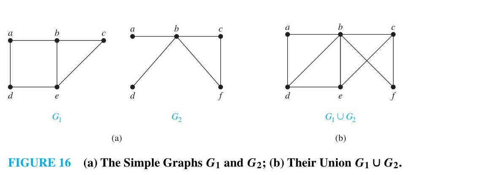
*Figure 16 — (a) The Simple Graphs $G_1$ and $G_2$; (b) Their Union $G_1 \cup G_2$.*
