<!-- Page 28 -->

## 10.3 Representing Graphs and Graph Isomorphism

### Introduction

To work with graphs using computers, we need efficient ways to represent them. In this section we will introduce three important ways to represent graphs: adjacency lists, adjacency matrices, and incidence matrices. We will also study graph isomorphism, which is the problem of determining whether two graphs have the same structure.

### Adjacency Lists

One way to represent a graph without multiple edges is to list all the vertices adjacent to each vertex of the graph. Such a representation is called an **adjacency list**.

#### EXAMPLE 1
Use adjacency lists to describe the simple graph given in Figure 1.

**Solution:** Table 1 lists those vertices adjacent to each of the vertices of the graph. $\blacktriangleleft$

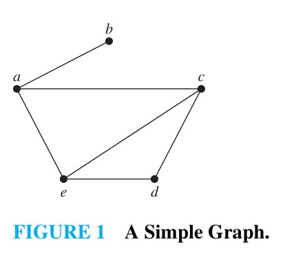
*Figure 1 — A Simple Graph.*

| Vertex | Adjacent Vertices |
| :--- | :--- |
| $a$ | $b, c, e$ |
| $b$ | $a$ |
| $c$ | $a, d, e$ |
| $d$ | $c, e$ |
| $e$ | $a, c, d$ |
*TABLE 1 — An Adjacency List for a Simple Graph.*

<!-- Page 29 -->

To represent a directed graph using adjacency lists, we list the terminal vertices of the edges that start at each vertex of the graph, as Example 2 illustrates.

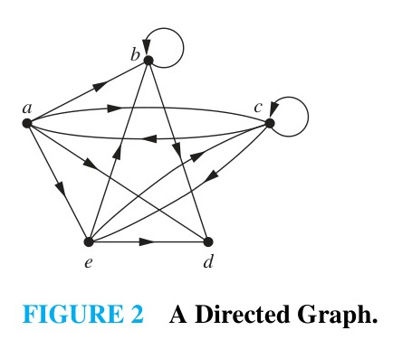
*Figure 2 — A Directed Graph.*

| Initial Vertex | Terminal Vertices |
| :--- | :--- |
| $a$ | $b, c, d, e$ |
| $b$ | $b, d$ |
| $c$ | $a, c, e$ |
| $d$ | |
| $e$ | $b, c, d$ |
*TABLE 2 — An Adjacency List for a Directed Graph.*

#### EXAMPLE 2
Represent the directed graph shown in Figure 2 by listing all the vertices that are the terminal vertices of edges starting at each vertex of the graph.

**Solution:** Table 2 represents the directed graph shown in Figure 2. $\blacktriangleleft$

### Adjacency Matrices

Carrying out graph algorithms using the representation of graphs by lists of edges, or by adjacency lists, can be cumbersome if there are many edges in the graph. To simplify computation, graphs can be represented using matrices. Two types of matrices commonly used for this purpose will be introduced here. One is based on the adjacency of vertices, and the other is based on the incidence of vertices and edges.

Suppose that $G = (V, E)$ is a simple graph where $|V| = n$. Suppose that the vertices of $G$ are listed arbitrarily as $v_1, v_2, \dots, v_n$. The **adjacency matrix** $A$ (or $A_G$) of $G$, with respect to this listing of the vertices, is the $n \times n$ zero–one matrix with 1 as its $(i, j)$th entry when $v_i$ and $v_j$ are adjacent, and 0 as its $(i, j)$th entry when they are not adjacent. In other words, if its adjacency matrix is $A = [a_{ij}]$, then
$$a_{ij} = \begin{cases} 1 & \text{if } \{v_i, v_j\} \text{ is an edge of } G, \\ 0 & \text{otherwise.} \end{cases}$$

#### EXAMPLE 3
Use an adjacency matrix to represent the graph shown in Figure 3.

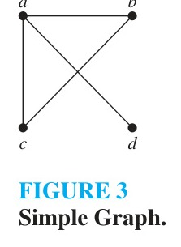
*Figure 3 — A Simple Graph.*

**Solution:** We order the vertices as $a, b, c, d$. The matrix representing this graph is
$$
\begin{bmatrix}
0 & 1 & 1 & 1 \\
1 & 0 & 1 & 0 \\
1 & 1 & 0 & 0 \\
1 & 0 & 0 & 0
\end{bmatrix}. \blacktriangleleft
$$

#### EXAMPLE 4
Draw a graph with the adjacency matrix
$$
\begin{bmatrix}
0 & 1 & 1 & 0 \\
1 & 0 & 0 & 1 \\
1 & 0 & 0 & 1 \\
0 & 1 & 1 & 0
\end{bmatrix}
$$
with respect to the ordering of vertices $a, b, c, d$.

**Solution:** A graph with this adjacency matrix is shown in Figure 4. $\blacktriangleleft$

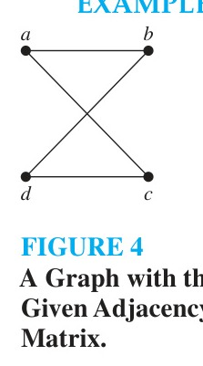
*Figure 4 — A Graph with the Given Adjacency Matrix.*

<!-- Page 30 -->

The adjacency matrix of a simple graph is symmetric, that is, $a_{ij} = a_{ji}$, because both of these entries are 1 when $\{v_i, v_j\}$ is an edge of $G$ and both are 0 when $\{v_i, v_j\}$ is not an edge of $G$. Furthermore, because a simple graph has no loops, each entry on the main diagonal is zero, that is, $a_{ii} = 0$ for $i = 1, 2, \dots, n$.

Adjacency matrices can also be used to represent undirected graphs with loops and with multiple edges. A loop at the vertex $v_i$ is represented by a 1 at the $(i, i)$th position of the adjacency matrix. When multiple edges connect the same pair of vertices $v_i$ and $v_j$, the $(i, j)$th entry of the adjacency matrix equals the number of edges connecting them.

#### EXAMPLE 5
Use an adjacency matrix to represent the pseudograph shown in Figure 5.

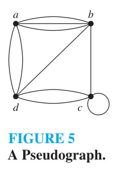
*Figure 5 — A Pseudograph.*

**Solution:** The adjacency matrix using the ordering of vertices $a, b, c, d$ is
$$
\begin{bmatrix}
0 & 3 & 0 & 2 \\
3 & 0 & 1 & 1 \\
0 & 1 & 1 & 2 \\
2 & 1 & 2 & 0
\end{bmatrix}. \blacktriangleleft
$$

The adjacency matrix for a directed graph $G = (V, E)$ has a 1 in its $(i, j)$th position if there is an edge from $v_i$ to $v_j$, where $v_1, v_2, \dots, v_n$ is a list of the vertices. In other words, if $A = [a_{ij}]$ is the adjacency matrix of $G$, then
$$a_{ij} = \begin{cases} 1 & \text{if } (v_i, v_j) \text{ is an edge of } G, \\ 0 & \text{otherwise.} \end{cases}$$
The adjacency matrix of a directed graph does not have to be symmetric, because there may not be an edge from $v_j$ to $v_i$ when there is an edge from $v_i$ to $v_j$. Adjacency matrices can also be used to represent directed multigraphs, with $a_{ij}$ equal to the number of directed edges from $v_i$ to $v_j$.

### Incidence Matrices

Another common way to represent graphs is to use incidence matrices. Let $G = (V, E)$ be an undirected graph with vertices $v_1, v_2, \dots, v_n$ and edges $e_1, e_2, \dots, e_m$. The **incidence matrix** with respect to this ordering of $V$ and $E$ is the $n \times m$ matrix $M = [m_{ij}]$, where
$$m_{ij} = \begin{cases} 1 & \text{when edge } e_j \text{ is incident with } v_i, \\ 0 & \text{otherwise.} \end{cases}$$

<!-- Page 31 -->

#### EXAMPLE 6
Represent the graph shown in Figure 6 with an incidence matrix.

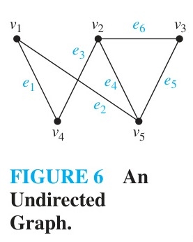
*Figure 6 — An Undirected Graph.*

**Solution:** The incidence matrix representing this graph is
$$
\begin{matrix}
& \begin{matrix} e_1 & e_2 & e_3 & e_4 & e_5 & e_6 \end{matrix} \\
\begin{matrix} v_1 \\ v_2 \\ v_3 \\ v_4 \\ v_5 \end{matrix} &
\begin{bmatrix}
1 & 1 & 0 & 0 & 0 & 0 \\
0 & 0 & 1 & 1 & 0 & 1 \\
0 & 0 & 0 & 0 & 1 & 1 \\
0 & 1 & 1 & 0 & 1 & 0 \\
1 & 0 & 0 & 1 & 0 & 0
\end{bmatrix}
\end{matrix}. \blacktriangleleft
$$

Incidence matrices can also be used to represent multiple edges and loops. Multiple edges are represented in the incidence matrix using columns with identical entries, because these edges are incident with the same pair of vertices. Loops are represented using a column with exactly one entry that is 1, corresponding to the vertex that is incident with this loop.

#### EXAMPLE 7
Represent the pseudograph shown in Figure 7 using an incidence matrix.

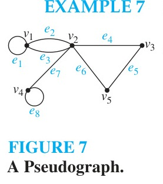
*Figure 7 — A Pseudograph.*

**Solution:** The incidence matrix representing this graph is
$$
\begin{matrix}
& \begin{matrix} e_1 & e_2 & e_3 & e_4 & e_5 & e_6 & e_7 & e_8 \end{matrix} \\
\begin{matrix} v_1 \\ v_2 \\ v_3 \\ v_4 \\ v_5 \end{matrix} &
\begin{bmatrix}
1 & 1 & 1 & 0 & 0 & 0 & 0 & 0 \\
0 & 1 & 1 & 1 & 0 & 1 & 1 & 0 \\
0 & 0 & 0 & 1 & 1 & 0 & 0 & 0 \\
0 & 0 & 0 & 0 & 0 & 0 & 1 & 1 \\
0 & 0 & 0 & 0 & 1 & 1 & 0 & 0
\end{bmatrix}
\end{matrix}. \blacktriangleleft
$$

### Isomorphism of Graphs

We often need to know whether two graphs have the same structure. For example, if two graphs represent circuits on chips, we might want to know whether they carry out the same function.

<!-- Page 32 -->

> [!NOTE] DEFINITION 1
> The simple graphs $G_1 = (V_1, E_1)$ and $G_2 = (V_2, E_2)$ are **isomorphic** if there exists a one-to-one and onto function $f$ from $V_1$ to $V_2$ with the property that $a$ and $b$ are adjacent in $G_1$ if and only if $f(a)$ and $f(b)$ are adjacent in $G_2$, for all $a$ and $b$ in $V_1$. Such a function $f$ is called an **isomorphism**. Two simple graphs that are not isomorphic are called **nonisomorphic**.

In other words, when two simple graphs are isomorphic, there is a one-to-one correspondence between vertices of the two graphs that preserves the adjacency relationship.

#### EXAMPLE 8
Show that the graphs $G = (V, E)$ and $H = (W, F)$, displayed in Figure 8, are isomorphic.

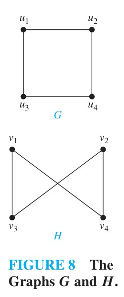
*Figure 8 — The Graphs $G$ and $H$.*

**Solution:** The function $f$ with $f(u_1) = v_1$, $f(u_2) = v_4$, $f(u_3) = v_3$, and $f(u_4) = v_2$ is a one-to-one correspondence between $V$ and $W$. To see that this correspondence preserves adjacency, note that adjacent vertices in $G$ are $u_1$ and $u_2$, $u_1$ and $u_3$, $u_2$ and $u_4$, and $u_3$ and $u_4$, and each of the pairs $f(u_1) = v_1$ and $f(u_2) = v_4$, $f(u_1) = v_1$ and $f(u_3) = v_3$, $f(u_2) = v_4$ and $f(u_4) = v_2$, and $f(u_3) = v_3$ and $f(u_4) = v_2$ consists of adjacent vertices in $H$. $\blacktriangleleft$

### Determining whether Two Simple Graphs Are Isomorphic

It is often difficult to determine whether two simple graphs are isomorphic. There are $n!$ possible one-to-one correspondences between the vertex sets of two simple graphs with $n$ vertices. Testing each such correspondence by checking whether it preserves adjacencies is impractical for graphs with even modest numbers of vertices, because $n!$ grows extremely rapidly.

Instead of trying all possible mappings, we can show that two graphs are not isomorphic by finding a **graph invariant**—a property preserved by isomorphism—that one graph has and the other does not. Some useful graph invariants include:
- The number of vertices
- The number of edges
- The degrees of the vertices (the degree sequence)
- The subgraphs induced by vertices of particular degrees
- The lengths of circuits present in the graphs

#### EXAMPLE 9
Show that the graphs displayed in Figure 9 are not isomorphic.

**Solution:** Both $G$ and $H$ have five vertices and six edges. However, the degrees of the vertices in $G$ are 2, 3, 2, 2, 3, and in $H$ they are 2, 2, 3, 3, 2. Both graphs have two vertices of degree three and three vertices of degree two.

However, in $G$, the two vertices of degree three, namely $c$ and $e$, are adjacent. In $H$, the two vertices of degree three, namely $a$ and $c$, are adjacent as well. But in $G$, the vertex of degree two $a$ is adjacent to two vertices of degree two (namely $b$ and $e$, where $\deg(e) = 3$ and $\deg(b) = 2$), while in $H$ each vertex of degree two is adjacent to at least one vertex of degree three. Specifically, in $G$, $\deg(a) = 2$ and its neighbors are $b$ (degree 2) and $e$ (degree 3). In $H$, the vertices of degree two are $b, d, e$. Vertex $b$ has neighbors $a$ (degree 3) and $c$ (degree 3); vertex $d$ has neighbors $a$ (degree 3) and $c$ (degree 3); vertex $e$ has neighbor $a$ (degree 3). Because no vertex of degree two in $H$ is adjacent to another vertex of degree two, $G$ and $H$ cannot be isomorphic. $\blacktriangleleft$

<!-- Page 33 -->

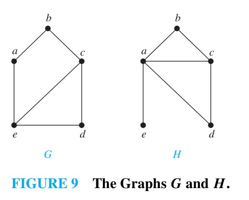
*Figure 9 — The Graphs $G$ and $H$.*

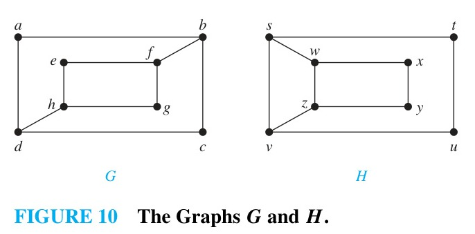
*Figure 10 — The Graphs $G$ and $H$.*

#### EXAMPLE 10
Determine whether the graphs shown in Figure 10 are isomorphic.

**Solution:** Both graphs have eight vertices and ten edges. Both have four vertices of degree two and four vertices of degree three. However, the subgraphs induced by vertices of degree three are not isomorphic. In $G$, the vertices of degree three are $b, d, f,$ and $h$. The subgraph of $G$ induced by these vertices consists of four vertices and two disjoint edges $\{b, f\}$ and $\{d, h\}$. In $H$, the vertices of degree three are $s, v, w,$ and $z$. The subgraph of $H$ induced by these vertices has four edges, connecting these vertices in a cycle of length four: $\{s, w\}, \{w, z\}, \{z, v\},$ and $\{v, s\}$. These subgraphs are displayed in Figure 11. Because these subgraphs are not isomorphic, $G$ and $H$ are not isomorphic. $\blacktriangleleft$

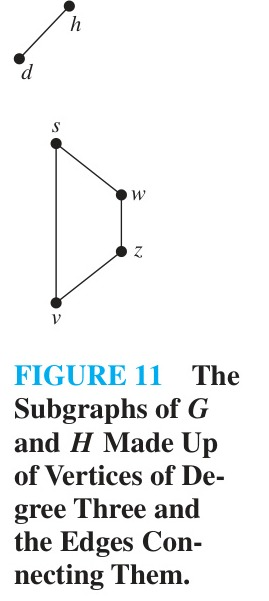
*Figure 11 — The Subgraphs of $G$ and $H$ Made Up of Vertices of Degree Three and the Edges Connecting Them.*

#### EXAMPLE 11
Determine whether the graphs $G$ and $H$ displayed in Figure 12 are isomorphic.

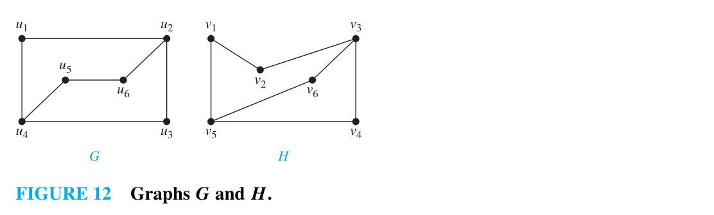
*Figure 12 — Graphs $G$ and $H$.*

<!-- Page 34 -->

**Solution:** Both $G$ and $H$ have six vertices and seven edges. Both have four vertices of degree two and two vertices of degree three. It is also easy to see that the subgraphs of $G$ and $H$ consisting of all vertices of degree two and the edges connecting them are isomorphic (as the reader should verify). Because $G$ and $H$ agree with respect to these invariants, it is reasonable to try to find an isomorphism $f$.

We now will define a function $f$ and then determine whether it is an isomorphism. Because $\deg(u_1) = 2$ and because $u_1$ is not adjacent to any other vertex of degree two, the image of $u_1$ must be either $v_4$ or $v_6$, the only vertices of degree two in $H$ not adjacent to a vertex of degree two. We arbitrarily set $f(u_1) = v_6$. [If we found that this choice did not lead to isomorphism, we would then try $f(u_1) = v_4$.] Because $u_2$ is adjacent to $u_1$, the possible images of $u_2$ are $v_3$ and $v_5$. We arbitrarily set $f(u_2) = v_3$. Continuing in this way, using adjacency of vertices and degrees as a guide, we set $f(u_3) = v_4$, $f(u_4) = v_5$, $f(u_5) = v_1$, and $f(u_6) = v_2$. We now have a one-to-one correspondence between the vertex set of $G$ and the vertex set of $H$, namely,
$$f(u_1) = v_6, \quad f(u_2) = v_3, \quad f(u_3) = v_4, \quad f(u_4) = v_5, \quad f(u_5) = v_1, \quad f(u_6) = v_2.$$

To see whether $f$ preserves edges, we examine the adjacency matrix of $G$,
$$
A_G = \begin{bmatrix}
0 & 1 & 0 & 1 & 0 & 0 \\
1 & 0 & 1 & 0 & 0 & 1 \\
0 & 1 & 0 & 1 & 0 & 0 \\
1 & 0 & 1 & 0 & 1 & 0 \\
0 & 0 & 0 & 1 & 0 & 1 \\
0 & 1 & 0 & 0 & 1 & 0
\end{bmatrix},
$$
and the adjacency matrix of $H$ with the rows and columns labeled by the images of the corresponding vertices in $G$,
$$
A_H = \begin{bmatrix}
0 & 1 & 0 & 1 & 0 & 0 \\
1 & 0 & 1 & 0 & 0 & 1 \\
0 & 1 & 0 & 1 & 0 & 0 \\
1 & 0 & 1 & 0 & 1 & 0 \\
0 & 0 & 0 & 1 & 0 & 1 \\
0 & 1 & 0 & 0 & 1 & 0
\end{bmatrix}.
$$
Because $A_G = A_H$, it follows that $f$ preserves edges. Hence, $f$ is an isomorphism, so $G$ and $H$ are isomorphic. $\blacktriangleleft$

### Applications of Graph Isomorphism

Graph isomorphism has many practical applications. We describe two important ones here.

<!-- Page 35 -->

Chemists use multigraphs, known as **molecular graphs**, to model chemical compounds. In these graphs, vertices represent atoms and edges represent chemical bonds between these atoms. Two **structural isomers**, molecules with identical molecular formulas but with atoms bonded differently, have nonisomorphic molecular graphs. When a potentially new chemical compound is synthesized, a database of molecular graphs is checked to see whether the molecular graph of the compound is the same as one already known.

Electronic circuits are modeled using graphs in which vertices represent components and edges represent connections between them. Modern integrated circuits, known as chips, are miniaturized electronic circuits, often with millions of transistors and connections between them. Because of the complexity of modern chips, automation tools are used to design them. Graph isomorphism is the basis for the verification that a particular layout of a circuit produced by an automated tool corresponds to the original schematic of the design. Graph isomorphism can also be used to determine whether a chip from one vendor includes intellectual property from a different vendor. This can be done by looking for large isomorphic subgraphs in the graphs modeling these chips.
