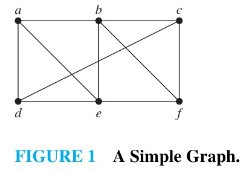
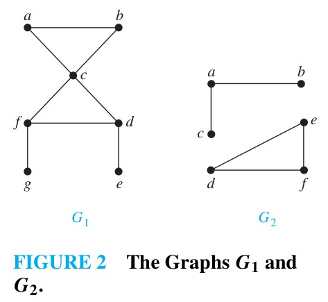
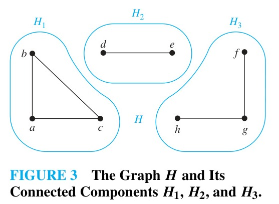
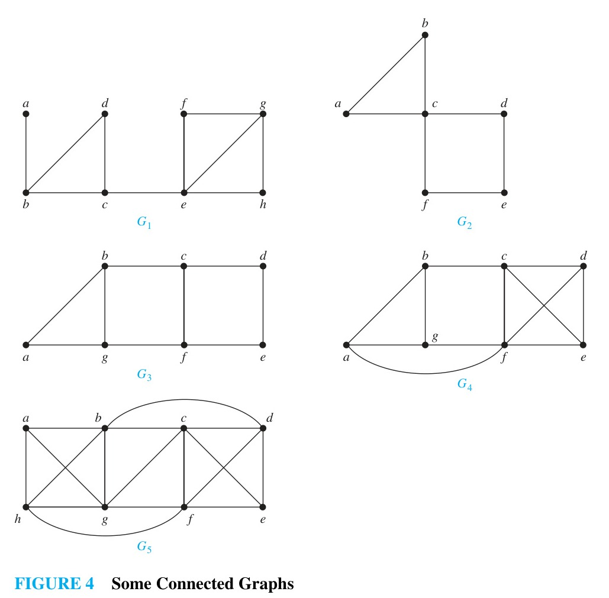
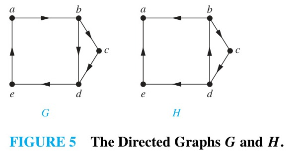
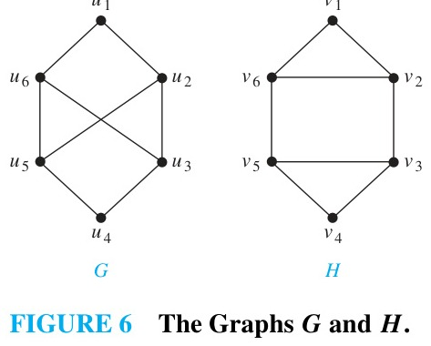
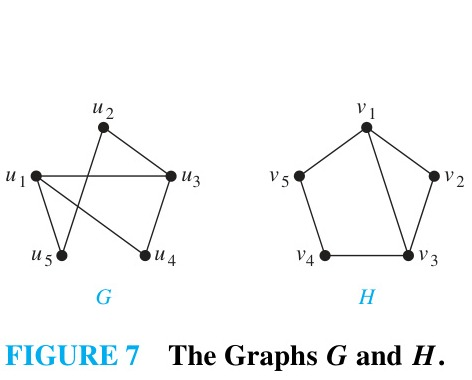
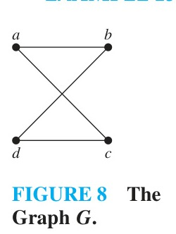

<!-- Page 38 -->

## 10.4 Connectivity

### Introduction

Many problems can be modeled with paths formed by traveling along the edges of graphs. For instance, the problem of determining whether a message can be sent between two computers using intermediate links can be studied with a graph model. Problems of efficiently planning routes for mail delivery, garbage pickup, diagnostics in computer networks, and so on can be solved using models that involve paths in graphs.

### Paths

Informally, a path is a sequence of edges that begins at a vertex of a graph and travels along edges of the graph, always connecting pairs of vertices.

<!-- Page 39 -->

> [!NOTE] DEFINITION 1
> Let $n$ be a nonnegative integer and $G$ an undirected graph. A **path** of length $n$ from $u$ to $v$ in $G$ is a sequence of $n$ edges $e_1, \dots, e_n$ of $G$ for which there exists a sequence of vertices $x_0 = u, x_1, \dots, x_{n-1}, x_n = v$ such that $e_i$ has, for $i = 1, \dots, n$, the endpoints $x_{i-1}$ and $x_i$. When the graph is simple, we denote this path by its vertex sequence $x_0, x_1, \dots, x_n$ (since listing the vertices uniquely determines the path). The path is a **circuit** if it begins and ends at the same vertex, that is, if $u = v$, and has length greater than zero. The path or circuit is said to **pass through** the vertices $x_1, x_2, \dots, x_{n-1}$ or **traverse** the edges $e_1, \dots, e_n$. A path or circuit is **simple** if it does not contain the same edge more than once.

#### EXAMPLE 1
In the simple graph shown in Figure 1, $a, d, c, f, e$ is a simple path of length 4, because $\{a, d\}, \{d, c\}, \{c, f\},$ and $\{f, e\}$ are all edges. However, $d, e, c, a$ is not a path, because $\{e, c\}$ is not an edge. The path $b, c, f, e, b$ is a circuit of length 4. The path $a, b, e, d, a, b$ is not a simple path, because the edge $\{a, b\}$ is traversed twice. $\blacktriangleleft$

*Figure 1 — A Simple Graph.*

<!-- Page 40 -->

> [!NOTE] DEFINITION 2
> Let $n$ be a nonnegative integer and $G$ a directed graph. A **path** of length $n$ from $u$ to $v$ in $G$ is a sequence of edges $e_1, e_2, \dots, e_n$ of $G$ such that $e_1$ is associated with $(x_0, x_1)$, $e_2$ is associated with $(x_1, x_2)$, and so on, with $e_n$ associated with $(x_{n-1}, x_n)$, where $x_0 = u$ and $x_n = v$. When there are no multiple edges in the directed graph, this path is denoted by its vertex sequence $x_0, x_1, \dots, x_n$. A path of length greater than zero that begins and ends at the same vertex is called a **circuit** or **cycle**. A path or circuit is called **simple** if it does not contain the same edge more than once.

#### EXAMPLE 2: Paths in Acquaintanceship Graphs
In an acquaintanceship graph, a path between two people represents a chain of people linking these two people, where two people adjacent in the chain know one another. For example, in Figure 6 in Section 10.1, there is a chain of six acquaintances linking Kamini and Ching: Kamini, Jan, Paula, Todd, Kamlesh, Ching.

A famous social science experiment conducted by Stanley Milgram in the 1960s led to the conventional wisdom that there is a chain of at most six acquaintances linking any two people in the world. This is the origin of the phrase "six degrees of separation." More recently, this concept has been explored in games such as finding the "Kevin Bacon number" of an actor, which is the length of a shortest path from that actor to Kevin Bacon in the Hollywood graph. $\blacktriangleleft$

#### EXAMPLE 3: Paths in the Collaboration Graph of Mathematicians
In the collaboration graph of mathematicians, a path between two mathematicians represents a chain of coauthors linking them. The **Erdős number** of a mathematician is the length of a shortest path between that mathematician and the prolific Hungarian mathematician Paul Erdős. Erdős had an Erdős number of 0. People who published a joint paper with Erdős have an Erdős number of 1. Those who did not publish with Erdős, but published with someone who did, have an Erdős number of 2, and so on. $\blacktriangleleft$

<!-- Page 41 -->

### Connectedness in Undirected Graphs

When does a computer network have the property that every pair of computers can communicate through intermediate links? This question can be answered by studying connectedness in graphs.

> [!NOTE] DEFINITION 3
> An undirected graph is called **connected** if there is a path between every pair of distinct vertices of the graph. An undirected graph that is not connected is called **disconnected**. We say that we **disconnect** a graph when we remove vertices or edges, or both, to produce a disconnected subgraph.

#### EXAMPLE 4
The graph $G_1$ in Figure 2 is connected, because for every pair of distinct vertices there is a path between them (the reader should verify this). However, the graph $G_2$ in Figure 2 is not connected. For instance, there is no path in $G_2$ between vertices $a$ and $d$. $\blacktriangleleft$

<!-- Page 42 -->

*Figure 2 — The Graphs $G_1$ and $G_2$.*

> [!NOTE] THEOREM 1
> There is a simple path between every pair of distinct vertices of a connected undirected graph.

**Proof:** Let $u$ and $v$ be distinct vertices of the connected undirected graph $G = (V, E)$. Because $G$ is connected, there is at least one path between $u$ and $v$. Let $x_0, x_1, \dots, x_n$, where $x_0 = u$ and $x_n = v$, be a path of least length between $u$ and $v$. We will show that this path is simple.

Suppose that this path is not simple. Then there is an edge that appears more than once in the path, so there are vertices $x_i$ and $x_j$ with $i < j$ such that the edge between $x_i$ and $x_{i+1}$ is the same as the edge between $x_j$ and $x_{j+1}$. (Or, in a simple graph, two vertices are identical, $x_i = x_j$ for some $0 \leq i < j \leq n$.) Then the path obtained by deleting the subpath $x_i, \dots, x_j$ has length less than $n$ and connects $u$ and $v$. This contradicts the choice of $x_0, x_1, \dots, x_n$ as a path of least length. Therefore, the path of least length between $u$ and $v$ is simple. $\blacksquare$

A graph that is not connected has two or more connected subgraphs, each of which is connected. A **connected component** of a graph $G$ is a connected subgraph of $G$ that is not a proper subgraph of any connected subgraph of $G$. That is, a connected component of a graph $G$ is a maximal connected subgraph of $G$. A graph $G$ that is not connected has two or more connected components that are disjoint and have $G$ as their union.

#### EXAMPLE 5
What are the connected components of the graph $H$ shown in Figure 3?

**Solution:** The graph $H$ is the union of three disjoint connected subgraphs $H_1, H_2,$ and $H_3$, shown in Figure 3. These three subgraphs are the connected components of $H$. $\blacktriangleleft$

*Figure 3 — The Graph $H$ and Its Connected Components $H_1, H_2,$ and $H_3$.*

#### EXAMPLE 6: Connected Components of Call Graphs
In the call graph representing phone calls during a 20-day period described in Example 4 of Section 10.1, there were 290 million vertices and 4 billion edges. It was found that this graph had many connected components, but a single giant connected component contained more than 260 million vertices. $\blacktriangleleft$

<!-- Page 43 -->

### How Connected Is a Graph?

It is often important to know how connected a graph is. If a graph represents a computer network, we may want to know how many computers or communication links can fail before the network becomes disconnected.

Sometimes the removal of a single vertex produces a subgraph that has more connected components than the original graph. Such a vertex is called a **cut vertex** (or **articulation point**). The removal of a cut vertex from a connected graph produces a subgraph that is not connected. Analogously, an edge whose removal produces a graph with more connected components than the original graph is called a **cut edge** (or **bridge**).

#### EXAMPLE 7
Find the cut vertices and cut edges in the graph $G_1$ shown in Figure 4.

**Solution:** The cut vertices of $G_1$ are $b, c,$ and $e$. The removal of one of these vertices disconnects the graph and increases the number of connected components. The cut edges of $G_1$ are $\{a, b\}$ and $\{c, e\}$. The removal of either of these edges disconnects the graph. $\blacktriangleleft$

*Figure 4 — Some Connected Graphs.*

<!-- Page 44 -->

Not all connected graphs have cut vertices. For example, the complete graph $K_n$, where $n \geq 3$, has no cut vertices. In such graphs, we may need to remove a set of vertices to disconnect the graph.

A subset of vertices $V'$ of the vertex set $V$ of a connected graph $G = (V, E)$ is called a **vertex cut**, or **separating set**, if $G - V'$ is disconnected. For instance, in the graph in Figure 1, the set $\{b, c, e\}$ is a vertex cut with three vertices. The **vertex connectivity** of a noncomplete connected graph $G$, denoted by $\kappa(G)$, is the minimum number of vertices in a vertex cut. When $G$ is a complete graph, it has no vertex cut, and we define $\kappa(K_n) = n - 1$. A graph is called **$k$-connected** (or **$k$-vertex-connected**) if $\kappa(G) \geq k$.

#### EXAMPLE 8
Find the vertex connectivity for each of the graphs in Figure 4.

**Solution:** Each of the five graphs in Figure 4 is connected and has more than one vertex, so each has vertex connectivity of at least 1.
- In $G_1$, removing the single cut vertex $c$ disconnects the graph, so $\kappa(G_1) = 1$.
- In $G_2$, vertex $c$ is a cut vertex, so $\kappa(G_2) = 1$.
- In $G_3$, there are no cut vertices, but the set $\{b, g\}$ is a vertex cut, so $\kappa(G_3) = 2$.
- In $G_4$, there are no cut vertices, but $\{b, f\}$ is a vertex cut, so $\kappa(G_4) = 2$.
- In $G_5$, removing any two vertices leaves a connected graph, but $\{b, c, g\}$ is a vertex cut, so $\kappa(G_5) = 3$. $\blacktriangleleft$

We can also disconnect a graph by removing edges. An **edge cut** of a connected graph $G = (V, E)$ is a set of edges $E'$ such that $G - E'$ is disconnected. The **edge connectivity** of a connected graph $G$, denoted by $\lambda(G)$, is the minimum number of edges in an edge cut. A graph is **$k$-edge-connected** if $\lambda(G) \geq k$.

#### EXAMPLE 9
Find the edge connectivity of each of the graphs in Figure 4.

**Solution:** Each of the five graphs in Figure 4 is connected and has more than one vertex, so each has edge connectivity of at least 1.
- In $G_1$, $\{a, b\}$ is a cut edge, so $\lambda(G_1) = 1$.
- In $G_2$, the edge $\{a, c\}$ is part of a cycle, but removing the edges $\{a, b\}$ and $\{a, c\}$ disconnects vertex $a$, or removing cut edge $\{c, d\}$... wait, the cut edges are $\{a, b\}$ and $\{a, c\}$? In $G_2$, vertex $a$ has degree 2 (connected to $b$ and $c$), while $\{b, c\}$ is an edge, so removing $\{c, f\}$ and $\{d, e\}$ disconnects the graph; removing $\{a, b\}$ and $\{a, c\}$ isolates $a$, so $\lambda(G_2) = 2$.
- In $G_3$, removing $\{a, b\}$ and $\{a, g\}$ isolates $a$, so $\lambda(G_3) = 2$.
- In $G_4$, removing $\{a, b\}$ and the two edges incident to $a$ isolates $a$, so $\lambda(G_4) = 2$.
- In $G_5$, $\lambda(G_5) = 3$. $\blacktriangleleft$

For any connected graph $G$, the vertex connectivity, edge connectivity, and minimum degree satisfy the inequality:
$$\kappa(G) \leq \lambda(G) \leq \min_{v \in V} \deg(v).$$

<!-- Page 45 -->

### Connectedness in Directed Graphs

We now consider connectedness in directed graphs.

> [!NOTE] DEFINITION 4
> A directed graph is **strongly connected** if there is a path from $a$ to $b$ and from $b$ to $a$ whenever $a$ and $b$ are vertices in the graph.

<!-- Page 46 -->

> [!NOTE] DEFINITION 5
> A directed graph is **weakly connected** if there is a path between every two vertices in the underlying undirected graph.

Clearly, any directed graph that is strongly connected is also weakly connected.

The subgraphs of a directed graph $G$ that are strongly connected and are not contained in larger strongly connected subgraphs, that is, the maximal strongly connected subgraphs of $G$, are called the **strongly connected components** of $G$.

#### EXAMPLE 10
Are the directed graphs $G$ and $H$ shown in Figure 5 strongly connected? Are they weakly connected?

**Solution:** $G$ is strongly connected because there is a path between any two vertices in the directed graph: $a, b, c, d, e, a$ is a directed cycle that visits all five vertices. Hence, $G$ is also weakly connected.

$H$ is not strongly connected. There is no directed path from $a$ to $b$, because no directed edges leave $a$. However, $H$ is weakly connected, because its underlying undirected graph is connected. $\blacktriangleleft$

#### EXAMPLE 11: Strongly Connected Components
The graph $H$ in Figure 5 has three strongly connected components: the subgraph consisting of the vertex $a$; the subgraph consisting of the vertex $e$; and the subgraph consisting of the vertices $b, c,$ and $d$ together with the directed edges $(b, c), (c, d),$ and $(d, b)$. $\blacktriangleleft$

*Figure 5 — The Directed Graphs $G$ and $H$.*

#### EXAMPLE 12: The Web Graph
The Web graph is a directed graph where vertices represent Web pages and directed edges represent hyperlinks. It is not strongly connected. Studies of the Web graph have shown that it has a large strongly connected core (SCC) containing tens of millions of pages, together with an IN component (pages that can reach the SCC but cannot be reached from it) and an OUT component (pages reachable from the SCC but that cannot reach it). $\blacktriangleleft$

<!-- Page 47 -->

### Paths and Isomorphism

Paths and circuits can help determine whether two graphs are isomorphic. The existence of a simple circuit of a particular length is a graph invariant.

#### EXAMPLE 13
Determine whether the graphs $G$ and $H$ shown in Figure 6 are isomorphic.

*Figure 6 — The Graphs $G$ and $H$.*

**Solution:** Both $G$ and $H$ have six vertices and eight edges. Each has two vertices of degree 2 and four vertices of degree 3. However, in $G$, there is a simple circuit of length 3, namely $u_1, u_2, u_6, u_1$, whereas $H$ has no simple circuit of length 3 (as the reader should verify). Because the existence of a simple circuit of length 3 is a graph invariant, $G$ and $H$ are not isomorphic. $\blacktriangleleft$

#### EXAMPLE 14
Determine whether the graphs $G$ and $H$ shown in Figure 7 are isomorphic.

*Figure 7 — The Graphs $G$ and $H$.*

**Solution:** Both $G$ and $H$ have five vertices and six edges. Both have two vertices of degree 2 and three vertices of degree 3. Both have simple circuits of length 3, 4, and 5.

However, in $G$, the two vertices of degree 2 are $u_1$ and $u_3$, which are not adjacent. In $H$, the two vertices of degree 2 are $v_1$ and $v_2$, which are adjacent. The distance between the vertices of degree 2 is a graph invariant. Therefore, $G$ and $H$ are not isomorphic. $\blacktriangleleft$

<!-- Page 48 -->

### Counting Paths Between Vertices

The number of paths between two vertices in a graph can be determined using the adjacency matrix of the graph.

> [!NOTE] THEOREM 2
> Let $G$ be a graph with adjacency matrix $A$ with respect to the ordering of vertices $v_1, v_2, \dots, v_n$ (with directed or undirected edges, with multiple edges and loops allowed). The number of different paths of length $r$ from $v_i$ to $v_j$, where $r$ is a positive integer, equals the $(i, j)$th entry of $A^r$.

**Proof:** We will use mathematical induction.
*Basis step:* For $r = 1$, the number of paths of length 1 from $v_i$ to $v_j$ is the number of edges from $v_i$ to $v_j$. This is by definition the $(i, j)$th entry of $A = A^1$.

*Inductive step:* Assume that the $(i, j)$th entry of $A^r$ is the number of paths of length $r$ from $v_i$ to $v_j$, where $r$ is a positive integer. We must show that the $(i, j)$th entry of $A^{r+1}$ is the number of paths of length $r+1$ from $v_i$ to $v_j$.

A path of length $r+1$ from $v_i$ to $v_j$ consists of a path of length $r$ from $v_i$ to some vertex $v_k$, followed by an edge from $v_k$ to $v_j$. By the induction hypothesis, the number of paths of length $r$ from $v_i$ to $v_k$ is the $(i, k)$th entry of $A^r$, denoted $a_{ik}^{(r)}$. The number of edges from $v_k$ to $v_j$ is the $(k, j)$th entry of $A$, denoted $a_{kj}$. By the product rule, the number of paths of length $r+1$ from $v_i$ to $v_j$ that have $v_k$ as their next-to-last vertex is $a_{ik}^{(r)} a_{kj}$.

By the sum rule, the total number of paths of length $r+1$ from $v_i$ to $v_j$ is
$$\sum_{k=1}^n a_{ik}^{(r)} a_{kj}.$$
This sum is precisely the $(i, j)$th entry of the product matrix $A^r \cdot A = A^{r+1}$. This establishes the inductive step and completes the proof. $\blacksquare$

#### EXAMPLE 15
How many paths of length four are there from $a$ to $d$ in the simple graph $G$ in Figure 8?

*Figure 8 — The Graph $G$.*

**Solution:** The adjacency matrix of $G$ with respect to the ordering $a, b, c, d$ is
$$
A = \begin{bmatrix}
0 & 1 & 1 & 0 \\
1 & 0 & 0 & 1 \\
1 & 0 & 0 & 1 \\
0 & 1 & 1 & 0
\end{bmatrix}.
$$

<!-- Page 49 -->

Computing $A^4$, we find
$$
A^4 = \begin{bmatrix}
8 & 0 & 0 & 8 \\
0 & 8 & 8 & 0 \\
0 & 8 & 8 & 0 \\
8 & 0 & 0 & 8
\end{bmatrix}.
$$
Because the $(1, 4)$th entry of $A^4$ is 8, there are exactly eight paths of length four from $a$ to $d$. By inspection of the graph, we see that
$$a, b, a, b, d; \quad a, b, a, c, d; \quad a, b, d, b, d; \quad a, b, d, c, d;$$
$$a, c, a, b, d; \quad a, c, a, c, d; \quad a, c, d, b, d; \quad a, c, d, c, d$$
are the eight paths of length four from $a$ to $d$. $\blacktriangleleft$

Theorem 2 can be used to find the length of the shortest path between two vertices of a graph, and it can also be used to determine whether a graph is connected.
