# 10.5 Euler and Hamilton Paths

Can we travel along the edges of a graph starting at a vertex and returning to it while visiting every vertex of the graph exactly once? Similarly, can we travel along the edges of a graph starting at a vertex and returning to it while using every edge of the graph exactly once?

Although these questions seem similar, the first question—which asks whether a graph has an **Euler circuit**—is relatively easy to solve, while the second question—which asks whether a graph has a **Hamilton circuit**—is notoriously difficult.

---

## Euler Paths and Circuits

The town of Königsberg, Prussia (now Kaliningrad, Russia), was divided into four sections by the Pregel River. Seven bridges connected these sections, as depicted below:

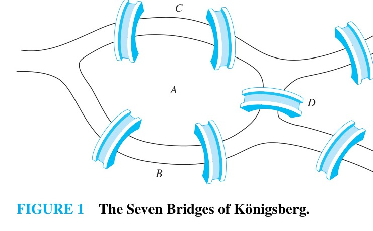

The townspeople wondered whether it was possible to start at some point in town, take a walk that crossed each of the seven bridges exactly once, and return to the starting point.

The problem can be modeled as a multigraph where vertices represent landmasses ($A, B, C, D$) and edges represent the bridges connecting them:

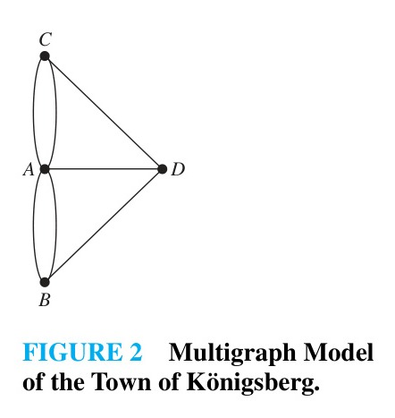

The question becomes: Does this multigraph contain a circuit that uses every edge exactly once?

> [!NOTE] DEFINITION 1
> An **Euler circuit** in a graph $G$ is a simple circuit containing every edge of $G$. An **Euler path** in $G$ is a simple path containing every edge of $G$.

---

### Examples of Euler Circuits and Paths

> [!NOTE] EXAMPLE 1
> Which of the undirected graphs in Figure 3 have an Euler circuit? Of those that do not, which have an Euler path?
>
> 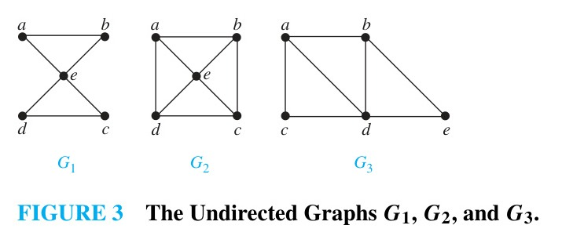
>
> **Solution:**  
> The graph $G_1$ has an Euler circuit, for example:
> $$a, e, c, d, e, b, a$$
> Neither $G_2$ nor $G_3$ has an Euler circuit. However, $G_3$ has an Euler path:
> $$a, c, d, e, b, d, a, b$$
> The graph $G_2$ has neither an Euler circuit nor an Euler path. $\blacktriangleleft$

> [!NOTE] EXAMPLE 2
> Which of the directed graphs in Figure 4 have an Euler circuit? Of those that do not, which have an Euler path?
>
> 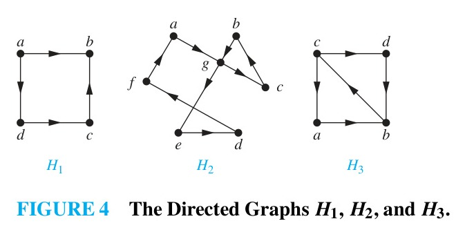
>
> **Solution:**  
> The graph $H_2$ has an Euler circuit, for example:
> $$a, g, c, b, g, e, d, f, a$$
> Neither $H_1$ nor $H_3$ has an Euler circuit. $H_3$ has an Euler path:
> $$c, a, b, c, d, b$$
> but $H_1$ has neither an Euler circuit nor an Euler path. $\blacktriangleleft$

---

## Necessary and Sufficient Conditions for Euler Circuits and Paths

Suppose that a graph $G$ has an Euler circuit $C$ starting and ending at vertex $a$. Every time the circuit passes through a vertex, it enters on one edge and exits on another, contributing $2$ to the degree of that vertex. The starting vertex $a$ has $1$ contributed when leaving initially, $1$ when returning finally, and $2$ for each intermediate visit. Thus, if a connected graph has an Euler circuit, **every vertex must have even degree**.

To show that this condition is also sufficient, we construct an Euler circuit:

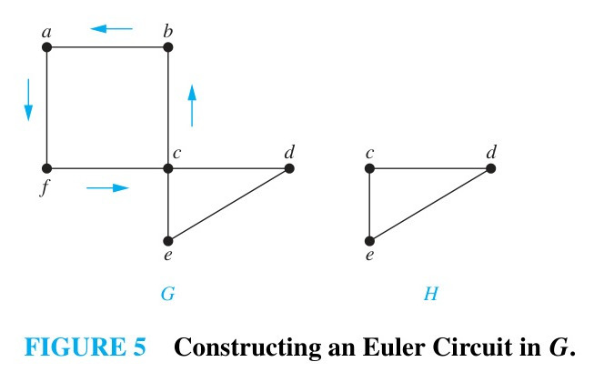

1. Start at an arbitrary vertex $a$ and form a simple path by successively adding unused edges until no further edge is available. Because every vertex has even degree, whenever we enter a vertex other than $a$, an unused edge remains to leave it. Hence, this path can terminate only at $a$, forming a simple circuit.
2. If this circuit contains all edges of $G$, it is an Euler circuit.
3. Otherwise, remove the edges of this circuit from $G$, leaving a subgraph $H$. Since $G$ is connected, $H$ shares at least one vertex $w$ with the circuit. Every vertex in $H$ still has even degree.
4. Construct another circuit in $H$ starting and ending at $w$. Splice this new circuit into the original circuit at $w$.
5. Repeat this process until all edges in $G$ are included.

> [!NOTE] THEOREM 1
> A connected multigraph with at least two vertices has an Euler circuit if and only if each of its vertices has even degree.

### Resolution of the Königsberg Bridge Problem
In the multigraph modeling the seven bridges (Figure 2):
$$\deg(A) = 5, \quad \deg(B) = 3, \quad \deg(C) = 3, \quad \deg(D) = 3$$
Because all four vertices have odd degree, this multigraph has **no Euler circuit**. It is impossible to walk across every bridge exactly once and return to the starting point.

---

### Algorithm for Constructing Euler Circuits

> [!NOTE] ALGORITHM 1: Constructing Euler Circuits
> ```
> procedure Euler(G: connected multigraph with all vertices of even degree)
>     circuit := a circuit in G beginning at an arbitrarily chosen vertex with edges successively added to form a path that returns to this vertex
>     H := G with the edges of this circuit removed
>     while H has edges
>         subcircuit := a circuit in H beginning at a vertex in H that also is an endpoint of an edge of circuit
>         H := H with edges of subcircuit and all isolated vertices removed
>         circuit := circuit with subcircuit inserted at the appropriate vertex
>     return circuit {circuit is an Euler circuit}
> ```

The worst-case time complexity of Algorithm 1 is $O(m)$, where $m$ is the number of edges of $G$.

---

> [!NOTE] EXAMPLE 3: Mohammed's Scimitars
> Many puzzles ask you to draw a picture in a continuous motion without lifting a pencil so that no part of the picture is retraced. Can Mohammed's scimitars, shown in Figure 6, be drawn in this way, beginning and ending at the same point?
>
> 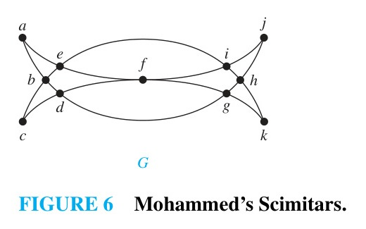
>
> **Solution:**  
> The graph $G$ has an Euler circuit because all of its vertices have even degree. Using Algorithm 1:
> 1. Form the initial circuit:
>    $$a, b, d, c, b, e, i, f, e, a$$
> 2. Deleting these edges yields the subgraph $H$. In $H$, form the circuit starting at vertex $d$:
>    $$d, g, h, j, i, h, k, g, f, d$$
> 3. Splicing this circuit into the first circuit at $d$ produces the complete Euler circuit:
>    $$a, b, d, g, h, j, i, h, k, g, f, d, c, b, e, i, f, e, a$$
> This circuit specifies how to trace the scimitars continuously without lifting the pencil. $\blacktriangleleft$

---

### Euler Paths

> [!NOTE] THEOREM 2
> A connected multigraph has an Euler path but not an Euler circuit if and only if it has exactly two vertices of odd degree.

**Proof:**  
- **Necessity:** Suppose a connected multigraph has an Euler path from $a$ to $b$ ($a \neq b$). The first edge incident with $a$ contributes $1$ to $\deg(a)$, and every intermediate visit contributes $2$. Thus, $\deg(a)$ is odd. Similarly, the last edge contributes $1$ to $\deg(b)$, making $\deg(b)$ odd. Every other vertex is visited by entering and leaving, contributing $2$ each time, so all other vertices have even degree.
- **Sufficiency:** Suppose $G$ has exactly two vertices of odd degree, $a$ and $b$. Add a temporary edge $\{a, b\}$ connecting them. In the resulting graph $G'$, every vertex has even degree, so $G'$ has an Euler circuit by Theorem 1. Removing the added edge $\{a, b\}$ from this circuit leaves an Euler path from $a$ to $b$ in $G$. $\blacksquare$

---

> [!NOTE] EXAMPLE 4
> Which graphs shown in Figure 7 have an Euler path?
>
> 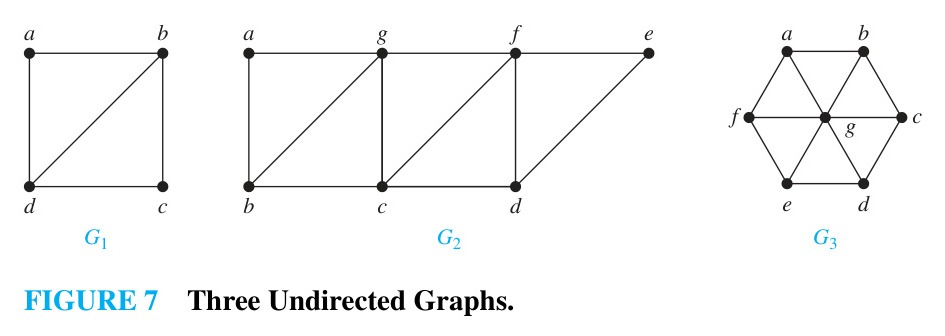
>
> **Solution:**  
> - $G_1$ contains exactly two vertices of odd degree ($b$ and $d$). Hence, it has an Euler path ending at $b$ and $d$, for example:
>   $$d, a, b, c, d, b$$
> - $G_2$ also contains exactly two vertices of odd degree ($b$ and $d$). An Euler path is:
>   $$b, a, g, f, e, d, c, g, b, c, f, d$$
> - $G_3$ has six vertices of odd degree, so it has **no Euler path**. $\blacktriangleleft$

### Returning to Königsberg
Could a person start at one point, cross every bridge exactly once, and end at a *different* point? This requires an Euler path. Because the multigraph has four vertices of odd degree (not two), **no Euler path exists either**.

---

### Applications of Euler Paths and Circuits
- **Routing and Street Sweeping:** Traversing every street in a neighborhood, utility grid connection, or communication link exactly once. Finding a minimal circuit that covers every edge when no Euler circuit exists is known as the **Chinese postman problem** (posed by Guan Meigu in 1962).
- **Circuit Layout:** Designing paths for lithography or routing.
- **Molecular Biology:** Euler paths are applied in DNA sequencing by reconstructing nucleotide sequences from overlapping fragments.

---

## Hamilton Paths and Circuits

While Euler paths and circuits involve traversing every **edge** of a graph, Hamilton paths and circuits involve visiting every **vertex**.

> [!NOTE] DEFINITION 2
> A simple path in a graph $G$ that passes through every vertex exactly once is called a **Hamilton path**, and a simple circuit in a graph $G$ that passes through every vertex exactly once is called a **Hamilton circuit**.
>
> That is, the simple path $x_0, x_1, \dots, x_{n-1}, x_n$ in $G = (V, E)$ is a Hamilton path if:
> $$V = \{x_0, x_1, \dots, x_{n-1}, x_n\} \quad \text{and} \quad x_i \neq x_j \text{ for } 0 \le i < j \le n$$
> The simple circuit $x_0, x_1, \dots, x_{n-1}, x_n, x_0$ (with $n > 0$) is a Hamilton circuit if $x_0, x_1, \dots, x_n$ is a Hamilton path.

### The Icosian Puzzle
The term originates from the **Icosian puzzle** invented in 1857 by Sir William Rowan Hamilton. It used a wooden regular dodecahedron with pegs at its 20 vertices representing world cities:

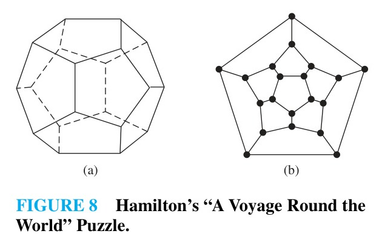

The object was to travel along edges visiting each of the other 19 cities exactly once and returning to the start. Modeling the dodecahedron as a planar graph reveals the puzzle's solution:

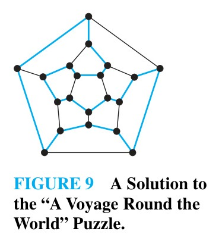

---

> [!NOTE] EXAMPLE 5
> Which of the simple graphs in Figure 10 have a Hamilton circuit or, if not, a Hamilton path?
>
> 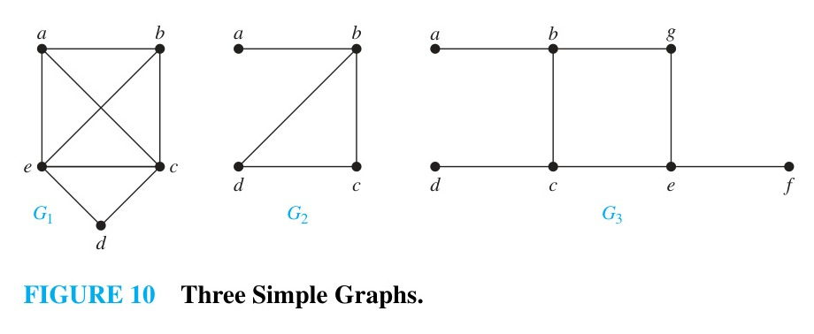
>
> **Solution:**  
> - $G_1$ has a Hamilton circuit:
>   $$a, b, c, d, e, a$$
> - $G_2$ has no Hamilton circuit (any circuit containing every vertex must traverse edge $\{a, b\}$ twice), but has a Hamilton path:
>   $$a, b, c, d$$
> - $G_3$ has neither a Hamilton circuit nor a Hamilton path, because any path visiting all vertices would have to traverse at least one of $\{a, b\}$, $\{e, f\}$, or $\{c, d\}$ more than once. $\blacktriangleleft$

---

## Conditions for the Existence of Hamilton Circuits

Unlike Euler circuits, there are **no known simple necessary and sufficient conditions** for the existence of Hamilton circuits. Determining whether an arbitrary graph contains a Hamilton circuit is an **NP-complete** problem.

However, several useful structural properties and sufficient conditions exist:

### Properties that Preclude Hamilton Circuits
1. If a graph has a vertex of degree $1$, it cannot have a Hamilton circuit (a Hamilton circuit must enter and leave each vertex via distinct edges).
2. If a vertex has degree $2$, both incident edges must be included in any Hamilton circuit.
3. Once a Hamilton circuit passes through a vertex, all other edges incident with that vertex can be removed from consideration.
4. A Hamilton circuit cannot contain a smaller cycle within itself.

> [!NOTE] EXAMPLE 6
> Show that neither graph displayed in Figure 11 has a Hamilton circuit.
>
> 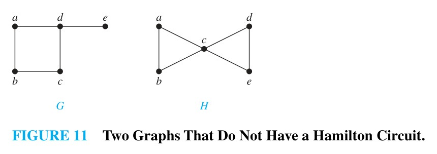
>
> **Solution:**  
> - In $G$, vertex $e$ has degree $1$, so no Hamilton circuit can exist.
> - In $H$, vertices $a, b, d,$ and $e$ each have degree $2$. Hence, all four edges incident with these vertices ($\{a, b\}, \{a, c\}, \{b, c\}, \{d, c\}, \{d, e\}, \{e, c\}$) must be part of any Hamilton circuit. But this would require $4$ edges incident with vertex $c$ to be used, which is impossible in a simple circuit. Thus, $H$ has no Hamilton circuit. $\blacktriangleleft$

> [!NOTE] EXAMPLE 7
> Show that the complete graph $K_n$ has a Hamilton circuit whenever $n \ge 3$.
>
> **Solution:**  
> Beginning at any vertex, we can visit all other vertices in any arbitrary order and return to the starting vertex, because an edge exists between every pair of distinct vertices in $K_n$. $\blacktriangleleft$

---

### Sufficient Conditions: Dirac's and Ore's Theorems

Adding edges to a graph makes the existence of a Hamilton circuit more likely. When degrees are sufficiently large, Hamilton circuits are guaranteed:

> [!NOTE] THEOREM 3: Dirac's Theorem
> If $G$ is a simple graph with $n$ vertices with $n \ge 3$ such that the degree of every vertex in $G$ is at least $n/2$, then $G$ has a Hamilton circuit.

> [!NOTE] THEOREM 4: Ore's Theorem
> If $G$ is a simple graph with $n$ vertices with $n \ge 3$ such that:
> $$\deg(u) + \deg(v) \ge n$$
> for every pair of nonadjacent vertices $u$ and $v$ in $G$, then $G$ has a Hamilton circuit.

> [!NOTE] REMARK
> - Dirac's theorem is a direct corollary of Ore's theorem, since $\deg(u) \ge n/2$ and $\deg(v) \ge n/2$ implies $\deg(u) + \deg(v) \ge n$.
> - Both theorems provide **sufficient conditions, not necessary conditions**. For example, the cycle graph $C_5$ has a Hamilton circuit, yet each vertex has degree $2 < 5/2 = 2.5$, failing both conditions.

---

## Applications of Hamilton Circuits

### The Traveling Salesperson Problem (TSP)
The traveling salesperson problem asks for the route of shortest total distance that visits every city in a given set and returns to the starting city. This corresponds to finding a Hamilton circuit of minimum total edge weight in a weighted complete graph.

> [!NOTE] EXAMPLE 8: Gray Codes
> Rotating pointers can represent positions digitally. A circle is divided into $2^n$ arcs, each labeled with a length-$n$ bit string:
>
> 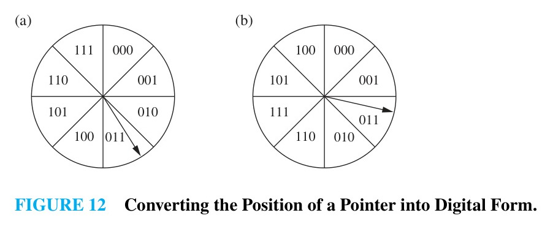
>
> Sensors read the bits corresponding to the pointer's position:
>
> 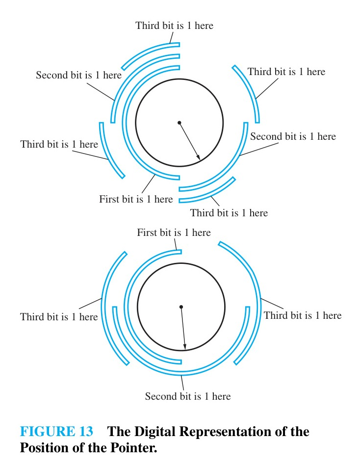
>
> - In a standard binary assignment (Figure 12a), a slight boundary misalignment can cause multiple bits to flip simultaneously (e.g., between `011` and `100`, all three bits change).
> - A **Gray code** labels adjacent arcs with bit strings that differ in **exactly one bit** (Figure 12b), minimizing reading errors.
>
> Finding a Gray code of length $n$ corresponds to finding a **Hamilton circuit in the $n$-cube graph $Q_n$**:
>
> 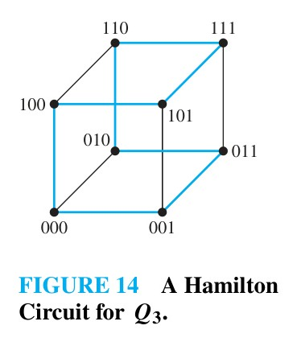
>
> For $Q_3$, a Hamilton circuit yields the Gray code sequence:
> $$000 \to 001 \to 011 \to 010 \to 110 \to 111 \to 101 \to 100 \to 000$$
> Each consecutive code differs by only a single bit. $\blacktriangleleft$
