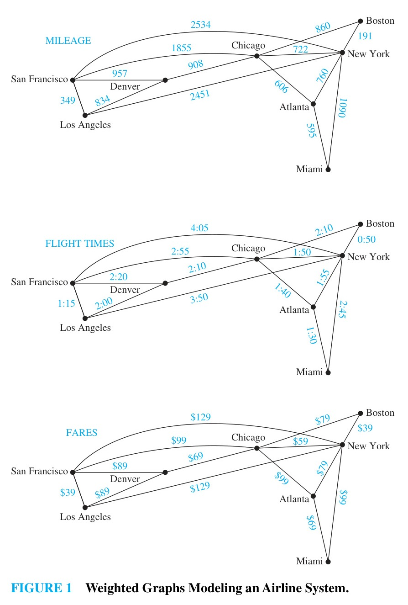
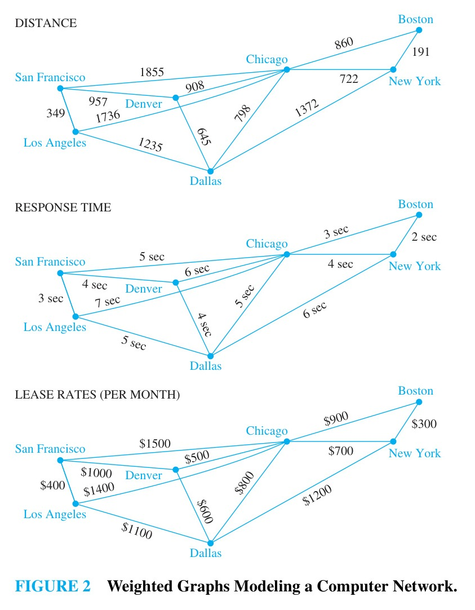
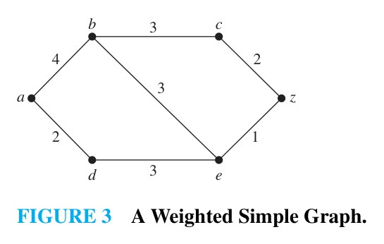
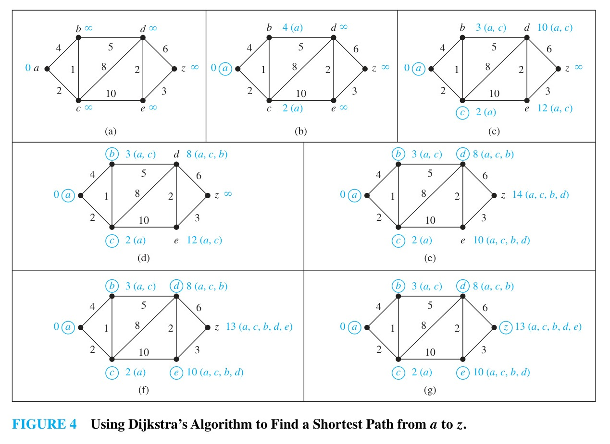
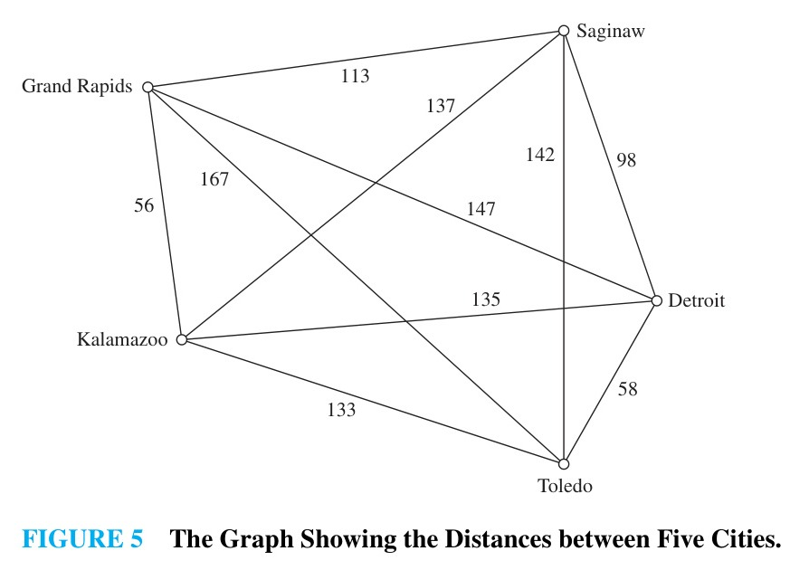

# 10.6 Shortest-Path Problems

## Introduction

Many practical problems can be modeled using graphs with weights assigned to their edges. Graphs that have a number assigned to each edge are called **weighted graphs**.

For instance, an airline system can be modeled where vertices represent cities and edges represent flights:
- Assigning distances between cities yields a distance model.
- Assigning flight times yields a time model.
- Assigning fares yields a cost model.



Similarly, computer networks can be modeled using weighted graphs representing connection distances, response times, or monthly lease costs:



### Length of a Path in a Weighted Graph
Let the **length** of a path in a weighted graph be the sum of the weights of the edges in that path:
$$\text{length of path } (e_1, e_2, \dots, e_k) = \sum_{i=1}^k w(e_i)$$
*(Note: In an unweighted graph, length denotes the number of edges. In a weighted graph, length refers to the sum of the edge weights.)*

A **shortest path** between two vertices is a path of minimum length connecting them.

---

## Dijkstra's Algorithm

Dijkstra's algorithm (discovered by Edsger W. Dijkstra in 1959) finds the length of a shortest path between two vertices $a$ and $z$ in an undirected, connected, simple weighted graph with positive edge weights.

### Intuitive Approach

> [!NOTE] EXAMPLE 1
> What is the length of a shortest path between $a$ and $z$ in the weighted graph shown below?
>
> 
>
> **Solution:**  
> We determine the vertices in order of their distance from $a$:
> 1. The vertices adjacent to $a$ are $b$ (weight $4$) and $d$ (weight $2$). The closest vertex to $a$ is $d$, with shortest path $a, d$ of length $2$.
> 2. The second closest vertex is either $b$ (path $a, b$ of length $4$) or a vertex adjacent to $d$, such as $e$ (path $a, d, e$ of length $2 + 3 = 5$). Since $4 < 5$, the second closest vertex is $b$ (length $4$).
> 3. The third closest vertex must be reached via $\{a, d, b\}$:
>    - Path $a, d, e$ has length $2 + 3 = 5$.
>    - Path $a, b, e$ has length $4 + 3 = 7$.
>    - Path $a, b, c$ has length $4 + 3 = 7$.  
>    The shortest of these is $a, d, e$ of length $5$, so $e$ is the third closest vertex.
> 4. The fourth closest vertex is found by examining paths from $\{a, d, b, e\}$ to remaining vertices $\{c, z\}$:
>    - Path $a, b, c$ has length $7$.
>    - Path $a, d, e, c$ has length $2 + 3 + \infty$ (no direct edge).
>    - Path $a, d, e, z$ has length $2 + 3 + 1 = 6$.  
>    Since $6 < 7$, the vertex $z$ is reached with shortest path length $6$ via $a, d, e, z$. $\blacktriangleleft$

---

### Formal Description of Dijkstra's Algorithm

Dijkstra's algorithm builds a distinguished set of vertices $S$. Initially, $S = \emptyset$.
- Each vertex $v$ maintains a label $L(v)$ representing the current estimate of the shortest path length from $a$ to $v$.
- Initialization: $L(a) = 0$, and $L(v) = \infty$ for all $v \neq a$.
- At each iteration:
  1. Select a vertex $u \notin S$ with minimal label $L(u)$.
  2. Add $u$ to $S$.
  3. For every neighbor $v \notin S$, update its label:
     $$L(v) := \min\{L(v), L(u) + w(u, v)\}$$
- The algorithm terminates when the target vertex $z$ is added to $S$.

> [!NOTE] ALGORITHM 1: Dijkstra's Algorithm
> ```
> procedure Dijkstra(G: weighted connected simple graph, with all weights positive)
>     {G has vertices a = v0, v1, ..., vn = z and edge weights w(vi, vj), where w(vi, vj) = ∞ if {vi, vj} is not an edge}
>     for i := 1 to n
>         L(vi) := ∞
>     L(a) := 0
>     S := ∅
>     {labels initialized: L(a) = 0, all other labels ∞; S is empty}
>     while z ∉ S
>         u := a vertex not in S with L(u) minimal
>         S := S ∪ {u}
>         for all vertices v not in S
>             if L(u) + w(u, v) < L(v) then
>                 L(v) := L(u) + w(u, v)
>     return L(z) {L(z) is the length of a shortest path from a to z}
> ```

---

> [!NOTE] EXAMPLE 2
> Use Dijkstra's algorithm to find the length of a shortest path between vertices $a$ and $z$ in the weighted graph displayed in Figure 4(a).
>
> 
>
> **Solution:**  
> The step-by-step execution is illustrated in Figure 4:
> - **Step (a):** Initialize $L(a) = 0$, all other vertices labeled $\infty$. $S = \emptyset$.
> - **Step (b):** Minimal vertex is $a$ ($L(a) = 0$). Add $a$ to $S$. Update neighbors: $L(b) = \min\{\infty, 0 + 4\} = 4$, $L(c) = \min\{\infty, 0 + 2\} = 2$.
> - **Step (c):** Minimal vertex not in $S$ is $c$ ($L(c) = 2$). Add $c$ to $S$. Update neighbors: $L(b) = \min\{4, 2 + 1\} = 3$, $L(d) = \min\{\infty, 2 + 8\} = 10$, $L(e) = \min\{\infty, 2 + 10\} = 12$.
> - **Step (d):** Minimal vertex not in $S$ is $b$ ($L(b) = 3$). Add $b$ to $S$. Update neighbors: $L(d) = \min\{10, 3 + 5\} = 8$.
> - **Step (e):** Minimal vertex not in $S$ is $d$ ($L(d) = 8$). Add $d$ to $S$. Update neighbors: $L(e) = \min\{12, 8 + 2\} = 10$, $L(z) = \min\{\infty, 8 + 6\} = 14$.
> - **Step (f):** Minimal vertex not in $S$ is $e$ ($L(e) = 10$). Add $e$ to $S$. Update neighbor $z$: $L(z) = \min\{14, 10 + 3\} = 13$.
> - **Step (g):** Minimal vertex not in $S$ is $z$ ($L(z) = 13$). Add $z$ to $S$.  
> 
> The algorithm terminates. The length of a shortest path from $a$ to $z$ is **$13$**, along the path $a, c, b, d, e, z$. $\blacktriangleleft$

---

### Correctness and Complexity

> [!NOTE] THEOREM 1
> Dijkstra's algorithm finds the length of a shortest path between two vertices in a connected simple undirected weighted graph with positive weights.

**Proof (by Mathematical Induction):**  
- **Inductive Hypothesis:** At the end of the $k$th iteration:
  1. For every vertex $v \in S_k$, $L(v)$ is the exact length of a shortest path from $a$ to $v$.
  2. For every vertex $u \notin S_k$, $L(u)$ is the length of a shortest path from $a$ to $u$ whose intermediate vertices all lie in $S_k$.
- **Basis Step ($k = 0$):** $S_0 = \emptyset$. $L(a) = 0$ is correct, and $L(v) = \infty$ for $v \neq a$ is correct since no paths contain only vertices from $\emptyset$.
- **Inductive Step:** Assume the hypothesis holds after $k$ iterations. Let $v$ be the vertex added to $S$ at step $k+1$ (minimal label among vertices not in $S_k$).
  - If there existed a shorter path from $a$ to $v$, it would have to leave $S_k$ at some first vertex $u \notin S_k$. But by induction, the subpath to $u$ would have length at least $L(u) \ge L(v)$, a contradiction. Thus $L(v)$ is the true shortest distance to $v$, proving condition (1).
  - Updating $L(u)$ for vertices remaining outside $S_{k+1}$ via $\min\{L(u), L(v) + w(v, u)\}$ correctly considers all shortest paths through $S_k \cup \{v\}$, maintaining condition (2).
- Therefore, when $z$ is added to $S$, $L(z)$ is the true shortest path length. $\blacksquare$

> [!NOTE] THEOREM 2
> Dijkstra's algorithm uses $O(n^2)$ operations (additions and comparisons) to find the length of a shortest path between two vertices in a connected simple undirected weighted graph with $n$ vertices.

**Complexity Analysis:**
- There are at most $n - 1$ iterations of the `while` loop.
- In each iteration:
  - Finding the vertex with minimal label takes at most $n - 1$ comparisons.
  - Updating the labels of the remaining vertices takes at most $n - 1$ additions and $n - 1$ comparisons (at most $2(n - 1)$ operations).
- Total operations: at most $(n - 1) \times 3(n - 1) = O(n^2)$.
- *(Note: Using a Fibonacci heap or min-priority queue, Dijkstra's algorithm can be implemented in $O(m + n \log n)$ time, where $m$ is the number of edges.)*

---

## The Traveling Salesperson Problem (TSP)

The **traveling salesperson problem (TSP)** asks for the circuit of minimum total weight in a weighted, complete, undirected graph that visits every vertex exactly once and returns to the starting vertex. This is equivalent to finding a **Hamilton circuit of minimum total weight**.

### Example: Five Michigan/Ohio Cities

Consider five cities: Detroit, Grand Rapids, Kalamazoo, Saginaw, and Toledo, with pairwise distances given in Figure 5:



Starting at Detroit, there are $(5 - 1)! / 2 = 24 / 2 = 12$ distinct Hamilton circuits to examine:

| Route | Total Distance (miles) |
| :--- | :---: |
| Detroit–Toledo–Grand Rapids–Saginaw–Kalamazoo–Detroit | 610 |
| Detroit–Toledo–Grand Rapids–Kalamazoo–Saginaw–Detroit | 516 |
| Detroit–Toledo–Kalamazoo–Saginaw–Grand Rapids–Detroit | 588 |
| **Detroit–Toledo–Kalamazoo–Grand Rapids–Saginaw–Detroit** | **458** |
| Detroit–Toledo–Saginaw–Kalamazoo–Grand Rapids–Detroit | 540 |
| Detroit–Toledo–Saginaw–Grand Rapids–Kalamazoo–Detroit | 504 |
| Detroit–Saginaw–Toledo–Grand Rapids–Kalamazoo–Detroit | 598 |
| Detroit–Saginaw–Toledo–Kalamazoo–Grand Rapids–Detroit | 576 |
| Detroit–Saginaw–Kalamazoo–Toledo–Grand Rapids–Detroit | 682 |
| Detroit–Saginaw–Grand Rapids–Toledo–Kalamazoo–Detroit | 646 |
| Detroit–Grand Rapids–Saginaw–Toledo–Kalamazoo–Detroit | 670 |
| Detroit–Grand Rapids–Toledo–Saginaw–Kalamazoo–Detroit | 728 |

The optimal route is **Detroit–Toledo–Kalamazoo–Grand Rapids–Saginaw–Detroit** (or its reverse) with a minimum total distance of **$458$ miles**.

---

### Computational Complexity of TSP
- **Exhaustive Search:** For $n$ vertices, choosing a starting vertex leaves $(n - 1)!$ circuits. Accounting for direction reversal yields:
  $$\frac{(n - 1)!}{2} \text{ circuits}$$
  For $n = 25$, this requires evaluating $24! / 2 \approx 3.1 \times 10^{23}$ circuits. At $1$ nanosecond per circuit, exhaustive search would take approximately **$10$ million years**.
- **NP-Completeness:** TSP is an **NP-complete** problem; no polynomial-time algorithm is known for finding exact solutions.
- **Approximation Algorithms:** In practice, approximation algorithms are used:
  - An approximation algorithm guarantees a tour of length $W'$ such that $W \le W' \le cW$, where $W$ is the optimal length and $c$ is a constant approximation ratio.
  - When the edge weights satisfy the **triangle inequality** ($w(u, v) \le w(u, x) + w(x, v)$), polynomial-time algorithms exist with $c = 3/2$ (Christofides' algorithm).
  - For practical applications, heuristics solve TSP instances with thousands of vertices to within $2\%$ of optimal in minutes.
