# 10.7 Planar Graphs

## Introduction

Consider the classic puzzle of joining three houses to three separate utilities (electricity, gas, water) so that no utility lines cross:

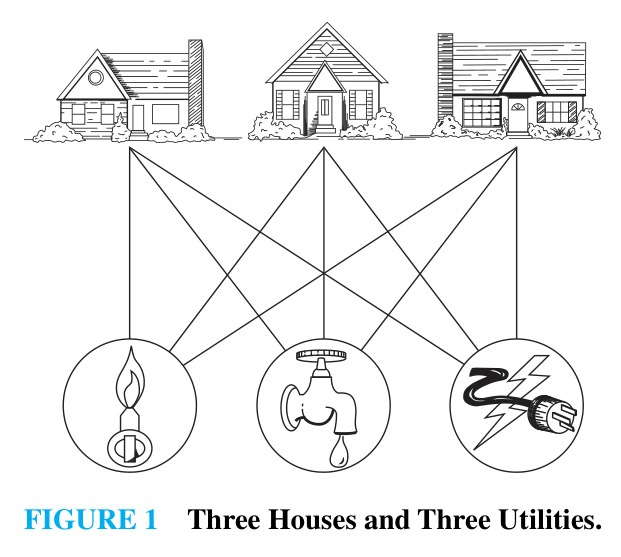

This puzzle can be modeled using the complete bipartite graph $K_{3,3}$, where vertices represent houses and utilities, and edges represent service connections. The question becomes: Can $K_{3,3}$ be drawn in the plane so that no two edges cross?

---

## Planar Representations

> [!NOTE] DEFINITION 1
> A graph is called **planar** if it can be drawn in the plane without any edges crossing (where a crossing is the intersection of the lines or curves representing edges at a point other than their common endpoints). Such a drawing is called a **planar representation** of the graph.

A graph may be planar even if drawn with crossings in some configurations, provided it is possible to redraw it without crossings.

---

### Examples of Planar Graphs

> [!NOTE] EXAMPLE 1
> Is $K_4$ planar?
>
> 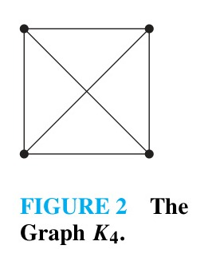
> 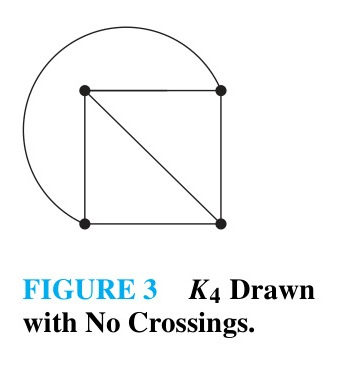
>
> **Solution:**  
> Although $K_4$ is standardly drawn with two crossing diagonal edges (Figure 2), it can be redrawn with one diagonal curved outside the triangle formed by the other three vertices (Figure 3). Since it can be drawn without crossings, $K_4$ is **planar**. $\blacktriangleleft$

> [!NOTE] EXAMPLE 2
> Is the 3-cube $Q_3$ planar?
>
> 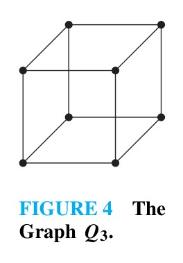
> 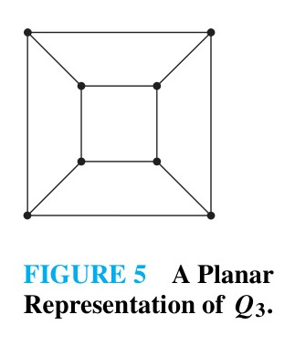
>
> **Solution:**  
> Yes, $Q_3$ can be redrawn in the plane with no edges crossing by placing the inner square inside the outer square and connecting corresponding vertices directly (Figure 5). Thus, $Q_3$ is **planar**. $\blacktriangleleft$

---

### Nonplanarity of $K_{3,3}$

> [!NOTE] EXAMPLE 3
> Is $K_{3,3}$ planar?
>
> 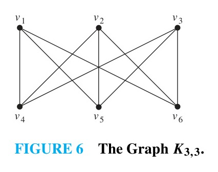
> 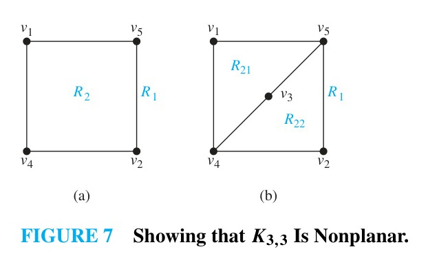
>
> **Solution:**  
> In any planar drawing of $K_{3,3}$, vertices $v_1$ and $v_2$ must connect to $v_4$ and $v_5$. These four edges form a closed cycle $v_1, v_4, v_2, v_5, v_1$ that divides the plane into two regions: an interior region $R_2$ and an exterior region $R_1$ (Figure 7a).
> - Now consider vertex $v_3$. It must lie either in $R_1$ or $R_2$.
> - If $v_3$ lies in $R_2$, the edges connecting $v_3$ to $v_4$ and $v_5$ split $R_2$ into two subregions, $R_{21}$ and $R_{22}$ (Figure 7b).
> - Finally, consider vertex $v_6$. It must connect to $v_1, v_2,$ and $v_3$:
>   - If $v_6 \in R_1$, it cannot connect to $v_3 \in R_2$ without crossing the boundary cycle.
>   - If $v_6 \in R_{21}$, it cannot connect to $v_2$ without crossing an edge.
>   - If $v_6 \in R_{22}$, it cannot connect to $v_1$ without crossing an edge.
> - A symmetric contradiction arises if $v_3$ is placed in $R_1$.  
> 
> Thus, $K_{3,3}$ cannot be drawn in the plane without crossing edges; **$K_{3,3}$ is nonplanar**. Consequently, the three-houses-and-three-utilities problem has no crossing-free solution in the plane. $\blacktriangleleft$

---

### Applications of Planar Graphs
- **Printed Circuit Board (PCB) Design:** Electronic circuits are printed on circuit boards where printed conductors cannot cross without short-circuiting. If the circuit's graph model is planar, it can be fabricated on a single layer. Nonplanar graphs require multilayer boards or insulated jumper wires, making crossing minimization critical.
- **Highway and Transportation Design:** Highway systems can be built without bridges, overpasses, or tunnels if and only if the underlying highway network graph is planar.

---

## Euler's Formula

A planar representation of a graph splits the plane into **regions**, including one unbounded (exterior) region:

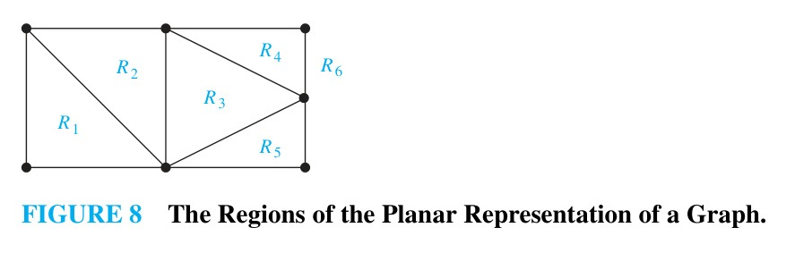

Euler established that all planar representations of a given connected graph split the plane into the exact same number of regions.

> [!NOTE] THEOREM 1: Euler's Formula
> Let $G$ be a connected planar simple graph with $e$ edges and $v$ vertices. Let $r$ be the number of regions in a planar representation of $G$. Then:
> $$r = e - v + 2$$

**Proof (by Mathematical Induction on the number of edges $e$):**  
- **Basis Step ($e = 1$):** A connected graph with $1$ edge must have $v_1 = 2$ vertices and divides the plane into $r_1 = 1$ unbounded region (Figure 9).  
  $$r_1 = 1 = 1 - 2 + 2 = e_1 - v_1 + 2$$
  Thus the base case holds.

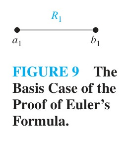

- **Inductive Step:** Assume the formula $r_k = e_k - v_k + 2$ holds for a connected subgraph $G_k$ with $k$ edges. Form $G_{k+1}$ by adding an edge $\{a_{k+1}, b_{k+1}\}$ to $G_k$:
  1. **Both endpoints already in $G_k$ (Figure 10a):** Vertices $a_{k+1}$ and $b_{k+1}$ must share the boundary of some existing region $R$. The added edge splits $R$ into two regions. Thus:
     $$r_{k+1} = r_k + 1, \quad e_{k+1} = e_k + 1, \quad v_{k+1} = v_k$$
     Then:
     $$r_{k+1} = (e_k - v_k + 2) + 1 = e_{k+1} - v_{k+1} + 2$$
  2. **One endpoint is new (Figure 10b):** Say $a_{k+1} \in G_k$ and $b_{k+1} \notin G_k$. Adding the new edge attaches a pendent vertex without creating any new cycle or region. Thus:
     $$r_{k+1} = r_k, \quad e_{k+1} = e_k + 1, \quad v_{k+1} = v_k + 1$$
     Then:
     $$e_{k+1} - v_{k+1} + 2 = (e_k + 1) - (v_k + 1) + 2 = e_k - v_k + 2 = r_k = r_{k+1}$$

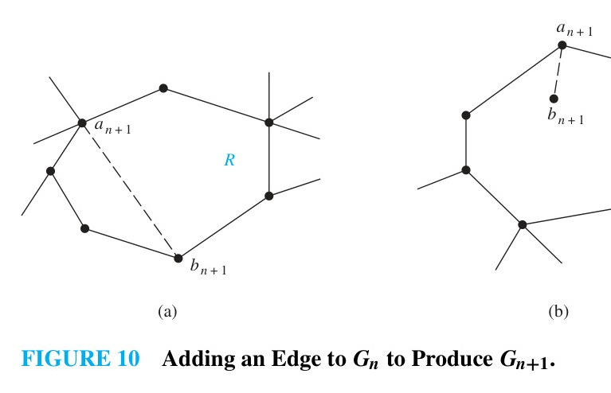

By mathematical induction, Euler's formula holds for all connected planar simple graphs. $\blacksquare$

---

> [!NOTE] EXAMPLE 4
> Suppose that a connected planar simple graph has $20$ vertices, each of degree $3$. Into how many regions does a representation of this planar graph split the plane?
>
> **Solution:**  
> - Vertices: $v = 20$.
> - By the Handshaking Theorem:
>   $$2e = \sum_{v \in V} \deg(v) = 20 \times 3 = 60 \implies e = 30$$
> - Applying Euler's formula:
>   $$r = e - v + 2 = 30 - 20 + 2 = 12$$
> The planar representation splits the plane into **$12$ regions**. $\blacktriangleleft$

---

## Planarity Conditions and Corollaries

### Degree of a Region
The **degree of a region** $R$, denoted $\deg(R)$, is the number of edges on the boundary of $R$. If an edge occurs twice along the boundary (e.g., a cut edge), it contributes $2$ to $\deg(R)$:

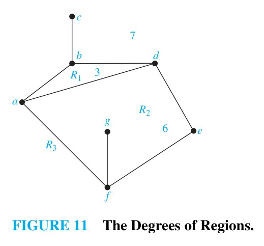

Because each edge serves as a boundary for two regions (or twice for one region):
$$\sum_{\text{all regions } R} \deg(R) = 2e$$

---

> [!NOTE] COROLLARY 1
> If $G$ is a connected planar simple graph with $e$ edges and $v$ vertices, where $v \ge 3$, then:
> $$e \le 3v - 6$$

**Proof:**  
In a simple graph with $v \ge 3$, each region boundary must consist of at least $3$ edges (no multiple edges or loops exist). Thus $\deg(R) \ge 3$ for every region $R$.  
$$2e = \sum_R \deg(R) \ge 3r \implies r \le \frac{2}{3}e$$
Substituting Euler's formula $r = e - v + 2$:
$$e - v + 2 \le \frac{2}{3}e \implies \frac{1}{3}e \le v - 2 \implies e \le 3v - 6 \quad \blacksquare$$

---

> [!NOTE] COROLLARY 2
> If $G$ is a connected planar simple graph, then $G$ has a vertex of degree not exceeding $5$ ($\deg(v) \le 5$).

**Proof:**  
If $v = 1$ or $v = 2$, the result is trivial. If $v \ge 3$, by Corollary 1:
$$2e \le 6v - 12$$
If every vertex had degree at least $6$, then by the Handshaking Theorem:
$$2e = \sum_{v \in V} \deg(v) \ge 6v$$
This contradicts $2e \le 6v - 12 < 6v$. Therefore, at least one vertex must have degree at most $5$. $\blacksquare$

---

> [!NOTE] EXAMPLE 5: Nonplanarity of $K_5$
> Show that $K_5$ is nonplanar using Corollary 1.
>
> **Solution:**  
> The complete graph $K_5$ has $v = 5$ vertices and:
> $$e = \binom{5}{2} = 10 \text{ edges}$$
> Under Corollary 1, planarity requires $e \le 3v - 6$:
> $$3(5) - 6 = 15 - 6 = 9$$
> However, $e = 10 > 9$. Thus, $K_5$ violates Corollary 1 and **is nonplanar**. $\blacktriangleleft$

---

> [!NOTE] COROLLARY 3
> If a connected planar simple graph has $e$ edges and $v$ vertices with $v \ge 3$ and **no circuits of length $3$** (no triangles), then:
> $$e \le 2v - 4$$

**Proof:**  
Since there are no circuits of length $3$, every cycle has length at least $4$, meaning $\deg(R) \ge 4$ for all regions. Thus:
$$2e = \sum_R \deg(R) \ge 4r \implies r \le \frac{e}{2}$$
Substituting $r = e - v + 2$:
$$e - v + 2 \le \frac{e}{2} \implies \frac{e}{2} \le v - 2 \implies e \le 2v - 4 \quad \blacksquare$$

---

> [!NOTE] EXAMPLE 6: Nonplanarity of $K_{3,3}$ via Corollary 3
> Use Corollary 3 to show that $K_{3,3}$ is nonplanar.
>
> **Solution:**  
> Because $K_{3,3}$ is bipartite, it contains no odd cycles, and hence no circuits of length $3$. It has $v = 6$ vertices and $e = 9$ edges.
> Applying Corollary 3:
> $$2v - 4 = 2(6) - 4 = 8$$
> Since $e = 9 > 8$, $K_{3,3}$ violates Corollary 3 and **is nonplanar**. $\blacktriangleleft$

---

## Kuratowski's Theorem

If a graph contains $K_5$ or $K_{3,3}$ as a subgraph, it is obviously nonplanar. However, nonplanarity also extends to graphs that contain "stretched" versions of these graphs.

### Elementary Subdivisions and Homeomorphism
- An **elementary subdivision** of a graph is the operation of removing an edge $\{u, v\}$ and adding a new vertex $w$ together with two edges $\{u, w\}$ and $\{w, v\}$.
- Two graphs $G_1$ and $G_2$ are called **homeomorphic** if they can both be obtained from the same graph by a sequence of elementary subdivisions.

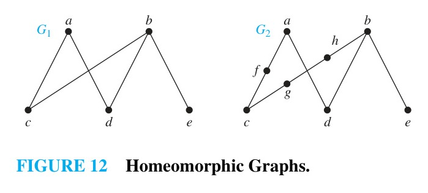

> [!NOTE] EXAMPLE 7
> Show that the graphs $G_1, G_2,$ and $G_3$ in Figure 12 are homeomorphic.
>
> **Solution:**  
> All three can be formed from $G_1$ by elementary subdivisions:
> - $G_1$ is obtained from itself by an empty sequence of subdivisions.
> - $G_2$ is obtained from $G_1$ by subdividing $\{a, c\}$ with $f$, and subdividing $\{b, c\}$ with $g$ and then $h$.
> - $G_3$ is obtained similarly by adding additional vertices on edges. $\blacktriangleleft$

---

### Kuratowski's Characterization

> [!NOTE] THEOREM 2: Kuratowski's Theorem
> A graph is nonplanar if and only if it contains a subgraph homeomorphic to $K_{3,3}$ or $K_5$.

---

> [!NOTE] EXAMPLE 8
> Determine whether the graph $G$ shown in Figure 13 is planar.
>
> 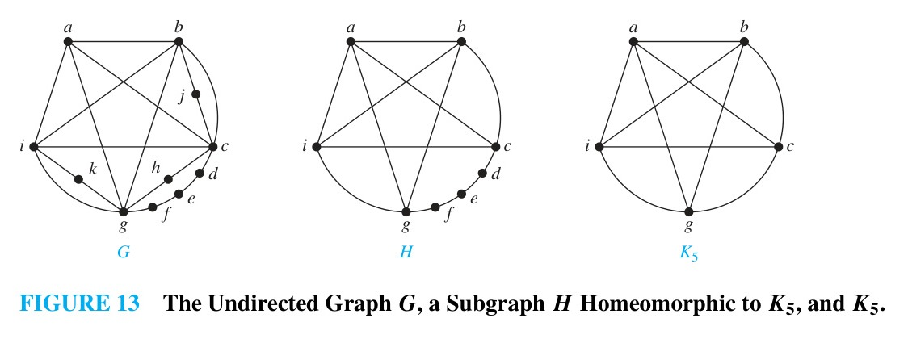
>
> **Solution:**  
> By removing vertices $h, j, k$ and their incident edges from $G$, we obtain the subgraph $H$.  
> $H$ is homeomorphic to $K_5$ because it can be obtained from $K_5$ (with vertices $a, b, c, g, i$) by subdividing edges with vertices $d, e,$ and $f$.  
> By Kuratowski's theorem, **$G$ is nonplanar**. $\blacktriangleleft$

---

> [!NOTE] EXAMPLE 9: The Petersen Graph
> Is the Petersen graph, shown in Figure 14(a), planar?
>
> 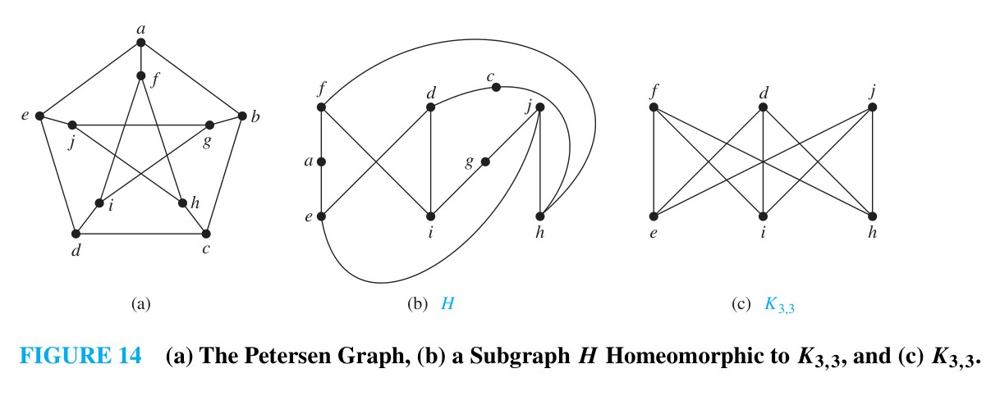
>
> **Solution:**  
> Deleting vertex $b$ and its three incident edges from the Petersen graph yields the subgraph $H$ shown in Figure 14(b).  
> Subgraph $H$ is homeomorphic to $K_{3,3}$ with bipartition $\{f, d, j\}$ and $\{e, i, h\}$, obtained via elementary subdivisions:
> - Edge $\{d, h\}$ subdivided by $c$ into $\{c, h\}$ and $\{c, d\}$.
> - Edge $\{e, f\}$ subdivided by $a$ into $\{a, e\}$ and $\{a, f\}$.
> - Edge $\{i, j\}$ subdivided by $g$ into $\{g, i\}$ and $\{g, j\}$.  
> 
> Because $H$ is homeomorphic to $K_{3,3}$, by Kuratowski's theorem the **Petersen graph is nonplanar**. $\blacktriangleleft$
