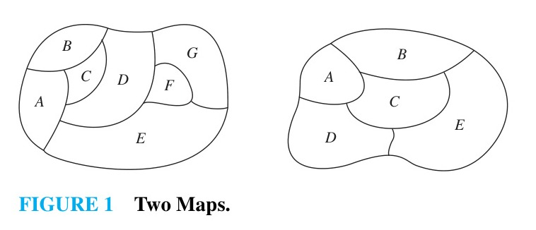
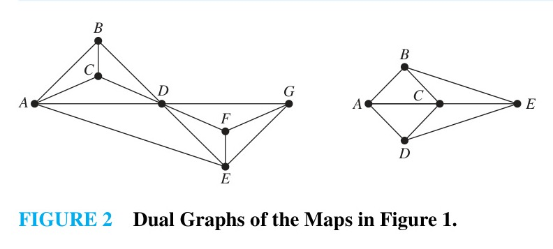
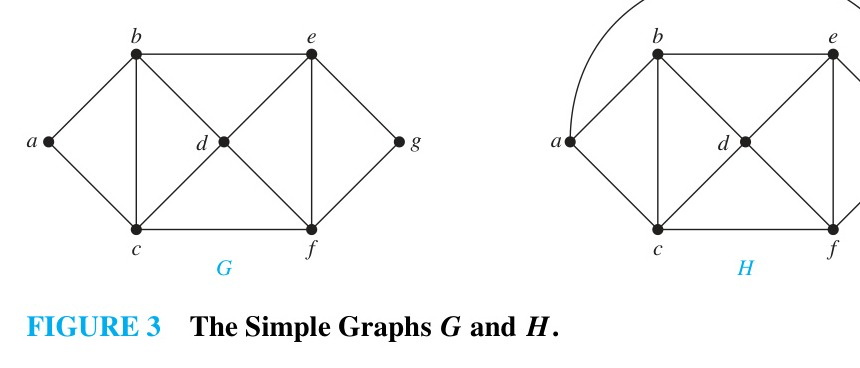
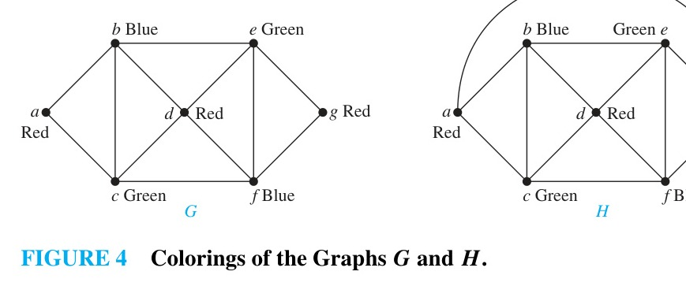
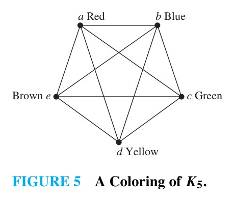
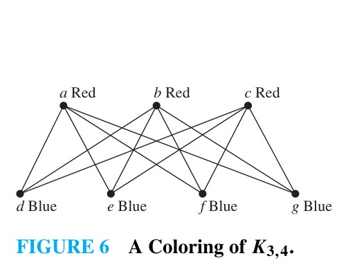
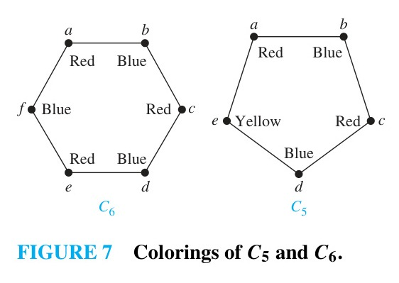
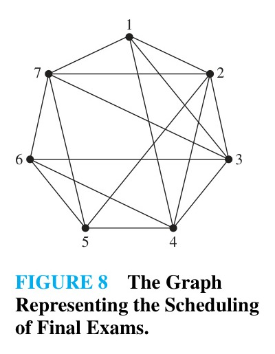
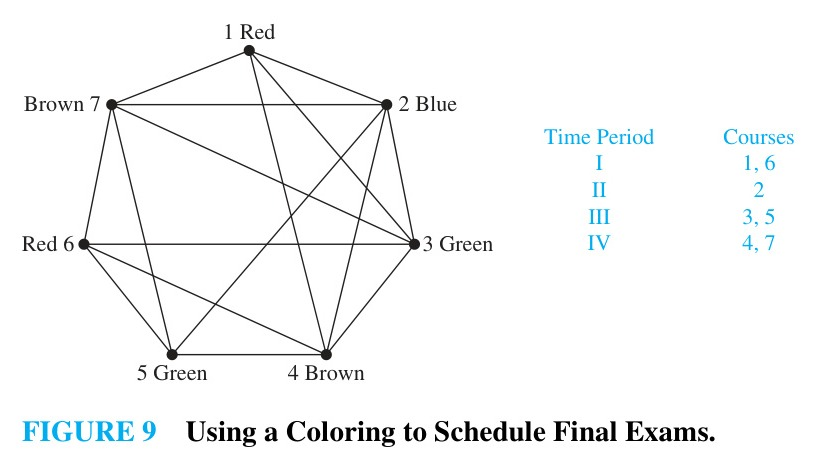

# 10.8 Graph Coloring

## Introduction

Problems related to coloring geographical maps so that adjacent regions never receive the same color have driven many foundational developments in graph theory.

### Dual Graphs
Every map in the plane can be represented by a graph called its **dual graph**:
- Each contiguous region of the map is represented by a vertex.
- An edge connects two vertices if their corresponding regions share a common boundary line (regions touching at only isolated single points are not considered adjacent).

Every map in the plane produces a **planar dual graph**. Coloring regions of a map such that adjacent regions have different colors is precisely equivalent to coloring vertices of its dual graph so that adjacent vertices have different colors.

---

## Definitions and the Four Color Theorem

> [!NOTE] DEFINITION 1
> A **coloring** of a simple graph is the assignment of a color to each vertex of the graph so that no two adjacent vertices are assigned the same color.

> [!NOTE] DEFINITION 2
> The **chromatic number** of a graph $G$, denoted by $\chi(G)$ (where $\chi$ is the Greek letter chi), is the least number of colors needed for a coloring of $G$.

Determining the chromatic number of planar graphs was one of the most famous open questions in mathematics for over a century:

> [!NOTE] THEOREM 1: The Four Color Theorem
> The chromatic number of a planar graph is no greater than four:
> $$\chi(G) \le 4 \quad \text{for any planar graph } G$$

The Four Color Theorem was originally conjectured in the 1850s and proved in 1976 by Kenneth Appel and Wolfgang Haken using an extensive computer-assisted case analysis of nearly 2000 reducible configurations (and later simplified by Robertson, Sanders, Seymour, and Thomas in 1996 to 633 configurations).

*(Note: The Four Color Theorem applies strictly to planar graphs. Nonplanar graphs can have arbitrarily large chromatic numbers.)*

---

## Determining Chromatic Numbers

To prove that the chromatic number of a graph is $k$ ($\chi(G) = k$):
1. **Upper Bound:** Exhibit an explicit valid coloring using $k$ colors (showing $\chi(G) \le k$).
2. **Lower Bound:** Prove that no valid coloring can be constructed using fewer than $k$ colors (showing $\chi(G) \ge k$).

---

> [!NOTE] EXAMPLE 1
> What are the chromatic numbers of the graphs $G$ and $H$ shown below?
>
> 
> 
>
> **Solution:**  
> - **For graph $G$:** Vertices $a, b,$ and $c$ form a triangle ($K_3$), so at least three distinct colors are required ($\chi(G) \ge 3$).  
>   Assign:
>   - $a$: Red, $b$: Blue, $c$: Green
>   - $d$ is adjacent to $b$ (Blue) and $c$ (Green) $\implies d$ must be Red.
>   - $e$ is adjacent to $a$ (Red) and $b$ (Blue) $\implies e$ must be Green.
>   - $f$ is adjacent to $a$ (Red) and $c$ (Green) $\implies f$ must be Blue.
>   - $g$ is adjacent to $b$ (Blue) and $c$ (Green) $\implies g$ must be Red.  
>   This yields a valid coloring with $3$ colors. Thus, $\chi(G) = 3$.
> - **For graph $H$:** Graph $H$ consists of $G$ with the addition of edge $\{a, g\}$. Since vertex $a$ is colored Red and vertex $g$ is adjacent to $a$ (Red), $b$ (Blue), and $c$ (Green), $g$ cannot receive Red, Blue, or Green. A fourth color (Brown) is required. Hence, $\chi(H) = 4$. $\blacktriangleleft$

---

### Chromatic Numbers of Special Graph Families

> [!NOTE] EXAMPLE 2: Complete Graphs $K_n$
> What is the chromatic number of the complete graph $K_n$?
>
> 
>
> **Solution:**  
> In $K_n$, every pair of vertices is connected by an edge. No two vertices can share the same color. Therefore, each of the $n$ vertices must receive a distinct color:
> $$\chi(K_n) = n$$
> *(Note: For $n \ge 5$, $K_n$ is nonplanar, so $\chi(K_n) \ge 5$ does not contradict the Four Color Theorem.)* $\blacktriangleleft$

---

> [!NOTE] EXAMPLE 3: Complete Bipartite Graphs $K_{m,n}$
> What is the chromatic number of the complete bipartite graph $K_{m,n}$?
>
> 
>
> **Solution:**  
> By definition, the vertex set of $K_{m,n}$ partitions into two disjoint sets $V_1$ (size $m$) and $V_2$ (size $n$), where edges connect only vertices in $V_1$ to vertices in $V_2$.  
> - Assign color 1 (Red) to all vertices in $V_1$.
> - Assign color 2 (Blue) to all vertices in $V_2$.  
> Since no edges exist within $V_1$ or within $V_2$, this 2-coloring is valid. Thus:
> $$\chi(K_{m,n}) = 2 \quad (\text{for } m, n \ge 1)$$ $\blacktriangleleft$

---

> [!NOTE] EXAMPLE 4: Cycle Graphs $C_n$
> What is the chromatic number of the cycle graph $C_n$ ($n \ge 3$)?
>
> 
>
> **Solution:**  
> - **When $n$ is even:** Traversal around the cycle alternates colors: Red, Blue, Red, Blue, $\dots$. The $n$th vertex (adjacent to the $(n-1)$st vertex [Red] and the 1st vertex [Red]) receives Blue with no conflict. Thus:
>   $$\chi(C_n) = 2 \quad \text{for even } n \ge 4$$
> - **When $n$ is odd:** Alternating two colors around the cycle leaves the $n$th vertex adjacent to both vertex $1$ (Red) and vertex $n-1$ (Blue). Therefore, a third color (Yellow) is required:
>   $$\chi(C_n) = 3 \quad \text{for odd } n \ge 3$$ $\blacktriangleleft$

---

## Computational Complexity
Finding the chromatic number of an arbitrary graph is an **NP-complete** problem. The best known exact algorithms require exponential worst-case time in the number of vertices. Even approximating the chromatic number within a factor of $2$ is NP-hard.

---

## Applications of Graph Colorings

Graph colorings provide natural models for conflict-avoidance and partitioning problems.

### 1. Final Exam Scheduling

> [!NOTE] EXAMPLE 5
> How can final exams at a university be scheduled into minimum time periods so that no student has two exams simultaneously?
>
> 
> 
>
> **Solution:**  
> - **Graph Model:**
>   - Vertices represent courses ($1, 2, \dots, 7$).
>   - An edge connects two courses if at least one student is enrolled in both.
>   - Colors represent examination time periods.
> - For the conflict graph shown in Figure 8:
>   $$\chi(G) = 4$$
> - A 4-coloring yields an optimal 4-period examination schedule:
>
> | Time Period | Color | Courses Scheduled |
> | :---: | :---: | :---: |
> | **I** | Red | Courses 1, 6 |
> | **II** | Blue | Course 2 |
> | **III** | Green | Courses 3, 5 |
> | **IV** | Brown | Courses 4, 7 |
>
> No student has conflicting exams in this schedule. $\blacktriangleleft$

---

> [!NOTE] EXAMPLE 6: Frequency Assignments
> Television channels 2 through 13 are assigned to stations in North America so that no two stations within 150 miles can operate on the same channel. How can the assignment of channels be modeled by graph coloring?
>
> **Solution:**  
> Construct a graph by assigning a vertex to each station. Two vertices are connected by an edge if they are located within 150 miles of each other. An assignment of channels corresponds to a coloring of the graph, where each color represents a different channel. $\blacktriangleleft$

---

> [!NOTE] EXAMPLE 7: Index Registers
> In efficient compilers, the execution of loops is speeded up when frequently used variables are stored temporarily in index registers in the central processing unit, instead of in regular memory. For a given loop, how many index registers are needed? How can this be modeled using graph coloring?
>
> **Solution:**  
> Let each vertex of a graph represent a variable in the loop. There is an edge between two vertices if the variables they represent must be stored in index registers at the same time during the execution of the loop. Thus, the chromatic number of the graph gives the minimum number of index registers needed, because different registers must be assigned to variables when the vertices representing these variables are adjacent. $\blacktriangleleft$
