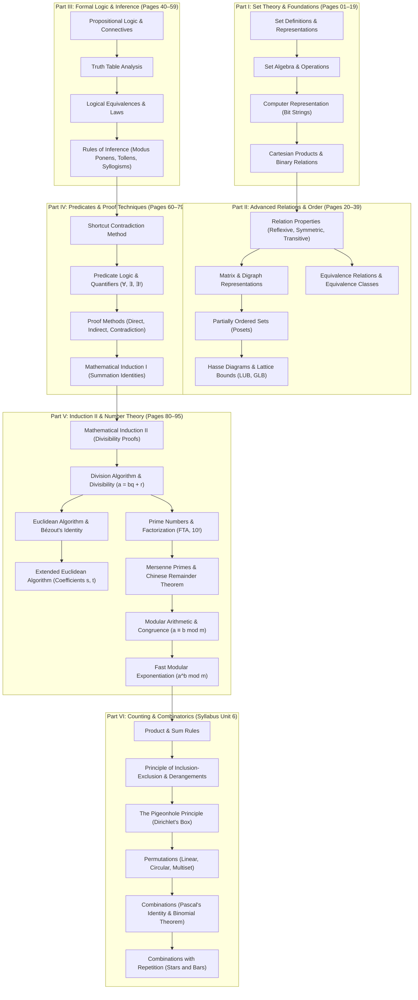

# ECE 2213: Discrete Mathematics — Master Study Index & Comprehensive Course Guide

**Course**: ECE 2213 — Numerical Methods & Discrete Mathematics (Section 2: Discrete Mathematics)  
**Student Notes Source**: Shishir (Roll: 2310002) & ECE 2213 Course Curriculum  
**Total Source Pages**: 95 Handwritten Pages + Combinatorics Completion Module (6 Master Modules)  
**Primary PDF**: [`Discrete Math By Shishir 2310002.pdf`](file:///home/azaz/AntigravityxStudy/SemesterFinal_2_2/ECE_2213/DiscreteMath_note_by_Shishir/Discrete%20Math%20By%20Shishir%202310002.pdf)  
**Syllabus Reference**: [`ECE2213_Syllabus.md`](file:///home/azaz/AntigravityxStudy/SemesterFinal_2_2/ECE_2213/DiscreteMath_note_by_Shishir/ECE2213_Syllabus.md)  
**Digitization Protocol**: Clean Obsidian-compatible Markdown, full KaTeX mathematical expressions, verbatim transcriptions with translated student insights, isolated `$$` fences, and 19 visually verified cropped diagrams.

---

## 1. Six-Module Modular Document Index

| Module | File Link | Source Coverage | Core Topics | Cropped Diagrams |
|:---:|:---|:---:|:---|:---:|
| **Module 1** | [[01_Set_Theory_and_Relations_Basics|01: Set Theory & Relations Basics]] | Pages 01–19 | Set representation, standard number sets, set operations, laws of set algebra, multisets, bit strings, Cartesian products, relation definitions, reflexivity & irreflexivity. | 3 |
| **Module 2** | [[02_Relations_Posets_and_Equivalence|02: Relations, Posets & Equivalence]] | Pages 20–39 | Symmetry, antisymmetry, transitivity, 0-1 matrix representation, digraphs, inverse & composition, Posets, Hasse diagrams, extremal bounds (LUB, GLB), equivalence relations & classes. | 6 |
| **Module 3** | [[03_Propositional_Logic_and_Inference|03: Propositional Logic & Inference]] | Pages 40–59 | Propositions, logical connectives, truth tables, conditional variants, tautology/contradiction, logical equivalence laws, Rules of Inference (Modus Ponens, Modus Tollens, Syllogisms), argument validity. | 4 |
| **Module 4** | [[04_Predicates_Proofs_and_Induction_I|04: Predicates, Proofs & Induction I]] | Pages 60–79 | Shortcut contradiction method for argument validity, predicate logic, universal & existential quantifiers, translation between English & logic, proof methods (Direct, Contrapositive, Contradiction), Mathematical Induction Part 1 (summations & series). | 2 |
| **Module 5** | [[05_Induction_II_and_Number_Theory|05: Induction II & Number Theory]] | Pages 80–95 | Induction Part 2 (Divisibility proofs), Division Algorithm, Greatest Common Divisor ($\gcd$), Euclidean Algorithm, Extended Euclidean Algorithm, Bézout's identity, prime factorization, Mersenne primes, Chinese Remainder Theorem (CRT), modular arithmetic, negative modulo, fast modular exponentiation. | 4 |
| **Module 6** | [[06_Counting_Pigeonhole_and_Combinatorics|06: Counting, Pigeonhole Principle & Combinatorics]] | Syllabus Unit 6 | Product & Sum Rules, Principle of Inclusion-Exclusion (General $n$-set, Derangements), The Pigeonhole Principle (Standard & Generalized $\lceil N/k \rceil$, Dirichlet's proofs), Permutations ($P(n, r)$, Circular, Multiset), Combinations ($C(n, r)$, Pascal's Identity, Binomial Theorem, Stars and Bars combinations with repetition). | — |
| **Total** | **6 Master Modules** | **Complete Semester Curriculum** | **100% Course Syllabus Coverage** | **19 Diagrams** |

---

## 2. Curriculum Concept Flow & Architectural Graph

---

## 3. Syllabus Mapping: Course Modules to Chapter Sections

| Official Syllabus Topic | Chapter Coverage | Primary Pages / Scope | Key Theoretical Highlights |
|:---|:---|:---:|:---|
| **1. Set Theory** | [[01_Set_Theory_and_Relations_Basics|Chapter 01]] | pp. 01–15 | Roster & Set-Builder notation; Power sets ($2^n$ cardinality); De Morgan's Laws; Bit-string operations; Principle of Inclusion-Exclusion. |
| **2. Relations & Posets** | [[01_Set_Theory_and_Relations_Basics|Chapter 01]] & [[02_Relations_Posets_and_Equivalence|Chapter 02]] | pp. 16–39 | $R \subseteq A \times B$; Matrix $M_R$; Digraphs; Reflexive, Irreflexive, Symmetric, Antisymmetric, Transitive; Poset definition $(S, \le)$; Hasse diagram reductions; LUB/GLB; Equivalence classes $[a]$. |
| **3. Propositional Logic** | [[03_Propositional_Logic_and_Inference|Chapter 03]] & [[04_Predicates_Proofs_and_Induction_I|Chapter 04]] | pp. 40–69 | Propositions; Connectives ($\neg, \land, \lor, \to, \leftrightarrow$); Converse, Inverse, Contrapositive; Tautology vs Contradiction; Rules of Inference; Shortcut Contradiction Method; Predicates $P(x)$; Universal ($\forall$) & Existential ($\exists$) quantifiers. |
| **4. Proof Techniques & Induction** | [[04_Predicates_Proofs_and_Induction_I|Chapter 04]] & [[05_Induction_II_and_Number_Theory|Chapter 05]] | pp. 70–80 | Direct Proof; Contraposition ($\neg q \to \neg p$); Reductio ad Absurdum; Principle of Mathematical Induction (Base step, Inductive hypothesis, Inductive step); Series summations $\sum i, \sum i(i+1), \sum (2i-1)^2, \sum i^3$; Divisibility induction ($8^n - 3^n$). |
| **5. Number Theory & Modular Arithmetic** | [[05_Induction_II_and_Number_Theory|Chapter 05]] | pp. 81–95 | Division Algorithm ($a = bq + r$); Euclidean Algorithm ($\gcd(a, b) = \gcd(b, r)$); Bézout's identity ($d = xa + yb$); Extended Euclidean Algorithm ($s, t$ recurrence); Fundamental Theorem of Arithmetic; Prime factorization of $10!$; Mersenne primes ($2^n - 1$); Chinese Remainder Theorem (CRT); Congruence modulo $m$ ($a \equiv b \pmod m$); Scientific calculator modulo algorithm; Negative residues; Fast modular exponentiation ($a^b \bmod m$). |
| **6. Introduction to Counting** | [[06_Counting_Pigeonhole_and_Combinatorics|Chapter 06]] & [[01_Set_Theory_and_Relations_Basics|Chapter 01]] | Module 06 & p. 15 | Product Rule ($n_1 n_2$); Sum Rule ($n_1 + n_2$); Generalized Inclusion-Exclusion; Derangements $D_n$; Pigeonhole Principle (Standard & Generalized $\lceil N/k \rceil$); Permutations $P(n, r) = \frac{n!}{(n-r)!}$; Circular Permutations $(n-1)!$; Combinations $C(n, r) = \binom{n}{r}$; Pascal's Identity $\binom{n+1}{r} = \binom{n}{r-1} + \binom{n}{r}$; Binomial Theorem; Stars and Bars $\binom{n+r-1}{r}$. |

---

## 4. Master Formula & Theorem Quick-Reference Cheatsheet

### 4.1 Set Theory & Relations
- **Cardinality of Power Set**:
  $$
  |P(A)| = 2^{|A|}
  $$
- **Total Possible Relations on Set $A$**:
  $$
  2^{n^2}, \quad \text{where } n = |A|
  $$
- **Principle of Inclusion-Exclusion**:
  $$
  |A \cup B| = |A| + |B| - |A \cap B|
  $$
  $$
  |A \cup B \cup C| = |A| + |B| + |C| - |A \cap B| - |B \cap C| - |C \cap A| + |A \cap B \cap C|
  $$
- **Relation Axiomatic Properties**:
  - *Reflexive*: $\forall x \in A, (x, x) \in R$
  - *Irreflexive*: $\forall x \in A, (x, x) \notin R$
  - *Symmetric*: $(x, y) \in R \implies (y, x) \in R$
  - *Antisymmetric*: $(x, y) \in R \land (y, x) \in R \implies x = y$
  - *Asymmetric*: $(x, y) \in R \implies (y, x) \notin R$ (Antisymmetric $+$ Irreflexive)
  - *Transitive*: $(x, y) \in R \land (y, z) \in R \implies (x, z) \in R$
  - *Equivalence Relation*: Reflexive $+$ Symmetric $+$ Transitive
  - *Partial Order (Poset)*: Reflexive $+$ Antisymmetric $+$ Transitive

---

### 4.2 Logic & Inference Rules
- **Implication Equivalence**:
  $$
  p \to q \equiv \neg p \lor q
  $$
- **Contrapositive Equivalence**:
  $$
  p \to q \equiv \neg q \to \neg p
  $$
- **De Morgan's Laws (Logic)**:
  $$
  \neg(p \land q) \equiv \neg p \lor \neg q, \quad \neg(p \lor q) \equiv \neg p \land \neg q
  $$
- **Quantifier Negations**:
  $$
  \neg \forall x P(x) \equiv \exists x \neg P(x), \quad \neg \exists x P(x) \equiv \forall x \neg P(x)
  $$
- **Primary Inference Rules**:
  - *Modus Ponens*: $[p \land (p \to q)] \implies q$
  - *Modus Tollens*: $[\neg q \land (p \to q)] \implies \neg p$
  - *Hypothetical Syllogism*: $[(p \to q) \land (q \to r)] \implies (p \to r)$
  - *Disjunctive Syllogism*: $[(p \lor q) \land \neg p] \implies q$

---

### 4.3 Mathematical Induction Key Identities
- **Sum of First $n$ Integers**:
  $$
  1 + 2 + 3 + \dots + n = \frac{n(n+1)}{2}
  $$
- **Sum of Products of Consecutive Integers**:
  $$
  1 \cdot 2 + 2 \cdot 3 + \dots + n(n+1) = \frac{n(n+1)(n+2)}{3}
  $$
- **Sum of Squares of Odd Integers**:
  $$
  1^2 + 3^2 + 5^2 + \dots + (2n-1)^2 = \frac{n(2n-1)(2n+1)}{3}
  $$
- **Sum of Cubes**:
  $$
  1^3 + 2^3 + 3^3 + \dots + n^3 = \frac{n^2(n+1)^2}{4} = \left[\frac{n(n+1)}{2}\right]^2
  $$
- **Divisibility Identity**:
  $$
  a^{k+1} - b^{k+1} = a \cdot a^k - b \cdot b^k = (a - b)a^k + b(a^k - b^k)
  $$

---

### 4.4 Number Theory & Modular Arithmetic
- **The Division Algorithm**:
  $$
  a = bq + r, \quad 0 \le r < |b|
  $$
- **Euclidean Algorithm Invariance**:
  $$
  \gcd(a, b) = \gcd(b, a \bmod b)
  $$
- **Bézout's Identity**:
  $$
  \gcd(a, b) = sa + tb \quad (s, t \in \mathbb{Z})
  $$
- **Extended Euclidean Algorithm Recurrence**:
  $$
  s = s_1 - s_2 q, \quad t = t_1 - t_2 q \quad (\text{init: } s_1=1, s_2=0; t_1=0, t_2=1)
  $$
- **Fundamental Theorem of Arithmetic**:
  $$
  n = \prod_{i=1}^k p_i^{a_i} = p_1^{a_1} p_2^{a_2} \cdots p_k^{a_k}
  $$
- **Mersenne Primes**:
  $$
  M_n = 2^n - 1 \quad (n \text{ is prime})
  $$
- **Chinese Remainder Theorem (CRT)**:
  $$
  N = \prod n_i, \quad N_i = \frac{N}{n_i}, \quad N_i N_i^{-1} \equiv 1 \pmod{n_i}
  $$
  $$
  x \equiv \sum_{i=1}^k a_i N_i N_i^{-1} \pmod N
  $$
- **Congruence Relation**:
  $$
  a \equiv b \pmod m \iff m \mid (a - b) \iff a \bmod m = b \bmod m
  $$
- **Negative Modulo Normalization**:
  $$
  \text{If } b < 0, \quad b \bmod m = (b + km) \pmod m \quad \text{such that } 0 \le b + km < m
  $$
- **Calculator Modulo Formula**:
  $$
  a \bmod m = \left( \frac{a}{m} - \left\lfloor \frac{a}{m} \right\rfloor \right) \times m
  $$

---

### 4.5 Counting & Combinatorics
- **Product Rule**:
  $$
  \text{Outcomes} = n_1 \times n_2 \times \dots \times n_k
  $$
- **Sum Rule (Disjoint)**:
  $$
  \text{Outcomes} = n_1 + n_2 + \dots + n_k
  $$
- **Generalized Pigeonhole Principle**:
  $$
  \text{At least one box contains } \ge \left\lceil \frac{N}{k} \right\rceil \text{ objects}
  $$
- **$r$-Permutation (Order matters, No repetition)**:
  $$
  P(n, r) = \frac{n!}{(n - r)!}
  $$
- **Circular Permutations**:
  $$
  P_{\text{circ}} = (n - 1)! \quad (\text{or } \frac{(n-1)!}{2} \text{ for flip-symmetric})
  $$
- **Multiset Permutations**:
  $$
  \frac{n!}{n_1! \, n_2! \, \dots \, n_k!}
  $$
- **$r$-Combination (Order does not matter, No repetition)**:
  $$
  C(n, r) = \binom{n}{r} = \frac{n!}{r!(n - r)!}
  $$
- **Pascal's Identity**:
  $$
  \binom{n + 1}{r} = \binom{n}{r - 1} + \binom{n}{r}
  $$
- **The Binomial Theorem**:
  $$
  (x + y)^n = \sum_{k=0}^n \binom{n}{k} x^{n - k} y^k
  $$
- **Combinations with Repetition (Stars and Bars)**:
  $$
  \binom{n + r - 1}{r} = \frac{(n + r - 1)!}{r!(n - 1)!}
  $$
- **Derangements (No Fixed Points)**:
  $$
  D_n = n! \sum_{k=0}^n \frac{(-1)^k}{k!}
  $$

---

## 5. Comprehensive Visual Catalog (All 19 Cropped Diagrams)

| Figure ID | File Path | Batch & Page | Description & Content |
|:---|:---|:---:|:---|
| `Fig_Set_07.1` | `diagrams/fig_set_p07_venn_intro.jpg` | Batch 1, p. 07 | Hand-drawn Venn diagram introducing overlapping sets $A$ and $B$ inside universal set $U$. |
| `Fig_Set_10.1` | `diagrams/fig_set_p10_assoc_symmetric_diff.jpg` | Batch 1, p. 10 | Hand-drawn multi-region Venn diagrams proving associativity of symmetric difference $(A \oplus B) \oplus C$. |
| `Fig_Rel_17.1` | `diagrams/fig_rel_p17_divides_graph.jpg` | Batch 1, p. 17 | Directed graph representation of the divisibility relation on finite set $\{1, 2, 3, 4\}$. |
| `Fig_Rel_32.1` | `diagrams/fig_rel_p32_digraph_divisibility.jpg` | Batch 2, p. 32 | Digraph of the partial order relation $a \mid b$ on $\{1, 2, 3, 4, 6, 8, 12, 24\}$ with all directed loops and edges. |
| `Fig_Rel_33.1` | `diagrams/fig_rel_p33_digraph_no_transitive.jpg` | Batch 2, p. 33 | Digraph after removing self-loops and transitive edges prior to Hasse diagram conversion. |
| `Fig_Rel_33.2` | `diagrams/fig_rel_p33_hasse_diagram.jpg` | Batch 2, p. 33 | Completed upright Hasse diagram of the divisibility relation on $\{1, 2, 3, 4, 6, 8, 12, 24\}$. |
| `Fig_Rel_34.1` | `diagrams/fig_rel_p34_hasse_chain_reduction.jpg` | Batch 2, p. 34 | Step-by-step reduction from full relation digraph to minimal Hasse diagram for subset inclusion. |
| `Fig_Rel_35.1` | `diagrams/fig_rel_p35_hasse_ge_chain.jpg` | Batch 2, p. 35 | Linear vertical chain Hasse diagram for the greater-than-or-equal relation $(\ge)$ on $\{1, 2, 3, 4, 5\}$. |
| `Fig_Rel_36.1` | `diagrams/fig_rel_p36_hasse_divisibility_multiples.jpg` | Batch 2, p. 36 | Branched Hasse diagram for divisibility poset on $\{1, 2, 3, 4, 6, 12\}$. |
| `Fig_Logic_51.1` | `diagrams/fig_logic_p51_truth_table_tautology.jpg` | Batch 3, p. 51 | Hand-drawn 8-row truth table proving $(p \lor q) \land (\neg p \lor r) \to (q \lor r)$ is a tautology. |
| `Fig_Logic_52.1` | `diagrams/fig_logic_p52_truth_table_equivalence.jpg` | Batch 3, p. 52 | Truth table evaluation proving logical equivalence $p \leftrightarrow q \equiv (p \to q) \land (q \to p)$. |
| `Fig_Logic_58.1` | `diagrams/fig_logic_p58_modus_ponens_tollens.jpg` | Batch 3, p. 58 | Handwritten truth table verification of Modus Ponens and Modus Tollens rules of inference. |
| `Fig_Logic_59.1` | `diagrams/fig_logic_p59_hypothetical_disjunctive_syllogism.jpg` | Batch 3, p. 59 | Verification table for Hypothetical Syllogism and Disjunctive Syllogism. |
| `Fig_Logic_62.1` | `diagrams/fig_logic_p62_shortcut_contradiction_method.jpg` | Batch 4, p. 62 | Visual branching schema demonstrating the shortcut contradiction method for argument validity. |
| `Fig_Pred_63.1` | `diagrams/fig_pred_p63_quantifiers_classification.jpg` | Batch 4, p. 63 | Hierarchical classification chart of quantifiers into Universal ($\forall$), Existential ($\exists$), and Uniqueness ($\exists!$). |
| `Fig_Num_81.1` | `diagrams/fig_num_p81_division_algorithm_schematic.jpg` | Batch 5, p. 81 | Arithmetic division bracket layout showing Divisor ($b$), Dividend ($a$), Quotient ($q$), and Remainder ($r$). |
| `Fig_Num_83.1` | `diagrams/fig_num_p83_euclidean_table.jpg` | Batch 5, p. 83 | Tabular Euclidean Algorithm division chain for $\gcd(26, 118)$ showing diagonal shift of $(b, r) \to (a, b)$. |
| `Fig_Num_84.1` | `diagrams/fig_num_p84_extended_euclidean_table.jpg` | Batch 5, p. 84 | Ten-column Extended Euclidean Algorithm matrix computing Bézout coefficients $s, t$ for $\gcd(275, 200) = 25$. |
| `Fig_Num_89.1` | `diagrams/fig_num_p89_calculator_mod_trick.jpg` | Batch 5, p. 89 | Visual calculation flow of the 3-step scientific calculator method for computing $a \bmod m$. |

---

## 6. Alphabetical Topic Directory with Exact Obsidian Wikilinks

- **A**
  - Additive Inverse in $\mathbb{Z}_n$: [[05_Induction_II_and_Number_Theory#10.2 Additive Inverse in $\mathbb{Z}_n$|Chapter 05 (p. 93)]]
  - Antisymmetric Relations: [[02_Relations_Posets_and_Equivalence#4. Antisymmetric Relation|Chapter 02 (p. 21)]]
  - Argument Validity: [[03_Propositional_Logic_and_Inference#9.1 Definition of a Valid Argument|Chapter 03 (p. 54)]], [[04_Predicates_Proofs_and_Induction_I#1. Argument Validity Problem Solving|Chapter 04 (p. 60)]]
  - Asymmetric Relations: [[02_Relations_Posets_and_Equivalence#6. Asymmetric Relation|Chapter 02 (p. 22)]]
- **B**
  - Bézout's Identity: [[05_Induction_II_and_Number_Theory#2.5 The Euclidean Algorithm & Bézout's Identity|Chapter 05 (p. 82)]]
  - Binary Relations: [[01_Set_Theory_and_Relations_Basics#1. Definition of Binary Relation|Chapter 01 (p. 16)]]
  - Binomial Theorem: [[06_Counting_Pigeonhole_and_Combinatorics#5.3 The Binomial Theorem|Chapter 06]]
  - Bit-String Set Representation: [[01_Set_Theory_and_Relations_Basics#Computer Representation of Sets|Chapter 01 (p. 14)]]
- **C**
  - Calculator Modulo Trick: [[05_Induction_II_and_Number_Theory#6.1 Scientific Calculator Algorithm for Modulo|Chapter 05 (p. 89)]]
  - Chinese Remainder Theorem (CRT): [[05_Induction_II_and_Number_Theory#5.2 The Chinese Remainder Theorem (CRT)|Chapter 05 (pp. 87–88)]]
  - Circular Permutations: [[06_Counting_Pigeonhole_and_Combinatorics#4.3 Circular Permutations|Chapter 06]]
  - Combinations ($C(n, r)$): [[06_Counting_Pigeonhole_and_Combinatorics#5. Combinations|Chapter 06]]
  - Combinations with Repetition: [[06_Counting_Pigeonhole_and_Combinatorics#5.4 Combinations with Repetition (Stars and Bars Theorem)|Chapter 06]]
  - Complement of a Set: [[01_Set_Theory_and_Relations_Basics#6. Venn Diagrams & Fundamental Set Operations|Chapter 01 (p. 06)]]
  - Congruence Modulo $m$: [[05_Induction_II_and_Number_Theory#7. Congruence Modulo $m$|Chapter 05 (pp. 90–91)]]
- **D**
  - De Morgan's Laws: [[01_Set_Theory_and_Relations_Basics#10. Algebraic Properties of Sets|Chapter 01 (p. 08)]], [[03_Propositional_Logic_and_Inference#Summary of 15 Core Laws|Chapter 03 (p. 49)]], [[04_Predicates_Proofs_and_Induction_I#2.3 Negation of Quantified Statements (De Morgan's Laws for Quantifiers)|Chapter 04 (p. 64)]]
  - Derangements: [[06_Counting_Pigeonhole_and_Combinatorics#2.4 Derangements (Permutations with No Fixed Points)|Chapter 06]]
  - Digraph Representation of Relations: [[02_Relations_Posets_and_Equivalence#8. Hasse Diagrams|Chapter 02 (pp. 26–27)]]
  - Direct Proof: [[04_Predicates_Proofs_and_Induction_I#4.1 Direct Proof|Chapter 04 (p. 70)]]
  - Disjunctive Syllogism: [[03_Propositional_Logic_and_Inference#10.4 Disjunctive Syllogism|Chapter 03 (p. 59)]]
  - Division Algorithm: [[05_Induction_II_and_Number_Theory#2.1 The Division Algorithm|Chapter 05 (p. 81)]]
- **E**
  - Equivalence Relations & Classes: [[02_Relations_Posets_and_Equivalence#12. Equivalence Relations|Chapter 02 (pp. 37–39)]]
  - Euclidean Algorithm: [[05_Induction_II_and_Number_Theory#2.5 The Euclidean Algorithm & Bézout's Identity|Chapter 05 (pp. 82–83)]]
  - Extended Euclidean Algorithm: [[05_Induction_II_and_Number_Theory#3. The Extended Euclidean Algorithm|Chapter 05 (pp. 84–85)]]
- **F**
  - Fast Modular Exponentiation: [[05_Induction_II_and_Number_Theory#10.3 Fast Modular Exponentiation|Chapter 05 (pp. 93–95)]]
  - Fundamental Theorem of Arithmetic: [[05_Induction_II_and_Number_Theory#4.1 The Fundamental Theorem of Arithmetic|Chapter 05 (p. 86)]]
- **G**
  - Greatest Common Divisor ($\gcd$): [[05_Induction_II_and_Number_Theory#2.2 Greatest Common Divisor ($\gcd$)|Chapter 05 (pp. 81–83)]]
  - Greatest Lower Bound (GLB / Infimum): [[02_Relations_Posets_and_Equivalence#C. Extremal Elements and Bounds in Posets|Chapter 02 (pp. 35–36)]]
- **H**
  - Hasse Diagrams: [[02_Relations_Posets_and_Equivalence#8. Hasse Diagrams|Chapter 02 (pp. 33–36)]]
  - Hypothetical Syllogism: [[03_Propositional_Logic_and_Inference#10.3 Hypothetical Syllogism (Chain Rule / Transitivity of Implication)|Chapter 03 (p. 59)]]
- **I**
  - Inclusion-Exclusion Principle: [[01_Set_Theory_and_Relations_Basics#11. Principle of Inclusion-Exclusion (PIE) & Cardinality Formulas|Chapter 01 (p. 15)]], [[06_Counting_Pigeonhole_and_Combinatorics#2. The Principle of Inclusion-Exclusion (PIE)|Chapter 06]]
  - Indirect Proof (Contraposition): [[04_Predicates_Proofs_and_Induction_I#4.3 Indirect Proof (Proof by Contraposition)|Chapter 04 (p. 71)]]
  - Induction on Series: [[04_Predicates_Proofs_and_Induction_I#5. Principle of Mathematical Induction (PMI) — Part I|Chapter 04 (pp. 75–79)]]
  - Induction on Divisibility: [[05_Induction_II_and_Number_Theory#1. Mathematical Induction: Divisibility Proofs (Continued)|Chapter 05 (p. 80)]]
  - Inverse Relations: [[02_Relations_Posets_and_Equivalence#Core Theory & Properties|Chapter 02 (p. 28)]]
- **L**
  - Least Upper Bound (LUB / Supremum): [[02_Relations_Posets_and_Equivalence#C. Extremal Elements and Bounds in Posets|Chapter 02 (pp. 35–36)]]
  - Logical Equivalences: [[03_Propositional_Logic_and_Inference#6. Fundamental Laws of Propositional Logic|Chapter 03 (pp. 48–53)]]
- **M**
  - Matrix Representation of Relations ($M_R$): [[02_Relations_Posets_and_Equivalence#A. Matrix Representation of Relations (0-1 Matrices $M_R$)|Chapter 02 (pp. 24–25)]]
  - Mersenne Primes: [[05_Induction_II_and_Number_Theory#5.1 Mersenne Prime Numbers|Chapter 05 (p. 87)]]
  - Modus Ponens: [[03_Propositional_Logic_and_Inference#10.1 Modus Ponens (Law of Detachment)|Chapter 03 (p. 58)]]
  - Modus Tollens: [[03_Propositional_Logic_and_Inference#10.2 Modus Tollens (Law of Contraposition / Denying the Consequent)|Chapter 03 (p. 58)]]
  - Multisets: [[01_Set_Theory_and_Relations_Basics#9. Multisets (Bags)|Chapter 01 (pp. 10–11)]]
- **N**
  - Negative Modulo Evaluation: [[05_Induction_II_and_Number_Theory#8.2 Calculating Modulo of Negative Integers: $-8 \bmod 5$|Chapter 05 (p. 91)]]
- **P**
  - Partially Ordered Sets (Posets): [[02_Relations_Posets_and_Equivalence#5. Partially Ordered Sets (Posets)|Chapter 02 (pp. 30–36)]]
  - Pascal's Identity: [[06_Counting_Pigeonhole_and_Combinatorics#5.2 Pascal's Identity & Triangle|Chapter 06]]
  - Permutations ($P(n, r)$): [[06_Counting_Pigeonhole_and_Combinatorics#4. Permutations|Chapter 06]]
  - Pigeonhole Principle: [[06_Counting_Pigeonhole_and_Combinatorics#3. The Pigeonhole Principle (Dirichlet's Box Principle)|Chapter 06]]
  - Power Sets: [[01_Set_Theory_and_Relations_Basics#h) Power Set ($P(S)$)|Chapter 01 (p. 04)]]
  - Predicate Logic & Quantifiers: [[04_Predicates_Proofs_and_Induction_I#2. Predicate Logic & Quantifiers|Chapter 04 (pp. 63–69)]]
  - Prime Factorization of $10!$: [[05_Induction_II_and_Number_Theory#4.2 Prime Factorization Problem Solving|Chapter 05 (p. 86)]]
  - Product Rule: [[06_Counting_Pigeonhole_and_Combinatorics#1.1 The Product Rule (Rule of Sequential Operations)|Chapter 06]]
  - Proof by Contradiction: [[04_Predicates_Proofs_and_Induction_I#4.5 Proof by Contradiction (*Reductio ad Absurdum*)|Chapter 04 (pp. 72–73)]]
- **R**
  - Reflexive Relations: [[01_Set_Theory_and_Relations_Basics#1. Reflexive Relation|Chapter 01 (pp. 18–19)]]
  - Rules of Inference: [[03_Propositional_Logic_and_Inference#10. Fundamental Rules of Inference|Chapter 03 (pp. 54–59)]]
- **S**
  - Shortcut Contradiction Method: [[04_Predicates_Proofs_and_Induction_I#1.2 Multi-Premise Complex Arguments & The Shortcut Contradiction Method|Chapter 04 (pp. 61–62)]]
  - Sum Rule: [[06_Counting_Pigeonhole_and_Combinatorics#1.2 The Sum Rule (Rule of Disjoint Alternatives)|Chapter 06]]
  - Symmetric Difference ($\oplus$): [[01_Set_Theory_and_Relations_Basics#7. Symmetric Difference of Sets ($\oplus$)|Chapter 01 (pp. 09–10)]]
  - Symmetric Relations: [[02_Relations_Posets_and_Equivalence#3. Symmetric Relation|Chapter 02 (pp. 20–21)]]
- **T**
  - Tautology & Contradiction: [[03_Propositional_Logic_and_Inference#5. Tautology, Contradiction, and Contingency|Chapter 03 (pp. 46–47)]]
  - Transitive Relations: [[02_Relations_Posets_and_Equivalence#5. Transitive Relation|Chapter 02 (p. 23)]]
  - Truth Tables: [[03_Propositional_Logic_and_Inference#2. Basic Truth Tables of Connectives|Chapter 03 (pp. 42–47)]]
