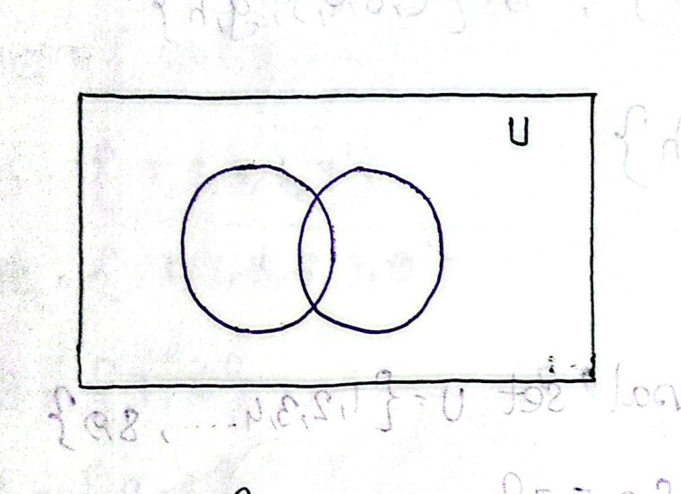
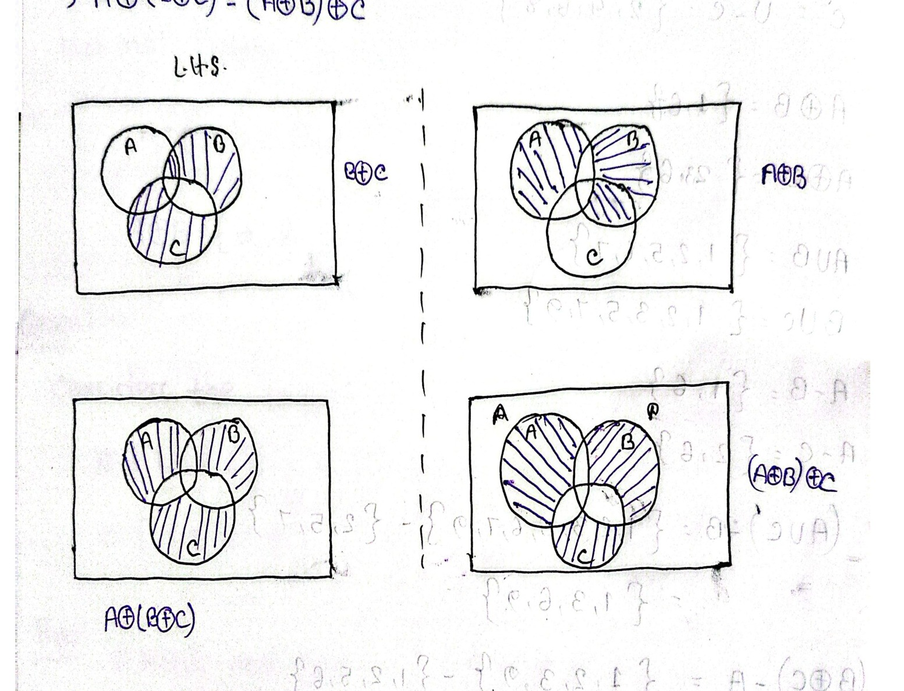
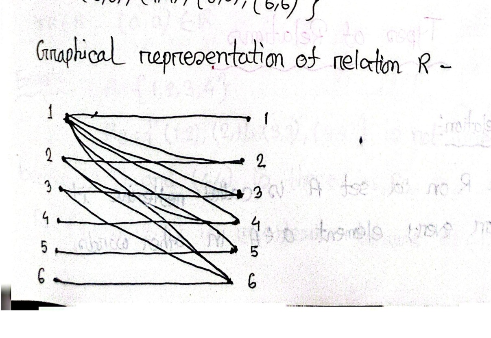

# ECE 2213: Set Theory & Relations Basics (Batch 1: Pages 01–19)

**Course**: ECE 2213 — Discrete Mathematics  
**Student**: Shishir (Roll: 2310002)  
**Batch**: 1 of 5 (Pages 01 – 19)  
**Topics Covered**: Set Theory Foundations, Set Operations & Venn Diagrams, Multisets, Bit-String Computer Representations, Algebraic Properties & Principle of Inclusion-Exclusion, Introduction to Binary Relations & Elementary Properties (Reflexive, Irreflexive).

---

<!-- Page 1 -->

## Set Theory Foundations
## 1. Definition of a Set

A **set** is a collection of well-defined objects.
- Sets are conventionally denoted by capital letters ($A, B, C, \dots, U$).

---

## 2. Representation of Sets

Sets can be represented using three primary methods:

```text
                      Representation of Set
         ┌──────────────────────┼──────────────────────┐
         ▼                      ▼                      ▼
   Roster Method       Set-Builder Method      Statement Method
```

### 1. Roster Method (Tabular Form)
- Used when the elements are finite or limited and can be explicitly listed within curly brackets.
- **Example**:
  $$A = \{\text{Sun}, \text{Mon}, \text{Tues}, \text{Thur}\}$$

### 2. Set-Builder Method (Rule Form)
- Used when the collection of elements is large, infinite, or defined by a common governing property.
- **Example**:
  $$A = \{x \mid x \text{ is a natural number},\ x < 50\}$$

### 3. Statement Method (Descriptive Form)
- The elements are described by a clear verbal statement enclosed in quotes or words.
- **Example**:
  $$\text{"Set of even numbers less than 8"}$$

---

## 3. Standard Number Sets

| Symbol | Meaning | Elements / Range |
| :---: | :--- | :--- |
| $\mathbb{N}$ | Natural Numbers | $1, 2, 3, \dots, \infty$ |
| $\mathbb{Z}$ | Integers | $-\infty, \dots, -3, -2, -1, 0, 1, 2, 3, \dots, \infty$ |
| $\mathbb{Q}$ | Rational Numbers | $\frac{p}{q}, \quad q \neq 0 \quad (p, q \in \mathbb{Z})$ |
| $\mathbb{I}$ | Irrational Numbers | Numbers not expressible as $\frac{p}{q}$ (e.g., $\sqrt{3}, \pi, e$) |
| $\mathbb{R}$ | Real Numbers | All rational and irrational numbers along the continuous number line |

---

<!-- Page 2 -->

## 4. Types of Sets

### a) Universal Set ($U$)
- A **universal set** is the set containing all possible elements under current consideration or discussion.
- Denoted by $U$.
- **Example**: 
  $$U = \{\text{Animals on the earth}\}$$

### b) Singleton Set
- A set containing exactly a single element.
- **Example**:
  $$A = \{5\}$$

### c) Finite Set
- A set where the total number of elements is countable / finite.
- **Example**:
  $$A = \{1, 2, 3, 4\}$$

### d) Infinite Set
- A set where the total number of elements is infinite (uncountable or endlessly continuing).
- **Example**:
  $$A = \{1, 2, 3, 4, \dots\}$$

---

<!-- Page 3 -->

### e) Null Set / Empty Set ($\emptyset$)
- A set that contains no elements at all.
- Denoted by $\emptyset$ or empty braces $\{\}$.
- **Example**:
  $$A = \{\} = \emptyset$$

### f) Subset ($\subseteq$)
- A set $A$ is called a **subset** of a set $B$ if every element of $A$ is also an element of $B$.
- **Notation**: $A \subseteq B$
- **Example**:
  $$\text{Let } A = \{1, 2\} \quad \text{and} \quad B = \{1, 2, 3\}$$
  $$\text{Here, } A \subseteq B$$

### g) Superset ($\supseteq$)
- A set $B$ is called a **superset** of a set $A$ if $B$ contains all the elements belonging to $A$. It is simply the reverse perspective of a subset relationship.
- **Notation**: $B \supseteq A$
- **Example**:
  $$A = \{1, 2\} \quad \text{and} \quad B = \{1, 2, 3\} \implies B \supseteq A$$

---

<!-- Page 4 -->

### h) Power Set ($P(S)$)
- The **power set** of a set $S$ is the set containing all possible subsets of $S$, including the empty set ($\emptyset$) and the set $S$ itself.
- **Notation**: $P(S)$
- **Formula**: If a set $S$ has $n$ elements ($|S| = n$), its power set $P(S)$ contains $2^n$ elements:
  $$|P(S)| = 2^n$$
- **Example**:
  $$\text{If } S = \{1, 2\}$$
  $$\text{Then } |S| = 2 \implies |P(S)| = 2^2 = 4$$
  $$P(S) = \big\{ \emptyset, \{1\}, \{2\}, \{1, 2\} \big\}$$

### i) Disjoint Sets
- Two sets $A$ and $B$ are called **disjoint sets** if they share no elements in common. Their intersection is an empty set.
- **Condition**: 
  $$A \cap B = \emptyset$$
- **Example**:
  $$A = \{1, 3, 5\} \quad \text{and} \quad B = \{2, 4, 6\}$$
  $$A \cap B = \emptyset \implies A \text{ and } B \text{ are disjoint.}$$

---

<!-- Page 5 -->

### j) Equal Sets
- Two sets $A$ and $B$ are called **equal sets** if they contain exactly the same elements, regardless of element order or repetition.
- **Condition**: 
  $$A \subseteq B \quad \text{and} \quad B \subseteq A \iff A = B$$
- **Example**:
  $$\text{Let } A = \{1, 2, 3\} \quad \text{and} \quad B = \{3, 1, 2\}$$
  $$A = B \quad \text{(both sets contain the exact same numbers)}$$

### k) Equivalent Sets
- Two sets $A$ and $B$ are called **equivalent sets** if they have the same cardinality (the same number of elements). The actual elements do not need to match.
- **Condition**:
  $$n(A) = n(B) \quad \text{or} \quad |A| = |B|$$
- **Example**:
  $$A = \{a, b, c\} \quad \text{and} \quad B = \{1, 2, 3\}$$
  $$n(A) = 3 \quad \text{and} \quad n(B) = 3$$
  $$\text{Therefore, } A \text{ and } B \text{ are equivalent sets.}$$

---

<!-- Page 6 -->

### l) Overlapping Sets (Intersecting Sets)
- Two sets $A$ and $B$ are called **overlapping sets** if they have at least one element in common, but neither set is completely contained within the other.
- **Condition**:
  $$A \cap B \neq \emptyset, \quad A \not\subseteq B, \quad \text{and} \quad B \not\subseteq A$$
- **Example**:
  $$A = \{1, 2, 3, 4\} \quad \text{and} \quad B = \{3, 4, 5, 6\}$$
  $$A \cap B = \{3, 4\} \neq \emptyset$$
  $$\text{Hence, } A \text{ and } B \text{ are overlapping sets.}$$

---

## 5. Cardinality of a Set

- The **cardinality** of a set is the total number of distinct elements present in the set.
- Denoted by:
  $$|A| \quad \text{or} \quad n(A)$$
- **Example**:
  $$A = \{3, 4, 6, 8\}$$
  $$|A| = 4, \quad n(A) = 4$$

---

<!-- Page 7 -->

## 6. Venn Diagrams & Fundamental Set Operations

A **Venn diagram** is a pictorial representation of relationships and operations between sets:
- The universal set $U$ is conventionally represented by a **rectangle**.
- Subsets of $U$ are represented by **circles** or closed curves inside the rectangle.


*Figure 7.1 — Basic Venn diagram structure showing universal set $U$ with subsets (Page 07)*

### Worked Example:
Given:
$$U = \{1, 2, 3, 4, 5\}$$
$$A = \{1, 2, 3\}$$
$$B = \{2, 3, 4, 5\}$$

1. **Union ($A \cup B$)**:
   The set of all elements belonging to $A$, to $B$, or to both:
   $$A \cup B = \{1, 2, 3, 4, 5\}$$

2. **Intersection ($A \cap B$)**:
   The set of elements common to both $A$ and $B$:
   $$A \cap B = \{2, 3\}$$

3. **Complement ($A'$ or $A^c$ or $\overline{A}$)**:
   The set of elements in the universal set $U$ that do not belong to $A$:
   $$A^c = U - A = \{4, 5\}$$
   $$B^c = U - B = \{1\}$$

4. **Difference ($A - B$)**:
   The set of elements belonging to $A$ but not to $B$:
   $$A - B = \{1\}$$

---

<!-- Page 8 -->

## 7. Symmetric Difference of Sets ($\oplus$)

- **Definition**: The symmetric difference of two sets $A$ and $B$, denoted by $A \oplus B$ (or $A\ \Delta\ B$), consists of all elements that belong to $A$ or to $B$, but **not to both**.
- **Formal Expression**:
  $$A \oplus B = (A - B) \cup (B - A) = (A \cup B) - (A \cap B)$$
- **Example**:
  $$\text{Let } A = \{a, b, c, d, e, f\} \quad \text{and} \quad B = \{c, d, e, f, g, h\}$$
  $$A - B = \{a, b\}$$
  $$B - A = \{g, h\}$$
  $$A \oplus B = \{a, b, g, h\}$$

---

### Practice Problem: Universal Set & Operations

**Question**:  
Consider the universal set:
$$U = \{1, 2, 3, 4, 5, 6, 7, 8, 9\}$$
$$\text{With subsets: } A = \{1, 2, 5, 6\}, \quad B = \{2, 5, 7\}, \quad C = \{1, 3, 5, 7, 9\}$$

Find the following:
i) $A \cap B$ and $A \cap C$  
ii) $A^c$ and $C^c$  
iii) $A \oplus B$ and $A \oplus C$  
iv) $A \cup B$ and $B \cup C$  
v) $A - B$ and $A - C$  
vi) $(A \cup C) - B$ and $(B \oplus C) - A$  

---

<!-- Page 9 -->

### Problem Solutions:

#### i) Intersections:
- $A \cap B = \{1, 2, 5, 6\} \cap \{2, 5, 7\} = \{2, 5\}$
- $A \cap C = \{1, 2, 5, 6\} \cap \{1, 3, 5, 7, 9\} = \{1, 5\}$

#### ii) Complements:
- $A^c = U - A = \{1, 2, 3, 4, 5, 6, 7, 8, 9\} - \{1, 2, 5, 6\} = \{3, 4, 7, 8, 9\}$
- $C^c = U - C = \{1, 2, 3, 4, 5, 6, 7, 8, 9\} - \{1, 3, 5, 7, 9\} = \{2, 4, 6, 8\}$

#### iii) Symmetric Differences:
- $A \oplus B = (A \cup B) - (A \cap B)$:
  $$A \cup B = \{1, 2, 5, 6, 7\}$$
  $$A \cap B = \{2, 5\}$$
  $$A \oplus B = \{1, 6, 7\}$$
- $A \oplus C = (A \cup C) - (A \cap C)$:
  $$A \cup C = \{1, 2, 3, 5, 6, 7, 9\}$$
  $$A \cap C = \{1, 5\}$$
  $$A \oplus C = \{2, 3, 6, 7, 9\}$$

#### iv) Unions:
- $A \cup B = \{1, 2, 5, 6, 7\}$
- $B \cup C = \{2, 5, 7\} \cup \{1, 3, 5, 7, 9\} = \{1, 2, 3, 5, 7, 9\}$

#### v) Differences:
- $A - B = \{1, 2, 5, 6\} - \{2, 5, 7\} = \{1, 6\}$
- $A - C = \{1, 2, 5, 6\} - \{1, 3, 5, 7, 9\} = \{2, 6\}$

#### vi) Compound Operations:
- $(A \cup C) - B$:
  $$(A \cup C) - B = \{1, 2, 3, 5, 6, 7, 9\} - \{2, 5, 7\} = \{1, 3, 6, 9\}$$
- $(B \oplus C) - A$:
  $$B \oplus C = (B \cup C) - (B \cap C) = \{1, 2, 3, 5, 7, 9\} - \{5, 7\} = \{1, 2, 3, 9\}$$
  $$(B \oplus C) - A = \{1, 2, 3, 9\} - \{1, 2, 5, 6\} = \{3, 9\}$$

---

<!-- Page 10 -->

## 8. Venn Diagram Proof: Associativity of Symmetric Difference

**Problem**:  
Using Venn diagrams, prove or disprove whether symmetric difference is associative:
$$A \oplus (B \oplus C) = (A \oplus B) \oplus C$$


*Figure 10.1 — Venn diagram proof verifying associativity of symmetric difference: L.H.S. matches R.H.S. (Page 10)*

### Step-by-Step Breakdown:
1. **Left-Hand Side (L.H.S.)**:
   - Construct $B \oplus C$: Shaded regions include parts of $B$ not in $C$, and parts of $C$ not in $B$.
   - Construct $A \oplus (B \oplus C)$: Taking symmetric difference of $A$ with the shaded $B \oplus C$ yields:
     $$\text{Shaded} = (\text{elements in exactly one of } A, B, C) \cup (\text{elements in all three: } A \cap B \cap C)$$

2. **Right-Hand Side (R.H.S.)**:
   - Construct $A \oplus B$: Shaded regions include parts of $A$ not in $B$, and parts of $B$ not in $A$.
   - Construct $(A \oplus B) \oplus C$: Taking symmetric difference with $C$ yields the exact same shaded region:
     $$\text{Shaded} = (\text{elements in exactly one of } A, B, C) \cup (\text{elements in all three: } A \cap B \cap C)$$

**Conclusion**: Since the shaded regions in the final Venn diagrams of L.H.S. and R.H.S. are identical, the identity is **proven**:
$$A \oplus (B \oplus C) = (A \oplus B) \oplus C$$

---

## 9. Multisets (Bags)

- **Definition**: A **multiset** (also referred to as an *m-set* or *bag*) is an unordered collection of elements where multiple copies (repetitions) of the same object are permitted.
- **Notation**: Elements of a multiset are enclosed in square brackets `[ ... ]`.
- **Multiplicity**: The number of times an element occurs in a multiset is called its *multiplicity*.
- **Example**:
  $$M = [a, b, b, c, a]$$
  Here, $a$ has multiplicity 2, $b$ has multiplicity 2, and $c$ has multiplicity 1.

---

<!-- Page 11 -->

### Multiset Operations Example

**Problem**:  
Let $A$ and $B$ be two multisets:
$$A = [a, a, b, b, c, f]$$
$$B = [a, a, b, b, d, d]$$

Find:  
a) $A \cup B$  
b) $A \cap B$  
c) $A - B$  
d) $B - A$  

> [!note] Student Insight / Rule of Thumb
> *"First, take all the common elements up to their maximum multiplicity, and then include all the remaining non-common elements."*  
> - For Union: $\text{multiplicity in } (A \cup B) = \max\big(m_A(x), m_B(x)\big)$  
> - For Intersection: $\text{multiplicity in } (A \cap B) = \min\big(m_A(x), m_B(x)\big)$  
> - For Difference: $\text{multiplicity in } (A - B) = \max\big(0, m_A(x) - m_B(x)\big)$

#### Solutions:
- **a) Union ($A \cup B$)**:
  $$A \cup B = [a, a, b, b, c, f, d, d]$$
  *(Common elements $a$ and $b$ each appear with multiplicity $\max(2,2)=2$; then distinct elements $c, f, d, d$ are added).*

- **b) Intersection ($A \cap B$)**:
  $$A \cap B = [a, a, b, b]$$
  *(Elements $a$ and $b$ appear with multiplicity $\min(2,2)=2$).*

- **c) Difference ($A - B$)**:
  $$A - B = [c, f]$$
  *(Removing elements of $B$ from $A$ leaves $c$ and $f$).*

- **d) Difference ($B - A$)**:
  $$B - A = [d, d]$$
  *(Removing elements of $A$ from $B$ leaves two copies of $d$).*

---

## Computer Representation of Sets
When learning discrete mathematics, representing sets on a computer boils down to one fundamental principle: **computers only understand $0$s and $1$s (bits)**.

### Illustrative Example: Attendance Tracking

Imagine a classroom with 5 students ordered fixedly on an attendance sheet:
$$\text{Class List: } [\text{Alice}, \text{Bob}, \text{Charlie}, \text{David}, \text{Eve}]$$

---

<!-- Page 12 -->

If only Alice and Charlie come to class today, how does the teacher mark attendance?
- Alice $\to$ Present ($1$)
- Bob $\to$ Absent ($0$)
- Charlie $\to$ Present ($1$)
- David $\to$ Absent ($0$)
- Eve $\to$ Absent ($0$)

The attendance for today is stored as a **bit string**:
$$\mathbf{10100}$$

---

### Conceptual Set Example: Bit Strings

Let the universal set be fixed as:
$$U = \{1, 2, 3, 4, 5\}$$

Represent two subsets $A$ and $B$:
- $\text{Set } A = \{1, 3, 5\}$
- $\text{Set } B = \{2, 3, 4\}$

---

<!-- Page 13 -->

### Bit Vector Table:

| Element of $U$ | Bit for $A$ | Bit for $B$ |
| :---: | :---: | :---: |
| **1** | 1 | 0 |
| **2** | 0 | 1 |
| **3** | 1 | 1 |
| **4** | 0 | 1 |
| **5** | 1 | 0 |

- Bit representation of $A$:
  $$\text{Bit string}(A) = \mathbf{10101}$$
- Bit representation of $B$:
  $$\text{Bit string}(B) = \mathbf{01110}$$

---

### Performing Set Operations via Bit-Wise Logic

#### 1. Intersection ($A \cap B$) $\to$ Bitwise AND ($\land$)
A bit in the result is $1$ if and only if both corresponding bits are $1$:

$$
\begin{array}{rcc}
A & = & 10101 \\
B & = & 01110 \\
\hline
A \cap B & = & \mathbf{00100}
\end{array}
$$

$$\implies \text{Only the 3rd element (3) is present.}$$
$$\text{Therefore, } A \cap B = \{3\}$$

#### 2. Union ($A \cup B$) $\to$ Bitwise OR ($\lor$)
To combine all elements, a bit is $1$ if at least one set has a $1$:

$$
\begin{array}{rcc}
A & = & 10101 \\
B & = & 01110 \\
\hline
A \cup B & = & \mathbf{11111}
\end{array}
$$

$$\implies \text{All elements } \{1, 2, 3, 4, 5\} \text{ are present.}$$
$$\text{Therefore, } A \cup B = \{1, 2, 3, 4, 5\}$$

---

<!-- Page 14 -->

#### 3. Complement ($\overline{A}$) $\to$ Bitwise NOT ($\sim$ / $\neg$)
To find everything NOT in $A$, flip every individual bit:

$$
\begin{array}{rcc}
A & = & 10101 \\
\hline
\overline{A} & = & \mathbf{01010}
\end{array}
$$

$$\implies \text{Elements at positions 2 and 4 are present.}$$
$$\text{Therefore, } \overline{A} = \{2, 4\}$$

---

## 10. Algebraic Properties of Sets

### 1. Commutative Properties:
$$A \cup B = B \cup A$$
$$A \cap B = B \cap A$$

### 2. Associative Properties:
$$A \cup (B \cup C) = (A \cup B) \cup C$$
$$A \cap (B \cap C) = (A \cap B) \cap C$$

---

<!-- Page 15 -->

### 3. Distributive Properties:
$$A \cap (B \cup C) = (A \cap B) \cup (A \cap C)$$
$$A \cup (B \cap C) = (A \cup B) \cap (A \cup C)$$

---

## 11. Principle of Inclusion-Exclusion (PIE) & Cardinality Formulas

### 1. Two Sets Cardinality Formula:
$$n(A \cup B) = n(A) + n(B) - n(A \cap B)$$
$$\iff n(A \cap B) = n(A) + n(B) - n(A \cup B)$$

### 2. Relative Difference Cardinality Formulas:
$$n(A - B) = n(A) - n(A \cap B)$$
$$n(B - A) = n(B) - n(A \cap B)$$

### 3. Complement Partition Formula:
$$n(A) + n(A') = n(U)$$

### 4. Three Sets Inclusion-Exclusion Formula:
$$n(A \cup B \cup C) = n(A) + n(B) + n(C) - n(A \cap B) - n(B \cap C) - n(C \cap A) + n(A \cap B \cap C)$$

---

<!-- Page 16 -->

## Introduction to Relations
## 1. Definition of Binary Relation

Let $A$ and $B$ be two sets. A **binary relation** $R$ from $A$ to $B$ is defined as a subset of the Cartesian product $A \times B$:
$$R \subseteq A \times B$$

### Recall: Cartesian Product
$$A \times B = \{(a, b) \mid a \in A \text{ and } b \in B\}$$

### Notation:
- If $(a, b) \in R$, we write:
  $$a R b \quad (\text{"}a\text{ is related to }b\text{"})$$
- If $(a, b) \notin R$, we write:
  $$a \not R b \quad (\text{"}a\text{ is not related to }b\text{"})$$

---

### Example:
Let:
$$A = \{1, 2, 3\} \quad \text{and} \quad B = \{0, 1, 2, 4\}$$

The Cartesian product $A \times B$ contains $3 \times 4 = 12$ ordered pairs:
$$A \times B = \big\{(1,0), (1,1), (1,2), (1,4), (2,0), (2,1), (2,2), (2,4), (3,0), (3,1), (3,2), (3,4)\big\}$$

Let $R$ be the relation where $(a, b) \in R$ if and only if $a = b$:
$$R = \{(1, 1), (2, 2)\}$$
Notice that $R \subseteq A \times B$.

---

<!-- Page 17 -->

## 2. Representations of Relations

### Graphical Representation of Ordered Pairs (Bipartite Mapping)
Arrows are drawn from elements of set $A$ to elements of set $B$ to represent each ordered pair in relation $R$:
- If $A = \{1, 2, 3\}$ and $B = \{0, 1, 2, 4\}$ with $R = \{(1, 1), (2, 2)\}$:
  - An arrow goes from $1 \in A$ to $1 \in B$.
  - An arrow goes from $2 \in A$ to $2 \in B$.

---

## 3. Relation on a Set to Itself

A relation on a single set $A$ is defined as a relation from $A$ to $A$:
$$R \subseteq A \times A$$

### Example: Divisibility Relation
Let set $A = \{1, 2, 3, 4, 5, 6\}$.  
Let relation $R$ be defined as:
$$R = \{(a, b) \mid a \text{ divides } b\}$$

The ordered pairs satisfying $a \mid b$ (i.e., $b \bmod a = 0$) are:
$$R = \big\{(1, 1), (1, 2), (1, 3), (1, 4), (1, 5), (1, 6), (2, 2), (2, 4), (2, 6), (3, 3), (3, 6), (4, 4), (5, 5), (6, 6)\big\}$$


*Figure 17.1 — Bipartite graphical arrow representation of relation $R = \{(a, b) \mid a \mid b\}$ on $A = \{1, 2, 3, 4, 5, 6\}$ (Page 17)*

---

<!-- Page 18 -->

## 4. Number of Relations on a Set with $n$ Elements

A relation on a set $A$ is any subset of $A \times A$.
1. Let set $A$ contain $n$ elements:
   $$|A| = n$$
2. The Cartesian product $A \times A$ contains $n \times n = n^2$ elements:
   $$|A \times A| = n^2$$
3. Listing down all possible relations on set $A$ is equivalent to finding the power set of $A \times A$:
   $$P(A \times A)$$
4. We know that if a set has $m$ elements, its power set has $2^m$ elements.
5. Therefore, the power set $P(A \times A)$ contains $2^{n^2}$ elements.

$$\mathbf{\text{Total number of relations on a set } A \text{ with } n \text{ elements} = |P(A \times A)| = 2^{n^2}}$$

---

## 5. Types of Relations

### 1. Reflexive Relation
A relation $R$ on a set $A$ is called **reflexive** if every element in $A$ is related to itself:
$$\forall a \in A, \quad (a, a) \in R$$

---

<!-- Page 19 -->

#### Examples of Reflexive Relations:
Let $A = \{1, 2, 3, 4\}$.  
All elements must have self-pairs: $(1, 1), (2, 2), (3, 3), (4, 4) \in R$.

- **Relation $R_1$**:
  $$R_1 = \{(1, 1), (1, 2), (2, 2), (2, 3), (3, 3), (4, 4)\}$$
  - **Verdict**: $R_1$ is **reflexive** because it contains all ordered pairs of the form $(a, a)$ for every element $a \in A$, namely $(1, 1), (2, 2), (3, 3), (4, 4)$.

- **Relation $R_2$**:
  $$R_2 = \{(1, 1), (1, 2), (2, 1), (2, 2), (3, 1), (4, 4)\}$$
  - **Verdict**: $R_2$ is **not reflexive** because the diagonal pair $(3, 3) \notin R_2$.

---

### 2. Irreflexive Relation
A relation $R$ on a set $A$ is called **irreflexive** if **no** element in $A$ is related to itself:
$$\forall a \in A, \quad (a, a) \notin R$$

#### Examples of Irreflexive Relations:
Let $A = \{1, 2, 3, 4\}$.

- **Relation $R_3$**:
  $$R_3 = \{(1, 2), (2, 1), (3, 3), (4, 4)\}$$
  - **Verdict**: $R_3$ is **not irreflexive** because diagonal pairs $(3, 3)$ and $(4, 4)$ are present in $R_3$. (It is also not reflexive since $(1, 1)$ and $(2, 2)$ are missing).

- **Relation $R_4$**:
  $$R_4 = \{(1, 2), (2, 1)\}$$
  - **Verdict**: $R_4$ is **irreflexive** because for all $a \in A$, $(a, a) \notin R_4$.

---

## Next Chapter Preview
In **Batch 2** ([[02_Relations_Posets_and_Equivalence|02_Relations_Posets_and_Equivalence.md]]):
- Symmetric, Antisymmetric, Asymmetric, and Transitive Relations
- Matrix Representation ($M_R$) and Digraphs
- Partially Ordered Sets (Posets), Hasse Diagrams, and Lattices
- Equivalence Relations, Equivalence Classes, and Set Partitions

---

**Navigation**: [[00_Discrete_Mathematics_Index|📋 Master Study Index]] | [[02_Relations_Posets_and_Equivalence|➡ Next: Batch 2 (Pages 20–39)]]
