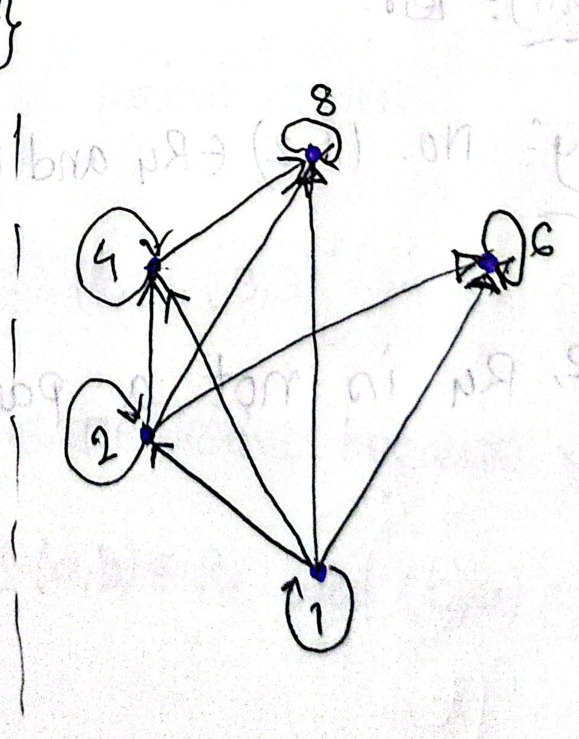
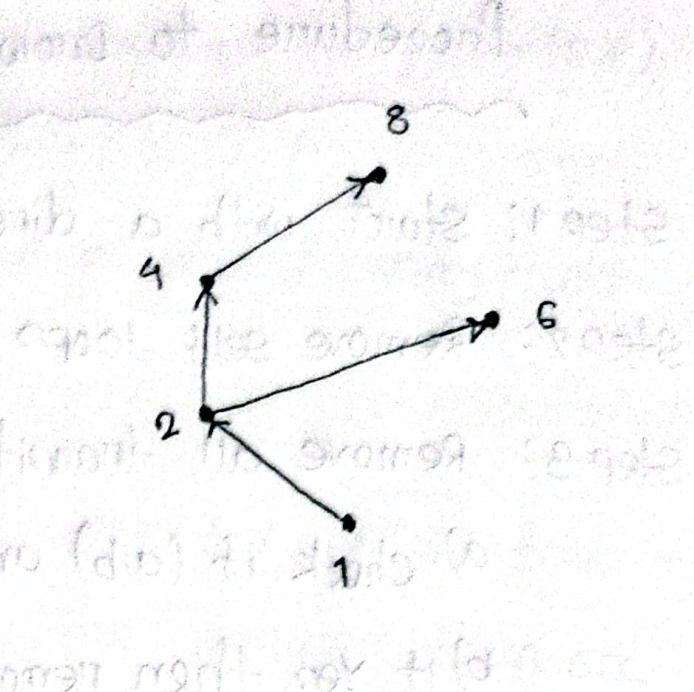
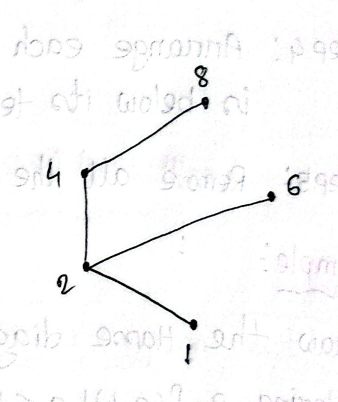
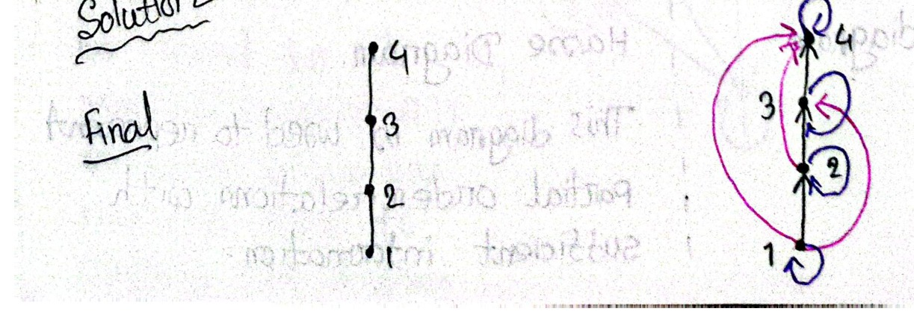
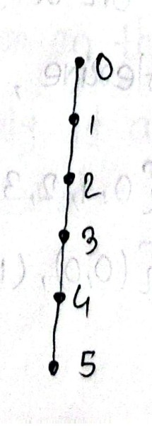
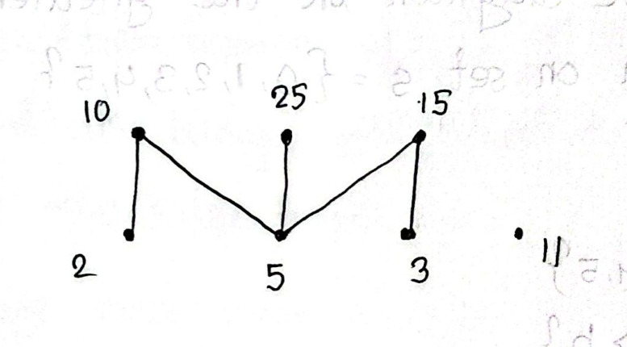

# ECE 2213: Relations, Posets, Hasse Diagrams & Equivalence Relations (Batch 2: Pages 20–39)

**Course**: ECE 2213 — Discrete Mathematics  
**Student**: Shishir (Roll: 2310002)  
**Batch**: 2 of 5 (Pages 20 – 39)  
**Topics Covered**: Types of Relations (Symmetric, Antisymmetric, Asymmetric, Transitive); Binary Relations & Real-World Intuition; Domain & Range Problems; Partially Ordered Sets (Posets); Comparable vs. Incomparable Elements; Poset Verification Proofs (Power Sets, Divisibility); Hasse Diagrams (5-Step Construction Methodology, Removing Self-Loops and Transitive Edges); Linear Orders & Chains; Divisibility Hasse Diagrams; Equivalence Relations (Definition, Counterexamples, and Formal Integer Proofs); Matrix Representation & Poset Extremal Bounds.

---

<!-- Page 20 -->

## Core Theory & Properties
## 1. Types of Relations (Continued)

### 3. Symmetric Relation

#### Definition: Symmetric Relation
A relation $R$ on a set $A$ is called **symmetric** if $(b, a) \in R$ holds whenever $(a, b) \in R$ for all $a, b \in A$.

In formal logic notation:
$$\forall a \, \forall b \, \Big((a, b) \in R \implies (b, a) \in R\Big)$$

> [!note] Student Insight / Key Intuition
> If an arrow goes from $a$ to $b$, there must be a return arrow coming back from $b$ to $a$. If $(a, b)$ is present, its mirror pair $(b, a)$ must also be present.

#### Examples: Symmetric Relation

- **Example 1 ($R_5$ is Symmetric)**:
  Let $A = \{1, 2\}$.
  $$R_5 = \big\{(1, 1), (1, 2), (2, 1), (2, 2)\big\}$$
  - For the pair $(1, 2) \in R_5$, the reverse pair $(2, 1)$ is also in $R_5$.
  - For the diagonal pairs $(1, 1)$ and $(2, 2)$, their reverse pairs are themselves, which are already in $R_5$.
  - > [!tip] Verification Shortcut
    > **There is no need to check diagonal pairs $(1, 1)$ and $(2, 2)$**, because reversing identical elements $(a, a)$ yields $(a, a)$, which trivially belongs to $R$.
  - Therefore, $R_5$ is **symmetric**.

- **Example 2 ($R_6$ is Not Symmetric)**:
  $$R_6 = \big\{(1, 1), (1, 2), (1, 3), (1, 4)\big\}$$
  - The pair $(1, 2) \in R_6$, but $(2, 1) \notin R_6$.
  - Similarly, $(1, 3) \in R_6$ but $(3, 1) \notin R_6$; and $(1, 4) \in R_6$ but $(4, 1) \notin R_6$.
  - Therefore, $R_6$ is **not symmetric**.

---

<!-- Page 21 -->

### 4. Antisymmetric Relation

#### Definition: Antisymmetric Relation
A relation $R$ on a set $A$ is called **antisymmetric** if:
$$\forall a \, \forall b \, \Big(\big((a, b) \in R \land (b, a) \in R\big) \implies (a = b)\Big)$$

> [!note] Student Insight / Key Intuition
> *"Whenever we have $(a, b)$ in $R$, we will never have $(b, a)$ in $R$ until or unless $a = b$."*  
> Stated contrapositively: If $a \neq b$, then $(a, b)$ and $(b, a)$ can **never both be in $R$ simultaneously**. Two distinct elements can never point to each other in both directions.

#### Example
Let $A = \{1, 2\}$.
$$R_7 = \big\{(1, 1), (2, 1)\big\}$$
- $(2, 1) \in R_7$, but the reverse pair $(1, 2) \notin R_7$.
- For $(1, 1)$, $a = b = 1$, which satisfies $a = b$.
- Therefore, $R_7$ is **antisymmetric**.

---

### 5. Transitive Relation

#### Definition: Transitive Relation
A relation $R$ on a set $A$ is called **transitive** if:
$$\forall a \, \forall b \, \forall c \, \Big(\big((a, b) \in R \land (b, c) \in R\big) \implies (a, c) \in R\Big)$$

> [!note] Student Insight / Key Intuition
> If there is a path from $a$ to $b$ and a path from $b$ to $c$, there must exist a direct "shortcut" edge directly from $a$ to $c$.

#### Examples: Transitive Relation

- **Example 1 ($R_8$ is Transitive)**:
  Let $A = \{1, 2, 3, 4\}$.
  $$R_8 = \big\{(2, 1), (3, 1), (3, 2), (4, 4)\big\}$$
  - Checking chained pairs:
    $$(3, 2) \in R_8 \quad \text{and} \quad (2, 1) \in R_8 \implies (3, 1) \in R_8$$
  - Since $(3, 1)$ is present in $R_8$, the condition is satisfied.
  - The isolated diagonal element $(4, 4)$ does not chain with any distinct element.
  - Therefore, $R_8$ is **transitive**.

- **Example 2 ($R_9$ is Not Transitive)**:
  $$R_9 = \big\{(2, 1), (1, 3)\big\}$$
  - Here, $(2, 1) \in R_9$ and $(1, 3) \in R_9$.
  - For transitivity, $(2, 3)$ must be in $R_9$.
  - However, $(2, 3) \notin R_9$.
  - Therefore, $R_9$ is **not transitive**.

---

<!-- Page 22 -->

### 6. Asymmetric Relation

#### Definition: Asymmetric Relation
A relation $R$ on a set $A$ is called **asymmetric** if:
$$\forall a \, \forall b \, \Big((a, b) \in R \implies (b, a) \notin R\Big)$$

> [!important] Crucial Difference: Asymmetric vs. Antisymmetric
> - **Antisymmetric**: Allows self-pairs $(a, a) \in R$ (because if $a = b$, both $(a, b)$ and $(b, a)$ being in $R$ is permitted).
> - **Asymmetric**: Strictly **forbids all self-pairs $(a, a)$**! If $(a, a) \in R$, then taking $b = a$ yields $(a, a) \in R \implies (a, a) \notin R$, a direct contradiction.
> - **Mathematical Fact**: A relation is asymmetric if and only if it is **both antisymmetric and irreflexive**.

#### Examples
Let $A = \{1, 2, 3, 4\}$.

- **Example 1 ($R_{10}$ is Not Asymmetric)**:
  $$R_{10} = \big\{(1, 1), (1, 2), (1, 3)\big\}$$
  - $R_{10}$ is **not asymmetric** because it contains the diagonal pair $(1, 1)$.

- **Example 2 ($R_{11}$ is Asymmetric)**:
  $$R_{11} = \big\{(1, 3), (2, 3)\big\}$$
  - $(1, 3) \in R_{11} \implies (3, 1) \notin R_{11}$ (Satisfied).
  - $(2, 3) \in R_{11} \implies (3, 2) \notin R_{11}$ (Satisfied).
  - Contains no self-pairs $(a, a)$.
  - Therefore, $R_{11}$ is an **asymmetric relation**.

---

## 2. Summary Table of Relation Properties

| # | Relation Property | Formal Mathematical Condition | Plain English Meaning |
| :-: | :--- | :--- | :--- |
| **1** | **Reflexive** | $\forall a \in A \, \big((a, a) \in R\big)$ | Every element is related to itself. |
| **2** | **Irreflexive** | $\forall a \in A \, \big((a, a) \notin R\big)$ | No element is related to itself (no self-loops). |
| **3** | **Symmetric** | $\forall a, b \in A \, \big((a, b) \in R \implies (b, a) \in R\big)$ | All connections are two-way bidirectional. |
| **4** | **Antisymmetric** | $\forall a, b \in A \, \Big(\big((a, b) \in R \land (b, a) \in R\big) \implies a = b\Big)$ | No two distinct elements have two-way connections. |
| **5** | **Asymmetric** | $\forall a, b \in A \, \big((a, b) \in R \implies (b, a) \notin R\big)$ | Strictly strictly one-way; no self-loops allowed. |
| **6** | **Transitive** | $\forall a, b, c \in A \, \Big(\big((a, b) \in R \land (b, c) \in R\big) \implies (a, c) \in R\Big)$ | Two-step paths imply a direct one-step shortcut. |

---

<!-- Page 23 -->

## 3. Binary Relations — Concepts & Intuition

### Definition & Terminology
The word **"Binary"** simply means **"two"**. In discrete mathematics, a **Binary Relation** is a rule that links elements from two sets together (or links elements of a single set to each other).

Formally, a binary relation from set $A$ to set $B$ is a subset of the Cartesian product $A \times B$:
$$R \subseteq A \times B$$

### The Real-World Intuition
Imagine you have a set of students ($A$) and a set of programming languages ($B$):
- Set of students: $A = \{\text{Alice}, \text{Bob}\}$
- Set of languages: $B = \{\text{C++}, \text{Python}\}$

Let us define a relation $R$ called:  
$$\text{"knows how to code in"}$$

If Alice knows both C++ and Python, but Bob only knows Python, our relation $R$ contains these specific ordered pairs:
$$R = \big\{(\text{Alice}, \text{C++}), \, (\text{Alice}, \text{Python}), \, (\text{Bob}, \text{Python})\big\}$$

> [!tip] Key Takeaway
> A relation $R$ is fundamentally a **collection of ordered pairs** satisfying a given condition.

---

<!-- Page 24 -->

## 4. Worked Problems on Binary Relations

### Problem 1: Relation Defined by Inequality Condition
**Question**: Let $A = \{1, 2, 3, 4\}$ and $B = \{1, 3, 5\}$. Let $R$ be a binary relation from $A$ to $B$ defined by:
$$R = \big\{(x, y) \mid y < x\big\}$$
Find $R$.

**Solution**:  
First, compute the full Cartesian product $A \times B$:
$$
A \times B = \left\{
\begin{matrix}
(1, 1), & (1, 3), & (1, 5), \\
(2, 1), & (2, 3), & (2, 5), \\
(3, 1), & (3, 3), & (3, 5), \\
(4, 1), & (4, 3), & (4, 5)
\end{matrix}
\right\}
$$

Now, filter for pairs $(x, y)$ satisfying the condition $y < x$:
- From row 1 ($x=1$): No $y \in B$ satisfies $y < 1$.
- From row 2 ($x=2$): $1 < 2 \implies (2, 1)$.
- From row 3 ($x=3$): $1 < 3 \implies (3, 1)$.
- From row 4 ($x=4$): $1 < 4 \implies (4, 1)$; and $3 < 4 \implies (4, 3)$.

$$\therefore R = \big\{(2, 1), (3, 1), (4, 1), (4, 3)\big\}$$

---

### Problem 2: Finding the Range from a Defined Domain
**Question**: The domain of a binary relation $R = \{(x, y) \mid y + 1 = 2x^2\}$ is the set of natural numbers $\mathbb{N}$. Find its range.

**Solution**:  
Given:
$$\text{Domain}(R) = \mathbb{N} = \{1, 2, 3, \dots\}$$
Express $y$ in terms of $x$:
$$y + 1 = 2x^2 \implies y = 2x^2 - 1$$

Evaluating for successive domain elements:
- If $x = 1 \implies y = 2(1)^2 - 1 = 2(1) - 1 = 1$
- If $x = 2 \implies y = 2(2)^2 - 1 = 2(4) - 1 = 7$
- If $x = 3 \implies y = 2(3)^2 - 1 = 2(9) - 1 = 17$
- If $x = 4 \implies y = 2(4)^2 - 1 = 2(16) - 1 = 31$

$$\therefore \text{Range}(R) = \{1, 7, 17, 31, \dots\}$$

---

<!-- Page 25 -->

## 5. Partially Ordered Sets (Posets)

### Example of Strict Inequality Relation
Let $A = \{1, 2, 3\}$. The full Cartesian product is:
$$A \times A = \big\{(1, 1), (1, 2), (1, 3), (2, 1), (2, 2), (2, 3), (3, 1), (3, 2), (3, 3)\big\}$$

Define relation $R$ by the rule: *"x is strictly less than y"* ($x < y$):
$$R = \big\{(1, 2), (1, 3), (2, 3)\big\}$$
*(Note: This relation is asymmetric, irreflexive, and transitive, but NOT a partial order because it lacks reflexivity).*

---

### Partial Ordering Definition
A relation $R$ on a set $S$ is called a **partial ordering** or **partial order** if it satisfies three axiomatic properties:

```text
                          Partial Ordering
                 ┌────────────────┼────────────────┐
                 ▼                ▼                ▼
             Reflexive      Antisymmetric      Transitive
```

1. **Reflexive**: Each element must be related to itself:
   $$\forall x \in S \, \big((x, x) \in R\big)$$
2. **Antisymmetric**: No two distinct elements can precede each other (ordering property):
   $$\forall x, y \in S \, \Big(\big((x, y) \in R \land (y, x) \in R\big) \implies x = y\Big)$$
3. **Transitive**: If the first element is related to the second, and the second is related to the third, then the first is related to the third:
   $$\forall x, y, z \in S \, \Big(\big((x, y) \in R \land (y, z) \in R\big) \implies (x, z) \in R\Big)$$

---

<!-- Page 26 -->

### Poset Notation
A set $S$ together with a partial order relation $R$ is called a **Partially Ordered Set** or **POSET**.
- Denoted by:
  $$(S, R) \quad \text{or} \quad (S, \preceq)$$
- where the notation $a \preceq b$ means "$a$ is related to $b$" under the partial order relation $R$ (i.e., $(a, b) \in R$).

---

### Example 1: Subset Inclusion Poset $(P(S), \subseteq)$
**Question**: Show that the relation $R = \{(a, b) \mid a \subseteq b\}$ defined on the power set of $S = \{1, 2, 3\}$ is a partial order relation.

**Solution**:  
A relation $R$ is a partial ordering if and only if it is reflexive, antisymmetric, and transitive.

Given set $S = \{1, 2, 3\}$. Its power set $P(S)$ has $2^3 = 8$ elements:
$$P(S) = \big\{ \emptyset, \{1\}, \{2\}, \{3\}, \{1, 2\}, \{2, 3\}, \{1, 3\}, \{1, 2, 3\} \big\}$$
The relation is $R = \{(a, b) \mid a \subseteq b\}$ for subsets $a, b \in P(S)$.

1. **Reflexivity**:
   - For every subset $a \in P(S)$, every set is a subset of itself:
     $$a \subseteq a$$
   - Hence, $(a, a) \in R$ for all $a \in P(S)$. $\implies$ **Reflexive**.
2. **Antisymmetry**:
   - For any subsets $a, b \in P(S)$:
     $$a \subseteq b \quad \text{and} \quad b \subseteq a \implies a = b$$
   - By definition of set equality, $a$ and $b$ must be identical. $\implies$ **Antisymmetric**.
3. **Transitivity**:
   - For any subsets $a, b, c \in P(S)$:
     $$a \subseteq b \quad \text{and} \quad b \subseteq c \implies a \subseteq c$$
   - Standard set containment is transitive. $\implies$ **Transitive**.

$$\therefore R \text{ is a partial order relation, and } (P(S), \subseteq) \text{ is a POSET.}$$

---

<!-- Page 27 -->

### Example 2: Divisibility Poset $(S, \mid)$
**Question**: Show that the relation $R = \{(a, b) \mid a \text{ divides } b\}$ defined on the set $S = \{1, 2, 3, 4, 6\}$ is a partial order relation.

**Solution**:  
Given $S = \{1, 2, 3, 4, 6\}$ and $R = \{(a, b) \mid a \mid b\}$.

1. **Reflexivity**:
   - For every integer $a \in S$, $a$ divides itself because $a = 1 \cdot a$.
   - Thus, $a \mid a$, which means $(a, a) \in R$ for all $a \in S$. $\implies$ **Reflexive**.
2. **Antisymmetry**:
   - Let $a, b \in S$. If $a \mid b$ and $b \mid a$:
   - Since all elements in $S$ are positive integers:
     $$a \mid b \implies a \le b \quad \text{and} \quad b \mid a \implies b \le a \implies a = b$$
   - Thus, $a \mid b \land b \mid a \implies a = b$. $\implies$ **Antisymmetric**.
3. **Transitivity**:
   - Let $a, b, c \in S$.
   - If $a \mid b$, then $b = k_1 a$ for some integer $k_1$.
   - If $b \mid c$, then $c = k_2 b$ for some integer $k_2$.
   - Substituting gives $c = k_2 (k_1 a) = (k_1 k_2) a$.
   - Therefore, $a \mid c$. $\implies$ **Transitive**.

$$\therefore R \text{ is a partial order relation, and } (S, \mid) \text{ is a POSET.}$$

---

<!-- Page 28 -->

## 6. Comparability in Posets

### Meaning of "Partial" Ordering
The word **"Partial"** in "partial ordering" indicates that **not every pair of elements in a set is comparable**. In other words, there can exist pairs of elements for which neither precedes the other.

### Comparable vs. Incomparable

#### 1. Comparable Elements
Two elements $a$ and $b$ of a poset $(S, R)$ are called **comparable** if:
$$a R b \quad \text{or} \quad b R a$$
Using poset notation:
$$a \preceq b \quad \text{or} \quad b \preceq a$$

#### 2. Incomparable Elements
Two elements $a$ and $b$ of a poset $(S, R)$ are called **incomparable** if:
$$\text{neither } a R b \text{ nor } b R a$$
Notation: $a \parallel b$.

> [!note] Student Note / Standard Notation
> We use the general symbol $\preceq$ in $(S, \preceq)$ to represent an arbitrary partial order relation, where $a \preceq b$ denotes $(a, b) \in R$.

---

<!-- Page 29 -->

### Example of Comparability
In the power set poset $(P(S), \subseteq)$ where $S = \{1, 2, 3\}$:
- Consider subsets $\{1, 3\}$ and $\{2\}$:
  $$\{1, 3\} \nsubseteq \{2\} \quad \text{and} \quad \{2\} \nsubseteq \{1, 3\}$$
  Therefore, $\{1, 3\}$ and $\{2\}$ are **incomparable**.
- Consider subsets $\{1\}$ and $\{1, 3\}$:
  $$\{1\} \subseteq \{1, 3\}$$
  Therefore, $\{1\}$ and $\{1, 3\}$ are **comparable**.

---

## 7. Poset Verification Problem

### Problem Statement: Poset Verification on Set A
Which of the following relations on set $A = \{0, 1, 2, 3\}$ are partial orderings? Determine the properties of a partial ordering that relations lack:
- **a)** $R_1 = \big\{(0, 0), (2, 2), (3, 3)\big\}$
- **b)** $R_2 = \big\{(0, 0), (1, 1), (2, 0), (2, 2), (2, 3), (3, 3)\big\}$
- **c)** $R_3 = \big\{(0, 0), (0, 1), (0, 2), (1, 0), (1, 1), (1, 2), (2, 0), (2, 2), (3, 3)\big\}$
- **d)** $R_4 = \big\{(0, 0), (1, 1), (1, 2), (1, 3), (2, 0), (2, 2), (2, 3), (3, 0), (3, 3)\big\}$

---

<!-- Page 30 -->

### Detailed Solutions (Parts a & b)

#### Part a: $R_1 = \{(0, 0), (2, 2), (3, 3)\}$ on $A = \{0, 1, 2, 3\}$
1. **Reflexivity**: **No**.
   - For $R_1$ to be reflexive, $(a, a) \in R_1$ must hold for all $a \in \{0, 1, 2, 3\}$.
   - Here, $(1, 1) \notin R_1$.
2. **Antisymmetry**: **Yes**.
   - If $(a, b) \in R_1$ and $(b, a) \in R_1$, then $a = b$.
   - All pairs in $R_1$ are diagonal pairs $(a, a)$, so antisymmetry holds vacuously for distinct elements.
3. **Transitivity**: **Yes**.
   - For all chained pairs $(a, b), (b, c) \in R_1$, $(a, c) \in R_1$ holds trivially.
   - For example: $(0, 0) \in R_1$ and $(0, 0) \in R_1 \implies a=0, b=0, c=0 \implies (0, 0) \in R_1$.

$$\therefore R_1 \text{ is \textbf{not} a partial order (lacks Reflexivity).}$$

---

#### Part b: $R_2 = \{(0, 0), (1, 1), (2, 0), (2, 2), (2, 3), (3, 3)\}$ on $A = \{0, 1, 2, 3\}$
1. **Reflexivity**: **Yes**.
   - Contains all required self-pairs: $(0, 0), (1, 1), (2, 2), (3, 3) \in R_2$.
   - $\forall a \in A \, \big((a, a) \in R_2\big)$ holds.
2. **Antisymmetry**: **Yes**.
   - Check non-diagonal pairs:
     - $(2, 0) \in R_2$, but $(0, 2) \notin R_2$.
     - $(2, 3) \in R_2$, but $(3, 2) \notin R_2$.
   - If $(a, b) \in R_2$ and $(b, a) \in R_2$, then $a = b$.
3. **Transitivity**: **Yes**.
   - Chained pairs:
     - $(2, 3) \in R_2$ and $(3, 3) \in R_2 \implies (2, 3) \in R_2$.
     - $(2, 0) \in R_2$ and $(0, 0) \in R_2 \implies (2, 0) \in R_2$.
   - No missing transitive links exist.

$$\therefore R_2 \text{ \textbf{is} a partial order.}$$

---

<!-- Page 31 -->

### Detailed Solutions (Parts c & d)

#### Part c: $R_3 = \{(0, 0), (0, 1), (0, 2), (1, 0), (1, 1), (1, 2), (2, 0), (2, 2), (3, 3)\}$
1. **Reflexivity**: **Yes**.
   - Contains $(0, 0), (1, 1), (2, 2), (3, 3)$. $\forall a \in A \, \big((a, a) \in R_3\big)$.
2. **Antisymmetry**: **No**.
   - $(0, 1) \in R_3$ and $(1, 0) \in R_3$, but $0 \neq 1$.
   - Similarly, $(0, 2) \in R_3$ and $(2, 0) \in R_3$, but $0 \neq 2$.
3. **Transitivity**: **No**.
   - $(2, 0) \in R_3$ and $(0, 1) \in R_3$, but the transitive pair $(2, 1) \notin R_3$.

$$\therefore R_3 \text{ is \textbf{not} a partial order (lacks Antisymmetry and Transitivity).}$$

---

#### Part d: $R_4 = \{(0, 0), (1, 1), (1, 2), (1, 3), (2, 0), (2, 2), (2, 3), (3, 0), (3, 3)\}$
1. **Reflexivity**: **Yes**.
   - Contains all diagonal elements: $(0, 0), (1, 1), (2, 2), (3, 3) \in R_4$.
2. **Antisymmetry**: **Yes**.
   - Check all pairs with distinct elements:
     - $(1, 2) \in R_4 \implies (2, 1) \notin R_4$
     - $(1, 3) \in R_4 \implies (3, 1) \notin R_4$
     - $(2, 0) \in R_4 \implies (0, 2) \notin R_4$
     - $(2, 3) \in R_4 \implies (3, 2) \notin R_4$
     - $(3, 0) \in R_4 \implies (0, 3) \notin R_4$
   - No symmetric pairs exist for distinct elements.
3. **Transitivity**: **No**.
   - $(1, 2) \in R_4$ and $(2, 0) \in R_4$, but $(1, 0) \notin R_4$.

$$\therefore R_4 \text{ is \textbf{not} a partial order (lacks Transitivity).}$$

---

<!-- Page 32 -->

## 8. Hasse Diagrams

### Motivation: Why Graphs?
It is always easy and intuitive to work with visual graphs. Using a graph to represent a partial order allows us to visually inspect orderings, bounds, and extremal elements.

### Transition from Directed Graph to Hasse Diagram
Let us represent the divisibility relation $R = \{(a, b) \mid a \mid b\}$ on the set $S = \{1, 2, 4, 6, 8\}$ using a directed graph.

The full relation contains 13 ordered pairs:
$$
R = \left\{
\begin{matrix}
(1, 1), & (2, 2), & (4, 4), & (6, 6), & (8, 8), \\
(1, 2), & (1, 4), & (1, 6), & (1, 8), \\
(2, 4), & (2, 6), & (2, 8), & (4, 8)
\end{matrix}
\right\}
$$

#### Step 1: Remove Self-Loops
- Self-loops are quite obvious and must be present at every vertex because $R$ is reflexive by definition of a partial order.
- Therefore, we can **remove all self-loops** to simplify the diagram without losing any information.


*Figure 2.1 — Initial directed graph for divisibility on $\{1, 2, 4, 6, 8\}$ with all self-loops and directed edges (Page 32)*

---

<!-- Page 33 -->

#### Step 2: Remove Transitive Edges
- It is quite obvious that if $a \mid b$ and $b \mid c$, then $a \mid c$.
  - For example: if $1 \mid 2$ and $2 \mid 4$, it is obvious that $1 \mid 4$.
  - If $1 \mid 2$ and $2 \mid 6$, it is obvious that $1 \mid 6$.
  - If $2 \mid 4$ and $4 \mid 8$, it is obvious that $2 \mid 8$.
  - If $1 \mid 2$, $2 \mid 4$, and $4 \mid 8$, it is obvious that $1 \mid 8$.
- Therefore, there is **no need to show transitive bypass edges** in the directed graph. Removing them dramatically simplifies the visual graph.


*Figure 2.2 — Directed graph after eliminating self-loops and all redundant transitive edges (Page 33)*

---

#### Step 3: Remove Arrowheads
- If we agree on the visual convention that **all edges point upwards**, there is no need to draw arrowheads on edges.
- An edge connecting $a$ to $b$ with $a$ lower than $b$ inherently signifies $a \preceq b$.
- We can safely **remove the arrows** from the diagram.


*Figure 2.3 — Final Hasse diagram for the divisibility relation on $\{1, 2, 4, 6, 8\}$ (Page 33)*

### Definition of Hasse Diagram
This simplified, non-redundant diagram is called the **Hasse Diagram**. It represents partial order relations with complete, sufficient mathematical information using the minimum number of edges.

---

<!-- Page 34 -->

## 9. Algorithmic Procedure to Draw a Hasse Diagram

To construct the Hasse diagram of a poset $(S, \preceq)$, follow these 5 standardized steps:

1. **Step 1**: Start with a directed graph representing the partial order relation $R$.
2. **Step 2**: Remove all self-loops at every vertex $(a, a)$.
3. **Step 3**: Remove all transitive edges:
   - Check if $(a, b) \in R$ and $(b, c) \in R$. If yes, remove the direct edge between $a$ and $c$.
   - If $(c, d)$ also belongs to the partial order, remove the edge $(a, d)$, and so on.
4. **Step 4**: Arrange each edge so that its initial vertex is placed strictly below its terminal vertex.
5. **Step 5**: Remove all arrowheads from the edges.

---

### Example: Linear Order $(\{1, 2, 3, 4\}, \le)$
**Question**: Draw the Hasse diagram representing the partial ordering $R = \{(a, b) \mid a \le b\}$ on set $S = \{1, 2, 3, 4\}$.

**Solution**:
- In the directed graph, every element has a self-loop, and there are transitive edges $(1 \to 3), (1 \to 4), (2 \to 4)$.
- Removing loops and transitive edges leaves only the immediate covering edges:
  $$1 \le 2, \quad 2 \le 3, \quad 3 \le 4$$
- Aligning elements vertically with 1 at the bottom produces a simple vertical chain:


*Figure 2.4 — Digraph reduction with eliminated self-loops and transitive edges alongside the final linear Hasse chain (Page 34)*

---

<!-- Page 35 -->

## 10. Total Orders, Linear Orders & Chains

### Definition: Total Order and Chain
A partial order relation $R$ on set $S$ is called a **total order** (or **linear order**) if **every pair of elements in $S$ is comparable**:
$$\forall a, b \in S \, (a \preceq b \lor b \preceq a)$$
A poset $(S, \preceq)$ where $\preceq$ is a total order is called a **totally ordered set** or a **chain**.

---

### Problem 1: Inverted Order ("$\ge$") Chain
**Question**: Draw the Hasse diagram for the "greater than or equal to" relation on set $S = \{0, 1, 2, 3, 4, 5\}$.

**Solution**:  
- Given set $S = \{0, 1, 2, 3, 4, 5\}$.
- Relation $R = \{(a, b) \mid a \ge b\}$.
- $R$ is reflexive ($a \ge a$), antisymmetric ($a \ge b \land b \ge a \implies a = b$), and transitive ($a \ge b \land b \ge c \implies a \ge c$).
- Hence $(S, \ge)$ is a poset.

> [!note] Student Insight / Critical Orientation Rule
> *"The bottom-most vertex in the Hasse Diagram must be the largest element in set $S$."*  
> **Explanation**: By Hasse diagram convention, if $a \preceq b$, then $a$ is drawn below $b$.  
> Here, $a \preceq b \iff a \ge b$.  
> Because $5 \ge 4 \ge 3 \ge 2 \ge 1 \ge 0$, we have:
> $$5 \preceq 4 \preceq 3 \preceq 2 \preceq 1 \preceq 0$$
> Therefore, **5 is placed at the very bottom**, followed in order upwards by 4, 3, 2, 1, and finally **0 is at the very top**!

Because every pair of elements is comparable, $(S, \ge)$ is a **total order** (linear chain):


*Figure 2.5 — Inverted linear Hasse chain for $(S, \ge)$ showing 5 at the base and 0 at the summit (Page 35)*

---

<!-- Page 36 -->

## 11. Divisibility Poset with Multiple Branches & Isolated Elements

### Problem 2: Divisibility on $S = \{2, 3, 5, 10, 11, 15, 25\}$
**Question**: Draw the Hasse diagram for the divisibility relation on the set $S = \{2, 3, 5, 10, 11, 15, 25\}$.

**Solution**:  
The relation is $R = \{(a, b) \mid a \mid b\}$.

- **Identify Minimal Divisors (Bottom Layer)**:
  - Primes: $2, 3, 5$. No elements in $S$ divide them (other than themselves).
- **Identify Composite Multiples (Top Layer)**:
  - $10 = 2 \times 5 \implies$ connected to both $2$ and $5$.
  - $25 = 5 \times 5 \implies$ connected to $5$.
  - $15 = 3 \times 5 \implies$ connected to both $3$ and $5$.
- **Isolated Element**:
  - The prime number **$11$** has no divisors in $S$ and divides no other elements in $S$.
  - Thus, $11$ appears as a completely isolated vertex with no edges connected to it.


*Figure 2.6 — Hasse diagram for divisibility on $\{2, 3, 5, 10, 11, 15, 25\}$ featuring prime base nodes, composite summits, and isolated prime 11 (Page 36)*

---

## 12. Equivalence Relations

### Definition: Equivalence Relation
A relation $R$ on a set $A$ is called an **equivalence relation** if and only if $R$ satisfies three axioms:
1. **Reflexive**: $\forall a \in A \, \big((a, a) \in R\big)$
2. **Symmetric**: $\forall a, b \in A \, \big((a, b) \in R \implies (b, a) \in R\big)$
3. **Transitive**: $\forall a, b, c \in A \, \Big(\big((a, b) \in R \land (b, c) \in R\big) \implies (a, c) \in R\Big)$

### Introductory Example
Let $A = \{0, 1, 2, 3\}$.
$$R_1 = \big\{(0, 0), (1, 1), (2, 2), (3, 3)\big\}$$

---

<!-- Page 37 -->

### Analysis of Equivalence Examples
Let $A = \{0, 1, 2, 3\}$. Evaluate each relation for equivalence:

1. **$R_1 = \{(0, 0), (1, 1), (2, 2), (3, 3)\}$**:
   - Reflexive: Yes (all $(a, a)$ present).
   - Symmetric: Yes (trivially symmetric).
   - Transitive: Yes.
   - **Conclusion**: **$R_1$ is an equivalence relation** (the identity relation on $A$).

2. **$R_2 = \{(0, 0), (0, 2), (2, 0), (2, 2), (2, 3), (3, 2), (3, 3)\}$**:
   - Reflexive: **No**, because $(1, 1) \notin R_2$.
   - **Conclusion**: **$R_2$ is not an equivalence relation**.

3. **$R_3 = \{(0, 0), (1, 1), (1, 2), (2, 1), (2, 2), (3, 3)\}$**:
   - Reflexive: Yes (contains $(0, 0), (1, 1), (2, 2), (3, 3)$).
   - Symmetric: Yes (contains $(1, 2)$ and $(2, 1)$).
   - Transitive: Yes ($(1, 2) \land (2, 1) \implies (1, 1) \in R_3$, $(2, 1) \land (1, 2) \implies (2, 2) \in R_3$).
   - **Conclusion**: **$R_3$ is an equivalence relation**.

4. **$R_4 = \emptyset$ (The Empty Relation)**:
   - Not reflexive because $(a, a) \notin \emptyset$ for non-empty set $A$.
   - **Conclusion**: **$R_4$ is not an equivalence relation**.

5. **$R_5 = A \times A$ (The Universal Relation)**:
   - Contains all possible ordered pairs.
   - Trivially reflexive, symmetric, and transitive.
   - **Conclusion**: **$R_5$ is an equivalence relation**.

---

## 13. Formal Proof of an Equivalence Relation

### Problem Statement: Integer Difference Equivalence
**Question**: Let $R$ be a relation on the set of integers $\mathbb{Z}$ defined by $a R b$ if and only if $a - b$ is an integer. Prove that $R$ is an equivalence relation.

---

<!-- Page 38 -->

### Proof

#### Setup
Let $A = \mathbb{Z} = \{\dots, -2, -1, 0, 1, 2, \dots\}$ be the set of all integers.  
Relation $R$ is defined on $\mathbb{Z}$ by:
$$a R b \iff (a - b) \in \mathbb{Z}$$

To prove that $R$ is an equivalence relation, we must verify that $R$ is reflexive, symmetric, and transitive:

#### 1. Reflexivity
$$\text{Claim: } \forall a \in \mathbb{Z}, \, (a, a) \in R$$
- $(a, a) \in R$ means that $a - a$ must be an integer.
- Computing the difference:
  $$a - a = 0$$
- Since $0$ is an integer ($0 \in \mathbb{Z}$), $(a, a) \in R$ holds for all $a \in \mathbb{Z}$.
- **Therefore, $R$ is reflexive.**

#### 2. Symmetry
$$\text{Claim: } \forall a, b \in \mathbb{Z}, \, \Big((a, b) \in R \implies (b, a) \in R\Big)$$
- Assume $(a, b) \in R$.
- By definition, $(a, b) \in R$ means that $a - b$ is an integer:
  $$a - b = k \quad (k \in \mathbb{Z})$$
- We need to show that $(b, a) \in R$, which means $b - a$ is an integer.
- Observe:
  $$b - a = -(a - b) = -k$$
- Since $k$ is an integer, its negation $-k$ is also an integer (the integers are closed under negation).
- Therefore, $b - a \in \mathbb{Z} \implies (b, a) \in R$.
- **Therefore, $R$ is symmetric.**

---

<!-- Page 39 -->

#### 3. Transitivity
$$\text{Claim: } \forall a, b, c \in \mathbb{Z}, \, \Big(\big((a, b) \in R \land (b, c) \in R\big) \implies (a, c) \in R\Big)$$
- Assume $(a, b) \in R$ and $(b, c) \in R$.
- By definition:
  - $(a, b) \in R$ means that $a - b$ is an integer ($a - b = k_1 \in \mathbb{Z}$).
  - $(b, c) \in R$ means that $b - c$ is an integer ($b - c = k_2 \in \mathbb{Z}$).
- We need to show that $(a, c) \in R$, which means $a - c$ is an integer.
- Notice that:
  $$(a - b) + (b - c) = a - b + b - c = a - c$$
- Substituting the integers:
  $$a - c = k_1 + k_2$$
- The sum of two integers is always an integer (integers are closed under addition).
- Therefore, $a - c \in \mathbb{Z} \implies (a, c) \in R$.
- **Therefore, $R$ is transitive.**

#### Conclusion
$$\text{Since relation } R \text{ is reflexive, symmetric, and transitive, } R \text{ is an equivalence relation. } \quad \blacksquare$$

---

## 14. Supplementary Course Reference: Matrices & Poset Extremal Elements

> [!note] Syllabus Bridge: Exam Essentials
> The following sections synthesize key theoretical concepts from the ECE 2213 syllabus directly complementing the topics in Pages 20–39:

### A. Matrix Representation of Relations (0-1 Matrices $M_R$)
Let $A = \{a_1, a_2, \dots, a_m\}$ and $B = \{b_1, b_2, \dots, b_n\}$. A relation $R \subseteq A \times B$ can be represented by an $m \times n$ zero-one matrix $M_R = [m_{ij}]$, where:
$$
m_{ij} = \begin{cases} 1 & \text{if } (a_i, b_j) \in R \\ 0 & \text{if } (a_i, b_j) \notin R \end{cases}
$$

#### Determining Relation Properties from $M_R$ (when $A = B$):
1. **Reflexive**: All main diagonal entries are 1 ($m_{ii} = 1$ for all $i$).
2. **Irreflexive**: All main diagonal entries are 0 ($m_{ii} = 0$ for all $i$).
3. **Symmetric**: The matrix is symmetric about the main diagonal ($M_R = M_R^T$, or $m_{ij} = m_{ji}$).
4. **Antisymmetric**: If $m_{ij} = 1$ with $i \neq j$, then $m_{ji} = 0$ (or entrywise $M_R \land M_R^T$ has non-zero entries only on the diagonal).
5. **Transitive**: The boolean matrix square satisfies $M_R^{[2]} \le M_R$ (where $M_R^{[2]} = M_R \odot M_R$ using boolean arithmetic).

---

### B. Equivalence Classes & Partitions

#### Equivalence Class $[a]$
Let $R$ be an equivalence relation on set $A$. The **equivalence class** of an element $a \in A$, denoted by $[a]$ or $[a]_R$, is the set of all elements in $A$ related to $a$:
$$[a] = \{x \in A \mid (a, x) \in R\}$$

#### Fundamental Theorem of Equivalence Relations
Let $R$ be an equivalence relation on $A$. Then:
1. $a \in [a]$ for every $a \in A$.
2. $[a] = [b]$ if and only if $(a, b) \in R$.
3. Either $[a] = [b]$ or $[a] \cap [b] = \emptyset$ (any two equivalence classes are either identical or disjoint).
4. The distinct equivalence classes form a **partition** of the set $A$:
   $$\bigcup_{a \in A} [a] = A \quad \text{and} \quad [a] \cap [b] = \emptyset \text{ for } [a] \neq [b]$$

**Example (from Page 37, $R_3$)**:
For $A = \{0, 1, 2, 3\}$ and $R_3 = \{(0, 0), (1, 1), (1, 2), (2, 1), (2, 2), (3, 3)\}$:
- $[0] = \{0\}$
- $[1] = \{1, 2\}$
- $[2] = \{1, 2\} = [1]$
- $[3] = \{3\}$
- Partition of $A$: $\big\{ \{0\}, \{1, 2\}, \{3\} \big\}$.

---

### C. Extremal Elements and Bounds in Posets

In a Hasse diagram, relative vertical positions define the order structure:

```text
          Greatest Element (Topmost unique)
                     ▲
            Maximal Elements (No element above)
                     ▲
                 [ POSET ]
                     ▼
            Minimal Elements (No element below)
                     ▼
           Least Element (Bottommost unique)
```

| Extremal Concept | Definition | Uniqueness |
| :--- | :--- | :--- |
| **Maximal Element** | An element $a \in S$ such that there is **no** $b \in S$ with $a \prec b$. | May have multiple maximal elements. |
| **Minimal Element** | An element $a \in S$ such that there is **no** $b \in S$ with $b \prec a$. | May have multiple minimal elements. |
| **Greatest (Maximum)** | An element $g \in S$ such that $x \preceq g$ for **all** $x \in S$. | If it exists, it is **unique**. |
| **Least (Minimum)** | An element $l \in S$ such that $l \preceq x$ for **all** $x \in S$. | If it exists, it is **unique**. |

#### Bounds of a Subset $A \subseteq S$:
- **Upper Bound**: An element $u \in S$ such that $x \preceq u$ for all $x \in A$.
- **Lower Bound**: An element $v \in S$ such that $v \preceq x$ for all $x \in A$.
- **Least Upper Bound (LUB / Supremum $\sup A$)**: An upper bound that is $\preceq$ all other upper bounds of $A$.
- **Greatest Lower Bound (GLB / Infimum $\inf A$)**: A lower bound that is $\succeq$ all other lower bounds of $A$.

#### Introduction to Lattices
A poset $(L, \preceq)$ is called a **Lattice** if **every pair of elements $\{a, b\}$ has both a Least Upper Bound (LUB, join $a \lor b$) and a Greatest Lower Bound (GLB, meet $a \land b$)**.
- Total orders (chains) are always lattices.
- The power set poset $(P(S), \subseteq)$ is always a lattice where $a \lor b = a \cup b$ and $a \land b = a \cap b$.

---

**Navigation**: [[01_Set_Theory_and_Relations_Basics|⬅ Previous: Batch 1 (Pages 01–19)]] | [[00_Discrete_Mathematics_Index|📋 Master Study Index]] | [[03_Propositional_Logic_and_Inference|➡ Next: Batch 3 (Pages 40–59)]]
