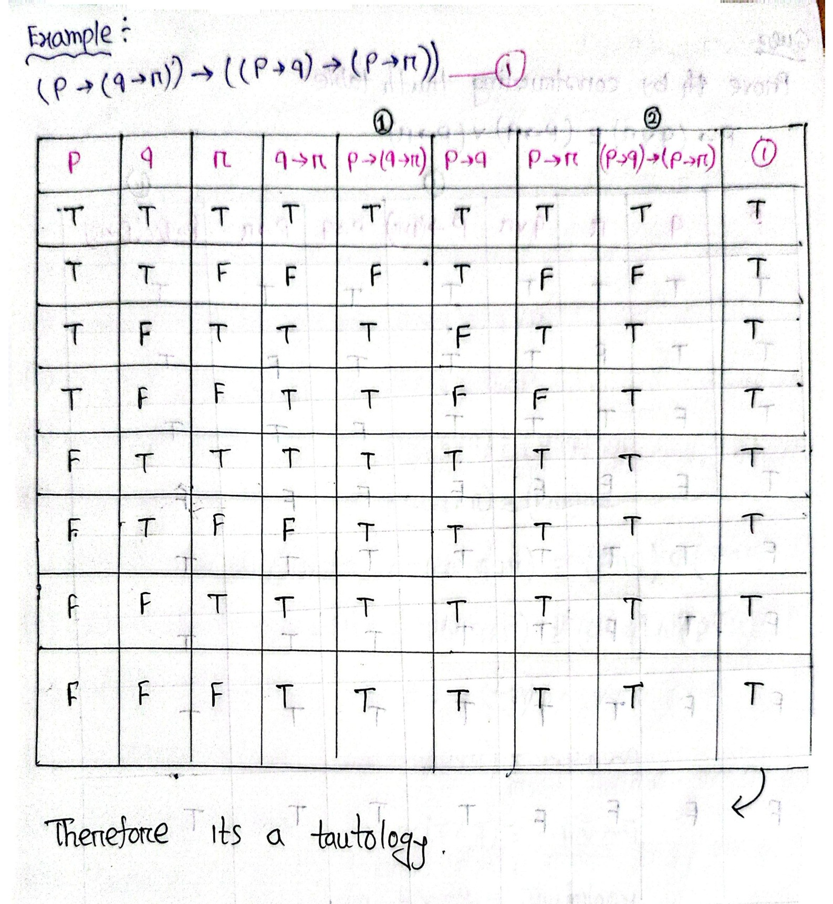

# ECE 2213: Propositional Logic & Foundations of Inference (Batch 3: Pages 40–59)

**Course**: ECE 2213 — Discrete Mathematics  
**Student**: Shishir (Roll: 2310002)  
**Batch**: 3 of 5 (Pages 40 – 59)  
**Topics Covered**: Propositional Logic Foundations (Statements, Truth Values); Logical Connectives (Conjunction, Disjunction, Negation, Conditional, Biconditional); Truth Table Construction & Evaluation; Conditional Statement Variations (Converse, Inverse, Contrapositive); Natural Language to Propositional Translation; Classification of Compound Propositions (Tautology, Contradiction, Contingency); Multi-variable Truth Table Evaluations; Equivalence Proofs; Fundamental Laws & Algebraic Equivalences of Propositional Logic; Normal Forms (Disjunctive Normal Form - DNF, Conjunctive Normal Form - CNF); Methods of Proof & Argument Validity; Rules of Inference (Modus Ponens, Modus Tollens, Hypothetical Syllogism, Disjunctive Syllogism, Addition, Simplification, Conjunction, Resolution).

---

<!-- Page 40 -->

## Foundations & Formal Systems
## 1. Fundamentals of Propositional Logic

### 1.1 Statement (Proposition)

#### Definition
A **statement** (or **proposition**) is a declarative sentence that is either **true** or **false**, but not both simultaneously.

Propositions are conventionally denoted by lowercase English letters:
$$p, \; q, \; r, \; s, \dots$$

#### Truth Value
Every proposition possesses an intrinsic **truth value**:
- **True**, denoted by $\mathbf{T}$ (or $1$)
- **False**, denoted by $\mathbf{F}$ (or $0$)

---

### 1.2 Logical Connectives

Compound statements are formed by combining one or more individual propositions using **logical connectives** (logical operators).

| Connective | Natural Language Equivalent | Formal Symbol | Name of Compound Statement |
| :--- | :--- | :---: | :--- |
| **AND** | "and", "but", "while" | $\land$ | **Conjunction** |
| **OR** | "or" | $\lor$ | **Disjunction** |
| **NOT** | "not", "it is not the case that" | $\sim$ (or $\neg$) | **Negation** |
| **IF ... THEN** | "implies", "if ... then" | $\to$ (or $\implies$) | **Conditional** (Implication) |
| **IFF** | "if and only if" | $\leftrightarrow$ (or $\iff$) | **Biconditional** (Equivalence) |

> [!note] Student Insight: Conjunction in Natural Language
> In natural English, the word **"but"** functions logically as an **AND** ($\land$). It asserts that both clauses are true simultaneously, adding only an informal contrast in tone.

---

<!-- Page 41 -->

## 2. Basic Truth Tables of Connectives

### 2.1 Conjunction (AND, $\land$)

The conjunction $p \land q$ is true **if and only if both** $p$ and $q$ are true. If either proposition is false, the conjunction is false.

$$
\begin{array}{|c|c|c|}
\hline
p & q & p \land q \\
\hline
\text{T} & \text{T} & \mathbf{T} \\
\text{T} & \text{F} & \mathbf{F} \\
\text{F} & \text{T} & \mathbf{F} \\
\text{F} & \text{F} & \mathbf{F} \\
\hline
\end{array}
$$

---

### 2.2 Disjunction (OR, $\lor$)

The disjunction $p \lor q$ represents an **inclusive OR**. It is true if at least one of the component propositions is true.

> [!note] Student Insight: Disjunction Evaluation Rule
> *Bengali annotation: "দুটাই F হলে F বাকি সব ক্ষেত্রে T হবে"*  
> **Translation**: If both inputs are $\mathbf{F}$, the output is $\mathbf{F}$; in all other combinations, the output evaluates to $\mathbf{T}$.

$$
\begin{array}{|c|c|c|}
\hline
p & q & p \lor q \\
\hline
\text{T} & \text{T} & \mathbf{T} \\
\text{T} & \text{F} & \mathbf{T} \\
\text{F} & \text{T} & \mathbf{T} \\
\text{F} & \text{F} & \mathbf{F} \\
\hline
\end{array}
$$

---

### 2.3 Negation (NOT, $\sim$ or $\neg$)

The negation $\sim p$ (or $\neg p$) reverses the truth value of proposition $p$.

$$
\begin{array}{|c|c|}
\hline
p & \sim p \\
\hline
\text{T} & \mathbf{F} \\
\text{F} & \mathbf{T} \\
\hline
\end{array}
$$

---

<!-- Page 42 -->

### 2.4 Conditional / Implication (IF ... THEN, $\to$)

In the conditional statement $p \to q$:
- $p$ is called the **hypothesis** (or antecedent / premise).
- $q$ is called the **conclusion** (or consequent).

> [!note] Student Insight: Conditional Evaluation Rule
> *Bengali annotation: "প্রথমটা T এবং পরেরটা F হলেই কেবল F হবে অন্যথায় T"*  
> **Translation**: The conditional is $\mathbf{F}$ **only when the first statement (hypothesis) is $\mathbf{T}$ and the subsequent statement (conclusion) is $\mathbf{F}$**; otherwise, it is always $\mathbf{T}$.

$$
\begin{array}{|c|c|c|}
\hline
p & q & p \to q \\
\hline
\text{T} & \text{T} & \mathbf{T} \\
\text{T} & \text{F} & \mathbf{F} \\
\text{F} & \text{T} & \mathbf{T} \\
\text{F} & \text{F} & \mathbf{T} \\
\hline
\end{array}
$$

> [!tip] Vacuous Truth
> When the hypothesis $p$ is false ($p = \text{F}$), the conditional statement $p \to q$ is **vacuously true** regardless of the truth value of $q$.

---

### 2.5 Biconditional (IFF / If and only if, $\leftrightarrow$)

The biconditional statement $p \leftrightarrow q$ asserts that $p$ and $q$ have identical truth values.

> [!note] Student Insight: Biconditional Evaluation Rule
> *Bengali annotation: "যদি দুইটাই Same হয় তাহলে T অন্যথায় F"*  
> **Translation**: If both variables have the **same truth value** (both $\text{T}$ or both $\text{F}$), the outcome is $\mathbf{T}$; otherwise, it is $\mathbf{F}$.

$$
\begin{array}{|c|c|c|}
\hline
p & q & p \leftrightarrow q \\
\hline
\text{T} & \text{T} & \mathbf{T} \\
\text{T} & \text{F} & \mathbf{F} \\
\text{F} & \text{T} & \mathbf{F} \\
\text{F} & \text{F} & \mathbf{T} \\
\hline
\end{array}
$$

---

<!-- Page 43 -->

## 3. Conditional Statement Variations

Given a conditional statement $p \to q$:

1. **Converse**:
   $$q \to p$$
   *(Swapping the hypothesis and conclusion)*

2. **Inverse**:
   $$\sim p \to \sim q$$
   *(Negating both the hypothesis and conclusion)*

3. **Contrapositive**:
   $$\sim q \to \sim p$$
   *(Swapping and negating both hypothesis and conclusion)*

> [!important] Logical Equivalence of Variations
> - A conditional statement is **logically equivalent to its contrapositive**:
>   $$p \to q \equiv \sim q \to \sim p$$
> - The converse is **logically equivalent to the inverse**:
>   $$q \to p \equiv \sim p \to \sim q$$
> - A conditional statement is **not** generally equivalent to its converse or inverse ($p \to q \not\equiv q \to p$).

---

## 4. Translating Natural Language into Propositional Logic

### Example Set: Expressing Statements in Symbolic Form

Translate each of the following natural language sentences into symbolic logic form:

1. *"There are many clouds in the sky but it did not rain."*
2. *"I will get first class if and only if I study well and score above 80 in mathematics."*
3. *"Computers are cheap but softwares are costly."*
4. *"It is very hot and humid or Ramesh is having heart problem."*
5. *"In small restaurants the food is good and service is poor."*

---

<!-- Page 44 -->

### Detailed Solutions

#### Problem (i)
> *"There are many clouds in the sky but it did not rain."*

- Let $p$: There are many clouds in the sky.
- Let $q$: It rained.

> [!note] Student Insight: Isolating Negation in Atomic Propositions
> *Bengali annotation: "Not থাকলে লেখা যাবে না কিন্তু symbolic form এ লিখতে হবে"*  
> **Translation**: When defining atomic proposition variables, do not include the word "Not". Define the proposition affirmative/positively, and represent the negative aspect via the negation operator ($\sim$ or $\neg$) inside the symbolic expression.

**Symbolic Form**:
$$p \land \sim q$$

---

#### Problem (ii)
> *"I will get first class if and only if I study well and score above 80 in mathematics."*

- Let $p$: I will get first class.
- Let $q$: I study well.
- Let $r$: Score above 80 in mathematics.

**Symbolic Form**:
$$p \leftrightarrow (q \land r)$$

---

#### Problem (iii)
> *"Computers are cheap but softwares are costly."*

- Let $p$: Computers are cheap.
- Let $q$: Softwares are costly.

**Symbolic Form**:
$$p \land q$$

---

#### Problem (iv)
> *"It is very hot and humid or Ramesh is having heart problem."*

- Let $p$: It is very hot.
- Let $q$: It is humid.
- Let $r$: Ramesh is having heart problem.

**Symbolic Form**:
$$(p \land q) \lor r$$

---

<!-- Page 45 -->

#### Problem (v)
> *"In small restaurants the food is good and service is poor."*

- Let $p$: In small restaurants the food is good.
- Let $q$: Service is poor.

**Symbolic Form**:
$$p \land q$$

---

### Example: Finding Converse, Inverse, and Contrapositive

#### Problem Statement: Geometry Conditional
Express the converse, inverse, and contrapositive of the conditional statement:
> *"If $x$ is rational, then $x$ is real."*

#### Step 1: Assign Propositional Variables
- Let $p$: $x$ is rational.
- Let $q$: $x$ is real.
- Given conditional statement: $p \to q$.

---

<!-- Page 46 -->

#### Step 2: Formulate Variations for Rational-Real Implication

1. **Converse ($q \to p$)**:
   $$\text{"If } x \text{ is real, then } x \text{ is rational."}$$

2. **Inverse ($\sim p \to \sim q$)**:
   $$\text{"If } x \text{ is not rational, then } x \text{ is not real."}$$

3. **Contrapositive ($\sim q \to \sim p$)**:
   $$\text{"If } x \text{ is not real, then } x \text{ is not rational."}$$

---

### Example: Compound Hypothesis Implication Variations

#### Problem Statement: Integer Conditional
Express the contrapositive, converse, and inverse forms of the following statement:
> *"If $3 < b$ and $1 + 1 = 2$, then $\sin\frac{\pi}{3} = \frac{1}{2}$."*

#### Step 1: Formal Symbolic Representation
- Let $p$: $3 < b$
- Let $q$: $1 + 1 = 2$
- Let $r$: $\sin\frac{\pi}{3} = \frac{1}{2}$

The original conditional statement has compound hypothesis $(p \land q)$:
$$(p \land q) \to r$$

---

<!-- Page 47 -->

#### Step 2: Formulate Variations for Compound Hypothesis Implication

1. **Converse**:
   $$r \to (p \land q)$$
   > *"If $\sin\frac{\pi}{3} = \frac{1}{2}$, then $3 < b$ and $1 + 1 = 2$."*

2. **Inverse**:
   $$\sim(p \land q) \to \sim r$$
   Applying De Morgan's Law to the negated antecedent:
   $$\sim(p \land q) \equiv \sim p \lor \sim q$$
   
   > [!note] Student Insight: De Morgan's Negation Rule
   > *Bengali annotation: "and এর negation OR হয়"*  
   > **Translation**: Negation transforms an AND ($\land$) operation into an OR ($\lor$) operation: $\sim(p \land q) \equiv \sim p \lor \sim q$.

   Substituting back:
   $$(\sim p \lor \sim q) \to \sim r$$
   > *"If $3 \ge b$ or $1 + 1 \neq 2$, then $\sin\frac{\pi}{3} \neq \frac{1}{2}$."*

3. **Contrapositive**:
   $$\sim r \to \sim(p \land q)$$
   Applying De Morgan's Law:
   $$\sim r \to (\sim p \lor \sim q)$$
   > *"If $\sin\frac{\pi}{3} \neq \frac{1}{2}$, then $3 \ge b$ or $1 + 1 \neq 2$."*

---

<!-- Page 48 -->

## 5. Tautology, Contradiction, and Contingency

Compound propositions are categorized into three fundamental classes according to their truth table profiles:

### 5.1 Tautology
A **tautology** is a compound proposition that is **always true**, regardless of the truth values assigned to its individual propositional variables.
- A tautology represents a statement that is unconditionally true in all possible scenarios.
- Denoted symbolically by $\mathbf{T}$ or $\mathbf{1}$.
- Classical example: $p \lor \sim p \equiv \mathbf{T}$ (Law of Excluded Middle).

---

### 5.2 Contradiction
A **contradiction** is a compound proposition that is **always false**, regardless of the truth values assigned to its individual propositional variables.
- A contradiction represents a statement that can never be true under any circumstance.
- Denoted symbolically by $\mathbf{F}$ or $\mathbf{0}$.
- Classical example: $p \land \sim p \equiv \mathbf{F}$ (Law of Non-Contradiction).

---

### 5.3 Contingency
A **contingency** is a compound proposition that is **neither a tautology nor a contradiction**.

---

<!-- Page 49 -->

Its truth value depends entirely on the specific truth values of its constituent variables:
- A contingency is true in at least one scenario and false in at least one scenario.

---

### 5.4 Truth Table Evaluations

#### Problem 1: Evaluate $(p \land q) \land \sim(p \lor q)$

Determine whether the statement formula $(p \land q) \land \sim(p \lor q)$ is a tautology, contradiction, or contingency.

##### Truth Table Construction: Compound Proposition 1

$$
\begin{array}{|c|c|c|c|c|c|}
\hline
p & q & p \land q & p \lor q & \sim(p \lor q) & (p \land q) \land \sim(p \lor q) \\
\hline
\text{T} & \text{T} & \text{T} & \text{T} & \text{F} & \mathbf{F} \\
\text{T} & \text{F} & \text{F} & \text{T} & \text{F} & \mathbf{F} \\
\text{F} & \text{T} & \text{F} & \text{T} & \text{F} & \mathbf{F} \\
\text{F} & \text{F} & \text{F} & \text{F} & \text{T} & \mathbf{F} \\
\hline
\end{array}
$$

##### Conclusion: Contingency Classification for Problem 1
Every entry in the final column is **$\mathbf{F}$**.  
Therefore, the compound proposition is a **Contradiction**.

---

<!-- Page 50 -->

#### Problem 2: Evaluate $(p \to q) \leftrightarrow (q \lor \sim p)$

Determine whether the statement formula $(p \to q) \leftrightarrow (q \lor \sim p)$ is a tautology, contradiction, or contingency.

##### Truth Table Construction: Compound Proposition 2

$$
\begin{array}{|c|c|c|c|c|c|}
\hline
p & q & \sim p & p \to q & q \lor \sim p & (p \to q) \leftrightarrow (q \lor \sim p) \\
\hline
\text{T} & \text{T} & \text{F} & \text{T} & \text{T} & \mathbf{T} \\
\text{T} & \text{F} & \text{F} & \text{F} & \text{F} & \mathbf{T} \\
\text{F} & \text{T} & \text{T} & \text{T} & \text{T} & \mathbf{T} \\
\text{F} & \text{F} & \text{T} & \text{T} & \text{T} & \mathbf{T} \\
\hline
\end{array}
$$

##### Conclusion: Tautology Classification for Problem 2
Every entry in the final column is **$\mathbf{T}$**.  
Therefore, the compound proposition is a **Tautology**.

> [!tip] Core Equivalence
> This verifies that the conditional statement $p \to q$ is logically equivalent to $\sim p \lor q$ (written commutatively as $q \lor \sim p$).

---

<!-- Page 51 -->

#### Problem 3: Three-Variable Implication Tautology

Evaluate whether the following compound proposition is a tautology:
$$\Big(p \to (q \to r)\Big) \longrightarrow \Big((p \to q) \to (p \to r)\Big)$$

##### Step-by-Step Truth Table Analysis (8 Rows) for Problem 3

Let:
- Column (1) denote: $p \to (q \to r)$
- Column (2) denote: $(p \to q) \to (p \to r)$
- Final Column denote: $(1) \to (2)$

$$
\begin{array}{|c|c|c|c|c|c|c|c|c|}
\hline
p & q & r & q \to r & \text{(1): } p \to (q \to r) & p \to q & p \to r & \text{(2): } (p \to q) \to (p \to r) & \text{(1)} \to \text{(2)} \\
\hline
\text{T} & \text{T} & \text{T} & \text{T} & \text{T} & \text{T} & \text{T} & \text{T} & \mathbf{T} \\
\text{T} & \text{T} & \text{F} & \text{F} & \text{F} & \text{T} & \text{F} & \text{F} & \mathbf{T} \\
\text{T} & \text{F} & \text{T} & \text{T} & \text{T} & \text{F} & \text{T} & \text{T} & \mathbf{T} \\
\text{T} & \text{F} & \text{F} & \text{T} & \text{T} & \text{F} & \text{F} & \text{T} & \mathbf{T} \\
\text{F} & \text{T} & \text{T} & \text{T} & \text{T} & \text{T} & \text{T} & \text{T} & \mathbf{T} \\
\text{F} & \text{T} & \text{F} & \text{F} & \text{T} & \text{T} & \text{T} & \text{T} & \mathbf{T} \\
\text{F} & \text{F} & \text{T} & \text{T} & \text{T} & \text{T} & \text{T} & \text{T} & \mathbf{T} \\
\text{F} & \text{F} & \text{F} & \text{T} & \text{T} & \text{T} & \text{T} & \text{T} & \mathbf{T} \\
\hline
\end{array}
$$

*Figure 3.1 — Handwritten 8-row truth table verification that $(p \to (q \to r)) \to ((p \to q) \to (p \to r))$ is a Tautology (Page 51)*

##### Conclusion: Tautology Proof for Problem 3
All 8 rows in the final column evaluate to $\mathbf{T}$.  
Therefore, the statement is a **Tautology** (representing the *Self-Distribution of Implication / Frege's Axiom*).

---

<!-- Page 52 -->

#### Problem 4: Logical Equivalence of Distributive Implication

**Question**: Prove by constructing a truth table that:
$$p \to (q \lor r) \equiv (p \to q) \lor (p \to r)$$

##### Step-by-Step Truth Table Analysis (8 Rows) for Problem 4

Let:
- Column (1) denote: $p \to (q \lor r)$
- Column (2) denote: $(p \to q) \lor (p \to r)$

$$
\begin{array}{|c|c|c|c|c|c|c|c|}
\hline
p & q & r & q \lor r & \text{(1): } p \to (q \lor r) & p \to q & p \to r & \text{(2): } (p \to q) \lor (p \to r) \\
\hline
\text{T} & \text{T} & \text{T} & \text{T} & \mathbf{T} & \text{T} & \text{T} & \mathbf{T} \\
\text{T} & \text{T} & \text{F} & \text{T} & \mathbf{T} & \text{T} & \text{F} & \mathbf{T} \\
\text{T} & \text{F} & \text{T} & \text{T} & \mathbf{T} & \text{F} & \text{T} & \mathbf{T} \\
\text{T} & \text{F} & \text{F} & \text{F} & \mathbf{F} & \text{F} & \text{F} & \mathbf{F} \\
\text{F} & \text{T} & \text{T} & \text{T} & \mathbf{T} & \text{T} & \text{T} & \mathbf{T} \\
\text{F} & \text{T} & \text{F} & \text{T} & \mathbf{T} & \text{T} & \text{T} & \mathbf{T} \\
\text{F} & \text{F} & \text{T} & \text{T} & \mathbf{T} & \text{T} & \text{T} & \mathbf{T} \\
\text{F} & \text{F} & \text{F} & \text{F} & \mathbf{T} & \text{T} & \text{T} & \mathbf{T} \\
\hline
\end{array}
$$

*Figure 3.2 — Handwritten truth table proving $p \to (q \lor r) \equiv (p \to q) \lor (p \to r)$ (Page 52)*

##### Conclusion: Logical Equivalence of Implication Chain
Columns (1) and (2) possess identical truth values for every possible truth assignment:
$$\text{Column (1)} = \text{Column (2)} = [\text{T}, \text{T}, \text{T}, \text{F}, \text{T}, \text{T}, \text{T}, \text{T}]^T$$
Therefore, **(1) and (2) are logically equivalent**.

---

<!-- Page 53 -->

## 6. Fundamental Laws of Propositional Logic

The following equivalence laws govern the algebraic manipulation and simplification of propositional formulas:

### Summary of 15 Core Laws

1. **Idempotence of $\lor$**:
   $$p \lor p \equiv p$$

2. **Idempotence of $\land$**:
   $$p \land p \equiv p$$

3. **Commutativity of $\lor$**:
   $$p \lor q \equiv q \lor p$$

4. **Commutativity of $\land$**:
   $$p \land q \equiv q \land p$$

5. **Associativity of $\lor$**:
   $$p \lor (q \lor r) \equiv (p \lor q) \lor r$$

6. **Associativity of $\land$**:
   $$p \land (q \land r) \equiv (p \land q) \land r$$

7. **Distributivity of $\land$ over $\lor$**:
   $$p \land (q \lor r) \equiv (p \land q) \lor (p \land r)$$

8. **Distributivity of $\lor$ over $\land$**:
   $$p \lor (q \land r) \equiv (p \lor q) \land (p \lor r)$$

9. **Double Negation**:
   $$\sim(\sim p) \equiv p$$

10. **De Morgan's Law for Disjunction**:
    $$\sim(p \lor q) \equiv \sim p \land \sim q$$

11. **De Morgan's Law for Conjunction**:
    $$\sim(p \land q) \equiv \sim p \lor \sim q$$

12. **Tautology Law (Excluded Middle)**:
    $$p \lor \sim p \equiv \mathbf{T}$$

13. **Contradiction Law (Non-Contradiction)**:
    $$p \land \sim p \equiv \mathbf{F}$$

14. **Absorption Law (Disjunctive)**:
    $$p \lor (p \land q) \equiv p$$

15. **Absorption Law (Conjunctive)**:
    $$p \land (p \lor q) \equiv p$$

---

<!-- Page 54 -->

## 7. Additional Equivalences & Normal Forms

### 7.1 Important Logical Equivalences

- **Implication Equivalence**:
  $$p \to q \equiv \sim p \lor q$$

- **Biconditional Equivalence**:
  $$p \leftrightarrow q \equiv (p \to q) \land (q \to p) \equiv (\sim p \lor q) \land (\sim q \lor p)$$

- **Identity and Dominance Laws**:
  $$
  \begin{aligned}
  p \lor \mathbf{T} &\equiv \mathbf{T} \quad &&(\text{Dominance of } \mathbf{T} \text{ in disjunction}) \\
  p \lor \mathbf{F} &\equiv p \quad &&(\text{Identity of } \mathbf{F} \text{ in disjunction}) \\
  p \land \mathbf{T} &\equiv p \quad &&(\text{Identity of } \mathbf{T} \text{ in conjunction}) \\
  p \land \mathbf{F} &\equiv \mathbf{F} \quad &&(\text{Dominance of } \mathbf{F} \text{ in conjunction})
  \end{aligned}
  $$

---

### 7.2 Definitions of Normal Forms

#### Disjunctive Normal Form (DNF)
A statement form that consists of a **disjunction of conjunctions** (a sum of products) is called **Disjunctive Normal Form (DNF)**:
$$\bigvee_i \left( \bigwedge_j l_{ij} \right)$$
where each $l_{ij}$ is a literal (a variable $p$ or its negation $\sim p$).

- **Example**:
  $$(p \land q) \lor q \lor (\sim q \land p)$$

#### Conjunctive Normal Form (CNF)
A statement form that consists of a **conjunction of disjunctions** (a product of sums) is called **Conjunctive Normal Form (CNF)**:
$$\bigwedge_i \left( \bigvee_j l_{ij} \right)$$
where each clause is a disjunction of literals.

- **Example**:
  $$(p \lor q) \land (\sim p \lor q) \land (\sim q)$$

---

<!-- Page 55 -->

## 8. Algebraic Derivation of Normal Forms

### 8.1 Problem: Obtain DNF of $(p \to q) \land (q \to p)$

Convert the biconditional expansion into Disjunctive Normal Form:

$$
\begin{aligned}
(p \to q) \land (q \to p) &\equiv (\sim p \lor q) \land (\sim q \lor p) && \text{[Implication Equivalence]} \\
&\equiv \Big[(\sim p \lor q) \land \sim q\Big] \lor \Big[(\sim p \lor q) \land p\Big] && \text{[Distributive Law]} \\
&\equiv \Big[(\sim p \land \sim q) \lor (q \land \sim q)\Big] \lor \Big[(\sim p \land p) \lor (q \land p)\Big] && \text{[Distributive Law]} \\
&\equiv \Big[(\sim p \land \sim q) \lor \mathbf{F}\Big] \lor \Big[\mathbf{F} \lor (p \land q)\Big] && \text{[Contradiction Law: } q \land \sim q \equiv \mathbf{F}] \\
&\equiv (\sim p \land \sim q) \lor (p \land q) && \text{[Identity Law: } X \lor \mathbf{F} \equiv X]
\end{aligned}
$$

**Result (DNF)**:
$$(\sim p \land \sim q) \lor (p \land q)$$

---

### 8.2 Problem: Find DNF of $\big(p \land (p \to q)\big) \to q$

$$
\begin{aligned}
\big(p \land (p \to q)\big) \to q &\equiv \big(p \land (\sim p \lor q)\big) \to q && \text{[Implication Equivalence]} \\
&\equiv \sim \big(p \land (\sim p \lor q)\big) \lor q && \text{[Implication Equivalence: } A \to B \equiv \sim A \lor B] \\
&\equiv \Big(\sim p \lor \sim(\sim p \lor q)\Big) \lor q && \text{[De Morgan's Law]} \\
&\equiv \sim p \lor (p \land \sim q) \lor q && \text{[De Morgan's \& Double Negation]}
\end{aligned}
$$

**Result (DNF)**:
$$\sim p \lor (p \land \sim q) \lor q$$

---

<!-- Page 56 -->

### 8.3 Problem: Obtain CNF of $p \land (p \to q)$

$$
\begin{aligned}
p \land (p \to q) &\equiv p \land (\sim p \lor q) && \text{[Implication Equivalence]} \\
&\equiv (p \land \sim p) \lor (p \land q) && \text{[Distributive Law]} \\
&\equiv \mathbf{F} \lor (p \land q) && \text{[Contradiction Law]} \\
&\equiv p \land q && \text{[Identity Law]}
\end{aligned}
$$

**Result (CNF)**:
$$p \land q$$
*(A single conjunction of atomic variables is a trivial degenerate CNF consisting of two single-literal clauses).*

---

### 8.4 Problem: Obtain DNF of $\big((p \to q) \land (q \to p)\big) \lor p$

$$
\begin{aligned}
\big((p \to q) \land (q \to p)\big) \lor p &\equiv \big((\sim p \lor q) \land (\sim q \lor p)\big) \lor p && \text{[Implication Equivalence]} \\
&\equiv p \lor \Big((\sim p \lor q) \land (\sim q \lor p)\Big) && \text{[Commutative Law]} \\
&\equiv \big(p \lor (\sim p \lor q)\big) \land \big(p \lor (\sim q \lor p)\big) && \text{[Distributive Law]}
\end{aligned}
$$

*(Note: The raw handwritten scratch expansion on Page 56 is completed cleanly on Page 57).*

---

<!-- Page 57 -->

### Problem 8.4 (Continued Simplification)

Continuing from the distributed form:
$$
\begin{aligned}
&\equiv \big((p \lor \sim p) \lor q\big) \land \big((p \lor p) \lor \sim q\big) && \text{[Associative \& Idempotent Laws]} \\
&\equiv (\mathbf{T} \lor q) \land (p \lor \sim q) && \text{[Tautology Law: } p \lor \sim p \equiv \mathbf{T}] \\
&\equiv \mathbf{T} \land (p \lor \sim q) && \text{[Dominance Law: } \mathbf{T} \lor q \equiv \mathbf{T}] \\
&\equiv p \lor \sim q && \text{[Identity Law: } \mathbf{T} \land X \equiv X]
\end{aligned}
$$

**Result (DNF)**:
$$p \lor \sim q$$

---

## 9. Methods of Proof & Argument Validity

### 9.1 Definition of a Valid Argument

An **argument** in propositional logic consists of a sequence of propositions called **premises** (or hypotheses):
$$P_1, \; P_2, \; P_3, \dots, P_n$$
followed by a final proposition called the **conclusion**:
$$C$$

An argument is declared **valid** if the truth of all premises collectively guarantees the truth of the conclusion.

#### Formal Criterion
The argument is **valid** if and only if the conditional statement asserting that the conjunction of all premises implies the conclusion is a **tautology**:
$$P_1 \land P_2 \land P_3 \land \dots \land P_n \longrightarrow C \quad \equiv \quad \mathbf{T}$$

If this implication is not a tautology (i.e., there exists at least one truth assignment where all premises are $\text{T}$ but the conclusion is $\text{F}$), the argument is called an **invalid argument** (or **fallacy**).

#### Standard Vertical Notation

$$
\begin{array}{cl}
S_1: & P_1 \\
S_2: & P_2 \\
\vdots & \vdots \\
S_n: & P_n \\
\hline
\therefore & C
\end{array}
\qquad \iff \qquad (P_1 \land P_2 \land \dots \land P_n) \to C \quad \text{is a Tautology}
$$

---

<!-- Page 58 -->

## 10. Fundamental Rules of Inference

Rules of inference are established, tautological argument templates that permit valid logical deductions without constructing exhaustive truth tables.

### 10.1 Modus Ponens (Law of Detachment)

#### Principle: Modus Ponens
If a conditional statement $p \to q$ is accepted as true, and the hypothesis $p$ is known to be true, then the conclusion $q$ must necessarily be true.

$$
\begin{array}{cl}
S_1: & p \to q \quad (\text{True}) \\
S_2: & p \quad (\text{True}) \\
\hline
S_3: & \therefore q \quad (\text{True})
\end{array}
$$

#### Symbolic Tautology Form: Modus Ponens
$$
\big((p \to q) \land p\big) \longrightarrow q \quad \text{is a Tautology}
$$

#### Truth Table Verification

$$
\begin{array}{|c|c|c|c|c|}
\hline
p & q & p \to q & (p \to q) \land p & \big((p \to q) \land p\big) \to q \\
\hline
\text{T} & \text{T} & \text{T} & \text{T} & \mathbf{T} \\
\text{T} & \text{F} & \text{F} & \text{F} & \mathbf{T} \\
\text{F} & \text{T} & \text{T} & \text{F} & \mathbf{T} \\
\text{F} & \text{F} & \text{T} & \text{F} & \mathbf{T} \\
\hline
\end{array}
$$

Notice that row 1 is the only row where all premises ($p \to q$ and $p$) are True, and in that row $q$ is also True.

---

### 10.2 Modus Tollens (Law of Contraposition / Denying the Consequent)

#### Principle: Modus Tollens
If a conditional statement $p \to q$ is true, and the conclusion is known to be false ($\sim q$ is true), then the hypothesis must also be false ($\sim p$ is true).

$$
\begin{array}{cl}
S_1: & p \to q \quad (\text{True}) \\
S_2: & \sim q \quad (\text{True, i.e., } q \text{ is False}) \\
\hline
S_3: & \therefore \sim p \quad (\text{True, i.e., } p \text{ is False})
\end{array}
$$

#### Symbolic Tautology Form: Modus Tollens
$$
\big((p \to q) \land \sim q\big) \longrightarrow \sim p \quad \text{is a Tautology}
$$

*Figure 3.3 — Handwritten Rules of Inference schemas for Modus Ponens and Modus Tollens (Page 58)*

---

<!-- Page 59 -->

### 10.3 Hypothetical Syllogism (Chain Rule / Transitivity of Implication)

#### Principle: Hypothetical Syllogism
If premise $p \to q$ is true, and premise $q \to r$ is true, then the transitive implication $p \to r$ must be true.

$$
\begin{array}{cl}
S_1: & p \to q \quad (\text{True}) \\
S_2: & q \to r \quad (\text{True}) \\
\hline
S_3: & \therefore p \to r \quad (\text{True})
\end{array}
$$

#### Symbolic Tautology Form: Hypothetical Syllogism
$$
\Big((p \to q) \land (q \to r)\Big) \longrightarrow (p \to r) \quad \text{is a Tautology}
$$

---

### 10.4 Disjunctive Syllogism

#### Principle: Disjunctive Syllogism
If a disjunction $p \lor q$ is true, and one of the disjuncts is known to be false ($p$ is false, so $\sim p$ is true), then the remaining disjunct $q$ must be true.

$$
\begin{array}{cl}
S_1: & p \lor q \quad (\text{True}) \\
S_2: & \sim p \quad (\text{True, i.e., } p \text{ is False}) \\
\hline
S_3: & \therefore q \quad (\text{True})
\end{array}
$$

#### Symbolic Tautology Form: Disjunctive Syllogism
$$
\big((p \lor q) \land \sim p\big) \longrightarrow q \quad \text{is a Tautology}
$$

#### Truth Table Verification of $p \lor q$
$$
\begin{array}{|c|c|c|}
\hline
p & q & p \lor q \\
\hline
\text{T} & \text{T} & \text{T} \\
\text{T} & \text{F} & \text{T} \\
\text{F} & \text{T} & \mathbf{T} \\
\text{F} & \text{F} & \text{F} \\
\hline
\end{array}
$$

In row 3, where $p$ is $\text{F}$ and $p \lor q$ is $\text{T}$, $q$ is guaranteed to be $\text{T}$.

*Figure 3.4 — Handwritten Rules of Inference schemas for Hypothetical Syllogism and Disjunctive Syllogism (Page 59)*

---

## 11. Master Reference Table of Rules of Inference

For comprehensive exam preparation and formal deduction proofs, the fundamental rules of inference are summarized below:

| Rule of Inference | Name | Tautological Implication Form |
| :--- | :--- | :--- |
| $\begin{array}{l} p \\ \hline \therefore p \lor q \end{array}$ | **Addition** | $p \to (p \lor q)$ |
| $\begin{array}{l} p \land q \\ \hline \therefore p \end{array}$ | **Simplification** | $(p \land q) \to p$ |
| $\begin{array}{l} p \\ q \\ \hline \therefore p \land q \end{array}$ | **Conjunction** | $(p) \land (q) \to (p \land q)$ |
| $\begin{array}{l} p \to q \\ p \\ \hline \therefore q \end{array}$ | **Modus Ponens** (Law of Detachment) | $\big((p \to q) \land p\big) \to q$ |
| $\begin{array}{l} p \to q \\ \sim q \\ \hline \therefore \sim p \end{array}$ | **Modus Tollens** (Denying the Consequent) | $\big((p \to q) \land \sim q\big) \to \sim p$ |
| $\begin{array}{l} p \to q \\ q \to r \\ \hline \therefore p \to r \end{array}$ | **Hypothetical Syllogism** (Chain Rule) | $\big((p \to q) \land (q \to r)\big) \to (p \to r)$ |
| $\begin{array}{l} p \lor q \\ \sim p \\ \hline \therefore q \end{array}$ | **Disjunctive Syllogism** | $\big((p \lor q) \land \sim p\big) \to q$ |
| $\begin{array}{l} p \lor q \\ \sim p \lor r \\ \hline \therefore q \lor r \end{array}$ | **Resolution** | $\big((p \lor q) \land (\sim p \lor r)\big) \to (q \lor r)$ |

---

**Navigation**: [[02_Relations_Posets_and_Equivalence|⬅ Previous: Batch 2 (Pages 20–39)]] | [[00_Discrete_Mathematics_Index|📋 Master Study Index]] | [[04_Predicates_Proofs_and_Induction_I|➡ Next: Batch 4 (Pages 60–79)]]
