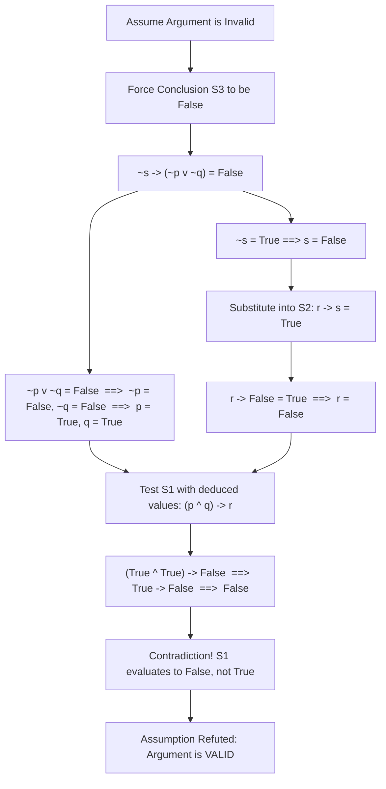
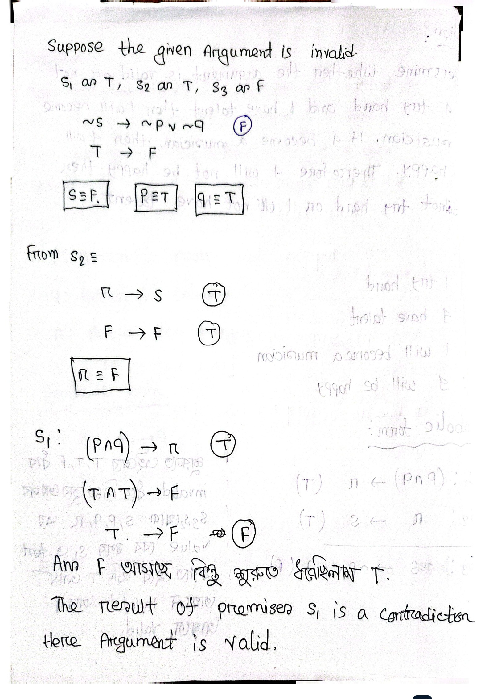
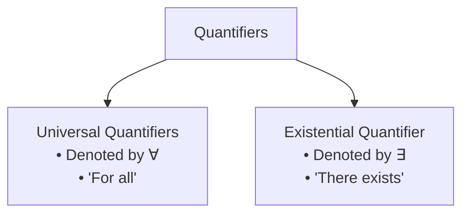
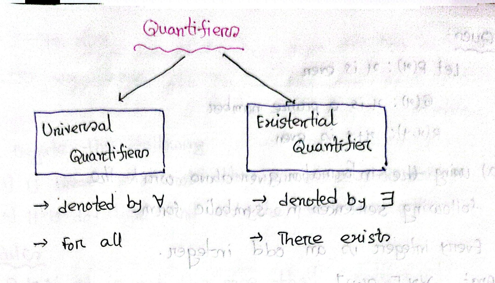

# ECE 2213: Predicate Logic, Proof Methods & Mathematical Induction I (Batch 4: Pages 60–79)

**Course**: ECE 2213 — Discrete Mathematics  
**Student**: Shishir (Roll: 2310002)  
**Batch**: 4 of 5 (Pages 60 – 79)  
**Topics Covered**: Argument Validity Problem Solving (Natural Language Formalization, Deduction via Hypothetical Syllogism); Shortcut Contradiction Method for Argument Validity (Truth Assignment, Indirect Verification, Bengali Heuristics Translated); Predicate Logic Foundations (Predicates, Propositional Functions $P(x)$, Universe of Discourse); Quantifiers (Universal $\forall$, Existential $\exists$, Uniqueness $\exists!$); Negation of Quantified Statements (Generalized De Morgan's Laws, Natural Language Transformation Rules); Translating Natural Language into Quantified Predicates and Reverse Translation; Methods of Mathematical Proof (Direct Proof, Indirect Proof / Contraposition, Proof by Contradiction / Reductio ad Absurdum, Proof by Counterexample); Principle of Mathematical Induction (PMI 3-Step Methodology, Summation of Arithmetic Series, Sum of Products of Consecutive Integers, Sum of Squares of Odd Integers, Sum of Cubes, and Divisibility Induction Prelude).

---

<!-- Page 60 -->

## Foundations of Predicates & Formal Proof
## 1. Argument Validity Problem Solving

### 1.1 Natural Language Argument Analysis & Syllogistic Deduction

When evaluating deductive reasoning expressed in natural language, arguments are tested by:
1. Identifying the individual atomic declarative propositions.
2. Formulating the premises and conclusion into standard symbolic logic.
3. Testing whether the conjunction of all premises logically implies the conclusion (i.e., whether the argument form constitutes a tautology).

---

#### Example 1: Syllogistic Argument on Human Condition

**Problem Statement**:  
Test the validity of the following argument:  
> *"If a person is poor, he is unhappy. If a person is unhappy, he dies young. Therefore, a poor person dies young."*

#### Step 1: Assign Propositional Variables (Human Condition Argument)
Let:
- $p$: The person is poor
- $q$: The person is unhappy
- $r$: The person dies young

#### Step 2: Formalize into Symbolic Premises and Conclusion
- **Premise 1 ($S_1$)**: "If a person is poor, he is unhappy" $\implies p \to q$
- **Premise 2 ($S_2$)**: "If a person is unhappy, he dies young" $\implies q \to r$
- **Conclusion ($S_3$)**: "Therefore, a poor person dies young" $\implies \therefore p \to r$

$$
\begin{array}{cl}
S_1: & p \to q \\
S_2: & q \to r \\
\hline
S_3: & \therefore p \to r
\end{array}
$$

#### Step 3: Validity Assessment
The argument corresponds directly to the classical rule of inference known as **Hypothetical Syllogism** (Transitivity of Implication):
$$\big((p \to q) \land (q \to r)\big) \longrightarrow (p \to r)$$

Because this conditional statement is a **Tautology** (it evaluates to $\text{True}$ for all possible truth assignments of $p, q, r$), the argument is **Valid**.

---

<!-- Page 61 -->

### 1.2 Multi-Premise Complex Arguments & The Shortcut Contradiction Method

In arguments containing four or more distinct atomic propositions, constructing a truth table requires $2^n$ rows ($2^4 = 16$ rows), which becomes time-consuming during exam conditions. To streamline verification, we utilize the **Shortcut Method** (also known as the **Indirect / Contradiction Method** for argument validity).

---

#### Example 2: Career, Talent, and Happiness Argument

**Problem Statement**:  
Determine whether the following argument is valid or not:  
> *"If I try hard and I have talent, then I will become a musician. If I become a musician, then I will be happy. Therefore, if I will not be happy, then I do not try hard or I do not have talent."*

#### Step 1: Assign Propositional Variables (Musician Career Argument)
Let:
- $p$: I try hard
- $q$: I have talent
- $r$: I will become a musician
- $s$: I will be happy

#### Step 2: Formal Symbolic Argument Representation
- **Premise 1 ($S_1$)**: "If I try hard and I have talent then I will become a musician"  
  $$S_1: (p \land q) \to r$$
- **Premise 2 ($S_2$)**: "If I become a musician, then I will be happy"  
  $$S_2: r \to s$$
- **Conclusion ($S_3$)**: "Therefore, if I will not be happy then I do not try hard or I do not have talent"  
  $$S_3: \therefore \sim s \to (\sim p \lor \sim q)$$

$$
\begin{array}{cl}
S_1: & (p \land q) \to r \quad (\text{T}) \\
S_2: & r \to s \quad (\text{T}) \\
\hline
S_3: & \therefore \sim s \to (\sim p \lor \sim q) \quad (\text{F})
\end{array}
$$

---

### 1.3 Theoretical Framework of the Shortcut Contradiction Method

> [!note] Student Insight: The Shortcut Contradiction Method for Argument Validity
> *Bengali Annotation*:  
> *"শুরুতে এইভাবে T, T, F ধরে invalid ধরে নিতে হবে তারপর $S_3, S_2$ থেকে $s, p, q, r$ এর value বের করে $S_1$ এ test করতে হবে যদি T আসে তাহলে invalid আর F আসলে valid."*  
>  
> **Translation & Theoretical Foundation**:  
> By definition, an argument is **invalid** if and only if there exists at least one truth assignment where **all premises are True simultaneously, but the conclusion is False**.  
> Therefore, we proceed by an indirect assumption of invalidity:
> 1. Set all premises ($S_1, S_2$) to $\mathbf{T}$ and the conclusion ($S_3$) to $\mathbf{F}$.
> 2. Work backward from the forced False condition of the conclusion $S_3$ to uniquely determine the truth values of component variables ($s, p, q$).
> 3. Propagate these values through intermediate premises ($S_2$) to deduce the remaining variables ($r$).
> 4. Substitute these forced truth values into the remaining premise ($S_1$).
> 5. **Evaluation Criterion**:
>    - If $S_1$ evaluates to $\mathbf{T}$, a consistent assignment exists where premises are $\text{T}$ and conclusion is $\text{F} \implies$ **Argument is Invalid**.
>    - If $S_1$ evaluates to $\mathbf{F}$, a logical contradiction is reached ($\text{T} \neq \text{F}$), proving that it is impossible for all premises to be $\text{T}$ while the conclusion is $\text{F} \implies$ **Argument is Valid**.

---

<!-- Page 62 -->

### 1.4 Step-by-Step Derivation of the Shortcut Method

**Hypothesis**: Suppose the given argument is **invalid**.  
This requires finding a truth assignment such that:
$$S_1 \equiv \text{T}, \quad S_2 \equiv \text{T}, \quad S_3 \equiv \text{F}$$

#### Step A: Analyze the Conclusion $S_3$
A conditional statement $A \to B$ is $\text{False}$ **if and only if** the antecedent $A$ is $\text{True}$ and the consequent $B$ is $\text{False}$:
$$S_3: \underbrace{\sim s}_{\text{T}} \longrightarrow \underbrace{(\sim p \lor \sim q)}_{\text{F}} \equiv \mathbf{F}$$

1. From antecedent $\sim s \equiv \text{T}$:
   $$\mathbf{s \equiv F}$$
2. From consequent $\sim p \lor \sim q \equiv \text{F}$:
   A disjunction is false only when both disjuncts are false:
   $$\sim p \equiv \text{F} \implies \mathbf{p \equiv T}$$
   $$\sim q \equiv \text{F} \implies \mathbf{q \equiv T}$$

$$\boxed{s \equiv \text{F}} \qquad \boxed{p \equiv \text{T}} \qquad \boxed{q \equiv \text{T}}$$

#### Step B: Analyze Premise $S_2$
We require $S_2: r \to s \equiv \text{T}$. Substituting our established value $s \equiv \text{F}$:
$$r \to \text{F} \equiv \text{T}$$

In the truth table of implication:
- If $r \equiv \text{T}$, then $\text{T} \to \text{F} \equiv \text{F}$ (which contradicts $S_2 \equiv \text{T}$).
- Hence, $r$ cannot be $\text{T}$. $r$ must be $\text{False}$:
$$\mathbf{r \equiv F} \qquad \implies \boxed{r \equiv \text{F}}$$

#### Step C: Test Consistency in Premise $S_1$
We substitute the uniquely deduced truth values ($p \equiv \text{T}, q \equiv \text{T}, r \equiv \text{F}$) into premise $S_1$:
$$S_1: (p \land q) \to r$$
$$(\text{T} \land \text{T}) \longrightarrow \text{F}$$
$$\text{T} \longrightarrow \text{F} \quad \Longrightarrow \quad \mathbf{F}$$

> [!note] Student Insight: Contradiction & Final Conclusion
> *Bengali Annotation*:  
> *"Ans F আসছে কিন্তু শুরুতে ধরেছিলাম T. The result of premises $S_1$ is a contradiction. Hence Argument is valid."*  
>  
> **Translation**:  
> The evaluation yields $\mathbf{F}$, but at the beginning we assumed premise $S_1$ must be $\mathbf{T}$. Because the required truth values force premise $S_1$ to become $\text{False}$, no truth assignment exists in which all premises are $\text{True}$ and the conclusion is $\text{False}$. The initial assumption of invalidity is refuted by contradiction.  
> **Hence, the argument is VALID.**

*Figure 4.1 — Handwritten derivation demonstrating the shortcut contradiction method for testing argument validity (Page 62)*

---

<!-- Page 63 -->

## 2. Predicate Logic & Quantifiers

### 2.1 The Concept of a Predicate

In propositional logic, statements are treated as atomic units without analyzing their internal structure. However, many mathematical statements depend on variables.

#### Definition
A **predicate** (or **propositional function**) is a statement containing one or more variables that becomes a proposition (either $\text{True}$ or $\text{False}$) when specific values from a domain are substituted for the variables.

A predicate is formally denoted by a capital letter followed by the variable(s) in parentheses:
$$P(x), \quad Q(x), \quad R(x, y), \quad S(x_1, x_2, \dots, x_n)$$

- The variable $x$ is called the **subject**.
- The property asserted of the subject is called the **predicate**.
- The collection of all allowable values for the variables is called the **Universe of Discourse** (or **Domain**).

> [!note] Student Insight: Identifying Predicates
> *Bengali Annotation*:  
> *"যদি কোনো statement variable এর হিসাবে দেয় — Ex: $x$ is a prime number."*  
>  
> **Translation**:  
> If any statement is given in terms of a variable (for example, "$x$ is a prime number"), it is a predicate. On its own, "$x$ is a prime number" has no definite truth value; it becomes a proposition only once a value for $x$ is assigned (e.g., $P(3)$ is $\text{True}$, whereas $P(4)$ is $\text{False}$).

---

### 2.2 Taxonomy of Quantifiers

Quantification expresses the extent to which a predicate is true over a range of elements in the domain of discourse.

*Figure 4.2 — Handwritten taxonomy and classification of Universal and Existential Quantifiers (Page 63)*

#### 1. Universal Quantifier ($\forall$)
- **Symbol**: $\forall$ (inverted "A", meaning *All*).
- **Read as**: "for all", "for every", "for each", "for any", "given any".
- **Notation**: $\forall x P(x)$.
- **Semantics**: Asserts that $P(x)$ is $\text{True}$ for **every element** $x$ in the domain of discourse.
- **Truth Criterion**:
  - $\forall x P(x)$ is **True** if $P(x)$ is true for every $x \in U$.
  - $\forall x P(x)$ is **False** if there exists at least one element $x_0 \in U$ such that $P(x_0)$ is false (such an element is called a **counterexample**).

#### 2. Existential Quantifier ($\exists$)
- **Symbol**: $\exists$ (reversed "E", meaning *Exists*).
- **Read as**: "there exists", "for some", "there is at least one".
- **Notation**: $\exists x P(x)$.
- **Semantics**: Asserts that $P(x)$ is $\text{True}$ for **at least one element** $x$ in the domain of discourse.
- **Truth Criterion**:
  - $\exists x P(x)$ is **True** if there is at least one $x_0 \in U$ for which $P(x_0)$ is true.
  - $\exists x P(x)$ is **False** if $P(x)$ is false for every element $x \in U$.

#### 3. Uniqueness Quantifier ($\exists!$)
- **Symbol**: $\exists!$ or $\exists^{=1}$.
- **Read as**: "there exists uniquely", "there is exactly one".
- **Notation**: $\exists! x P(x)$.
- **Semantics**: Asserts that there is one and only one element $x \in U$ that satisfies $P(x)$.

---

### 2.3 Negation of Quantified Statements (De Morgan's Laws for Quantifiers)

Negating a quantified statement switches the quantifier and negates the predicate function.

| Original Statement | Negation Statement | Equivalence Form | Logical Meaning |
| :--- | :--- | :---: | :--- |
| $\forall x P(x)$ | $\sim \forall x P(x)$ | $\exists x [\sim P(x)]$ | "It is not the case that all $x$ satisfy $P$" $\equiv$ "There exists an $x$ that does not satisfy $P$" |
| $\exists x [\sim P(x)]$ | $\sim \exists x [\sim P(x)]$ | $\forall x [P(x)]$ | "No $x$ fails $P$" $\equiv$ "All $x$ satisfy $P$" |
| $\forall x [\sim P(x)]$ | $\sim \forall x [\sim P(x)]$ | $\exists x [P(x)]$ | "Not all $x$ fail $P$" $\equiv$ "There exists at least one $x$ that satisfies $P$" |
| $\exists x P(x)$ | $\sim \exists x P(x)$ | $\forall x [\sim P(x)]$ | "It is not the case that there exists an $x$ satisfying $P$" $\equiv$ "For all $x$, $P(x)$ is false" |

$$
\begin{aligned}
\neg \forall x P(x) &\equiv \exists x \neg P(x) \\
\neg \exists x P(x) &\equiv \forall x \neg P(x)
\end{aligned}
$$

---

<!-- Page 64 -->

## 3. Symbolic Translation & Negation of Predicates

### 3.1 Translating English Sentences into Quantified Predicates

**Problem Specification**:  
Let the universe of discourse be the set of all integers ($\mathbb{Z}$). Define the following predicates:
- $P(x): x \text{ is even}$
- $Q(x): x \text{ is a prime number}$
- $R(x, y): x + y \text{ is even}$

Translate each of the following natural English sentences into formal symbolic predicate logic:

#### (i) "Every integer is an odd integer."
- **Analysis**:
  - "Every integer" indicates the universal quantifier $\forall x$.
  - "Odd integer" is the logical negation of being even, i.e., $\sim P(x)$.
- **Symbolic Form**:
  $$\forall x [\sim P(x)]$$

#### (ii) "Every integer is even or prime."
- **Analysis**:
  - "Every integer" indicates $\forall x$.
  - "Even or prime" is the inclusive disjunction of predicates $P(x)$ and $Q(x)$, i.e., $P(x) \lor Q(x)$.
- **Symbolic Form**:
  $$\forall x [P(x) \lor Q(x)]$$

#### (iii) "The sum of any two integers is an odd integer."
- **Analysis**:
  - "Any two integers" applies universally to all pairs $(x, y)$, indicating $\forall x \forall y$.
  - "The sum $x + y$ is odd" is the negation of the predicate asserting the sum is even, i.e., $\sim R(x, y)$.
- **Symbolic Form**:
  $$\forall x \forall y [\sim R(x, y)]$$

---

### 3.2 Negating Quantified Mathematical Expressions

**Problem Statement**:  
Negate each of the following quantified mathematical statements:

#### Problem 1: $\forall x, |x| = x$
- **Original Statement**: $\forall x (|x| = x)$ (asserting every number equals its absolute value).
- **Negation Rule**: $\sim \forall x P(x) \equiv \exists x [\sim P(x)]$.
- **Symbolic Negation**:
  $$\exists x, \; |x| \ne x$$
- *Remark*: In the domain of real numbers $\mathbb{R}$, this negation is $\text{True}$ because any negative number (e.g., $x = -5$) provides a counterexample: $|-5| = 5 \neq -5$.

---

<!-- Page 65 -->

#### Problem 2: $\exists x, x^2 = x$
- **Original Statement**: $\exists x (x^2 = x)$ (asserting there exists a number whose square equals itself).
- **Negation Rule**: $\sim \exists x P(x) \equiv \forall x [\sim P(x)]$.
- **Symbolic Negation**:
  $$\forall x, \; x^2 \ne x$$
- *Remark*: In $\mathbb{R}$, the original statement is $\text{True}$ (since $0^2 = 0$ and $1^2 = 1$). Consequently, its negation is $\text{False}$.

---

### 3.3 Natural Language Negation Rules & Sentence Negation

**Problem Statement**:  
Formulate the negation of the following natural English sentences:
1. *"If there is a riot, then someone is killed."*
2. *"It is daylight and all the people are arisen."*

#### Transformation Rules

##### Rule 1: Syntactic Prefix Negation
Prefix the statement directly with:
$$\text{"It is not the case that [statement]"}$$

##### Rule 2: Quantifier Inversion Heuristic
> [!note] Student Insight: Natural Language Quantifier Inversion
> *Bengali Annotation*:  
> *"Someone থাকলে all are not করতে হবে  
> All থাকলে some are not করতে হবে"*  
>  
> **Translation & Formal Interpretation**:  
> - **Rule 2A**: If a clause contains the existential pronoun **"someone"** / **"some"**, its negation transforms the quantifier into **"all are not"** (or equivalently, **"no one"** / **"none"**):  
>   $$\sim \exists x K(x) \equiv \forall x \sim K(x)$$
> - **Rule 2B**: If a clause contains the universal adjective **"all"** / **"every"**, its negation transforms the quantifier into **"some are not"** (or **"at least one is not"**):  
>   $$\sim \forall x A(x) \equiv \exists x \sim A(x)$$

---

#### Solution to Sentence 1: *"If there is a riot, then someone is killed."*

- **Method 1 (Rule 1 - Direct Prefix)**:
  > *"It is not the case that if there is a riot, then someone is killed."*

- **Method 2 (Handwritten Heuristic Form)**:
  > *"If there is a riot, then all are not killed."*

> [!important] Formal Logic Reference: Negating an Implication
> In formal propositional logic, the negation of an implication $p \to q$ is:
> $$\sim (p \to q) \equiv p \land \sim q$$
> Here:
> - $p$: "There is a riot"
> - $q$: "Someone is killed" ($\exists x K(x)$)
> - $\sim q$: "No one is killed" / "All are not killed" ($\forall x \sim K(x)$)
>
> Therefore, the formal mathematical negation is:  
> **"There is a riot and no one is killed."**

---

<!-- Page 66 -->

#### Solution to Sentence 2: *"It is daylight and all the people are arisen."*

- **Method 1 (Rule 1 - Direct Prefix)**:
  > *"It is not the case that it is daylight and all the people are arisen."*

- **Method 2 (Handwritten Quantifier Inversion Form)**:
  > *"It is daylight and some are not arisen."*

> [!important] Formal Logic Reference: Negating a Conjunction
> By De Morgan's Law:
> $$\sim (p \land q) \equiv \sim p \lor \sim q$$
> Let $p$: "It is daylight" and $q$: "All the people are arisen" ($\forall x A(x)$).  
> Then $\sim q \equiv \exists x \sim A(x)$ ("Some people are not arisen").  
> The rigorous formal negation is:  
> **"It is not daylight OR some people are not arisen."**

---

### 3.4 Translating Symbolic Predicates into Natural English Sentences

**Problem Statement**:  
Using the predicate definitions from Example 3.17.2, write an English sentence for each symbolic statement given below:
- $Q(x): x \text{ is a prime number}$
- $P(x): x \text{ is even}$
- $R(x, y): x + y \text{ is even}$
- Domain of Discourse: Set of all integers ($\mathbb{Z}$).

**Statements to Translate**:
1. $\forall x (\sim Q(x))$
2. $\exists y (\sim P(y))$
3. $\sim \big[\exists x (P(x) \land Q(x))\big]$

---

<!-- Page 67 -->

### 3.5 English Translations

#### 1. Translation of $\forall x (\sim Q(x))$
- **Literal Reading**: "For every integer $x$, $x$ is not a prime number."
- **Standard English**:
  > *"All the integers are not prime numbers."*  
  > *(Or equivalently: "No integer is a prime number.")*

#### 2. Translation of $\exists y (\sim P(y))$
- **Literal Reading**: "There exists an integer $y$ such that $y$ is not even."
- **Standard English**:
  > *"At least one integer is not even."*  
  > *(Or equivalently: "There exists an odd integer.")*

#### 3. Translation of $\sim \big[\exists x (P(x) \land Q(x))\big]$
- **Literal Reading**: "It is not the case that there exists an integer $x$ such that $x$ is both even and prime."
- **Equivalent Formal Dual**: By De Morgan's quantifier law:
  $$\forall x \big[\sim P(x) \lor \sim Q(x)\big]$$
  ("Every integer is either not even or not prime.")
- **Standard English**:
  > *"It is not the case that there exists an integer which is even and prime."*  
  > *(Or equivalently: "No integer is both even and prime.")*
  
  *(Note: In mathematics, the integer $2$ is both even and prime, so this statement is factually false, but the translation correctly reflects the given symbolic expression).*

---

## 4. Methods of Mathematical Proof

In discrete mathematics, a **proof** is a valid argument that establishes the truth of a mathematical statement. Different structural forms of conditional statements require different proof strategies.

| Proof Method | Target Statement | Strategy | Core Principle |
| :--- | :---: | :--- | :--- |
| **Direct Proof** | $p \to q$ | Assume $p$ is $\text{T}$, deduce $q$ is $\text{T}$ | Direct algebraic/logical consequence |
| **Indirect Proof (Contraposition)** | $p \to q$ | Prove $\sim q \to \sim p$ | Contrapositive equivalence: $(p \to q) \equiv (\sim q \to \sim p)$ |
| **Proof by Contradiction** | $p$ or $p \to q$ | Assume $\sim p$ (or $p \land \sim q$), derive contradiction | *Reductio ad absurdum*: $\sim p \to \mathbf{F} \implies p$ |
| **Proof by Counterexample** | $\forall x P(x)$ | Find single $x_0 \in U$ where $P(x_0)$ is $\text{F}$ | Refutes universal claim |

---

### 4.1 Direct Proof

> [!note] Student Insight: Direct Proof Strategy
> *Bengali Annotation*:  
> *"($p$ true হলে, দেখাও $q$ ও true)"*  
>  
> **Translation**:  
> If the hypothesis $p$ is assumed to be $\text{True}$, demonstrate that the conclusion $q$ must also be $\text{True}$.

#### Formal Definition: Direct Proof
A **direct proof** is a method of proving a conditional statement $p \to q$ by assuming that the hypothesis $p$ is true, and then using logical reasoning, mathematical definitions, axioms, algebraic rules, and previously proven theorems to directly deduce that the conclusion $q$ is also true.

---

<!-- Page 68 -->

### 4.2 Direct Proof Theorems & Examples

#### Parity Definitions in Number Theory
For any integer $n \in \mathbb{Z}$:
- $n$ is **even** $\iff \exists k \in \mathbb{Z} \text{ such that } n = 2k$
- $n$ is **odd** $\iff \exists k \in \mathbb{Z} \text{ such that } n = 2k + 1$

---

#### Theorem 1: If $n$ is odd, then $n^2$ is odd

**Theorem Statement**:  
Prove that for any integer $n$, if $n$ is odd, then $n^2$ is odd.

#### Identification of Components:
- **Hypothesis ($p$)**: $n$ is an odd integer
- **Conclusion ($q$)**: $n^2$ is an odd integer
- **Target Implication**: $p \to q$

#### Direct Proof:
1. Assume the hypothesis $p$ is true: let $n$ be an odd integer.
2. By the definition of odd integers, there exists an integer $k \in \mathbb{Z}$ such that:
   $$n = 2k + 1$$
3. Squaring both sides of the equation:
   $$
   \begin{aligned}
   n^2 &= (2k + 1)^2 \\
   &= 4k^2 + 4k + 1
   \end{aligned}
   $$
4. Factoring out a common multiple of $2$ from the first two terms:
   $$n^2 = 2(2k^2 + 2k) + 1$$
5. Since $k$ is an integer, the expression $m = 2k^2 + 2k$ is also an integer (by the closure of integers under addition and multiplication).
6. Substituting $m$:
   $$n^2 = 2m + 1 \quad \text{where } m = 2k^2 + 2k \in \mathbb{Z}$$
7. Since $n^2$ is expressed in the form $2m + 1$, by definition $n^2$ is an odd integer.
8. Therefore, if $n$ is odd, then $n^2$ is odd. $\blacksquare$

---

#### Theorem 2: The product of two odd integers is odd

**Theorem Statement**:  
Give a direct proof of the statement: *"The product of two odd integers is odd."*

#### Proof: Direct Proof for Product of Two Odd Integers
1. Let $a$ and $b$ be two arbitrary odd integers.
2. By the definition of odd integers, there exist integers $m, n \in \mathbb{Z}$ such that:
   $$a = 2m + 1 \quad \text{and} \quad b = 2n + 1$$

---

<!-- Page 69 -->

3. Compute the product $a \cdot b$:
   $$
   \begin{aligned}
   a \cdot b &= (2m + 1)(2n + 1) \\
   &= 4mn + 2m + 2n + 1
   \end{aligned}
   $$
4. Factor out $2$ from the first three terms:
   $$a \cdot b = 2(2mn + m + n) + 1$$
5. Let $k = 2mn + m + n$. Since $m$ and $n$ are integers, $k \in \mathbb{Z}$ by closure of integers.
6. Substituting $k$:
   $$a \cdot b = 2k + 1 \quad [k = 2mn + m + n]$$
7. Because $a \cdot b$ is expressed in the form $2k + 1$ with $k \in \mathbb{Z}$, the product $a \cdot b$ is an odd integer.
8. Hence, the product of any two odd integers is odd. $\blacksquare$

---

### 4.3 Indirect Proof (Proof by Contraposition)

> [!note] Student Insight: Principle of Contraposition
> *Bengali Annotation*:  
> *"এইটা True হলে original statement ও true হবে।"*  
>  
> **Translation**:  
> If the contrapositive statement ($\sim q \to \sim p$) is proven to be $\text{True}$, then the original conditional statement ($p \to q$) is automatically and necessarily $\text{True}$.

#### Formal Definition: Proof by Contraposition
An **indirect proof by contraposition** is a method of proving a conditional statement $p \to q$ by proving its logically equivalent contrapositive statement:
$$\sim q \longrightarrow \sim p$$

It assumes that the conclusion $q$ is false ($\sim q$ is true) and uses logical deduction to demonstrate that the hypothesis $p$ must also be false ($\sim p$ is true).

---

<!-- Page 70 -->

### 4.4 Indirect Proof Example

**Theorem Statement**:  
Give an indirect proof of the theorem:  
> *"If $3n + 2$ is odd, then $n$ is odd."*

#### Step 1: Formalize the Statement
- Let $p$: $3n + 2 \text{ is odd}$
- Let $q$: $n \text{ is odd}$
- Logical expression: $p \to q$

#### Step 2: Formulate the Contrapositive
The contrapositive is $\sim q \to \sim p$:
- $\sim q$: $n \text{ is even}$ (negation of $n$ is odd)
- $\sim p$: $3n + 2 \text{ is even}$ (negation of $3n + 2$ is odd)
- Statement to prove: *"If $n$ is even, then $3n + 2$ is even."*

#### Step 3: Execute the Proof
1. Assume the hypothesis of the contrapositive is true: let $n$ be an even integer ($\sim q \equiv \text{T}$).
2. By definition of an even integer, there exists an integer $k \in \mathbb{Z}$ such that:
   $$n = 2k$$
3. Substitute $n = 2k$ into the algebraic expression $3n + 2$:
   $$
   \begin{aligned}
   3n + 2 &= 3(2k) + 2 \\
   &= 6k + 2 \\
   &= 2(3k + 1)
   \end{aligned}
   $$
4. Let $m = 3k + 1$. Since $k$ is an integer, $m$ is also an integer:
   $$3n + 2 = 2m \quad [m = 3k + 1]$$
5. Since $3n + 2$ is divisible by $2$ (expressed as $2m$), $3n + 2$ is an even integer ($\sim p \equiv \text{T}$).

---

<!-- Page 71 -->

6. Therefore, the contrapositive implication $\sim q \to \sim p$ is $\text{True}$.
7. Because $(p \to q) \equiv (\sim q \to \sim p)$, this proves the original theorem:
   $$\text{"If } 3n + 2 \text{ is odd, then } n \text{ is odd."} \quad \blacksquare$$

---

### 4.5 Proof by Contradiction (*Reductio ad Absurdum*)

> [!note] Student Insight: Contradiction Strategy
> *Bengali Annotation*:  
> *"$\hookrightarrow (\sim q \text{ prove করে } p \text{ কে false বানাতে হবে})$"*  
>  
> **Translation**:  
> Assume the negation of the conclusion ($\sim q$ is true), and through deduction show that the premise $p$ becomes false ($\sim p$ is true), creating a direct contradiction with the given condition that $p$ is true.

#### Formal Definition: Proof by Contradiction
A **proof by contradiction** is a method where, to prove a proposition $p$, we assume that $p$ is false ($\sim p$ is true). We then derive logical consequences from this assumption until we reach a contradiction (a statement of the form $r \land \sim r$, or a contradiction of a known premise/axiom). Because valid reasoning cannot produce a contradiction from true premises, the initial assumption must be false, thereby proving that $p$ is true.

To prove a conditional statement $p \to q$ by contradiction:
- Assume both that hypothesis $p$ is $\text{True}$ **and** conclusion $q$ is $\text{False}$ ($\sim q$ is $\text{True}$).
- Deduce a contradiction.

---

#### Example: Proving Parity via Contradiction

**Problem Statement**:  
Show by contradiction that if $3n + 2$ is odd, then $n$ is odd.

#### Proof: Contradiction Proof for Parity Theorem
1. Identify components:
   - $p$: $3n + 2 \text{ is odd}$ (Given Premise, assumed $\text{True}$)
   - $q$: $n \text{ is odd}$ (Conclusion to prove)
2. Assume the contrary: suppose $q$ is $\text{False}$, meaning that $n$ is an **even** integer ($\sim q$ is $\text{True}$).
3. Since $n$ is even, there exists an integer $k \in \mathbb{Z}$ such that:
   $$n = 2k$$

---

<!-- Page 72 -->

4. Substitute $n = 2k$ into the expression $3n + 2$:
   $$
   \begin{aligned}
   3n + 2 &= 3(2k) + 2 \\
   &= 6k + 2 \\
   &= 2(3k + 1) \\
   &= 2m \quad [m = 3k + 1]
   \end{aligned}
   $$
5. This implies that $3n + 2$ is an **even** integer.
6. However, this **contradicts** the given premise that $3n + 2$ is odd!
7. Because assuming that $n$ is even produces a contradiction ($3n+2 \text{ is even} \land 3n+2 \text{ is odd}$), the assumption must be false.
8. Therefore, $n$ must be an odd integer. $\blacksquare$

---

## 5. Principle of Mathematical Induction (PMI) — Part I

Mathematical Induction is a fundamental proof technique used to establish the validity of an infinite sequence of mathematical statements indexed by the natural numbers $\mathbb{N} = \{1, 2, 3, \dots\}$.

### 5.1 The Three-Step Induction Framework

To prove that a predicate statement $P(n)$ is true for all natural numbers $n \ge 1$:

$$
\begin{array}{lcl}
\mathbf{Step \; 1: \; Basis \; Step} & \longrightarrow & \text{Prove } P(1) \text{ is True.} \\
\mathbf{Step \; 2: \; Inductive \; Hypothesis} & \longrightarrow & \text{Assume } P(k) \text{ is True for an arbitrary integer } k \ge 1. \\
\mathbf{Step \; 3: \; Inductive \; Step} & \longrightarrow & \text{Prove } P(k+1) \text{ is True based on the hypothesis } P(k).
\end{array}
$$

If Steps 1, 2, and 3 hold, then by the Principle of Mathematical Induction, $P(n)$ is true for all natural numbers $n \ge 1$.

---

### 5.2 Problem 1: Sum of the First $n$ Natural Numbers

**Problem Statement**:  
By using Mathematical Induction, show that:
$$1 + 2 + 3 + \dots + n = \frac{n(n+1)}{2} \quad \text{for all natural number values of } n$$

#### Proof: Induction for Sum of Natural Numbers
Let the propositional function be:
$$P(n): 1 + 2 + 3 + \dots + n = \frac{n(n+1)}{2}$$

#### Step 1: Basis Step for Sum of Natural Numbers ($n = 1$)
- $\text{L.H.S.} = 1$

---

<!-- Page 73 -->

- $\text{R.H.S.} = \frac{n(n+1)}{2} = \frac{1(1+1)}{2} = \frac{2}{2} = 1$
- Since $\text{L.H.S.} = \text{R.H.S.}$, $P(n)$ is **True for $n = 1$**.

#### Step 2: Inductive Hypothesis for Sum of Natural Numbers ($n = k$)
Assume that $P(n)$ is true for $n = k$, where $k$ is an arbitrary positive integer:
$$1 + 2 + 3 + \dots + k = \frac{k(k+1)}{2}$$

#### Step 3: Inductive Step for Sum of Natural Numbers ($n = k + 1$)
We must show that $P(k+1)$ is true, that is:
$$1 + 2 + 3 + \dots + k + (k+1) = \frac{(k+1)((k+1)+1)}{2} = \frac{(k+1)(k+2)}{2}$$

Starting from the left-hand side ($\text{L.H.S.}$):
$$
\begin{aligned}
\text{L.H.S.} &= 1 + 2 + 3 + \dots + k + (k+1) \\
&= \underbrace{\big(1 + 2 + 3 + \dots + k\big)}_{\text{by Inductive Hypothesis}} + (k+1) \\
&= \frac{k(k+1)}{2} + (k+1) \\
&= \frac{k(k+1) + 2(k+1)}{2} \\
&= \frac{(k+1)(k+2)}{2}
\end{aligned}
$$

Evaluating the right-hand side ($\text{R.H.S.}$):
$$\text{R.H.S.} = \frac{(k+1)(k+1+1)}{2} = \frac{(k+1)(k+2)}{2}$$

Since $\text{L.H.S.} = \text{R.H.S.}$, $P(n)$ is **True for $n = k + 1$**.

---

<!-- Page 74 -->

#### Conclusion: Sum of Natural Numbers Induction Proved
By the Principle of Mathematical Induction, $P(n)$ is true for all natural number values of $n \ge 1$. $\blacksquare$

---

### 5.3 Problem 2: Sum of Products of Consecutive Integers

**Problem Statement**:  
Prove by Mathematical Induction for $n \ge 1$:
$$1\cdot 2 + 2\cdot 3 + 3\cdot 4 + \dots + n(n+1) = \frac{n(n+1)(n+2)}{3}$$

#### Proof: Induction for Consecutive Integer Products
Let the propositional function be:
$$P(n): 1\cdot 2 + 2\cdot 3 + 3\cdot 4 + \dots + n(n+1) = \frac{n(n+1)(n+2)}{3}$$

#### Step 1: Basis Step for Consecutive Integer Products ($n = 1$)
- $\text{L.H.S.} = n(n+1) = 1(1+1) = 1 \cdot 2 = 2$
- $\text{R.H.S.} = \frac{n(n+1)(n+2)}{3} = \frac{1(1+1)(1+2)}{3} = \frac{1 \cdot 2 \cdot 3}{3} = 2$
- Since $\text{L.H.S.} = \text{R.H.S.}$, $P(n)$ is **True for $n = 1$**.

#### Step 2: Inductive Hypothesis for Consecutive Integer Products ($n = k$)
Assume that $P(n)$ is true for $n = k$, where $k \ge 1$:
$$1\cdot 2 + 2\cdot 3 + 3\cdot 4 + \dots + k(k+1) = \frac{k(k+1)(k+2)}{3}$$

---

<!-- Page 75 -->

#### Step 3: Inductive Step for Consecutive Integer Products ($n = k + 1$)
We must prove that:
$$1\cdot 2 + 2\cdot 3 + \dots + k(k+1) + (k+1)[(k+1)+1] = \frac{(k+1)(k+2)(k+3)}{3}$$

Starting from the left-hand side ($\text{L.H.S.}$):
$$
\begin{aligned}
\text{L.H.S.} &= 1\cdot 2 + 2\cdot 3 + 3\cdot 4 + \dots + k(k+1) + (k+1)(k+2) \\
&= \underbrace{\big[1\cdot 2 + 2\cdot 3 + 3\cdot 4 + \dots + k(k+1)\big]}_{\text{by Inductive Hypothesis}} + (k+1)(k+2) \\
&= \frac{k(k+1)(k+2)}{3} + (k+1)(k+2) \\
&= \frac{k(k+1)(k+2) + 3(k+1)(k+2)}{3} \\
&= (k+1)(k+2) \left[\frac{k+3}{3}\right] \\
&= \frac{(k+1)(k+2)(k+3)}{3}
\end{aligned}
$$

Evaluating the right-hand side ($\text{R.H.S.}$):
$$\text{R.H.S.} = \frac{(k+1)((k+1)+1)((k+1)+2)}{3} = \frac{(k+1)(k+2)(k+3)}{3}$$

Since $\text{L.H.S.} = \text{R.H.S.}$, $P(n)$ is **True for $n = k + 1$**.

#### Conclusion: Consecutive Integer Products Induction Proved
By the Principle of Mathematical Induction, $P(n)$ is true for all integers $n \ge 1$. $\blacksquare$

---

<!-- Page 76 -->

### 5.4 Problem 3: Sum of Squares of Consecutive Odd Integers

**Problem Statement**:  
Prove by Mathematical Induction for all $n \ge 1$:
$$1^2 + 3^2 + 5^2 + \dots + (2n-1)^2 = \frac{n(2n-1)(2n+1)}{3}$$

#### Proof: Induction for Sum of Squares of Odd Integers
Let the propositional function be:
$$P(n): 1^2 + 3^2 + 5^2 + \dots + (2n-1)^2 = \frac{n(2n-1)(2n+1)}{3}$$

#### Step 1: Basis Step for Sum of Squares of Odd Integers ($n = 1$)
- $\text{L.H.S.} = (2n-1)^2 = (2(1)-1)^2 = (1)^2 = 1$
- $\text{R.H.S.} = \frac{n(2n-1)(2n+1)}{3} = \frac{1(2(1)-1)(2(1)+1)}{3} = \frac{1(1)(3)}{3} = 1$
- Since $\text{L.H.S.} = \text{R.H.S.}$, $P(n)$ is **True for $n = 1$**.

#### Step 2: Inductive Hypothesis for Squares of Odd Integers ($n = k$)
Assume that $P(n)$ is true for $n = k$:
$$1^2 + 3^2 + 5^2 + \dots + (2k-1)^2 = \frac{k(2k-1)(2k+1)}{3}$$

#### Step 3: Inductive Step for Sum of Squares of Odd Integers ($n = k + 1$)
For $n = k + 1$, the $(k+1)$-th term is:
$$(2(k+1) - 1)^2 = (2k + 2 - 1)^2 = (2k + 1)^2$$

Starting from the left-hand side ($\text{L.H.S.}$):
$$
\begin{aligned}
\text{L.H.S.} &= 1^2 + 3^2 + 5^2 + \dots + (2k-1)^2 + (2(k+1)-1)^2 \\
&= \underbrace{\big[1^2 + 3^2 + 5^2 + \dots + (2k-1)^2\big]}_{\text{by Inductive Hypothesis}} + (2k+1)^2 \\
&= \frac{k(2k-1)(2k+1)}{3} + (2k+1)^2
\end{aligned}
$$

---

<!-- Page 77 -->

Combining over a common denominator and factoring out $(2k+1)$:
$$
\begin{aligned}
\text{L.H.S.} &= \frac{k(2k-1)(2k+1) + 3(2k+1)^2}{3} \\
&= (2k+1) \left[\frac{k(2k-1) + 3(2k+1)}{3}\right] \\
&= (2k+1) \left(\frac{2k^2 - k + 6k + 3}{3}\right) \\
&= (2k+1) \left(\frac{2k^2 + 5k + 3}{3}\right)
\end{aligned}
$$

Factoring the quadratic polynomial in the numerator:
$$2k^2 + 5k + 3 = 2k^2 + 2k + 3k + 3 = 2k(k+1) + 3(k+1) = (k+1)(2k+3)$$

Substituting back into $\text{L.H.S.}$:
$$\text{L.H.S.} = \frac{(2k+1)(k+1)(2k+3)}{3} = \frac{(k+1)(2k+1)(2k+3)}{3}$$

Evaluating the right-hand side ($\text{R.H.S.}$) for $n = k + 1$:
$$
\begin{aligned}
\text{R.H.S.} &= \frac{(k+1)(2(k+1)-1)(2(k+1)+1)}{3} \\
&= \frac{(k+1)(2k+2-1)(2k+2+1)}{3} \\
&= \frac{(k+1)(2k+1)(2k+3)}{3}
\end{aligned}
$$

Since $\text{L.H.S.} = \text{R.H.S.}$, $P(n)$ is **True for $n = k + 1$**.

#### Conclusion: Squares of Odd Integers Induction Proved
By the Principle of Mathematical Induction, $P(n)$ is true for all values of $n \ge 1$. $\blacksquare$

---

<!-- Page 78 -->

### 5.5 Problem 4: Sum of Cubes of the First $n$ Natural Numbers

**Problem Statement**:  
Prove by Mathematical Induction for all $n \ge 1$:
$$1^3 + 2^3 + 3^3 + \dots + n^3 = \frac{n^2(n+1)^2}{4}$$

#### Proof: Induction for Sum of Cubes
Let the propositional function be:
$$P(n): 1^3 + 2^3 + 3^3 + \dots + n^3 = \frac{n^2(n+1)^2}{4}$$

#### Step 1: Basis Step for Sum of Cubes ($n = 1$)
- $\text{L.H.S.} = 1^3 = 1$
- $\text{R.H.S.} = \frac{1^2(1+1)^2}{4} = \frac{1(2)^2}{4} = \frac{4}{4} = 1$
- Since $\text{L.H.S.} = \text{R.H.S.}$, $P(n)$ is **True for $n = 1$**.

#### Step 2: Inductive Hypothesis for Sum of Cubes ($n = k$)
Assume that $P(n)$ is true for $n = k$:
$$1^3 + 2^3 + 3^3 + \dots + k^3 = \frac{k^2(k+1)^2}{4}$$

#### Step 3: Inductive Step for Sum of Cubes ($n = k + 1$)
Starting from the left-hand side ($\text{L.H.S.}$):
$$
\begin{aligned}
\text{L.H.S.} &= 1^3 + 2^3 + 3^3 + \dots + k^3 + (k+1)^3 \\
&= \underbrace{\big[1^3 + 2^3 + 3^3 + \dots + k^3\big]}_{\text{by Inductive Hypothesis}} + (k+1)^3 \\
&= \frac{k^2(k+1)^2}{4} + (k+1)^3
\end{aligned}
$$

---

<!-- Page 79 -->

Combining terms over the common denominator $4$:
$$
\begin{aligned}
\text{L.H.S.} &= \frac{k^2(k+1)^2 + 4(k+1)^3}{4} \\
&= (k+1)^2 \left[\frac{k^2 + 4(k+1)}{4}\right] \\
&= (k+1)^2 \left[\frac{k^2 + 4k + 4}{4}\right] \\
&= (k+1)^2 \left[\frac{(k+2)^2}{4}\right] \\
&= \frac{(k+1)^2(k+2)^2}{4}
\end{aligned}
$$

Evaluating the right-hand side ($\text{R.H.S.}$) for $n = k + 1$:
$$\text{R.H.S.} = \frac{(k+1)^2((k+1)+1)^2}{4} = \frac{(k+1)^2(k+2)^2}{4}$$

Since $\text{L.H.S.} = \text{R.H.S.}$, $P(n)$ is **True for $n = k + 1$**.

#### Conclusion: Sum of Cubes Induction Proved
By the Principle of Mathematical Induction, $P(n)$ is true for all natural numbers $n \ge 1$. $\blacksquare$

---

### 5.6 Divisibility Proofs by Mathematical Induction — Prelude

**Problem Statement**:  
For all positive integers $n \ge 1$, show by Mathematical Induction that:
$$8^n - 3^n \text{ is divisible by } 5$$

#### Proof: Divisibility of $8^n - 3^n$ (Base Case)
Let the propositional function be:
$$P(n): 8^n - 3^n \text{ is divisible by } 5$$

#### Step 1: Basis Step for Divisibility of $8^n - 3^n$ ($n = 1$)
- $\text{L.H.S.} = 8^1 - 3^1 = 8 - 3 = 5$
- Since $5 = 5 \times 1$, $5$ is divisible by $5$.
- Hence, $\text{L.H.S.} = \text{R.H.S.}$ in satisfaction of the divisibility property.
- $P(n)$ is **True for $n = 1$**.

> [!note] Batch Continuity Note: Transition to Batch 5
> The complete inductive resolution of this divisibility theorem—comprising **Step 2 (Inductive Hypothesis)** and **Step 3 (Inductive Step)** with algebraic decomposition:
> $$8^{k+1} - 3^{k+1} = 8 \cdot 8^k - 3 \cdot 3^k = 5 \cdot 8^k + 3\big(8^k - 3^k\big)$$
> continues directly onto **Page 80**, which opens **Batch 5** ([[05_Induction_II_and_Number_Theory|05_Induction_II_and_Number_Theory.md]]).

---

**Navigation**: [[03_Propositional_Logic_and_Inference|⬅ Previous: Batch 3 (Pages 40–59)]] | [[00_Discrete_Mathematics_Index|📋 Master Study Index]] | [[05_Induction_II_and_Number_Theory|➡ Next: Batch 5 (Pages 80–95)]]
