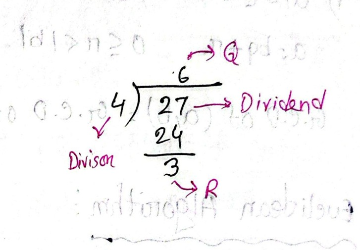
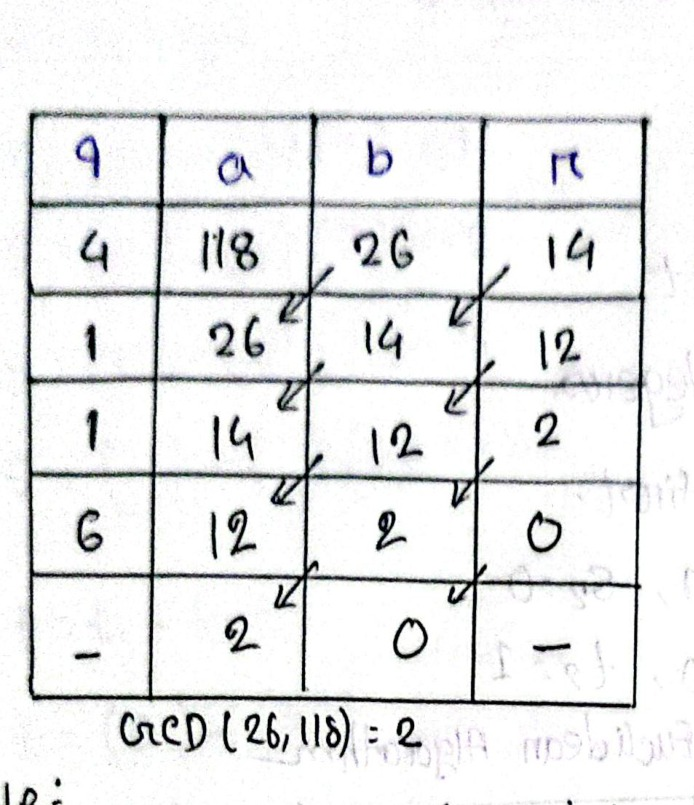
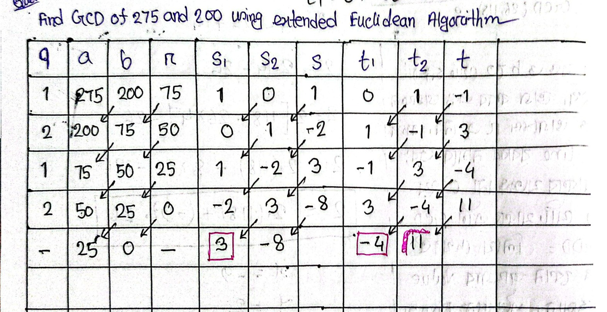
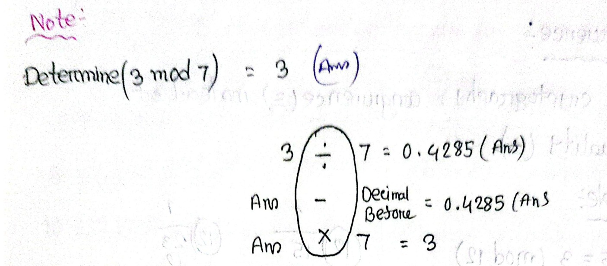

# ECE 2213: Mathematical Induction II & Elementary Number Theory (Batch 5: Pages 80–95)

**Course**: ECE 2213 — Discrete Mathematics  
**Student**: Shishir (Roll: 2310002)  
**Batch**: 5 of 5 (Pages 80 – 95) — *Final Batch*  
**Topics Covered**: Mathematical Induction (Part II: Divisibility Induction Proof Completion for $8^n - 3^n$); Elementary Number Theory (The Division Algorithm, Dividend-Divisor-Quotient-Remainder Structure, Uniqueness Properties); Greatest Common Divisor ($\gcd$) & Least Common Multiple ($\operatorname{lcm}$); The Euclidean Algorithm (Divisibility Chain, Tabular Reduction, Bézout's Identity / Linear Combination $d = xa + yb$ via Back-Substitution); Extended Euclidean Algorithm (Bézout Recurrence Relations $s = s_1 - s_2 q$ and $t = t_1 - t_2 q$, Tabular Tracking, Modular Multiplicative Inverses); Prime Numbers & Prime Factorization (Fundamental Theorem of Arithmetic, Prime Factorization of Large Composite Integers and Factorials $10!$); Mersenne Primes ($M_n = 2^n - 1$); The Chinese Remainder Theorem (CRT Formulation, Pairwise Coprime Moduli, Inverse Computation via Direct Divisibility Trial, Solution Synthesis $\bar{x} \equiv \sum a_i N_i N_i^{-1} \pmod N$); Modular Arithmetic Foundations (Residue Systems, Scientific Calculator Modulo Algorithm, Cryptographic Relevance); Congruence Modulo $m$ ($a \equiv b \pmod m$, Validity Testing, Evaluation of Negative Residues and Modulo Normalization); Algebraic Properties of Modular Arithmetic (Compatibility with Addition, Subtraction, Multiplication; Commutative, Associative, and Distributive Laws); Modular Identities & Inverses (Additive Identity, Multiplicative Identity, Additive Inverses in $\mathbb{Z}_n$); Fast Modular Exponentiation ($a^b \bmod m$, Residue Simplification, Negative Base Reductions, Problem Solving for $23^3 \bmod 30$, $31^{500} \bmod 30$, $242^{329} \bmod 243$, and $11^7 \bmod 13$).

**Navigation**: [[00_Discrete_Mathematics_Index|📋 Master Study Index]] \| [[04_Predicates_Proofs_and_Induction_I|⬅ Previous: Batch 4 (Pages 60–79)]] \| [[06_Counting_Pigeonhole_and_Combinatorics|➡ Next: Module 6 (Counting & Combinatorics)]]

---

<!-- Page 80 -->

## Core Theory & Worked Problems
## 1. Mathematical Induction: Divisibility Proofs (Continued)

### 1.1 Theorem: Divisibility of $8^n - 3^n$ by $5$

This proof completes the inductive argument initiated on **Page 79** of Batch 4.

**Problem Statement**:  
For all integers $n \ge 1$, prove by the Principle of Mathematical Induction that:
$$8^n - 3^n \text{ is divisible by } 5$$

---

#### Formal Inductive Proof

Let the propositional function be:
$$P(n): 8^n - 3^n \text{ is divisible by } 5, \quad n \in \mathbb{Z}^+$$

#### Step 1: Basis Step (for $n = 1$)
*(Completed on Page 79)*
- $\text{L.H.S.} = 8^1 - 3^1 = 8 - 3 = 5$
- Since $5 = 5 \times 1$, $5$ is divisible by $5$.
- Therefore, $P(1)$ is **True**.

---

#### Step 2: Inductive Hypothesis (for $n = k$)
Assume that $P(n)$ is true for an arbitrary positive integer $n = k$:
$$8^k - 3^k \text{ is divisible by } 5 \quad \text{--- (1)}$$

*(By definition of divisibility, this means there exists an integer $m$ such that $8^k - 3^k = 5m$.)*

---

#### Step 3: Inductive Step (for $n = k + 1$)
We must show that $P(k + 1)$ is true, namely that $8^{k+1} - 3^{k+1}$ is divisible by $5$.

Starting from the left-hand side ($\text{L.H.S.}$):
$$
\begin{aligned}
\text{L.H.S.} &= 8^{k+1} - 3^{k+1} \\
&= 8^k \cdot 8 - 3^k \cdot 3
\end{aligned}
$$

To expose the inductive hypothesis $(8^k - 3^k)$, rewrite the coefficient $8$ as $(5 + 3)$:
$$
\begin{aligned}
&= 8^k(5 + 3) - 3^k \cdot 3 \\
&= 8^k \cdot 5 + 8^k \cdot 3 - 3^k \cdot 3 \\
&= 5 \cdot 8^k + 3\big(8^k - 3^k\big)
\end{aligned}
$$

#### Analysis of the Decomposed Terms:
$$\underbrace{5 \cdot 8^k}_{\text{Term 1}} + \underbrace{3\big(8^k - 3^k\big)}_{\text{Term 2}}$$

1. **Term 1 ($5 \cdot 8^k$)**: Has an explicit factor of $5$, hence it is divisible by $5$.
2. **Term 2 ($3(8^k - 3^k)$)**: By the Inductive Hypothesis (1), $(8^k - 3^k)$ is divisible by $5$. Therefore, $3(8^k - 3^k)$ is also divisible by $5$.

Since both individual terms are divisible by $5$, their sum is also divisible by $5$:
$$\text{Both terms are divisible by } 5 \implies 5 \cdot 8^k + 3\big(8^k - 3^k\big) \text{ is divisible by } 5$$

Hence, $P(n)$ is **True for $n = k + 1$**.

$$\text{L.H.S.} = \text{R.H.S. (in divisibility by 5)}$$

#### Conclusion:
By the Principle of Mathematical Induction, $P(n)$ is true for all positive integers $n \ge 1$. $\blacksquare$

---

<!-- Page 81 -->

## 2. Elementary Number Theory: The Division Algorithm & Divisibility

### 2.1 The Division Algorithm

> [!important] Theorem: The Division Algorithm
> For any integer $a$ (called the **dividend**) and any positive integer $b$ (called the **divisor**), there exist **unique** integers $q$ (the **quotient**) and $r$ (the **remainder**) such that:
> $$a = bq + r, \quad \text{where } 0 \le r < |b|$$

#### Structural Components:
- **$a$**: Dividend (the number being divided)
- **$b$**: Divisor (the dividing number, $b > 0$)
- **$q$**: Quotient (integer result of division, $q = \lfloor a / b \rfloor$)
- **$r$**: Remainder ($r = a - bq$, satisfying $0 \le r < b$)

---

#### Illustrative Example:
Let $a = 27$ and $b = 4$:
$$27 = 4 \times 6 + 3$$
- Divisor: $b = 4$
- Dividend: $a = 27$
- Quotient: $q = 6$
- Remainder: $r = 3$ (satisfies $0 \le 3 < 4$)

*Figure 5.1 — Standard arithmetic division schematic illustrating Divisor ($b$), Dividend ($a$), Quotient ($q$), and Remainder ($r$) on Page 81.*

---

### 2.2 Greatest Common Divisor ($\gcd$)

#### Formal Definition:
Let $a, b \in \mathbb{Z}$, such that at least one of them is non-zero (i.e., not both $0$).

The **Greatest Common Divisor** of $a$ and $b$, denoted $\gcd(a, b)$, is the largest positive integer $d$ that divides both $a$ and $b$:
$$d \mid a \quad \text{and} \quad d \mid b$$

In the student's handwritten notation:
$$\frac{d}{a} \text{ and } \frac{d}{b} \implies d \text{ is a common divisor of } a \text{ and } b$$
*(Note: Mathematically, $d \mid a$ denotes "$d$ divides $a$", meaning $a$ is an integer multiple of $d$.)*

---

<!-- Page 82 -->

### 2.3 Finding $\gcd$ via Factor Enumeration

#### Example: Find $\gcd(45, 60)$
List all positive divisors of each number:
- **Divisors of $45$**: $\{1, 3, 5, 9, \mathbf{15}, 45\}$
- **Divisors of $60$**: $\{1, 3, 5, 10, \mathbf{15}, 20, 30, 60\}$

The set of common divisors is $\{1, 3, 5, 15\}$. The greatest among them is:
$$\gcd(45, 60) = 15$$

---

### 2.4 Fundamental Invariance of the Euclidean Algorithm

Let $a, b \in \mathbb{Z}$ with $b \ne 0$. Expressing $a$ via the Division Algorithm:
$$a = bq + r, \quad 0 \le r < |b|$$

The fundamental property of the Euclidean Algorithm states:
$$\gcd(a, b) = \gcd(b, r)$$

> [!tip] Mathematical Justification
> If $d \mid a$ and $d \mid b$, then $d$ divides any linear combination of $a$ and $b$, specifically $r = a - bq$. Conversely, if $d \mid b$ and $d \mid r$, then $d$ divides $a = bq + r$. Therefore, the common divisors of $(a, b)$ are identical to the common divisors of $(b, r)$, which implies $\gcd(a, b) = \gcd(b, r)$.

---

### 2.5 The Euclidean Algorithm & Bézout's Identity

The **Euclidean Algorithm** is an iterative method used to compute the actual value of the greatest common divisor $d = \gcd(a, b)$ without prime factorization.

Furthermore, by **Bézout's Identity**, the greatest common divisor $d$ can always be represented as an integer linear combination of $a$ and $b$:
$$d = xa + yb, \quad \text{where } x, y \in \mathbb{Z}$$
The integers $x$ and $y$ are known as **Bézout's coefficients**.

---

#### Problem:
Find $\gcd(26, 118)$ and express it in the form:
$$26x + 118y, \quad \text{where } x, y \in \mathbb{Z}$$

---

<!-- Page 83 -->

### 2.6 Solving $\gcd(26, 118)$ via Tabular Euclidean Algorithm

To compute $\gcd(118, 26)$ systematically, we construct the division table where $a$ is the larger number and $b$ is the smaller number:

*Figure 5.2 — Tabular execution of the Euclidean Algorithm for $\gcd(26, 118)$ showing diagonal shift of $(b, r) \to (a, b)$ on Page 83.*

#### Iterative Table Execution:

$$
\begin{array}{|c|c|c|c|l|}
\hline
\mathbf{q} & \mathbf{a} & \mathbf{b} & \mathbf{r} & \textbf{Division Equation} \\
\hline
4 & 118 & 26 & 14 & 118 = 26 \times 4 + 14 \\
\hline
1 & 26 & 14 & 12 & 26 = 14 \times 1 + 12 \\
\hline
1 & 14 & 12 & 2 & 14 = 12 \times 1 + 2 \\
\hline
6 & 12 & 2 & 0 & 12 = 2 \times 6 + 0 \\
\hline
- & 2 & 0 & - & \textbf{Terminated} \\
\hline
\end{array}
$$

The last non-zero remainder in the division chain is $2$:
$$\gcd(26, 118) = 2$$

---

### 2.7 Expressing $\gcd$ as a Linear Combination (Back-Substitution)

Using the relation $a = bq + r \implies r = a - bq$, we work backward from the step yielding remainder $2$:

#### Step 1: Isolate the remainder $2$
$$2 = 14 - 12 \times 1$$
$$2 = 14 - 12$$

#### Step 2: Substitute for $12$ from the preceding row ($12 = 26 - 14 \times 1$)
$$
\begin{aligned}
2 &= 14 - [26 - 14 \times 1] \\
&= 14 - 26 + 14 \\
&= 2 \cdot 14 - 26
\end{aligned}
$$

#### Step 3: Substitute for $14$ from the first row ($14 = 118 - 26 \times 4$)
$$
\begin{aligned}
2 &= 2 [118 - 26 \times 4] - 26 \\
&= 2 \cdot (118) - 8 \times 26 - 26 \\
&= 2 \cdot (118) + (-9) \cdot 26
\end{aligned}
$$

Rearranging into the standard form $26x + 118y$:
$$2 = 26(-9) + 118(2)$$

Thus, the Bézout coefficients are:
$$\mathbf{x = -9, \quad y = 2}$$

---

### 2.8 Student Insight: Practical Rules for the Euclidean Algorithm

> [!note] Student Insight: Rules for Tabular Euclidean Algorithm & Back-Substitution
> *Original Bengali Notes (Page 83)*:  
> > *"Rule:*  
> > *(1) $a$-তে বড় ও $b$-তে ছোট সংখ্যা নিতে হবে। ভাগ করব এবং ভাগফল $q$-এ ও ভাগশেষ $r$-এ নেব। এরপর Parallel line বরাবর নামবে এবং চলতে থাকবে যতক্ষণ না 0 হয়। অবশিষ্ট যেটি থাকবে ঐটা GCD।*  
> > *এখন $\text{GCD} =$ লিখে দেখব ঐ GCD এর কোন জায়গার Value $r$ এর সমান। এইখানে Divisor algorithm use করে $r = a - bq$ use করব। 14 ও 12 এর মধ্যে 2 টায় $r$ এ আছে আমি ছোটটা নিয়ে কাজ করব। এইখানে কোনো সংখ্যা গুণ করা যাবে না আলাদা রাখতে হবে। এইভাবে ভাঙতে থাকতে হবে মিলে যাবে।"*  
>  
> *English Translation & Operational Synthesis*:  
> 1. **Table Setup**: Always assign the larger integer to column $a$ and the smaller integer to column $b$.  
> 2. **Iterative Step**: Perform division $a \div b$: place the quotient in column $q$ and the remainder in column $r$.  
> 3. **Diagonal Propagation**: Shift entries diagonally down along parallel diagonals: the old divisor $b$ becomes the new dividend $a$, and the old remainder $r$ becomes the new divisor $b$.  
> 4. **Termination**: Continue this cascade until the remainder reaches $0$. The last non-zero remainder is the greatest common divisor ($\gcd$).  
> 5. **Linear Combination Back-Substitution**:  
>    - Express the remainder relation as $r = a - bq$.  
>    - Locate the row where the remainder equals the $\gcd$ ($r = 2$), and write the equation for $2$.  
>    - Successively substitute each intermediate remainder ($12$, then $14$) from the rows above it.  
>    - **Critical Golden Rule**: Never multiply out the base terms ($118$ and $26$) into scalar products; keep them isolated as symbolic factors and combine their integer coefficients. Following this systematic backward expansion will invariably produce the exact Bézout coefficients!

---

<!-- Page 84 -->

## 3. The Extended Euclidean Algorithm

### 3.1 Motivation & Scope
The **Extended Euclidean Algorithm** computes:
1. The greatest common divisor $\gcd(a, b)$.
2. The Bézout coefficients $s$ and $t$ such that:
   $$\gcd(a, b) = sa + tb$$
3. The **modular multiplicative inverse** of an integer modulo $m$, which is essential for RSA and asymmetric cryptography.

---

### 3.2 Recurrence Relations & Initialization

Let $s$ and $t$ be updated iteratively alongside quotients $q$:
$$s = s_1 - s_2 q$$
$$t = t_1 - t_2 q$$

#### Initial Conditions:
$$
\begin{aligned}
s_1 &= 1, \quad s_2 = 0 \\
t_1 &= 0, \quad t_2 = 1
\end{aligned}
$$

At each step, values shift diagonally:
$$(s_2, s) \longrightarrow (s_1, s_2) \quad \text{and} \quad (t_2, t) \longrightarrow (t_1, t_2)$$

---

### 3.3 Problem: Find $\gcd(275, 200)$ via Extended Euclidean Algorithm

*Figure 5.3 — Full tabular tracking of the Extended Euclidean Algorithm for $\gcd(275, 200)$ computing Bézout coefficients $s$ and $t$ on Page 84.*

#### Master Tabular Execution:

$$
\begin{array}{|c|c|c|c|c|c|c|c|c|c|}
\hline
\mathbf{q} & \mathbf{a} & \mathbf{b} & \mathbf{r} & \mathbf{s_1} & \mathbf{s_2} & \mathbf{s = s_1 - s_2 q} & \mathbf{t_1} & \mathbf{t_2} & \mathbf{t = t_1 - t_2 q} \\
\hline
1 & 275 & 200 & 75 & 1 & 0 & 1 - 0(1) = \mathbf{1} & 0 & 1 & 0 - 1(1) = \mathbf{-1} \\
\hline
2 & 200 & 75 & 50 & 0 & 1 & 0 - 1(2) = \mathbf{-2} & 1 & -1 & 1 - (-1)(2) = \mathbf{3} \\
\hline
1 & 75 & 50 & 25 & 1 & -2 & 1 - (-2)(1) = \mathbf{3} & -1 & 3 & -1 - 3(1) = \mathbf{-4} \\
\hline
2 & 50 & 25 & 0 & -2 & 3 & -2 - 3(2) = \mathbf{-8} & 3 & -4 & 3 - (-4)(2) = \mathbf{11} \\
\hline
- & \mathbf{25} & 0 & - & \mathbf{3} & -8 & - & \mathbf{-4} & 11 & - \\
\hline
\end{array}
$$

#### Extracted Values:
- $\gcd(275, 200) = \mathbf{25}$
- Coefficient of $275$: $s = s_1 = \mathbf{3}$
- Coefficient of $200$: $t = t_1 = \mathbf{-4}$

---

<!-- Page 85 -->

### 3.4 Step-by-Step Computational Verification of Coefficients

#### Evaluation Log for $s = s_1 - s_2 q$:
1. **Row 1**: $s = (1) - (0)(1) = 1$
2. **Row 2**: $s = (0) - (1)(2) = -2$
3. **Row 3**: $s = (1) - (-2)(1) = 1 + 2 = 3$
4. **Row 4**: $s = (-2) - (3)(2) = -2 - 6 = -8$

#### Evaluation Log for $t = t_1 - t_2 q$:
1. **Row 1**: $t = (0) - (1)(1) = -1$
2. **Row 2**: $t = (1) - (-1)(2) = 1 + 2 = 3$
3. **Row 3**: $t = (-1) - (3)(1) = -1 - 3 = -4$
4. **Row 4**: $t = (3) - (-4)(2) = 3 + 8 = 11$

---

### 3.5 Student Insight: Iteration Count Matching

> [!note] Student Insight: Alignment of Coefficient Updates with Quotients
> *Original Bengali Annotation (Page 85)*:  
> > *"$q$ এর value যতগুলো ততগুলো $s$ নেব, $t$ এর ক্ষেত্রেও same."*  
>  
> *English Translation & Explanation*:  
> "The number of calculated values of $s$ (and identically for $t$) exactly equals the number of quotient values $q$ obtained in the division sequence."  
> That is, since there are $4$ division steps generating quotients ($q = 1, 2, 1, 2$), we evaluate exactly $4$ values for $s$ and $4$ values for $t$. When the remainder reaches $0$, we do not compute further $s$ or $t$; rather, the final Bézout coefficients are read directly from $s_1$ and $t_1$ in the terminating row.

---

### 3.6 Final Linear Combination & Numerical Check

Expressing $\gcd(275, 200) = 25$ in linear combination form:
$$25 = x \cdot 275 + y \cdot 200$$
Substituting the extracted coefficients $x = 3$ and $y = -4$:
$$25 = 3 \times 275 + (-4) \times 200$$

#### Numerical Verification:
$$
\begin{aligned}
3 \times 275 &= 825 \\
(-4) \times 200 &= -800 \\
825 + (-800) &= 25 \quad \checkmark
\end{aligned}
$$
The result is completely verified.

---

<!-- Page 86 -->

## 4. Prime Numbers & Prime Factorization

### 4.1 The Fundamental Theorem of Arithmetic

> [!important] Fundamental Theorem of Arithmetic (Unique Factorization Theorem)
> Every integer $n > 1$ either is a prime number itself or can be represented uniquely as a product of prime numbers, up to the order of the prime factors:
> $$n = p_1^{a_1} p_2^{a_2} p_3^{a_3} \cdots p_k^{a_k}$$
> where $p_1 < p_2 < \dots < p_k$ are prime numbers and $a_i \ge 1$ are positive integer exponents.

---

### 4.2 Prime Factorization Problem Solving

#### Example 1: Factorization of $45500$
Decomposing by successive division by smallest prime factors:
$$
\begin{aligned}
45500 &= 2 \times 22750 \\
&= 2 \times 2 \times 11375 \\
&= 2 \times 2 \times 5 \times 2275 \\
&= 2 \times 2 \times 5 \times 5 \times 455 \\
&= 2 \times 2 \times 5 \times 5 \times 5 \times 91 \\
&= 2 \times 2 \times 5 \times 5 \times 5 \times 7 \times 13
\end{aligned}
$$

Expressing in canonical prime exponential form:
$$\mathbf{45500 = 2^2 \times 5^3 \times 7 \times 13}$$

---

#### Example 2: Factorization of $6647$
Testing divisibility:
- $6647$ is not divisible by $2, 3, 5, 7, 11, 13$.
- Dividing by $17$: $6647 \div 17 = 391$.
- Dividing $391$ by $17$: $391 \div 17 = 23$.
- $23$ is a prime number.

$$
\begin{aligned}
6647 &= 17 \times 391 \\
&= 17 \times 17 \times 23 \\
&= \mathbf{17^2 \times 23}
\end{aligned}
$$

---

#### Example 3: Prime Factorization of $10!$ (Factorial Decomposition)
Expand $10!$ into its individual integer product:
$$10! = 10 \times 9 \times 8 \times 7 \times 6 \times 5 \times 4 \times 3 \times 2 \times 1$$

Decompose each composite factor into primes:
$$
\begin{aligned}
10! &= (5 \times 2) \times (3 \times 3) \times (2 \times 2 \times 2) \times 7 \times (3 \times 2) \times 5 \times (2 \times 2) \times 3 \times 2 \times 1 \\
&= (2 \times 5) \times (3^2) \times (2^3) \times 7 \times (2 \times 3) \times 5 \times (2^2) \times 3 \times 2
\end{aligned}
$$

Collecting exponents for each prime:
- **Prime $2$**: $1 \text{ (from 10)} + 3 \text{ (from 8)} + 1 \text{ (from 6)} + 2 \text{ (from 4)} + 1 \text{ (from 2)} = 8 \implies 2^8$
- **Prime $3$**: $2 \text{ (from 9)} + 1 \text{ (from 6)} + 1 \text{ (from 3)} = 4 \implies 3^4$
- **Prime $5$**: $1 \text{ (from 10)} + 1 \text{ (from 5)} = 2 \implies 5^2$
- **Prime $7$**: $1 \text{ (from 7)} = 1 \implies 7^1$

$$\mathbf{10! = 2^8 \times 3^4 \times 5^2 \times 7}$$

---

<!-- Page 87 -->

## 5. Mersenne Primes & The Chinese Remainder Theorem

### 5.1 Mersenne Prime Numbers

#### Definition:
A **Mersenne number** is a number of the form:
$$M_n = 2^n - 1, \quad \text{where } n \text{ is a prime number}$$
If $M_n$ is itself prime, it is called a **Mersenne prime**.

#### Examples:
1. For $n = 5$ (which is prime):
   $$M_5 = 2^5 - 1 = 32 - 1 = 31 \quad (\text{Prime})$$
2. For $n = 7$ (which is prime):
   $$M_7 = 2^7 - 1 = 128 - 1 = 127 \quad (\text{Prime})$$

*(Note: If $n$ is composite, $2^n - 1$ is always composite. However, $n$ being prime is a necessary but not sufficient condition for $2^n - 1$ to be prime, e.g., $2^{11} - 1 = 2047 = 23 \times 89$.)*

---

### 5.2 The Chinese Remainder Theorem (CRT)

The **Chinese Remainder Theorem** provides a unique solution modulo $N$ for a system of simultaneous linear congruences having pairwise coprime moduli.

#### Problem Statement:
Solve the simultaneous system of congruences:
$$
\begin{aligned}
x &\equiv 2 \pmod 3 \\
x &\equiv 3 \pmod 5 \\
x &\equiv 2 \pmod 7
\end{aligned}
$$
using CRT.

---

#### Step 1: Identify Parameters
- Remainders: $a_1 = 2, \quad a_2 = 3, \quad a_3 = 2$
- Moduli: $n_1 = 3, \quad n_2 = 5, \quad n_3 = 7$

Verify pairwise coprimality:
$$\gcd(3, 5) = 1, \quad \gcd(5, 7) = 1, \quad \gcd(3, 7) = 1$$
Since all pairs are coprime, CRT guarantees a unique solution modulo $N$.

---

#### Step 2: Compute Total Modulus $N$ and Partial Moduli $N_i$
$$N = n_1 \cdot n_2 \cdot n_3 = 3 \times 5 \times 7 = 105$$

$$
\begin{aligned}
N_1 &= \frac{N}{n_1} = \frac{105}{3} = 35 \\
N_2 &= \frac{N}{n_2} = \frac{105}{5} = 21 \\
N_3 &= \frac{N}{n_3} = \frac{105}{7} = 15
\end{aligned}
$$

---

<!-- Page 88 -->

### 5.3 Step 3: Compute Modular Multiplicative Inverses ($N_i^{-1} \pmod{n_i}$)

We determine $N_i^{-1}$ satisfying $N_i \cdot N_i^{-1} \equiv 1 \pmod{n_i}$:

#### Case (i): Inverse for $N_1 = 35$ modulo $n_1 = 3$
$$N_1 N_1^{-1} \equiv 1 \pmod{n_1} \implies 35 N_1^{-1} \equiv 1 \pmod 3$$

> [!note] Student Insight: Modular Inverse via Direct Testing
> *Original Bengali Annotation (Page 88)*:  
> > *"$N_1^{-1}$ কে যদি 1 ধরি তাহলে $35 \times 1 = 35$ হবে। $35 - 1 = 34$, এখন 34 কি 3 দ্বারা বিভাজ্য? না তাই 1 ধরা যাবে না। যদি $N_1^{-1} = 2$ ধরি, $35 \times 2 = 70$, $70 - 1 = 69$ যা 3 দ্বারা বিভাজ্য। $\therefore N_1^{-1} = 2$। এইভাবেই বাকিগুলো বের করতে হবে।"*  
>  
> *English Translation & Analytical Insight*:  
> - If we test $N_1^{-1} = 1$: $35 \times 1 = 35$. The residue condition requires $(35 - 1) = 34$ to be divisible by $3$. Since $34$ is not divisible by $3$, $1$ is invalid.  
> - If we test $N_1^{-1} = 2$: $35 \times 2 = 70$. The difference $(70 - 1) = 69$ is divisible by $3$ ($69 / 3 = 23$).  
> - Therefore:
>   $$\mathbf{N_1^{-1} = 2}$$
> *(Alternatively, reducing modulo 3 first: $35 \equiv 2 \pmod 3 \implies 2 N_1^{-1} \equiv 1 \equiv 4 \pmod 3 \implies N_1^{-1} \equiv 2 \pmod 3$.)*

---

#### Case (ii): Inverse for $N_2 = 21$ modulo $n_2 = 5$
$$N_2 N_2^{-1} \equiv 1 \pmod{n_2} \implies 21 N_2^{-1} \equiv 1 \pmod 5$$
Reducing $21 \bmod 5 = 1$:
$$1 \cdot N_2^{-1} \equiv 1 \pmod 5 \implies \mathbf{N_2^{-1} = 1}$$

---

#### Case (iii): Inverse for $N_3 = 15$ modulo $n_3 = 7$
$$N_3 N_3^{-1} \equiv 1 \pmod{n_3} \implies 15 N_3^{-1} \equiv 1 \pmod 7$$
Reducing $15 \bmod 7 = 1$:
$$1 \cdot N_3^{-1} \equiv 1 \pmod 7 \implies \mathbf{N_3^{-1} = 1}$$

---

### 5.4 Step 4: Synthesize the Solution

The combined linear solution is given by:
$$\bar{x} = a_1 N_1 N_1^{-1} + a_2 N_2 N_2^{-1} + a_3 N_3 N_3^{-1}$$

Substitute the values:
$$
\begin{aligned}
\bar{x} &= (2 \times 35 \times 2) + (3 \times 21 \times 1) + (2 \times 15 \times 1) \\
&= 140 + 63 + 30 \\
&= 233
\end{aligned}
$$

---

### 5.5 Step 5: Normalize Solution Modulo $N$

Reduce $\bar{x}$ modulo $N = 105$:
$$
\begin{aligned}
x &= \bar{x} \bmod N \\
&= 233 \bmod 105
\end{aligned}
$$

Since $233 = 2 \times 105 + 23$:
$$\mathbf{x = 23}$$

#### Solution Verification:
- $23 \bmod 3 = 2 \quad \checkmark$
- $23 \bmod 5 = 3 \quad \checkmark$
- $23 \bmod 7 = 2 \quad \checkmark$

The solution is completely verified.

---

<!-- Page 89 -->

## 6. Modular Arithmetic Foundations

### 6.1 Scientific Calculator Algorithm for Modulo

Standard scientific calculators (such as Casio fx-991MS / fx-991ES) do not have a dedicated `mod` button. The notes present an exact 3-step shortcut to evaluate $a \bmod m$.

#### Example: Evaluate $3 \bmod 7 = 3$

*Figure 5.4 — Three-step scientific calculator operation flow for evaluating $a \bmod m$ on Page 89.*

#### The Calculator Procedure:
1. **Division**: $3 \div 7 = 0.4285714\dots$
2. **Subtract Integer Part (Before Decimal Point)**: $\text{Ans} - 0 = 0.4285714\dots$
3. **Multiply by Divisor / Modulus**: $\text{Ans} \times 7 = 3$

> [!note] Student Insight: Calculator Shortcut for Modulo
> *Original Bengali Notes (Page 89)*:  
> > *"প্রথমে যে দুটি integer থাকবে তাদের ভাগ করতে হবে। এরপর Ans থেকে পূর্ণ অংশটুকু বিয়োগ করতে হবে, এরপর Ans এর সাথে mod এর পরের সংখ্যা গুণ করতে হবে। Last এ যা থাকবে ঐটা Ans."*  
>  
> *English Translation*:  
> "First, divide the two given integers ($a \div m$). Next, subtract the whole integer part ($\lfloor a/m \rfloor$) from the displayed answer. Then, multiply the resulting fractional decimal answer by the modulus ($m$) that appeared after the mod. The final whole number displayed is the exact remainder / Ans."  
>  
> *Formula*:  
> $$a \bmod m = \left( \frac{a}{m} - \left\lfloor \frac{a}{m} \right\rfloor \right) \times m$$

---

### 6.2 Definition and Properties of Modular Arithmetic

- **System of arithmetic for integers**: Deals with discrete integer systems under restricted boundaries.
- **Wrap-around property**: Integers wrap around cyclically upon reaching a certain fixed limit known as the **modulus** ($m$).
- **Significance in modern computer science**: Serves as the central mathematical foundation of modern **cryptography** (RSA encryption, Diffie-Hellman key exchange, hashing algorithms).

---

<!-- Page 90 -->

## 7. Congruence Modulo $m$

### 7.1 Formal Definition of Congruence

> In cryptography and discrete mathematics, the **congruence relation** ($\equiv$) is used instead of standard equality ($=$).

Let $a, b \in \mathbb{Z}$ and $m \in \mathbb{Z}^+$ ($m > 1$).  
We say that $a$ is **congruent to $b$ modulo $m$**, written:
$$a \equiv b \pmod m$$
if and only if $m$ divides the difference $(a - b)$, denoted $m \mid (a - b)$.

Equivalently:
$$a \bmod m = b \bmod m$$
$$(a - b) = km \quad \text{for some integer } k$$

---

### 7.2 Introductory Examples:

1. **$15 \equiv 3 \pmod{12}$**:
   - Division: $15 = 12 \times 1 + 3 \implies 15 \bmod 12 = 3$.
   - Difference: $15 - 3 = 12$, and $12 \mid 12$.  
   - $\implies \mathbf{Valid}$.

2. **$23 \equiv 11 \pmod{12}$**:
   - Division: $23 = 12 \times 1 + 11 \implies 23 \bmod 12 = 11$.
   - Difference: $23 - 11 = 12$, and $12 \mid 12$.  
   - $\implies \mathbf{Valid}$.

3. **$33 \equiv 3 \pmod{10}$**:
   - Division: $33 = 10 \times 3 + 3 \implies 33 \bmod 10 = 3$.
   - Difference: $33 - 3 = 30$, and $10 \mid 30$.  
   - $\implies \mathbf{Valid}$.

---

### 7.3 Congruence with Negative Residues

Consider the expression:
$$10 \equiv -2 \pmod{12}$$
Is this statement valid? $\implies \mathbf{Valid}$.

#### Division Analysis:
$$10 = 12 \times 0 + 10$$
Or in terms of difference: $10 - (-2) = 12$, which is divisible by $12$.

> [!note] Student Insight: Converting Negative Residues
> *Original Bengali Annotation (Page 90)*:  
> > *"valid. যদি negative হয় তাহলে mod এর দুইপাশের সংখ্যা যোগ করলে reminder থাকবে। এখানে 10 reminder তাই $(12 - 2) = 10$ so valid"*  
>  
> *English Translation & Mathematical Principle*:  
> "Valid! If the residue on the right-hand side is negative, adding the modulus to the negative residue recovers the standard non-negative remainder. Here, the remainder of $10$ divided by $12$ is $10$. On the other side, adding the modulus to the negative residue gives $(12 + (-2)) = 10$. Since both match, the relation is valid!"  
>  
> *General Rule*: If $b < 0$, then $b \equiv (b + km) \pmod m$ for any integer $k$. Choosing $k$ such that $0 \le b + km < m$ yields the canonical principal remainder.

---

<!-- Page 91 -->

## 8. Congruence Validity Problem Solving & Negative Modulo

### 8.1 Testing Validity of Congruence Relations

Test whether each of the following statements is **Valid** or **Invalid**:

1. **$38 \equiv 2 \pmod{12}$** $\longrightarrow \mathbf{Valid} \ (\checkmark)$
   - Difference: $38 - 2 = 36$.
   - Divisibility: $36 = 12 \times 3$, which is divisible by $12$.

2. **$38 \equiv 14 \pmod{12}$** $\longrightarrow \mathbf{Valid} \ (\checkmark)$
   - Difference: $38 - 14 = 24$.
   - Divisibility: $24 = 12 \times 2$, which is divisible by $12$.
   - *(Note: Although $14 \ge 12$, it is still a valid residue in the same equivalence class.)*

3. **$5 \equiv 0 \pmod 5$** $\longrightarrow \mathbf{Valid} \ (\checkmark)$
   - Difference: $5 - 0 = 5 = 5 \times 1$, divisible by $5$.

4. **$10 \equiv 2 \pmod 6$** $\longrightarrow \mathbf{Invalid} \ (\times)$
   - Difference: $10 - 2 = 8$.
   - Divisibility: $8$ is not divisible by $6$ ($8 / 6 \notin \mathbb{Z}$).

5. **$13 \equiv 3 \pmod{13}$** $\longrightarrow \mathbf{Invalid} \ (\times)$
   - Difference: $13 - 3 = 10$.
   - Divisibility: $10$ is not divisible by $13$.

6. **$2 \equiv -3 \pmod 5$** $\longrightarrow \mathbf{Valid} \ (\checkmark)$
   - Difference: $2 - (-3) = 2 + 3 = 5 = 5 \times 1$, divisible by $5$.

---

### 8.2 Calculating Modulo of Negative Integers: $-8 \bmod 5$

> [!note] Student Insight: Systematic Calculation of Negative Modulo
> *Original Bengali Notes (Page 91)*:  
> > *"$-8 \bmod 5$ কত? Negative সংখ্যার mod বের করতে $-8$ এর সাথে 5 যোগ করতে থাকব যতক্ষণ না Plus value আসছে। $-8$ এর সাথে 2 বার 5 যোগ করলে 2 আসে। এখন $2 \bmod 5$ ই হবে ভাগশেষ যা হলো 2।"*  
>  
> *English Translation & Operational Procedure*:  
> "What is $-8 \bmod 5$? To find the remainder of a negative number, keep adding the modulus ($5$) to $-8$ repeatedly until a positive (non-negative) value $< 5$ is reached:  
> $$-8 + 5 = -3$$
> $$-3 + 5 = 2$$
> Adding $5$ twice yields $2$. Therefore, $2 \bmod 5 = 2$, which is the true remainder!"  
>  
> *Division Algorithm Check*:  
> $$-8 = 5 \times (-2) + 2 \implies q = -2, \quad r = 2 \quad (0 \le 2 < 5)$$

---

### 8.3 Evaluating Validity of $-8 \equiv 7 \pmod 5$

**Problem**: Is $-8 \equiv 7 \pmod 5$ valid?

#### Method 1: Evaluating Modulo on Both Sides
- Left-hand side: $-8 \bmod 5 = 2$
- Right-hand side: $7 \bmod 5 = 2$
- Since both sides evaluate to $2$:
$$\therefore \mathbf{-8 \equiv 7 \pmod 5 \text{ is Valid.}}$$

#### Method 2: Difference Divisibility
$$-8 - 7 = -15 = 5 \times (-3)$$
Since $-15$ is divisible by $5$, the congruence is valid.

---

<!-- Page 92 -->

## 9. Algebraic Properties of Modular Arithmetic

### 9.1 Compatibility with Arithmetic Operations

For any integers $a, b$ and positive integer $n$:

1. **Modular Addition**:
   $$\big[(a \bmod n) + (b \bmod n)\big] \bmod n = (a + b) \bmod n$$

2. **Modular Subtraction**:
   $$\big[(a \bmod n) - (b \bmod n)\big] \bmod n = (a - b) \bmod n$$

3. **Modular Multiplication**:
   $$\big[(a \bmod n) \times (b \bmod n)\big] \bmod n = (a \times b) \bmod n$$

---

### 9.2 Algebraic Laws in Modular Systems

#### 1. Commutative Laws:
$$(a + b) \bmod n = (b + a) \bmod n$$
$$(a \times b) \bmod n = (b \times a) \bmod n$$

#### 2. Associative Laws:
$$\big[(a + b) + c\big] \bmod n = \big[a + (b + c)\big] \bmod n$$
$$\big[(a \times b) \times c\big] \bmod n = \big[a \times (b \times c)\big] \bmod n$$

#### 3. Distributive Law:
$$\big[a \times (b + c)\big] \bmod n = \big[(a \times b) + (a \times c)\big] \bmod n$$

---

<!-- Page 93 -->

## 10. Identities, Inverses & Fast Modular Exponentiation

### 10.1 Modular Identities

1. **Additive Identity ($0$)**:
   $$(0 + a) \bmod n = a \bmod n$$
2. **Multiplicative Identity ($1$)**:
   $$(1 \times a) \bmod n = a \bmod n$$

---

### 10.2 Additive Inverse in $\mathbb{Z}_n$

For every element $a \in \mathbb{Z}_n$, there exists an element '$-a$' (or $n - a$) such that:
$$(a) + (-a) \equiv 0 \pmod n$$

---

### 10.3 Fast Modular Exponentiation

#### Concept:
**Modular Exponentiation** is the operation of computing the remainder when an integer base $a$ raised to an exponent $b$ is divided by a modulus $m$:
$$a^b \bmod m \quad \text{or} \quad a^b \pmod m$$

Because $a^b$ grows astronomically for large exponents, computing $a^b$ directly causes integer overflow. Modular arithmetic allows intermediate reduction of the base at every multiplication step:
$$a^b \bmod m = (a \bmod m)^b \bmod m$$

Furthermore, using **negative residues** (when $a \bmod m > m/2$, replace $a$ with $a - m$) dramatically simplifies calculations.

---

### 10.4 Problem 1: Solve $23^3 \bmod 30$

#### Step 1: Base Reduction using Negative Residue
Observe that $23 \bmod 30$ can be represented either as $23$ or as:
$$23 - 30 = -7$$
Thus:
$$23 \equiv -7 \pmod{30}$$

#### Step 2: Substitute into the Exponentiation
$$23^3 \bmod 30 = (-7)^3 \bmod 30$$

#### Step 3: Expand the Power
$$
\begin{aligned}
(-7)^3 \bmod 30 &= \big[(-7)^2 \times (-7)\big] \bmod 30 \\
&= \big[49 \times (-7)\big] \bmod 30
\end{aligned}
$$

*(Continued on Page 94)*

---

<!-- Page 94 -->

### 10.5 Problem 1 (Continued): Completing $23^3 \bmod 30$

Continuing from $49 \times (-7) \bmod 30$:
Reducing $49 \bmod 30 = 19$:
$$
\begin{aligned}
19 \times (-7) &= -133 \\
-133 \bmod 30 &= -13 \bmod 30
\end{aligned}
$$
*(since $-133 = 30 \times (-4) - 13$, or $-133 + 4 \times 30 = -13$)*

Normalizing the negative remainder:
$$-13 + 30 = 17$$
$$\therefore \mathbf{23^3 \bmod 30 = 17}$$

#### Direct Numerical Verification:
$$23^3 = 12167 = 30 \times 405 + 17 \quad \checkmark$$

---

### 10.6 Problem 2: Solve $31^{500} \bmod 30$

#### Step 1: Reduce the Base Modulo $30$
$$31 \bmod 30 = 1$$
Therefore:
$$31 \equiv 1 \pmod{30}$$

#### Step 2: Evaluate the Power
$$
\begin{aligned}
31^{500} \bmod 30 &= 1^{500} \bmod 30 \\
&= 1 \bmod 30 \\
&= \mathbf{1}
\end{aligned}
$$

---

### 10.7 Problem 3: Solve $242^{329} \bmod 243$

#### Step 1: Reduce the Base Modulo $243$
$$242 - 243 = -1 \implies 242 \equiv -1 \pmod{243}$$

#### Step 2: Evaluate the Power for $242^{329} \bmod 243$
$$
\begin{aligned}
242^{329} \bmod 243 &= (-1)^{329} \bmod 243
\end{aligned}
$$
Since $329$ is an **odd exponent**, $(-1)^{329} = -1$:
$$= -1 \bmod 243$$

#### Step 3: Normalize to Positive Remainder
$$-1 + 243 = 242$$
$$\therefore \mathbf{242^{329} \bmod 243 = 242}$$

---

<!-- Page 95 -->

## 11. Problem Solving: Modular Exponentiation of $11^7 \bmod 13$

### 11.1 Problem Statement
Solve:
$$11^7 \bmod 13$$

---

### 11.2 Analytical Solution

#### Method 1: Product Decomposition via Modular Multiplication Property
By the multiplicative property of modular arithmetic:
$$11^7 \bmod 13 = \big(11 \bmod 13 \times 11 \bmod 13 \times 11 \bmod 13 \times 11 \bmod 13 \times 11 \bmod 13 \times 11 \bmod 13 \times 11 \bmod 13\big) \bmod 13$$

#### Method 2: Base Reduction via Negative Residue
Notice that $11$ is close to the modulus $13$:
$$11 - 13 = -2 \implies 11 \equiv -2 \pmod{13}$$

Substitute $-2$ into all 7 factors:
$$
\begin{aligned}
11^7 \bmod 13 &= \big[(-2) \times (-2) \times (-2) \times (-2) \times (-2) \times (-2) \times (-2)\big] \bmod 13 \\
&= (-2)^7 \bmod 13
\end{aligned}
$$

#### Step 3: Compute $(-2)^7$
$$(-2)^7 = -128$$

#### Step 4: Reduce $-128 \bmod 13$
Divide $-128$ by $13$:
$$-128 = 13 \times (-9) - 11 = -117 - 11$$
Thus:
$$-128 \bmod 13 = -11 \bmod 13$$

#### Step 5: Normalize to Canonical Positive Remainder
$$-11 + 13 = \mathbf{2}$$

$$\therefore \mathbf{11^7 \bmod 13 = 2}$$

---

### 11.3 Alternative Verification via Repeated Squaring (Binary Exponentiation)
To confirm the result:
$$
\begin{aligned}
11^1 &\equiv -2 \pmod{13} \\
11^2 &\equiv (-2)^2 = 4 \pmod{13} \\
11^4 &\equiv 4^2 = 16 \equiv 3 \pmod{13} \\
11^7 &= 11^4 \times 11^2 \times 11^1 \equiv 3 \times 4 \times (-2) \pmod{13} \\
&\equiv 12 \times (-2) \equiv (-1) \times (-2) = \mathbf{2} \pmod{13}
\end{aligned}
$$

Direct integer power check:
$$11^7 = 19{,}487{,}171$$
$$19{,}487{,}171 \div 13 = 1{,}498{,}936.153846\dots$$
$$1{,}498{,}936 \times 13 = 19{,}487{,}168$$
$$19{,}487{,}171 - 19{,}487{,}168 = \mathbf{2} \quad \checkmark$$

---

## 12. Batch 5 Summary & Topics Concluded

With the completion of Page 95, all 95 pages of the handwritten Discrete Mathematics notes (by Shishir, Roll 2310002) are fully digitized.

### Topics Completed in Batch 5:
1. **Mathematical Induction**: Complete resolution of divisibility induction proofs ($8^n - 3^n$ divisible by $5$).
2. **Elementary Number Theory**: Division Algorithm, Dividend-Divisor-Quotient-Remainder uniqueness, Greatest Common Divisor ($\gcd$), and Least Common Multiple ($\operatorname{lcm}$).
3. **The Euclidean Algorithm**: Tabular division chain, diagonal shift invariants, finding $\gcd(26, 118) = 2$, and Bézout's identity linear combination back-substitution ($x = -9, y = 2$).
4. **The Extended Euclidean Algorithm**: Bézout recurrence formulas for $s$ and $t$, tabular evaluation for $\gcd(275, 200) = 25$ with $s = 3, t = -4$, and modular inverse concepts.
5. **Prime Numbers**: Fundamental Theorem of Arithmetic, canonical prime factorization ($45500$, $6647$, and factorial decomposition $10!$).
6. **Mersenne Primes**: $M_n = 2^n - 1$ definition and examples ($31, 127$).
7. **The Chinese Remainder Theorem (CRT)**: Simultaneous system solving, partial moduli ($N_i$), modular inverses ($N_i^{-1}$) via direct divisibility verification, linear synthesis, and final normalization ($x = 23 \pmod{105}$).
8. **Modular Arithmetic Foundations**: Periodic cyclic arithmetic, scientific calculator modulo algorithm, cryptographic importance.
9. **Congruence Modulo $m$**: Definition, difference divisibility criteria, true/false validity testing, handling and normalising negative remainders (adding modulus).
10. **Algebraic Laws of Modular Arithmetic**: Addition, subtraction, multiplication compatibility; commutative, associative, and distributive laws.
11. **Fast Modular Exponentiation**: Negative residue reduction, modular exponentiation problem solving ($23^3 \bmod 30 = 17$, $31^{500} \bmod 30 = 1$, $242^{329} \bmod 243 = 242$, and $11^7 \bmod 13 = 2$).

---

## 🏆 Project Completion & Master Links
- **Full Course Index**: [[00_Discrete_Mathematics_Index|📋 Master Study Index & Comprehensive Course Guide]]
- **Course Syllabus**: [[ECE2213_Syllabus|ECE 2213 Syllabus Breakdown]]
- **Complete Curriculum Sequence**:
  - [[01_Set_Theory_and_Relations_Basics|Chapter 01: Set Theory & Relations Basics (Pages 01–19)]]
  - [[02_Relations_Posets_and_Equivalence|Chapter 02: Relations, Posets & Equivalence (Pages 20–39)]]
  - [[03_Propositional_Logic_and_Inference|Chapter 03: Propositional Logic & Inference (Pages 40–59)]]
  - [[04_Predicates_Proofs_and_Induction_I|Chapter 04: Predicates, Proofs & Induction I (Pages 60–79)]]
  - [[05_Induction_II_and_Number_Theory|Chapter 05: Induction II & Number Theory (Pages 80–95)]]
  - [[06_Counting_Pigeonhole_and_Combinatorics|Chapter 06: Counting, Pigeonhole Principle & Combinatorics (Curriculum Completion)]]

