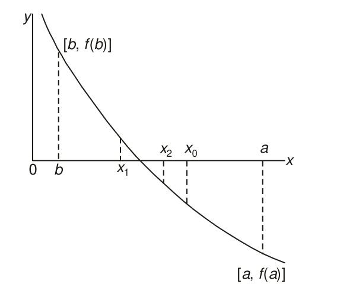

# Section 2.2: Bisection Method

<!-- Page 23 -->

## 2.2 BISECTION METHOD

This method is based on Theorem 1.1 which states that if a function $f(x)$ is continuous between $a$ and $b$, and $f(a)$ and $f(b)$ are of opposite signs, then there exists at least one root between $a$ and $b$. For definiteness, let $f(a)$ be negative and $f(b)$ be positive. Then the root lies between $a$ and $b$ and let its approximate value be given by $x_0 = (a + b)/2$. If $f(x_0) = 0$, we conclude that $x_0$ is a root of the equation $f(x) = 0$. Otherwise, the root lies either between $x_0$ and $b$, or between $x_0$ and $a$ depending on whether $f(x_0)$ is negative or positive. We designate this new interval as $[a_1, b_1]$ whose length is $|b - a|/2$. As before, this is bisected at $x_1$ and the new interval will be exactly half the length of the previous one. We repeat this process until the latest interval (which contains the root) is as small as desired, say $\varepsilon$. It is clear that the interval width is reduced by a factor of one-half at each step and at the end of the $n$th step, the new interval will be $[a_n, b_n]$ of length $|b - a|/2^n$. We then have
$$\frac{|b - a|}{2^n} \le \varepsilon,$$
which gives on simplification
$$n \ge \frac{\log_e(|b - a|/\varepsilon)}{\log_e 2} \tag{2.3}$$
Equation (2.3) gives the number of iterations required to achieve an accuracy $\varepsilon$. For example, if $|b - a| = 1$ and $\varepsilon = 0.001$, then it can be seen that
$$n \ge 10 \tag{2.4}$$

<!-- Page 24 -->

The method is shown graphically in Fig. 2.1.

*Figure 2.1 — Graphical representation of the bisection method.*

> [!NOTE] ALGORITHM: Bisection Method
> 1. Choose two real numbers $a$ and $b$ such that $f(a)f(b) < 0$.
> 2. Set $x_r = (a + b)/2$.
> 3. (a) If $f(a)f(x_r) < 0$, the root lies in the interval $(a, x_r)$. Then, set $b = x_r$ and go to step 2 above.
>    (b) If $f(a)f(x_r) > 0$, the root lies in the interval $(x_r, b)$. Then, set $a = x_r$ and go to step 2.
>    (c) If $f(a)f(x_r) = 0$, it means that $x_r$ is a root of the equation $f(x) = 0$ and the computation may be terminated.

In practical problems, the roots may not be exact so that condition (c) above is never satisfied. In such a case, we need to adopt a criterion for deciding when to terminate the computations.

A convenient criterion is to compute the percentage error $\varepsilon_r$ defined by
$$\varepsilon_r = \left|\frac{x_r' - x_r}{x_r'}\right| \times 100\% \tag{2.5}$$
where $x_r'$ is the new value of $x_r$. The computations can be terminated when $\varepsilon_r$ becomes less than a prescribed tolerance, say $\varepsilon_p$. In addition, the maximum number of iterations may also be specified in advance.

> [!NOTE] EXAMPLE 2.1
> Find a real root of the equation $f(x) = x^3 - x - 1 = 0$.
> 
> **Solution:**
> Since $f(1)$ is negative and $f(2)$ positive, a root lies between $1$ and $2$ and, therefore, we take $x_0 = 3/2$. Then
> $$f(x_0) = \frac{27}{8} - \frac{3}{2} - 1 = \frac{15}{8}, \quad \text{which is positive.}$$

<!-- Page 25 -->

Hence the root lies between $1$ and $1.5$ and we obtain
$$x_1 = \frac{1 + 1.5}{2} = 1.25$$
We find $f(x_1) = -19/64$, which is negative. We, therefore, conclude that the root lies between $1.25$ and $1.5$. It follows that
$$x_2 = \frac{1.25 + 1.5}{2} = 1.375$$
The procedure is repeated and the successive approximations are
$$x_3 = 1.3125, \quad x_4 = 1.34375, \quad x_5 = 1.328125, \text{ etc.}$$
$\blacktriangleleft$

> [!NOTE] EXAMPLE 2.2
> Find a real root of the equation $x^3 - 2x - 5 = 0$.
> 
> **Solution:**
> Let $f(x) = x^3 - 2x - 5$. Then
> $$f(2) = -1 \quad \text{and} \quad f(3) = 16.$$
> Hence a root lies between $2$ and $3$ and we take
> $$x_1 = \frac{2 + 3}{2} = 2.5$$
> Since $f(x_1) = f(2.5) = 5.6250$, the root lies between $2$ and $2.25$.
> Hence
> $$x_2 = \frac{2 + 2.5}{2} = 2.25$$
> Now, $f(x_2) = 1.890625$, the root lies between $2$ and $2.25$.
> Therefore,
> $$x_3 = \frac{2 + 2.25}{2} = 2.125$$
> Since $f(x_3) = 0.3457$, the root lies between $2$ and $2.125$.
> Therefore,
> $$x_4 = \frac{2 + 2.125}{2} = 2.0625$$
> Proceeding in this way, we obtain the successive approximations:
> $$
> \begin{aligned}
> x_5 &= 2.09375, & x_6 &= 2.10938, & x_7 &= 2.10156, \\
> x_8 &= 2.09766, & x_9 &= 2.09570, & x_{10} &= 2.09473, \\
> x_{11} &= 2.09424, \dots
> \end{aligned}
> $$
> We find
> $$x_{11} - x_{10} = -0.0005,$$
> and
> $$\left|\frac{x_{11} - x_{10}}{x_{11}}\right| \times 100 = \frac{0.0005}{2.09424} \times 100 = 0.02\%$$
> Hence a root, correct to three decimal places, is $2.094$.
> $\blacktriangleleft$

<!-- Page 26 -->

> [!NOTE] EXAMPLE 2.3
> Find a real root of $f(x) = x^3 + x^2 + x + 7 = 0$ correct to three decimal places.
> 
> **Solution:**
> The given equation is a cubic and the last term is positive. Hence, $f(x) = 0$ will have a negative real root. We find that
> $$f(-1) = 6, \quad f(-2) = 1 \quad \text{and} \quad f(-3) = -14.$$
> Therefore, a real root lies between $-3$ and $-2$.
> We take
> $$x_1 = \frac{-2 - 3}{2} = -2.5$$
> Since $f(-2.5) = -4.875$, the root lies between $-2$ and $-2.5$, and then
> $$x_2 = \frac{-2 - 2.5}{2} = -2.25$$
> Now $f(x_2) = -1.5781$, and, therefore, the root lies between $-2$ and $-2.25$.
> It follows that
> $$x_3 = \frac{-4.25}{2} = -2.125$$
> Successive approximations are given by
> $$
> \begin{aligned}
> x_4 &= -2.0625, & x_5 &= -2.0938, & x_6 &= -2.1094, \\
> x_7 &= -2.1016, & x_8 &= -2.1055, & x_9 &= -2.1035, \\
> x_{10} &= -2.1045, & x_{11} &= -2.1050, \dots
> \end{aligned}
> $$
> The difference between $x_{10}$ and $x_{11}$ is $0.0005$. Hence, we conclude that the root is given by $x = -2.105$, correct to three decimal places.
> $\blacktriangleleft$

> [!NOTE] EXAMPLE 2.4
> Find the positive root, between $0$ and $1$, of the equation $x = e^{-x}$ to a tolerance of $0.05\%$.
> 
> **Solution:**
> Let
> $$f(x) = xe^x - 1 = 0$$
> We have, $f(0) = -1$ and $f(1) = e - 1$, which is positive. Hence, a root exists between $0$ and $1$, and
> $$x_1 = \frac{0 + 1}{2} = 0.5$$
> Because, $f(x_1) = -0.1756$, the root lies between $0.5$ and $1.0$.
> Then
> $$x_2 = \frac{0.5 + 1.0}{2} = 0.75$$

<!-- Page 27 -->

Now, the tolerance $\varepsilon_1$ is given by
$$
\begin{aligned}
\varepsilon_1 &= \left|\frac{x_2 - x_1}{x_2}\right| \times 100 \\
&= \frac{0.25}{0.75} \times 100 = 33.33\%
\end{aligned}
$$
since $f(x_2) = 0.5878$, the root lies between $0.5$ and $0.75$.
Therefore,
$$x_3 = \frac{0.5 + 0.75}{2} = 0.625$$
also,
$$\varepsilon_2 = \left|\frac{0.625 - 0.75}{0.625}\right| \times 100 = 20\%.$$
Proceeding in this way, successive approximations and tolerances are obtained:
$$
\begin{aligned}
x_4 &= 0.5625, & \varepsilon_3 &= 11.11\%; & x_5 &= 0.5938, & \varepsilon_4 &= 5.26\%; \\
x_6 &= 0.5781, & \varepsilon_5 &= 2.71\%; & x_7 &= 0.5703, & \varepsilon_6 &= 1.37\%; \\
x_8 &= 0.5664, & \varepsilon_7 &= 0.69\%; & x_9 &= 0.5684, & \varepsilon_8 &= 0.35\%; \\
x_{10} &= 0.5674, & \varepsilon_9 &= 0.18\%; & x_{11} &= 0.5669, & \varepsilon_{10} &= 0.09\%; \\
x_{12} &= 0.5671, & \varepsilon_{11} &= 0.035\%
\end{aligned}
$$
Since $\varepsilon_{11} = 0.035\% < 0.05\%$, the required root is $0.567$, correct to three decimal places.
$\blacktriangleleft$

> [!NOTE] EXAMPLE 2.5
> Find a root, correct to three decimal places and lying between $0$ and $0.5$, of the equation
> $$4e^{-x} \sin x - 1 = 0$$
> 
> **Solution:**
> Let
> $$f(x) = 4e^{-x} \sin x - 1$$
> We have $f(0) = -1$ and $f(0.5) = 0.163145$
> Therefore,
> $$x_1 = 0.25$$
> Since $f(0.25) = -0.22929$, it follows that the root lies between $0.25$ and $0.5$.
> Therefore,
> $$x_2 = \frac{0.75}{2} = 0.375$$
> The successive approximations are given by
> $$
> \begin{aligned}
> x_3 &= 0.3125, & x_4 &= 0.3438, & x_5 &= 0.3594, \\
> x_6 &= 0.3672, & x_7 &= 0.3711, & x_8 &= 0.3692, \\
> x_9 &= 0.3702, & x_{10} &= 0.3706, & x_{11} &= 0.3704, \\
> x_{12} &= 0.3705, \dots
> \end{aligned}
> $$
> Hence the required root is $0.371$, correct to three decimal places.
> $\blacktriangleleft$
