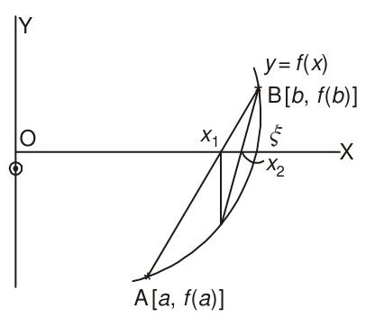

# Section 2.3: Method of False Position

<!-- Page 28 -->

## 2.3 METHOD OF FALSE POSITION

This is the oldest method for finding the real root of a nonlinear equation $f(x) = 0$ and closely resembles the bisection method. In this method, also known as *regula–falsi* or the *method of chords*, we choose two points $a$ and $b$ such that $f(a)$ and $f(b)$ are of opposite signs. Hence, a root must lie in between these points. Now, the equation of the chord joining the two points $[a, f(a)]$ and $[b, f(b)]$ is given by
$$\frac{y - f(a)}{x - a} = \frac{f(b) - f(a)}{b - a}. \tag{2.6}$$
The method consists in replacing the part of the curve between the points $[a, f(a)]$ and $[b, f(b)]$ by means of the *chord* joining these points, and taking the point of intersection of the chord with the $x$-axis as an *approximation* to the root. The point of intersection in the present case is obtained by putting $y = 0$ in Eq. (2.6). Thus, we obtain
$$x_1 = a - \frac{f(a)}{f(b) - f(a)}(b - a) = \frac{af(b) - bf(a)}{f(b) - f(a)}, \tag{2.7}$$
which is the *first approximation* to the root of $f(x) = 0$. If now $f(x_1)$ and $f(a)$ are of opposite signs, then the root lies between $a$ and $x_1$, and we replace $b$ by $x_1$ in Eq. (2.7), and obtain the *next* approximation. Otherwise, we replace $a$ by $x_1$ and generate the next approximation. The procedure is repeated till the root is obtained to the desired accuracy. Figure 2.2 gives a graphical representation of the method. The error criterion Eq. (2.5) can be used in this case also.

*Figure 2.2 — Method of false position.*

> [!NOTE] EXAMPLE 2.6
> Find a real root of the equation:
> $$f(x) = x^3 - 2x - 5 = 0.$$
> 
> **Solution:**
> We find $f(2) = -1$ and $f(3) = 16$. Hence $a = 2$, $b = 3$, and a root lies between $2$ and $3$. Equation (2.7) gives

<!-- Page 29 -->

$$x_1 = \frac{2(16) - 3(-1)}{16 - (-1)} = \frac{35}{17} = 2.058823529.$$
Now, $f(x_1) = -0.390799917$ and hence the root lies between $2.058823529$ and $3.0$. Using formula (2.7), we obtain
$$x_2 = \frac{2.058823529(16) - 3(-0.390799917)}{16.390799917} = 2.08126366.$$
Since $f(x_2) = -0.147204057$, it follows that the root lies between $2.08126366$ and $3.0$. Hence, we have
$$x_3 = \frac{2.08126366(16) - 3(-0.147204057)}{16.147204057} = 2.089639211.$$
Proceeding in this way, we obtain successively:
$$
\begin{aligned}
x_4 &= 2.092739575, & x_5 &= 2.09388371, \\
x_6 &= 2.094305452, & x_7 &= 2.094460846, \dots
\end{aligned}
$$
The correct value is $2.0945\dots$, so that $x_7$ is correct to five significant figures.
$\blacktriangleleft$

> [!NOTE] EXAMPLE 2.7
> Given that the equation $x^{2.2} = 69$ has a root between $5$ and $8$. Use the method of regula–falsi to determine it.
> 
> **Solution:**
> Let $f(x) = x^{2.2} - 69$. We find
> $$f(5) = -34.50675846 \quad \text{and} \quad f(8) = 28.00586026.$$
> Hence
> $$x_1 = \frac{5(28.00586026) - 8(-34.50675846)}{28.00586026 + 34.50675846} = 6.655990062.$$
> Now, $f(x_1) = -4.275625415$ and therefore, the root lies between $6.655990062$ and $8.0$. We obtain
> $$x_2 = 6.83400179, \quad x_3 = 6.850669653.$$
> The correct root is $6.8523651\dots$, so that $x_3$ is correct to three significant figures.
> $\blacktriangleleft$

> [!NOTE] EXAMPLE 2.8
> The equation $2x = \log_{10} x + 7$ has a root between $3$ and $4$. Find this root, correct to three decimal places, by regula–falsi method.
> 
> **Solution:**
> Let
> $$f(x) = 2x - \log_{10} x - 7, \quad a = 3 \text{ and } b = 4.$$
> Then we find
> $$f(3) = -1.4771 \quad \text{and} \quad f(4) = 0.3979.$$

<!-- Page 30 -->

Hence
$$
\begin{aligned}
x_1 &= \frac{af(b) - bf(a)}{f(b) - f(a)} \\
&= \frac{3(0.3979) - 4(-1.4771)}{0.3979 + 1.4771} \\
&= \frac{7.1021}{1.8750} = 3.7878.
\end{aligned}
$$
Therefore, the root lies between $3$ and $3.7878$. Now, we take $a = 3$ and $b = 3.7878$. Then,
$$f(b) = 2(3.7878) - \log_{10} 3.7878 - 7 = -0.002787$$
Hence,
$$
\begin{aligned}
x_2 &= \frac{3(-0.002787) - 3.7878(-1.4771)}{-0.002787 + 1.4771} \\
&= 3.7893,
\end{aligned}
$$
and
$$
\begin{aligned}
f(x_2) &= 2(3.7893) - \log_{10} (3.7893) - 7 \\
&= 0.000041,
\end{aligned}
$$
which shows that $x = 3.789$ is the root correct to three decimal places.
$\blacktriangleleft$

> [!NOTE] EXAMPLE 2.9
> Find a root of the equation $4e^{-x} \sin x - 1 = 0$ by regular–falsi method given that the root lies between $0$ and $0.5$.
> 
> **Solution:**
> Let
> $$f(x) = 4e^{-x} \sin x - 1, \quad a = 0, \; b = 0.5.$$
> We have
> $$f(a) = -1 \quad \text{and} \quad f(b) = 4e^{-0.5} \sin 0.5 - 1 = 0.163145$$
> Therefore,
> $$
> \begin{aligned}
> x_1 &= \frac{0(0.163145) - 0.5(-1)}{1.163145} \\
> &= \frac{0.5}{1.163145} = 0.4298690
> \end{aligned}
> $$
> Now, we take
> $$a = 0 \quad \text{and} \quad b = 0.4298690$$
> Then
> $$f(x) = 0.08454$$
> Therefore,
> $$
> \begin{aligned}
> x_2 &= \frac{0(0.08454) - 0.42987(-1)}{1.08454} \\
> &= 0.39636
> \end{aligned}
> $$
> Now,
> $$a = 0, \quad b = 0.39636 \quad \text{and} \quad f(b) = 0.038919$$

<!-- Page 31 -->

Hence
$$x_3 = \frac{0(0.038919) - 0.39636(-1)}{1.038919} = 0.381512,$$
and
$$f(x_3) = 0.016934$$
Taking $a = 0$ and $b = 0.381512$, we obtain
$$x_4 = \frac{0(0.016934) - 0.381512(-1)}{1.016934} = 0.375159,$$
and
$$f(x_4) = 0.0071873$$
Proceeding as above, we obtain
$$
\begin{aligned}
x_5 &= 0.37248, & x_6 &= 0.37136, \\
x_7 &= 0.37089, & x_8 &= 0.370697
\end{aligned}
$$
It follows that the required root is $0.371$, correct to three decimal places.
$\blacktriangleleft$
