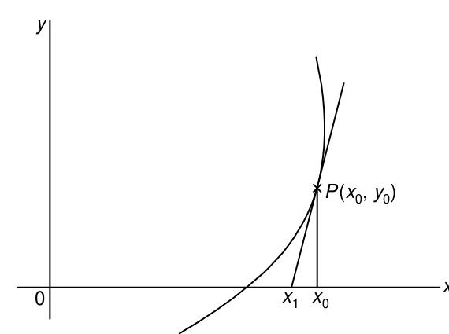

# Section 2.5: Newton–Raphson Method

<!-- Page 37 -->

## 2.5 NEWTON–RAPHSON METHOD

This method is generally used to improve the result obtained by one of the previous methods. Let $x_0$ be an approximate root of $f(x) = 0$ and let $x_1 = x_0 + h$ be the correct root so that $f(x_1) = 0$. Expanding $f(x_0 + h)$ by Taylor's series, we obtain
$$f(x_0) + h f'(x_0) + \frac{h^2}{2!} f''(x_0) + \cdots = 0.$$

<!-- Page 38 -->

Neglecting the second and higher-order derivatives, we have
$$f(x_0) + h f'(x_0) = 0,$$
which gives
$$h = -\frac{f(x_0)}{f'(x_0)}.$$
A better approximation than $x_0$ is, therefore, given by $x_1$, where
$$x_1 = x_0 - \frac{f(x_0)}{f'(x_0)}. \tag{2.24a}$$
Successive approximations are given by $x_2, x_3, \dots, x_{n+1}$, where
$$x_{n+1} = x_n - \frac{f(x_n)}{f'(x_n)}, \tag{2.24b}$$
which is the *Newton–Raphson formula*.

If we compare Eq. (2.24b) with the relation
$$x_{n+1} = \phi(x_n)$$
of the iterative method [see Eq. (2.9)], we obtain
$$\phi(x) = x - \frac{f(x)}{f'(x)},$$
which gives
$$\phi'(x) = \frac{f(x)f''(x)}{[f'(x)]^2}. \tag{2.25}$$
To examine the convergence we assume that $f(x)$, $f'(x)$ and $f''(x)$ are continuous and bounded on any interval containing the root $x = \xi$ of the equation $f(x) = 0$. If $\xi$ is a simple root, then $f'(x) \ne 0$. Further since $f'(x)$ is continuous, $|f'(x)| \ge \varepsilon$ for some $\varepsilon > 0$ in a suitable neighbourhood of $\xi$. Within this neighbourhood we can select an interval such that $|f(x)f''(x)| < \varepsilon^2$ and this is possible since $f(\xi) = 0$ and since $f(x)$ is continuously twice differentiable. Hence, in this interval we have
$$|\phi'(x)| < 1. \tag{2.26}$$
Therefore, Newton–Raphson formula given in Eq. (2.24b) converges, provided that the initial approximation $x_0$ is chosen sufficiently close to $\xi$. When $\xi$ is a multiple root, the Newton–Raphson method still converges but slowly. Convergence can, however, be made faster by modifying Eq. (2.24b). This will be discussed later.

To obtain the rate of convergence of the method, we note that $f(\xi) = 0$ so that Taylor's expansion gives
$$f(x_n) + (\xi - x_n)f'(x_n) + \frac{1}{2}(\xi - x_n)^2 f''(x_n) + \cdots = 0,$$

<!-- Page 39 -->

from which we obtain
$$-\frac{f(x_n)}{f'(x_n)} = (\xi - x_n) + \frac{1}{2}(\xi - x_n)^2 \frac{f''(x_n)}{f'(x_n)} \tag{2.27}$$
From Eqs. (2.24b) and (2.27), we have
$$x_{n+1} - \xi = \frac{1}{2}(x_n - \xi)^2 \frac{f''(x_n)}{f'(x_n)} \tag{2.28}$$
Setting
$$\varepsilon_n = x_n - \xi, \tag{2.29}$$
Equation (2.28) gives
$$\varepsilon_{n+1} \approx \frac{1}{2}\varepsilon_n^2 \frac{f''(\xi)}{f'(\xi)}, \tag{2.30}$$
so that the Newton–Raphson process has a second-order or quadratic convergence.

Geometrically, the method consists in replacing the part of the curve between the point $[x_0, f(x_0)]$ and the $x$-axis by means of the tangent to the curve at the point, and is described graphically in Fig. 2.3. It can be used for solving both algebraic and transcendental equations and it can also be used when the roots are complex.

*Figure 2.3 — Newton–Raphson method.*

> [!NOTE] EXAMPLE 2.15
> Use the Newton–Raphson method to find a root of the equation $x^3 - 2x - 5 = 0$.
> 
> **Solution:**
> Here $f(x) = x^3 - 2x - 5$ and $f'(x) = 3x^2 - 2$. Hence Eq. (2.24b) gives:
> $$x_{n+1} = x_n - \frac{x_n^3 - 2x_n - 5}{3x_n^2 - 2} \tag{i}$$

<!-- Page 40 -->

Choosing $x_0 = 2$, we obtain $f(x_0) = -1$ and $f'(x_0) = 10$. Putting $n = 0$ in Eq. (i), we obtain
$$x_1 = 2 - \left(-\frac{1}{10}\right) = 2.1$$
Now,
$$f(x_1) = (2.1)^3 - 2(2.1) - 5 = 0.061,$$
and
$$f'(x_1) = 3(2.1)^2 - 2 = 11.23.$$
Hence
$$x_2 = 2.1 - \frac{0.061}{11.23} = 2.094568.$$
This example demonstrates that Newton–Raphson method converges more rapidly than the methods described in the previous sections, since this requires fewer iterations to obtain a specified accuracy. But since two function evaluations are required for each iteration, Newton–Raphson method requires more computing time.
$\blacktriangleleft$

> [!NOTE] EXAMPLE 2.16
> Find a root of the equation $x\sin x + \cos x = 0$.
> 
> **Solution:**
> We have
> $$f(x) = x\sin x + \cos x \quad \text{and} \quad f'(x) = x\cos x.$$
> The iteration formula is, therefore,
> $$x_{n+1} = x_n - \frac{x_n \sin x_n + \cos x_n}{x_n \cos x_n}.$$
> With $x_0 = \pi$, the successive iterates are given below
> 
> | $n$ | $x_n$ | $f(x_n)$ | $x_{n+1}$ |
> |:---:|:---:|:---:|:---:|
> | 0 | 3.1416 | $-1.0$ | 2.8233 |
> | 1 | 2.8233 | $-0.0662$ | 2.7986 |
> | 2 | 2.7986 | $-0.0006$ | 2.7984 |
> | 3 | 2.7984 | 0.0 | 2.7984 |
> $\blacktriangleleft$

> [!NOTE] EXAMPLE 2.17
> Find a real root of the equation $x = e^{-x}$, using the Newton–Raphson method.
> 
> **Solution:**
> We write the equation in the form
> $$f(x) = xe^x - 1 = 0 \tag{i}$$
> Let $x_0 = 1$. Then
> $$x_1 = 1 - \frac{e - 1}{2e} = \frac{1}{2}\left(1 + \frac{1}{e}\right) = 0.6839397$$

<!-- Page 41 -->

Now
$$f(x_1) = 0.3553424, \quad \text{and} \quad f'(x_1) = 3.337012,$$
so that
$$x_2 = 0.6839397 - \frac{0.3553424}{3.337012} = 0.5774545$$
Proceeding in this way, we obtain
$$x_3 = 0.5672297 \quad \text{and} \quad x_4 = 0.5671433.$$
$\blacktriangleleft$

> [!NOTE] EXAMPLE 2.18
> Using Newton–Raphson method, find a real root, correct to 3 decimal places, of the equation $\sin x = x/2$ given that the root lies between $\pi/2$ and $\pi$.
> 
> **Solution:**
> Let
> $$f(x) = \sin x - \frac{x}{2}$$
> Then
> $$f'(x) = \cos x - \frac{1}{2}$$
> Choosing $x_0 = \frac{\pi}{2}$, we obtain
> $$
> \begin{aligned}
> x_1 &= \frac{\pi}{2} - \frac{\sin \frac{\pi}{2} - \frac{\pi}{4}}{\cos \frac{\pi}{2} - \frac{1}{2}} = 2, \\
> x_2 &= 2 - \frac{\sin 2 - 1}{\cos 2 - \frac{1}{2}} = 1.9010, \\
> x_3 &= 1.9010 - \frac{\sin 1.9010 - 0.9505}{\cos 1.9010 - 0.5} = 1.8955
> \end{aligned}
> $$
> Similarly, $x_4 = 1.8954$, $x_5 = 1.8955, \dots$. Hence the required root is $x = 1.896$.
> $\blacktriangleleft$

> [!NOTE] EXAMPLE 2.19
> Given the equation $4e^{-x}\sin x - 1 = 0$, find the root between $0$ and $0.5$ correct to three decimal places.
> 
> **Solution:**
> Let $f(x) = 4e^{-x}\sin x - 1$ and $x_0 = 0.2$.
> Then
> $$f(x_0) = -0.349373236,$$
> and
> $$f'(x_0) = 2.559015826.$$
> Therefore,
> $$
> \begin{aligned}
> x_1 &= 0.2 + \frac{0.349373236}{2.559015826} \\
> &= 0.336526406 \approx 0.33653.
> \end{aligned}
> $$

<!-- Page 42 -->

Now,
$$f(x_1) = -0.056587$$
and
$$
\begin{aligned}
f'(x_1) &= 1.753305735 \\
&= 1.75330
\end{aligned}
$$
Therefore,
$$x_2 = 0.33653 + \frac{0.056587}{1.75330} = 0.36880$$
For the next approximation, we find $f(x_2) = -0.00277514755$ and $f'(x_2) = 1.583028705$. This gives
$$x_3 = 0.36880 - 0.00175 = 0.37055$$
since $f(x_3) = -0.000001274$, it follows that the required root is given by $x = 0.370$.
$\blacktriangleleft$

### Generalized Newton's method

If $\xi$ is a root of $f(x) = 0$ with multiplicity $p$, then the iteration formula corresponding to Eq. (2.24) is taken as
$$x_{n+1} = x_n - p\frac{f(x_n)}{f'(x_n)}, \tag{2.31}$$
which means that $(1/p)f'(x_n)$ is the slope of the straight line passing through $(x_n, y_n)$ and intersecting the $x$-axis at the point $(x_{n+1}, 0)$.

Equation (2.31) is called the *generalized Newton's formula* and reduces to Eq. (2.24) for $p = 1$. Since $\xi$ is a root of $f(x) = 0$ with multiplicity $p$, it follows that $\xi$ is also a root of $f'(x) = 0$ with multiplicity $(p - 1)$, of $f''(x) = 0$ with multiplicity $(p - 2)$, and so on. Hence the expressions
$$x_0 - p\frac{f(x_0)}{f'(x_0)}, \qquad x_0 - (p - 1)\frac{f'(x_0)}{f''(x_0)}, \qquad x_0 - (p - 2)\frac{f''(x_0)}{f'''(x_0)}$$
must have the same value if there is a root with multiplicity $p$, provided that the initial approximation $x_0$ is chosen sufficiently close to the root.

> [!NOTE] EXAMPLE 2.20
> Find a double root of the equation $f(x) = x^3 - x^2 - x + 1 = 0$.
> 
> **Solution:**
> Choosing $x_0 = 0.8$, we have
> $$f'(x) = 3x^2 - 2x - 1, \quad \text{and} \quad f''(x) = 6x - 2.$$
> With $x_0 = 0.8$, we obtain
> $$x_0 - 2\frac{f(x_0)}{f'(x_0)} = 0.8 - 2\frac{0.072}{-(0.68)} = 1.012,$$
> and
> $$x_0 - \frac{f'(x_0)}{f''(x_0)} = 0.8 - \frac{(-0.68)}{2.8} = 1.043.$$

<!-- Page 43 -->

The closeness of these values indicates that there is a double root near to unity. For the next approximation, we choose $x_1 = 1.01$ and obtain
$$x_1 - 2\frac{f(x_1)}{f'(x_1)} = 1.01 - 0.0099 = 1.0001,$$
and
$$x_1 - \frac{f'(x_1)}{f''(x_1)} = 1.01 - 0.0099 = 1.0001.$$
We conclude, therefore, that there is a double root at $x = 1.0001$ which is sufficiently close to the actual root unity.

On the other hand, if we apply Newton–Raphson method with $x_0 = 0.8$, we obtain
$$x_1 = 0.8 + 0.106 \approx 0.91, \quad \text{and} \quad x_2 = 0.91 + 0.046 \approx 0.96.$$
It is clear that the generalized Newton's method converges more rapidly than the Newton–Raphson procedure.
$\blacktriangleleft$
