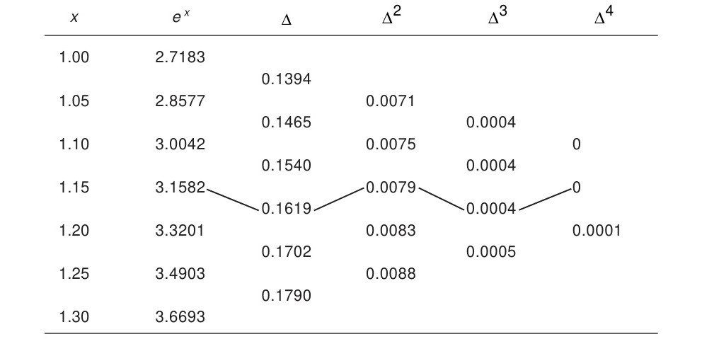

<!-- Page 90 -->

# 3.7 Central Difference Interpolation Formulae

In the preceding section, we derived and discussed Newton's forward and backward interpolation formulae, which are applicable for interpolation near the beginning and end respectively, of tabulated values. We shall, in the present section, discuss the central difference formulae which are most suited for interpolation near the middle of a tabulated set. The central difference operator $\delta$ was already introduced in Section 3.3.3.

The most important central difference formulae are those due to Stirling, Bessel and Everett. These will be discussed in Sections 3.7.2, 3.7.3 and 3.7.4, respectively. Gauss's formulae, introduced in Section 3.7.1 below, are of interest from a theoretical stand-point only.

### 3.7.1 Gauss' Central Difference Formulae

In this section, we will discuss Gauss' forward and backward formulae.

#### Gauss' forward formula

We consider the following difference table in which the central ordinate is taken for convenience as $y_0$ corresponding to $x = x_0$.

<!-- Page 91 -->

The differences used in this formula lie on the line shown in Table 3.6. The formula is, therefore, of the form
$$y_p = y_0 + G_1 \Delta y_0 + G_2 \Delta^2 y_{-1} + G_3 \Delta^3 y_{-1} + G_4 \Delta^4 y_{-2} + \cdots \tag{3.16}$$
where $G_1, G_2, \dots$ have to be determined. The $y_p$ on the left side can be expressed in terms of $y_0$, $\Delta y_0$ and higher-order differences of $y_0$, as follows:

*Table 3.6 — Gauss' Forward Formula.*

Clearly,
$$
\begin{aligned}
y_p &= E^p y_0 \\
&= (1 + \Delta)^p y_0, \quad \text{using relation (3.8a)} \\
&= y_0 + p\Delta y_0 + \frac{p(p-1)}{2!}\Delta^2 y_0 + \frac{p(p-1)(p-2)}{3!}\Delta^3 y_0 + \cdots
\end{aligned}
$$
Similarly, the right side of Eq. (3.16) can also be expressed in terms of $y_0$, $\Delta y_0$ and higher-order differences. We have
$$
\begin{aligned}
\Delta^2 y_{-1} &= \Delta^2 E^{-1} y_0 \\
&= \Delta^2 (1 + \Delta)^{-1} y_0 \\
&= \Delta^2 (1 - \Delta + \Delta^2 - \Delta^3 + \cdots) y_0 \\
&= \Delta^2 (y_0 - \Delta y_0 + \Delta^2 y_0 - \Delta^3 y_0 + \cdots) \\
&= \Delta^2 y_0 - \Delta^3 y_0 + \Delta^4 y_0 - \Delta^5 y_0 + \cdots
\end{aligned}
$$

<!-- Page 92 -->

$$\Delta^3 y_{-1} = \Delta^3 y_0 - \Delta^4 y_0 + \Delta^5 y_0 - \Delta^6 y_0 + \cdots$$
$$
\begin{aligned}
\Delta^4 y_{-2} &= \Delta^4 E^{-2} y_0 \\
&= \Delta^4 (1 + \Delta)^{-2} y_0 \\
&= \Delta^4 (y_0 - 2\Delta y_0 + 3\Delta^2 y_0 - 4\Delta^3 y_0 + \cdots) \\
&= \Delta^4 y_0 - 2\Delta^5 y_0 + 3\Delta^6 y_0 - 4\Delta^7 y_0 + \cdots
\end{aligned}
$$
Hence Eq. (3.16) gives the identity
$$
\begin{aligned}
y_0 + p\Delta y_0 &+ \frac{p(p-1)}{2!}\Delta^2 y_0 + \frac{p(p-1)(p-2)}{3!}\Delta^3 y_0 \\
&+ \frac{p(p-1)(p-2)(p-3)}{4!}\Delta^4 y_0 + \cdots \\
&= y_0 + G_1 \Delta y_0 + G_2 (\Delta^2 y_0 - \Delta^3 y_0 + \Delta^4 y_0 - \Delta^5 y_0 + \cdots) \\
&\quad + G_3 (\Delta^3 y_0 - \Delta^4 y_0 + \Delta^5 y_0 - \Delta^6 y_0 + \cdots) \\
&\quad + G_4 (\Delta^4 y_0 - 2\Delta^5 y_0 + 3\Delta^6 y_0 - 4\Delta^7 y_0 + \cdots) + \cdots \tag{3.17}
\end{aligned}
$$
Equating the coefficients of $\Delta y_0, \Delta^2 y_0, \Delta^3 y_0$, etc., on both sides of Eq. (3.17), we obtain
$$
\left.
\begin{aligned}
G_1 &= p, \\
G_2 &= \frac{p(p-1)}{2!}, \\
G_3 &= \frac{(p+1)p(p-1)}{3!}, \\
G_4 &= \frac{(p+1)p(p-1)(p-2)}{4!}.
\end{aligned}
\right\} \tag{3.18}
$$

#### Gauss' backward formula

This formula uses the differences which lie on the line shown in Table 3.7.

<!-- Page 93 -->

*Table 3.7 — Gauss' Backward Formula.*

Gauss' backward formula can therefore be assumed to be of the form
$$y_p = y_0 + G'_1 \Delta y_{-1} + G'_2 \Delta^2 y_{-1} + G'_3 \Delta^3 y_{-2} + G'_4 \Delta^4 y_{-2} + \cdots \tag{3.19}$$
where $G'_1, G'_2, \dots$ have to be determined. Following the same procedure as in Gauss' forward formula, we obtain
$$
\left.
\begin{aligned}
G'_1 &= p, \\
G'_2 &= \frac{p(p+1)}{2!}, \\
G'_3 &= \frac{(p+1)p(p-1)}{3!}, \\
G'_4 &= \frac{(p+2)(p+1)p(p-1)}{4!} \\
&\vdots
\end{aligned}
\right\} \tag{3.20}
$$

> [!NOTE] EXAMPLE 3.9
> From the following table, find the value of $e^{1.17}$ using Gauss' forward formula:
> 
> | $x$ | $e^x$ |
> | :---: | :---: |
> | 1.00 | 2.7183 |
> | 1.05 | 2.8577 |
> | 1.10 | 3.0042 |
> | 1.15 | 3.1582 |
> | 1.20 | 3.3201 |
> | 1.25 | 3.4903 |
> | 1.30 | 3.6693 |
> 
> **Solution:**
> We have
> $$1.17 = 1.15 + p(0.05),$$

<!-- Page 94 -->

> which gives
> $$p = \frac{0.02}{0.05} = \frac{1}{4}.$$
> The difference table is given below.
> 
> 
> *Difference table for Example 3.9.*
> 
> Using formulae (3.16) and (3.18), we obtain
> $$
> \begin{aligned}
> e^{1.17} &= 3.1582 + \frac{2}{5}(0.1619) + \frac{(2/5)(2/5 - 1)}{2}(0.0079) \\
> &\quad + \frac{(2/5 + 1)(2/5)(2/5 - 1)}{6}(0.0004) \\
> &= 3.1582 + 0.0648 - 0.0009 \\
> &= 3.2221.
> \end{aligned}
> $$
> $\blacktriangleleft$

### 3.7.2 Stirling's Formula

Taking the mean of Gauss' forward and backward formulae, we obtain

> [!IMPORTANT] Stirling's Formula
> $$y_p = y_0 + p \frac{\Delta y_{-1} + \Delta y_0}{2} + \frac{p^2}{2} \Delta^2 y_{-1} + \frac{p(p^2 - 1)}{3!} \frac{\Delta^3 y_{-1} + \Delta^3 y_{-2}}{2} + \frac{p^2(p^2 - 1)}{4!} \Delta^4 y_{-2} + \cdots \tag{3.21}$$

Formula given in Eq. (3.21) is called *Stirling's formula*.

### 3.7.3 Bessel's Formula

This is a very useful formula for practical interpolation, and it uses the differences as shown in the following table, where the brackets mean that the average of the values has to be taken.

<!-- Page 95 -->

| $x$ | $y$ | $\Delta$ | $\Delta^2$ | $\Delta^3$ | $\Delta^4$ | $\Delta^5$ | $\Delta^6$ |
| :---: | :---: | :---: | :---: | :---: | :---: | :---: | :---: |
| $\vdots$ | $\vdots$ | | | | | | |
| $x_{-1}$ | $y_{-1}$ | | | | | | |
| $x_0$ | $\begin{pmatrix} y_0 \\ y_1 \end{pmatrix}$ | $\Delta y_0$ | $\begin{pmatrix} \Delta^2 y_{-1} \\ \Delta^2 y_0 \end{pmatrix}$ | $\Delta^3 y_{-1}$ | $\begin{pmatrix} \Delta^4 y_{-2} \\ \Delta^4 y_{-1} \end{pmatrix}$ | $\Delta^5 y_{-2}$ | $\begin{pmatrix} \Delta^6 y_{-3} \\ \Delta^6 y_{-2} \end{pmatrix}$ |
| $x_1$ | | | | | | | |
| $\vdots$ | $\vdots$ | | | | | | |

Hence, Bessel's formula can be assumed in the form
$$
\begin{aligned}
y_p &= \frac{y_0 + y_1}{2} + B_1 \Delta y_0 + B_2 \frac{\Delta^2 y_{-1} + \Delta^2 y_0}{2} + B_3 \Delta^3 y_{-1} \\
&\quad + B_4 \frac{\Delta^4 y_{-2} + \Delta^4 y_{-1}}{2} + \cdots \\
&= y_0 + \left( B_1 + \frac{1}{2} \right) \Delta y_0 + B_2 \frac{\Delta^2 y_{-1} + \Delta^2 y_0}{2} + B_3 \Delta^3 y_{-1} \\
&\quad + B_4 \frac{\Delta^4 y_{-2} + \Delta^4 y_{-1}}{2} + \cdots \tag{3.22}
\end{aligned}
$$
Using the method outlined in Section 3.7.1, i.e., Gauss' forward formula, we obtain
$$
\left.
\begin{aligned}
B_1 + \frac{1}{2} &= p, \\
B_2 &= \frac{p(p-1)}{2!}, \\
B_3 &= \frac{p(p-1)(p-1/2)}{3!}, \\
B_4 &= \frac{(p+1)p(p-1)(p-1)}{4!}, \\
&\vdots
\end{aligned}
\right\} \tag{3.23}
$$
Hence, Bessel's interpolation formula may be written as

> [!IMPORTANT] Bessel's Interpolation Formula
> $$
> \begin{aligned}
> y_p &= y_0 + p\Delta y_0 + \frac{p(p-1)}{2!} \frac{\Delta^2 y_{-1} + \Delta^2 y_0}{2} + \frac{p(p-1)(p-1/2)}{3!} \Delta^3 y_{-1} \\
> &\quad + \frac{(p+1)p(p-1)(p-2)}{4!} \frac{\Delta^4 y_{-2} + \Delta^4 y_{-1}}{2} + \cdots \tag{3.24}
> \end{aligned}
> $$

<!-- Page 96 -->

### 3.7.4 Everett's Formula

This is an extensively used interpolation formula and uses only even order differences, as shown in the following table:

| $x_0$ | $y_0$ | | $\Delta^2 y_{-1}$ | | $\Delta^4 y_{-2}$ | | $\Delta^6 y_{-3}$ |
| :---: | :---: | :---: | :---: | :---: | :---: | :---: | :---: |
| | | — | | — | | — | |
| $x_1$ | $y_1$ | | $\Delta^2 y_0$ | | $\Delta^4 y_{-1}$ | | $\Delta^6 y_{-2}$ |

Hence the formula has the form
$$y_p = E_0 y_0 + E_2 \Delta^2 y_{-1} + E_4 \Delta^4 y_{-2} + \cdots + F_0 y_1 + F_2 \Delta^2 y_0 + F_4 \Delta^4 y_{-1} + \cdots \tag{3.25}$$
The coefficients $E_0, F_0, E_2, F_2, E_4, F_4, \dots$ can be determined by the same method as in the preceding cases, and we obtain
$$
\left.
\begin{aligned}
E_0 &= 1 - p = q, & F_0 &= p, \\
E_2 &= \frac{q(q^2 - 1^2)}{3!}, & F_2 &= \frac{p(p^2 - 1^2)}{3!}, \\
E_4 &= \frac{q(q^2 - 1^2)(q^2 - 2^2)}{5!}, & F_4 &= \frac{p(p^2 - 1^2)(p^2 - 2^2)}{5!}, \\
&\vdots & &\vdots
\end{aligned}
\right\} \tag{3.26}
$$
Hence Everett's formula is given by

> [!IMPORTANT] Everett's Formula
> $$
> \left.
> \begin{aligned}
> y_p &= qy_0 + \frac{q(q^2 - 1^2)}{3!} \Delta^2 y_{-1} + \frac{q(q^2 - 1^2)(q^2 - 2^2)}{5!} \Delta^4 y_{-2} + \cdots \\
> &\quad + py_1 + \frac{p(p^2 - 1^2)}{3!} \Delta^2 y_0 + \frac{p(p^2 - 1^2)(p^2 - 2^2)}{5!} \Delta^4 y_{-1} + \cdots
> \end{aligned}
> \right\} \tag{3.27}
> $$

where $q = 1 - p$.

### 3.7.5 Relation between Bessel's and Everett's Formulae

These formulae are very closely related, and it is possible to deduce one from the other by a suitable rearrangement. To see this we start with Bessel's formula
$$
\begin{aligned}
y_p &= y_0 + p\Delta y_0 + \frac{p(p-1)}{2!} \frac{\Delta^2 y_{-1} + \Delta^2 y_0}{2} + \frac{p(p-1)(p-1/2)}{3!} \Delta^3 y_{-1} \\
&\quad + \frac{(p+1)p(p-1)(p-2)}{4!} \frac{\Delta^4 y_{-2} + \Delta^4 y_{-1}}{2} + \cdots
\end{aligned}
$$

<!-- Page 97 -->

$$
\begin{aligned}
&= y_0 + p(y_1 - y_0) + \frac{p(p-1)}{2!} \frac{\Delta^2 y_{-1} + \Delta^2 y_0}{2} + \frac{p(p-1)(p-1/2)}{3!} (\Delta^2 y_0 - \Delta^2 y_{-1}) \\
&\quad + \frac{(p+1)p(p-1)(p-2)}{4!} \frac{\Delta^4 y_{-2} + \Delta^4 y_{-1}}{2} + \cdots
\end{aligned}
$$
expressing the odd order differences in terms of low even order differences. This gives on simplification
$$
\begin{aligned}
y_p &= (1 - p)y_0 + \left[ \frac{p(p-1)}{4} - \frac{(p-1)p(p-1/2)}{6} \right] \Delta^2 y_{-1} + \cdots \\
&\quad + py_1 + \left[ \frac{p(p-1)}{4} + \frac{p(p-1)(p-1/2)}{6} \right] \Delta^2 y_0 + \cdots \\
&= qy_0 + \frac{q(q^2 - 1^2)}{3!} \Delta^2 y_{-1} + \cdots + py_1 + \frac{p(p^2 - 1^2)}{3!} \Delta^2 y_0 + \cdots
\end{aligned}
$$
which is *Everett's formula* truncated after second differences. Hence we have a result of practical importance that Everett's formula truncated after second differences is equivalent to Bessel's formula truncated after third differences. In a similar way, Bessel's formula may be deduced from Everett's.
